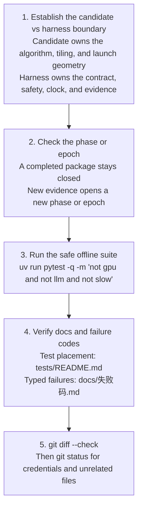

# Contributing to ShapeForge

ShapeForge welcomes human and AI-assisted contributions. The project values executable evidence over plausible explanations.

## Contributor checklist

Section 1 names the files to read before the first edit. The checklist below is the path after that. Sections 2–6 expand scope, the candidate/harness boundary, tests, evidence, and the commit check.



| Term | Meaning on this path |
| --- | --- |
| Candidate | The submitted implementation. It chooses the algorithm, fusion, tiling, and, when the track uses a bundle, the host program and launch geometry. |
| Harness | The programs that compile, check safety, score numeric error, time the run, and record evidence. They do not invent the candidate's schedule. |
| Phase / epoch | A closed acceptance package: its verifier, manifest, and recorded result. When the contract, the policy, or that evidence must change, open a new package. The old one stays as recorded. |
| Failure code | A typed name in [docs/失败码.md](docs/失败码.md), not a free-form log line. |

1. **Establish the candidate vs harness boundary.** State which side the change touches. A candidate may choose its algorithm and geometry. The harness keeps the task contract, the safety checks, the measurement boundary, and the evidence. Section 3 is the list of results that stay on the harness side, including the 1.10 regression gate and the rule that search-best is not a published speedup.
2. **Check the phase or epoch.** Read [docs/架构/shape-portfolio实施计划.md](docs/架构/shape-portfolio实施计划.md) before changing status. A completed phase package stays closed. New evidence goes in a new phase or epoch.
3. **Run the safe offline suite.** This command does not take the GPU and does not call a paid model:

```bash
uv run pytest -q -m 'not gpu and not llm and not slow'
```

4. **Verify docs and failure codes.** Place a new test with [tests/README.md](tests/README.md#test-layers-and-failure-triage): `tests/shared/` is backend-agnostic, `tests/backends/<id>/` is backend-specific, and `tests/support/` holds helpers and goldens. When the change can fail closed, use the typed name in [docs/失败码.md](docs/失败码.md). The safe suite includes `tests/shared/test_docs_integrity.py`, which checks links and cited repository paths in this file and in `tests/README.md`.
5. **`git diff --check`.** Then look at the status for credentials, caches, and unrelated files. Section 6 is the commit rule.

```bash
git status --short
git diff --check
```

## 1. Load the project context

- Read `AGENTS.md` first. It is the canonical AI context and safety boundary.
- Read `README.md` (English) or `README.zh-CN.md` (Chinese) for the project overview.
- For ShapeForge work, load `.agents/skills/shapeforge/SKILL.md`.
- Before changing status, read `docs/架构/shape-portfolio实施计划.md`; do not infer it from old notes.

Do not recreate `docs/README.md`. The root language-specific READMEs are the only project entrypoints.

## 2. Choose a small, explicit scope

A good change identifies:

- the task or bug being addressed;
- the candidate/harness boundary it must preserve;
- the fixed CPU/GPU nodes and negative cases that prove it;
- the evidence or documentation that must be updated;
- whether a new phase/epoch is needed instead of editing a completed one.

Do not mix unrelated experiments, large third-party materials or local configuration into a ShapeForge commit.

## 3. Preserve candidate freedom and evidence

Candidates may choose algorithms, fusion, Tiling, Host Tiling and ExecutionGeometry. Do not solve a task by adding a per-task algorithm registry or restricting candidates to a pattern library.

Do not:

- lower the 1.10 regression gate to make a candidate pass;
- remove a failing shard, test or required unseen instance;
- count fallback work as variant success;
- use search-best as published speedup;
- rewrite historical evidence or completed phase manifests;
- skip/xfail a required GPU node or weaken an assertion;
- claim real NPU correctness/performance from simulation.

If the current implementation does not meet the gate, leave the phase blocked and record the actual result.

## 4. Test appropriately

Start with:

```bash
uv run pytest -q -m 'not gpu and not llm and not slow'
```

Only with explicit GPU permission:

```bash
uv run pytest -q -m gpu
```

Debug a single failure with:

```bash
uv run pytest -q -n 0 <nodeid>
```

Read `tests/README.md` before adding or moving tests. Shared tests must not import a backend; backend-specific behavior belongs under `tests/backends/<id>/`.

For a failure, use `logs/pytest/triage/triage_summary.md` and its AI handoff. Keep pre-existing/environment failures separate from new regressions.

## 5. Update evidence and documentation

For a phase change, include as applicable:

- a verifier and manifest;
- fixed negative cases and fixed node IDs;
- an acceptance document and current status;
- fresh evidence rather than hand-edited measurements;
- a new epoch if the contract, policy or completed evidence must change.

Keep `README.md` and `README.zh-CN.md` conceptually aligned, but do not create another project entrypoint. Update `AGENTS.md` when contributor invariants change, and keep `.agents/skills/shapeforge/SKILL.md` as a short pointer rather than duplicating the full architecture.

## 6. Commit and publish

CI is not currently wired (the repository carries no workflow definitions), so run the two paths locally: `uv run pytest -q -m 'not gpu and not llm and not slow'` for the safe CPU suite, and `uv run pytest -q -n 0 -m gpu` manually on an idle local Apple Silicon machine. Anything that re-adds CI must keep them separate and keep GPU checks off shared runners.

Before committing:

```bash
git status --short
git diff --check
```

Check for credentials, local caches, generated binaries and unrelated large files. Third-party code must retain its license and provenance; the self-contained MLX-derived fixture documents its source.

Use a focused commit message. Do not force-push shared history. A clean local commit is required before `git push`, but passing a verifier does not imply that a performance phase is complete.

## Security and cost boundaries

- Never commit credentials.
- Never run paid model search or real GPU/NPU experiments without explicit user authorization.
- Use bounded execution for untrusted candidate kernels; the GPU also drives the display.
- Remote evaluation requires an explicit config and human-registered allowlist.
- Treat model suggestions, self-reported evidence and profiling output as separate trust levels.
