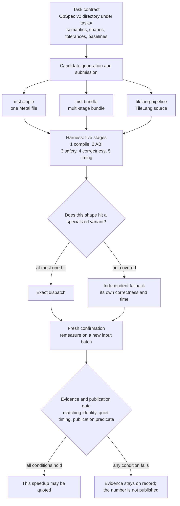
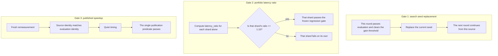

# ShapeForge

[English](README.md) | [简体中文](README.zh-CN.md)

**Generate specialized kernels. Prove every shard.**

ShapeForge is an evidence-first system for generating, evaluating and dispatching specialized GPU kernels. It supports kernels written by an LLM or by a person; candidate implementation freedom is not restricted to Triton translation or a fixed pattern library.

The current production target is **Apple GPU / Metal Shading Language**. Qingwei NPU support is limited to offline protocol and data simulation: no real-device correctness or performance is claimed.

## Core concepts

The rest of this page uses the words below in these senses. Multi-DSL means several delivery routes coexist; each route is a Track.

| Term | Plain meaning | Who holds it |
| --- | --- | --- |
| OpSpec v2 | The task contract: semantics, inputs and outputs, tolerances, and registered baselines. A live task is a directory under `tasks/` | The harness holds the contract, including tolerances and the measurement boundary |
| Candidate vs Harness | The candidate is the implementation a person or a model submits. The harness is the independent checker | The candidate owns the algorithm, fusion, tiling, and coverage plan. The harness owns the contract, ABI, safety, measurement, and evidence |
| Track (`msl-single` / `msl-bundle` / `tilelang-pipeline`) | A delivery, build, and execution route. `msl-single` is one Metal file. `msl-bundle` is a multi-stage bundle. `tilelang-pipeline` submits TileLang source | That route owns its frontend and execution plan. The shared Metal runtime owns safety, buffers, dispatch audit, timing, and evidence |
| Shape Portfolio and Exact Dispatch | Several stable specialized variants may coexist. Exact dispatch selects at most one of them for a shape | The candidate declares the coverage plan. The harness checks it and selects |
| Fallback | An input that no specialized variant covers runs on a separately validated general implementation | Its correctness and its time stay on that implementation's own account |
| Search Best vs Published Speedup | Search best is the fastest observation seen while searching. Published speedup is a number remeasured after search | Publication also requires a fresh input batch, matching source and evaluation identity, quiet timing, and the single publication predicate |
| Two accounts (`specialized_hit` vs `effective_end_to_end`) | `specialized_hit_speedup` counts shards a generated variant handled. `effective_end_to_end_speedup` counts all real work, including fallback | Every shard meets the frozen latency-ratio policy on its own. A geomean is descriptive |

## What ShapeForge does

- **Task contracts**: standard OpSpec v2 directories define semantics, inputs/outputs, tolerances and registered baselines.
- **Candidate-owned implementation**: the candidate chooses algorithms, fusion, Tiling, Host Tiling and ExecutionGeometry.
- **Shape portfolio**: a candidate ShapePlanner declares coverage buckets; multiple stable variants coexist and exact one-of-N dispatch selects at most one.
- **General fallback**: uncovered inputs use an independently validated implementation, never a disguised variant success.
- **Unseen-shard validation**: required boundary, tail and resource instances remain outside candidate tuning.
- **Evidence-bound activation**: canonical bundles, build/evaluation identity, fresh confirmation and one publication predicate decide what may run and what may be quoted.

The harness owns the task contract, ABI, safety, measurement boundary and evidence. It does not prescribe a closed set of kernel patterns.

## Current status

| Area | Status |
| --- | --- |
| R0–R6 evidence and build identity | Complete |
| G0 and A1–A6 OpSpec v2 migration | Complete |
| Shape portfolio P0–P2 | Complete |
| P3-A performance accounting | Complete |
| Varlen V0–V6 and fixed KDA delivery | Varlen Metal acceptance complete; fixed KDA standard task and complex bundle pass offline/CPU checks; real-Metal bundle and paid search not run |
| P3-B second tiled GEMM task | Complete: fresh `fp16/small/benchmark` latency ratio 0.836 and `fp16/paper/benchmark` 1.004, both inside the frozen 1.10 gate |
| P3-C finite-domain performance evidence | Complete: both finite-domain tasks archived with the two accounts, per-shard device/dispatch identity and a live-versus-archived check |
| Qingwei NPU | Offline simulation only; NPU-P0 remains blocked |

The P3 ratios are the fresh per-shard `latency_ratio` values archived under `tests/support/golden/shared/shape-portfolio-阶段验收/P3/`, not search bests. A good individual measurement alone still does not close a phase.

## Multi-DSL Tracks

A Track is a delivery/build/execution route, not a DSL or a central IR. The shared Metal runtime owns safety, buffers, dispatch audit, timing and evidence; each Track owns its frontend and execution plan.

| Track | Current evidence |
| --- | --- |
| `msl-single` / `msl-bundle` | existing MSL routes; `affine_ramp` fresh confirmation passed |
| `tilelang-pipeline/1` | `interface_only` source-only replay, not selectable |
| `tilelang-pipeline/2` | fixed human TileLang Metal mechanism and correctness-only generation/replay complete |
| `tilelang-pipeline/3` | fixed ReLU registration, activation/resume and `affine_ramp` exploration winner; `track_explore_reviewer_done=true` |

`taic run --track` accepts only ids that are currently selectable, and a new run takes that id's highest selectable version, so `--track tilelang-pipeline` resolves to `/3` while `/1` cannot be chosen. A search that names no track uses `msl-single`.

The r15 exploration covers all three routes with independent run directories and fresh confirmation. `tilelang-pipeline/3` has the lowest latency ratio (0.074707), but this is **exploration-only**: not the same fresh input, not a cross-Track runtime portfolio and not a speedup publication. MT6 is complete within the independently reviewed MSL + TileLang scope (`full_mt6_done=true`, `additional_dsl_not_required=true`). `publication_allowed=false`. MT7's final independent review is complete; this does not open speedup publication. See `tests/support/golden/shared/多DSL-Track-阶段验收/MT6/` and the read-only `/api/v2/track-explore` endpoint.

## How one candidate goes through

The task contract fixes semantics and the acceptance rules. The candidate then submits through one delivery route. The harness runs five stages in order: compile, ABI, safety, correctness, timing. A failed stage does not continue on to occupy the GPU. Exact dispatch selects at most one specialized variant; an uncovered input uses the general implementation. A number can be quoted only after fresh confirmation and the publication gate.



Several specialized variants may coexist. One dispatch hits at most one of them. Fallback results stay on the fallback account. The fastest observation seen during search still has to clear the last gate above.

Candidates may use persistent kernels, multi-stage state machines and public native matrix/synchronization features. Arbitrary host includes, undeclared resources and sandbox escapes are refused. Runaway execution is handled by an external watchdog rather than by limiting candidate loop style.

## Three gates and two accounts

The five stages above sit inside one evaluation. The three gates below are three different decisions. Passing one does not pass the others.



| Question | Gate | What a pass lets you say |
| --- | --- | --- |
| Which source does the next search round continue from? | Gate 1, seed replacement | The seed was replaced. This is a search-time observation, the pool from which a search best is taken |
| Did any portfolio shard regress? | Gate 2, per-shard `latency_ratio <= 1.10` | That shard passed the frozen regression gate. A geomean does not stand in for it |
| May this number be quoted as a published speedup? | Gate 3, publication gate | Fresh remeasurement, matching identity, quiet timing, and the publication predicate all hold |

The two accounts are both built from gate 2's per-shard results. They answer whose time was counted:

| Account | What it counts |
| --- | --- |
| `specialized_hit_speedup` | Shards handled by a generated specialized variant |
| `effective_end_to_end_speedup` | All real work, including the path that actually ran on fallback |

The P3 ratios in Current status are archived fresh per-shard `latency_ratio` values. Read them as gate 2 evidence. Search best is a separate number from the search itself. A published speedup is gate 3.

## Quick start

Requirements: macOS on Apple Silicon, Xcode/Metal toolchain, `uv`, and the Python environment described by `pyproject.toml`.

If any of that is missing, `uv run python scripts/doctor.py` checks it in one command and prints the single next action for each problem.

```bash
uv sync

# Prove this checkout can run at all (toolchain, GPU, tasks, runs dir, dashboard)
uv run python scripts/doctor.py

# Discover standard task contracts
uv run python -m tcenv.cli tasks

# Exercise a known-correct kernel through the v2 evaluation pipeline
uv run python -m tcenv.cli eval-v2 kda tasks/kda/known_good.metal --quick

# Read-only run summaries
uv run python -m taic.cli brief
uv run python -m taic.cli brief RUN_DIR
```

### What success looks like

| Command | Expected output |
| --- | --- |
| `scripts/doctor.py` | eleven `[PASS]` lines when every check passes, then a summary line; `Next:` only for WARN or FAIL; exit code 0 |
| `tcenv.cli tasks` | one line per **v2** task with `dtype=`, `size=`, `inputs=`, `flops=` (`--legacy` is the retired v1 registry and prints no tasks; v1 fixtures live under `tests/support/golden/shared/v1-track/`) |
| `tcenv.cli eval-v2 kda tasks/kda/known_good.metal --quick` | a `STATUS:` line and per-case correctness; `--quick` stops before the benchmark, so microseconds and the speedup only appear in a full run whose status is `ok` |
| `taic.cli brief RUN_DIR` | the search best and the confirmation number, kept separate |

### If something fails

| Message | Cause | Fix |
| --- | --- | --- |
| `[Errno 48] error while attempting to bind on address ('127.0.0.1', 8765)` | another dashboard already owns the port | use `OBSERVE_PORT=8766 uv run python -m observe`, or stop the old one: `lsof -nP -tiTCP:8765 -sTCP:LISTEN \| xargs kill` |
| `ModuleNotFoundError: No module named 'tcenv'` | not running inside the project environment | `uv sync`, then prefix commands with `uv run` |
| a `code=` you do not recognise | a typed failure from the task contract or evidence plane | look it up in [docs/失败码.md](docs/失败码.md): meaning, common causes, next action |

### Tests

Start with the safe CPU suite (no GPU, model calls or long checks):

```bash
uv run pytest -q -m 'not gpu and not llm and not slow'
```

Run GPU tests only when you explicitly allow real GPU use:

```bash
uv run pytest -q -m gpu
```

For one serial failure, read `logs/pytest/triage/triage_summary.md` and the Markdown/JSON handoff it points to, then reproduce with:

```bash
uv run pytest -q -n 0 <nodeid>
```

Test layout, markers and evidence rules are in `tests/README.md`.

### Paid model search and GPU use

`taic run` and `taic resume` can spend money and execute kernels on the GPU that also drives the display. They are never required for reading evidence or running the CPU suite.

```bash
# Example only; this spends money and uses the GPU
uv run python -m taic.cli run softmax --budget 1.0
```

Kernel writing goes through the local `hmz` launcher and `pi`; see `docs/架构/hmz.md`. Credentials are read from the environment or the configured credential file and are never committed.

## Evidence and performance claims

Gate 1 and gate 3 from [Three gates and two accounts](#three-gates-and-two-accounts) are the two numbers below. Gate 2 is the per-shard latency ratio.

Two numbers must not be mixed up:

- **Search best**: the fastest observation during a search. It is not publishable.
- **Published speedup**: a fresh remeasurement with matching source/evaluation identity, quiet timing and a passing publication gate.

Correctness uses the repository's `tolerances + scaled_error`, including final `read_write` state. Fallback correctness and fallback time are not credited to a specialized variant.

For shape portfolios there are two accounts:

- `specialized_hit_speedup`: only shards handled by generated variants;
- `effective_end_to_end_speedup`: total work including the real fallback path.

Every shard must independently satisfy the frozen regression policy. Geomeans are descriptive only and cannot hide a local regression.

Raw observations, JSON fields and hashes alone do not prove real hardware execution. Activation also requires independent expected reconstruction and fresh evidence.

## Repository layout

| Path | Purpose |
| --- | --- |
| `tasks/` | OpSpec v2 task directories: `opspec.json`, `reference.py`, baselines and optional display/reference metadata |
| `tcenv/` | Task contracts, Track/CanonicalBundle, evaluation, Metal runtime and backend-neutral evidence |
| `tcenv/portfolio/` | Semantic domains, candidate portfolios and exact dispatch |
| `tcenv/portfolio_evidence/` | Deterministic evidence projection and strict comparison |
| `tcenv/portfolio_validation/` | Freeze, tune/unseen plans and candidate views |
| `tcenv/portfolio_performance/` | Per-shard verdicts and the two performance accounts |
| `taic/` | Search, confirmation, activation, persistence and portfolio-aware resume |
| `backends/` | Backend metadata, skills and wiki |
| `targets/` | Chip profiles, measurements and trust boundaries |
| `tests/` | `shared/`, `backends/<id>/` and support/golden suites; see `tests/README.md` |
| `docs/` | Architecture, implementation plans, security and acceptance evidence |
| `kernels/` | Confirmed kernel examples where present |

Historical v1 task fixtures are test-only. The old per-task `task.py`, `track.json`, `kernel_triton.py`, per-task LoweringProfile and generated-task registry are not the current authoring path.

## Documentation map

Start here:

- `docs/架构说明.md` — process and runtime overview;
- `docs/架构/shape-portfolio实施计划.md` — authoritative portfolio plan and P0–P4 status;
- `docs/架构/v2协议参考.md` — OpSpec v2 task directories and candidate delivery;
- `docs/架构/构建与评测身份.md` — build/evaluation identity and publication evidence;
- `docs/架构/执行运行时与设备扩展.md` — local/remote execution and evaluator boundaries;
- `docs/security.md` — model-written kernel and P2 security boundaries;
- `docs/agent-skills.md` — agent skill entry points.

Stage acceptance material is under:

- `tests/support/golden/shared/跨硬件算子生成分工-阶段验收/`
- `tests/support/golden/shared/shape-portfolio-阶段验收/`

These are evidence records, not claims that every planned stage is complete.

### Local dashboard

Start or safely restart the local dashboard with:

```bash
scripts/observe.sh
```

The script detects the listener on `OBSERVE_PORT` (default 8765), stops the old instance, waits for the port to be released, starts a new one, and performs an HTTP health check. Logs and PID state are written under `${TMPDIR:-/tmp}/shapeforge-observe-$UID/`. Set `OBSERVE_PORT` to use another port.

## CI

CI is not currently wired: this repository no longer carries workflow definitions, so nothing runs
on push. Run the same two paths locally instead:

- **Safe CPU** — the deterministic smoke and portfolio suites, no paid model calls:
  `uv run pytest -q -m 'not gpu and not llm and not slow'`.
- **Metal GPU** — manual only, on an intentionally idle local Apple Silicon machine, with no
  paid-model credentials: `uv run pytest -q -n 0 -m gpu`.

Whatever runs them, nothing is allowed to use `continue-on-error`, and `logs/pytest/triage/`
artifacts stay visible. A CI change may re-add workflows, but it must keep both paths separate and
keep GPU checks off shared runners.

## For AI-assisted contributors

Start with `AGENTS.md`, the canonical project context and safety boundary. `CONTRIBUTING.md` describes the human/AI workflow, and `.agents/skills/shapeforge/SKILL.md` provides a short onboarding skill for other agents. These files explain candidate freedom, evidence invariants, current status, tests and authorization boundaries so another AI does not have to infer the project from its Triton history.

## Historical origin

ShapeForge began as an Apple M4 Max re-implementation of *AI as a compiler: compiling Triton kernels without the Triton compiler*. The original path lowered Triton text directly to MSL. That work remains visible in the Git history and in the optional `triton-msl` comparison path.

It is no longer the project boundary. Current candidates may originate from Triton, handwritten MSL, new algorithms or a shape planner. The current architecture centers on OpSpec v2, candidate-owned implementation, shape portfolios and evidence-bound activation.

## Security and responsible use

A Metal kernel can hang the GPU that drives the display. Use the bounded evaluator instead of launching arbitrary candidate source manually. GPU hang tests are guarded by `TCENV_ALLOW_GPU_HANG_TESTS=1` and are not part of the normal suite.

No CUDA, PTX, CuTe, TIRx, NVIDIA scheduling rules, AscendC, CANN or related vendor-specific knowledge is used in the production task packs or candidate guidance.
