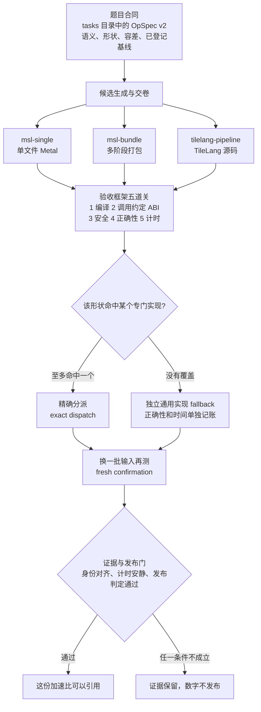
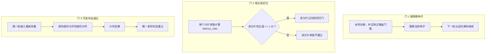

# ShapeForge

[English](README.md) | [简体中文](README.zh-CN.md)

ShapeForge 生成专用 GPU 内核，按可核对的证据做评测，再按形状分派执行。人和大模型都可以写候选。当前生产目标是 Apple GPU 上的 Metal 着色语言（Metal Shading Language）。

## 核心概念白话速查表

后文的状态、流程图和引用规则都沿用下表。多 DSL 指多条交付路线可以并存，每条路线的含义见「Track」一行。

| 说法 | 它是什么 | 谁负责，记在哪 |
| --- | --- | --- |
| OpSpec v2 | 一道题的合同：语义、输入输出、容差，以及已经登记的对照基准。现行题面是 `tasks/` 下的一个目录 | 验收框架持有合同，包括容差和测量边界 |
| Candidate 与 Harness | 候选（candidate）是人或模型交出的实现。验收框架（harness）是独立的检查方 | 候选定算法、融合、分块和覆盖计划。框架定合同、调用约定（ABI）、安全、测量和证据 |
| Track（`msl-single` / `msl-bundle` / `tilelang-pipeline`） | 一条交付路线。`msl-single` 交单文件 Metal；`msl-bundle` 交多阶段打包；`tilelang-pipeline` 交 TileLang 源码 | 该路线拥有自己的前端和执行计划。安全、缓冲区、分派审计、计时和证据归共享的 Metal 运行时 |
| Shape Portfolio 与 Exact Dispatch | 形状组合：同一题可以挂多个稳定的专门实现。精确分派按形状至多选中一个 | 覆盖计划由候选声明。框架负责检查和选择 |
| Fallback | 没有专门实现接住的输入，走单独验证过的通用实现 | 它的正确性和时间单独记账 |
| Search Best 与 Published Speedup | 搜索期最快观察，是搜索过程中看到的最快一次。可发布加速比，是搜索结束之后重新测得的数字 | 后者要同时满足：换一批输入、源码与评测身份对齐、计时安静、通过唯一发布判定 |
| 两本账（`specialized_hit` 与 `effective_end_to_end`） | `specialized_hit_speedup` 只统计专门实现接住的分片。`effective_end_to_end_speedup` 把真实走到通用实现的工作也算进去 | 每个分片单独满足已经冻结的延迟比政策。几何平均只作描述 |

## 现在到哪一步

| 范围 | 状态 |
| --- | --- |
| R0–R6 构建与证据身份 | 已完成 |
| G0、A1–A6 题目合同（OpSpec）v2 迁移 | 已完成 |
| 多个专门实现按形状选一个（shape portfolio）P0–P2 | 已完成 |
| P3-A 性能两本账 | 已完成 |
| 变长序列（varlen）V0–V6，以及固定长度 KDA | varlen 的 Metal 验收已完成。固定 KDA 的标准任务和复杂打包（bundle）通过了离线/CPU 检查。真实 Metal 上的 bundle，以及付费搜索，还没跑 |
| P3-B 第二个分块矩阵乘（tiled GEMM） | 已完成。换一批没见过的输入再测一次（fresh confirmation）后，`fp16/small/benchmark` 的延迟比（latency ratio）是 0.836，`fp16/paper/benchmark` 是 1.004。两个数都在冻结的 1.10 门内 |
| P3-C 事先圈定的一小批形状（有限域） | 已完成。两个有限域任务的完整证据、两本账、每个分片（shard）的设备与分派（dispatch）身份，以及当场结果和归档的对照（live vs archived），已经归档 |
| 清微 NPU | 只有离线协议和数据模拟。清微真机还没接上，不能当成已完成（NPU-P0），这项仍阻断。文档不给真机正确性或性能结论 |
| P4 清微离线模拟 | 已完成。只对接本机假服务，不解除 NPU-P0 |

这些 P3 比值是 `tests/support/golden/shared/shape-portfolio-阶段验收/P3/` 里归档的 fresh、逐分片 `latency_ratio`。搜索期最快观察（search best）是另一套数。单次测得比较好，仍然关不掉一个阶段。

## 一次候选怎么走完

题目合同先定下语义和验收口径。候选再按一条交付路线交卷。验收框架按固定顺序过五道关：编译、调用约定（ABI）、安全、正确性、计时。前一关没有通过，就不再占用 GPU。形状命中时，精确分派到至多一个专门实现；没有命中时，走单独验证过的通用实现。数字能不能公开，要等换一批输入的再测和发布门。



多个专门实现可以同时存在。一次分派至多命中一个。通用实现的成绩留在它自己的账上。搜索过程中看到的最快一次，仍然要等上面最后一扇门。

## 三道门与两本账

上面的五道关在一次评测内部按顺序执行。下面三道门回答三个不同的问题。通过其中一道，另外两道仍要单独看。



| 问题 | 看哪一道门 | 通过之后可以怎么说 |
| --- | --- | --- |
| 下一轮搜索从哪份源码继续？ | 门 1，搜索换种子 | 种子已经替换。这是搜索期观察，搜索期最快值从这类观察里取出 |
| 这个形状组合的每个分片有没有退步？ | 门 2，每个分片的 `latency_ratio <= 1.10` | 该分片过了冻结回归门。几何平均不能代替这一个分片 |
| 这份数字能不能写成已发布加速比？ | 门 3，发布门 | 换一批输入、身份对齐、计时安静、发布判定，四项同时成立 |

两本账都建在门 2 的分片结果上，用来回答时间记在谁的账上：

| 账本 | 记账范围 |
| --- | --- |
| `specialized_hit_speedup` | 由生成出来的专门实现处理的分片 |
| `effective_end_to_end_speedup` | 全部实际工作，包括真实走到通用实现的路径 |

上文 P3 的 0.836 和 1.004 是归档的、逐分片的 fresh `latency_ratio`，用来核对门 2。搜索期最快观察是另一套数。可发布加速比走门 3。

## 谁做什么，不必做什么

| 角色 | 要做 | 不必做 |
| --- | --- | --- |
| 写候选的人或大模型 | 自己定算法、融合、覆盖计划和分块，并交出候选 | 不必改题目合同、测量边界和证据规则 |
| 验收框架 | 检查合同、安全、测量，并记录证据 | 不必替候选指定算法 |
| 在本机跑命令的人 | 做环境自检，再跑 CPU 测试 | 不必为了读证据或跑 CPU 套件去执行付费搜索 |
| 引用结果的人 | 只按后文「哪些话可以说」转述已经写明的状态 | 不必把搜索期最快观察、探索比值或清微 NPU 模拟写成已发布加速比 |

要在本机跑通，看下一节。要引用数字，先看「性能数字怎么引用」和「哪些话可以说」。

## 在这台机器上跑起来

环境要求：Apple Silicon macOS、Xcode/Metal 工具链、`uv`，以及 `pyproject.toml` 声明的 Python 依赖。

缺东西时，先跑一条命令自检。`uv run python scripts/doctor.py` 会逐项检查，并只给出每条问题的下一步。

```bash
uv sync

# 一份自检：工具链、GPU、任务、运行目录、看板
uv run python scripts/doctor.py

# 查看标准任务合同
uv run python -m tcenv.cli tasks

# 让已知正确的内核走 v2 评测路径
uv run python -m tcenv.cli eval-v2 kda tasks/kda/known_good.metal --quick

# 只读查看搜索摘要
uv run python -m taic.cli brief
uv run python -m taic.cli brief RUN_DIR
```

### 跑通时长什么样

| 命令 | 该看到的输出 |
| --- | --- |
| `scripts/doctor.py` | 全部通过时是十一行 `[PASS]`，再加一行汇总；只有 WARN 或 FAIL 才有 `Next:`；退出码 0 |
| `tcenv.cli tasks` | 每个 **v2** 任务一行，带 `dtype=`、`size=`、`inputs=`、`flops=`（`--legacy` 是已退役的 v1 登记，现在不打印任务；v1 夹具在 `tests/support/golden/shared/v1-track/`） |
| `tcenv.cli eval-v2 kda tasks/kda/known_good.metal --quick` | 先给 `STATUS:` 行与逐 case 正确性；`--quick` 在 benchmark 之前停下，微秒数与加速比只在 status 为 `ok` 的完整跑里出现 |
| `taic.cli brief RUN_DIR` | 搜索期最快观察和确认加速比，分成两项列出 |

### 报错了看哪里

| 报错 | 原因 | 怎么修 |
| --- | --- | --- |
| `[Errno 48] error while attempting to bind on address ('127.0.0.1', 8765)` | 已经有一个看板占着这个端口 | 换端口 `OBSERVE_PORT=8766 uv run python -m observe`，或停掉旧的：`lsof -nP -tiTCP:8765 -sTCP:LISTEN \| xargs kill` |
| `ModuleNotFoundError: No module named 'tcenv'` | 没在项目环境里跑 | 先 `uv sync`，命令前加 `uv run` |
| 不认识的 `code=` | 任务合同或证据平面的 typed 失败 | 查 [docs/失败码.md](docs/失败码.md)：含义、常见原因、下一步 |

### 测试

先运行不使用 GPU、模型和长检查的 CPU 安全套件：

```bash
uv run pytest -q -m 'not gpu and not llm and not slow'
```

只有明确允许真实 GPU 使用时才运行：

```bash
uv run pytest -q -m gpu
```

调试单个失败时，先读 `logs/pytest/triage/triage_summary.md` 及其指向的 Markdown/JSON handoff，再串行复现：

```bash
uv run pytest -q -n 0 <nodeid>
```

测试目录、标记（marker）、黄金对照（golden）和并行规则见 `tests/README.md`。

### 花钱的搜索和 GPU

`taic run` 和 `taic resume` 会花钱，也会在这块同时驱动显示器的 GPU 上执行内核。读取证据和运行 CPU 套件不需要它们。

```bash
# 仅为示例：会花钱并使用 GPU
uv run python -m taic.cli run softmax --budget 1.0
```

写内核通过本机 `hmz` 启动器和 `pi`，见 `docs/架构/hmz.md`。凭据从环境变量或配置的凭据文件读取。凭据不进入仓库。

### 不必做的事

读已有证据、跑 CPU 套件时，不必执行 `taic run` 或 `taic resume`。没有明确允许真实 GPU 时，不必跑 `-m gpu`。引用结果时，不必把还没跑的项说成已完成：固定 KDA 的真实 Metal bundle 和付费搜索还没跑；NPU-P0 仍阻断。

## 题目和候选各写什么

一道题是一个 OpSpec v2 目录。目录里写清语义、输入输出、容差，以及已经登记的对照基准（baselines）。

候选自己决定算法和融合，也决定分块（Tiling）、主机侧分块（Host Tiling）、执行几何（ExecutionGeometry），以及形状规划（ShapePlanner）里的覆盖分组（coverage buckets）。多个稳定的专门实现可以同时挂在同一道题上。一次运行按形状精确选中至多一个。没有被覆盖的输入走单独验证过的通用实现，正确性和时间记在通用实现自己的账上。

规定必须覆盖的边界样本（boundary）、尾部样本（tail）和资源样本（resource instances），不会出现在候选调优时能看到的数据里。

一份候选能不能激活、能不能从中断处恢复，以及性能数字能不能被引用，取决于规范交付包（CanonicalBundle）、构建身份、评测身份、换一批输入的再测（fresh confirmation），以及唯一发布判定（publication predicate）。后文把这个判定也叫发布门。

候选可以来自 Triton 文本、手写的 Metal、一套新算法，或 ShapePlanner。仓库用候选自己交出的实现来定上限，而不是用一份封闭的写法清单（pattern 库）。

## 多 DSL：MSL 与 TileLang 的交付路线

多 DSL 在这里指多条交付路线可以并存。Track 这个名字只用于交付、构建和执行。每条 Track 拥有自己的前端（frontend）和执行计划。共享的 Metal 运行时（Metal runtime）负责安全、缓冲区、分派审计、计时和证据。内核描述语言（DSL）和中央中间表示（IR）另行登记。一条 Track 记录的是它自己的交付路线。

| Track | 已有证据 |
| --- | --- |
| `msl-single` / `msl-bundle` | 原有的 MSL 路线。`affine_ramp` 的 fresh confirmation 已通过 |
| `tilelang-pipeline/1` | 只保留接口（interface_only），并且只重放源码（source-only replay）。这条不能被选中 |
| `tilelang-pipeline/2` | 固定的人工 TileLang，在 Metal 上的机制已完成。只做正确性（correctness-only）的生成和 replay 已完成 |
| `tilelang-pipeline/3` | 固定 ReLU 已登记。激活和断点恢复（activation/resume）已接上。它是 `affine_ramp` 的探索胜出条目（exploration winner）。`track_explore_reviewer_done=true` |

`taic run --track` 只接受当前可选的 track id。新的一次 run 取该 id 目前最高的可选版本。因此 `--track tilelang-pipeline` 落到 `/3`。`/1` 不能被选中。命令里没有写 track 时，搜索使用 `msl-single`。

r15 覆盖三条路线。每条路线有自己的运行目录（run_dir），也有自己的 fresh confirmation。TileLang `/3` 的 latency ratio 是 0.074707，三条里最低。这个数来自探索（exploration）。三条路线的 fresh 输入对不上同一批数据。这里没有跨 Track 的运行时组合（runtime portfolio）。这里也没有 speedup 发布。

MT6 已按独立复核后的范围完成。范围是 MSL + TileLang。`full_mt6_done=true`。`additional_dsl_not_required=true`。`publication_allowed=false`。MT7 的最终独立终审已完成。speedup publication 仍然关闭。证据在 `tests/support/golden/shared/多DSL-Track-阶段验收/MT6/`。看板 observe 提供只读入口 `/api/v2/track-explore`。

## 验收框架管什么

验收框架持有题目合同、调用约定（ABI）、打包闭包（pack closure）、安全检查、测量边界和证据。算法仍然由候选自己定。

一次评测留下四项记录：正确性、分派是否和声明一致（dispatch parity）、换一批输入后的计时，以及规范身份（canonical identity）。激活和发布还要能回答四件事：选中了哪个实现、有没有走到通用实现（fallback）、确认测量的结果（confirmation），以及撤销和恢复（revocation/resume）是否成立。

候选可以写常驻内核（persistent kernel）、多阶段状态机，也可以使用公开的原生矩阵和同步功能（native matrix/synchronization）。随意引用的宿主头文件（host include）、没有声明的资源，以及逃出沙箱（sandbox escape），都会被拒绝。执行时间失控交给外部看门狗（watchdog）。框架不靠限制循环写法来保证安全，候选可以按自己的风格写循环。

## 性能数字怎么引用

两个数要分开写。口径与上文「三道门与两本账」相同。

搜索期最快观察是搜索过程中看到的最快值。它不能直接发布。

可发布的加速比（published speedup）是搜索之后重新测的。源码身份和评测身份要对上。计时要安静。还要通过唯一发布门。

正确性只认本仓库的容差和缩放误差（`tolerances + scaled_error`）。比较包含可读写缓冲区的终值（`read_write`）。fallback 的正确性和时间，不记入某个专门实现的正确性或加速比。

shape portfolio 使用两本账：

- `specialized_hit_speedup`：只统计由生成出来的专门实现处理的分片；
- `effective_end_to_end_speedup`：统计全部实际工作，包括真实的 fallback 路径。

每个分片要单独满足已经冻结的回归政策。几何平均（geomean）只作描述。某一个分片变差时，要单独看这个分片。

原始 observation、JSON 字段、摘要或哈希，本身不能证明代码在真实硬件上执行过。激活还需要独立重建的期望值（expected reconstruction），以及 fresh evidence。

## 哪些话可以说

| 可以说 | 不能说 |
| --- | --- |
| 当前生产目标是 Apple GPU 上的 Metal 着色语言 | 清微 NPU 已有真机正确性或性能 |
| 清微 NPU 只有离线协议和数据模拟；NPU-P0 仍阻断 | NPU-P0 已完成，真机结果可以引用 |
| R0–R6、G0、A1–A6、shape portfolio 的 P0–P2、P3-A、P3-B、P3-C 已完成 | 计划中的每个阶段都已完成 |
| varlen V0–V6 的 Metal 验收已完成 | 固定长度 KDA 已跑过真实 Metal bundle 或付费搜索 |
| 固定长度 KDA 的标准任务和复杂 bundle 通过了离线/CPU 检查 | 把这次离线/CPU 检查说成真实 Metal 验收 |
| P3-B 的 fresh confirmation：`fp16/small/benchmark` 延迟比 0.836，`fp16/paper/benchmark` 延迟比 1.004，都在冻结的 1.10 门内 | 这两个数是搜索期最快观察，或单次较好测量已经关闭该阶段 |
| 上述 P3 比值是 `tests/support/golden/shared/shape-portfolio-阶段验收/P3/` 里归档的、逐分片的 fresh `latency_ratio` | 用这份归档以外的一次测量替换上述数字 |
| P3-C 已归档两个有限域任务的完整证据、两本账、逐分片设备与分派身份，以及 live 与 archived 对照 | 这份归档表示后续阶段都已结束 |
| 候选可以来自 Triton、手写 MSL、新算法或 ShapePlanner | 候选只能从 Triton 文本逐句改写，或只能从封闭的 pattern 库里选 |
| 当前编写路径是 `tasks/` 下的 OpSpec v2 目录。历史 v1 任务只作为测试夹具保留 | 当前还要写逐题 `task.py`、`track.json`、`kernel_triton.py`、逐题 LoweringProfile，或生成任务的中央登记表 |
| `--legacy` 是已退役的 v1 登记，现在不打印任务。夹具在 `tests/support/golden/shared/v1-track/` | `--legacy` 仍会列出一批 v1 任务 |
| Track 是一条交付、构建和执行路线。frontend 和执行计划归该 Track。安全、缓冲区、分派审计、计时和证据归共享 Metal runtime | Track 是一种 DSL，或一套中央 IR |
| `msl-single` / `msl-bundle` 上，`affine_ramp` 的 fresh confirmation 已通过。未指定 track 时搜索使用 `msl-single` | 未指定 track 的搜索默认走 `tilelang-pipeline` |
| `tilelang-pipeline/1` 是 `interface_only` 的 source-only replay，不能被选中 | `--track tilelang-pipeline` 会落到 `/1` |
| `tilelang-pipeline/2` 的固定人工 TileLang Metal 机制，以及 correctness-only 生成和 replay，已完成 | `/2` 的这项完成已经是可发布加速比 |
| `tilelang-pipeline/3` 完成了固定 ReLU 登记和 activation/resume，并且是 `affine_ramp` 的 exploration winner；`track_explore_reviewer_done=true` | `/3` 的 exploration winner 已经是 speedup 发布 |
| r15 覆盖三条路线，各自有独立 `run_dir` 和 fresh confirmation。TileLang `/3` 的 latency ratio 0.074707 最低 | 这是同一批 fresh 输入上的比较、跨 Track 的 runtime portfolio，或已发布的 speedup |
| MT6 已在独立复核后的 MSL + TileLang 范围内完成；`full_mt6_done=true`；`additional_dsl_not_required=true`；`publication_allowed=false` | `publication_allowed=true`，或 MT6 还要求再加一条 DSL 才算完成 |
| MT7 最终独立终审已完成 | 这次终审开放了 speedup publication |
| 搜索期最快观察可以单独列出 | 把搜索期最快观察直接写成发布数字 |
| 可发布加速比要同时满足：重新测量、源码与评测身份匹配、计时安静、通过唯一发布门 | 缺任何一条时仍写成已发布加速比 |
| `taic.cli brief RUN_DIR` 把搜索期最快观察和确认加速比分成两项列出 | 把这两项合成一个发布数字 |
| 正确性只认 `tolerances + scaled_error`，并包括 `read_write` 终值 | 换一套误差口径来宣布正确 |
| fallback 的正确性和时间单独记账 | 把 fallback 的正确性或时间记成某个专门实现的成绩 |
| `specialized_hit_speedup` 只算生成实现处理的分片；`effective_end_to_end_speedup` 计入真实 fallback | 用几何平均掩盖某一个分片退步 |
| 每个分片独立满足冻结的回归政策 | 只报一个总平均值就通过回归政策 |
| 激活还要有独立的 expected reconstruction 和 fresh evidence | 原始 observation、JSON 字段、摘要或哈希本身就证明了真实硬件执行 |
| 阶段验收目录是证据记录 | 这些目录等于所有计划阶段已经完成 |
| 候选可以使用常驻内核、多阶段状态机和公开的原生矩阵/同步能力 | 随意 host include、未声明资源或沙箱逃逸可以通过检查 |
| 失控执行由外部看门狗处理。候选可以按自己的风格写循环 | 靠限制候选的循环写法来保证安全 |
| `taic run` 和 `taic resume` 会花钱，并在驱动显示器的 GPU 上执行内核 | 读证据或跑 CPU 套件之前必须先执行这两条命令 |
| 凭据从环境变量或配置的凭据文件读取 | 把凭据提交进仓库 |
| CI 当前没有 workflow，push 不会跑检查 | push 之后仓库会自动跑 CPU 或 GPU 检查 |
| 本地 CPU 与 Metal GPU 两条路径要分开。GPU 检查不跑在共享 runner 上。不允许 `continue-on-error`。`logs/pytest/triage/` 要保留 | 用 `continue-on-error` 放过失败，或在共享 runner 上跑 GPU |
| 真实 GPU 卡死测试要单独设置 `TCENV_ALLOW_GPU_HANG_TESTS=1` | 把 GPU 卡死测试放进普通测试套件 |

## 仓库里有什么（可跳过）

| 路径 | 内容 |
| --- | --- |
| `tasks/` | OpSpec v2 标准目录：`opspec.json`、`reference.py`、baselines，以及可选的 display/reference 元数据 |
| `tcenv/` | 题目合同、Track / CanonicalBundle、评测、Metal runtime，以及与具体后端无关的证据 |
| `tcenv/portfolio/` | 语义域（Semantic Domain）、候选 portfolio、exact dispatch |
| `tcenv/portfolio_evidence/` | 确定性的证据投影，以及严格比较 |
| `tcenv/portfolio_validation/` | 冻结（freeze）、调优集与未见集计划（tune/unseen plan）、候选视图 |
| `tcenv/portfolio_performance/` | 逐分片判定，以及两本性能账 |
| `taic/` | 搜索、确认、激活、持久化，以及能识别 portfolio 的恢复（portfolio-aware resume） |
| `backends/` | backend 元数据、技能说明（skills）和 wiki |
| `targets/` | 芯片配置（chip profile）、测量和信任边界 |
| `tests/` | `shared/`、`backends/<id>/` 和 support/golden 套件，规则见 `tests/README.md` |
| `docs/` | 架构、实施计划、安全边界和阶段验收证据 |
| `kernels/` | 已确认的内核示例（若存在） |

历史 v1 任务只作为测试夹具保留。当前编写路径不使用逐题的 `task.py`、`track.json`、`kernel_triton.py`、逐题 LoweringProfile，也不使用生成任务的中央登记表。

## 接着读哪份文档

- `docs/架构说明.md`：进程与 runtime 总览；
- `docs/架构/shape-portfolio实施计划.md`：portfolio 的权威计划，以及 P0–P4 的状态；
- `docs/架构/v2协议参考.md`：OpSpec v2 题面与候选交付；
- `docs/架构/构建与评测身份.md`：构建身份、评测身份和发布证据；
- `docs/架构/执行运行时与设备扩展.md`：本地/远程执行，以及 evaluator 边界；
- `docs/security.md`：模型写出的候选，以及 P2 安全边界；
- `docs/agent-skills.md`：agent skill 入口。

阶段验收材料位于：

- `tests/support/golden/shared/跨硬件算子生成分工-阶段验收/`
- `tests/support/golden/shared/shape-portfolio-阶段验收/`

这些目录是证据记录。计划里还有未完成的阶段。

### 本机看板

一键启动或安全重启：

```bash
scripts/observe.sh
```

脚本先探测 `OBSERVE_PORT`（默认 8765）上的旧实例，停止它并等待端口释放，再启动新实例，最后做 HTTP 健康检查。日志和 PID 状态位于 `${TMPDIR:-/tmp}/shapeforge-observe-$UID/`。换端口用 `OBSERVE_PORT`。

## 持续集成

CI 当前没有接线。仓库里已经没有 workflow 定义。push 不会触发检查。改为在本地跑同样的两条路径：

- **CPU 安全套件**。确定性 smoke 与 portfolio 测试，不调用付费模型：`uv run pytest -q -m 'not gpu and not llm and not slow'`。
- **Metal GPU**。仅手动，在本机空闲的 Apple Silicon 上执行，且没有付费模型凭据：`uv run pytest -q -n 0 -m gpu`。

上面「测试」一节里的 GPU 命令不带 `-n 0`。这一节的手动 GPU 路径带 `-n 0`。

无论谁来跑，都不允许使用 `continue-on-error`。失败记录和 `logs/pytest/triage/` 里的证据都要留下。以后如果重新接上 CI，两条路径仍然分开。GPU 检查不放到共享 runner 上。

## 人和 AI 一起改

先读 `AGENTS.md`。它是项目上下文和安全边界的权威说明。`CONTRIBUTING.md` 写人和 AI 怎么协作。`.agents/skills/shapeforge/SKILL.md` 是一段短的上手说明。这三份文件写了候选能自由决定什么、证据有哪些不变量、当前状态、测试方式和授权边界。看完这三份，就不必从早期的 Triton 历史去猜现在的项目。

## 项目从哪来（可跳过）

ShapeForge 起步时，在 Apple M4 Max 上复现 *AI as a compiler: compiling Triton kernels without the Triton compiler*。早期做法是把 Triton 文本直接改写成 MSL。这段历史在 Git 记录里。可选的 `triton-msl` 对照路径也还在。Triton 直译留在这些地方。它不划定现在的项目边界。

现在的候选可以来自 Triton、手写 MSL、新算法，或 ShapePlanner。当前主线是 OpSpec v2、候选自己的实现、shape portfolio，以及凭证据激活。

## 安全使用

Metal 内核可能让正在驱动显示器的 GPU 卡住。请用有界评测器（bounded evaluator）跑候选。不要自己手工启动不可信的候选。真实的 GPU 卡死测试要单独设置 `TCENV_ALLOW_GPU_HANG_TESTS=1`。这类测试不在普通测试套件里。
