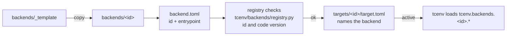

# Backends

A backend is a language and a runtime. It is not a chip.

| concept | what it is | where it lives |
| --- | --- | --- |
| backend | a language plus a runtime, implemented against a protocol | `backends/<id>/` (`backend.toml`, skill notes, wiki) |
| target | one chip: names its backend and holds what was measured on that chip | `targets/<id>/target.toml` |

`metal` is the Apple GPU path: Metal Shading Language, the skill notes, and Apple's PDFs. Chip measurements do not live here.

Backend metadata also holds the formal TrackRegistry. `backends/metal/tracks.json` (`schema_version: 2`) registers delivery mechanisms keyed by `(track_id, track_version)`: `single_source` (`msl-single`), `candidate_bundle` (`msl-bundle`) and `dsl_source_pipeline` (`tilelang-pipeline`, versions 1-3; `/1` stays `interface_only`, so only `/2`–`/3` are selectable). `tcenv/track/registry.py` loads it as `load_track_registry()`; that default path is the Metal file, so the live registry is currently Metal-specific. A new run gets the highest selectable version, while a frozen reconstruction, resume or replay asks for the recorded version and a missing version is a typed refusal. `--track` advertises only the track ids the registry reports as available; `resume` parses every registered id and checks the recorded version downstream.

## Adding a new accelerator

A new accelerator is a new directory next to `metal`, copied from `_template`, with its own `backend.toml`. A target under `targets/` then names that backend.

`backend.toml` must name a repository `entrypoint` under `tcenv.backends.`; the registry (`tcenv/backends/registry.py`) checks the id and code version. The protocol itself is `tcenv.backends.base.Backend`. Skills and wiki alone do not make the backend runnable; the entrypoint has to implement the protocol.

The shared `Contract` and the verification interface live at `tcenv.contract` and `tcenv.verify`. Backend-specific code is imported from `tcenv.backends.<id>.*`; the old top-level `tcenv/*.py` shims were removed after Phase 4.
