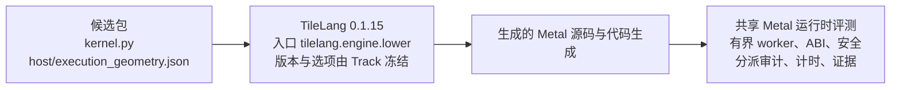

# TileLang Track：当前已验证边界

TileLang 是一条独立的交付路线（Track），使用自己的 Python DSL。它不是 Metal 着色语言的包装层，其他 DSL 也不必先经过它。候选包只接受两个路径：`kernel.py`，以及 `host/execution_geometry.json`。这两份文件带上 DSL 源、work-list 和执行几何（ExecutionGeometry）。多出来的路径会被拒绝。前端的版本、入口和选项由这条 Track 冻结，候选不能改。验收框架继续持有有界 worker、调用约定（ABI）、安全、分派、计时和证据。

## 版本与当前事实

| 版本 | 状态 |
| --- | --- |
| `/1` | `interface_only` source-only replay，不可选择，不进入生产 Metal build |
| `/2` | 固定人工真实 Metal 机制、人工/LLM correctness-only 生成与 replay 已完成 |
| `/3` | 固定 ReLU 登记、fresh identity、activation/resume 和 `affine_ramp` 批量探索通过 |

三条版本共用冻结的 TileLang `0.1.15` 和入口 `tilelang.engine.lower`。差别在选择权、调度和已经验收的范围。

| 项 | `/1` | `/2` | `/3` |
| --- | --- | --- | --- |
| 登记状态 | `interface_only` | `available` | `available` |
| 新的一次 run | 不能被选中，也不进入生产 Metal 构建 | 状态保持 `available`。不写版本的新 run 取该 id 当前最高的可选版本 | `--track tilelang-pipeline` 落到 `/3`。续跑沿用目录里已经记下的版本 |
| 调度 | 没有生产调度参数 | `barrier_interval` 为 0，与 MSL 相同 | native concurrent，`barrier_interval=2`，用来压住调度抖动 |
| 构建身份 | 只重放源码 | 固定人工候选的真实 Metal 机制。correctness-only 的生成和 replay 已完成 | 稳定的 fresh subject 进入 BuildProfile。`metal-build.2` 描述符只保留稳定身份。真实构建仍使用 `/2` 那条围栏内的 source-only 子构建，这份子构建不叫作 `/2` 的 fresh confirmation |
| 已验收范围 | source-only replay | 固定人工 TileLang 在 Metal 上的机制，以及 correctness-only 生成和 replay | 固定 ReLU 的登记、fresh identity、activation/resume，以及 `affine_ramp` 探索中的最低 latency ratio |
| 历史合同 | 保留 | 保留。`/3` 不改写这份合同和历史证据 | 不改写 `/1` 和 `/2` |

`/3` 的主要变化不是“更强的 DSL”：

- 稳定 `tilelang_fresh_subject` 进入 BuildProfile，attempt-specific 证据留在 BuildEvidence.log；
- `metal-build.2` descriptor 只含稳定 candidate/frontend/artifact identity，避免 native_digest 随 attempt 漂移；
- 真实构建继续使用 `/2` 的 fenced source-only 子构建，不能把它误称为 `/2` fresh confirmation；
- `/3` 使用 native concurrent + `barrier_interval=2` 控制调度抖动，`/2` 和 MSL 为 0；
- `/1`、`/2` 的合同与历史证据不因此被改写。

## 已执行的验证

- 固定 ReLU 候选：fresh identity、golden correctness、activation 和非 dry-run resume；
- `affine_ramp` 三 Track 探索：`msl-single`、`msl-bundle`、TileLang `/3` 均 `confirmed/eligible`，TileLang 以最低 ratio 0.074707 成为 exploration winner；
- r15 observation 与 summary 同期一致：`observations.json` 逐条记录 `encoder_strategy=pyobjc_fallback` 与 `native_batch_calls=0`，`observed-execution.json` 保留 binding/dispatch 细节；
- 使用完整 `build.evidence.duration_ms` 统计真实 lowering 成本；
- 所有路线均满足 `latency_ratio <= 1.10`，但不等同于发布。

## 不得外推

- 不把 r15 当成同一 fresh 输入、跨 Track runtime portfolio 或 speedup publication；
- MT6 已按 MSL + TileLang 完成（`full_mt6_done=true`，`additional_dsl_not_required=true`），`publication_allowed=false`；
- 不把该完成外推为 Graph、无界 `track-explore`、生产 LLM 搜索或 speedup publication；
- 不把 `/3` 的固定候选结果外推为所有 TileLang 程序、所有形状或其他硬件的结论；
- 不修改历史 MT0/MT1b/MT2/MT4/P2 证据来消除 registry/prompt epoch drift。

权威证据：`tests/support/golden/shared/多DSL-Track-阶段验收/MT6/`，尤其是 `evidence/track-explore-r15/`、`review-r15.json` 和 `review-r10-rejected.json`。observe 的 `/api/v2/track-explore` 只提供只读展示，不是发布权威。
