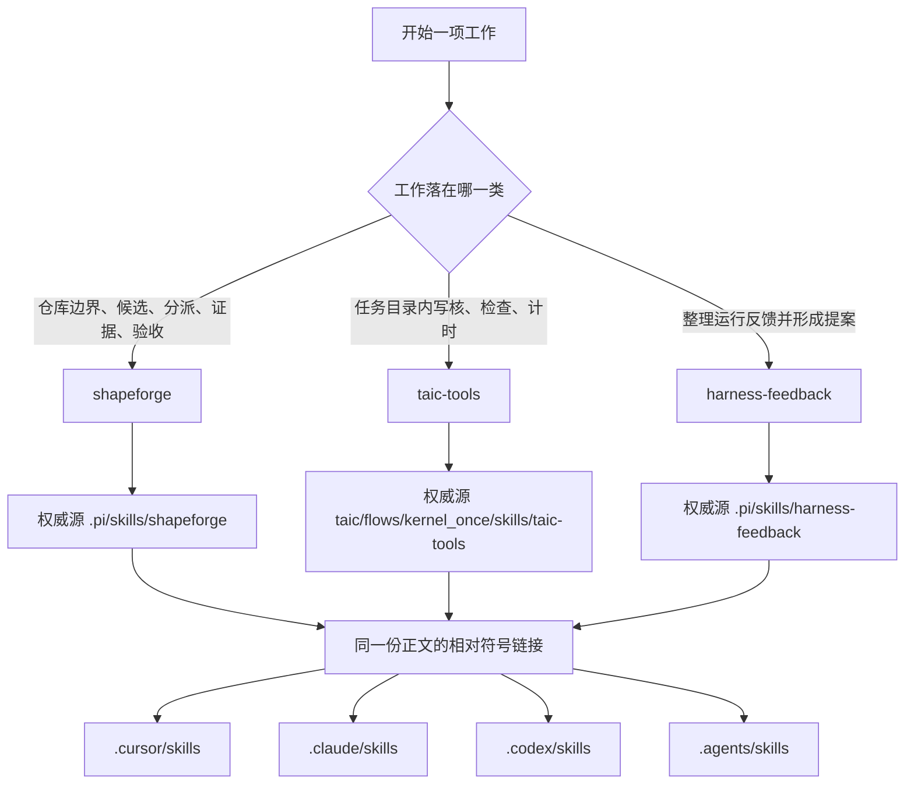

# Agent skills

## 这篇讲什么

项目的技能（skill）只有一份权威源，放在仓库里，而不是某个 agent 的私有目录。各个 agent 工具看到的 `.claude/skills/`、`.codex/skills/`、`.cursor/skills/`、`.agents/skills/` 下，同名条目都是指向权威源的相对符号链接。改技能时改权威源，不要复制出一份新的技能树。

## 第一次来，先读哪篇教程

这三篇只负责帮助新手进入正确的权威源；它们不是第二套项目入口，也不替代 `AGENTS.md`。

| 读者 | 教程 | 先回答 |
| --- | --- | --- |
| 第一次用编程 agent 参与本仓库 | [Agent 新手第一课](教程/Agent-新手第一课.md) | 候选和 harness 怎么分，哪些证据不能碰，最小改动怎么验收 |
| 第一次生成 Metal 内核 | [Kernel 生成新手第一课](教程/Kernel-生成新手第一课.md) | 从任务目录和 OpSpec 走到第一颗正确候选，怎样留下笔记 |
| 第一次读性能或确认结果 | [Kernel 测量与证据入门](教程/Kernel-测量与证据入门.md) | quick、timed、ab、fresh confirmation 和 publication 各自能证明什么 |

## 专业人员的工作包

这三篇不是入门读物，而是给要交付可评审结果的人用的检查清单。它们只把现有合同收成可执行步骤，不放宽授权。

| 工作 | 文档 | 交付前必须能回答 |
| --- | --- | --- |
| 新增一道 OpSpec v2 任务 | [OpSpec 任务作者专业指南](教程/OpSpec-任务作者专业指南.md) | 语义、oracle、baseline、case、负例和身份变化分别由谁证明 |
| 独立复核候选、run 或阶段包 | [内核证据复核专业指南](教程/内核证据复核专业指南.md) | 证据等级、身份链、fresh/发布谓词、负例和 blocker 怎么写 |
| 接入 backend、target、Track 或远程 site | [后端与目标接入专业指南](教程/后端与目标接入专业指南.md) | 四层边界、能力拒绝、实测标定、interface_only/available 和模拟边界 |

## 文档可视化

[docs/visual/index.html](visual/index.html) 是离线文档阅读器：分类首页、全文搜索、阅读目录和 Mermaid。它直接由当前 Markdown 生成，不启动服务也可以打开。修改文档后运行 `uv run python scripts/build_doc_visual.py` 重建索引；维护规则见 [docs/visual/README.md](visual/README.md)。

## 权威源与符号链接

权威源（canonical source）在仓库内：

```text
.pi/skills/harness-feedback/                 # feedback triage
.pi/skills/shapeforge/                        # project onboarding for other contributors
taic/flows/kernel_once/skills/taic-tools/    # kernel-session tool guidance
```

下面这些是指向上述权威源的相对符号链接：

```text
.claude/skills/{harness-feedback,shapeforge,taic-tools}
.codex/skills/{harness-feedback,shapeforge,taic-tools}
.cursor/skills/{harness-feedback,shapeforge,taic-tools}
.agents/skills/{harness-feedback,shapeforge,taic-tools}
```

各 agent 的入口文件和技能发现位置：

| Agent | 入口文件 Entry point | 技能发现位置 Skill discovery |
| --- | --- | --- |
| Claude Code | `CLAUDE.md` | `.claude/skills/` |
| Codex | `AGENTS.md` | `.codex/skills/` / `.agents/skills/` |
| Cursor | `.cursor/rules/project.mdc` | `.cursor/skills/` and rules |
| Pi | `AGENTS.md` | `.pi/skills/` |

一句话概括这套布局：入口文件负责告诉 agent“项目是什么”，技能目录负责给它“怎么做某类任务”的说明；两者都指向同一份仓库内容。

## 该加载哪一份技能

三份技能各管一类工作。先读权威源里的 `SKILL.md`。`.cursor/skills`、`.claude/skills`、`.codex/skills` 和 `.agents/skills` 里的同名目录都是相对符号链接，改链接那边不会得到第二份正文。

| 正在做的事 | 加载 | 权威源 |
| --- | --- | --- |
| 了解仓库边界，修改候选、分派或性能证据，或走验收流程 | shapeforge | `.pi/skills/shapeforge` |
| 在一次内核任务目录里读 Metal 参考、按 `TASK.md` 检查或计时，并留下 `NOTES.md` | taic-tools | `taic/flows/kernel_once/skills/taic-tools` |
| 整理运行反馈里的自由文本建议，判断它是提示、前提、措辞还是代码修复；改动要先有人确认 | harness-feedback | `.pi/skills/harness-feedback` |



改 harness、改 Triton 源，或启动会花钱的搜索，走仓库的贡献流程，不走 taic-tools。harness-feedback 把建议整理成提案；它本身不是改代码的许可。

## Adding or changing a skill

新增或修改一个技能时，按顺序做四件事：

1. 改权威源：编辑 `.pi/skills/` 或 `taic/flows/kernel_once/skills/` 下的文件。
2. 保留现有的相对符号链接；不要创建复制出来的技能树。
3. 如果某个工具要求单独的规则文件，就加一条简短的指针规则，写明权威源在哪里，例如 `.cursor/rules/harness-feedback.mdc` 的做法。
4. 跑一遍离线测试套件：`tests/shared/test_docs_integrity.py` 的 D-S01 会检查权威源已在本文件登记、别名树的条目全是符号链接、`SKILL.md` 的 description 带触发条件；如果映射关系变了，同步更新本文档。


## 中间结果

跨 stage 复用一块设备缓冲时，读 [中间结果复用与Scratch Workspace.md](架构/中间结果复用与Scratch Workspace.md)。那里写字段、每轮重算、身份链，以及 conv2d 的实测。写核会话现在通过 `system_prompt_v2`、`backends/metal/skills/msl_reference.md` 和 `taic/flows/kernel_once/skills/taic-tools/SKILL.md` 获得同一份生命周期指导；摘要代次见 [ScratchSpec 提示面 epoch](架构/scratch-prompt-epoch.md)。`experience.md` 没有为这条另加规则。

## 信任边界

只有来自 run 反馈的技能文本才可能被当作不可信输入；技能说明本身属于仓库代码，应当像代码一样 review。

## TileLang Track 的当前事实入口

TileLang `/3` 已经完成登记、fresh identity、activation/resume，以及 `affine_ramp` 的批量探索。MT6 已按独立复核后的 MSL + TileLang 范围完成（`full_mt6_done=true`，`additional_dsl_not_required=true`）。Graph、无界 track-explore、生产搜索和 speedup publication 仍未签署，`publication_allowed=false`。协作者先读 `backends/metal/wiki/tilelang.md` 和 `tests/support/golden/shared/acceptance-epochs/fixtures/mt6/evidence/track-explore-r15/`，按这两处的当前记录理解 Track，而不是按早期只写 Triton 的说法。MT6 包本身的恢复命令在 `tests/support/golden/shared/retired.json`。`observe` 的 `/api/v2/track-explore` 只读展示不是发布权威。
