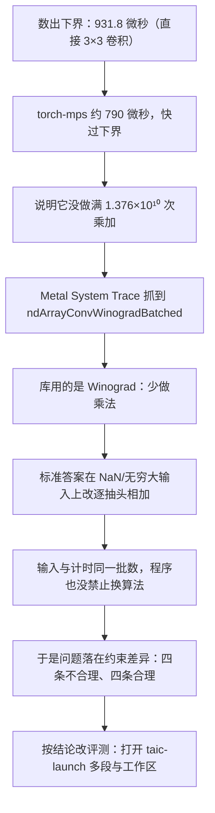

# conv2d：和现成库比的时候，约束哪里不一样

## 这篇讲什么

2026-10-20 的排查记录。当时两次委员会搜索的 conv2d 加速比都没有超过 1。这篇记下当天怎么查的，以及若要让我们的核和现成库面对同一组约束，哪些差异合理、哪些不合理。

- 排查当时**没有改评测**，也没有改当时还在跑的搜索。后来按这篇的结论改了评测，见文末「后来打开的」。
- 结论分两半：四条差异我们有不合理（几颗核、启动方式、工作区、能不能换算法），四条必须保留（数据排布、有限数要对、NaN/无穷大、安全与确定性检查）。
- 2026-10-21 的补记推翻了排查时的一个硬件断言：fp32 操作数进矩阵单元并不慢。

当时的数：直调 `runs/apple-m4-max/conv2d-committees-20261020` 确认 0.795，搜索过程中的最好是 0.779，种子是 `init`。`hmz` 那次 `runs/apple-m4-max/conv2d-committees-hmz-20261020` 排查时种子也是 `init`，加速比 0.785。更早两次跑完的确认是 0.779 和 0.783，见 [诚实说明.md](诚实说明.md)。

## 排查顺序

### 1. 先算这道题的下界

下界按直接 3×3 卷积来数。

- **运算量**：paper 尺寸下，每个输出、每个输入通道、每个抽头各一次乘加，`2 × 93312 × 128 × 576 = 1.376×10¹⁰` 次浮点运算。
- **最少搬运**：每个输入、权重、输出字节只碰一次，fp16，共 36,880,384 字节。
- **峰值**是 2026-10-06 在这台 M4 Max 上测的，不是手册数字：fp16 大矩阵乘 14.77 TFLOP/s；这道题写的字节超过一半，带宽落到拷贝那一档 449 GB/s。
- **两条时间**：算力时间 931.8 微秒，带宽时间 82.1 微秒。
- **成绩单里的下界取较慢的那条**，也就是 931.8 微秒。没有另一条时间上界。

公式在 `tcenv/backends/metal/profile.py` 的 `roofline`，运算量在 `tasks/conv2d/task.py`。

### 2. 对照实现却比下界更快

torch-mps 大约 790 微秒，快过这条 931.8 微秒的下界。所以它没有做满这 1.376×10¹⁰ 次乘加。

### 3. 抓 trace，看它实际跑哪颗核

按基线同一条路跑了一次：fp16、NCHW、图像 `(32, 64, 56, 56)`、权重 `(128, 64, 3, 3)`、步长 1、无填充。这就是 `tasks/conv2d/task.py` 里 `_torch` 在重排之后交给 `F.conv2d` 的形状。

`MTL_CAPTURE_ENABLED=1` 仍报捕获层没有插进去，所以没有把当场编译的那一份指令逐条反汇编。改用 Metal System Trace。

| trace 里看到什么 | 值 |
| --- | --- |
| 这次 Python 进程编出来的计算着色器 | `ndArrayConvWinogradBatched` |
| 名字里带 `normal_half` 的那个 | 是填随机数的核 |
| 名字出在哪个库 | 系统库 `MPSNDArray` 的 `default.metallib` |
| AIR 上的源文件 | `MPSNDArrayConvolutionA14Winograd.metal` |
| 参数结构 | `MPSNDArrayConvolutionParametersA14Winograd` |
| 半精度实现内部 | `simdgroup_matrix` 的 8×8 乘加，操作数 fp16，累加 fp32，变换用 `fma` |
| 同库里还有、但这次 trace 没出现的 | `ndArrayConvWinogradBatched_reducedTile`、`ndArrayConvWinogradGEMMA18`、`ndArrayWinogradAMD_NCHW` |

也就是说，库用的是 Winograd：少做乘法，用变换换运算量。

### 4. 标准答案为什么不用 `F.conv2d`

这不是造假。Winograd 少做乘法，但有限的数仍要落在容差里。一个无穷大在变换里乘到 0 会变成 NaN，并涂到一整小块上。

所以标准答案在输入含 NaN 或无穷大时不用 `F.conv2d`，改成逐个抽头相加。代码在 `tasks/conv2d/task.py` 的 `reference`。

### 5. 输入和计时是不是同一批数

是。`prepare_case` 抽一套，我们的核按 NHWC 读，torch 在计时里面把同一批数排成 NCHW 再送进 `F.conv2d`，算完再排回来。计时也用这套数，并复制几份轮着读。见 `tcenv/backends/metal/testing.py`、`tcenv/backends/metal/baselines.py`、`tcenv/evaluate.py`。

### 6. 程序有没有禁止换算法

没有。我们没有用程序禁止换算法。排查当天，成绩单在库已经快过下界时写过一句：库更快，不是换算法的理由。这句后来从 `tcenv/report.py` 删掉了。含 ieee 在内的用例仍要跟参考对上。模型试过 Winograd，有的数值不对，有的更慢，种子留在直接卷积那一版。

**一句话概括当天的处境：** 排查当时的 0.78 倍，比的是一颗写死启动方式的核，对上一个可以自己拆、自己换算法的库。那些搜索进程读的是改评测之前的代码。

## 不合理

下面这张表是 2026-10-20 改评测之前的约束。单核、固定线程和禁止工作区，已经按文末「后来打开的」放开。换算法那句已经不在成绩单里。卷积仍没有 `@` 菜单。`BLOCK_*`、纹理和输入只读仍在。程序仍不禁止 Winograd。

排查当天，这四条是我们有、现成库没有的。目标若是和库面对同一组约束，这四条当时不合理。

| 约束 | 我们的核 | 现成库 |
| --- | --- | --- |
| 几颗核 | 只能交一颗，程序只启动一次 | 可以先重排，再跑好几段 |
| 开多少线程、怎么切块 | 写死在题目里，卷积没有另选一套的菜单 | 库自己选 |
| 额外的工作区 | 不许加缓冲区、纹理 | 库可以自己分配中间结果 |
| 能不能换算法 | 成绩单写明：库更快，不是换算法的理由 | 库已经换成 Winograd |

## 合理

这四条留下。数据格式是题目的一部分。特殊数上的标准答案是逐个抽头相加，不是去抄库把无穷大涂开的那种结果。安全检查不进计时。

| 约束 | 我们的核 | 现成库 |
| --- | --- | --- |
| 数据怎么排 | 调用方传入的就是 NHWC | 库可以在内部重排，这段时间算在它的耗时里 |
| 有限的数必须对 | 和 CPU 参考对，容差写死 | 同一批数，也要算出这道卷积 |
| NaN、无穷大 | 必须和「每个抽头乘一次再相加」一致 | 同一批输入。库在这种输入上的输出可以和标准答案不同，我们不因此判库错 |
| 不许越界、不许死循环、两次结果要一样 | 只查我们的核 | 库不经过这套检查 |

## 后来打开的

源码里可以写一段 `/* taic-launch */`。没有这段时，仍是一颗核、题目网格、`math fast`。

**放开的：**

- 最多 32 段，放在同一条 command buffer 里，一次等待；
- 每一段自己的网格和线程；
- 命名的 device 工作区；
- 动态 threadgroup；
- 可选 `math safe`；
- 成绩单不再写「库更快不是换算法的理由」。

**留下的：**

- **输入仍是 `device const`，跑完字节不变。** 运行时本来就会比对输入快照，这条静态检查的用处是**在评测前**就退掉，少一次编译和 GPU 启动。
- **纹理和采样器仍拒绝**（数据布局属于题目）。
- **单段线程组总数不超过 2^24。** 契约的线程索引是 32 位 `uint`，所以 2^32 是硬界；而 2^24 组 × 1024 线程 = 1.7e10 线程，是仓库最大张量（paper 的 2^24 元素）的 1000 倍，65536 组（2^24 元素、每组 256 线程）必须放行。
- **段数最多 32。** 编码实测 1.42 µs/段，多段只会自罚时间；Winograd 是 4 段、split-K 是 k+1 段（见过的 k 不超过 16），32 是 2 倍余量。
- **挂死看的是这一次 command buffer**：单核 2 秒，流水线按段数乘 2 秒、封顶 8 秒，着色器校验是这个数的 2 倍，超过仍计入 `max_hangs`。
- **这次都不做**：按运行时数据决定网格、多队列、题目以外的新标量、自选语言版本、私有存储、`<metal_*>` 以外的 include。

**下界和早停：**

- 下界仍按参考算法的运算量和字节量算。有启动说明时，反馈里的占用百分比会注明这一点。
- 种子自己的 `time_over_lower_bound` 低于 0.95 时，贴顶早停不触发。只是写了启动说明，不停用早停。

**计时窗口与工作区（为什么这样定）：**

计时从编码开始，到 `waitUntilCompleted` 结束；编码和 `commit` 都在计时窗内，和 MLX 的 `mx.eval`、PyTorch 的启动循环取同一段窗口。

工作区在每一次计时迭代里、同一条 command buffer 内先由计算核填零，再跑各段。填零算进候选时间，提示词里也写了这一点，所以工作区越小越划算。

把清零放到计时窗前会让核把变换结果留在工作区里、后面的迭代直接复用，而正确性那三遍每次都重填，看不出来。

量级：按本机实测峰值带宽 449 GB/s，8 MB 工作区每次约 0.018 ms（对 1 ms 的核是 +2%），108 MB（conv2d paper 的 im2col 大小）约 0.24 ms（+25%）。

## 2026-10-21 补记：fp32 矩阵乘加不降速，Winograd 没有出局

### 一条没测过的断言活了四轮

排查和随后的搜索都把 Winograd 判出局，依据是同一句：矩阵单元的操作数只能是 fp16，变换后的操作数收成 fp16 后缩放误差 1.8–3.8，过不了 1.0。这句在 r1、r5、r7 的笔记里出现三次，没有一次测过。

2026-10-21 用一个二十行的探针单独测了操作数类型（`runs/manual-muse-20261021/probe_fmma.py`，分片装好后只循环乘加）：

| 操作数类型 | 实测 |
| --- | ---: |
| fp16 操作数 | 15.42 TFLOP/s |
| fp32 操作数 | 15.09 TFLOP/s |

标定里其实早有一行 fp32 峰值（MLX 大矩阵乘，12.83 TFLOP/s），只是成绩单从来只印题目类型的峰值，没人看见它。这次起，成绩单的 roofline 段会把各操作数类型的实测峰值都印出来。

### 全部留 fp32 之后：Winograd 能过

变换和乘法全程留 fp32 后，误差和直接卷积一模一样。一颗手写核（`runs/manual-muse-20261021/kernel.metal`，两段：先把滤波器变换进工作区，第二段用 fp32 分片乘加，NaN/Inf 整组改逐抽头直算）三次计时 767.5–772.1 µs，对 torch-mps 777.7–780.2 µs，加速比 1.011–1.014，六个用例全过（ieee 0.206）。

当时（2026-10-21）搜索侧的已确认最好是 0.831×，这颗手写核不算搜索的成绩。

2026-10-23 核对本地 `runs/` 时，`runs/apple-m4-max/conv2d-feedback-20261021/result.json` 已记录确认状态 `ok`、源码指纹和 `confirmed_speedup` 1.6896×（搜索过程 1.7276×，24 轮，预算 15 美元，`stop_reason=budget_exhausted`）；这份源码用了 `/* taic-launch */` 两段、命名工作区和 fp32 矩阵乘加。

0.831× 是 `runs/apple-m4-max/conv2d-flame-20261020` 的确认值，属于不用多段启动/工作区的直接卷积版本；两个数字不是同一类实现，不能直接合成同一条结论。

### 教训

1. **决定算法生死的硬件断言必须先测。** 探针比一次错误否决便宜得多，这次的错误否决在笔记里活了四轮搜索。
2. **交接会放大错误。** 每轮新会话只读到上一轮 NOTES 的前 1500 字，那句断言每次都在，而唯一能推翻它的数字（标定里的 fp32 峰值）从没印进反馈。

这次改了三处：

| 改动 | 内容 |
| --- | --- |
| 合同和技能 | 写明「未实测的上限断言标未验证、可重开」 |
| 交接 | 上限放宽到 4000 字 |
| 成绩单 | 印各类型峰值 |
