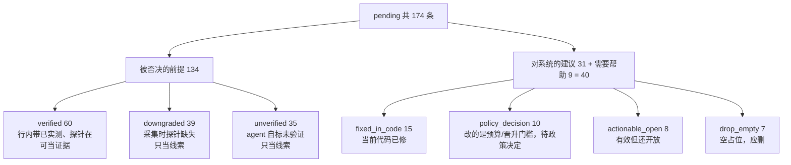

# 代理反馈待审统计（2026-10-22）

## 这篇讲什么

来源：`/Users/kuafu/CLionProjects/ai_lowerling/data/observe.sqlite`，`status='pending'` 共 **174** 条。本报告只读索引和运行目录，不调用模型、不启动 GPU。

读这份报告要先分清三件事：

- **能被当作实测证据的只有 60 条**，条件是 premise（前提）里有 `[已实测: ...]` 标记，并且探针文件现在能在 `agent_work` 里找到。
- **采集时探针缺失的 39 条**已经被解析器改写成 `[未验证: ...]`，只能当「别再试」的线索。
- **agent 自己标了 `[未验证]` 的 35 条**有信息量，不是证据。

## 结论

- 174 条 = **被否决的前提 134** + **对系统的建议 31** + **需要帮助 9**。
- 可直接当作实测证据：**60 条**（含 83 行 `[已实测]`，探针文件现在都存在）。
- 有效但还开放的系统建议：**8 条**；需要政策决定：**10 条**；当前代码已修：**15 条**。
- 明确的未验证前提：**74 条**（35 条 `[未验证]` + 39 条采集时探针缺失被降级）；只能当“别再试”的线索，不能当证据。
- 不应进入待审：**7 条空占位**（“无/没有/不需要”）；33 条非空建议/求助合并为 10 个主题，其中 **23 条是同一主题的重复**。
- 行级：83 行 `[已实测]`，其中 83 行探针存在、0 行缺失；74 行 `[未验证]`，190 行分析/补充。



## 分类计数

### 按 verdict

| verdict | 条数 |
| --- | ---: |
| valid_measured | 60 |
| missing_probe_at_capture | 39 |
| open_unverified | 35 |
| fixed_in_code | 15 |
| policy_decision | 10 |
| actionable_open | 8 |
| drop_empty | 7 |

### 按 section

| section | 条数 |
| --- | ---: |
| 被否决的前提 | 134 |
| 对系统的建议 | 31 |
| 需要帮助 | 9 |

### 被否决的前提：按 stored premise

| 被否决的前提的 stored premise | 条数 |
| --- | ---: |
| verified | 60 |
| downgraded | 39 |
| unverified | 35 |

### 系统建议/求助：按 topic（含空占位）

| 系统建议/求助 topic（含空占位） | 条数 |
| --- | ---: |
| self_check_dir | 7 |
| budget | 7 |
| relative_path | 7 |
| other | 7 |
| roofline | 5 |
| bench2 | 2 |
| dce | 2 |
| xctrace | 1 |
| seed_report | 1 |
| max_threads | 1 |

### 系统建议/求助：按 topic（不含空占位）

| 非空系统建议/求助 topic | 条数 |
| --- | ---: |
| self_check_dir | 7 |
| relative_path | 7 |
| roofline | 5 |
| budget | 5 |
| other | 2 |
| bench2 | 2 |
| dce | 2 |
| xctrace | 1 |
| seed_report | 1 |
| max_threads | 1 |

## 有效：实测证据

60 条 premise 至少有一行 `[已实测]`，探针文件现在都能在 `agent_work` 里找到。它们主要是算法/硬件结论，不是系统缺陷；逐条 ID、原文和行级计数在 JSON 的 `rows`。

## 有效：系统建议

- **budget**：7 条，{'drop_empty': 2, 'policy_decision': 5}；IDs: apple-m4-max/conv2d-feedback-20261021#25:89cf6bce36fa1059, apple-m4-max/conv2d-feedback-20261021#25:ffd8597b65917f4b, apple-m4-max/conv2d-feedback-20261021#24:5dccb2805904ff73, apple-m4-max/conv2d-feedback-20261021#23:5e3aa0e0d88db417, apple-m4-max/conv2d-feedback-20261021#22:6f03fdfc09e1384e, apple-m4-max/conv2d-feedback-20261021#20:70995c95b5645c84 …
- **other**：7 条，{'actionable_open': 2, 'drop_empty': 5}；IDs: apple-m4-max/conv2d-feedback-20261021#21:916eddc12af2170f, apple-m4-max/conv2d-feedback-20261021#12:f147c5687fd2c005, apple-m4-max/conv2d-feedback-20261021#10:c250394477600afa, apple-m4-max/conv2d-feedback-20261021#8:cc2c69fe557869fe, apple-m4-max/conv2d-feedback-20261021#4:62f79233fd693413, apple-m4-max/conv2d-feedback-20261021#2:e68ac7488c95f9ce …
- **relative_path**：7 条，{'fixed_in_code': 7}；IDs: apple-m4-max/conv2d-feedback-20261021#24:2901139ec6aac107, apple-m4-max/conv2d-feedback-20261021#22:55ad3ee9f619f49d, apple-m4-max/conv2d-feedback-20261021#18:bce47133d04dbb2d, apple-m4-max/conv2d-feedback-20261021#14:552c53eb55120a6c, apple-m4-max/conv2d-feedback-20261021#6:4add830bfa1826f6, apple-m4-max/conv2d-feedback-20261021#4:62d0ed3e7449b4cc …
- **self_check_dir**：7 条，{'fixed_in_code': 7}；IDs: apple-m4-max/flash_attention-20261022-2#20:78bb75b3bebf8b5f, apple-m4-max/flash_attention-20261022-2#18:a37b301aa5de3caf, apple-m4-max/flash_attention-20261022-2#16:26972d1cd606d3e0, apple-m4-max/flash_attention-20261022-2#4:f8b72d076e9fcabc, apple-m4-max/flash_attention-20261022-2#1:143203d190784f46, apple-m4-max/flash_attention-20261022#2:fe1fa5ab832605e8 …
- **roofline**：5 条，{'policy_decision': 5}；IDs: apple-m4-max/flash_attention-20261022-2#16:2e83b5b0aa3829c5, apple-m4-max/flash_attention-20261022-2#12:6507501743063885, apple-m4-max/flash_attention-20261022-2#10:dbec79230face025, apple-m4-max/flash_attention-20261022-2#6:d479eaeac8205256, apple-m4-max/conv2d-feedback-20261021#13:d199a42c0939be42
- **bench2**：2 条，{'actionable_open': 2}；IDs: apple-m4-max/conv2d-feedback-20261021#16:32fec21e08e6b390, apple-m4-max/conv2d-feedback-20261021#12:342d9c1130422251
- **dce**：2 条，{'actionable_open': 2}；IDs: apple-m4-max/conv2d-feedback-20261021#8:39fe45c0060e2cff, apple-m4-max/conv2d-feedback-20261021#6:3cecf8498f023aa7
- **max_threads**：1 条，{'actionable_open': 1}；IDs: apple-m4-max/conv2d-feedback-20261021#6:4832daa0dd6d0503
- **seed_report**：1 条，{'fixed_in_code': 1}；IDs: apple-m4-max/conv2d-feedback-20261021#10:d5e8ee242c9f5a96
- **xctrace**：1 条，{'actionable_open': 1}；IDs: apple-m4-max/conv2d-feedback-20261021#17:17bb84ef361401f6

## 应剔除 / 应降级

### 空占位（7 条，应直接删除，不进入待审）

- `apple-m4-max/conv2d-feedback-20261021#25:89cf6bce36fa1059` 需要帮助 r24.p0: 无（预算 $14.79/$15.00 已尽，后续各棒基本只能复测种子）。
- `apple-m4-max/conv2d-feedback-20261021#14:41fd6fd117d4a301` 需要帮助 r13.p0: 无。本轮不需要外部改动就能推进，卡点是硬件预算是死的（见 NOTES §3）。
- `apple-m4-max/conv2d-feedback-20261021#12:f147c5687fd2c005` 需要帮助 r11.p0: 没有阻塞性的事。这一轮不需要人介入；下面两条只是想让人看一眼。
- `apple-m4-max/conv2d-feedback-20261021#10:c250394477600afa` 需要帮助 r9.p0: 没有。本轮不需要人介入，交回的核已验证（correct / safe / validated）。
- `apple-m4-max/conv2d-feedback-20261021#4:62f79233fd693413` 需要帮助 r3.p0: 无。核已合格、比种子快（交错 A/B 一致约 1.05×），`--timed --validate` 三次里有两次印「够换种子」。
- `apple-m4-max/conv2d-feedback-20261021#2:e68ac7488c95f9ce` 需要帮助 r1.p0: 无。本目录的核已经能编译、过六用例、`--timed --validate` 三次都印「够换种子」。
- `apple-m4-max/conv2d-feedback-20261021#1:fe2cfc4ca411cd51` 对系统的建议 init: 无（这轮能拿到的东西都拿到了；真正值得系统层面改的是下面「被否决的前提」里那条
——`experience.md` 里「32 个累加器片段就溢出」的说法在这一题上被过度推广了，见下）。

### 采集时探针缺失（39 条，已标成未验证，不应作为 `[已实测]` 审查）

这些行在采集时引用的探针文件不存在，解析器已改写成 `[未验证: 探针文件不存在 | … | …]`。它们可以保留为“别再试”的记录，但不应该和 60 条有探针的实测混在一起计数。

**本次审计前的数据问题**：`prune_work` 曾把 FEEDBACK.md/NOTES.md 引用的探针一起归档，行级检查一度 83 行全部找不到文件。已修：`prune_work` 现在保留被引用文件；`experiments.restore_feedback_evidence` 从 `scratch/` 恢复了 538 个文件。当前 83 行都能找到探针；索引里 39 条仍保留采集时 `downgraded` 的文本，重新解析或人工复核前不要把它们当实测。

### 明确未验证（35 条，保留为开放问题）

这些是 agent 自己标了 `[未验证]` 的前提；有信息量，但不是证据。审查时只决定“要不要继续追”，不要接受为事实。

## 已修 / 已过时

15 条建议指向旧 TASK.md 或旧 self-check 路径：

- `self_check_dir`：已把 `--self-check-dir` 改到工作区内 `.selfcheck/`，agent 沙箱可写；旧 run 的外层 `session_checks` 仍可回退（提交 `1fd881d`）。
- `relative_path` / `seed_report`：当前 `_check_command` 用绝对路径的 kernel 与 `report.json`。

## 待政策决定

10 条是有效建议，但改的是预算/晋升门槛，不是 bug：

- `apple-m4-max/flash_attention-20261022-2#16:2e83b5b0aa3829c5` roofline r15.p0: 成绩单印的「标定峰值 14.766 TFLOP/s」偏保守：本机同 launch、同 4096 mma/SIMD 组的 mma 流 273 µs 就跑完 4.295 GFLOP（15.7 TFLOP/s，`probe_r
- `apple-m4-max/flash_attention-20261022-2#12:6507501743063885` roofline r11.p0: `flash_attention / fp16 / paper` 在 apple-m4-max 上已经到顶：交卷版 GPU 侧 292.5 µs = 14.68 TFLOP/s = 标定峰值
14.766 的 99.4 
- `apple-m4-max/flash_attention-20261022-2#10:dbec79230face025` roofline r9.p0: 换种子按 wall 比，而 wall 含一段不随候选变动的固定开销：实测 `wall − GPU-ts` = 16.9-17.8 µs，来自 `run_pipeline` 里每次
  dispatch 的 Python/
- `apple-m4-max/flash_attention-20261022-2#6:d479eaeac8205256` roofline r5.p0: 这题的核已贴着硬件底线：实测 mma 单元对真实操作数 14.2-14.5 TFLOP/s（即成绩单 14.8 的 fp16 峰值），4.19 M 条 mma 对应 294 µs，下界 290.9 µs，提交版 GPU 
- `apple-m4-max/conv2d-feedback-20261021#25:ffd8597b65917f4b` budget r24.p0: 全局 $15 预算在最后约 10 轮里实际锁死了搜索：每轮只剩 ~$0.2，只够「复测种子 + 写笔记」，
  不够一次「改动 + 两轮 eval」的完整循环。后期若无晋升， patience 是在烧固定的 sessio
- `apple-m4-max/conv2d-feedback-20261021#24:5dccb2805904ff73` budget r23.p0: 预算：本运行 $14.77 / $15.00 开局，只够一次改动 + 一次实测。到 r23 为止 `conv2d` 已经连续
4 轮 unchanged，剩下的都是「必须实测才能判真假」的硬件级问题（寄存器驻留、CGRA
- `apple-m4-max/conv2d-feedback-20261021#23:5e3aa0e0d88db417` budget r22.p0: 剩余预算低于一场会话的成本时，继续开新会话只能产出「复测种子 + 原样交卷」（r21、r22
连续两轮如此）。建议在预算余量 < 单场均价时直接停搜或只跑确认计时，把余钱留给还有
预算的题目；否则每一轮都在烧确认一场注定
- `apple-m4-max/conv2d-feedback-20261021#22:6f03fdfc09e1384e` budget r21.p0: 预算告警应该在 prompt 里更显眼：本轮开始时 $14.55/$15.00，只够 1 次 `--timed` + 1 次配对 bench，
  于是「测一个方向」和「把三种因素拆开」只能二选一。建议在预算低于 5% 
- `apple-m4-max/conv2d-feedback-20261021#20:70995c95b5645c84` budget r19.p0: `--timed` 的自测里「候选 vs 种子」是**跨会话**比较（本次种子锚点 490.9 µs，本轮实测同一颗核 486.8 µs，机器慢 0.7%），
  而 `--min-improvement` 门槛按这个差
- `apple-m4-max/conv2d-feedback-20261021#13:d199a42c0939be42` roofline r12.p0: 队友避坑提示的转发范围建议扩大到**所有**前轮的「被否决的前提」，而不只是最近两轮。本轮的提示列表只含 r9 和 r11 的条目；r9 用模拟器实测否决「fp16 操作数」的数字（V fp16 = 6.71 倍容差）只

## 修复建议（按优先级）

1. **删除 7 条空占位**，并让 `taic/agent_feedback.py` 把“无/没有/不需要”这类整段识别为空，不再进入 pending。
2. **把 39 条探针缺失行降为 info**（或保留但不在“待审证据”里计数）；它们的探针已从 `scratch` 恢复 538 个文件，重新解析后可能有一部分能升级为 verified。
3. **合并 23 条系统建议的重复主题**：self-check 7、relative path 7、roofline 5、budget 5、bench2 2、DCE 2，其余各 1。每个主题只保留一条开放问题。
4. **关闭已修的 15 条**（self-check/relative/seed-report），并在看板上标注“已修”。
5. **保留未验证前提**，但打上“未验证”标签，不做实测证据。

## 复现

```bash
uv run python -m experiments.feedback_audit
```

机器可读：`docs/feedback_audit_20261022.json`；逐条 `verdict`、`measured_lines`、`text` 都在 `rows`。

## 执行记录（2026-10-22）

- 解析器升 `fbv3`：7 条空占位不再生成 claim；已有审查文件里的对应条目保留为 `obsolete`。
- 用 `experiments.apply_feedback_audit --merge-topic` 写回 174 条：60 条实测 `adopted`、15 条已修 `done`、35 条未验证 `info`、7 条空占位 `obsolete`，其余保留 `pending`。
- 探针恢复后重建索引：多数降级前提升级为 `verified`（当前索引 31 条；仍保留原 digest 和审查键），8 条没有可恢复探针的保持 `downgraded`。
- 复核指出按 topic 合并过宽后，`experiments.revert_topic_merges` 把 10 条 `duplicate of` 的 `obsolete` 改回 `pending`，备注改为「possible same topic」；当前 pending 为 57。7 条空占位仍保留 `obsolete`。
- 写回后的待审计数包含 39 条采集时缺探针的前提；它们现在只在人工复核队列里，不会被当成实测证据。`--merge-topic` 是显式选择，topic 本身不是命题等价。

```bash
uv run python -m experiments.apply_feedback_audit --dry-run
uv run python -m experiments.apply_feedback_audit --apply --merge-topic
```
