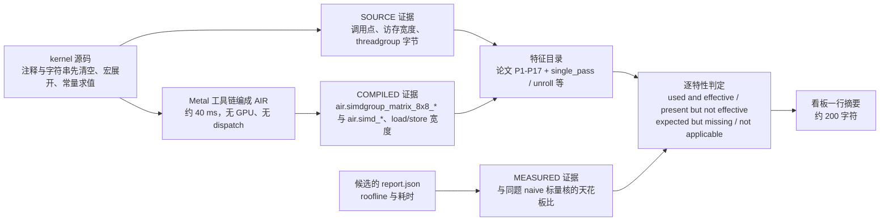

# Hardware features: what the paper credits, what Apple GPUs offer, and what the generated kernels use

## 中文导读（这篇讲什么）

- **它回答什么问题：** 模型写出来的 Metal 源码，有没有用上论文点名的那些硬件特性；这块苹果 GPU 又到底有没有对应的特性。
- **短答：** 检测器只能判断「这个特性出现在源码里，或出现在编译器输出里」，**不能判断「加速是它带来的」**。检测器是 `taic/hwfeatures.py`；`experiments/hw_features.py` 在已经落盘的运行上生成报告（`runs/hw_features/REPORT.md`）。搜索默认不开这条，只有设了 `search.hw_feedback` 才会用。
- **为什么保留论文里的特性名：** 检测器就是按那些名字做匹配的。
- **谁可以停在这里：** 新读者读完这一段和第 9 节就够。

三条读法：

1. 第 1-3 节是「论文有什么、苹果这边对应什么、每道题的最优核该用什么」。表里的定量数字多是论文作者的解释，不是控制变量的对照实验。
2. 第 4-5 节是检测器本身和它的校验；第 6 节是一次快照的发现。
3. 第 7-9 节是限制、可选消融（只写了方案，没跑）和接线。

| 节 | 讲什么 | 中文提示 |
| --- | --- | --- |
| 1 | 论文表 1：P1-P17 硬件特性与定量归因 | 归因是作者解释；内存受限的核基本没收益 |
| 2 | 表 2：每条特性在 M4 Max 上的对应物 | 状态只有三档：直接对应 / 部分对应 / 无对应 |
| 3 | 表 3：每道题的最优核预期要用什么 | `R` 必需、`r` 推荐、空 = 不适用 |
| 4 | 检测器：源码、编译产物、实测三级证据 | 不派发 GPU，只编译到 AIR |
| 5 | 校验：参考核、naive 核、负例、源码对编译器 | 40 个测试 |
| 6 | 一次快照的发现 | 快照会过期，不是当前 benchmark 结果 |
| 7 | 限制 | 最重要的一条：存在性能验证，因果不能 |
| 8 | 可选消融（描述，未运行） | 要独占显卡锁，所以没做 |
| 9 | 接线：反馈进入搜索循环（可选开启） | 默认关，`--hw-feedback` 打开 |

Question this answers: can we tell whether the Metal text the model wrote uses the hardware features the paper credits, and the features this Apple GPU actually has?

Short answer: the detector can say a feature is present in the source or in the compiler output. It cannot say the speedup happened because of that feature. `taic/hwfeatures.py` is the detector. `experiments/hw_features.py` writes the report over runs already on disk (`runs/hw_features/REPORT.md`). Search does not turn this on unless `search.hw_feedback` is set.

The rest of this note keeps the paper's feature names, because those names are what the detector matches. A new reader can stop after this paragraph and section 9.

Historical note: the measured peaks quoted in sections 2-3 and the numbers in sections 5-6, plus the A/B status in section 9, are snapshots from the dates printed there or from the 2026-10 calibration. `runs/hw_features/REPORT.md` is regenerated and may differ; these are not current benchmark results. The detector and test counts in section 4 are current as of the 2026-10-23 audit.

Contents: 1 the paper's features (table 1) - 2 their Apple/Metal analogues (table 2) - 3 what an optimal kernel of each task is expected to use (table 3) - 4 the detector - 5 validation - 6 findings - 7 limits - 8 optional ablation - 9 integration.

Page numbers are the page of the PDF (1-15, the number printed at the bottom). "Quoted" text is verbatim from the paper; everything else is a paraphrase. The paper reports speedups of whole kernels; the "because of" attributions below are the authors' explanations, not controlled experiments.

---

## 1. Table 1 - hardware features and hardware-oriented techniques in the paper

**中文要点：** 论文把 Triton 降到 NVIDIA PTX，测在 L40S（Ada）、H100（Hopper）、B200（Blackwell）三种卡上。P1-P17 是论文在生成的核里、或在「为什么快」的分析里点名的全部特性；表里第三列的数字是论文给出的归因，属于作者解释，不是控制变量实验。

另有两条不属于特性、但读这张表要一起看的结论：源码要求 IEEE-754 语义时，生成的 PTX 会避开 Tensor Core；elementwise 与 recurrent 负载「基本持平」，即内存受限的核从这些特性没有收益。

论文里**搜过但没找到**的项，所以下文不会把任何一条说成「论文的特性」：warp specialization（只在相关工作里作为 Tawa 的异步引用出现）、persistent kernel、occupancy / 寄存器压力调优、128 位向量加载本身（只有 32-bit loads 与 vectorized global stores）、fast-math 开关、启动配置搜索（契约固定网格与线程）。「去掉边界 mask」是 Triton 基线的准备工作，不是生成核的特性。

The paper lowers Triton to NVIDIA PTX on L40S (Ada), H100 (Hopper), B200 (Blackwell). Every feature the paper names in generated kernels or in its analysis of why they are fast:

| ID | feature (paper's words) | where | quantitative attribution in the paper |
| --- | --- | --- | --- |
| P1 | Tensor Core MMA: "mma.sync + ldmatrix" on Ada; FP16/FP8 inputs, FP32 accumulation; row sums computed as MMA with a ones operand ("expresses each row sum as X1 and uses Tensor Cores") | Fig. 3 (p. 6); sec. 4.1 (p. 6-7); A.1 reduction sum (p. 13); A.2 FlashSinkhorn (p. 14) | reduction sum: two 16x8x16 `mma.sync` replace "scalar conversion and reduction chains" (H100 FP16); one 16x8x32 MMA on L40S FP8 = 1.125x; FlashSinkhorn: FP16 coordinates "feed mma.sync.m16n8k16 directly", replacing FP16->FP32 conversions and TF32 m16n8k8; "doubling the reduction extent per MMA also halves the number of matrix instructions" = 1.55x |
| P2 | Larger asynchronous MMA tiles: `wgmma.mma_async.m64n256k32` instead of Triton's `m64n64k32` ("requiring more WGMMA instructions to cover the same output tile"); tile held in registers ("the fixed coordinate tile remains in registers") | A.1 H100 FP8 GEMM (p. 13); A.2 FlashSinkhorn (p. 14); sec. 4.2 (p. 8) | H100 FP8 GEMM 1.61x ("larger WGMMA tiles, fewer synchronization points, and a cheaper transposing epilogue"); not on other architectures ("explaining the gain on Hopper and its absence on the other architectures") |
| P3 | Blackwell `tcgen05` MMA with tensor memory (TMEM) accumulators, descriptor-based operand layouts, "asynchronous execution coordinated through commits, waits, memory barriers, and proxy fences" | abstract (p. 1); Fig. 3 (p. 6); A.1 conv (p. 13) | B200 FP8 conv: "pipelined input and weight buffers feed tcgen05.mma, yielding 2.23x" |
| P4 | Decoding packed data straight into Tensor Core operands: BitDelta "constructs packed FP16 representations of +-1 directly ... each lop3 produces two decoded values", and "decoded weights can be written directly to the tensor-memory operand of tcgen05.mma, eliminating a shared-memory store-reload cycle" | abstract (p. 1); sec. 4.4 (p. 8); A.2 (p. 13-14) | BitDelta 3.34x (batched 2.51x, same strategy); together with "a four-stage activation pipeline, two alternating weight buffers, and a reduction step increased from 32 to 64" |
| P5 | Shared-memory bank-conflict avoidance by swizzling: "XOR bank swizzle" (Ada), "128-B XOR swizzle" (Hopper), "64-B offset swizzle" (Blackwell) | Fig. 3 (p. 6); sec. 4.1 (p. 7) | none given |
| P6 | Shared-memory staging of operand tiles, packed shared-memory stores, circular shared-memory cache for window reuse (Triton "uses scalar loads and shared-memory staging") | A.1 conv (p. 13) | conv: H100 FP16 1.90x, L40S FP8 1.17x with "a circular shared-memory cache" |
| P7 | Double buffering / multi-stage pipelines: "explicit double buffering prepares the next A/B tile while the current Tensor Core operations execute"; "packed shared-memory stores and double buffering overlap operand preparation with WGMMA"; "double buffering and overlap between normalization updates and matrix operations" | A.1 (p. 13); A.2 FlashAttention (p. 14) | part of H100 FP8 GEMM 1.61x, conv 1.90x / 2.23x, FlashAttention 1.37x |
| P8 | Asynchronous copies: "cp.async pipeline" (Ada), "TMA + mbarrier" (Hopper), "TMA 2-D + phase parity" (Blackwell) | Fig. 3 (p. 6); sec. 4.1 (p. 6-7); App. B (p. 14) | none given (used on every architecture: "A check mark denotes that the generated kernels use the feature") |
| P9 | Warp-level shuffles and reductions, combined with Tensor Cores: "three shuffle-and-add stages ... one atomic update per warp and no shared-memory reduction or block barrier"; `redux.sync.add`, `redux.sync` min/max after a sign-aware remap; warp-independent log-sum-exp "without block barriers or shuffles in the loop" | intro (p. 2); sec. 4.5 (p. 9); A.1 (p. 13); A.2 (p. 14) | reduction sum: replaces Triton's reduction that "accumulates values within threads and warps, combines partial results through shared memory, and finally uses atomic updates"; H100 FP8 `redux.sync.add` + one barrier = 1.09x; FlashSinkhorn 1.55x |
| P10 | Packed / vectorized memory access and packed arithmetic: "32-bit loads fetch adjacent pixels", "vectorized global stores", "packed f32x2 arithmetic", packed formats "16x2 and 8x4" | A.1 (p. 13); A.2 (p. 14); App. B (p. 14) | part of conv 1.90x; part of FlashAttention 1.37x |
| P11 | Softmax ownership aligned with the accumulator layout: "assigns each thread a complete 32-score row in the native tensor-memory layout, making the maximum and sum register-local reductions and eliminating shuffle instructions"; two 64-row query tiles combined into one 128-row tile ("each key/value tile serves twice as many queries") | abstract (p. 1); A.2 FlashAttention (p. 14) | FlashAttention 1.37x (five-run mean 1.236 +- 0.106, best 1.366x, Table 1, p. 8) |
| P12 | Epilogue and layout conversion: "transposing `stmatrix` variant, followed by one synchronization and vectorized global stores" instead of Triton's "repeatedly stores accumulator fragments to shared memory, synchronizes, and reloads" | A.1 (p. 13) | part of H100 FP8 GEMM 1.61x |
| P13 | Thread / work mapping: each warp "an independent 128-point slice" with separate accumulators; "a single warp uses one 16x8x32 MMA"; plans range "from local instruction-level edits to global changes in thread mapping, data movement, or synchronization" | sec. 3.3 (p. 5); A.1-A.2 (p. 13-14) | FlashSinkhorn 1.55x |
| P14 | Bit-level tricks: funnel shifts and byte permutations to build neighbouring values from 32-bit loads ("byte permutations reuse a small set of 32-bit loads across several filter offsets"), `lop3` sign-bit manipulation, sign-aware integer remap for float max/min | A.1 (p. 13); sec. 4.5 (p. 9) | conv H100 1.90x, B200 2.23x; BitDelta 3.34x |
| P15 | Fewer synchronization points: "synchronization occurs only when a shared-memory stage is consumed or reused"; "reduce block barriers from three to one per loop iteration"; "eight iterations without block barriers" | A.1 (p. 13); A.2 (p. 14) | part of H100 FP8 GEMM 1.61x, FlashAttention 1.37x, FlashSinkhorn 1.55x |
| P16 | Target-specific instruction selection / math ("selecting target-specific instructions that are not exposed by Triton's evaluated lowering pipeline"; `tanh`, `exp2` modelled by the verifier) | intro (p. 2); App. B (p. 14) | none given |
| P17 | Data reuse across overlapping convolution windows ("reusing overlapping convolution windows (up to 2.23x)") | abstract (p. 1); A.1 (p. 13) | conv 1.17x-2.23x |

Also relevant: when the Triton source requests IEEE-754 semantics "the generated PTX avoids Tensor Core operations" (sec. 4.1, p. 7); elementwise kernels and recurrent workloads "remain near parity" (sec. 4.2, 4.4, p. 7-8): the paper's own result is that memory-bound kernels gain nothing from these features. FP8 Tensor Core formats appear in the FP8 results (sec. 4.2, p. 8).

**Searched for and not found in the paper** (so nothing below is claimed to be "the paper's feature"): warp specialization (only in related work, p. 2-3, as Tawa's asynchronous references), persistent kernels, occupancy / register-pressure tuning, 128-bit vector loads as such (only "32-bit loads" and "vectorized global stores"), fast-math flags, launch-configuration search (the contract fixes grid and threads, sec. 3.1-3.2, p. 4). "Removing boundary masks" (p. 6, p. 8) is a Triton-baseline preparation, not a generated-kernel feature.

---

## 2. Table 2 - Apple / Metal analogue of every paper feature (M4 Max, Apple9 GPU family)

**中文要点：** 这一节逐条给 P1-P17 找 M4 Max 上的对应物，状态只有三档：`direct analogue`（直接对应）、`partial analogue`（部分对应）、`no analogue on M4 Max`（这块芯片没有）。

「How verified（怎么验证的）」有四种：

- **runs**：`runs/` 里真有一颗核用它，经 harness 编译、算对、计时过；
- **compile**：我在本机工具链（32023.883，MSL 4.0）上编过探针，没有 GPU；
- **repo doc**：仓库文档（`backends/metal/skills/msl_reference.md` 或 `apple_gpu_optimization.md`）写了，我没有复核；
- **background**：我了解的苹果文档，标了不确定。

最要紧的五条：P3（Blackwell 的 tensor memory）在 M4 Max 没有对应；P8（异步拷贝）没有公开对应，只能用寄存器预取模拟；P1 的矩阵单元是每个 SIMD group 8x8x8，比论文一个 warp 16x8x16 小；P10 只有宽访存对应，打包算术没有已知对应；FP8 类型完全没有。

Status vocabulary: `direct analogue`, `partial analogue`, `no analogue on M4 Max`. "How verified" says what I actually checked: **runs** = a kernel in `runs/` that uses it, compiled by the harness, correct and benchmarked (the AIR intrinsic names are in the compiled evidence of `runs/hw_features`); **compile** = I compiled a probe with the installed Metal toolchain (32023.883, MSL 4.0) in this session, no GPU; **repo doc** = stated in `backends/metal/skills/msl_reference.md` or `apple_gpu_optimization.md` and not re-checked by me; **background** = my knowledge of Apple's documentation, flagged uncertain.

| ID | Apple analogue | status | how verified | notes / uncertainty |
| --- | --- | --- | --- | --- |
| P1 | `simdgroup_matrix` 8x8x8 MMA: `simdgroup_load` / `simdgroup_multiply_accumulate` / `simdgroup_store`; half/bfloat inputs with float accumulators; `ldmatrix` is `simdgroup_load` (from threadgroup or device memory, optional `transpose`) | direct analogue (smaller tile: 8x8x8 per SIMD group vs 16x8x16 per warp) | runs: `p1/gemm_paper` best compiles to `air.simdgroup_matrix_8x8_multiply_accumulate.v64f32.v64f16.v64f16.v64f32` and reaches 14.5 TFLOP/s = 98 % of the measured matrix peak (14.77); `simdgroup_load(..., transpose=true)` in `p1/fa_paper` best | matrix unit is synchronous per SIMD group; no tensor-memory operand path |
| P2 | More accumulator fragments per SIMD group (register blocking, e.g. 4x4 fragments = a 32x32 sub-tile) | partial analogue | runs: 16-fragment kernels are the best GEMMs; reference GEMMs with >= 32 fragments take 12-26x longer (`runs/contract_sensitivity`, spills) | there is no warpgroup-level async MMA; the register file bounds the tile |
| P3 | none for tensor memory. Nearest: accumulators live in registers; Metal 4 `mpp::tensor_ops::matmul2d` (cooperative tensors) | no analogue on M4 Max | compile: `matmul2d` with `<MetalPerformancePrimitives/MetalPerformancePrimitives.h>` compiles to AIR; **but** `tcenv/backends/metal/screen.py` accepts only `<metal_*>` includes, so the harness refuses that header; `#include <metal_tensor>` alone has no `matmul2d` | whether it would *run* on M4 Max was not tested (no GPU pipeline created); `msl_reference.md` says it targets newer neural-accelerator GPUs |
| P4 | Writing `simdgroup_matrix::thread_elements()` (2 elements per lane of an 8x8 tile) so decoded or shuffled values become operand fragments without a threadgroup round trip | partial analogue | runs: `p1/fa_flash` best builds K, V and P fragments this way and passes the correctness gates | lane-to-(row, col) mapping is "an implementation detail rather than documented API" (`msl_reference.md`); BitDelta has no run yet |
| P5 | Row padding (`stride = BLOCK_K + 8`), odd strides; XOR swizzle is index arithmetic but `simdgroup_load` takes pointer + stride, so it cannot swizzle inside an 8x8 tile | partial analogue | runs: `p1/gemm_paper` best pads A/B/C by 8 halves; `p1/fa_flash` best uses stride 33 words | Apple does not document the threadgroup-memory bank layout; `msl_reference.md` says 32 banks x 4 B (not re-checked). The effect of padding on M4 is **uncertain** (not isolated) |
| P6 | Threadgroup memory (32 KiB per threadgroup), `threadgroup_barrier` | direct analogue | runs: pipeline reflection of every candidate (`static_threadgroup_bytes` up to 25.6 KB seen) | |
| P7 | Two or more threadgroup buffers selected by loop parity; slot pointers into one array | direct as a pattern, partial in effect | runs: ring buffers in `p1/fa_flash`, `p1/fa_paper`, 3-deep sub-tiles in `pilot/gemm_fp16` best | without an async copy engine the overlap comes from other SIMD groups / threadgroups running while one waits, or from register prefetch (P8) |
| P8 | No public async copy. Emulation: issue the next tile's device loads into registers before the MMAs, store them to threadgroup memory after (loop-carried "register prefetch") | no analogue on M4 Max (public); partial emulation | compile: `simdgroup_event` is "unknown type name" with the installed toolchain headers (no `metal_simdgroup_event`); runs: `p1/gemm_paper` best does the register prefetch | an undocumented private async-copy intrinsic may exist in other Apple toolchains (background, **uncertain**, not tested) |
| P9 | `simd_sum/max/min`, `simd_prefix_*`, `simd_shuffle*`, `simd_broadcast`; integer versions replace `redux.sync`; `atomic_*` | direct analogue | runs: AIR `air.simd_sum.f32`, `air.simd_max.f32`, `air.simd_shuffle_xor.f32` in the best softmax / FlashAttention / GEMM-epilogue kernels | the harness rejects nondeterministic float atomics (`msl_reference.md`) |
| P10 | `half4` / `float4` / `uint4` accesses (16 B per lane; `ulong` 8 B), `packed_*` types | direct analogue for accesses; **no** packed-math analogue known | runs: AIR `load <4 x i32> addrspace(1)` in the best kernels; skills say half math has no throughput benefit | whether Apple ALUs execute `float2` ops packed is undocumented (background, **uncertain**) |
| P11 | Each lane holds 2 elements of every 8x8 fragment, so a row is spread over 4 lanes: row max / sum need `simd_shuffle_xor` (x1, x8); a thread-owns-a-row layout needs a round trip through threadgroup memory | partial analogue | runs: every FlashAttention best kernel does the shuffle form | the paper's "no shuffles" needs a layout Metal does not expose |
| P12 | `thread_elements()` epilogue on accumulator registers, `simdgroup_store` (has a `transpose` argument per `msl_reference.md`), vectorized stores | direct analogue (transposing store not tested by me) | runs: GEMM / conv / FlashAttention best kernels apply their epilogue on `thread_elements()` | |
| P13 | `simdgroup_index_in_threadgroup`, `thread_index_in_simdgroup`, per-SIMD-group sub-tiles | direct analogue | runs | the contract fixes grid and threads (like the paper, sec. 3.2) |
| P14 | Integer shifts / masks / `as_type`, `extract_bits`, `insert_bits`, `popcount`, `rotate`; no `prmt` / `lop3` / funnel-shift intrinsic | partial analogue | runs: `p1/fa_flash` best packs key pairs with shifts and masks (AIR shows plain `shl` / `and` / `or`) | whether the back end fuses them is not visible at AIR level (**uncertain**) |
| P15 | Fewer `threadgroup_barrier`s per iteration; `simdgroup_barrier` | direct analogue | runs: 1 barrier per 8-key slice in `p1/fa_flash` best | |
| P16 | `fast::exp2`, `fast::tanh`, `precise::`; fast math is on by default in the harness | partial analogue | runs: `air.fast_exp2.f32`, `air.fast_fmax.f32` in AIR | `precise::sin/cos` needed for RoPE angles (skills) |
| P17 | Algorithmic: keep overlapping windows in registers / threadgroup memory, `simd_shuffle` for neighbours | direct analogue | not detectable by the detector (needs data-flow) | scored manually only |
| (FP8) | none: Apple GPUs have no FP8 types | no analogue on M4 Max | repo doc (README: "FP8 not available on Apple GPUs") | |

---

## 3. Table 3 - hardware features an optimal kernel of each task is expected to use

**中文要点：** `R` = 必需（最优核一定有），`r` = 推荐（论文或仓库技能说有收益，最优核通常有），空 = 不适用。这张表来自技能文档、论文表 1 和本仓库的证据（实测峰值：矩阵约 14.8 TFLOP/s、标量 FMA 约 5.5 TFLOP/s；带宽约 449-527 GB/s）以及每道题的 roofline。机器可读副本是 `experiments.hw_features.EXPECTED`，测试保证这张表与代码一致。

按家族看：

- **elementwise（sigmoid、relu、silu、swiglu、lion、rope）：带宽受限**，算术强度 0.2-1.2 FLOP/B，下界 = 字节 / 475 GB/s；要宽访存和单遍读。
- **行归约（rmsnorm、softmax、reduction_sum）与 gemv**：同样带宽受限，要 `simd_sum` / `simd_max`；矩阵单元**不**划算，因为这道题就贴着 DRAM roofline。
- **gemm、gemm_silu、conv2d（隐式 GEMM）、bitdelta_gemm**：计算受限（算术强度 373-1638 FLOP/B，ridge 31），要矩阵单元 + 浮点累加 + 寄存器分块 + threadgroup 暂存。
- **flash_attention**：矩阵单元、online softmax（必需，不许把分数矩阵落盘）、行归约走 `simd_shuffle_xor`。
- **mamba2_chunk_scan**：每个 chunk 三次 `dot`（AI 58 FLOP/B），矩阵单元与暂存是推荐，不是旗舰用例。

`R` = required (an optimal kernel has it), `r` = recommended (the paper or the repo's skills say it pays, the best kernels usually have it), empty = not applicable. Derived from `backends/metal/skills/apple_gpu_optimization.md`, the paper (table 1 above) and the evidence in this repository: measured peaks (matrix ~14.8 TFLOP/s vs ~5.5 TFLOP/s scalar FMA for GEMM, bandwidth ~449-527 GB/s) and the roofline of each task (`runs/hw_features/REPORT.md` section 3). The machine-readable copy is `experiments.hw_features.EXPECTED`; `tests/backends/metal/test_hw_features.py` checks that this table and the code agree.

| task | matrix unit | float accumulate | register blocking | tg staging | tg padding | pipelining | epilogue on fragments | online softmax | simd reduce | simd shuffle | operand in registers | bit packing | vector access | single pass | few barriers | fast math |
| --- | --- | --- | --- | --- | --- | --- | --- | --- | --- | --- | --- | --- | --- | --- | --- | --- |
| sigmoid |  |  |  |  |  |  |  |  |  |  |  |  | R | R |  | r |
| relu |  |  |  |  |  |  |  |  |  |  |  |  | R | R |  |  |
| silu |  |  |  |  |  |  |  |  |  |  |  |  | R | R |  | r |
| swiglu |  |  |  |  |  |  |  |  |  |  |  |  | R | R |  | r |
| lion |  |  |  |  |  |  |  |  |  |  |  |  | R | R |  |  |
| rope |  |  |  |  |  |  |  |  |  |  |  |  | R | R |  |  |
| rmsnorm |  |  |  |  |  |  |  |  | R |  |  |  | R | R | r |  |
| softmax |  |  |  |  |  |  |  |  | R |  |  |  | R | R | r | r |
| reduction_sum |  |  |  |  |  |  |  |  | R |  |  |  | R | R | r |  |
| gemv |  |  |  |  |  |  |  |  | R |  |  |  | R | R |  |  |
| gemm | R | R | R | R | r | r |  |  |  |  |  |  | r |  |  |  |
| gemm_silu | R | R | R | R | r | r | R |  |  |  |  |  | r |  |  | r |
| conv2d | R | R | R | R | r | r |  |  |  |  |  |  | R |  |  |  |
| flash_attention | R | R | R | r | r | r |  | R |  | r | r |  | r |  | r | r |
| bitdelta_gemm | R | R | R | R | r | r |  |  |  |  | r | R | r |  |  |  |
| mamba2_chunk_scan | r | r | r | r |  | r |  |  |  |  |  |  | r |  |  | r |

Reasoning per family:

* **Elementwise (sigmoid, relu, silu, swiglu, lion, rope): bandwidth-bound** (arithmetic intensity 0.2-1.2 FLOP/B, roofline lower bound = bytes / 475 GB/s). Required: wide device accesses (16 B per lane is the skills' recommendation; 8 B was enough in `runs/apple-m4-max/suite_full`, see section 6) and one pass over every input. `fast_math` is recommended only where there is an `exp`. Nothing else matters; the paper says the same ("within approximately 1 % of Triton", p. 7). `rope` also needs `precise::sin/cos` for large angles (skills), which is a correctness constraint, not a feature.
* **Row-wise (rmsnorm, softmax, reduction_sum) and gemv**: also bandwidth-bound; a row is reduced across lanes, so `simd_sum` / `simd_max` (required) with one cross-SIMD-group exchange (few barriers, recommended), a single read pass (registers hold the row; the online recurrence is only needed when the row does not fit: softmax N=2048 fits, so `online_softmax` is not expected). The matrix unit is not expected: `reduction_sum` over 4096x4096 fp16 moves 33.5 MB (~70 us at the measured 475 GB/s), and the paper's MMA row-sum trick (P1, A.1) pays on NVIDIA where the reduction is instruction-bound; here the task is at the DRAM roofline (no ablation was run; one candidate did try the MMA row sum, section 6).
* **gemm, gemm_silu, conv2d (implicit GEMM), bitdelta_gemm**: compute-bound (arithmetic intensity 373-1638 FLOP/B, ridge 31). Required: matrix unit with float accumulators, register blocking (a SIMD group owns a sub-tile of >= 4 fragments) and threadgroup staging; recommended: padded strides, software pipelining (double buffer or register prefetch) and wide device accesses. `gemm_silu` additionally requires the activation to be applied on the accumulator registers before the single store. `conv2d` requires wide gathers along the contiguous channel dimension. `bitdelta_gemm` requires bit-level decoding of the packed weights and recommends building the decoded operand fragments in registers (the paper's biggest gain, P4).
* **flash_attention**: matrix unit for QK^T and PV with float accumulators, online softmax (required: no score matrix may be materialized), row reductions through `simd_shuffle_xor` (recommended), operand fragments in registers (recommended), staging / pipelining / few barriers (recommended).
* **mamba2_chunk_scan**: three `dot`s per chunk (AI 58 FLOP/B) plus `exp` and a causal mask: matrix unit and staging recommended (the repo notes that triton-msl refuses it for lack of shared-memory staging); not a flagship case.

---

## 4. The detector

**中文要点：** 检测器的输入是一份 kernel 源码，输出一份 `HardwareFeatureReport`（`to_json()`，字段 `source`、`compiled`、`measured`、`performance_test`、`features`、`missing`、`summary`）。三级证据分开存放：源码级、编译产物级、实测级。`fast_math` 是唯一的例外，它把源码和编译两级混在一起判。



`taic/hwfeatures.py` (the detector; `experiments/hw_features.py` is the CLI and report on top of it, and re-exports the whole API). One kernel source in, one `HardwareFeatureReport` out (`to_json()`, dataclass fields `source`, `compiled`, `measured`, `performance_test`, `features`, `missing`, `summary`).

### 4.1 Three evidence levels

The catalogue keeps source, compiled, and measured evidence in separate columns. `fast_math` is the exception: its present flag is also true when the AIR contains `air.fast_*` or `air.exp2`, and that compile passes `-ffast-math`.

1. **SOURCE** - comments and string literals are blanked first (so `// simdgroup_multiply_accumulate` or `"simd_sum"` never counts); function-like macros are expanded; helper functions the kernel calls are inlined with their arguments substituted (needed for ordering analyses); constants (`BLOCK_M`, `constexpr`, `#define`) are evaluated, so tile counts and threadgroup bytes are numbers; helpers the kernel does not reach are not counted.
2. **COMPILED** - the candidate is assembled with the task's contract header (`tasks.get_task(...).contract.render_header()`, read-only) and compiled with the Metal toolchain to AIR text (`xcrun -sdk macosx metal -std=metal4.0 -ffast-math -S -emit-llvm`, `nice -n 15`, ~40 ms each, **no GPU, no dispatch, no pipeline creation**; results cached under a key made of the parser version, the requested `-std`, fast-math, the resolved Metal toolchain (path/size/mtime) and the source hash, in `runs/hw_features/.cache`). The IR is parsed for matrix intrinsics (`air.simdgroup_matrix_8x8_*` with element types), `air.simd_*` and `air.quad_*`, `air.wg.barrier` (+ flags), math intrinsics (`air.fast_exp2`), device / threadgroup `load` / `store` widths (`<4 x i32>` = 16 B), threadgroup globals (bytes), fragment arrays. Pipeline reflection numbers (max threads per threadgroup, static threadgroup bytes) are *not* recomputed (that would create a GPU pipeline); the ones the harness stored in each candidate's `report.json` are shown.
3. **MEASURED** - from the candidate's `report.json` (roofline: achieved TFLOP/s and GB/s, peak fractions, speedup, pipeline). Compared with the ceiling of the same task *without* the feature: the task's own naive scalar kernel measured by the same protocol (`naive_<task>_<dtype>.json` in the suite directories); if none exists: 0.37 x the measured matrix peak (compute-bound; 0.37 = the repo's 5.5 / 14.8 scalar-FMA GEMM ratio) or 0.87 x the measured bandwidth peak (memory-bound; skills: "naive scalar versions already reach 80-87 %"). `above` = achieved >= 1.10 x ceiling (compute) or 1.02 x (memory), `at` = not above, `unmeasured` = the candidate has no ok benchmark.

### 4.2 Feature catalogue: what is detected and how

| id (paper) | source evidence | compiled evidence |
| --- | --- | --- |
| `matrix_unit` (P1) | any `simdgroup_multiply_accumulate` / `simdgroup_multiply` call with enough arguments. The call does not have to be declared as 8x8. Operand and accumulator variables are told apart by their role in the call; element types come from declarations when those names are found | `air.simdgroup_matrix_8x8_multiply_accumulate.<acc>.<a>.<b>.<acc>` call sites |
| `float_accumulate` (P1) | every accumulator variable is `float` | accumulator type `f32` in the intrinsic suffix |
| `register_blocking` (P2) | accumulator fragments >= 4: declared array dimensions (constants evaluated) or separate variables | f32 fragment arrays in the AIR (`alloca [4 x [4 x simdgroup_matrix]]`) or f32 `init_*` calls |
| `simdgroup_tiling` (P13) | `simdgroup_index_in_threadgroup` is used | - |
| `tg_staging` (P6) | threadgroup arrays totalling >= 512 B in one array, plus a threadgroup barrier or a `simdgroup_load` from threadgroup memory; reports declared bytes per array | `addrspace(3)` globals, recursive type size |
| `tg_padding` (P5) | the padding evidence below, and threadgroup staging at the same time: at least one array of 512 bytes, plus a threadgroup barrier or a `simdgroup_load` from threadgroup. Padding evidence is a stride constant defined as `X + c` (c = 1..16), an odd stride constant (e.g. 33) multiplied into a threadgroup index, or a padded array bound; heuristic | - |
| `double_buffering` (P7) | present only when the detector marks `explicit`: a stage dimension or sibling arrays together with parity or ternary selection, or at least two slot pointers that sit in a loop. A lone `buf[2][N]` is `likely` and is not present. Two operand tiles `As`/`Bs` are **not** stages | - |
| `register_prefetch` (P8) | inside one loop, a register assigned from a device load whose threadgroup store comes *earlier* in the loop body (data fetched one iteration ahead; copies `k0 = nk0` are followed) or whose load precedes the MMAs and whose store follows them | - |
| `pipelining` (P7/P8) | `double_buffering` or `register_prefetch` | - |
| `async_copy` (P8) | source mentions `simdgroup_event`, `simdgroup_async_copy`, `async_copy`, `__metal_simdgroup_async`, or `wait_for_event` | compiled stays empty. A compile error is not recorded |
| `vector_access` (P10) | widest device load and store >= 8 B: `reinterpret_cast<device T*>` and C-style casts dereferenced (load vs store told apart by the assignment), typed vector pointers (`device const half4*`, `__restrict`, `*p`, `p[i]`, `auto p = reinterpret_cast`), `__builtin_nontemporal_*`; typed pointers are scoped per function | widest `load` / `store` in `addrspace(1)` |
| `simd_reduce`, `simd_shuffle` (P9) | `simd_sum/max/min/prefix_*` and `simd_shuffle*`/`broadcast` calls (also `quad_*`) | `air.simd_*` and `air.quad_*` calls |
| `online_softmax` (P11) | `exp`/`exp2` of a difference `P - Q` where `Q = max(P, ...)` (any `*max*` helper) is the running maximum, and the factor is applied to running state (`l = l * a + ...`, `acc *= a`); a naive max pass followed by an exp pass is **not** online | - |
| `operand_in_registers` (P4) | `thread_elements()` accessed on a matrix variable that is an MMA *operand* (not an accumulator) | - |
| `epilogue_on_fragments` (P12) | `thread_elements()` used after the last MMA loop; also lists math functions and store spaces of the epilogue region | - |
| `bit_packing` (P14) | shifts, masks or `|` applied to a register that holds device-loaded data (index arithmetic does not count) | - |
| `single_pass` | every input buffer is read in at most one top-level loop (static, aliases followed) | - |
| `few_barriers` (P15) | <= 2 threadgroup barrier sites in the main loop (or in the kernel when it has no loop) | barrier count shown |
| `unroll` | `#pragma unroll` / `#pragma clang loop unroll` | - |
| `fast_math` (P16) | present when the source has `fast::` or an `exp2` with a folded `log2(e)`, or when the AIR has `air.fast_*` / `air.exp2`. The AIR compile itself passes `-ffast-math`, so this one feature mixes the source and compiled levels | `air.fast_*` / `air.exp2` intrinsics |
| `tensor_api` (P3) | `metal_tensor`, `cooperative_tensor`, `matmul2d`, `tensor_ops`, `mpp::`, `tensor<device` or `tensor<threadgroup`, or an include of `MetalPerformancePrimitives` | - |

Source and AIR evidence are compared automatically (REPORT.md section 1d).

### 4.3 Verdicts

For every feature of a kernel: `used and effective` (present, and the kernel is clearly above the no-feature ceiling), `present but not effective` (present, at the ceiling), `expected but missing` (listed `R`/`r` in table 3 for the task, absent), `not applicable`. Extras: `present, not measured` (no ok benchmark), `present, not expected`. Each verdict carries `attribution`: **primary** for the feature whose absence defines the ceiling (matrix unit for compute-bound tasks, vector accesses and SIMD reductions for memory-bound ones) and **joint** for every other feature, because the same measured number is the result of all of them together.

### 4.4 Summary string (for the dashboard)

`matrix unit: yes (8x8 half->float acc, 16 tile(s) [4x4]) | staging: threadgroup 9.5 KiB, padded, register prefetch | vector: 16B ld / 16B st | simd: shuffle_xor | epilogue on regs, unroll | missing: ...` - one line, at most ~200 characters, the `missing` list shows required before recommended features.

### 4.5 What it does not do

No GPU dispatch, no benchmark, no pipeline creation, no git access; reads `tcenv.contract` (header) and `tasks` read-only; writes only to `--out`.

### 4.6 Commands

```bash
uv run python -m experiments.hw_features                       # default roots (p1, suite_full, repeat_*, semantic_main, pilot_*, ...) -> runs/hw_features
uv run python -m experiments.hw_features runs/apple-m4-max/p1 runs/apple-m4-max/suite_full --out runs/hw_features --jobs 2
uv run python -m experiments.hw_features --source my_kernel.metal --task gemm [--json] [--no-compile]
uv run python -m experiments.hw_features --ablate              # prints the optional ablation plan (section 8)
nice -n 15 uv run pytest tests/backends/metal/test_hw_features.py -q          # 40 tests, no GPU
```

Outputs: `REPORT.md` (tables below), `data.json` (aggregates), `kernels.jsonl` (one report per kernel), `.cache/` (compile cache).

---

## 5. Validation (details and numbers in `runs/hw_features/REPORT.md`, section 1)

**中文要点：** 校验分五类：手写的参考 GEMM、naive 核、负例、源码级与编译器输出的一致性、单元测试。最关键的两个数：在所有能编译的核上，源码级的矩阵单元标记、浮点累加标记、最宽 load、最宽 store、simd 归约/乱序与 AIR 的一致率是 100%；threadgroup 字节数只差一个。测试是 `tests/backends/metal/test_hw_features.py`，40 个；没有 Metal 工具链时编译类测试跳过。

* **Reference GEMMs**: the 14 hand-written `simdgroup_matrix` kernels of `experiments/contract_sensitivity.py` (sources generated, never run) are all detected as matrix-unit users on both levels (source and AIR), with float accumulators, 4-64 accumulator fragments and the right staging / padding flags (the generator pads by 8 only when it fits in 32 KB: the detector reports `padded: no` exactly for those contracts).
* **Naive kernels**: none of the 16 `tasks/*/naive.metal` is reported as using a matrix unit or wide accesses (bitdelta's 4-byte `uint` loads aside).
* **Negative cases**: a feature named only in a comment, only in a string literal, or a plain scalar kernel claim nothing.
* **Source vs compiler**: over all kernels that compile (428 at the snapshot of section 6), the source-level matrix-unit flag, float-accumulator flag, widest device load, widest device store and the presence of SIMD reductions / shuffles agree with the AIR in 100 % of the cases; threadgroup bytes agree in all but one.
* **Tests**: `tests/backends/metal/test_hw_features.py`, 40 tests (synthetic matrix / scalar / comment-only / string-only / vector-width / double-buffer / online-softmax / register-prefetch / bit-packing kernels, macros and helper inlining, the generated reference GEMM, all 16 naive kernels, compiled evidence, verdict logic, run loading, the CLI on a fake runs directory, table 3 vs code); compile tests skip when the Metal toolchain is missing.

---

## 6. Findings (snapshot; `runs/hw_features/REPORT.md` is regenerated, this section is not)

**中文要点：** 这是一次快照：35 个运行（9 个仍是部分，因为实验被重启过）、401 个候选、34 个最优核。四个反直觉的发现：

1. **计算受限的候选 100% 都有矩阵单元**，而且每个运行的第一个正确候选就有；浮点累加、threadgroup 暂存、16 字节访存同样第一次就有。所以这些特性**解释不了胜负**。
2. **elementwise 的 naive 标量核也已经贴着带宽**（比值 0.99-1.04），`vector_access` 在 relu、sigmoid、silu、swiglu（以及 rmsnorm、reduction_sum）上是「存在但没效果」。
3. **过犹不及**：每个 SIMD group 32 个及以上累加器片段时，参考 GEMM 反而慢 12-26 倍（寄存器溢出）。
4. **FlashAttention 的胜负与特性数量只是松相关**：七个最优核全都用 online softmax，但特征最全的 `fa_flash` 也只有 0.735x MLX。

Snapshot of 2026-10-07 05:46: 35 runs (9 still partial, because their experiments were restarted), 401 run candidates, 34 best kernels.

* **The matrix unit is present in 100 % of the compute-bound candidates and in the first correct candidate of every one of 14 runs** (GEMM, conv2d, FlashAttention, Mamba-2): the LLM does not need the search to find it. Float accumulators, threadgroup staging and 16-byte accesses are likewise there from the first attempt. So these features *explain nothing about wins*: the `without` group has n <= 6.
* **GEMM** (`p1/gemm_paper`, best so far, 1.004x MLX): matrix unit with a 4x4 grid of float fragments, padded threadgroup tiles (stride +8), loop-carried register prefetch (device loads for tile k+1 issued before the MMAs of tile k), 16-byte loads and stores, `simd_shuffle_xor` in the epilogue; no double buffering. 14.5 TFLOP/s = 98 % of the matrix peak, 2.6x the naive scalar kernel. Nothing recommended is missing. The other GEMM bests (`suite_full`, pilot) use the same ingredients plus multi-stage buffers.
* **FlashAttention**: all seven bests use the matrix unit with float accumulators for QK^T and PV, **online softmax** (running max, `exp2(m_old - m_new)` rescale) and `simd_shuffle_xor` row reductions. `fa_flash` (0.735x MLX) also has operand fragments built in registers, a 4-slice ring buffer with one barrier per slice, register prefetch, odd threadgroup strides and bit packing of key pairs: it has every paper feature that has a Metal analogue (P1, P2, P4-P16 in the scoreboard of REPORT.md section 5; P3 has none), and is 1.9x above the naive scalar ceiling (9.7 vs 5.1 TFLOP/s) yet still only 66 % of the matrix peak, 0.735x the baseline. `fa_pro` (0.566x) has the matrix unit and online softmax but no pipelining and no register-built operands. The ranking of the runs by speedup follows the number of paper-style features only loosely (`fa_paper` has 20 fragments + ring buffers and is at 0.68x).
* **FlashAttention, wins vs the rest** (148 candidates with a trace): online softmax is in 24 of the 25 accepted wins and in 109 of the other 123 candidates; the 15 candidates without it won once (7 % vs 18 %, anecdotal). Register prefetch is in 13 of 25 wins vs 89 of 123 others, i.e. not what separates wins. `p1/fa_flash_cnt` (stopped after one round with `repeated_worker_crashes`: three evaluations crashed on a transient `SyntaxError` in `tcenv/gpulock.py` while it was being edited) has the matrix unit with online softmax yet sits at the naive ceiling (5.3 vs 5.1 TFLOP/s): `present but not effective`; its seed (`init`) spilled 190 kB in the run's xctrace profile, which is why presence is not enough.
* **conv2d**: matrix unit, 16 fragments, multi-stage threadgroup buffers with register prefetch (14.3 TFLOP/s, 2.6x naive); `rep/conv2d/trial_1`'s best still gathers with scalar loads (no wide access) and is at the same speed as `trial_2`'s 16-byte version (0.779x vs 0.781x): wide gathers did not separate them (two runs, anecdotal).
* **Elementwise tasks** (relu, sigmoid, silu, swiglu, rope): the bests use 16-byte (sigmoid, silu, rope) or 8-byte (relu, swiglu) accesses and a single pass, and sit at 98-103 % of the measured bandwidth - **but the naive scalar kernels already do too** (ratio 0.99-1.04): the verdict for `vector_access` is `present but not effective` for relu, sigmoid, silu, swiglu (and rmsnorm, reduction_sum); `used and effective` only for rope (+3.8 %), softmax (+3 %) and gemv (+22 % over its naive), the first two within about two noise-cv of the naive kernel. The paper's own conclusion (elementwise kernels "remain near parity") holds here for hardware features.
* **Row reductions**: `softmax`, `rmsnorm`, `reduction_sum` bests use `simd_max` / `simd_sum` (+ `simd_shuffle_xor` in rmsnorm), 16-byte accesses, a single pass and <= 2 barriers; at the roofline (1.01-1.03x of the naive kernel: `rmsnorm` and `reduction_sum` are `present but not effective`).
* **One candidate used the paper's MMA row-sum trick** on `reduction_sum` (ones-matrix multiply-accumulate, `suite_full/reduction_sum_fp16/012_r4.p2`): correct, 0.983x, not accepted (1 of 19 candidates).
* **Mamba-2** (`p1/mamba2`, partial): matrix unit with 10 fragments, no pipelining, at the scalar ceiling (5.4 vs 5.5 TFLOP/s): `present but not effective`.
* **What the LLM adds during the search** (first correct candidate vs best): double buffering (+4 of 14 runs), register-built operand fragments (+2), padding (+1), online softmax (+1); register prefetch and epilogue-on-fragments were also *lost* by 2 and 1 runs when a later candidate won.
* **Too much of a good feature**: reference GEMMs with >= 32 accumulator fragments per SIMD group are 12-26x slower than those with <= 16 (spills): `register_blocking` present is not `effective`.

---

## 7. Limits

**中文要点：** 六条限制，按重要性排：

1. **存在性可验证，因果不能**；要知道某个特性贡献多少，只能做第 8 节的消融，而特性之间会互相影响。
2. **模式检测是启发式**（双缓冲、寄存器预取、padding、online softmax、单遍、位打包），修过假阴性，非典型代码还会出错；用运行时数值表示的 stride，`tg_padding` 看不见。
3. **AIR 不是机器码**：调用点是静态计数，寄存器、溢出和最终调度在 AIR 之后才定；看溢出要用 `tcenv.cli profile`。
4. **天花板**：16 道题里 11 道用实测的 naive 核当天花板，其余用文档里的比例（报告里标 `fallback`）。
5. **语义/早期运行**预算不同、有的没有 roofline，不进胜率统计或单独标注。
6. **快照**：生成这份时实验在重启，部分运行的「best」是当时的 best-so-far。

* **Presence is verified, causal attribution is not.** Only an ablation (section 8) can say how much of a kernel's speed one feature explains; features interact. Non-primary features carry `attribution: joint`.
* **Pattern detectors are heuristics**: double buffering, register prefetch, padding, online softmax, single pass, bit packing. They were checked by hand against the best kernels listed in section 6 and against the synthetic cases, and they produced false negatives before being fixed (macros, `__restrict`, attribute-qualified arrays, helper-returned loads, scoped pointers); expect more on unusual code. A stride held in a runtime value is invisible to `tg_padding`.
* **AIR is not machine code**: call-site counts are static; registers, spills and the final scheduling are decided after AIR. Use `tcenv.cli profile` for spills.
* **Ceilings**: the naive kernels are the measured no-feature ceiling for 11 of the 16 tasks; the others use the documented ratio (flagged `fallback` in the report). The `naive_*.json` of a suite were measured at their own time; a different machine load changes the ratio by the cv (1-2 %).
* **Semantic / early runs** (`semantic_main`, `pilot_*`, the first relu run) have other budgets and no roofline for some; they are reported but excluded from the win-rate statistics (semantic) or marked.
* **Snapshots**: experiments were being restarted while this was produced; partial runs are marked and their "best" is best-so-far.

## 8. Optional ablation (described, not run)

**中文要点：** 想把一次加速归给某个特性，就要造一份「只去掉它」的变体（矩阵单元 → 同 tile 的标量 FMA 循环；宽访存 → 同样地址的标量访问；寄存器分块 → 每个 SIMD group 1 个片段；流水线 → 读、屏障、算、屏障；padding → 补 0；片段收尾 → 先写 threadgroup），保持 ABI 与容差不变，再用 `tcenv.evaluate.evaluate(...)` 评测。`variant_time / original_time` 就是这个特性在**那颗核里**的贡献。这一步要独占显卡锁，所以本文没有跑。

To attribute a speedup to one feature, build a variant of the best kernel with only that feature removed (matrix unit -> scalar FMA loop over the same tile; wide accesses -> scalar accesses of the same addresses; register blocking -> 1 fragment per SIMD group; pipelining -> load, barrier, compute, barrier; padding -> pad 0; epilogue on fragments -> store to threadgroup first), keep the ABI and tolerance, and evaluate it with `tcenv.evaluate.evaluate(task, dtype, size, source)` (interleaved protocol, exclusive GPU lock). `variant_time / original_time` is the feature's contribution *in that kernel*. `python -m experiments.hw_features --ablate` prints the same text. This needs GPU time under the exclusive lock, so it was not done here.

## 9. Integration

**中文要点：** 接线已完成，但默认关。

- **开关：** `search.hw_feedback`（`SearchConfig`，默认 `false`；`taic.toml` / `taic.paper.toml` 里没有这一项）。用 `taic run ... --hw-feedback`、`taic resume ... --hw-feedback`，或在 driver 的搜索选项里写 `hw_feedback=True` 打开。状态记进 `run_config.json`，`taic resume` 会保留。v2 搜索（`tasks/<op>/opspec.json` 主线）在启动时就拒绝它：`taic/orchestrator.py` 对 `hw_feedback`/`profile_best`/`profile_poor` 抛 `RunStartError`（"a v2 search does not support hw_feedback or Instruments profiling yet"），因为 v2 侧还没接。
- **块放哪：** 追加到本轮 `TASK.md` 的 evidence 字符串里（那里已经有 profiler 证据）。`render_contract` 把整块 evidence 截到 600 字节，所以硬件块尾部可能被截掉。
- **说什么：** 最多 12 行、约 150 词：用了什么、离 roofline 多远、最多三条「该有却没有」的特性（各带一句苹果 GPU 提示）、32 个以上累加器片段的警告、一句免责（静态分析的提示，不是硬性要求，实测时间说了算）。已经到 roofline 约 90% 的核**不给**缺失清单。
- **Skill 2c**（`backends/metal/skills/hardware_feedback.md`，17 行）只在开关打开时追加到系统提示，排在 Skill 2b 之后。
- **关掉时逐字节一致：** `tests/backends/metal/test_hw_feedback.py` 拿 176 个系统提示、110 条用户消息、12 份格式化过的报告、四次脚本化搜索的全部请求，和 `tests/support/golden/metal/hw_off.json` 对比。
- **A/B：** `fa_flash_hw` 对 `fa_flash`，只改开关，n=1（随机搜索，只能当轶事）。`fa_flash_hw` 确认约 0.622x，`fa_flash` 约 0.735x；两份文件都没有发布门现在要求的源码 hash。这一对还留下一个教训：第 1 轮时检测器把有 online softmax 的种子误报成缺失（假阴性），第 2 轮起才修好。

**Done: feedback to the search loop (opt-in).** The core of the detector now lives in `taic/hwfeatures.py` (importable without `experiments`; `experiments/hw_features.py` is the report CLI on top of it, with its 40 tests; the feedback has its own in `tests/backends/metal/test_hw_feedback.py`). `taic/hwfeedback.py` wraps it: `hw_feedback(task, source, report, *, backend_id=...) -> str | None` returns a block of at most 12 lines / about 150 words for a *correct* candidate, built from the source, the cached AIR compile (about 40 ms, 10 s limit) and the candidate's own roofline; it returns `None` and logs a warning on any failure, on a 20 s overrun, for failed candidates, for tasks without expectations (the semantic tests), and when the backend's `supports_hw_features` capability is false.

* **Switch**: `search.hw_feedback` (`SearchConfig`, default `false`; not in `taic.toml` / `taic.paper.toml`). Turned on by `taic run ... --hw-feedback`, `taic resume ... --hw-feedback`, or `hw_feedback=True` in the search options of a driver (`experiments.p1_runs` run `fa_flash_hw`). A v2 search (the `tasks/<op>/opspec.json` mainline) refuses it at startup: `taic/orchestrator.py` raises `RunStartError` for `hw_feedback`/`profile_best`/`profile_poor` ("a v2 search does not support hw_feedback or Instruments profiling yet"). Recorded in `run_config.json`; `taic resume` keeps it (`SEARCH_FIELDS`), and for runs without `run_config.json` it is read from the recorded system prompt (Skill 2c present).
* **Where the block goes**: `Orchestrator._rounds` appends it to the evidence string that already carries the profiler evidence. That string is written into this round's `TASK.md`; `render_contract` caps the whole evidence block at 600 bytes, so a long hardware block can lose its tail in the task file. There is no separate planner request. Skill 2c is still appended to the stored `system_prompt.txt`; the `pi` session is not given that file.
* **What it says** (see `taic/hwfeedback.py`): what the kernel uses; how far it is from the roofline; up to three expected-but-missing features of the task class (table 3), each with one Apple-GPU hint; a warning for 32 or more accumulator fragments (reference GEMMs were 12 to 26 times slower), plus a neutral note when `maxTotalThreadsPerThreadgroup` equals the launch size (the field alone does not prove register pressure); a caveat line (hints from static analysis, not requirements, the measured time decides). A kernel at about 90 % of its roofline gets **no** missing list: hardware features cannot help beyond the roofline, and for the saturated elementwise tasks section 6 found wide loads `present but not effective`. If the fastest baseline is more than 5% under `lower_bound_us`, the block does not say "at the ceiling": that bound counts the direct algorithm, and a baseline that far under it uses fewer operations (conv2d: torch-mps 777 us against a 932 us direct-convolution bound). The sentence gives that baseline's time as the target. A few percent under the bound is treated as measurement noise, which is where the elementwise kernels sit.
* **Skill 2c** (`backends/metal/skills/hardware_feedback.md`, 17 lines) is appended to the system prompt only when the switch is on, after Skill 2b, with the same gating pattern.
* **Byte identity when off**: `tests/backends/metal/test_hw_feedback.py` compares every system prompt (all tasks x fp16/bf16 x tools x profiler evidence: 176), every user message (110), `format_feedback` of recorded reports (12) and every request of four scripted searches against `tests/support/golden/metal/hw_off.json`, recorded from the code *before* the wiring (`python -m tests.support.hw_golden --record` rewrites it; only do that on purpose).
* **A/B**: `fa_flash_hw` = `fa_flash` (same task, shape, contract, model `deepseek-flash`, budget 3 USD, preset `base`, patience 4, 12 rounds) with only the switch changed. n=1 on a stochastic search: an anecdote. Status when this was written: launched 2026-10-07 06:08 (`experiments.p1_runs --runs fa_flash_hw --out runs/apple-m4-max/p1 --budget 3.0 --preset base`); in round 1 the block told the model that online softmax was missing from a seed that has one (its exponential goes through a helper, `exp2_acc`: a detector false negative), and also missed a padding stride written as `D + PAD`. Both were fixed in `taic/hwfeatures.py` (and `fast_math` is no longer hinted at all, because kernels avoid the fast exp on purpose), the run was stopped and continued with `taic.cli resume` at 06:28 (same budget, same system prompt, ledger carried over), so **round 1 of this run saw the old block, later rounds the fixed one**. Result on disk: `runs/apple-m4-max/p1/fa_flash_hw` confirmed about 0.622x, spent about $2.89, 8 rounds, stop reason `converged (4 rounds without improvement)`. The control `fa_flash` confirmed about 0.735x. n=1, and neither file has the source hash the publication gate now requires.
* **Reading the A/B**: `uv run python -m experiments.hw_feedback_ab runs/apple-m4-max/p1/fa_flash_hw runs/apple-m4-max/p1/fa_flash` lists, per round, the features the block named as missing (for the control run: the list that the block *would* have shown for the same seed), how many of the three plans talk about them, and how many patch candidates gain one that the seed lacked (static detector). It measures influence on proposals, not speed; n=1 per arm.

**Not done** (other agents own these files):

* **Dashboard**: opening the run detail computes the feature grid from that run's candidates (`taic/policy.py` `feature_signature(source, backend_id=...)`). It does not score the grid with a model.
* **Run results**: `taic.orchestrator` could store the summary in `result.json` (`best_features`) at the end of a run, so older and newer runs are comparable without re-analysis.
* **Turning it on by default** is not recommended before more than one A/B pair says it helps.
