# OpenAI Jalapeño（Hot Chips 2026）中文翻译

> **原文标题**：OpenAI Jalapeno - Final - HotChips '26  
> **报告人**：Richard Ho、Ravi Narayanaswami、Chris Leary（OpenAI）  
> **原始 slides**：[`2026_hotchips_openai_jalapeno.pdf`](2026_hotchips_openai_jalapeno.pdf)  
> **下载来源**：<https://wan-research-group.github.io/coms6998-f26/assets/readings/openai-jalapeno-hot-chips-2026.pdf>  
> **原始文件 SHA-256**：`1ae0e3aa6d80781e08609926b8161c171edc30ec36b88547a6bfed6b7ee5bcf8`

## 翻译说明

- 本文件是 **AI 辅助制作的中文逐页翻译稿，不是 OpenAI 官方中文译本**。已对照原文检查页码、关键数字和术语；如有歧义，以原始 PDF 为准。
- 全部性能、功耗、面积、吞吐量和效率结果均为 **OpenAI 原报告的主张**，不代表本仓库或译者已经独立复现。
- **每页均直接嵌入对应的原始 slide PNG 图片**；为便于检索，部分图表另转写为 Markdown 表格或项目符号。图形布局、颜色、曲线形状和原始视觉信息以嵌入图片及原始 PDF 为准。无法可靠辨认的内容会显式标注，不作补猜。
- 页码与原 deck 的 36 页一一对应；英文技术名词在必要处保留，便于和原始 slides、代码及后续 DSL/Harness/Wiki 研究互相检索。

## 术语对照

| 英文 | 本译文用法 |
| --- | --- |
| prefill | 预填充 |
| decode | 解码 |
| STP（single-token prediction） | 单 token 预测 |
| MTP（multi-token prediction） | 多 token 预测 |
| TTFT（time to first token） | 首 token 延迟 |
| throughput | 吞吐量 |
| latency | 延迟 |
| power / energy | 功率 / 能耗 |
| PPA | 性能、功耗、面积 |
| kernel | 保留 `kernel`，指面向硬件的计算内核 |
| execution block | 执行块 |
| mapping / placement | 映射 / 放置 |
| scheduling / pipelining | 调度 / 流水化 |
| workload | 工作负载 |
| simulation / simulator | 仿真 / 仿真器 |

---

## 第 1 页｜你只管去构建~~东西~~……芯片
> 原文标题：You Can Just Build Things … Chips

- **Richard Ho**，硬件副总裁
- **Ravi Narayanaswami**，技术团队成员
- **Chris Leary**，技术团队成员

---

## 第 2 页｜Jalapeño ASIC + 系统
> 原文标题：Jalapeño ASIC + System

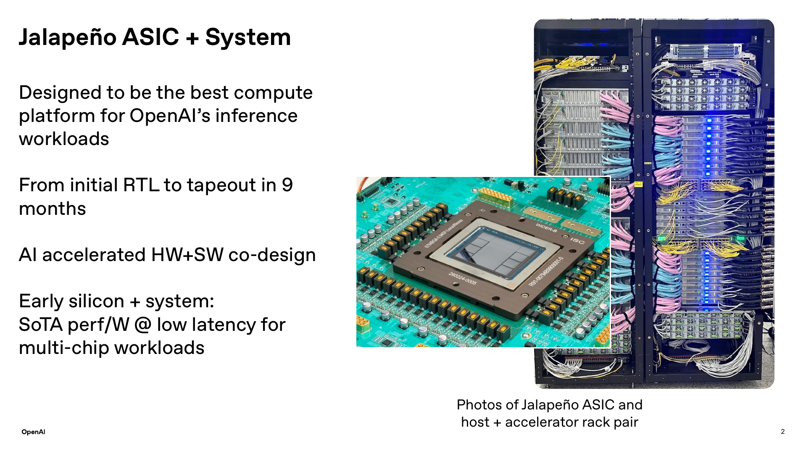

旨在成为面向 OpenAI 推理工作负载的最佳计算平台。

从初始 RTL 到流片仅用 9 个月。

AI 加速的硬件 + 软件协同设计。

早期芯片 + 系统：面向多芯片工作负载，在低延迟下实现 SoTA（最先进）性能/瓦。

- 照片：Jalapeño ASIC，以及由主机机架 + 加速器机架组成的一对机架。

*页码：2*

---

## 第 3 页｜项目时间线
> 原文标题：Project timeline

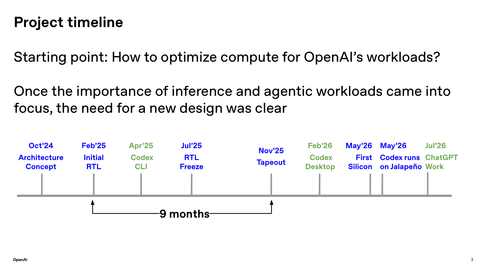

出发点：如何针对 OpenAI 的工作负载优化计算？

一旦推理和智能体工作负载的重要性成为焦点，对新设计的需求就显而易见了。

| 时间 | 里程碑 |
|---|---|
| 2024 年 10 月 | 架构概念 |
| 2025 年 2 月 | 初始 RTL |
| 2025 年 4 月 | Codex CLI |
| 2025 年 7 月 | RTL 冻结 |
| 2025 年 11 月 | 流片 |
| 2026 年 2 月 | Codex Desktop |
| 2026 年 5 月 | 首批芯片 |
| 2026 年 5 月 | Codex 在 Jalapeño 上运行 |
| 2026 年 7 月 | ChatGPT Work |

从初始 RTL 到流片：**9 个月**。

*页脚：OpenAI；页码：3*

---

## 第 4 页｜性能
> 原文标题：Performance

---

## 第 5 页｜重要的指标：延迟与能耗
> 原文标题：Metrics that matter: latency and energy

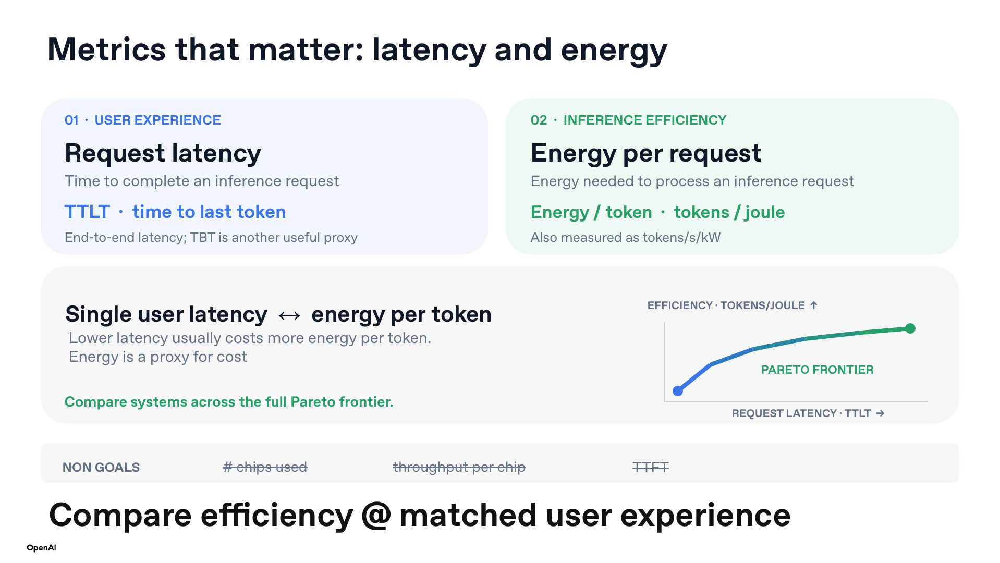

### 01 · 用户体验

**请求延迟**

完成一次推理请求所需的时间。

**TTLT · 至最后一个 token 的时间**

端到端延迟；TBT 是另一个有用的代理指标。

### 02 · 推理效率

**每次请求的能耗**

处理一次推理请求所需的能耗。

**能耗/token · token/焦耳**

也以 tokens/s/kW 衡量。

### 单用户延迟 ↔ 每 token 能耗

更低的延迟通常需要更高的每 token 能耗。

能耗是成本的代理指标。

在整条帕累托前沿上比较各系统。

- 纵轴：效率 · token/焦耳 ↑
- 横轴：请求延迟 · TTLT →
- 曲线标注：帕累托前沿

**非目标：** ~~使用的芯片数量~~　~~每芯片吞吐量~~　~~TTFT~~

**在用户体验相匹配的条件下比较效率。**

*页脚：OpenAI*

---

## 第 6 页｜SemiAnalysis InferenceX：公开、经功率归一化的比较
> 原文标题：SemiAnalysis InferenceX: public, power-normalized comparisons

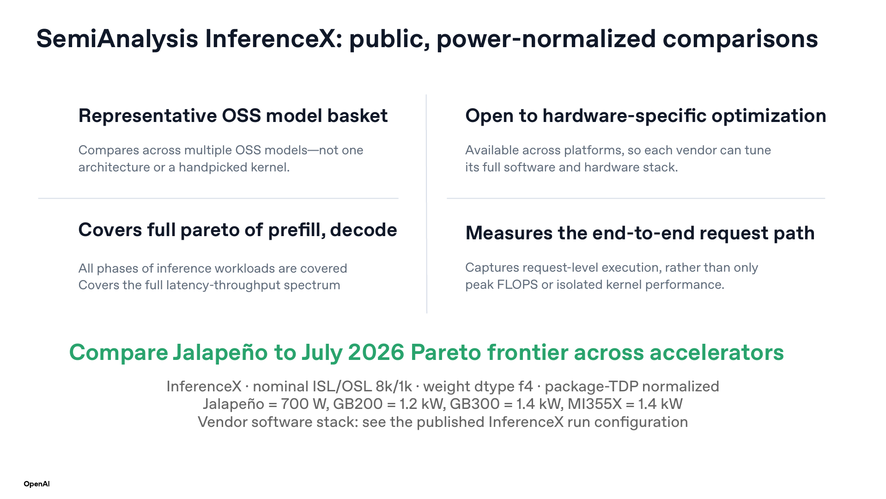

- **具有代表性的 OSS 模型组合**
  - 跨多个 OSS 模型进行比较——而非只比较一种架构或一个人工挑选的 kernel。
- **允许针对特定硬件进行优化**
  - 可跨平台使用，因此每家供应商都可以调优其完整的软件和硬件栈。
- **覆盖预填充和解码的完整帕累托前沿**
  - 覆盖推理工作负载的所有阶段。
  - 覆盖完整的延迟—吞吐量范围。
- **测量端到端请求路径**
  - 衡量请求级执行，而非仅衡量峰值 FLOPS 或单个 kernel 的性能。

将 Jalapeño 与 2026 年 7 月各类加速器的帕累托前沿进行比较。

- InferenceX · 标称 ISL/OSL 8k/1k · 权重数据类型 f4 · 按封装 TDP 归一化
- Jalapeño = 700 W；GB200 = 1.2 kW；GB300 = 1.4 kW；MI355X = 1.4 kW
- 供应商软件栈：参见已发布的 InferenceX 运行配置

---

## 第 7 页｜推测解码：8 个 token，1 次大模型前向计算
> 原文标题：Speculative decoding: 8 tokens, 1 large-model pass

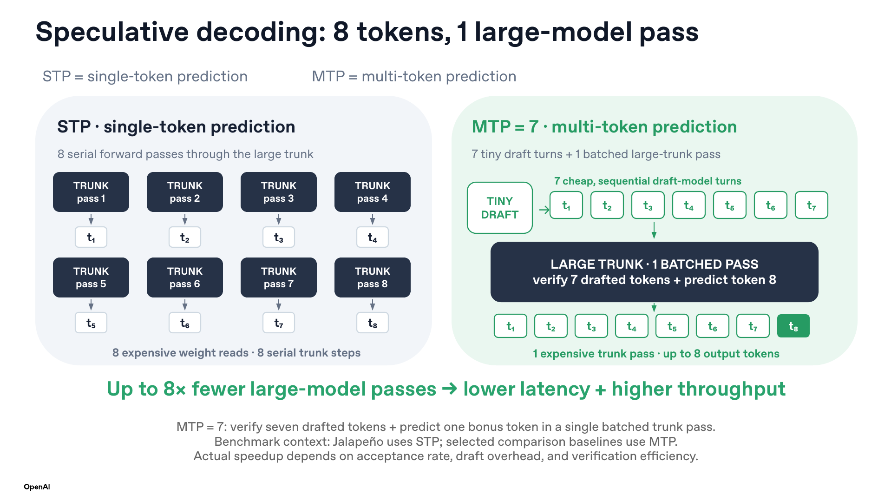

STP = 单 token 预测；MTP = 多 token 预测。

- **STP · 单 token 预测**
  - 通过大模型主干进行 8 次串行前向计算。
  - 主干（TRUNK）第 1～4 次前向计算分别生成 t₁、t₂、t₃、t₄；第 5～8 次前向计算分别生成 t₅、t₆、t₇、t₈。
  - 8 次高开销的权重读取 · 8 个串行主干步骤。
- **MTP = 7 · 多 token 预测**
  - 7 轮微型草稿模型计算 + 1 次批量的大模型主干前向计算。
  - 7 轮低开销、顺序执行的草稿模型计算：微型草稿模型（TINY DRAFT）依次生成 t₁、t₂、t₃、t₄、t₅、t₆、t₇。
  - 大模型主干（LARGE TRUNK）· 1 次批量前向计算：验证 7 个草稿 token，并预测第 8 个 token；得到 t₁、t₂、t₃、t₄、t₅、t₆、t₇、t₈。
  - 1 次高开销的主干前向计算 · 最多输出 8 个 token。

大模型前向计算次数最多可降至原来的 1/8 → 更低延迟 + 更高吞吐量。

- MTP = 7：在一次批量主干前向计算中验证七个草稿 token，并额外预测一个 token。
- 基准测试背景：Jalapeño 使用 STP；部分对比基线使用 MTP。
- 实际加速效果取决于接受率、草稿开销和验证效率。

---

## 第 8 页｜用三个模型展示通用性与推进速度
> 原文标题：Three models to demonstrate generality and velocity

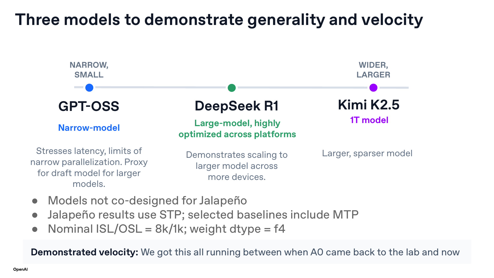

- **窄、小（NARROW, SMALL）**
  - **GPT-OSS——窄模型**
    - 对延迟以及窄并行化的极限构成压力测试。
    - 用作更大模型之草稿模型的代理。
- **更宽、更大（WIDER, LARGER）**
  - **DeepSeek R1——大模型，在各平台上经过高度优化**
    - 展示如何在更多设备上扩展到更大的模型。
  - **Kimi K2.5——1T 模型**
    - 更大、更稀疏的模型。

补充说明：

- 这些模型并非与 Jalapeño 协同设计。
- Jalapeño 的结果使用 STP；部分基线包含 MTP。
- 标称 ISL/OSL = 8k/1k；权重数据类型 = f4。

**已展示的推进速度：**从 A0 送回实验室到现在，我们已经让所有这些模型运行起来。

---

## 第 9 页｜Jalapeño 在 GPT-OSS 120B 上处于帕累托前沿
> 原文标题：Jalapeño is pareto frontier at GPT-OSS 120B

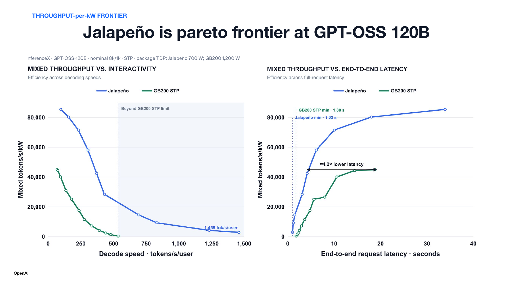

**每 kW 吞吐量前沿**

InferenceX · GPT-OSS-120B · 标称 8k/1k · STP · 封装 TDP：Jalapeño 700 W；GB200 1,200 W。

- **左图：混合吞吐量与交互性的关系**
  - 副标题：不同解码速度下的效率。
  - 图例：蓝线为 Jalapeño；绿线为 GB200 STP。
  - 纵轴：混合 token/秒/kW；刻度为 0、20,000、40,000、60,000、80,000。
  - 横轴：解码速度 · token/秒/用户；刻度为 0、250、500、750、1,000、1,250、1,500。
  - 阴影区域标注：超出 GB200 STP 上限。
  - Jalapeño 曲线末端标注：1,459 token/秒/用户。
- **右图：混合吞吐量与端到端延迟的关系**
  - 副标题：不同完整请求延迟下的效率。
  - 图例：蓝线为 Jalapeño；绿线为 GB200 STP。
  - 纵轴：混合 token/秒/kW；刻度为 0、20,000、40,000、60,000、80,000。
  - 横轴：端到端请求延迟 · 秒；刻度为 0、10、20、30、40。
  - 最小延迟标注：GB200 STP 最小值 · 1.80 秒；Jalapeño 最小值 · 1.03 秒。
  - 图中箭头标注：延迟约降至原来的 1/4.2。

页脚：OpenAI

---

## 第 10 页｜Jalapeño 在 GPT-OSS 的各个工作点上均领先
> 原文标题：Jalapeño leads across GPT-OSS operating points

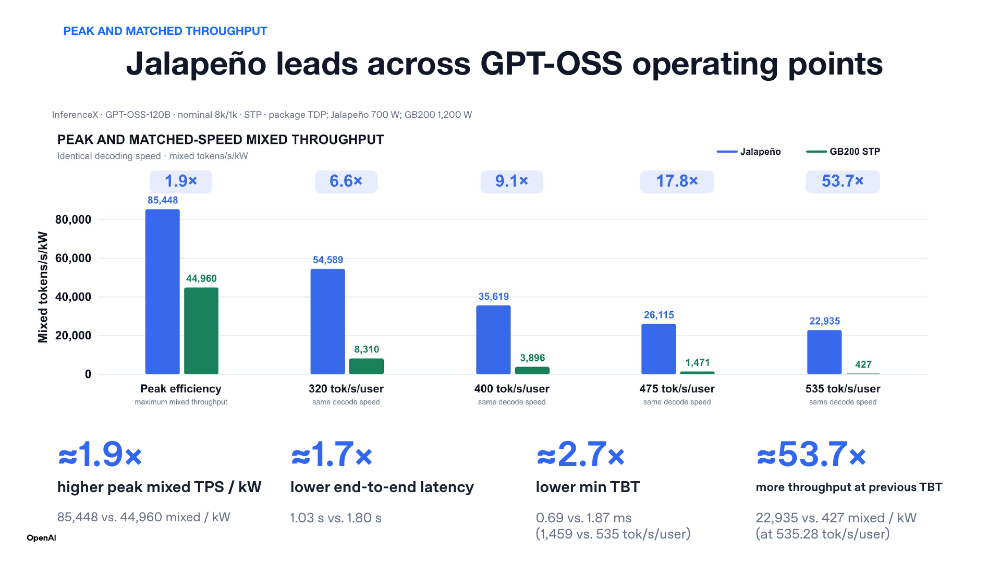

**峰值与匹配吞吐量**

InferenceX · GPT-OSS-120B · 标称 8k/1k · STP · 封装 TDP：Jalapeño 700 W；GB200 1,200 W。

| 指标 | 原作者给出的比较 | 数值对比 |
|---|---:|---:|
| 每 kW 峰值混合 TPS | 约提高至 1.9 倍 | 85,448 对比 44,960 混合 TPS/kW |
| 端到端延迟 | 约降至原来的 1/1.7 | 1.03 秒对比 1.80 秒 |
| 最小 TBT | 约降至原来的 1/2.7 | 0.69 对比 1.87 毫秒（1,459 对比 535 token/秒/用户） |
| 此前 TBT 下的吞吐量 | 约提高至 53.7 倍 | 22,935 对比 427 混合 TPS/kW（在 535.28 token/秒/用户下） |

---

## 第 11 页｜Jalapeño 在 DeepSeek R1 670B 上处于帕累托前沿
> 原文标题：Jalapeño is pareto frontier at DeepSeek R1 670B

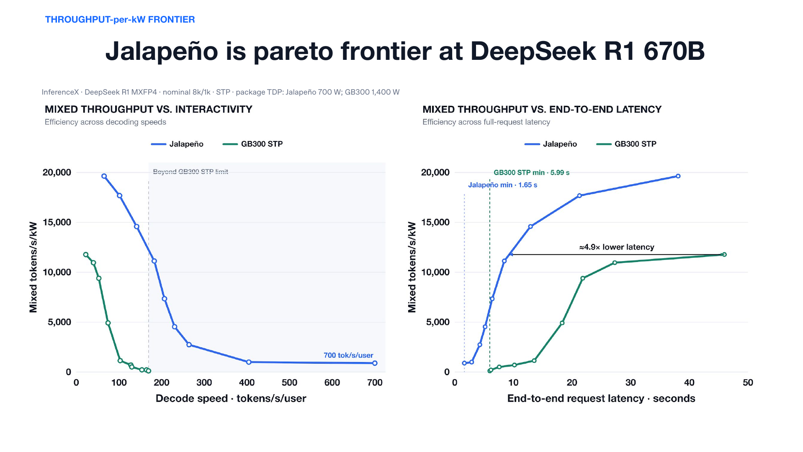

**每 kW 吞吐量前沿**

InferenceX · DeepSeek R1 MXFP4 · 标称 8k/1k · STP · 封装 TDP：Jalapeño 700 W；GB300 1,400 W。

- **左图：混合吞吐量与交互性的关系**
  - 副标题：不同解码速度下的效率。
  - 图例：蓝线为 Jalapeño；绿线为 GB300 STP。
  - 纵轴：混合 token/秒/kW；刻度为 0、5,000、10,000、15,000、20,000。
  - 横轴：解码速度 · token/秒/用户；刻度为 0、100、200、300、400、500、600、700。
  - 阴影区域标注：超出 GB300 STP 上限。
  - Jalapeño 曲线末端标注：700 token/秒/用户。
- **右图：混合吞吐量与端到端延迟的关系**
  - 副标题：不同完整请求延迟下的效率。
  - 图例：蓝线为 Jalapeño；绿线为 GB300 STP。
  - 纵轴：混合 token/秒/kW；刻度为 0、5,000、10,000、15,000、20,000。
  - 横轴：端到端请求延迟 · 秒；刻度为 0、10、20、30、40、50。
  - 最小延迟标注：GB300 STP 最小值 · 5.99 秒；Jalapeño 最小值 · 1.65 秒。
  - 图中箭头标注：延迟约降至原来的 1/4.9。

页脚：OpenAI

---

## 第 12 页｜Jalapeño 在 DeepSeek R1 的各个工作点上均领先
> 原文标题：Jalapeño leads across DeepSeek R1 operating points

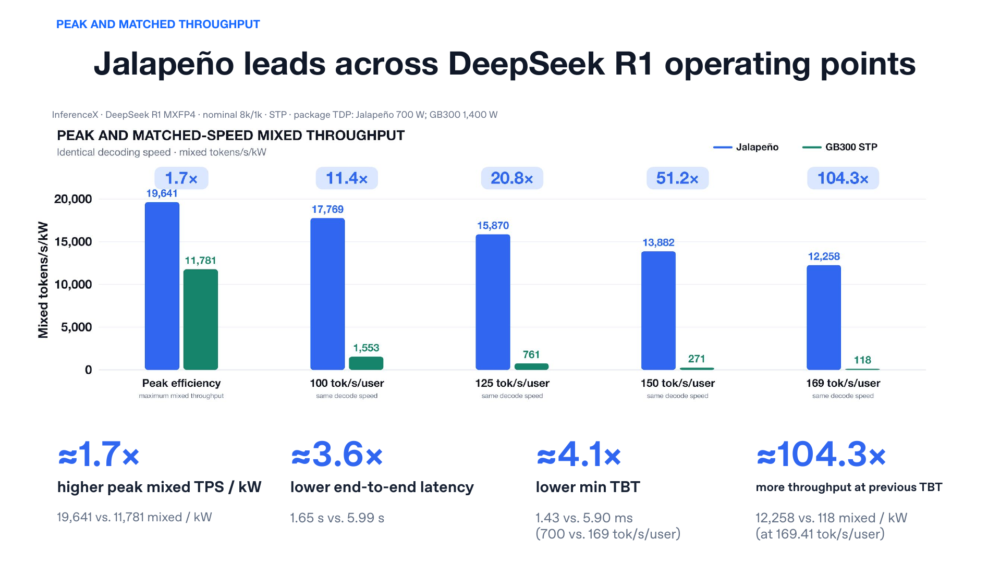

**峰值与匹配吞吐量**

InferenceX · DeepSeek R1 MXFP4 · 标称 8k/1k · STP · 封装 TDP：Jalapeño 700 W；GB300 1,400 W。

| 指标 | 原作者给出的比较 | 数值对比 |
|---|---:|---:|
| 每 kW 峰值混合 TPS | 约提高至 1.7 倍 | 19,641 对比 11,781 混合 TPS/kW |
| 端到端延迟 | 约降至原来的 1/3.6 | 1.65 秒对比 5.99 秒 |
| 最小 TBT | 约降至原来的 1/4.1 | 1.43 对比 5.90 毫秒（700 对比 169 token/秒/用户） |
| 此前 TBT 下的吞吐量 | 约提高至 104.3 倍 | 12,258 对比 118 混合 TPS/kW（在 169.41 token/秒/用户下） |

---

## 第 13 页｜Jalapeño STP 相比 GB300 MTP 推进了前沿
> 原文标题：Jalapeño STP advances the frontier vs. GB300 MTP

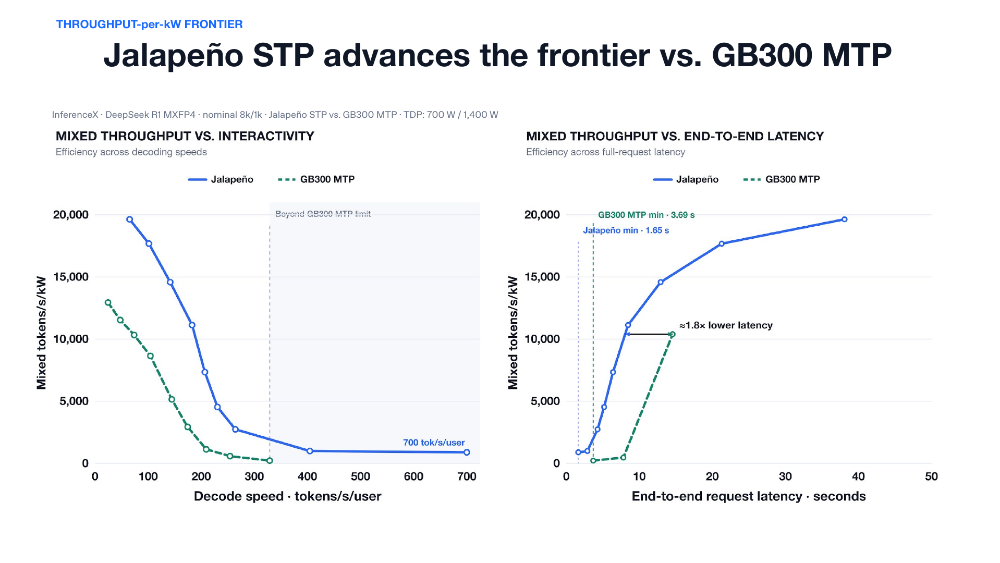

**每 kW 吞吐量前沿**

InferenceX · DeepSeek R1 MXFP4 · 标称 8k/1k · Jalapeño STP 对比 GB300 MTP · TDP：700 W / 1,400 W

### 混合吞吐量与交互性

不同解码速度下的效率。

- 图例：蓝色实线为 Jalapeño；绿色虚线为 GB300 MTP。
- 横轴：解码速度，单位为 tokens/s/用户；刻度为 0、100、200、300、400、500、600、700。
- 纵轴：混合 tokens/s/kW；刻度为 0、5,000、10,000、15,000、20,000。
- 两条曲线均随解码速度提高而下降；在所示共同解码速度范围内，Jalapeño 的混合吞吐量高于 GB300 MTP。GB300 MTP 曲线在阴影区前结束，Jalapeño 曲线延伸至右端标注的 **700 tok/s/用户**。
- 阴影区注释：**超出 GB300 MTP 限制**。

### 混合吞吐量与端到端延迟

不同完整请求延迟下的效率。

- 图例：蓝色实线为 Jalapeño；绿色虚线为 GB300 MTP。
- 横轴：端到端请求延迟，单位为秒；刻度为 0、10、20、30、40、50。
- 纵轴：混合 tokens/s/kW；刻度为 0、5,000、10,000、15,000、20,000。
- 两条曲线均随端到端请求延迟增加而上升；Jalapeño 在更低的延迟下达到更高的混合吞吐量。
- 最低延迟标注：**GB300 MTP 最低值 · 3.69 s**；**Jalapeño 最低值 · 1.65 s**。
- 图中比较标注：延迟降低 **≈1.8×**。

---

## 第 14 页｜Jalapeño STP 在各 GB300 MTP 工作点均领先
> 原文标题：Jalapeño STP leads across GB300 MTP operating points

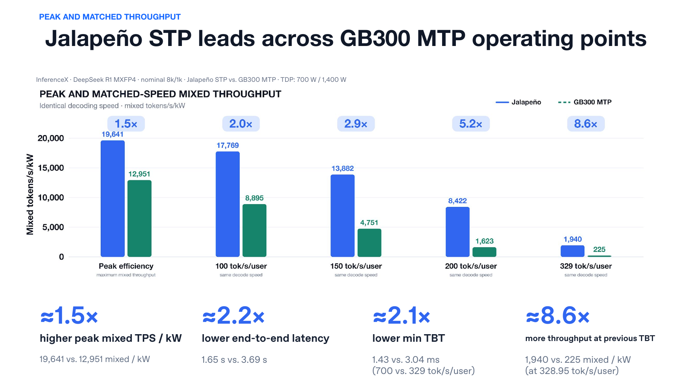

**峰值与匹配吞吐量**

InferenceX · DeepSeek R1 MXFP4 · 标称 8k/1k · Jalapeño STP 对比 GB300 MTP · TDP：700 W / 1,400 W

### 峰值及速度匹配下的混合吞吐量

相同解码速度 · 混合 tokens/s/kW。

- 图例：蓝色为 Jalapeño；绿色为 GB300 MTP。
- 纵轴：混合 tokens/s/kW；刻度为 0、5,000、10,000、15,000、20,000。

| 工作点 | 条件 | Jalapeño（混合 tokens/s/kW） | GB300 MTP（混合 tokens/s/kW） | 图中倍数 |
|---|---|---:|---:|---:|
| 峰值效率 | 最大混合吞吐量 | 19,641 | 12,951 | 1.5× |
| 100 tok/s/用户 | 相同解码速度 | 17,769 | 8,895 | 2.0× |
| 150 tok/s/用户 | 相同解码速度 | 13,882 | 4,751 | 2.9× |
| 200 tok/s/用户 | 相同解码速度 | 8,422 | 1,623 | 5.2× |
| 329 tok/s/用户 | 相同解码速度 | 1,940 | 225 | 8.6× |

- **峰值混合 TPS/kW 高 ≈1.5×**：19,641 对 12,951 混合 tokens/s/kW。
- **端到端延迟低 ≈2.2×**：1.65 s 对 3.69 s。
- **最低 TBT 低 ≈2.1×**：1.43 对 3.04 ms（700 对 329 tok/s/用户）。
- **在此前 TBT 下，吞吐量高 ≈8.6×**：1,940 对 225 混合 tokens/s/kW（在 328.95 tok/s/用户时）。

---

## 第 15 页｜Jalapeño 在 Kimi K2.5 1T 上处于帕累托前沿
> 原文标题：Jalapeño is pareto frontier at Kimi K2.5 1T

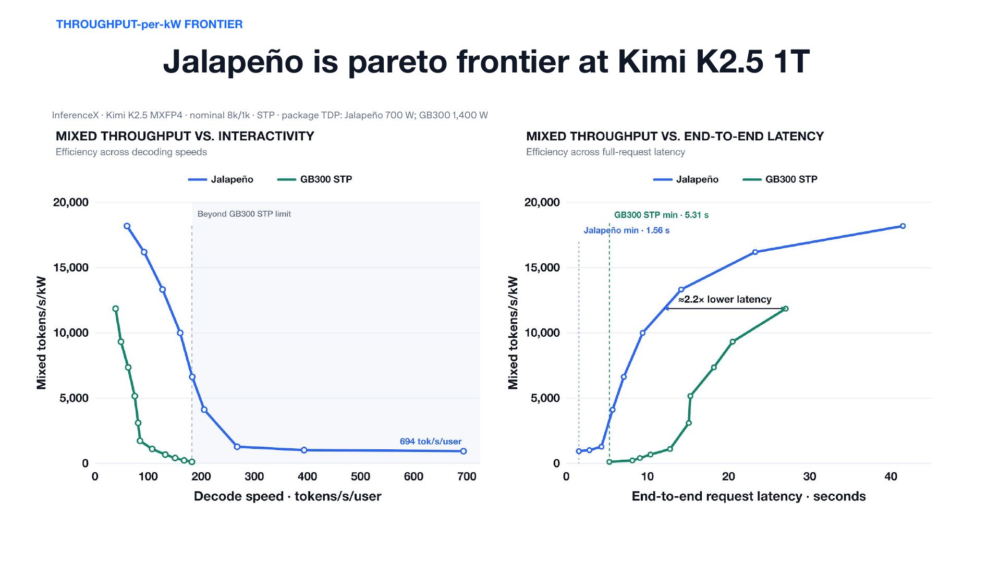

**每 kW 吞吐量前沿**

InferenceX · Kimi K2.5 MXFP4 · 标称 8k/1k · STP · 封装 TDP：Jalapeño 700 W；GB300 1,400 W

### 混合吞吐量与交互性

不同解码速度下的效率。

- 图例：蓝色实线为 Jalapeño；绿色实线为 GB300 STP。
- 横轴：解码速度，单位为 tokens/s/用户；刻度为 0、100、200、300、400、500、600、700。
- 纵轴：混合 tokens/s/kW；刻度为 0、5,000、10,000、15,000、20,000。
- 两条曲线均随解码速度提高而下降；在所示共同解码速度范围内，Jalapeño 的混合吞吐量高于 GB300 STP。GB300 STP 曲线在阴影区前结束，Jalapeño 曲线延伸至右端标注的 **694 tok/s/用户**。
- 阴影区注释：**超出 GB300 STP 限制**。

### 混合吞吐量与端到端延迟

不同完整请求延迟下的效率。

- 图例：蓝色实线为 Jalapeño；绿色实线为 GB300 STP。
- 横轴：端到端请求延迟，单位为秒；刻度为 0、10、20、30、40。
- 纵轴：混合 tokens/s/kW；刻度为 0、5,000、10,000、15,000、20,000。
- 两条曲线均随端到端请求延迟增加而上升；Jalapeño 在更低的延迟下达到更高的混合吞吐量。
- 最低延迟标注：**GB300 STP 最低值 · 5.31 s**；**Jalapeño 最低值 · 1.56 s**。
- 图中比较标注：延迟降低 **≈2.2×**。

---

## 第 16 页｜Jalapeño 在各 Kimi K2.5 工作点均领先
> 原文标题：Jalapeño leads across Kimi K2.5 operating points

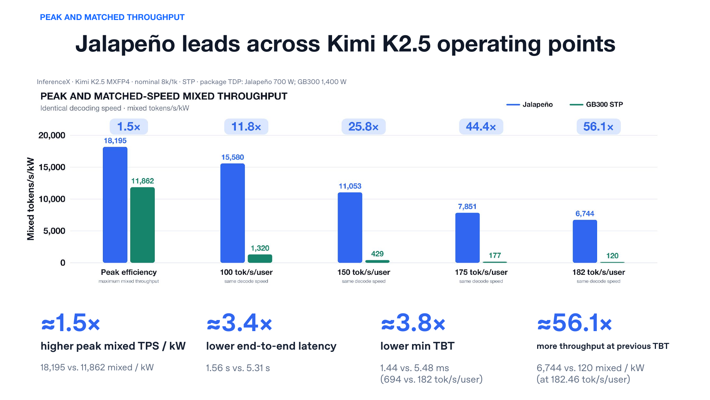

**峰值与匹配吞吐量**

InferenceX · Kimi K2.5 MXFP4 · 标称 8k/1k · STP · 封装 TDP：Jalapeño 700 W；GB300 1,400 W

### 峰值及速度匹配下的混合吞吐量

相同解码速度 · 混合 tokens/s/kW。

- 图例：蓝色为 Jalapeño；绿色为 GB300 STP。
- 纵轴：混合 tokens/s/kW；刻度为 0、5,000、10,000、15,000、20,000。

| 工作点 | 条件 | Jalapeño（混合 tokens/s/kW） | GB300 STP（混合 tokens/s/kW） | 图中倍数 |
|---|---|---:|---:|---:|
| 峰值效率 | 最大混合吞吐量 | 18,195 | 11,862 | 1.5× |
| 100 tok/s/用户 | 相同解码速度 | 15,580 | 1,320 | 11.8× |
| 150 tok/s/用户 | 相同解码速度 | 11,053 | 429 | 25.8× |
| 175 tok/s/用户 | 相同解码速度 | 7,851 | 177 | 44.4× |
| 182 tok/s/用户 | 相同解码速度 | 6,744 | 120 | 56.1× |

- **峰值混合 TPS/kW 高 ≈1.5×**：18,195 对 11,862 混合 tokens/s/kW。
- **端到端延迟低 ≈3.4×**：1.56 s 对 5.31 s。
- **最低 TBT 低 ≈3.8×**：1.44 对 5.48 ms（694 对 182 tok/s/用户）。
- **在此前 TBT 下，吞吐量高 ≈56.1×**：6,744 对 120 混合 tokens/s/kW（在 182.46 tok/s/用户时）。

---

## 第 17 页｜关键要点
> 原文标题：Key Takeaways

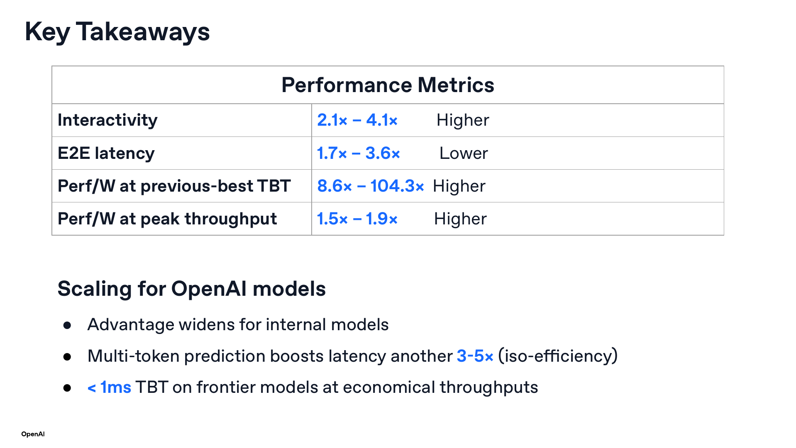

| 性能指标 | 倍数 | 方向 |
|---|---:|---|
| 交互性 | 2.1× – 4.1× | 更高 |
| 端到端（E2E）延迟 | 1.7× – 3.6× | 更低 |
| 此前最佳 TBT 下的性能/瓦 | 8.6× – 104.3× | 更高 |
| 峰值吞吐量下的性能/瓦 | 1.5× – 1.9× | 更高 |

### OpenAI 模型的扩展

- 对内部模型，优势进一步扩大。
- 多 token 预测使延迟表现再提升 **3-5×**（等效率）。
- 在经济可行的吞吐量下，前沿模型实现 **< 1ms** TBT。

---

## 第 18 页｜智能体工作负载
> 原文标题：Agentic workloads

---

## 第 19 页｜一个请求横跨三种不同的硬件工作模式
> 原文标题：A request spans three distinct hardware regimes

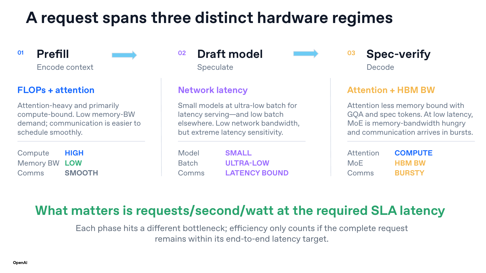

### 01　预填充

**编码上下文**

**FLOPs + 注意力**

以注意力为主，且主要受计算限制。内存带宽需求低；通信更容易平滑调度。

| 项目 | 特征 |
|---|---|
| 计算 | 高 |
| 内存带宽 | 低 |
| 通信 | 平滑 |

### 02　草稿模型

**推测**

**网络延迟**

在低延迟服务中，小模型以超低 batch 运行；在其他场景则以低 batch 运行。网络带宽需求低，但对延迟极其敏感。

| 项目 | 特征 |
|---|---|
| 模型 | 小 |
| Batch | 超低 |
| 通信 | 受延迟限制 |

### 03　推测验证

**解码**

**注意力 + HBM 带宽**

借助 GQA 和推测 token，注意力受内存限制的程度降低。在低延迟下，MoE 对内存带宽需求很大，通信以突发方式到达。

| 项目 | 特征 |
|---|---|
| 注意力 | 计算 |
| MoE | HBM 带宽 |
| 通信 | 突发 |

**真正重要的是在满足所需 SLA 延迟时的请求数/秒/瓦。**

每个阶段都会遇到不同的瓶颈；只有完整请求仍满足其端到端延迟目标，效率才有意义。

---

## 第 20 页｜比例变化 → 异构集群的低效
> 原文标题：Changing ratios → inefficiency in heterogeneous fleets

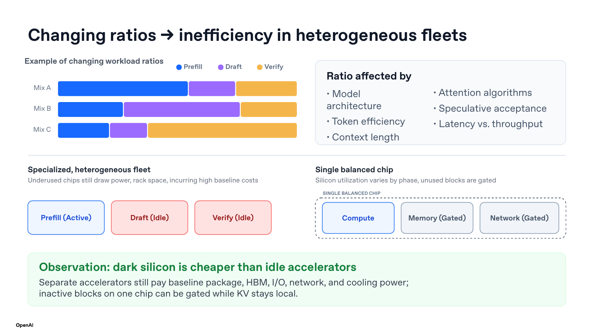

### 工作负载比例变化示例

图例：蓝色为预填充，紫色为草稿，黄色为验证。

- **混合 A**：预填充占比最大，验证次之，草稿最小。
- **混合 B**：草稿占比最大，预填充次之，验证最小。
- **混合 C**：验证占比最大，预填充次之，草稿最小。

**比例受以下因素影响：**

- 模型架构
- Token 效率
- 上下文长度
- 注意力算法
- 推测接受
- 延迟与吞吐量的权衡

### 专用异构集群

利用不足的芯片仍消耗功率、占用机架空间，导致高昂的基础成本。

图中状态：**预填充（活跃）**、**草稿（空闲）**、**验证（空闲）**。

### 单颗均衡芯片

硅片利用率随阶段变化，未使用的模块被门控。

图中“单颗均衡芯片”包含：**计算**、**内存（已门控）**、**网络（已门控）**。

**观察：暗硅比空闲加速器更便宜。**

独立加速器仍需承担封装、HBM、I/O、网络和散热的基础功耗；单芯片上的非活跃模块可被门控，同时 KV 保持在本地。

---

## 第 21 页｜系统选择：移动 KV，或改变活跃硅资源的配比
> 原文标题：System choice: KV moves or the active silicon mix varies

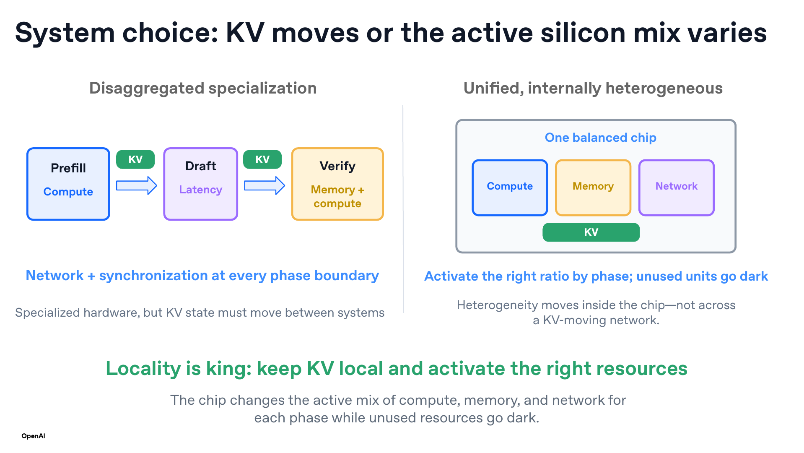

### 分离式专用化

图中流程：**预填充／计算** → **KV** → **草稿／延迟** → **KV** → **验证／内存 + 计算**。

**每个阶段边界都需要网络 + 同步。**

硬件实现专用化，但 KV 状态必须在系统之间移动。

### 统一、内部异构

图中的“一颗均衡芯片”包含：**计算**、**内存**、**网络**，以及位于芯片内的 **KV**。

**按阶段激活合适的比例；未使用单元转为暗态。**

异构性转移到芯片内部，而不是横跨需要移动 KV 的网络。

**局部性至上：让 KV 保持本地，并激活合适的资源。**

芯片针对每个阶段改变计算、内存和网络的活跃组合，同时让未使用资源转为暗态。

---

## 第 22 页｜Jalapeño 架构
> 原文标题：Jalapeño Architecture

---

## 第 23 页｜原始 HBM 带宽意味着极高的 token 速率
> 原文标题：Raw HBM bandwidth implies extraordinary token rates

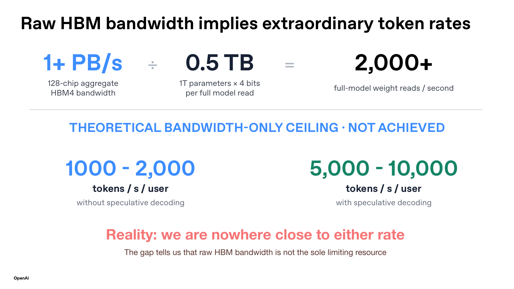

**1+ PB/s ÷ 0.5 TB = 2,000+**

| 计算项 | 数值 | 含义 |
|---|---:|---|
| 128 颗芯片的聚合 HBM4 带宽 | 1+ PB/s | 被除数 |
| 每次完整模型读取：1T 参数 × 4 bits | 0.5 TB | 除数 |
| 每秒完整模型权重读取次数 | 2,000+ | 结果 |

**仅考虑带宽的理论上限 · 未达到**

- **1000 - 2,000 tokens/s/用户**：不使用推测解码。
- **5,000 - 10,000 tokens/s/用户**：使用推测解码。

**现实：我们离这两个速率都还差得很远。**

这一差距告诉我们，原始 HBM 带宽并不是唯一的限制资源。

---

## 第 24 页｜架构可能主导观测到的延迟
> 原文标题：Architecture can dominate observed latency

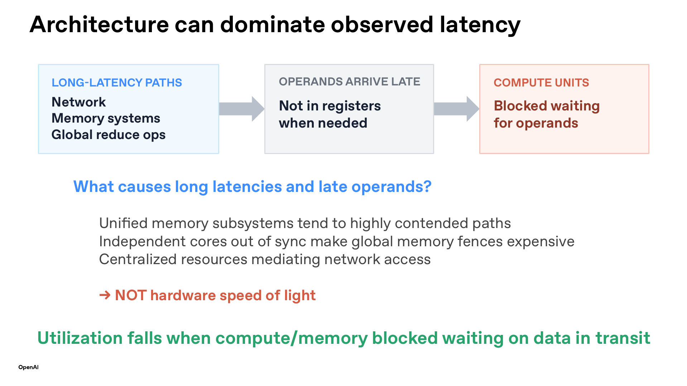

**长延迟路径 → 操作数迟到 → 计算单元**

| 长延迟路径 | 操作数迟到 | 计算单元 |
|---|---|---|
| 网络 | 需要时不在寄存器中 | 阻塞等待操作数 |
| 内存系统 |  |  |
| 全局归约操作 |  |  |

### 什么导致长延迟和操作数迟到？

- 统一内存子系统往往会形成高争用路径。
- 彼此不同步的独立核心使全局内存屏障开销高昂。
- 由集中式资源协调网络访问。

**→ 并非硬件的光速极限。**

**当计算/内存因等待传输中的数据而阻塞时，利用率下降。**

---

## 第 25 页｜协同设计架构以解决瓶颈
> 原文标题：Co-design the architecture to address the bottleneck

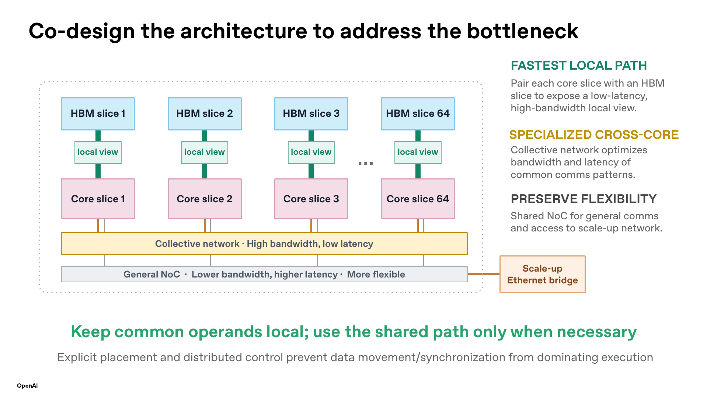

**最快的本地路径**

将每个核心切片与一个 HBM 切片配对，提供低延迟、高带宽的本地视图。

| 切片 | 1 | 2 | 3 | 64 |
|---|---|---|---|---|
| HBM | HBM 切片 1 | HBM 切片 2 | HBM 切片 3 | HBM 切片 64 |
| 本地视图 | 本地视图 | 本地视图 | 本地视图 | 本地视图 |
| 核心 | 核心切片 1 | 核心切片 2 | 核心切片 3 | 核心切片 64 |

图中以省略号表示切片 3 与切片 64 之间的中间项。

**专用跨核心通信**

集合通信网络优化常见通信模式的带宽和延迟。

**保留灵活性**

共享 NoC 用于一般通信以及访问 scale-up 网络。

- 集合通信网络：高带宽、低延迟。
- 通用 NoC：较低带宽、较高延迟、更灵活。
- scale-up 以太网桥接。

**让常用操作数保持本地；仅在必要时使用共享路径。**

显式放置和分布式控制可防止数据移动／同步主导执行过程。

---

## 第 26 页｜单颗芯片还不够——网络让它成为系统
> 原文标题：A single chip isn’t enough—the network makes it a system

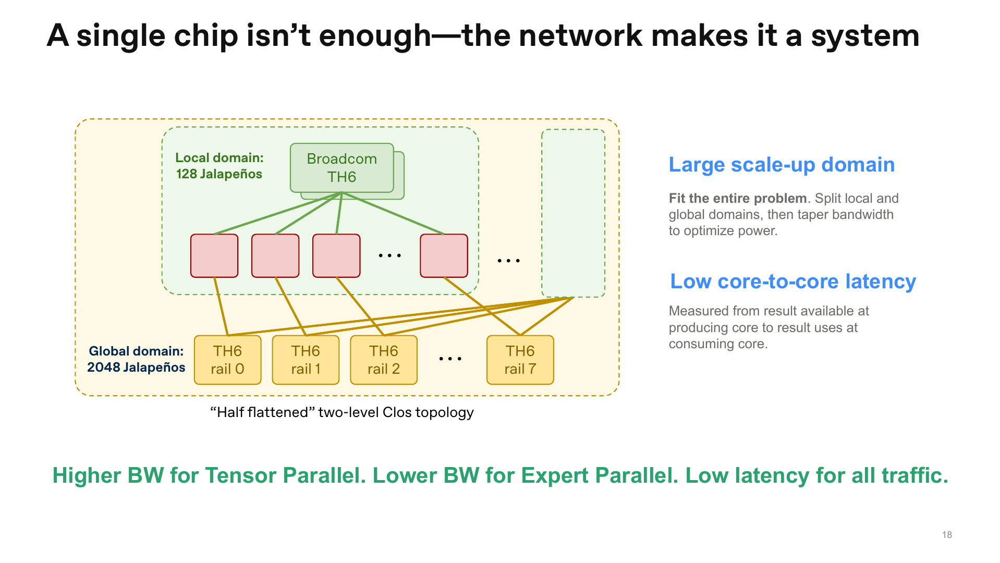

**拓扑图**

- 本地域：128 个 Jalapeño；上层为 Broadcom TH6。
- 全局域：2048 个 Jalapeño；下层为 TH6 rail 0、TH6 rail 1、TH6 rail 2、…、TH6 rail 7。
- “半扁平化”两级 Clos 拓扑。

**大规模 scale-up 域**

容纳整个问题。拆分本地域和全局域，然后逐步缩减带宽以优化功率。

**低核心间延迟**

从结果在生产核心上可用，一直测量到结果在消费核心处被使用。

**张量并行使用更高带宽。专家并行使用较低带宽。所有流量均保持低延迟。**

---

## 第 27 页｜执行：持续收敛——而非一份完整规格
> 原文标题：Execution: continuous convergence—not a complete spec

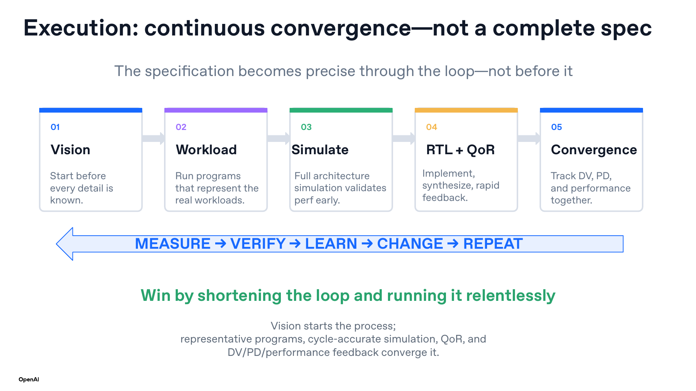

规格是在循环过程中变得精确的，而不是在循环之前就已精确。

1. **愿景**：在所有细节都已知之前就开始。
2. **工作负载**：运行能够代表真实工作负载的程序。
3. **仿真**：完整架构仿真及早验证性能。
4. **RTL + QoR**：实现、综合、快速反馈。
5. **收敛**：同步跟踪 DV、PD 和性能。

**测量 → 验证 → 学习 → 变更 → 重复**

**通过缩短循环并坚持不懈地运行它来取胜。**

愿景启动这一过程；代表性程序、周期精确仿真、QoR 以及 DV／PD／性能反馈使其收敛。

---

## 第 28 页｜AI 帮助我们更快地构建 Jalapeño，并让它变得更好
> 原文标题：AI helped us build Jalapeño faster and made it better

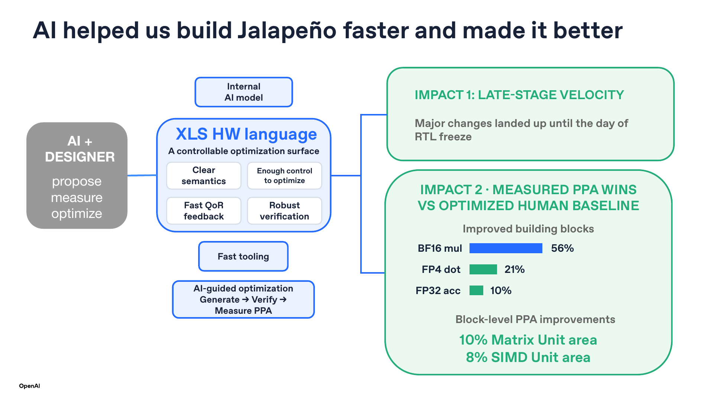

**设计流程与工具**

- 内部 AI 模型。
- **AI + 设计师**：提出方案 → 测量 → 优化。
- **XLS 硬件语言**：可控的优化空间。
  - 清晰的语义。
  - 有足够的控制力进行优化。
  - 快速 QoR 反馈。
  - 稳健的验证。
- 快速工具链。
- **AI 引导的优化**：生成 → 验证 → 测量 PPA。

**交付内容**

**影响 1：后期推进速度**

直到 RTL 冻结当天，仍有重大变更落地。

**影响 2：相对经过优化的人类基线，实测 PPA 收益**

改进的构建模块：

| 构建模块 | PPA 收益 |
|---|---:|
| BF16 mul | 56% |
| FP4 dot | 21% |
| FP32 acc | 10% |

块级 PPA 改进：

- Matrix Unit 面积：10%。
- SIMD Unit 面积：8%。

---

## 第 29 页｜架构模型：人类易于理解，前沿 AI 易于编程
> 原文标题：Architecture model: Simple for humans to understand. Easy for frontier AI to program.

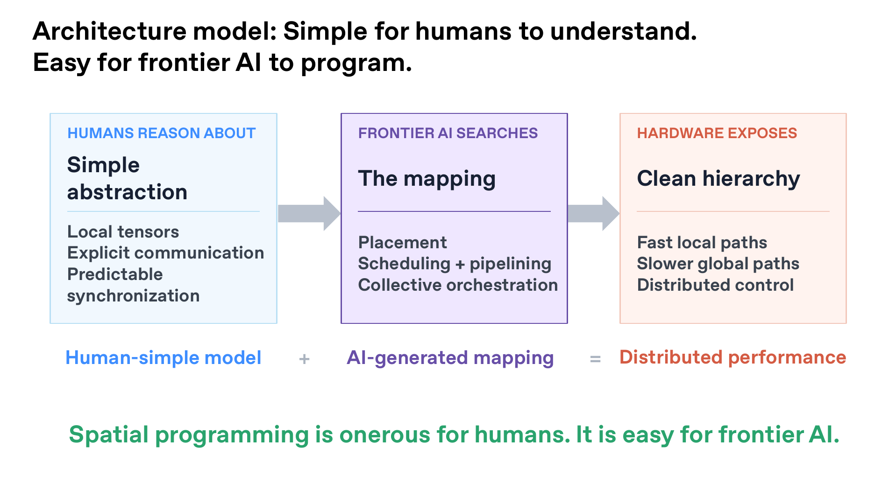

| 人类推理所用 | 前沿 AI 搜索 | 硬件暴露 |
|---|---|---|
| 简单抽象 | 映射 | 清晰的层次结构 |
| 本地张量 | 放置 | 快速本地路径 |
| 显式通信 | 调度 + 流水化 | 较慢的全局路径 |
| 可预测的同步 | 集合通信编排 | 分布式控制 |

**人类易懂的模型 + AI 生成的映射 = 分布式性能**

**空间编程对人类而言很繁重，对前沿 AI 而言却很容易。**

---

## 第 30 页｜Jalapeño 是一种空间架构
> 原文标题：Jalapeño is a spatial architecture

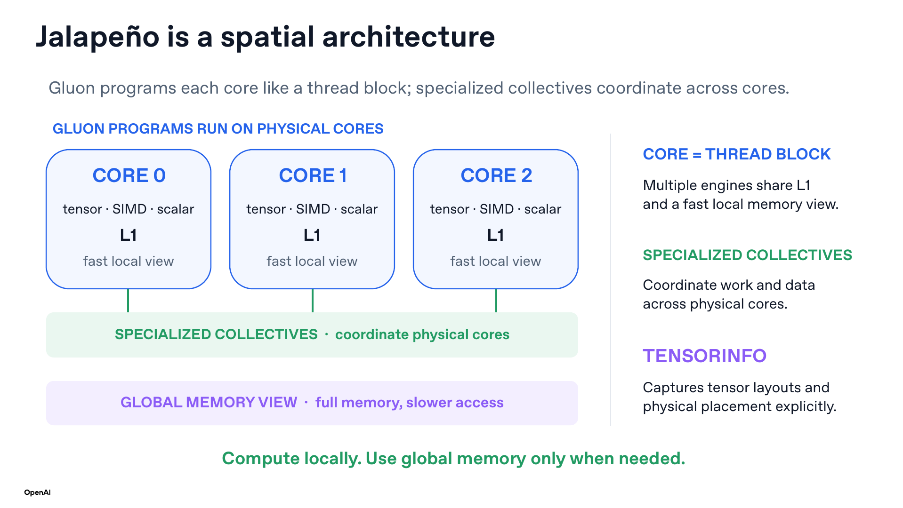

Gluon 以线程块的方式对每个核心进行编程；专用集合通信在核心之间进行协调。

**Gluon 程序在物理核心上运行**

| CORE 0 | CORE 1 | CORE 2 |
|---|---|---|
| 张量 · SIMD · 标量 | 张量 · SIMD · 标量 | 张量 · SIMD · 标量 |
| L1 | L1 | L1 |
| 快速本地视图 | 快速本地视图 | 快速本地视图 |

- **专用集合通信**：协调物理核心。
- **全局内存视图**：完整内存，访问较慢。

**核心 = 线程块**

多个引擎共享 L1 和快速本地内存视图。

**专用集合通信**

协调跨物理核心的工作和数据。

**TENSORINFO**

显式捕获张量布局和物理放置。

**在本地计算。仅在需要时使用全局内存。**

---

## 第 31 页｜AI 将功能正确的 kernel 转化为高性能实现
> 原文标题：AI turns functional kernels into high-performance implementations

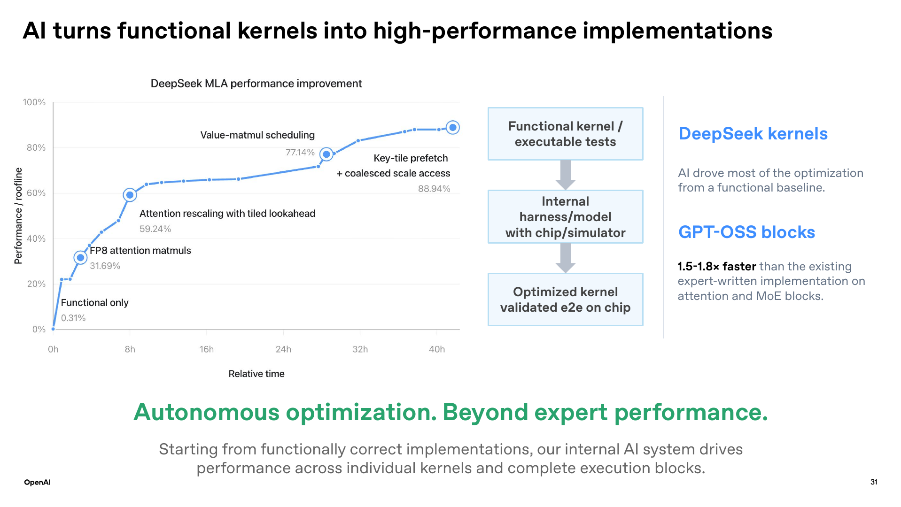

**DeepSeek MLA 性能提升图**

- 纵轴：性能／roofline；刻度为 0%、20%、40%、60%、80%、100%。
- 横轴：相对时间；刻度为 0h、8h、16h、24h、32h、40h。
- 曲线随相对时间推进总体上升，标注的优化里程碑如下：

| 曲线标注 | 性能／roofline |
|---|---:|
| 仅功能正确的实现 | 0.31% |
| FP8 注意力矩阵乘法 | 31.69% |
| 采用分块前瞻的注意力重缩放 | 59.24% |
| Value 矩阵乘法调度 | 77.14% |
| Key 分块预取 + 合并的 scale 访问 | 88.94% |

**优化流程**

功能正确的 kernel／可执行测试  
→ 内部 harness／模型，配合芯片／仿真器  
→ 优化后的 kernel，已在芯片上完成端到端验证。

**DeepSeek kernels**

AI 从功能正确的基线出发，驱动了大部分优化。

**GPT-OSS 块**

在注意力和 MoE 块上，比现有的专家编写实现快 **1.5-1.8×**。

**自主优化。超越专家性能。**

从功能正确的实现出发，我们的内部 AI 系统推动单个 kernel 和完整执行块的性能提升。

---

## 第 32 页｜规格
> 原文标题：Specifications

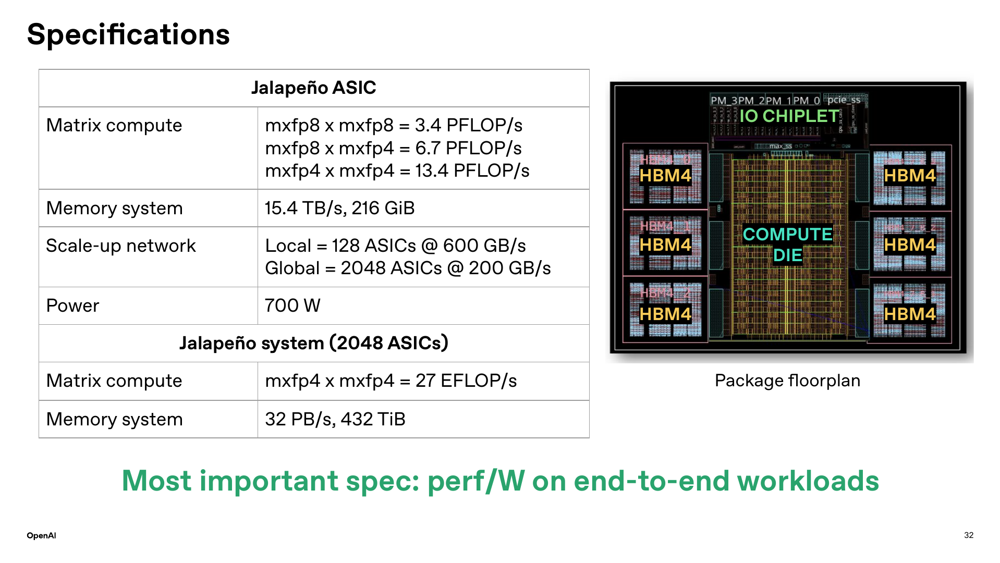

### Jalapeño ASIC

| 项目 | 规格 |
|---|---|
| 矩阵计算 | mxfp8 x mxfp8 = 3.4 PFLOP/s |
|  | mxfp8 x mxfp4 = 6.7 PFLOP/s |
|  | mxfp4 x mxfp4 = 13.4 PFLOP/s |
| 内存系统 | 15.4 TB/s，216 GiB |
| scale-up 网络 | 本地 = 128 个 ASIC @ 600 GB/s |
|  | 全局 = 2048 个 ASIC @ 200 GB/s |
| 功率 | 700 W |

### Jalapeño 系统（2048 个 ASIC）

| 项目 | 规格 |
|---|---|
| 矩阵计算 | mxfp4 x mxfp4 = 27 EFLOP/s |
| 内存系统 | 32 PB/s，432 TiB |

**封装平面图**：顶部为 I/O 芯粒，中央为计算裸片，左右两侧为 HBM4。

**最重要的规格：端到端工作负载上的每瓦性能（perf/W）。**

---

## 第 33 页｜你只管去构建~~东西~~……芯片
> 原文标题：You Can Just Build Things … Chips

---

## 第 34 页｜你只管去构建~~东西~~……芯片
> 原文标题：You Can Just Build Things … Chips

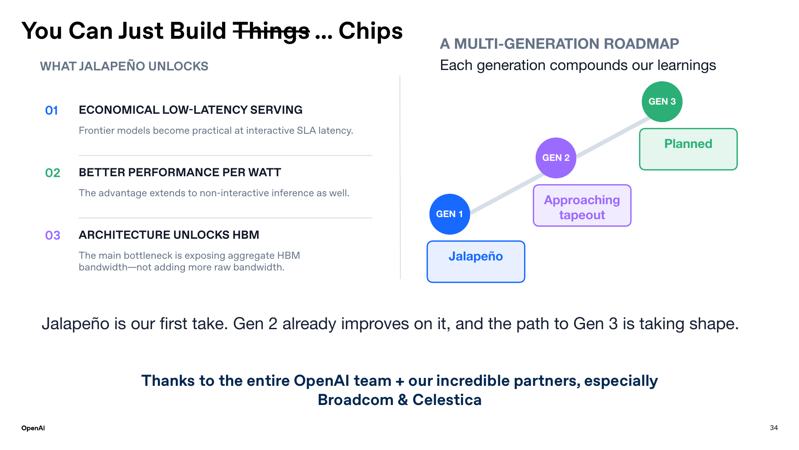

**Jalapeño 解锁的能力**

1. **经济实用的低延迟服务**  
   在交互式 SLA 延迟下，前沿模型变得切实可用。

2. **更高的每瓦性能**  
   这一优势也延伸至非交互式推理。

3. **架构释放 HBM 潜力**  
   主要瓶颈在于让聚合 HBM 带宽可供利用，而不是增加更多原始带宽。

**多代路线图**

每一代都会让我们积累的经验产生复利效应。

- **GEN 1**：Jalapeño。
- **GEN 2**：接近流片。
- **GEN 3**：已规划。

Jalapeño 是我们的首次尝试。GEN 2 已经在此基础上有所改进，通往 GEN 3 的路径也正在成形。

**感谢整个 OpenAI 团队 + 我们卓越的合作伙伴，尤其是 Broadcom 与 Celestica。**

---

## 第 35 页｜附录：Jalapeño 单 token 预测（STP）与 GB300 多 token 预测（MTP）对比——使用全口径公用供电 MW
> 原文标题：Appendix. Jalapeño STP vs. GB300 MTP using all-in utility MW

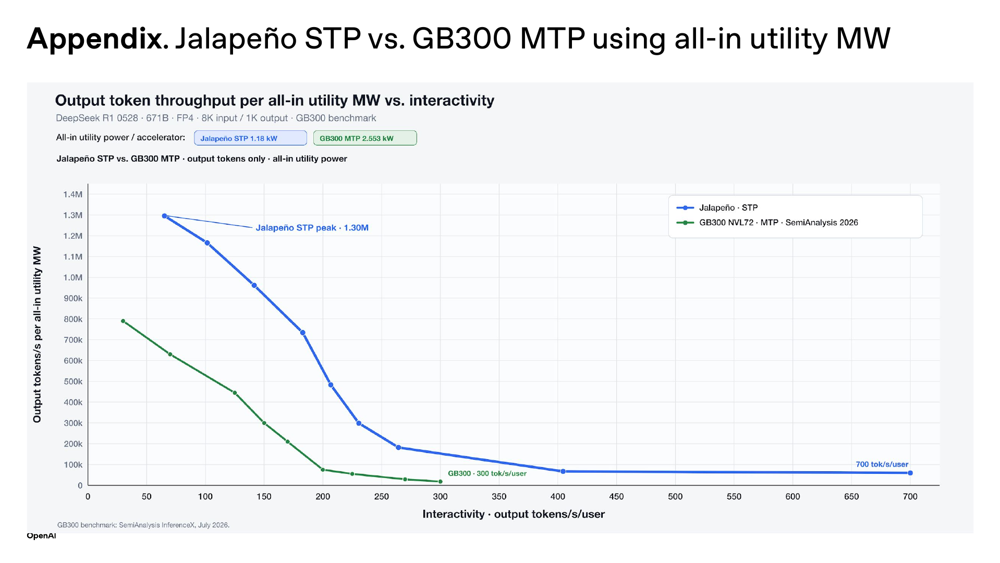

**每全口径公用供电 MW 的输出 token 吞吐量与交互性的关系**

DeepSeek R1 0528 · 671B · FP4 · 8K 输入／1K 输出 · GB300 基准测试

**全口径公用供电功率／加速器：**

- Jalapeño 单 token 预测（STP）：**1.18 kW**。
- GB300 多 token 预测（MTP）：**2.553 kW**。

**Jalapeño 单 token 预测（STP）与 GB300 多 token 预测（MTP）对比 · 仅输出 token · 全口径公用供电功率**

- 图例：
  - 蓝色：Jalapeño · 单 token 预测（STP）。
  - 绿色：GB300 NVL72 · 多 token 预测（MTP） · SemiAnalysis 2026。
- 纵轴：每全口径公用供电 MW 的输出 token/s；刻度为 0、100k、200k、300k、400k、500k、600k、700k、800k、900k、1.0M、1.1M、1.2M、1.3M、1.4M。
- 横轴：交互性 · 输出 token/s/用户；刻度为 0、50、100、150、200、250、300、350、400、450、500、550、600、650、700。
- 两条曲线均随每用户输出速度提高而下降；蓝色曲线高于绿色曲线，并延伸至更高的交互性。
- 蓝色曲线标注：**Jalapeño 单 token 预测（STP）峰值 · 1.30M**。
- 绿色曲线终点标注：**GB300 · 300 tok/s/user**。
- 蓝色曲线右端标注：**700 tok/s/user**。

脚注：GB300 基准测试：SemiAnalysis InferenceX，2026 年 7 月。

---

## 第 36 页｜附录：Jalapeño 单 token 预测（STP）与 GB300 多 token 预测（MTP）在速度匹配条件下的对比
> 原文标题：Appendix. Jalapeño STP vs. GB300 MTP at matched speed

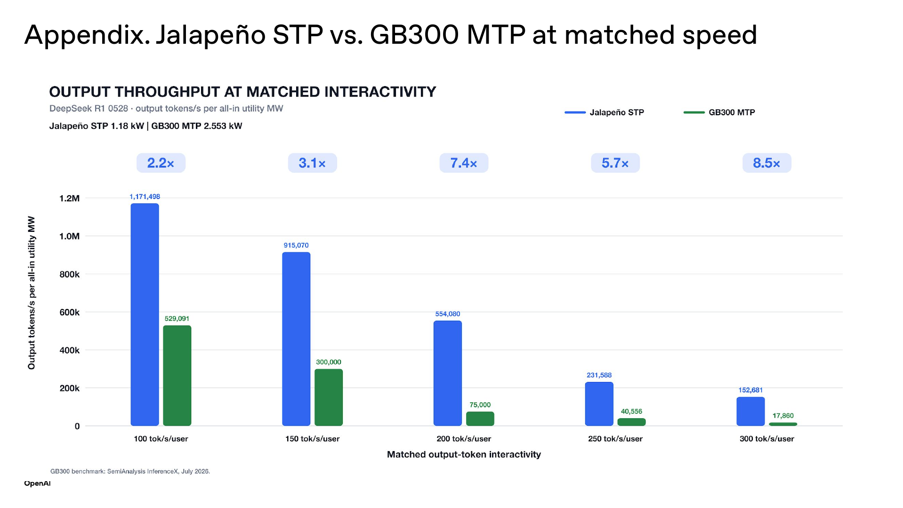

**交互性匹配时的输出吞吐量**

DeepSeek R1 0528 · 每全口径公用供电 MW 的输出 token/s

Jalapeño 单 token 预测（STP）**1.18 kW**｜GB300 多 token 预测（MTP）**2.553 kW**

- 图例：蓝色为 Jalapeño 单 token 预测（STP）；绿色为 GB300 多 token 预测（MTP）。
- 纵轴：每全口径公用供电 MW 的输出 token/s；刻度为 0、200k、400k、600k、800k、1.0M、1.2M。
- 横轴：匹配的输出 token 交互性。

| 匹配的交互性 | Jalapeño 单 token 预测（STP） | GB300 多 token 预测（MTP） | 图中倍数 |
|---|---:|---:|---:|
| 100 tok/s/user | 1,171,498 | 529,091 | 2.2× |
| 150 tok/s/user | 915,070 | 300,000 | 3.1× |
| 200 tok/s/user | 554,080 | 75,000 | 7.4× |
| 250 tok/s/user | 231,588 | 40,556 | 5.7× |
| 300 tok/s/user | 152,681 | 17,860 | 8.5× |

表中两种方案的数值单位均为：每全口径公用供电 MW 的输出 token/s。

脚注：GB300 基准测试：SemiAnalysis InferenceX，2026 年 7 月。
