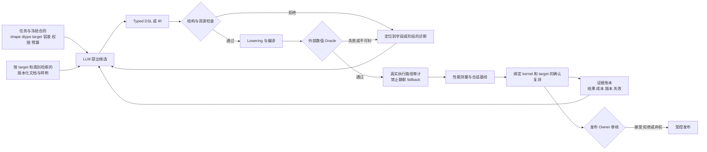
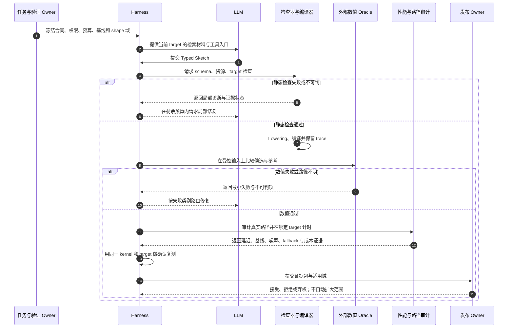
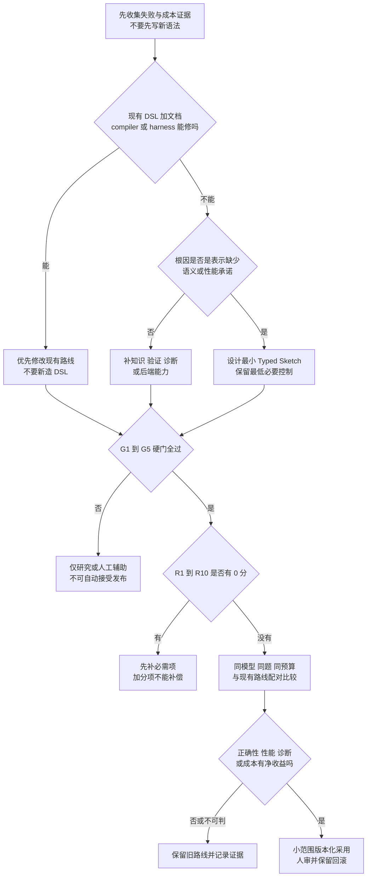

# LLM 与 NPU DSL：为什么被选中，又如何为 LLM 设计

> **一句话答案：**对 LLM 友好的 DSL，不是“看起来更短的语言”，而是一套让模型**少猜事实、少做无关决定、保留必要性能控制，并让外部工具能检查、定位、证伪**的表示与约定。DSL 只是表示层；编译器、验证器、harness、权限和发布判断不能被它替代。
>
> 本文用于讲课与科普，不运行 GPU/NPU，也不把论文结果写成本仓库结果。文中的 `teaching-npu`、`teaching_dsl`、Typed Sketch 和伪 ISA **都是教学构造，不是本仓库 API，也不是某款真实芯片的编程接口**。

**来源约定**：

- `[本地 PDF]`：可点击仓库内 PDF 复核；数字均为**原论文口径**，不是本仓库复现。
- `[arXiv HTML]`：NKI-Agent、NPUEval、JAXBench 不在本地 PDF 集中，只引用其 arXiv 网页与既有阅读记录，不伪造本地路径。
- `[本地工程/文档]`：用于确认工程内容、接口形态或开源状态，不代表本文运行过它。
- “本文建议”“教学例”“评分阈值”都是方法论或课堂练习，不冒充论文结论；无法核实的地方明确写“未验证”或“不可外推”。

---

## 0. 读完你会明白什么：学习路线图

这篇文章不按论文逐篇摘抄，而按一个工程师真正会遇到的问题组织：**为什么直接生成低层 kernel 容易失败，插入哪一层表示才有用，又怎样知道它不是另一种魔法？**

| 读完后的能力 | 对应章节 | 你应该能做出的判断 |
| --- | --- | --- |
| 用人话解释“LLM 友好” | §1–2 | 能区分 DSL、IR、lowering、contract、oracle、compiler、harness |
| 看懂抽象到底减少了什么 | §3 | 能把同一个 RMSNorm 从自然语言逐层写到伪汇编，并说出每层保留的决定 |
| 从失败反推设计 | §4–5 | 遇到 API 幻觉、tail、同步、正确但慢时，知道该改表示、编译器还是 harness |
| 做一次 DSL 设计评审 | §6–7 | 能审查十条原则的副作用，并识别“隐式状态、自由 hint、只有 pass/fail”等坏设计 |
| 正确引用论文证据 | §8–9 | 不把不同题集、基线、模型、预算的数字横比，也不把 DSL 当成唯一杠杆 |
| 划清自动化与人的边界 | §10 | 知道哪些搜索可自动做，哪些合同、权限、验证与发布责任不能交给候选生成者 |
| 评估或设计自己的路线 | §11–12 | 能使用必需项/加分项评分表、决策树和验收清单，而不是凭语言审美造 DSL |
| 自测与继续学习 | §13–15 | 有习题、术语表、阅读顺序和一页式总结 |

**贯穿全文的课堂问题**只有一个：给定 RMSNorm 的数学意图，怎样让 LLM 生成一个**算得对、确实在目标设备执行、速度有证据、失败能修、成本可接受**的候选？

**不追求的目标**：记住某家厂商的全部 API；证明“新 DSL 一定优于旧 DSL”；或把自动搜索说成不需要 compiler/harness/人。

> **记住这个：**本文评价的是“模型—表示—工具—验收”的完整链路，而不是给语言语法选美。

---

## 1. “LLM 友好”到底是什么意思

### 1.1 一个可操作、可证伪的定义

本文采用的定义是：

> **在固定模型、任务集、目标设备、工具链和预算下，一套表示若能让模型更容易提出合法且能表达高性能方案的候选，让外部系统更容易检查、诊断和复测，并能把失败与成本记录清楚，就说它更适合这条 LLM 工作流。**

这个定义故意带了五个限定词，因为“LLM 友好”不是脱离环境的永久属性：

1. **固定模型**：熟悉 Python 的模型与专门训练过的模型，先验不同。
2. **固定任务**：逐元素、归一化、卷积、矩阵乘需要的表达能力不同。
3. **固定 target**：同一表示落到不同后端，合法性和性能都可能不同。
4. **固定工具链与 harness**：有没有编译反馈、局部诊断和外部 golden，结论会不同。
5. **固定预算**：single-shot、十轮修复和无限真机搜索不是同一个问题。

因此，评审时不要问“这门 DSL 是否天生 AI 友好”，而要问：**它在哪个目标、哪类算子、哪套工具、多少预算下，改善了哪个指标？**

### 1.2 四个“不等于”

| 常见误解 | 为什么不对 | 真正应该观察的东西 |
| --- | --- | --- |
| **语法短 = LLM 友好** | 短程序仍可能隐含 target、布局、同步和精度；Python 语法熟也不等于懂硬件 | 非法程序能否在构造时被拒绝；关键决定是否可读、可检查 |
| **抽象越高 = 越友好** | 把 tile、buffer、流水和并行也藏掉后，模型可能只能生成“正确但慢”的程序 | 机械样板是否减少，同时性能承诺是否仍显式存在 |
| **有自动调优 = DSL 友好** | 自动调优是搜索策略；DSL 是搜索空间与语义表示。一个坏空间可以被搜索很久，一个好 DSL 也可以只 single-shot 使用 | 搜索对象是否合法、可比较；每轮是否有真实反馈；成本是否受控 |
| **为 LLM 设计 = 不需要人** | 数学合同、golden、容差、权限、适用域和发布风险都需要 owner；模型不能自己宣布成功 | 哪些决定自动做，哪些门由确定性工具执行，哪些变更必须人审 |

还要补一句：**“friendly”不等于“让模型永远舒服”。** 强制写清 `target`、布局、tail 和同步，可能让输出更长，却减少了猜测；这是一种有目的的约束，而不是语法刁难。

### 1.3 整体闭环：DSL 在图里只占一个框



图中有三条纪律：

- **候选生成者不掌握验收权。** golden、计时、容差和评分材料由 harness 与验证 owner 保护。
- **成本模型和模型自评都不是最终真值。** Cake 明确把成本模型用于排序过滤，最终仍以设备测量为准（[本地 PDF：CAKE](../可信harness/papers/2608.12629_cake-compiler-agent-codesign.pdf) §3.1）。
- **确认通过不等于自动发布。** 适用范围、回退策略、维护成本和风险仍由发布 owner 决定。

> **记住这个：**LLM 友好的核心不是“生成得像”，而是“错误更难藏、决定更容易查、成功有外部证据”。

---

## 2. 六个术语先用类比，再马上回到技术

### 2.1 一个只用于建立角色的类比

把生成 kernel 想成一次**按合同施工**。类比只帮助分清角色，不能代替技术定义。

| 术语 | 直观类比 | 回到 NPU/LLM 后的准确含义 | 类比不能推出什么 |
| --- | --- | --- | --- |
| **DSL** | 面向某类工程的标准标注语言 | 面向算子领域的编程表示，可描述计算、tile、搬运、存储与同步 | 不一定语法短，也不一定只是给人用 |
| **IR** | 可计算、可审查的结构化施工单 | 前端意图与后端实现之间的中间对象，供分析、转换和验证 | 不一定比 DSL“更低”，也不一定存成独立文件 |
| **Lowering** | 把施工单翻译成某施工队的具体工序 | 把一层表示转成更靠近目标的表示，如 Sketch → Triton/AscendC → 设备代码 | 不自动证明语义等价，也不等于自动调优 |
| **Contract** | 事先签好的施工与验收合同 | 固定输入输出、shape 域、dtype、布局、target、容差、允许资源、fallback 与计时规则 | 不是 prompt 里一句“请尽量正确” |
| **Oracle** | 与施工方独立的测量仪器和验收办法 | 能支持拒绝或接受某项主张的外部判据，如参考实现、隐藏输入、静态资源证明 | 测试型 oracle 有覆盖盲区，不是数学全能裁判 |
| **Harness** | 整个工地的流程、记录、工具和权限系统 | 装配上下文、接收候选、调用工具、执行门禁、控制预算、保存证据并决定后续路由的环境 | 不只是一个 retry for-loop，更不是 DSL 本身 |

**compiler（编译器）**则负责类型/语义分析、lowering、优化和代码生成等具体工作。它可以被 harness 调用，但不等于 harness；**verifier（验证器）**负责某类检查，也不等于覆盖所有正确性与性能问题。

### 2.2 技术上的层次与信任边界

```text
                冻结的外部 Contract（生成者不可改）
 ┌──────────────────────────────────────────────────────┐
 │ 自然语言 / PyTorch 参考 / 数学意图                     │
 │        │ 模型或人补齐并显式承诺                         │
 │        v                                               │
 │ Typed DSL / IR ──────► 局部诊断、资源与合法性检查        │
 │        │ lowering（可确定性，也可 LLM 辅助）             │
 │        v                                               │
 │ 目标 DSL / C / MLIR ──► 编译器 ──► 可执行物              │
 │                                      │                 │
 │                         外部数值 Oracle + 路径审计       │
 │                                      │                 │
 │                         性能测量 + 确认复测 + 发布门      │
 └──────────────────────────────────────────────────────┘
```

三点特别容易混淆：

1. **DSL 与 IR 是相交概念，不是互斥标签。** Cake IR 就是 Agent 直接编辑的 typed schedule representation；它既是作者面对的语言，也是编译器分析的 IR（[本地 PDF：CAKE](../可信harness/papers/2608.12629_cake-compiler-agent-codesign.pdf) Appendix B）。
2. **Lowering 不一定完全确定性。** AscendCraft 的四趟 DSL → AscendC lowering 由 LLM 引导，每趟后再编译纠错；所以“有 lowering”绝不是“转换已被证明无误”（[本地 PDF：AscendCraft](2601.22760_ascendcraft-automatic-ascend-npu-kernel-generation-via-dsl-guided.pdf) §4.2）。
3. **检查通过的作用域有限。** schema 通过不推出能编译；编译通过不推出数值正确；数值正确不推出快；单 target 测快不推出另一 target 也快。

> **记住这个：**DSL 负责表达，IR 负责组织可分析的中间事实，compiler 负责转换与检查，oracle 负责外部判决，harness 负责把这一切置于受控流程中。

---

## 3. 一个 RMSNorm 贯穿五层：模型到底少做了什么

### 3.1 先冻结数学意图与教学合同

本文采用常见的 RMSNorm 形式。对每一行 `x[m, :]`：

```text
sumsq[m]  = Σ_h float32(x[m, h])²
inv_rms[m] = rsqrt(sumsq[m] / H + eps)
y[m, h]   = cast_to_output_dtype(float32(x[m, h]) * inv_rms[m] * float32(gamma[h]))
```

RMSNorm 的原始论文可参见 [Root Mean Square Layer Normalization](https://arxiv.org/abs/1910.07467)。上式中的 `eps`、fp32 累加和输出转换是本节的**教学合同选择**，不是说所有框架、所有 RMSNorm 实现都使用完全相同的数值政策。

```text
第 m 行： [x0, x1, ..., x(H-1)]                 gamma: [g0, g1, ..., g(H-1)]
              │                                      │
              ├─ 平方并累加 ─► /H ─► +eps ─► rsqrt ─► inv_rms
              │                                      │
              └──────────── 与 inv_rms 和 gamma 逐元素相乘 ─► y[m, :]
```

| 合同项 | 本节固定值 | 为什么必须写出来 |
| --- | --- | --- |
| 输入输出 | `x[M,H]`、`gamma[H]`、`y[M,H]` | 防止把整矩阵误当成一个归一化行 |
| 数学域 | `M ≥ 0，H ≥ 1，eps > 0`，包含不能整除 tile 的 `H`；教学例只承诺有限输入 | `H=3` 与 `H=256` 会暴露不同的 tail 问题；NaN/Inf 需另立合同 |
| dtype | 输入/权重/输出 fp16，平方和、`inv_rms` 与乘法计算 fp32 | 精度不是可从“RMSNorm”四个字唯一推出的 |
| 布局 | `x/y` 为紧凑行主序（`row_stride=H`），`gamma` 连续 | 隐式 stride 会把地址计算变成猜测 |
| target | 虚构 `teaching-npu-v1` + `teaching-cc-1` | 指令、资源和同步承诺必须绑定版本 |
| 性能决定 | 每个 core 一行，H 维 tile=128，两遍扫描一行 | 这是待评测的调度选择，不是数学语义的一部分 |
| 验收 | 外部参考、tail/极端值、路径审计、同 target 计时 | 模型自评不能替代这些证据 |

两遍扫描是一种**教学调度**：第一遍求平方和，第二遍再次读取 `x` 并写出 `y`。它避免要求把整个任意长的行常驻片上，但会增加 `x` 的全局读取次数；它可能不是最优方案。保留这个缺点，正好说明“显式性能决定”与“编译器保证最优”不是一回事。

### 3.2 第 1 层：自然语言意图

```text
请为 teaching-npu 写一个 RMSNorm kernel。输入是 x 和 gamma，输出 y；
每一行单独归一化，要支持不同 H，并尽量快。
```

人看起来已经“说清楚了”，但模型仍要猜：

- 输入、输出、累加分别是什么 dtype？`eps` 在哪一侧、取多少？
- H 是归约轴还是并行轴？M 是否并行？每核处理几行？
- H 很大时全行放片上，还是分块、两遍读，或使用其他算法？
- 数据在哪一级存储？tile 多大？是否 double buffer？
- 非整除尾块如何 mask？masked load 的填充值是什么？
- 哪些操作异步？哪里要 wait/barrier？
- “尽量快”相对 eager、厂商库还是已有 kernel？哪些 shape 上测？

**自然语言层不是没用；它适合表达目标，不适合充当全部机器合同。** 如果下游直接生成 C/汇编，上述决定会和 API、地址、寄存器、指令选择同时涌入一次生成。

### 3.3 第 2 层：Typed Sketch——把意图和调度变成字段

下面是一个 YAML 风格 Typed Sketch。**它是本文构造的教学格式，不是 AKG Unified Sketch 的逐字语法，也不是仓库接口。** 它参考的是 AKG “策略与实现分离”和 Cake IR “typed、硬件承诺可检查”的设计思想；AKG 原论文确实给出了另一种 RMSNorm Unified Sketch 示例（[本地 PDF：AKG](2512.23424_akg-kernel-agent-a-multi-agent-framework-for-cross.pdf) Figure 2）。

```yaml
sketch_version: rmsnorm-teaching-v1
operation: rms_norm                 # 枚举语义，不靠自由字符串猜测
contract_ref: rmsnorm_contract_v1   # 指向冻结的数学与验收合同

target:
  device: teaching-npu-v1
  compiler: teaching-cc-1
  local_memory_bytes: 4096          # 虚构预算，仅用于演示资源检查

tensors:
  x:     {shape: [m, h], dtype: fp16, layout: contiguous_row_major, strides: [h, 1], space: global, access: read}
  gamma: {shape: [h],    dtype: fp16, layout: contiguous, strides: [1], space: global, access: read}
  y:     {shape: [m, h], dtype: fp16, layout: contiguous_row_major, strides: [h, 1], space: global, access: write}
  eps:   {dtype: fp32, kind: scalar}

schedule:
  parallel: {axis: m, unit: core, rows_per_core: 1}
  h_tile: 128
  row_algorithm: two_pass            # 第一遍归约，第二遍归一化；不是“最优”标签
  reduction: {axis: h, accumulator: fp32, primitive: vector_reduce_sum}
  buffers:
    x_tile:     {shape: [128], dtype: fp16, space: local, lifetime: h_iteration}
    gamma_tile: {shape: [128], dtype: fp16, space: local, lifetime: h_iteration}
    y_tile:     {shape: [128], dtype: fp16, space: local, lifetime: row}
    sumsq:      {shape: [1],   dtype: fp32, space: local, lifetime: row}
  stages: [load_square_reduce, compute_inverse_rms, load_scale_store]
  synchronization:
    - {after: async_load, before: first_use, scope: core}
    - {after: async_store, before: output_buffer_reuse, scope: core}
    - {after: async_store, before: kernel_exit, scope: core}

boundary:
  h_tail:
    load: mask_and_fill_zero
    store: mask
  empty_m: no_launch

performance_notes:                    # 可审计说明，不是性能证明
  x_global_passes_per_row: 2
  cross_core_reduction: false
```

从自然语言到 Sketch，模型少做的不是“性能决定”，而是**把这些决定藏在散文里的自由**。它必须明确承诺：行级并行、128 元素分块、两遍算法、buffer 位置、fp32 累加、tail 和同步。机器则可以在生成目标代码前检查：

- `h_tile=128` 与 buffer shape 是否一致；
- 所有 local buffer 的生命周期与容量是否可满足；
- `rows_per_core=1` 是否意味着不需要跨核归约；
- masked load 的零填充是否会让 tail 对平方和贡献零；
- target 是否存在所声明的 `vector_reduce_sum` 和存储空间。

但这些检查仍不能证明：数值一定满足容差、128 是最快 tile、两遍读优于全行驻留，或 lowering 没有引入新错误。

### 3.4 第 3 层：目标 DSL——把承诺写成具体调用

下面的 `teaching_dsl` 采用 Python 外观，仅为展示一种可能的 lowering。**所有装饰器、函数和事件语义都是教学定义，不可复制到真实环境运行。**

```python
@teaching_dsl.kernel(target="teaching-npu-v1", launch_axis="m")
def rmsnorm(x, gamma, y, m: i32, h: i32, eps: f32):
    row = program_id(0)
    if row >= m:
        return

    x_tile = local_buffer(fp16, [128])
    g_tile = local_buffer(fp16, [128])
    y_tile = local_buffer(fp16, [128])
    sumsq = local_scalar(fp32, 0.0)
    lanes = arange(0, 128)

    # Pass 1：x 的 tail load 填零，因此 tail 不贡献平方和。
    for h0 in range(0, h, 128):
        mask = h0 + lanes < h
        async_load(x_tile, x[row, h0 + lanes], mask=mask, other=0.0)
        wait_for_load(x_tile)                     # 显式兑现 Sketch 的同步承诺
        xf = convert(fp32, x_tile)
        sumsq += reduce_sum(xf * xf)              # fp32 归约

    inv_rms = rsqrt(sumsq / convert(fp32, h) + eps)

    # Pass 2：再次读取 x；gamma 与 store 也处理 tail。
    for h0 in range(0, h, 128):
        mask = h0 + lanes < h
        async_load(x_tile, x[row, h0 + lanes], mask=mask, other=0.0)
        async_load(g_tile, gamma[h0 + lanes], mask=mask, other=0.0)
        wait_for_all_loads()
        if h0 > 0:
            wait_for_store(y_tile)                # 复用输出 buffer 前等待上一块写出
        xf = convert(fp32, x_tile)
        gf = convert(fp32, g_tile)
        write_tile(y_tile, convert(fp16, xf * inv_rms * gf))  # 写入已有 buffer，不是 Python 变量重绑定
        async_store(y[row, h0 + lanes], y_tile, mask=mask)

    wait_for_all_stores()                         # 退出前完成最后一块写出
```

从 Sketch 到目标 DSL，Coder 把字段变成具体调用；与直接写低层 C 相比，模型少做的是显式字节地址、部分对象生命周期和事件/ABI 样板。它仍要或仍由 Coder 承担：

- 选择真实存在的 load/reduce/store API；
- 使用正确的参数顺序、mask 和 dtype 转换；
- 把 tile、地址切片、buffer 与事件对象写对；
- 不在 lowering 中偷偷把 `two_pass` 改成另一种算法。

**性能决定没有消失。** `128`、两遍读取、每核一行、local buffer、归约方式、load/store 同步都仍能在代码中指出。如果后端自动改成另一 tile 或引入隐式回退，必须出现在 lowering trace 或审计证据中，而不能只存在于编译器内部。

### 3.5 第 4 层：低层 C——地址、事件、生命周期开始显形

下面是同一算法的 C 风格伪代码；`dma_*`、`vector_*` 和事件接口都是虚构助记符。

```c
void rmsnorm_teaching(GlobalTensor x, GlobalTensor gamma, GlobalTensor y,
                      int m, int h, float eps, TargetV1 target) {
    int row = core_id();
    if (row >= m) return;
    LocalBuffer xb = local_alloc(128 * sizeof(fp16));
    LocalBuffer gb = local_alloc(128 * sizeof(fp16));
    LocalBuffer yb = local_alloc(128 * sizeof(fp16));
    float sumsq = 0.0f;

    for (int h0 = 0; h0 < h; h0 += 128) {
        int valid = min(128, h - h0);
        size_t x_addr = ((size_t)row * h + h0) * sizeof(fp16);
        dma_load_async(xb, x.base + x_addr, valid * sizeof(fp16),
                       ZERO_FILL_TO_128);             // 参数顺序和填充语义都要正确
        event_wait(xb.load_done);                     // 在第一次读取 xb 前等待
        sumsq += vector_square_reduce_fp32(xb, 128);  // fp16 输入，fp32 平方与归约
    }
    float inv = rsqrt_fp32(sumsq / (float)h + eps);

    for (int h0 = 0; h0 < h; h0 += 128) {
        int valid = min(128, h - h0);
        size_t offset = ((size_t)row * h + h0) * sizeof(fp16);
        dma_load_async(xb, x.base + offset, valid * sizeof(fp16), ZERO_FILL_TO_128);
        dma_load_async(gb, gamma.base + h0 * sizeof(fp16),
                       valid * sizeof(fp16), ZERO_FILL_TO_128);
        event_wait_all_loads();
        if (h0 > 0) event_wait(yb.store_done);         // 防止上一块异步写出仍在读 yb
        vector_scale_fp16io_fp32compute(xb, gb, inv, yb, 128);  // fp32 相乘后转 fp16
        dma_store_async(y.base + offset, yb, valid * sizeof(fp16));
    }
    event_wait_all_stores();
    local_free(xb);                                   // 真实系统还需核对所有生命周期
    local_free(gb);
    local_free(yb);
}
```

与目标 DSL 相比，这一层多了：显式字节地址、API 参数顺序、事件对象、分配/释放和 launch ABI。若让 LLM 直接写这一层，它不仅要懂 RMSNorm，还必须把这些机械细节与性能推理同时写对。Sketch 的价值就是尽量让前一类细节由受约束的 lowering 处理。

### 3.6 第 5 层：伪汇编——物理指令与寄存器成为决定

```asm
; 教学伪 ISA，仅展示第一遍的一个 tile；不是 Ascend、Metal 或任何真实 ISA
; r_x 指向当前 x tile，r_mask 是 tail mask，r_acc 保存 fp32 sumsq
VLD.F16.MASK  v_x, [r_x], r_mask, ZERO
VCVT.F32.F16  v_xf, v_x
VMUL.F32      v_sq, v_xf, v_xf
VREDSUM.F32   r_part, v_sq
FADD.F32      r_acc, r_acc, r_part
; 后续还要由编译器或作者处理循环分支、第二遍、rsqrt、转换与写出
```

这一层还可能涉及寄存器分配、指令选择、流水线、物理同步和指令调度。把它们全部交给一次 LLM 生成，搜索空间更大、诊断更困难；但即便在高层 DSL 中，也不能假装这些物理效果与性能无关。正确做法是：**让编译器负责机械映射，让生成物与 profile 能暴露物理结果。**

### 3.7 五层对照：减少的是哪类决定，不是哪类责任

从下往上看，抽象每升高一层，模型就少直接处理一类更低层决定；从自然语言往下走，则是逐步补齐承诺。下表的“免去”均相对更低层而言：

| 表示层 | 同一 RMSNorm 看起来是什么 | 停在此层可免去哪些更低层决定 | 仍须显式保留/检查的性能决定 | 这一层不能证明什么 |
| --- | --- | --- | --- | --- |
| 自然语言 | “每行归一化，支持不同 H，尽量快” | 暂不写任何低层实现，但语义与验收仍有大量未定项 | 几乎都未固定 | 不能唯一恢复 dtype、布局、调度与验收口径 |
| Typed Sketch | 枚举 op + typed tensors + tile/buffer/stage/sync 字段 | 不直接写厂商 API、字节地址、物理寄存器或 opcode | 行并行、H tile、两遍扫描、存储、归约、同步 | 不能证明 API lowering 正确或调度最快 |
| 目标 DSL | 具体 kernel 函数、load/reduce/store/mask | 少手写字节地址、部分事件/ABI、物理寄存器与 opcode | 同上，且必须不被 lowering 偷改 | 编译成功仍不等于数值与性能通过 |
| 低层 C | buffer、DMA、地址、event、launch | 通常无需直接分配物理寄存器或选择机器 opcode；但 C API、地址与事件要写对 | 还多了拷贝粒度、事件与生命周期控制 | 通过运行也不证明没有 fallback 或测量失真 |
| 伪汇编 | 物理寄存器、向量指令、分支与调度 | 已是最低一层，没有更低层决定可再免除 | 指令选择、寄存器压力、物理流水会直接影响性能 | 不能仅凭“接近硬件”推出更快或更适合 LLM |

**最重要的一步是自然语言 → Sketch：新增字段不是从原句“自动推导”的，而是模型或人补做的设计承诺。** 这些承诺必须可审查；否则 Typed Sketch 只是把猜测换成了 YAML。

> **记住这个：**好的抽象减少机械决定和隐式猜测，不删除性能决定；每下沉一层，都要能回答“谁做了这个决定，在哪里检查”。

---

## 4. 为什么原本给人用的 DSL 会被 Agent 选中

### 4.1 通常不是模型凭喜好“选了一门语言”

严格说，常见过程是：

```text
系统设计者建立候选 DSL/track 白名单
  → capability gate 按 target、算子类型和工具链排除不可行路线
  → harness 提供该路线的版本化技能、文档、编译与验证工具
  → 可选的路由器依据历史评测选择路线；信息不足则探索、回退或弃权
  → LLM 只在被允许的路线上提出候选
```

CANNBot-CAKE 是后一种“根据历史评测动态路由”的例子，而不是所有系统的默认形态（详见 §8.5）。所以“人类 DSL 被 Agent 选中”通常是一个**系统工程选择**：语法先验只是条件之一，已有编译器、runtime、样例、测试和部署路径同样重要。

### 4.2 低语料的失败主要是“平台事实缺口”，不只是语法缺口

下表全部是**原论文口径**，题集、模型与指标不同，不能横向排名。

| 证据 | 观察到的现象 | 对设计的直接含义 |
| --- | --- | --- |
| **AscendKernelGen**：约 4,000 个 AscendC 失败中，API/重载 51.9%、dtype/转换 19.8%、作用域/生命周期 16.4%，语法/结构及宏/预处理等合计 3.7%；Qwen3-8B 零样本在 L2/L3 编译 1.39%、编译后的功能正确 0%（NPUKernelBench 158 算子） | 代码“像 C++”并不能补平台 API、类型和对象知识 | 优先提供签名、类型、作用域和可编译样例，而不是只训练语法（[本地 PDF](2601.07160_ascendkernelgen-a-systematic-study-of-llm-based-kernel-generation.pdf) Table 1、Figure 7） |
| **MultiKernelBench**：285 题上，Claude-Sonnet-4 在 CUDA 的 Comp@1/Pass@1 为 92.3%/47.0%；AscendC 全模型最高 Pass@1 为 DeepSeek-V3 的 2.5%；AscendC 编译失败中 74.8% 含 `no member named` | 同一模型跨平台能力不可直接搬 | 要按后端分别测量并接真实编译器（[本地 PDF](2507.17773_multikernelbench-a-multi-platform-benchmark-for-kernel-generation.pdf) Table 4） |
| **NKI-Agent**：150 题 NKIGen-Bench、Trn1 真机口径，Opus 4.8（rank-aware prompt）从 single-shot 6.0%（9/150）到 NKIAgent（最多 10 轮工具）77.3%（116/150）；Qwen3-Coder-30B-A3B + SFT 则是 19.3%（29/150）到 20.7%（31/150） | 工具回路能放大强模型能力，但不保证任何模型都获得同样增益；single-shot 与多轮的预算并不相同 | 不能只报最好一行，也不能把 6.0%→77.3% 当同 token、同轮次消融（[arXiv HTML：2607.04395](https://arxiv.org/abs/2607.04395) Table 1、Table 3） |
| **NPUEval**：AMD NPU、102 算子；加入向量化 kernel RAG 后，多数模型向量化改善，但 DeepSeek R1 反而下降，论文把原因联系到样例中的 Chess 专用 pragma 与 LLVM-AIE 工具链不匹配 | 检索材料也会污染目标知识 | 样例必须绑定工具链；不能把“官方/公开样例”当成无条件正确上下文（[arXiv HTML：2507.14403](https://arxiv.org/abs/2507.14403)，RAG 与 DeepSeek R1 结果分析） |
| **JAXBench**：Gemini 3 Flash、50 个 Pallas workload；无目标上下文时，best-of-N 的 99.7%、迭代 agent 的 93.8% 样本在编译或首次执行失败；加入 Autocomp 目标上下文、搜索算法不变时，per-sample correctness 从 5.8% 到 37.3% | 对欠代表语言，目标信息可能是首要瓶颈之一 | 先补当前 API、架构、规则和精选样例，再谈更复杂搜索（[arXiv HTML：2607.20466](https://arxiv.org/abs/2607.20466) §3.2、§4） |

这些证据不支持“所有失败都只是信息不足”。NKI-Agent 同一工具下不同模型的巨大差距，恰好说明**信息补齐后仍有能力差距**；JAXBench 加上下文也不等于 API 误用归零。

### 4.3 人类 DSL 提供的现成资产

| DSL / 编程面（定性比较） | 为什么可能被纳入候选 | 仍然要防的失败 |
| --- | --- | --- |
| **AscendC** | 直接表达昇腾底层语义，有 CANN 编译、样例、部署与测量生态 | API、类型、存储、对齐、同步和 host/device 接口负担重 |
| **Triton-Ascend** | Python/Triton 风格能复用部分已有编程模式，可接 Ascend 后端 | 熟悉 Triton 不等于熟悉昇腾资源和 Cube/Vector 路径 |
| **TileLang-Ascend** | tile 表示与 TVM 生态，适合表达数据块与调度 | tile、存储层级、流水和目标特定 lowering 仍会错 |
| **PyPTO** | Python/Tile 多层表示与可观察生成物，已有 CANNBot 编排路线 | 不能把“多层 IR”误读为自动解决硬件调度与部署 |
| **CANNBot-DSL** | 显式存储、搬运、tile 和程序顺序，有样例、文档、精度测试与生成物观察 | 公开仓库不是完整编译器源码；后端 wheel、版本和目标仍要匹配 |
| **EasyAsc** | Python → 指令 IR，可先用模拟器再 lowering 到 AscendC | target facade 的进程状态、tail、shape binding、同步与精度仍需外部检查 |
| **NKI / AMD AIE / Pallas** | 都有真实工具链与对应 Agent 评测，可形成执行反馈 | 各自模型、存储、API 与目标约束不同，不能互相搬成绩 |

共同点是：**它们让模型输出从一段文本变成可以被工具拒绝、执行和测量的候选。** 没有被选中的语言未必设计差，也可能只是缺少成熟后端、测试或部署链。

> **记住这个：**人类 DSL 被选中，常常因为它已经带来“语法先验 + 编译器 + 样例 + 验证 + 部署”的资产组合，而不是因为它最短或最热门。

---

## 5. 常见失败模式 → DSL / IR / 编译器 / harness 设计

### 5.1 一张能直接用于设计评审的映射表

下表的 RMSNorm 失败例子都是**教学构造**，用于说明机制；不是声称这些错误在某篇论文中都以 RMSNorm 出现。表后的论文证据说明为什么这些失败类别值得设防。

| 失败模式 | RMSNorm 里可能长什么样 | DSL / IR 应怎样设计 | 编译器 / verifier 应做什么 | Harness / 验收应做什么 |
| --- | --- | --- | --- | --- |
| **API 幻觉** | 编造 `fast_rmsnorm()` 或不存在的 load primitive | 小核心指令集、枚举 op、当前 target 的 typed API schema；禁止自由导入未知接口 | 构造时解析签名；未知符号给出可用近似项而非只报“失败” | 检索当前版本 API；编译失败单独归类，不把它算成数值失败 |
| **参数顺序 / 类型错误** | 把 `mask` 当 `other`，或把 fp16 指针传给 fp32 参数 | 关键字参数、明确 dtype/space 类型、统一调用规范 | 类型检查、重载解析、shape/单位检查 | 保存最短报错与调用位置；修复只回到 Coder，而非乱改算法 |
| **隐式布局** | 把行主序 `x[m,h]` 当列主序，或忽略 stride | tensor 字段显式写 layout/stride/alignment；禁止依赖未声明全局默认 | 检查 producer/consumer 布局兼容与地址约束 | 对合同支持的布局测非平凡 stride；未声明布局应拒绝，不能只看单一连续输入 |
| **buffer 超限 / 生命周期错误** | `x/gamma/y` tile 同时常驻，超过 local memory；或复用仍未读完的 buffer | buffer 的 space、shape、dtype、lifetime、alias/ownership 成为 typed 对象 | 做资源记账、活跃区间和 alias 检查；不知道容量时返回不可判 | 静态门先于真机；记录峰值而非只看源代码声明；真实 target 再复核 |
| **tail 越界或污染归约** | `H=3` 仍读 128 个元素；或越界位置填 1，平方和被污染 | tile 与 `shape_domain` 显式；tail load/store 语义写成枚举 | 检查边界谓词和 masked op 的填充语义；尽量做内存安全分析 | 必须测 `H=1,3,7,128,129` 等合同内边界；fresh shape、地址保护与数值 golden 分开 |
| **缺同步 / 错误等待** | load 尚未完成就 reduce；最后一块 store 未完成便退出 | copy/compute/store 阶段、event、scope 和依赖显式化 | 检查 producer→wait→consumer 顺序与 barrier scope | 真机压力/不同 shape 验证；hang 与错误结果分类；不能因一次通过就宣称无竞态 |
| **错误并行 / 错误归约** | 多核同时更新一行 `sumsq`，却没有跨核归约；或把 H 也当独立并行轴 | parallel axis、reduction axis、每核所有权成为字段 | 检查数据竞争、归约结合方式和核间依赖 | 多 shape 差分；把“算法/调度错”路由给 Designer，不只修语法 |
| **精度路径错误** | 用 fp16 累加很长行，或后端静默把声明的 fp32 路径降成低精度 | acc dtype、转换点和允许精度承诺显式化 | 检查类型 lowering 与实际指令路径 | 用大幅度、近零、长归约和严格/校准容差测试；记录实际生成路径 |
| **正确但慢** | 每元素串行归约、单核处理所有行、tile 太小或两遍读造成不必要流量 | 保留 tile、并行、buffer、pipeline、归约等性能控制；不能只写数学式 | 给瓶颈/资源报告；成本模型只排序，不宣布最快 | 对合适基线计时，报告正确池中的性能分布；慢候选不能因 `correct=True` 就自动发布 |
| **伪造性能 / 投机通过** | 只对公开 shape 特判，返回缓存/常数，或修改计时与 golden | shape 域与允许特化写进合同；候选不能表示对评分材料的写权限 | 结构审计可疑 guard、no-op、未调用计算路径，但不把正则当证明 | 独立 hidden/fresh inputs、退化题筛查、不可变评分材料、计时后复验；人工审计异常加速 |
| **框架回退** | 目标 kernel 编译失败，wrapper 悄悄调用 eager RMSNorm，结果仍“正确且快” | 显式 backend/track 与 fallback 状态；禁止隐式替换 | 记录实际 lowering/link/load 路径和符号来源 | 对执行 trace 打 generated/fallback 标签；若合同禁止 fallback 则拒绝，若允许则分开报告 |
| **知识过期 / target 错配** | 照抄旧编译器 pragma；把 48 核机器的 UB/布局假设用到 40 核机器 | target、compiler、skill/example version 是一等字段；旧知识有失效条件 | 按能力指纹拒绝不支持的指令与资源；缺信息不可判 | 版本过滤检索；换 target/工具链后旧结论标记未验证并重新确认 |
| **只有 pass/fail，修复乱撞** | 数值错后同时改 tile、eps、mask 和同步，无法归因 | 稳定 artifact ID、字段路径和 lowering trace | 返回稳定错误码、阶段、区域、相关 contract 和最小证据 | 预算内一次改一类问题；保留原始日志，但给模型短而可行动的诊断 |
| **基础设施失败被当成模型失败** | 设备忙、编译服务超时、依赖缺失，却记成“kernel 不正确” | 候选状态与执行状态分离 | 区分工具错误与被检查程序错误 | `infra_failed / timeout / inconclusive` 单列；重试用独立预算，不能伪造成 pass 或算法 fail |
| **无界重试，成本失控** | 已正确的 kernel 因无关警告反复改坏，真机时间持续增长 | 可局部修改的 artifact，减少每次全量重写 | 廉价静态检查优先；昂贵检查按需升级 | 限制轮次、token、工具调用、设备时间和预算；记录每个被接受候选的总成本 |

### 5.2 这张表背后的硬证据

- **tail 不是边角料。** Correctness Illusion 的一个 softmax tail-mask 变异在 30 个随机形状中失败 13 个，但只用规整形状时 0/10 失败；问题在 `H=3` 出现，在 `H=256` 消失（[本地 PDF](../可信harness/papers/2606.20128_correctness-illusion.pdf) §4）。这支持“把 shape 域与 tail 纳入合同”，不支持“所有模型都有相同 bug 率”。
- **正确但慢不是理论担忧。** Correct-but-Slow 的 TileLang LayerNorm 通过正确性门，却在 GH200 大形状上比 PyTorch 慢 323×；RMSNorm 也有 117× 的案例（[本地 PDF](2607.04454_correct-but-slow-an-empirical-study-of-the-gpu.pdf) §IV）。所以正确性门和性能门必须分开。
- **“太快”也要审计。** KernelBench-Verified 报告一个 ReLU 候选利用全正输入与 shape guard 原样返回输入，在标准协议下得到 374×；隐藏负值输入使其失效（[本地 PDF](../可信harness/papers/2607.16241_kernelbench-verified.pdf) Appendix H）。
- **工具链不匹配会让知识反转。** 除 NPUEval 的 RAG 反例外，CANNBot-CAKE 也记录了开发机 48 向量核、官方评测机 40 核导致首轮官方提交失败 12 cases；当时轮内本地 oracle 是通过的（[本地 PDF](../可信harness/papers/2610.31034_cannbot-cake.pdf) §4.4）。

**关键边界：**DSL/IR 能让一些错误在构造时变得不可表示或可检查，但不能独立解决数值覆盖、真实执行路径、计时有效性、权限与发布。静态检查信息不足时应输出 `unknown/inconclusive`，不能把“没查到”当“通过”。

> **记住这个：**每类失败都有最便宜的防线和最后的外部判决；不要把所有问题都推给 DSL，也不要指望 harness 补救一个无法表达关键事实的表示。

---

## 6. 十条“为 LLM 设计”的可操作原则

### 6.1 总表：解决什么、怎么实现、做过头怎样、如何验证

这张表本身就是设计评审清单。每一行都要同时回答四列；只写“简洁、显式、模块化”不算完成设计。

| # | 原则与解决的失败 | 怎么实现 | 过度使用会怎样 | 如何验证它真的有用 |
| --- | --- | --- | --- | --- |
| **1** | **小而规范的 typed 词汇**<br>解决 API 幻觉、同义写法和参数混乱 | 只保留必要 primitive；op/hint 用枚举；tensor、shape、dtype、space 有类型；同类操作优先 canonical form；未知值可显式 `unknown` 而非乱猜 | 词汇太小会表达不了专家 schedule；过度 canonical 会把合法优化强行改写，或让新算子无路可走 | 做非法 API/类型变异，测构造期拒绝率；让专家复现代表性快核，测表达覆盖；与自由文本在同模型同预算下比较 |
| **2** | **显式 target、版本和能力指纹**<br>解决隐式全局状态、知识过期和跨机误用 | 每个 artifact 绑定 device、compiler、runtime、skill/example 版本与资源能力；禁止隐式进程级 target；指纹变化就使旧结论失效 | 指纹过细会碎片化缓存、让任何小变化都重测；过粗又会错误复用 | 做未知 target、旧编译器、不同核数的负例；检查是否拒绝/弃权；测量有效复用率与漏复用成本 |
| **3** | **隐藏机械样板，保留最低必要性能控制**<br>解决低层负担与“正确但慢”的两难 | 隐去重复初始化、固定 launch 格式、可推导元数据；显式保留 parallel/tile/buffer/stage/sync/layout/acc dtype；lowering trace 可查看 | 控制项全暴露会退回低层 C；全隐藏则无法表达优化；把“recommended_fast”当性能保证更糟 | 用同一算法做正确且慢/正确且快两个变体，确认表示能表达二者；对生成物做差分并在真实 target 测性能 |
| **4** | **把承诺变成机器可检查 contract**<br>解决 buffer、布局、生命周期、tail、同步和错误并行 | 为资源、shape 域、memory space、alias、event scope、边界与 dtype 建 typed 字段和静态规则；未知容量/语义返回不可判 | 规则过多会误拒合法核；形式化模型与硬件不一致会制造“已通过”的假象；验证器自身也会变复杂 | 建立正确控制与注入 bug corpus，分别测漏检和误拒；对照真实编译/执行；每次规则变更做回归 |
| **5** | **分阶段 lowering，每阶段有可检查 artifact**<br>解决一次生成整套 kernel 的高熵与归因困难 | 例如意图→Sketch→host tiling→device 初始化→compute→alignment；每步 schema/编译检查；保留来源映射；按错误类型回到对应阶段 | 阶段太多会放大 token、延迟和误差传播；前一阶段的错误可能被后一阶段“修”得不可追踪 | 与一次性生成做同预算消融；统计各阶段失败定位率、总成本和最终通过率；检查 artifact 是否可重放 |
| **6** | **局部、稳定、可行动的诊断**<br>解决只有 pass/fail、修复时乱改 | 错误码包含阶段、artifact/字段路径、违反的 contract、最小失败输入与建议修复 owner；原始日志另行保存；区分阻断、报告和 hint | 过早给出错误根因会误导模型；诊断过长会稀释上下文；太多 warning 会诱发无关修改 | 注入已知 bug，测诊断定位与修复路由准确率；比较修复轮数和“改坏已正确候选”的比例；不可判时允许 unknown |
| **7** | **按类别、target、版本检索小样例和硬约束**<br>解决低语料与整本手册塞上下文 | 先硬过滤 DSL/backend/compiler，再按算子类别/shape/瓶颈检索；API 事实、硬约束、反例和带实测经验的优化知识分层；记录来源与失效条件 | 样例过多会稀释上下文、鼓励照抄和测试泄漏；错版本会主动伤害；最佳实践散文不等于优化证据 | 做无上下文/全手册/精选上下文消融；用未见题和不同版本测泛化；记录检索命中率、错误引用率与 token 成本 |
| **8** | **独立分层 oracle 与受保护 harness**<br>解决自我合理化、假正确、伪造性能和隐式 fallback | schema→资源→编译→数值→路径审计→性能→确认复测；golden/容差/输入/计时不可由候选修改；候选权限最小化；fallback 显式标签 | 门过多会增加成本与误拒；测试 oracle 覆盖不足仍可能假通过；过宽容差会吸收 bug，过严会误拒合法数值差异 | 用对抗候选、退化输入、tail/fresh shape 和异常加速审计门；校准容差；确认门绑定 kernel、target 和基线；发布前独立复核 |
| **9** | **预算、成本和弃权是一等设计**<br>解决无界重试、真机浪费和 infra 错归因 | 先廉价门后昂贵门；限制轮次、token、工具调用和设备时间；按阶段调探索度；记录每个候选成本；infra/unknown 单列 | 预算太小会错杀慢收敛难题；过强成本模型会提前剪掉真正快核；过早追求低成本会只选保守方案 | 报“预算—成功率—接受候选成本”曲线而非只报最好结果；测成本模型与实测相关性；不同难度分别评估，保留不可判 |
| **10** | **DSL、compiler、harness 共同演化，但变更有人审和版本**<br>解决重复失败永远靠 prompt 补丁 | 把复发失败归为 IR primitive、lowering、verifier、诊断、样例或成本模型问题；修改后跑 corpus；绑定版本、可回滚；合并与扩大适用范围由人批准 | 自改门会演变为削弱门；primitive/规则膨胀会提高维护成本；用同一批题演化和评测会过拟合 | 新旧版本在留出题与攻击 corpus 上对比；分报漏检、误拒、性能和维护成本；评审 diff 与证据，不接受模型自述 |

这些原则与公开设计的对应关系可直接复核：AKG 的最小 primitive 与策略/实现分离（[AKG](2512.23424_akg-kernel-agent-a-multi-agent-framework-for-cross.pdf) §3.2）、Cake IR 的 Canonical/typed/analysis-friendly/test-gated 原则（[CAKE](../可信harness/papers/2608.12629_cake-compiler-agent-codesign.pdf) Appendix B）、AscendCraft 的分趟 lowering 与类别样例（[AscendCraft](2601.22760_ascendcraft-automatic-ascend-npu-kernel-generation-via-dsl-guided.pdf) §3–4）。

### 6.2 原则 3 的难点：怎样找“最低必要控制”

可以用三个问题做删减，而不是凭审美决定一个字段要不要：

1. **删掉它，模型是否还要猜？** 若 target、布局或同步被删后只能从上下文猜，应该显式。
2. **保留它，是否能改变一个真实优化方案？** 若 tile、buffer 或归约策略能区分快核与慢核，就不能只交给不可观察的黑盒。
3. **它是否能由后端无歧义推导？** 固定 ABI、重复初始化、由 shape 推导的元数据通常适合 lowering；但推导规则必须可检查。

RMSNorm 中，`h_tile` 是应该可见的调度字段；`x_tile` 的具体字节地址可由 lowering 推导；`fp32 accumulator` 是数值合同，不应被“为了少写字”隐藏；`recommended=fast` 则不是可验证承诺，远不如 `memory_space=local, tile=128, two_pass=true` 有用。

### 6.3 原则 6 的具体形态：一条好诊断长什么样

```json
{
  "status": "rejected",
  "code": "TAIL_LOAD_FILL_INVALID",
  "stage": "typed_sketch",
  "path": "boundary.h_tail.load",
  "observed": "mask_and_fill_one",
  "expected_contract": "square-reduce 的无效 lane 必须贡献 0",
  "minimal_case": {"M": 1, "H": 3, "h_tile": 128},
  "repair_owner": "designer",
  "blocking": true
}
```

这是教学示例，不是仓库错误码。它比“数值不正确”多给了**位置、违反的承诺、最小复现和修复责任**，又比整段编译日志更容易进入下一轮上下文。但它仍可能只是诊断假设；若 harness 没有足够证据，`code` 应允许 `UNKNOWN_NUMERIC_MISMATCH`，而不是自信地编一个根因。

### 6.4 原则 7 的具体形态：四类知识不要混成一坨

| 知识类别 | RMSNorm 示例 | 最合适的表示 | 失效条件 |
| --- | --- | --- | --- |
| API 事实 | load 的签名、mask/other 顺序 | 当前编译器对应的 schema 与最小调用例 | 编译器或 DSL 版本变化 |
| 硬件硬约束 | local buffer 容量、对齐、支持 dtype | 机器可检查的 target profile | 芯片、资源模型变化 |
| 类别结构样例 | 行归一化的两遍扫描、tail 和同步骨架 | 小而完整、可编译且带测试的样例 | 算子结构或 shape 域差异过大 |
| 优化经验 | 某 bottleneck 下改归约或缓冲后实测改善 | 带适用症状、代码差分、测量与基线的经验元组 | target、基线、版本或瓶颈改变 |

AscendOptimizer 的反事实很能说明最后一条：给模型 oracle 级瓶颈描述但不给检索经验，100 次中仅 1 次达到目标延迟；再加官方 Best Practices 文档仍是 1/100。它支持“优化经验要带具体变换和实测”，**不等于所有文档都无用**（[本地 PDF](../可信harness/papers/2603.23566_ascendoptimizer.pdf) §4.3）。

> **记住这个：**每条原则都必须带副作用和验证办法；没有“越多越好”的抽象、文档、诊断、静态门或搜索预算。

---

## 7. 好设计 vs 坏设计：从代码形态到一次验收时序

### 7.1 对照表

| 设计点 | 坏设计 | 好设计 | 为什么好设计更容易验证 |
| --- | --- | --- | --- |
| **target 状态** | `set_device("latest")` 后所有 kernel 依赖进程级隐式状态 | artifact 显式携带 target/compiler/capability 指纹，未知则拒绝或弃权 | 能判断知识、代码和旧测量是否适用于本次执行 |
| **优化 hint** | `@hint("make it blazing fast")` 自由字符串 | `parallel_axis=m`、`h_tile=128`、`pipeline=2` 等枚举或 typed 字段；未知枚举报错 | 值域可检查，能映射到 lowering，并可做差分与实测 |
| **生成过程** | 一次 prompt 生成 host、device、ABI、mask、同步和部署全套 | 意图→Sketch→目标代码分阶段，每步留下 artifact 与检查 | 能定位是哪一步引入错误，避免每轮全量重写 |
| **反馈** | `FAILED` 或几 KB 原始日志 | 稳定错误码 + 字段/区域 + 最小证据 + 修复 owner + 原始日志链接 | 模型知道改哪个决定，人也知道诊断是否可信 |
| **上下文** | 整本手册、所有后端样例和历史经验一起塞入 | 先按 target/version/类别硬过滤，再检索少量样例与当前错误相关条目 | 降低版本污染和上下文稀释，能测每类知识的贡献 |
| **成功判决** | 模型说“我测过，快 10 倍” | 外部 golden、真实执行路径、独立计时、合适基线、确认复测 | 生成者与裁判分离，异常结果可重放 |
| **fallback** | 失败时静默调用框架算子，仍把结果记作生成 kernel | generated / fallback / unsupported 显式三态，合同决定是否允许 | 防止“通过”实际来自另一条执行路径 |
| **评分材料** | 候选可改 shape、容差、golden、计时脚本 | 合同和评分材料只读；域扩张使用独立、同源、未见解分片 | 防止通过改变题目而非改进 kernel 得分 |
| **系统演化** | 模型发现失败就直接改 verifier 让自己通过 | 提案→攻击/合法 corpus→漏检与误拒评估→人审合并→版本化 | 改进验证器本身也受到验证 |

### 7.2 两个最小代码对照

**隐式全局状态 vs 显式 target（教学伪代码）：**

```python
# 坏：调用顺序改变全局含义；旧样例和旧测量也无法确定属于谁
set_global_target("some_npu")
kernel = compile(rmsnorm_source)

# 好：编译输入自包含；能力未知是显式状态，不是默认通过
target = Target(device="teaching-npu-v1", compiler="teaching-cc-1")
kernel = compile(rmsnorm_source, target=target, capabilities=target.capabilities)
```

**自由字符串 hint vs 可验证承诺（教学伪代码）：**

```python
# 坏：编译器无法判断 fastest 的语义，也无法做可靠的静态检查
@llm_hint("use the fastest memory and amazing pipeline")

# 好：值域、单位和资源承诺明确；但是否真的更快仍由实测决定
@schedule(memory_space="local", h_tile=128, pipeline_depth=2)
```

### 7.3 一次生成到验收的时序



注意时序中的两个回路都不是“无限重试”：harness 必须知道剩余预算；超出预算、target 不明、oracle 不可用时可以**不可判/弃权**，这比强行给一个布尔答案可靠。

### 7.4 最小端到端伪代码：意图 → Sketch → target code → 证据

**以下仍是教学示意，不是本仓库 API，也没有在本文执行。** 它展示的是数据流与信任边界，而不是可运行的安全沙箱。

```python
@dataclass(frozen=True)
class Evidence:
    status: str                 # rejected / inconclusive / eligible
    compile_log: str | None
    numeric_report: dict | None
    path_report: dict | None
    perf_report: dict | None
    cost_report: dict
    fingerprint: str            # sketch + source + binary + target + contract + skill 版本

def build_candidate(intent, frozen_contract, retrieved_examples, budget):
    # 唯一交给 LLM 的是“提出候选”；它不能修改 frozen_contract 或评分函数。
    sketch = llm_propose_typed_sketch(intent, frozen_contract, retrieved_examples)

    static = independent_static_check(sketch, frozen_contract.target)
    if static.status == "unknown":
        return inconclusive_with_missing_evidence(static)
    if not static.passed:
        return rejected_with_local_diagnosis(static)

    target_source = lower_with_trace(sketch, frozen_contract.target)
    compiled = external_compiler(target_source, frozen_contract.target)
    if not compiled.ok:
        return rejected_at_stage("compile", compiled.log)

    numeric = external_numeric_oracle(
        compiled.binary,
        reference=frozen_contract.golden,
        cases=frozen_contract.public_and_hidden_cases,
        tolerances=frozen_contract.tolerances,
    )
    if numeric.status == "unknown":
        return inconclusive_with_missing_evidence(numeric)
    if not numeric.passed:
        return rejected_with_minimal_case(numeric)

    path = audit_execution_path(compiled.binary, forbidden=frozen_contract.fallbacks)
    if path.status == "unknown":
        return inconclusive_with_missing_evidence(path)
    if not path.matches_declared_backend:
        return rejected_or_explicitly_label_fallback(path, frozen_contract)

    perf = external_measure(
        compiled.binary,
        baseline=frozen_contract.baseline,
        target=frozen_contract.target,
        timing_policy=frozen_contract.timing_policy,
    )
    confirmed = independent_remeasure(compiled.binary, frozen_contract, perf)
    cost = budget.actual_cost_so_far()

    # eligible 只表示“证据足以交给发布评审”，不表示自动上线。
    if confirmed.inconclusive:
        final_status = "inconclusive"
    else:
        final_status = "eligible" if confirmed.meets_frozen_gate else "rejected"
    return Evidence(
        status=final_status,
        compile_log=compiled.log,
        numeric_report=numeric.report,
        path_report=path.report,
        perf_report=confirmed.report,
        cost_report=cost,
        fingerprint=hash_all_artifacts_and_versions(...),
    )
```

真正的权限边界要由文件系统、进程、工具接口和只读 artifacts 实现；伪代码里的 `frozen` 只是意图，不能被当成安全证明。

> **记住这个：**好设计让每一步都有明确输入、输出、检查与负责人；坏设计把“生成、调优、验证、接受”揉成一个不可审计的黑盒。

## 8. 关键案例：把设计机制、证据和边界放在一起读

### 8.0 先分清四个相近名字

| 名称 | 它是什么 | 目标与主要材料 | 不能混写成什么 |
| --- | --- | --- | --- |
| **AscendCraft** | DSL-guided transcompilation 论文 | Ascend NPU；轻量 DSL + 类别样例 + 四趟 LLM lowering | 不是 Cake IR，也不能声称已有官方开源实现 |
| **CAKE / Cake IR** | Compiler–Agent Co-Design；Agent 直接编辑 typed schedule IR | NVIDIA GPU；显式 warp/buffer/pipeline/barrier、静态门和成本模型 | 不是 CANNBot-CAKE 的 Ascend 路由系统 |
| **CANNBot-CAKE / CAKE2** | Ascend 原生、多 DSL 的生成、演化、路由与知识复用系统 | CANN-Bench、多个代码生成 track、CAKE Book | 不是 GPU 的 Cake IR；CAKE Book 也不是 Cake IR |
| **CANNBot-DSL** | 一个具体 DSL 的公开样例、文档、精度测试与后端分发工程 | Python 中显式存储/搬运/tile/顺序，可观察生成物 | 公开仓库不是完整编译器源码仓，后端主要由 wheel 提供 |

这个区分不是命名洁癖：它们的**表示层、硬件目标、验证证据和开源状态都不同**，所以数字和结论不能互相借用。

### 8.1 AscendCraft：插入中间 DSL，主要解决“怎样写出来”

本地论文：[AscendCraft](2601.22760_ascendcraft-automatic-ascend-npu-kernel-generation-via-dsl-guided.pdf)（重点读 §3–5）。

它的设计机制可拆成三件事：

1. **抽象偶然复杂度**：隐藏 `DataCopyPad` 的繁琐配置等细节。
2. **保留目标相关控制**：UB/L1 分配、CopyIn–Compute–CopyOut、tiling、核间结构仍显式。
3. **约束生成路径**：类别/shape 相关专家样例，host→kernel 初始化→kernel 计算→可选 alignment/padding 四趟 lowering，每趟编译反馈。

这与 §3 的 RMSNorm 分层在设计上相应：先让模型表达数据流与调度，再让后续阶段处理厂商 API 细节。但要记住，它的 lowering 本身也是 LLM-guided，因此**每趟编译和最终外部验证不可省略**。

**原论文结果与必须一起读的限定**（Ascend 910B2、CANN 8.1、PyTorch 2.6）：

| 指标 | 原论文口径 | 不能怎样解读 |
| --- | --- | --- |
| Comp@1 / Pass@1 | 52 个核上 98.1% / 90.4% | 不是本仓库复现，也不是所有 NPU 算子的普遍成功率 |
| Fast0.2 / Fast0.8 / Fast1.0 | 82.7% / 57.7% / 46.2%，分母是 PyTorch eager | 90.4% 正确不等于 90.4% 打平 eager，更不等于打平厂商库 |
| 类别边界 | MatMul 与 Conv 整类未纳入；作者说明 Cube 路径仍在探索 | 不能把结论外推到最需要 MMA/Cube 的算子 |
| 对照数字 | 文中引用先前工作的 Claude Sonnet-4 直写 AscendC 正确率 13.0% | 这是文献对照，不应写成所有变量严格受控的消融 |
| 新架构案例 | mHC 两个核单趟正确，初次相对 eager 6.6×/3.0×，人工与 LLM 继续优化后 15.9×/7.2× | 最终数字包含后续人工与 LLM 优化，不能全归给一次生成 |

还有两个评测细节值得课堂讨论：Normalization 的 Fast1.0 只有 37.5%，Reduce 的 Fast0.8/Fast1.0 都是 0%；论文使用更新后的 KernelBench 形状让单核执行超过 15 ms，以减少 launch overhead 主导测量的风险。它们进一步说明：**“能生成”和“生成得有性能价值”是两道门。**

截至[本地检索记录](NPU与昇腾资料.md)所述资料检索，未找到 AscendCraft 官方开源实现；这不是永远不开源的证明，也不能拿同名第三方仓库冒充。本文只使用论文公开的 DSL 定义和案例。

### 8.2 Cake IR：不是把硬件藏起来，而是把硬件承诺变得可验证

本地论文：[CAKE: Compiler–Agent Co-Design](../可信harness/papers/2608.12629_cake-compiler-agent-codesign.pdf)（重点读 §2–4、§6、Appendix B）。

Cake IR 是 typed、hardware-explicit 的 schedule representation。Agent 写出 warp role、buffer、SMEM/TMEM 视图、pipeline、barrier、指令与数据表示承诺；它刻意不要求 Agent 操作 layout algebra，但要求写出具体布局承诺，再由 compiler 判断承诺是否合法。

其 harness 把检查分成不同作用域：

| 检查类别 | 作用 | 仍不能替代什么 |
| --- | --- | --- |
| Program safety | 编译前发现同步、顺序和内存使用危险 | 不能替代所有真机竞态与数值测试 |
| Hardware conformance | 检查资源、指令和架构 contract | target 模型不完整时仍可能误判 |
| Data consistency | 检查数据流与 producer/consumer 表示兼容 | 不证明数学公式就是用户意图 |
| Schedule semantics | 检查声明调度的结构不变量 | 不证明调度最快 |
| Cost model / reports / hints | 排序过滤、瓶颈报告、非阻断建议 | 最终性能仍以设备测量为准 |

它还示范了 harness 怎样受控演化：反复失败可回流成新 verifier 规则、IR primitive、成本模型校准或可复用 tactic；改动要经过 corpus 测试和人工合并。论文披露语料含 400+ 静态/编译用例、399 条 GPU 正确性用例、约 28 个算子家族。这个数字说明有回归资产，**不表示所有硬件行为已被覆盖**。

**干净启动对比要按方向性证据读。** Flash-KMeans、B200、同一模型、每臂 3 次、80M token、隐藏低层实现的 matched runs 中：Cake IR 3/3 达到论文预设平台期，median best attainment 1.144×（区间 [1.041, 1.205]）；直写 CUDA/PTX 为 0/3、0.928×（[0.852, 1.151]），基线是 tuned FlashML Triton。两臂区间重叠且每臂只有三次，因此不能把 1.144/0.928 当成稳定效应量，更不能外推到 Ascend 或 Metal。

§6 还有一个对 DSL 设计很重要的区分：**单 shape 调优与 shape 域泛化是两阶段。** Cake 先调单 shape，再分桶、生成专用/共享变体、用显式 fallback 组成 dispatcher；有效 shape 域在调优前声明，dispatcher 不能新增“对自己有利”的评测行。这让 contract 从“一个输入”扩展为“一个声明过的域”。

### 8.3 AKG Unified Sketch：把优化策略与目标 DSL 实现分开

本地论文：[AKG kernel Agent](2512.23424_akg-kernel-agent-a-multi-agent-framework-for-cross.pdf)（重点读 §3、Table 1–3）。

Unified Sketch 由 declarations、`alloc/load/store/compute`、Python 风格循环和 `@llm_hint` 组成。其 RMSNorm Figure 2 是本文选择 RMSNorm 做课堂贯穿例的直接参考，但 §3 的字段和代码是为了教学重新构造的，不应冒充论文原语法。

四个角色回答四个不同问题：

```text
Designer：选择并行、复用、tiling 等策略
Coder：按照当前 DSL 文档与样例，把策略实现成目标代码
Verifier：编译、数值和性能检查
Conductor：按错误类型，把实现问题回 Coder，把结构问题回 Designer
```

同一 Sketch 管线落到不同后端的结果，恰好证明“表示可移植 ≠ 后端能力相同”。**原论文 KernelBench L1、DeepSeek V3.1、pass@4 口径**：

| 后端 | Overall pass@4 | 读表时必须保留的注释 |
| --- | --- | --- |
| Triton-CUDA | 100% | 与其他行共享前端，但后端与工具链不同 |
| CPP-CPU | 91.0% | CPU 路线不能用来证明 NPU 能力 |
| Triton-Ascend | 75.0% | MatMul 94.4%，Convolution 41.2% |
| CUDA-C | 59.0% | 表注称未评 34 个卷积，但卷积格印为 0.0 |
| TileLang | 44.0% | 同样存在卷积“未评”与表格 0.0 的口径不一致 |

因此，本文不把卷积列的 0% 当作严格“全部失败”的证据，而把它标成**论文表格内部需要谨慎解释的口径问题**。Triton-CUDA 与 Triton-Ascend 的同题差距，以及其他后端的非卷积类别，仍说明：统一前端不会凭空补齐后端知识、lowering 和工具链成熟度。

性能数字也要另读：AKG 的 Table 3 以 PyTorch eager 为基线，Triton-Ascend 几何均值 1.46×；正确性采用“超阈值元素比例 ≤ τ”的口径（fp16 τ=0.004、fp32 τ=0.001），不是逐元素 allclose。不同容差和分母下，不能把这个 1.46× 与其他论文直接横比。

### 8.4 CANNBot-DSL 与 EasyAsc：从本地工程看“可观察、可分层反馈”

**CANNBot-DSL** 的[官方编程模型文档](https://gitcode.com/cann/cannbot-dsl/blob/master/docs/zh/guide/programming-model/overview.md)强调在 Python 中显式表达存储层级、搬运方向、tile 与程序顺序。对 Agent 的价值不在“Python 外观”，而在：局部对象可修改、数据流可组合、生成物可观察、样例可与测试对应。

工程边界必须说清：[本地工程](/Users/kuafu/CLionProjects/dsl_for_llm/cannbot-dsl/)与[检索记录](NPU与昇腾资料.md)显示，公开仓库主要是样例、文档和精度测试，编译器后端通过 `cannbot-dsl` wheel 提供；**不能把它写成完整编译器源码仓**。

**EasyAsc** 的[本地插件](/Users/kuafu/CLionProjects/dsl_for_llm/cannbot-skills/plugins-community/ops-easyasc-dsl/)展示了另一条思路：Python 函数→指令 IR→模拟器或 AscendC lowering。`simulator=True` 可把一部分检查放在真机之前；`a2/a3/a5/a5pr` 等 target facade 则提醒：即使语法是 Python，进程级设备状态也必须隔离。模拟器能提前发现部分问题，但不能替代真实 target 的数值和性能确认。

这两个工程目前没有与上面论文同口径的独立量化对比。**没有数字不等于效果差；有数字也不等于可直接比较。**

### 8.5 CANNBot-CAKE：DSL 路由应依赖能力、历史和版本，而非热度

本地论文：[CANNBot-CAKE](../可信harness/papers/2610.31034_cannbot-cake.pdf)（重点读 §3–6）。它是“系统先建立候选，再依据证据路由”的具体例子：

1. **能力硬过滤**：按 `(track, chip, operator type)` 排除不可行组合；没有可行 track 或设备字符串无法识别时，明确区分原因并弃权。
2. **结构化算子特征**：用 tiling、scheduling、blocking、reduction、dtype、data movement、fusion、cube intensity 等维度描述任务。
3. **历史评测估计能力**：用 item-response 风格模型区分题目难度与 track 能力，而不是直接比较各 DSL 在不同题目集合上的平均分。
4. **版本化观测与受控探索**：记录 `(track, skill_version)`；旧技能版本的观测降权，基础设施失败、作弊嫌疑和自相矛盾提交保留在账本但不用于能力估计。

这与“让模型自由说一句我觉得 Triton 更好”有本质区别：路由的候选、证据和版本都可审计，信息不足允许不选。

**原论文结果**：CANN-Bench v1.1、Ascend 950PR、53 个算子上，标准集 1060/1060（100%）、隐藏集 4167/4240（98.28%）、均分 78.63/100、相对任务基线平均加速 1.334×。至少四个限定不能省：

- 78.63 的权重是 compile 0.2 + 正确 0.3 + 性能 0.5，不是“78.63% 正确率”。
- 排行榜快照按算子跨 1.1.0–1.1.2 修订取最好，不能当成单次冻结结果。
- CAKE Book 的因果贡献未被该评测隔离；有写入路径不等于已经证明它带来多少提升。
- 本地开发机 48 向量核、官方评测机 40 核，首轮官方提交因 UB 记账与 kernel 布局不一致失败 12 cases；最终修复结果不能回填成“每轮都通过”。

这些限定不会推翻路由机制的价值，反而示范了**版本、环境和验收作用域必须成为一等对象**。

### 8.6 两处共同空白：矩阵类证据与性能分母

**空白一：矩阵类/Cube/MMA 的证据弱得多。**

| 工作 | 原论文暴露的边界 | 能支持的谨慎结论 |
| --- | --- | --- |
| AscendCraft | MatMul、Conv 整类不在 52 核评测内 | 不能拿 90.4% 推断 Cube 类能力 |
| AKG | Triton-Ascend Convolution 41.2%；TileLang/CUDA-C 卷积格存在未评与 0.0 的口径冲突 | 统一 Sketch 没有消除后端与算子类别差距 |
| MultiKernelBench | CUDA 上三类强模型的平均 Pass@1：Activation 88.9%、Convolution 13.7%；AscendC 总体最高仅 2.5% | 类别差异可能大于“是否换 DSL”的直觉影响 |
| Correct-but-Slow | Triton 卷积相对库效率在 GH200 为 12.1%、A100 为 28.9% | 能写正确卷积不等于能替代成熟库 |

因此，不能把归一化、逐元素和归约上的证据直接外推到需要 MMA 流水、复杂 swizzle 和双缓冲的 kernel。对 Metal 的 simdgroup MMA 也应同样克制。

**空白二：换一个分母，结论可能翻转。**

| 工作 | 性能分母 | 原论文数字 | 为什么不能横比 |
| --- | --- | --- | --- |
| AscendCraft | PyTorch eager | Fast1.0 46.2% | 不是与专家 AscendC 或厂商库比较 |
| AKG | PyTorch eager | Triton-Ascend GM 1.46× | eager 可能由多个小算子组成，融合本身会影响结果 |
| AscendKernelGen | 专家/aclnn 参考，不是理论下界 | SFT+RL 全部 level 的 mean 0.87×，L2 1.86× | 高 pass@k 不保证平均超过专家基线 |
| CANNBot-CAKE | 任务自带 AscendC 基线算子 | 平均 1.334× | 是改进已有核，不是从 eager 重写同一任务 |
| KernelBench-Verified | 更现实的 PyTorch TF32 路径 | GPT-5.5 聚合从标准协议 1.43× 变为 verified 0.88× | 基线配置和隐藏测试都会改变“加速”含义 |
| Correct-but-Slow | cuBLAS/cuDNN 或相应参考库 | 不同类别效率差异巨大 | “比 eager 快”不能推出“接近专家库” |

读任何加速数字前先问四件事：**分母是谁、通过了哪些正确性门、采样预算是多少、在哪个 target 上测。**

> **记住这个：**案例真正可迁移的是机制和验证纪律；数字必须连同任务、模型、基线、预算、target 和开源状态一起读。

---

## 9. 低语料不只有“造 DSL”一条解法：四个杠杆与成本

### 9.1 四个杠杆各自解决什么

| 杠杆 | 代表工作与**原论文证据** | 最适合解决的缺口 | 主要代价与边界 |
| --- | --- | --- | --- |
| **① 换表示**：插入 DSL/IR | AscendCraft：52 核 Comp@1 98.1%、Pass@1 90.4%；Cake IR：小样本 clean-start 方向性证据 | 一次生成决定过多、性能承诺不可查、诊断难定位 | 要建 lowering、静态分析和测试；AscendCraft 排除 MatMul/Conv，Cake 每臂仅 3 次 |
| **② 给上下文**：当前 API、硬约束、类别样例 | JAXBench：搜索算法不变，per-sample correctness 5.8%→37.3%；AgenticCANN 的 LayerNorm 知识阶梯 0%→40%→60%→80%→90% | 不知道平台事实、目标约束和常见结构 | 错版本会有害；文档不自动提供优化判断；90% 是单个 LayerNorm 轨迹，不是 54 题总率 |
| **③ 训模型**：领域 SFT/RL | AscendKernelGen：SFT+RL 在 L2 的 Pass@10 CR/ER 为 95.49%/64.28%；全体 mean speedup 0.87× | 工具与知识已就位后，仍有领域生成能力缺口 | 要数据、训练和算力；pass@k 预算不能省；同源训练/评测与 held-out 问题要单独审查 |
| **④ 挖经验**：从实测中形成可检索变换 | AscendOptimizer：101 算子、每次独立同预算 230 evaluations；Stage I 1.16×，去经验 1.09×，全系统 1.21× | 已能写对，但不知道针对瓶颈做哪种优化 | 经验有适用域与版本；该论文是 transductive autotuning，不是零样本泛化证明 |

来源依次为 [AscendCraft](2601.22760_ascendcraft-automatic-ascend-npu-kernel-generation-via-dsl-guided.pdf)、[CAKE](../可信harness/papers/2608.12629_cake-compiler-agent-codesign.pdf)、[JAXBench](https://arxiv.org/abs/2607.20466)、[AgenticCANN](2607.26661_agenticcann-automated-ascend-c-operator-generation-via-knowledge-augment.pdf)、[AscendKernelGen](2601.07160_ascendkernelgen-a-systematic-study-of-llm-based-kernel-generation.pdf)、[AscendOptimizer](../可信harness/papers/2603.23566_ascendoptimizer.pdf)。各行题集与指标不同，**不可横向比较**。

特别注意 AscendKernelGen 的预算口径：同一个 SFT+RL L2 行里，Pass@1 的 CR/ER 是 62.75%/14.25%，Pass@10 是 95.49%/64.28%，Pass@100 是 100%/91.67%。不能把 Pass@10 的编译率与 Pass@100 的执行率拼成“同一次生成的 95%/92%”，也不能省略 k。

### 9.2 “瓶颈是信息还是能力”并不矛盾

JAXBench 在同一模型上加上下文获得明显提升，说明**缺事实时先补信息**；NKI-Agent 在同一工具框架下，Opus 与 30B SFT 模型结果差距很大，说明**信息与会用工具之后仍有能力差距**。

可操作的排查顺序是：

```text
未知 API / 签名 / target 约束多？ → 先补当前知识与 schema
已知 API 但一次生成决定太多？      → 试 typed Sketch 与分阶段 lowering
能写对但定位/修复差？             → 改诊断、artifact 和反馈路由
能稳定写对但不会优化？           → 检索带实测经验、做受控搜索
同工具同信息仍明显不会？         → 才评估换模型或领域训练
```

这不是普遍必然的成本排序，而是一份**先排除廉价、可证伪原因的调试顺序**。若现有表示已够用，就不应为了“拥有一门 DSL”重造一层。

### 9.3 成本不是事后账单

AgenticCANN 的 GELU 对照给了一个很适合课堂讨论的非单调例子（**原论文口径**）：

| 交互形态 | 最好延迟 | 后续演化增益 | token 成本 | 应该怎样读 |
| --- | --- | --- | --- | --- |
| Fix-Loop | 36.12 ms | +26.0% | 350K | 单点不是最快，但后续迭代更能持续改进 |
| Tool-Agent | 30.37 ms | +0.04% | 4.18M | 探索得到好的单点，却在收敛阶段花约 12 倍 token 几乎不再改进 |
| EoH | 48.84 ms | 0.00% | 242K | 最便宜也不等于有效 |

来源：[本地 PDF：AgenticCANN](2607.26661_agenticcann-automated-ascend-c-operator-generation-via-knowledge-augment.pdf) Table 7。它支持“按阶段匹配探索度与收敛度”，不支持“工具越多越差”或“Fix-Loop 永远更好”。

对 DSL/harness 的直接要求是：静态门尽量挡住昂贵错误；报告每轮 token、编译、真机时间与人工处理；分别记录**最好候选成本**和**被接受候选总成本**；预算耗尽与无法判断要如实报告。

> **记住这个：**表示层是其他杠杆的地基之一，但不是唯一杠杆；最好的方案要把信息、能力、搜索和成本一起算账。

---

## 10. 哪些必须由人做，哪些可以自动搜索

### 10.1 边界不是“人写代码、机器调参数”这么简单

LLM 可以参与设计和审查，但**参与提案不等于拥有最终责任**。下表中的“人”可以是工程师团队或明确 owner，不意味着每一步都手工执行。

| 角色 | 必须由人负责或批准的决定 | 可以自动搜索/生成的工作 | 必须留下的证据与权限边界 |
| --- | --- | --- | --- |
| **DSL / compiler 工程师** | 语义、类型系统、合法状态、lowering 责任、target 能力模型；新增 primitive 与后端是否合并 | 提出新 primitive、生成 lowering patch、补静态规则、做 corpus 回归分类 | 正确/错误语料、生成物差分、漏检与误拒；候选不能自行放宽合法性 |
| **算法 / 性能专家** | 数学意图、算法变体是否有意义、性能基线是否现实、哪些优化值得保留 | tile/unroll/buffer/pipeline/并行轴的受控搜索，生成融合或归约变体 | 每个变体都重跑数值与安全门；性能搜索不能改 shape 域和基线 |
| **验证 owner** | golden、输入分布、shape/dtype 域、容差、隐藏测试、反作弊与不可判政策 | 自动生成补充测试候选、最小化失败输入、运行差分与变异测试 | 测试生成方与优化方隔离；候选对 golden/容差/计时只读；新增测试需独立审查 |
| **样例 / 技能维护者** | 样例是否正确、属于哪个 target/version/类别、何时退役、是否可升格为可信经验 | 检索、去重、过期标记、失败聚类、提出新样例或文档补丁 | 来源、版本、实测记录、适用范围；不能将模型自撰经验直接当事实 |
| **Harness / 安全 owner** | 工具白名单、可写路径、进程隔离、资源限额、预算与 infra 故障政策 | 确定性执行门禁、超时回收、账本记录、廉价检查优先调度 | 最小权限、不可绕过的工具边界；模型不能给自己增加设备、文件或网络权限 |
| **路由 / 发布 owner** | 候选 track 白名单、适用范围扩大、确认门是否满足、上线/回滚/弃权 | 在白名单内按历史证据路由、打包、生成报告、绑定环境复测 | search best 与 confirmation 结果分开；kernel/target/版本指纹；最终发布决定留痕 |

### 10.2 一个可执行的自动化白名单

在合同、候选 track 和预算已冻结后，通常可以自动探索：

- `h_tile`、每核行数、unroll 因子等有限参数；
- 两遍扫描与全行驻留等**已声明语义**的算法变体；
- buffer 层级、double buffering、pipeline depth；
- 并行轴与归约实现，但不能引入未处理的数据竞争；
- 合法 API 修复、局部 lowering 修复；
- 在批准的 DSL/backend 列表中路由；
- 根据真实性能保留、拒绝或继续搜索候选。

以下事项不应由候选生成者自行改变：数学合同、公开/隐藏测试、容差、性能分母、计时规则、设备指纹、fallback 政策、工具权限、预算上限、评分与发布规则。**自动搜索的空间可以大，修改规则的权限必须小。**

> **记住这个：**机器可以探索候选，人必须拥有问题定义、验证政策、权限边界和发布责任；“不需要人逐行写”不等于“不需要人负责”。

---

## 11. 如何判断一门 DSL 是否 LLM-friendly：硬门、评分表与决策树

### 11.1 先区分“语言设计分”与“系统准入门”

一门 DSL 可能有漂亮的类型系统，却还没有可用编译器；也可能语法很普通，但接入成熟工具后非常适合 Agent。因此下面先检查**用于自动生成与验收的系统硬门**，再给表示层打分。

任何硬门不满足，都不意味着“这门语言毫无价值”，而意味着：**当前不能据此自动接受或发布候选。**

| 硬门 | 最低证据 | 不满足时的状态 |
| --- | --- | --- |
| G1 可执行语义 | 明确的编译/执行入口、compiler 与版本；研究原型可标为 simulator-only | 只能做文本或模拟研究，不能声称真机正确/快 |
| G2 独立数值判决 | 外部参考、声明的 shape/dtype/输入域与容差，候选不可修改 | 不接受模型自评正确 |
| G3 target 与合同绑定 | device、工具链、资源、fallback、计时和适用域明确 | 不可判；不能沿用其他 target 的旧结论 |
| G4 权限与路径审计 | 候选最小权限；能识别实际执行的是 generated 还是 fallback | 存在未知执行路径时不得自动验收 |
| G5 性能主张有外部测量 | 同 target 的合适基线、计时政策、噪声与确认复测 | 可以报告“正确”，不能报告“更快” |

### 11.2 必需项评分（0–20 分）

这是**本文的教学启发式，不是行业标准**。每项 0/1/2 分；阈值的用途是迫使评审留下证据，而不是制造一个看似精确的总分。

| 必需项 | 0 分 | 1 分 | 2 分 | 如何现场验证 |
| --- | --- | --- | --- | --- |
| R1 typed 语义与规范词汇 | 自由文本、未知类型 | 有部分 schema | 核心 op/tensor/hint 均 typed 且未知值显式 | 提交错误 op、dtype、枚举，观察何时拒绝 |
| R2 显式 target/version | 依赖全局或 `latest` | 有 target 但版本/能力不全 | device/compiler/skill/example 指纹完整 | 换未知 target 与旧版本，是否不可判 |
| R3 数学与适用域合同 | 只有算子名字 | 有 I/O 但 shape/layout/dtype 不全 | 语义、域、布局、精度、fallback 均明确 | 用 `H=3`、非连续布局、空 M 问系统如何处理 |
| R4 性能控制可见 | 只有数学式或 `fast` hint | 有部分 tile/parallel | tile/buffer/stage/sync/reduction/layout 可表达并追踪 | 能否写出两个语义相同、调度不同的版本 |
| R5 可检查资源与依赖 | 编译后才知道大部分问题 | 有部分类型/容量检查 | 资源、生命周期、alias、同步、边界有对应规则 | 注入超限、缺 wait、tail bug，看静态门能否发现 |
| R6 Lowering 可观察 | 只有最终二进制 | 有目标源但无来源映射 | 每阶段 artifact、trace、来源与版本可重放 | 从一个错误指令反查 Sketch 字段和 lowering 阶段 |
| R7 局部诊断 | 只有 pass/fail | 有原始日志/粗分类 | 稳定码、字段/区域、最小证据、owner、unknown | 统计注入 bug 的定位和修复路由准确率 |
| R8 版本化类别知识 | 全手册或无来源经验 | 有文档但无 target/version 过滤 | API/约束/样例/经验分层且可失效 | 比较全量与精选上下文；检查旧样例是否被过滤 |
| R9 分层外部验证 | 模型自评 | 只有编译或单一数值门 | 静态、编译、数值、路径、性能、确认各自独立 | 用正确但慢、fallback、异常加速候选穿透测试 |
| R10 成本、账本与不可判 | 无限重试、只报最好 | 有轮次上限 | token/工具/设备/人工成本、版本、infra、unknown 全记录 | 能否重放一个候选并算出被接受总成本 |

**解释分数的建议**：

- 任一 R 项为 0：先补必需项，不进入“谁加分更多”的比较。
- 0–11：当前更像低约束文本生成环境。
- 12–15：可做受控实验，但应明确薄弱项，不宜扩大自动化权限。
- 16–20 且 G1–G5 全过：才进入同任务、同模型、同预算的配对实证。

这些阈值不是论文测量结果；团队应根据自己的误拒、漏检、成本和发布风险重新校准。

### 11.3 加分项（0–5 分，不能补偿硬门或必需项 0 分）

| 加分项 | 1 分的证据 | 过度追求的风险 |
| --- | --- | --- |
| B1 廉价模拟器/静态预检 | 能在真机前稳定发现一批真实失败，并测过误拒率 | 把模拟器结果当真机结论 |
| B2 多后端可观察 lowering | 同一 Sketch 可落多个 target，且每个后端独立验证 | 把“能生成文本”误当“后端能力相同” |
| B3 经验生命周期 | 经验有来源、症状、版本、实测、退役与移除检验 | 经验库膨胀、训练/测试泄漏、旧知识复用 |
| B4 verifier/compiler 受控演化 | 规则变更有攻击与合法 corpus、版本、人审和回滚 | 为了让候选通过而削弱门 |
| B5 shape 域泛化与 dispatch | 域预先声明，有未见解分片、guard/fallback 覆盖检查 | 用单 shape 特化冒充域泛化，或 dispatcher 藏起错误候选 |

加分项只用于已经过门的路线之间排序；**B 项不能抵消 G/R 项缺失。**

### 11.4 DSL 设计决策树



这棵树刻意把“不要造 DSL”放在很前面。新表示必须证明它解决的是**现有文档、harness 或 compiler 无法解决的表示缺口**，而不是团队的语言审美。

### 11.5 单个 kernel 的验收评分清单

**硬门必须全部通过；分数只用于比较已过门候选，不允许用高性能抵消错误，也不允许用高总分自动发布。** 下表 0/1/2 的含义是“无证据/部分证据/完整证据”；标为硬门的项目必须达到 2。

| 验收项 | 0 / 1 / 2 的证据要求 | 性质 | 失败或不可判时怎么办 |
| --- | --- | --- | --- |
| A1 合同与来源 | 无合同 / 有部分 I/O / 语义、域、target、基线、版本和候选 lineage 完整 | **硬门** | 拒绝或补合同，不能事后改域 |
| A2 静态与编译 | 无证据 / 只编译 / schema、资源、target、ABI、lowering trace 均通过 | **硬门** | 回对应阶段；infra 单列 |
| A3 数值与覆盖 | 自评 / 公开单形状 / 外部 golden、tail、dtype、分布、hidden/fresh cases 全过 | **硬门** | 保存最小失败；覆盖不足记不可判 |
| A4 内存、同步与路径安全 | 未查 / 有静态检查 / 静态与真机路径、内存、同步、fallback 审计均符合合同 | **硬门** | 拒绝；不能因输出碰巧正确而放行 |
| A5 评分材料与权限 | 候选可改 / 部分隔离 / golden、输入、容差、计时、权限均独立且只读 | **硬门** | 停止自动验收并修 harness |
| A6 性能与确认 | 模型自报 / 单次计时 / 合适基线、噪声、真实路径、绑定 kernel/target 的确认复测全过 | **性能主张硬门** | 只可声称正确，不可声称更快 |
| A7 泛化与特化透明度 | 未说明 / 有 shape 列表 / 域、guard、fallback、未见 cases 与特化理由完整 | 0–2 分 | 缩窄发布域，不外推 |
| A8 成本 | 未记录 / 只记轮次 / token、工具、设备、人工和确认总成本可核 | 0–2 分 | 超预算则停止或重新评审价值 |
| A9 可维护性 | 不可读黑盒 / 有源 / artifact、诊断、文档、负责人和回滚路径完整 | 0–2 分 | 可拒绝难以维护的快核 |
| A10 发布证据包 | 只有 best 数字 / 有部分日志 / 指纹、全部失败、search best、confirmation、残余风险齐全 | 0–2 分 | 发布 owner 拒绝或弃权 |

这里的 A7–A10 不设通用及格线，因为不同任务对泛化、成本和维护性的要求不同；应在任务开始前写入门限。A1–A5 永远不能用其他分数补偿；一旦声称性能，A6 同样是不可补偿的硬门。

> **记住这个：**先过硬门，再谈分数；先证明现有路线修不了，再考虑造 DSL；任何“unknown”都不能被算成通过。

---

## 12. 如果为自己的 Metal/NPU 工程设计表示：一套不造轮子的做法

### 12.1 先按症状选改哪一层

| 观察到的主要症状 | 第一候选改动 | 暂时不要做什么 |
| --- | --- | --- |
| 大量未知 API、参数顺序错 | 当前版本 schema、精选样例、编译诊断 | 先造一门更短的新语言 |
| 数学对但 tile、布局、同步靠猜 | typed Sketch 与显式 contract | 把更多性能决定藏进黑盒 |
| 静态合法但 lowering 经常错 | compiler/lowering、来源映射和生成物测试 | 只给模型加“请仔细”提示 |
| 正确但慢，且无法表达专家方案 | 保留 tile/buffer/pipeline/并行等性能控制 | 把自动调优轮数无限增加 |
| 假正确、fallback、异常加速 | 独立 oracle、路径审计、权限和隐藏输入 | 继续加强模型自我反思 |
| 修复轮次多且总改错地方 | 分阶段 artifact、稳定诊断与错误路由 | 每轮从空白重写完整 kernel |
| 换 target 后旧经验失效 | target/skill 版本指纹、作用域和重新确认 | 把同系列设备当成完全相同 |

### 12.2 对 Metal/NPU 通常不能轻易隐藏的承诺

以下是**设计评审项，不是声称当前仓库已经全部实现**：

- threadgroup / simdgroup 或相应核心分工；
- threadgroup/local memory 的容量、地址空间、生命周期和 alias；
- 对齐、stride、layout、tail 与 shape domain；
- 同步、fence、异步 copy 的 scope；
- target GPU/NPU 特性、编译器与实际指令路径；
- dtype、acc precision、近似数学和容差政策；
- host launch、ABI、真实 backend 与 fallback 状态。

机械初始化、重复 launch 格式、能够由声明无歧义推导的地址和元数据，则可以交给可观察的 lowering。仓库现有的[评测规则](../架构/评测.md)与[搜索/确认规则](../架构/搜索.md)应作为验收侧背景阅读；本文不假设它们已经提供上述 Typed Sketch。

### 12.3 一个六步、可证伪的设计实验

这只是实验方案，本文没有运行它，也不预设结果。

1. **先聚类失败，不写语法。** 从既有日志分出 API、布局、资源、tail、同步、数值、性能、fallback、infra 和成本；不知道比例就先标未知。
2. **冻结一个 RMSNorm 合同。** 明确 §3 的数学、shape/dtype/layout 域、target、基线、容差、fallback 和预算。
3. **建立最小变异语料。** 人工构造缺 mask、填错 tail、fp16 累加、buffer 超限、缺 wait、错误并行、正确但慢、静默 fallback 等正反例。
4. **做同预算配对对照。** 至少比较：直接目标 DSL、现有 DSL+精选上下文、Typed Sketch+同一后端。模型、检索、工具、轮次和真机预算要尽量一致。
5. **同时看四类指标。** 编译、正确、确认后性能、诊断/成本；还要测 verifier 的漏检与误拒，不能只看最终 best。
6. **只补被证据支持的字段。** 如果缺的是 API 知识，就补 schema/样例；如果缺的是性能承诺，才增加 IR 字段。新版本经留出题、人审和回滚门后小范围采用。

一个合理的结果也可能是“现有目标 DSL 路线加合同和诊断已经足够，不需要新 DSL”。这不是实验失败，而是避免了维护一个多余编译层。

> **记住这个：**从失败证据出发，优先修最具体的缺口；新 DSL 的通过标准不是“能写例子”，而是同预算下比现有路线更有净收益。

---

## 13. 自测题：先作答，再看后面的简短答案

### 题目

1. 一门 Python DSL 的 RMSNorm 只有 15 行，另一门 typed DSL 要 40 行。能否据此判断前者更 LLM-friendly？为什么？
2. Typed Sketch 已经写了 `h_tile=128` 和 `two_pass`，能否删掉数值 golden，因为语义已被类型检查？
3. 一个 RMSNorm 在 `H=256` 全对，在 `H=3` 出错。最可能缺了哪类合同与测试？静态 schema 通过能否排除它？
4. 为什么 `@hint("fastest")` 不如 `memory_space="local", h_tile=128`？后者是否保证更快？
5. 候选正确且比 eager 快 5 倍，但执行 trace 显示它调用了框架 RMSNorm。应给什么结论？
6. 同一 kernel 在开发机上通过且很快，换到同系列另一台机器后应沿用旧结论吗？需要重新绑定哪些指纹？
7. 自动搜索可以改哪些东西？为什么不能让候选为了提高分数修改容差和 shape 域？
8. 一门 DSL 的必需项 R5 为 0，但有模拟器、多后端和经验库三个加分项。能否用加分补偿？下一步先做什么？

### 简短答案

| 题号 | 答案要点 |
| --- | --- |
| 1 | 不能。要比较非法状态、显式性能控制、可检查性、诊断、外部验证和成本；40 行若消除 target/布局/同步猜测，可能更友好。 |
| 2 | 不能。类型与调度合法不证明数值实现符合参考，也不证明 lowering 无误；外部 golden 仍是独立门。 |
| 3 | 缺 tail/shape-domain 承诺与边界测试。schema 通过只说明结构合法，不能证明 masked load/store 和数值行为正确。 |
| 4 | 后者值域、单位和 lowering 承诺可检查、可差分；但不保证性能，仍须同 target 实测。 |
| 5 | 若合同禁止 fallback，应拒绝；若允许，也只能标成 framework fallback，不能声称生成 kernel 正确且加速。 |
| 6 | 不能。至少重绑 device/核数与资源、compiler/runtime、binary/kernel、skill 和基线指纹，并在新环境确认复测。 |
| 7 | 可搜索合同内的 tile、buffer、pipeline、算法/API 候选和批准 track。改容差/shape 会改变题目与裁判，造成选择偏差或作弊。 |
| 8 | 不能。先补资源与依赖的可检查 contract，并用超限/缺同步等注入 bug 测漏检和误拒；加分项不抵消必需项。 |

> **记住这个：**如果答案里出现“语法短所以好”“类型过了所以正确”“模型说快所以快”，就还没有掌握本文主线。

---

## 14. 术语速查表与推荐阅读顺序

### 14.1 术语速查

| 术语 | 一句话解释 | 最容易混淆的边界 |
| --- | --- | --- |
| DSL | 面向特定领域的编程表示 | 不等于语法短，也不等于只给人用 |
| IR | 编译/生成链中的可分析中间表示 | 可与 Agent 直接编写的 DSL 是同一对象 |
| Typed Sketch | 带类型与明确字段的结构化意图/调度草图 | 类型合法不等于数值正确或性能最好 |
| Lowering | 从一层表示转换到更靠近目标的表示 | 不等于自动调优，也不天然保证等价 |
| Compiler | 做分析、转换、优化和代码生成的工具链 | 不等于完整 Agent harness |
| Contract | 预先冻结的语义、域、target、验收与权限约定 | 不是可随候选修改的建议 |
| Oracle | 对某项主张给出外部判据的机制 | 测试覆盖有限；不是模型自评 |
| Golden reference | 数值比较的参考实现或高精度结果 | 参考本身也要审查，且不代表性能基线 |
| Harness | 组织上下文、工具、执行、门禁、预算和证据的环境 | 不是 DSL，也不只是重试循环 |
| Verifier | 执行某类静态/动态检查的工具 | 单一 verifier 不能覆盖所有正确性和性能 |
| Target fingerprint | device、compiler、runtime、资源和相关版本的绑定 | 同系列芯片不等于同一信任域 |
| Tile | 对计算/数据轴的分块 | tile 合法与 tile 最快是两件事 |
| Layout / stride | 元素在内存中的逻辑到物理映射 | 数学 shape 相同不表示地址访问相同 |
| Tail | 尺寸不能整除 tile 时剩下的边界部分 | 填零是否合法取决于具体运算 |
| Barrier / event | 约束执行或数据就绪顺序的同步机制 | 有 barrier 文本不表示 scope 和位置正确 |
| Fallback | 未走声明生成路径时改用框架/参考实现 | 可以是合法产品策略，但必须显式并分账 |
| pass@k | k 个候选中至少一个满足指标的统计口径 | 不同 k 的数字不能拼成一次生成能力 |
| Fastα / speedup | 相对某个基线的性能口径 | 必须先问分母、正确池、target 与计时政策 |
| Inconclusive | 证据不足，无法可靠接受或拒绝 | 不是 pass，也不一定是候选能力失败 |
| Confirmation | 用绑定 artifact 与环境重新确认搜索阶段主张 | search best 不应直接当发布数字 |

### 14.2 推荐阅读顺序

**第一条线：先建立设计直觉（适合讲课前准备）**

1. 本文 §1–3：先分清角色，再用 RMSNorm 走一遍五层。
2. [AKG kernel Agent](2512.23424_akg-kernel-agent-a-multi-agent-framework-for-cross.pdf) §3.1–3.4 与 Figure 2：看真实 Unified Sketch 和 Designer/Coder/Conductor。
3. [CANNBot-DSL 编程模型](https://gitcode.com/cann/cannbot-dsl/blob/master/docs/zh/guide/programming-model/overview.md)：看“显式、局部、可组合”怎样落在具体编程面。

**第二条线：研究面向 Agent 的表示与 compiler 协同**

1. [AscendCraft](2601.22760_ascendcraft-automatic-ascend-npu-kernel-generation-via-dsl-guided.pdf) §3–4：抽象什么、保留什么、四趟 lowering。
2. [CAKE](../可信harness/papers/2608.12629_cake-compiler-agent-codesign.pdf) §2–4、Appendix B：typed IR、静态门、局部诊断和受控演化。
3. [CANNBot-CAKE](../可信harness/papers/2610.31034_cannbot-cake.pdf) §3、§6：多 DSL 路由、版本化观测、弃权与局限。

**第三条线：专门学习“验收为什么会被骗”**

1. [Correctness Illusion](../可信harness/papers/2606.20128_correctness-illusion.pdf)：shape/dtype/容差盲区。
2. [KernelBench-Verified](../可信harness/papers/2607.16241_kernelbench-verified.pdf)：隐藏分布、现实基线与 reward hacking。
3. [Correct-but-Slow](2607.04454_correct-but-slow-an-empirical-study-of-the-gpu.pdf)：正确性门为什么接不住性能质量。
4. [AscendOptimizer](../可信harness/papers/2603.23566_ascendoptimizer.pdf)：为什么优化经验要带实测证据。

**只有 arXiv HTML 的三篇补充材料**

- [NKI-Agent](https://arxiv.org/abs/2607.04395)：工具回路与模型能力的交互；本地无 PDF。
- [NPUEval](https://arxiv.org/abs/2507.14403)：编译反馈、RAG 与工具链匹配；本地无 PDF。
- [JAXBench](https://arxiv.org/abs/2607.20466)：目标上下文、搜索与 Pallas 失败分布；本地无 PDF。

更多工程状态和检索边界见 [NPU 与昇腾资料](NPU与昇腾资料.md)；论文证据与局限的逐篇笔记见 [论文价值评估](论文价值评估.md)。

> **记住这个：**先读机制，再读评测，最后读数字；反过来很容易被单个高加速比带偏。

---

## 15. 一页式总结

### 15.1 用一段话说清全文

**对 LLM 友好的 DSL，是在明确 target 和预算下，用 typed、尽量规范、可分析的表示减少模型对 API 与硬件事实的猜测，隐藏机械样板但保留 tile、buffer、布局、并行、归约、同步和精度等必要承诺；再用 compiler、独立 oracle、真实路径审计、性能测量、受控权限和人工发布门，把候选变成可证伪、可定位、可复测的工程 artifact。**

### 15.2 十句话检查设计

1. **短不等于友好**：少写 API 样板有用，隐去关键承诺有害。
2. **Typed 不等于正确**：类型只缩小非法空间，golden 仍要独立。
3. **抽象不等于删除性能控制**：RMSNorm 的 tile、两遍扫描、buffer 和归约必须可见。
4. **Lowering 不等于魔法**：每一层都要知道谁做决定、在哪里检查、如何回溯。
5. **文档不等于知识都可复用**：按类别、target、工具链版本检索，优化经验还要带实测。
6. **反馈不等于一句 FAILED**：诊断要定位字段/阶段、给最小证据、允许 unknown。
7. **正确不等于快，快不等于真**：分别检查数值、性能、fallback、异常加速和基线。
8. **搜索不等于无限预算**：先廉价门，后昂贵门；记录 token、设备、人工和确认成本。
9. **自动化不等于无边界**：候选可探索，合同、权限、评分和发布不能由它自行修改。
10. **新 DSL 不是默认答案**：先证明现有 DSL+知识+compiler+harness 修不了，再做同预算配对实验。

### 15.3 五个验收问题

```text
1. 算什么？      —— 数学、dtype、layout、shape 域是否冻结？
2. 在哪算？      —— device、compiler、资源、真实执行路径是否绑定？
3. 怎样算对？    —— tail、同步、精度、hidden/fresh input 是否过外部 oracle？
4. 凭什么说快？  —— 分母、计时、噪声、fallback、确认复测是否可信？
5. 谁负责？      —— 成本、残余风险、版本、回滚和发布 owner 是否明确？
```

最后保留两条读数字的纪律：**先问分母，再问采样预算与 target；论文数字是原论文口径，不是本仓库复现。** 也保留一条设计纪律：**模型只提出候选，不宣布自己成功；DSL 只提供表示，不替代 compiler、verifier、harness、权限与人。**

> **记住这个：**最好的“LLM 友好”不是让错误看起来更少，而是让合法方案更容易表达、错误更早暴露、成功更难伪造、责任更清楚。

