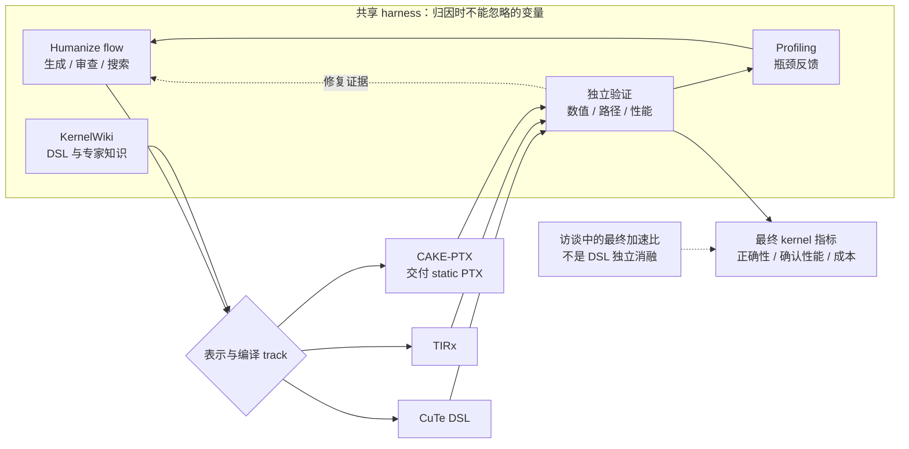
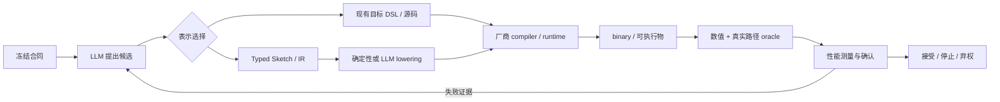
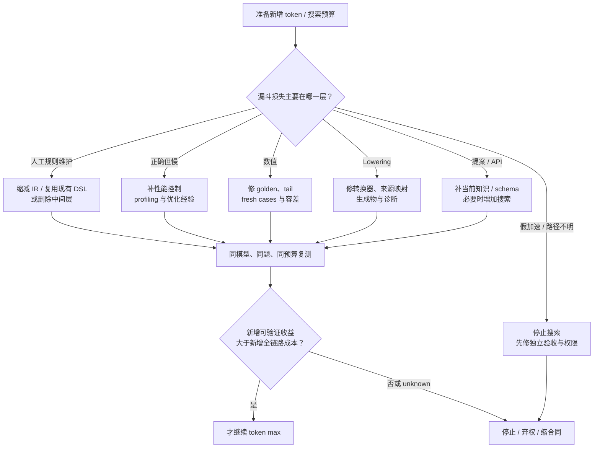
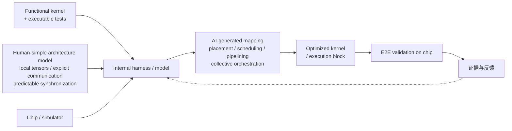

# NPU DSL for LLM：人类 DSL 与 Agent IR 的比较

日期：2026-10-27

> **范围**：本文只读研究“什么表示能让 Agent 更少猜测，同时保留性能控制，并让错误可检查、可定位、可复测”。不实现新 DSL，不运行模型生成实验、GPU/NPU、付费 A/B、安装脚本或下载仓库的 Agent。
>
> **一句话结论**：优先考虑“现有 DSL + 冻结合同 + 最小 Typed Sketch + 可观察 lowering + 分层外部验收”，而不是先造一门更短的语言。跨后端最适合共享的是数学意图和可审计 artifact；tile、存储、同步、指令与性能结论必须由 target 专属层重新确认。

## 0. 证据标记与边界

- **[论文]**：原论文声称。数字只属于原论文的模型、任务、基线、预算和 target，不是本仓库复现。
- **[报告]**：厂商原始报告或 slides 的主张；是一手来源，但不等于独立复现，也不自动成为可信优化经验。
- **[代码]**：本轮在指定快照中看到的源文件事实。测试文件、skill 或 README 存在，只证明相应文本/代码存在，不证明测试通过或机制有效。
- **[推断]**：本文的设计解释或建议，不是论文已经证明的结论。
- **[未知]**：当前材料不足，不能可靠判断；`unknown/inconclusive` 不得折算成通过。
- 公众号与既有学习笔记只作阅读索引，不作独立证据。AscendCraft 官方实现的当前公开状态沿用交接时的检索记录，本轮未重新联网核实，因此仍标 **[未知]**。

核心原文：

1. **AscendCraft**：[arXiv:2601.22760](https://arxiv.org/abs/2601.22760) · [本地 PDF](2601.22760_ascendcraft-automatic-ascend-npu-kernel-generation-via-dsl-guided.pdf)，重点 §3–5。
2. **AKG kernel Agent**：[arXiv:2512.23424](https://arxiv.org/abs/2512.23424) · [本地 PDF](2512.23424_akg-kernel-agent-a-multi-agent-framework-for-cross.pdf)，重点 §3–4、Figure 2。
3. **CANNBot-CAKE**：[arXiv:2610.31034](https://arxiv.org/abs/2610.31034) · [本地 PDF](../可信harness/papers/2610.31034_cannbot-cake.pdf)，重点 §2–7。
4. **CAKE / Cake IR**：[arXiv:2608.12629](https://arxiv.org/abs/2608.12629) · [本地 PDF](../可信harness/papers/2608.12629_cake-compiler-agent-codesign.pdf)，重点 §2–6、Appendix B–C。

补充一手证据：

- **AscendKernelGen**：[arXiv:2601.07160](https://arxiv.org/abs/2601.07160) · [本地 PDF](2601.07160_ascendkernelgen-a-systematic-study-of-llm-based-kernel-generation.pdf)。
- **MultiKernelBench**：[arXiv:2507.17773](https://arxiv.org/abs/2507.17773) · [本地 PDF](2507.17773_multikernelbench-a-multi-platform-benchmark-for-kernel-generation.pdf)。
- **OpenAI Jalapeño / Hot Chips 2026**：[原始 slides](2026_hotchips_openai_jalapeno.pdf)（重点第 27–31 页）· [中文逐页翻译](2026_hotchips_openai_jalapeno.zh-CN.md) · [下载来源](https://wan-research-group.github.io/coms6998-f26/assets/readings/openai-jalapeno-hot-chips-2026.pdf)；SHA-256 `1ae0e3aa6d80781e08609926b8161c171edc30ec36b88547a6bfed6b7ee5bcf8`。

**CANNBot-CAKE 不是 GPU CAKE；CANNBot-DSL 不是 Cake IR；AscendOpGenAgent 不是 AscendCraft 官方实现。**

## 1. 人类 DSL vs Agent 专用 IR

### 1.1 表示与系统对照表

“有 IR”不等于有独立、typed、可执行验证的 IR；也可能是 Agent 之间传递的文本中间态。表中把这点单独标出。

| 路线 | 定位与 target | 中间表示及主要抽象 | 隐藏什么、保留什么 | 检查与反馈 | 代码与证据边界 |
| --- | --- | --- | --- | --- | --- |
| **AscendC** | 人类低层编程面；Ascend | host tiling + device C++；GM/L1/UB/L0、Scalar/Vector/Cube、MTE、TQue/TBuf | 保留几乎全部存储、搬运、队列、对齐、并行与同步控制；机械 API/地址/生命周期负担也保留 | 可接 CANN 编译、数值、profiler；错误常落在具体 C++ API 与运行阶段 | **[论文]** AscendKernelGen/MultiKernelBench 报告低零样本能力。**[代码]** 本地有两个评测工程；未在本轮执行。不能把低语料问题简化为语法问题。 |
| **Triton-Ascend** | 原人类 Triton 编程模型接 Ascend 后端 | tile/program 级 Python 风格表示；后端决定更多物理映射 | 复用 tiling、归约、mask 等表达；物理 UB/L1、队列和同步通常不由作者逐项写出 | 编译与设备反馈取决于 Ascend 后端；相同 Triton 前端不保证后端能力相同 | **[论文]** AKG 在同一前端下仍报 Triton-CUDA 100% vs Triton-Ascend 75% pass@4，Convolution 41.2%。主仓未克隆，更低层检查能力标 **[未知]**。 |
| **TileLang-Ascend** | 人类 tile DSL；Ascend | tile 与调度表示，经目标 lowering 到后端 | 保留数据块与部分调度；具体队列、资源与指令由目标层处理 | 需要目标编译、数值和性能证据，不能从 TileLang 名字推定 | **[论文]** AKG/MultiKernelBench 提供对照，但任务和未评项口径须保留。主仓未克隆，Ascend 专属静态检查为 **[未知]**。 |
| **PyPTO** | Python/tile、多层表示；Ascend | 本地资料登记为多层 Python/Tile 表示 | 目标是保留可观察生成物并降低 host/device 编程负担；最低必要控制需看主仓 | 模拟、编译和真机能力须分别核实 | 主仓未克隆；CANNBot 编排可见不等于 PyPTO 全部能力已验证。详细字段标 **[未知]**。 |
| **EasyAsc** | Agent 友好的 Python DSL；Ascend | 项目文档所述 Python 函数 → 指令 IR → 模拟器或 AscendC lowering | 让数据流和指令 IR 可观察；target、tail、同步和精度仍需外部合同 | 模拟器可把部分错误提前；不能替代真机数值/性能确认 | 插件随 `cannbot-skills` 获得；`agent/assets` 未展开，本轮未运行初始化。详见 §7。 |
| **CANNBot-DSL** | Agent 亲和 DSL；Ascend | Python 外观的显式存储、搬运、tile 与程序顺序 | 让局部对象与生成物可审查；不是“完整编译器源码仓” | 有样例、文档和精度测试；后端 wheel、target 与版本匹配是独立前提 | **[代码]** 公开仓主要是样例/文档/测试，后端主要由 wheel 提供。测试存在不等于本轮通过。 |
| **AscendCraft DSL** | 为 LLM 生成设计的轻量 DSL；Ascend 910B2 论文环境 | host + kernel；UB/L1 buffer 分配、copyin/compute/copyout、tiling、核间结构 | 隐藏 `DataCopyPad` 配置、部分对齐/队列/ABI 样板；显式保留 UB/L1、阶段、tile、core 分配，禁止隐式 alias | DSL 经**四趟 LLM lowering**到 AscendC，每趟编译纠错；最终仍需独立数值和性能验收 | **[论文]** 52 个非 MatMul/Conv 核，Comp@1 98.1%、Pass@1 90.4%、Fast1.0 46.2%（eager）。官方实现状态 **[未知]**。 |
| **AKG Unified Sketch** | DSL-agnostic 策略草图；CUDA/Ascend/CPU 等 | declarations + `alloc/load/store/compute` + Python loops + `@llm_hint` | 分离优化策略与目标 DSL；`fast/fastest` 等语义 hint 由 Coder 映射到具体资源 | Verifier 编译/数值/计时；Conductor 按错误回 Coder 或 Designer | **[论文]** 跨后端 pass@4 与 eager 性能。**[代码]** 当前实现主要是文档约定的文本 Sketch，hint 未作 typed 校验；论文 Figure 2 也未显式给出完整 tail 承诺，详见 §7。 |
| **Cake IR** | Agent 直接编辑的 typed、hardware-explicit schedule IR；NVIDIA GPU | typed vocabulary、warp roles、SMEM/TMEM views、pipeline、barrier、具体 layout 承诺 | 不写 layout 代数、raw address、phase bit、descriptor 编码；但**没有隐藏硬件调度**。物理元数据由确定性 lowering 推导 | 构造/静态门 → 确定性 CUDA/PTX lowering → 外部数值/实测；诊断到资源/角色/阶段；缺覆盖显式不可判 | **[论文]** 主要是 B200，非 NVIDIA 未测。**[代码]** FlashInfer 有生成 CUDA 与集成物，不等于完整 Cake 编译器/verifier 开源。 |
| **CANNBot-CAKE / CAKE2** | 多 DSL 生成、演化、路由与交付 harness；**不是一门 DSL** | `op_desc`、reference、functional form、DSL/host/device source、package、binding、evaluation record | 把 track 选择、artifact、skill 版本和知识证据显式化；具体 DSL 的控制项属于各 track | 阶段 gate、编译/安装/绑定/数值/计时；能力硬过滤、版本化历史路由、人审知识升格 | **[论文]+[代码]** 本地插件有可查生成/评测流程，但与论文完整 router/ledger/CAKE Book 机制存在显著差距，不能把二者直接等同；详见 §7。 |

### 1.2 路由与弃权不是 DSL 语法的一部分

| 路线 | 路由与弃权证据 |
| --- | --- |
| 人类 DSL/track | **[推断]** 由系统白名单和能力门先选候选；能力未知时应 unknown，而不是让模型凭熟悉度决定“最适语言”。 |
| AscendCraft | **[论文]** 是单一 DSL→AscendC 路线，不是多 DSL router；MatMul/Conv 被排除在证据域外，不能默认路由成功。 |
| AKG | **[论文]+[代码]** 按 DSL/backend 等过滤文档和样例；不是按历史 track 能力选 DSL 的完整路由。未见统一的无路/unknown 验收政策。 |
| CANNBot-CAKE | **[论文]** L0 无可用 track 时声明 abstain，但同段又写交完整 track menu，需结合实际 controller 理解；当前快照未见统一实现，见 §7.2。 |
| GPU CAKE | **[论文]** 要求 exact target match；设备/工具链不支持时报告缺失而非降到另一架构，未标定的 target 也不继承性能预测。 |

### 1.3 四条生成—验证链，不要把它们混成一种方法

**AscendCraft [论文]**

```text
任务 + DSL 规范 + 类别/shape 专家样例
  → LLM 写 Ascend DSL
  → LLM pass 1：host → 编译纠错
  → LLM pass 2：kernel 初始化、TQue/TBuf → 编译纠错
  → LLM pass 3：CopyIn/Compute/CopyOut 阶段函数 → 编译纠错
  → 可选 LLM pass 4：32B 对齐/padding → 编译纠错
  → AscendC 数值与性能评测
```

关键不是“四趟”这个数字，而是每趟只负责一个可观察子 artifact。**编译反馈不能证明 lowering 语义等价，尤其 lowering 本身也由 LLM 完成。** Figure 2 可见 `rows // n_cores` 与 ceil tile 数，但图中没有完整展示行尾和 mask 规则；不能仅凭示意图断言完整实现有或没有 tail bug，应该把边界语义列为必须检查的 artifact。

**AKG [论文]**

```text
算子规格 + target 文档
  → Designer：Unified Sketch（策略）
  → Coder：按 DSL 文档和检索样例写目标代码（实现）
  → Verifier：编译、数值、性能
  → Conductor：实现错误回 Coder；算法/访存结构错误回 Designer
  → 多轮/岛屿搜索，成功 Sketch + 代码 + 分析入库
```

它把“选什么算法”与“怎样写对这个 DSL”分开。Figure 2 的 RMSNorm 是 `[B,F,D1,D2]`、沿 `F` 归约的特定形式，不是本文后文的两维逐行 RMSNorm；它也没有 `gamma`，不能照抄语义。论文数值门允许一定比例元素超阈值，且性能结论段仍写“profiling infrastructure pending”，与 Table 3 已报性能形成需要保留的口径紧张关系。

**CANNBot-CAKE [论文]**

```text
需求 → op_desc 合同 → PyTorch reference + functional form
  → 能力硬过滤 + 历史证据路由（或用户指定 track）
  → 选定 DSL lowering + host tiling + device source
  → build/package/install/Python binding
  → dtype-aware 数值 + on-device timing
  → 修复或 Evolution
  → 观测账本、CAKE Book、经评审的 skill/reference 更新
```

交付单位是**可部署算子及每阶段验证记录**，不是一段 kernel 文本。路由依赖 `(track, chip, operator type)` 能力、结构化算子特征、历史观测和 `skill_version`，不是让模型凭语言偏好选择。论文的 L0 文字同时出现“abstain”与“交完整 track menu”的描述，实际代码行为必须在 §7 单独核实，不能简化成所有无路情形都自动停止。

**GPU CAKE [论文]**

```text
冻结 workload contract
  → 结构不同的 Cake IR 候选
  → 构造检查 + 安全/硬件/数据/调度静态门 + cost model 排序
  → 确定性 lowering 为可观察 CUDA/PTX
  → 外部数值 oracle + CUPTI/on-device 实测
  → 证据分别回候选、verifier、cost model 或 IR vocabulary
  → corpus 测试 + 人工 merge gate 后才演化 compiler/harness
```

Cake IR 与 AKG Sketch 是两种不同取舍：前者刻意显式物理调度以支持静态分析，后者刻意保持 DSL/硬件无关以促进策略迁移。**[推断]** 对 NPU 不应机械复制任何一端，而应先确定需要静态检查哪些承诺，再决定这些承诺必须多具体。

## 2. 最低必要控制：哪些该隐藏，哪些必须留下

### 2.1 判据不是代码行数，而是“谁做决定、在哪里检查”

| 决定 | 推荐位置 | 原因与验证 |
| --- | --- | --- |
| 数学语义、shape/dtype/layout/stride、`eps`、累加精度、输入域、容差 | **冻结合同，生成者不可改** | 这些不能从“RMSNorm”名称唯一恢复；由独立 golden、边界/分布用例与容差政策检查。 |
| target、compiler/runtime、skill/example 版本、能力指纹 | **每个 artifact 显式绑定** | 决定 API、资源和旧证据能否适用；未知或不匹配应拒绝/不可判。 |
| 并行轴、归约轴、每核/每线程组所有权、是否跨核归约 | **Sketch 显式** | 决定数据竞争、工作划分和归约结构；做所有权/依赖检查与多 shape 差分。 |
| tile/block、每核行数、one/two-pass、unroll、pipeline depth、buffer 层级 | **可搜索，但最终 Sketch 必须物化** | 它们区分“正确但慢”和真正的高性能方案；自动调优可以选值，不能把最终承诺藏进黑盒。 |
| buffer shape/dtype/space、容量、生命周期、alias/ownership | **Sketch 或 target IR 显式** | 支持静态资源、活跃区间和复用检查；容量未知时返回不可判。 |
| copy/compute/store 阶段、event/barrier scope、producer→wait→consumer 依赖 | **按 target 需要显式** | 高层 Triton 可由编译器承担更多；显式异步 NPU schedule 则必须可检查，不能只用“pipeline”自由 hint 代替。 |
| tail load/store、填充值、空输入、允许的 shape 特化 | **合同 + Sketch 显式** | 填零是否合法取决于运算；用非整除、空域、地址保护和 fresh shape 检查。 |
| 字节地址、由 layout 推导的偏移、queue/event 对象名、phase bit、描述符编码、寄存器分配、物理 opcode | **优先由可观察 lowering 推导** | 属机械映射，容易出错但不适合全部交给一次 LLM 生成；保留 trace 和来源映射，检查推导是否违背上层承诺。 |
| 固定 launch/ABI 样板、重复初始化、打包元数据 | **编译器/项目骨架生成** | 可从合同无歧义推导；ABI、构建与 binding 仍需独立 gate。 |
| `fastest`、`amazing pipeline` 等自由优化词 | **不作为最终性能承诺** | 没有唯一语义，也无法静态验证。若保留作跨后端意图，必须经 target schema 解析成具体资源/阶段并留下映射；否则标 unknown。 |
| 专家 escape hatch（特殊指令、layout、target extension） | **版本化、typed、受能力门约束** | 避免小词汇表挡住专家快核；扩展仍需 legality、生成物和外部性能证据，不能退回任意嵌入文本。 |

**[推断] 最低必要控制是 target/operator/track 的函数，不是全局常数。** RMSNorm 的归约/tail/累加与矩阵类的 Cube/MMA operand layout、L0 资源、多级流水不是同一控制集。AscendCraft 没把 MatMul/Conv 纳入 52 核评测，因此不能用其归一化结果证明这套最小集合也适合 Cube。

### 2.2 人类 DSL 与 Agent IR 的合理边界

| 选择 | 真正收益 | 主要代价 | 何时优先 |
| --- | --- | --- | --- |
| 现有人类 DSL + 文档/工具 | 语法先验、编译器、样例、runtime、部署链和专家生态现成 | 低层 API 负担、隐式调度、反馈粗、自由写法多 | 主要失败是未知 API/签名/版本，或现有 DSL 已能表达专家方案。 |
| 人类 DSL + Typed Sketch/合同 | 保留生态，同时把语义、调度和验收承诺结构化 | 需要 Sketch→DSL lowering、schema 和来源映射 | 主要失败是 tile/layout/tail/sync 靠猜，或修复总在错误层。 |
| Agent 专用 typed IR | canonical、可分析、局部诊断、适合受控搜索和 compiler 共同演化 | 新编译器/验证器/语料/维护成本，可能过度约束或表达不了专家 schedule | 有复发证据证明缺口在表示本身，且同预算实验能超过“现有 DSL+上下文”。 |
| 直接低层 C/汇编 | 最大物理控制，初期无需新 IR | 高熵、错误难定位、目标绑定和验证成本最高 | 极少数专家/新 ISA 场景；不能把“接近硬件”当成更适合 Agent。 |

**[推断] DSL 与 IR 不是互斥标签。** Agent 编辑的 Cake IR 同时也是编译器分析对象；AKG Sketch 也可能只是工作流中的文本中间层。评审应问“是否有 schema、类型、语义、artifact ID、lowering trace 和检查”，而不是问文件后缀叫什么。

### 2.3 KDA 案例：多 DSL/IR 路线与表示层证据边界

这里要区分 **Kernel Design Agents（KDA 工作流）**与被优化的 **Kimi Delta Attention（也叫 KDA）**。

**KDA 确实使用 DSL/IR，但不绑定一门“KDA DSL”。** **[代码]** 主工作树的 KernelWiki 把 CuTe DSL、CUDA C++、PTX、Triton 列为一等语言知识（`/Users/kuafu/CLionProjects/kda/skills/KernelWiki/README.md:107-118`）。实现工作树 `kda-260927-kda`（本轮核查 commit `f539baab8e46`）则明确保留三条 forward 路线（`README.md:16-23`）：

| 路线 | 本地交付形态 | 能证明什么 |
| --- | --- | --- |
| `kda-cake-cute/` | CuTe DSL（Python） | KDA 可以用高层 DSL 表达并交付 KDA kernel。 |
| `kda-tirx/` | TIRx（TVM） | 另一条编译/表示路线可进入同一任务与验证协议。 |
| `kda-cake-ptx/` | static PTX + TVM FFI host shims | 最终交付物是 PTX；不能只凭目录名反推 Agent 当时编辑的是 Cake IR 还是直接 PTX。 |

下图把“多表示路线”和“共享 harness”放在同一张图里：最终指标来自整条链，不能只归因到 track 名称。



访谈第 6 页给出团队自述的 B300 结果：TIRx 2.96×、CAKE-PTX 2.94×、CuTe-DSL 2.85×，均相对官方 FlashKDA（[访谈 PDF](<../一个公众号的论文解读/跑掉四五千万人民币等值 Token 之后，两位英伟达工程师重新理解了 Agent：代码不是护城河，时间才是.pdf>)）。本地实现 README 的另一个 artifact/日期快照另报 judge geomean 2.786/2.950/2.914（`README.md:27-40`）。两组数字不能拼接成同一次实验，也不作本仓库复现。

这些材料支持“**多种表示/编译路线都能进入 KDA 的生成与优化体系**”，但不支持“最终加速全部来自语言层”：

| 要回答的问题 | 访谈数字能否回答 | 原因 |
| --- | --- | --- |
| 最终 kernel 是否比 FlashKDA 快 | 能，限于团队所述 target、任务与协议 | 是最终 kernel 对 baseline 的测量，不是本仓库复现。 |
| DSL 是否提高首次编译率或最终正确率 | 不能 | 没有给出同预算的 direct-vs-DSL 生成漏斗。 |
| DSL 是否减少 token、轮次或人工成本 | 不能 | 没有等预算的表示层对照和总成本账。 |
| 哪一种表示独立贡献了多少性能 | 不能 | 多条路线共享 flow、KernelWiki、profiling、搜索和验证，变量没有隔离。 |

**最接近表示层对照的证据来自 GPU CAKE，而不是上述访谈数字。** **[论文]** CAKE clean-start 在同模型、scaffold、任务、oracle、shape 和预算下比较 Cake IR 与直接 CUDA/PTX：3/3 vs 0/3 达到预设平台期，80M token 时 median best 为 1.144 vs 0.928（§5 Table 2）。它支持“typed、硬件显式表示 + 结构化编译器诊断可能改善生成环境”，但每臂仅 3 次且区间重叠。论文另报的 KDA prefill 2.05×仍是最终 kernel 对 FlashKDA，不是 IR 对无 IR 的消融。

KDA 的 `hacking_example/` 还说明为什么不能用最终倍数反推表示或模型能力：项目保留的失格 kernel 曾被宽松 verifier 接受到 3.7413×，关闭作弊路径后为 2.4768×，项目结论是表观增益来自评测利用（`hacking_example/README.md:1-19,47-49`）。后续验证加入 final state、秘密种子、分布外探针、真实模型输入和独立代码审查（`:78-96`）。这是项目整理的证据，不是本轮重跑；它说明**表示、搜索和 token 都必须置于可信 oracle 之下**。

### 2.4 Token max：瓶颈会迁移到中间层，但不必然是人工模板编译器

前提需要修正：**DSL/IR 不是只要存在就重要，只有在它解决可测的复发失败时才有净价值。** 即使直接生成 CUDA/MSL，厂商编译器、runtime 和验证 harness 也仍然存在。中间通道不是可选项；可选的是它的表示、实现方式和可信程度。



Token max 主要增加提案、修复和搜索次数；若 lowering 也使用 LLM，还会增加转换成本。它不能自动提高转换保真度、验证覆盖率、测量可信度或人工维护能力。

| 路线 | 中间层的实际形态 | 对“必须人工模板编译器”的修正 |
| --- | --- | --- |
| 直接 CUDA/MSL | 厂商编译器 + runtime + 验证 harness | 没有自定义 IR，也并没有绕开中间层。 |
| AKG 当前实现 | 文本 Sketch + LLM Coder | 没有独立 typed IR parser，自定义 typed IR 不是生成的必要条件。 |
| AscendCraft | DSL + 四趟 LLM lowering + 每趟编译 | 转换器本身也消耗模型调用，token 增加不等于转换更可靠。 |
| GPU CAKE | typed Cake IR + 确定性 lowering + 静态分析 | 人工编译器规则是核心杠杆，但 primitive/分析覆盖也会成为上限。 |

| 人工规则模板编译器的形态 | 作用 | 判断方式 |
| --- | --- | --- |
| 一次编写、被大量算子复用 | 把逐 kernel 的机械劳动变成共享基础设施，是杠杆 | 复用算子数增加时，单位维护成本下降，且漏检/误拒可控。 |
| 每个新算子都增加 primitive、例外和专用规则 | 变成新的逐 kernel 人工负担，是瓶颈 | 人工维护时间接近或超过节省的写核时间，应考虑缩 IR/复用现有 DSL/删除层。 |

瓶颈需要用症状定位，而不是预设为模型或编译器：

| 症状 | 更可能的瓶颈 | 继续加 token 是否对症 |
| --- | --- | --- |
| 大量未知 API、类型和签名错误 | 当前版本知识、schema、样例 | 通常不如精准上下文和构造期检查。 |
| Sketch 合理但目标代码持续出错 | lowering/Coder、来源映射和生成物诊断 | 应修转换层，不只是生成更多 Sketch。 |
| 编译通过但数值错误 | golden、tail、输入覆盖和最小反例 | 需要更强 oracle；更多候选可能增加假通过。 |
| 正确但慢 | 性能控制、profiling、优化经验和搜索空间 | 需要硬件反馈与合法 schedule，不是只加轮数。 |
| 假加速、fallback、常数输出 | 独立路径审计、权限和评分材料 | 应停止盲目搜索并修验收。 |
| 每个新算子都修改 IR/转换规则 | 人工编译器维护 | 应缩 IR、复用现有 DSL，或放弃新增层。 |
| 大量 token 后仍无合格候选 | 模型能力、任务可行性、反馈质量或预算配置 | 应换路线、缩小合同或记 inconclusive，不能默认继续烧。 |

因此，评估 token max 时应记录完整漏斗与每阶段成本：

| 漏斗阶段 | 必记结果 | 同步记录的成本与归因 |
| --- | --- | --- |
| 提案 | 候选数、不同 schedule 数 | token、模型/委员会、检索上下文。 |
| Schema / 静态检查 | 通过数、字段级拒绝数 | 检查耗时、规则版本、误拒与漏检。 |
| Lowering / 编译 | 通过数、各阶段失败数 | lowering token/耗时、编译时间、修复 owner。 |
| 数值 | 正确数、最小失败输入数 | 设备时间、golden/case 成本、误拒与漏检。 |
| 真实路径 | generated/fallback/unknown 数 | 路径审计成本、不可判项。 |
| 确认性能 | 合格数、绑定 artifact 的确认值 | 复测批次、噪声、baseline、设备时间。 |
| 最终接受 | 接受/拒绝/弃权数 | 人工评审、规则维护、迁移与风险成本。 |

真正要优化的是**每单位总成本换来的可验证接受数**：

```text
每个被接受算子的总成本
= LLM token + lowering/编译 + GPU/NPU 验证
+ 人工评审 + IR/编译器/样例维护 + 迁移与风险成本
```

下面的决策图把“继续加 token”改成先定位瓶颈、再验证边际收益的规则：



**[推断] Token max 只有在“新增 token 带来的新增可验证收益 > 新增全链路成本”时才合理。** 卡在模型提案时可以增加搜索；卡在 lowering 时修编译器；卡在数值时修 oracle；卡在正确但慢时补性能反馈；卡在人工补规则时缩减或删除中间层。瓶颈不是“有没有 DSL/IR”，而是每单位 token 能转化成多少可信改进。

### 2.5 OpenAI Jalapeño：对 DSL / Harness / Wiki 建设的启示

| 证据项 | 本次吸收口径 |
| --- | --- |
| 一手来源 | OpenAI《Jalapeño》Hot Chips 2026 原始 slides，[本地 PDF](2026_hotchips_openai_jalapeno.pdf)，重点第 27–31 页。 |
| 核心事实 [报告] | 报告展示“功能正确实现 + executable tests → internal harness/model + chip/simulator → optimized kernel → 芯片端到端验证”的路线。 |
| 结果口径 [报告] | DeepSeek kernels 的大部分优化由 AI 从功能基线完成；GPT-OSS attention/MoE blocks 相对已有专家实现 1.5–1.8×。这些是 OpenAI 自报，不是本仓库或第三方复现。 |
| 未知边界 [未知] | 内部模型、完整 harness、生成物与评测细节未随 slides 全部公开；对 Ascend/Metal 的成功率、性能和成本收益均未知。 |

下图合并第 29 页的“人类简单模型 + AI-generated mapping”和第 31 页的优化链，说明**表示、工具与验证必须一起建设**：



| 报告位置 | 原文机制 [报告] | 对我们最重要的含义 [推断] |
| --- | --- | --- |
| 第 27 页 | `MEASURE → VERIFY → LEARN → CHANGE → REPEAT`；通过代表性程序、模拟、QoR 和性能反馈持续收敛 | 短反馈闭环比一次性写完整规格更重要，但每次 change 都要重新 verify。 |
| 第 28 页 | XLS HW language 是 controllable optimization surface；clear semantics、enough control、fast QoR、robust verification | 表示层必须同时提供清晰语义和足够优化控制；验证与反馈速度是表示设计的一部分。 |
| 第 29 页 | 人理解 simple abstraction/local tensors/explicit communication/predictable synchronization；AI 搜索 mapping/placement/scheduling/pipelining/collective orchestration | 把数学语义与人类可审查抽象，和 AI 可搜索的调度空间分开；不能把全部硬件决定藏成 `fast`。 |
| 第 30 页 | Gluon 将 core 当 thread block；L1 local view、specialized collectives、TENSORINFO 显式布局与物理放置 | 对空间架构，core 分工、局部存储、集合通信、layout/placement 是一等 schedule 事实。 |
| 第 31 页 | 从功能正确实现和 executable tests 出发，AI 优化 kernel 与 execution blocks，最后 on-chip e2e 验证 | 不必让模型同时猜语义、正确性和性能；先独立建立功能基线，再做受控性能搜索。 |

#### 对 DSL / Harness / Wiki 的具体建设映射

| 建设面 | 应吸收的机制 [推断] | 不应外推或误写 |
| --- | --- | --- |
| **DSL：语义与调度分层** | 数学合同保持人类简单、可审查；AI 可搜索的 mapping、placement、tile、scheduling、pipeline、collectives 必须成为显式 schedule 字段和最终 artifact。 | 不能把“human-simple”理解成只保留高层数学式；也不能把 Jalapeño/Gluon 字段逐字当成 Ascend/Metal API。 |
| **DSL：空间与数据流事实** | local/global memory、core ownership、explicit communication、predictable sync、layout 和 placement 应可类型化、可检查，并保留 target escape hatch。 | 不能推出 UB/L1 就等于 Jalapeño L1，或 Metal threadgroup 就等于其 physical core；具体容量、路径和同步语义仍须 target profile。 |
| **DSL：优化对象** | IR/artifact 应能覆盖 kernel 与 execution block，并保留 host/core orchestration；避免只能优化孤立函数而丢失 block 级融合收益。 | 不能预设 block 越大越好；融合和集合编排会增加资源、同步与验证成本，必须实测。 |
| **Harness：功能基线先行** | 先冻结功能正确实现、golden 和 executable tests，再开放性能搜索；候选不得修改合同、测试、容差和计时。 | 不是让模型从一句算子名同时猜语义、正确性和性能，也不是用 AI 自评替代独立 oracle。 |
| **Harness：多保真反馈** | 静态/schema → 模拟或廉价检查 → 编译/数值 → 真实芯片 e2e → 绑定 artifact 的确认；反馈保留版本和来源。 | 模拟器结果不能升格为真机结果；OpenAI 的 on-chip 结果也不能直接当 Ascend/Metal 证据。 |
| **Harness：闭环与成本** | 短循环采用 generate→verify→measure→learn/change；按失败阶段路由修复，并记录 token、工具、设备、人工和接受总成本。 | `repeat` 不是无限 token max；unknown、路径不明、预算耗尽或边际收益不足时必须停止/弃权。 |
| **Wiki：案例而非口号** | 把报告拆成语义/调度机制、功能基线、模拟/真机反馈、e2e 验证和自报性能五类证据，分别标 target 和证据状态。 | 不把“1.5–1.8×”写成我方预期收益，不把厂商案例直接升格为通用 optimization tip。 |

#### Wiki 条目模板（教学示例，不宣称符合任一仓库 schema）

| 字段 | 本报告应记录的内容 |
| --- | --- |
| `source_kind` | `vendor_conference_case_study`；不是 independent reproduction，也不是 trusted optimization rule。 |
| `source` | Hot Chips 2026 OpenAI Jalapeño slides；保存[原始 PDF](2026_hotchips_openai_jalapeno.pdf)与[下载 URL](https://wan-research-group.github.io/coms6998-f26/assets/readings/openai-jalapeno-hot-chips-2026.pdf)。 |
| `source_integrity` | 36 页；SHA-256 `1ae0e3aa6d80781e08609926b8161c171edc30ec36b88547a6bfed6b7ee5bcf8`；重点定位第 27–31 页。 |
| `target_scope` | Jalapeño ASIC、Gluon/spatial architecture、OpenAI internal harness/model；不得省略这些限定。 |
| `mechanism_claims` | human-simple abstraction、AI-generated mapping、functional baseline、chip/simulator feedback、e2e validation。 |
| `performance_claims` | GPT-OSS attention/MoE 1.5–1.8×相对已有专家实现；`status=vendor_reported`，不得改写成 `verified_by_us`。 |
| `transfer_hypotheses` | 语义/调度分层、显式空间数据流、功能基线先行、多保真反馈、block 级 artifact；在 Ascend/Metal 均为待验证设计假设。 |
| `retrieval_tags` | `dsl`、`kernel-generation`、`harness`、`functional-baseline`、`simulator`、`e2e-validation`、`spatial-architecture`。 |
| `review_and_expiry` | 升格为 skill/tip 前需要人审与目标证据；出现公开实现、独立复现或新 target 结果时新增 scoped 证据，不覆盖原报告记录。 |

这张模板体现 Wiki 的建设原则：**原始主张、代码/生成物事实、我方设计推断和待验证性能分账保存；检索可以复用机制，升格为规则必须另有证据。**

## 3. RMSNorm 纸面贯穿（教学构造，不是现有 API）

### 3.1 冻结合同

对每一行 `x[m, :]`：

```text
sumsq[m]   = Σ_h fp32(x[m,h])²
inv_rms[m] = rsqrt(sumsq[m] / H + eps)
y[m,h]     = fp16(fp32(x[m,h]) × inv_rms[m] × fp32(gamma[h]))
```

| 合同项 | 教学选择 | 不能由算子名猜出的原因 |
| --- | --- | --- |
| I/O | `x[M,H]`、`gamma[H]`、`y[M,H]`；每行独立 | 防止归约轴、广播和输出形状错误。 |
| 域 | `M≥0, H≥1, eps>0`；含非整除 H；仅承诺有限输入 | 空 M、H=3、NaN/Inf 需要不同政策；本文不声称覆盖 NaN/Inf。 |
| dtype | I/O fp16；平方、归约、rsqrt 和乘法 fp32；最终转 fp16 | 精度与转换点不是语义名称的一部分。 |
| layout | 紧凑行主序，`x/y` strides `[H,1]`，gamma 连续 | 非平凡 stride 要另立合同。 |
| target | 虚构 `teaching-npu-v1` + `teaching-cc-1`，local memory 4096 B | 不代表 Ascend/Metal；能力未知时不可判。 |
| 调度 | 每 core 一行，H tile=128，two-pass；不是“最快”声明 | two-pass 增加 x 的全局读取，但无需整行常驻。 |
| 数值 oracle | 独立高精度参考；逐元素 `|y-ref|≤1e-2+1e-2×|ref|` 的教学起点，之后必须校准 | 该阈值不是通用标准；须测合法误拒与注入 bug 漏检。 |
| 性能/路径 | 冻结 eager baseline 与计时政策；禁止隐式 fallback；绑定 binary/source/target 确认复测 | 正确、走目标 kernel、更快是三件事。 |

### 3.2 最小 Typed Sketch

```yaml
sketch_version: rmsnorm-teaching-v1       # 教学格式，非 AKG/Cake/CANNBot 语法
operation: rms_norm
contract_ref: rmsnorm_contract_v1         # 指向 §3.1 的冻结合同

target:
  device: teaching-npu-v1
  compiler: teaching-cc-1
  capabilities:
    local_memory_bytes: 4096
    required: [vector_reduce_sum_f32, async_copy, masked_tail]

tensors:
  x:     {shape: [m,h], dtype: fp16, strides: [h,1], space: global, access: read}
  gamma: {shape: [h],   dtype: fp16, strides: [1],   space: global, access: read}
  y:     {shape: [m,h], dtype: fp16, strides: [h,1], space: global, access: write}
  eps:   {kind: scalar, dtype: fp32}

schedule:
  parallel: {axis: m, unit: core, rows_per_core: 1}
  reduction: {axis: h, accumulator: fp32, primitive: vector_reduce_sum}
  h_tile: 128
  row_algorithm: two_pass
  buffers:
    x_tile:     {shape: [128], dtype: fp16, space: local, lifetime: h_iteration}
    gamma_tile: {shape: [128], dtype: fp16, space: local, lifetime: h_iteration}
    y_tile:     {shape: [128], dtype: fp16, space: local, lifetime: tile_until_store_done}
    sumsq:      {shape: [1],   dtype: fp32, space: local, lifetime: row}
  passes:
    - {name: square_reduce, repeat: ceil_div(h,128),
       steps: [async_load_x, wait_x_load, square_and_reduce_f32]}
    - {name: inverse_rms, repeat: 1,
       steps: [divide_by_h_add_eps_rsqrt_f32]}
    - {name: normalize_store, repeat: ceil_div(h,128),
       steps: [async_load_x_gamma, wait_loads,
               wait_previous_store_before_y_reuse,
               scale_cast_fp16, async_store_y]}
    - {name: drain, repeat: 1, steps: [wait_all_stores]}

boundary:
  h_tail: {load: mask_and_fill_zero, store: mask}
  empty_m: no_launch
  row_owner: exact_cover_no_overlap

performance_notes:                         # 可审计说明，不是性能证明
  x_global_passes_per_row: 2
  cross_core_reduction: false
```

静态检查可以先算：三个 fp16 tile 共 `3×128×2=768 B`，加 fp32 `sumsq` 为 772 B（未计 target 对齐/元数据），小于虚构的 4096 B；还必须检查 tile/buffer shape 一致、所有权精确覆盖、alias/lifetime、load/store 依赖、所需 primitive 和 tail 语义。**这些检查仍不证明数值、lowering、同步在真实硬件上正确，也不证明 128 或 two-pass 更快。**

### 3.3 对照表示 A：Triton 风格

下面是教学伪代码，不宣称是可直接编译的 Triton-Ascend 程序：

```python
@teaching_triton.kernel
def rmsnorm(x, gamma, y, m, h, eps, BLOCK_H: constexpr):
    row = program_id(0)                  # launch grid=m；m=0 由 host 不启动
    sumsq = 0.0                          # 后续输入均为 fp32
    for h0 in range(0, h, BLOCK_H):
        lanes = h0 + arange(0, BLOCK_H)
        mask = lanes < h
        xv = load(x + row*h + lanes, mask=mask, other=0.0).to(fp32)
        sumsq += reduce_sum(xv * xv)     # fp32 归约
    inv = rsqrt(sumsq / fp32(h) + eps)

    for h0 in range(0, h, BLOCK_H):
        lanes = h0 + arange(0, BLOCK_H)
        mask = lanes < h
        xv = load(x + row*h + lanes, mask=mask, other=0.0).to(fp32)
        gv = load(gamma + lanes, mask=mask, other=0.0).to(fp32)
        store(y + row*h + lanes, (xv * inv * gv).to(fp16), mask=mask)
```

这一层保留 `BLOCK_H`、每 program 一行、two-pass、mask 和 fp32 累加；**没有显式 UB/L1 buffer、队列、物理 event、寄存器或指令选择**。编译器可做更多存储与同步决定，因此生成物/实际路径必须可观察。若 launch 暴露 `num_warps` 等配置，也应进入最终 schedule 与指纹，而不是留在不可复测的隐式默认值里。

### 3.4 对照表示 B：Ascend/AscendC 风格

下面仅借用 AscendCraft 的 host/kernel、UB 和阶段概念，不是官方 AscendCraft 或 CANNBot-DSL 语法：

```text
host(m, h):
  if m == 0: no_launch
  cores = min(m, target.core_count)
  rows_per_core = ceil_div(m, cores)       # 不丢行尾
  n_tiles = ceil_div(h, 128)
  launch(cores, rows_per_core, n_tiles, aligned_copy_metadata)

kernel(pid):
  x_ub = alloc_ub(128, fp16)
  g_ub = alloc_ub(128, fp16)
  y_ub = alloc_ub(128, fp16)
  for row in exact_owned_rows(pid, rows_per_core, m):
    sumsq = fp32(0)
    for tile in range(n_tiles):            # pass 1
      copyin:  load_x_with_valid_count_and_zero_pad(x_ub)
      compute: sumsq += reduce_sum_f32(fp32(x_ub)²)
    compute: inv = rsqrt(sumsq / fp32(h) + eps)
    for tile in range(n_tiles):            # pass 2
      copyin:  load_x_and_gamma_with_zero_pad(x_ub, g_ub)
      compute: wait_inputs; wait_y_reuse_if_needed
               y_ub = fp16(fp32(x_ub) * inv * fp32(g_ub))
      copyout: store_only_valid_lanes(y_ub)
    drain_output_queue_before_exit
```

host 的 core/tiling 计算、`DataCopyPad` 参数、TQue/TBuf 初始化、字节地址和 ABI 可由分阶段 lowering 生成；但 `rows_per_core` 精确覆盖、每核所有权、two-pass、tile、UB 预算、队列依赖和 tail 填充必须能在 Sketch/lowering trace 中追踪。此例没有跨核归约，因此不应无依据插入跨核 `SyncAll`；队列 drain 与跨核 barrier 也不是同一语义。

### 3.5 每次 lowering 少了哪些猜测，仍要检查什么

| 转换 | 减少的猜测/机械工作 | 新增或仍需保留的决定 | 必须留下的检查 |
| --- | --- | --- | --- |
| 自然语言 → 冻结合同 | 不再只凭“RMSNorm”猜 I/O、精度、域和验收 | 人/任务 owner 做语义与容差决定 | 合同完整性、独立 golden、baseline、权限与版本。 |
| 合同 → Typed Sketch | 把并行、tile、buffer、tail、sync 从散文变成字段 | Agent/人做调度承诺；不是自动推导 | schema、资源、所有权、依赖、tail、target capability。 |
| Sketch → Triton 风格 | 少写物理 buffer、地址、队列与同步 | 选择真实 API、mask/dtype；编译器承担更多物理调度 | 生成物、tile 未被偷改、实际精度/指令路径、动态 shape。 |
| Sketch → Ascend 风格 | 少写 DataCopyPad、TQue/TBuf、字节地址和 ABI | host tiling、UB、CopyIn/Compute/CopyOut 与队列依赖 | 每阶段 trace、32B/布局、host/device 一致性、编译与最终数值。 |
| 目标源码 → binary | 寄存器分配、最终指令选择等机械工作由编译器完成 | 编译器仍可能改变精度、流水或资源使用 | binary/source/target 指纹、反汇编或执行路径证据、真机数值与性能。 |

## 4. 失败模式 → 表示 / 编译器 / harness 设计

| 失败模式 | 表示层应有的事实 | compiler / verifier 的最早防线 | harness / oracle 的最后判决与修复 owner |
| --- | --- | --- | --- |
| API 幻觉、参数/类型错误 | 小核心词汇、typed API、dtype/space、当前版本 schema | 构造时签名/重载/单位检查，给合法近似项 | 归类 compile/API，回 Coder；不能记成数值失败。 |
| target/compiler/skill 错配 | device、版本、能力、知识指纹 | 能力门；未知 target 不可判 | 检索硬过滤、旧证据失效；回路由/知识 owner。 |
| 隐式 layout/stride/alignment | tensor layout、stride、address space、对齐单位 | producer/consumer 与地址约束检查 | 非平凡布局/地址保护用例；回 Designer 或 lowering。 |
| tail 越界或污染归约 | shape domain、mask、填充值、行尾所有权 | 边界谓词和填充语义检查 | `H=1,3,7,128,129,1025`、fresh shape、guard bytes；回 Designer。 |
| buffer 超限、alias/生命周期错误 | space/shape/dtype/lifetime/alias/ownership | 峰值资源与活跃区间分析；容量未知不可判 | 静态门先于设备；真实 target 再复核；回 Designer/compiler。 |
| 缺 wait、错误 barrier scope | copy/compute/store 阶段、event、scope、依赖 | producer→wait→consumer 与统一控制流检查 | 多次启动、压力/shape 测试，hang 与错误分账；回 Coder/Designer。 |
| 错误并行或跨核归约 | parallel/reduction axis、每核所有权 | 竞争、所有权和归约依赖检查 | 多 shape 差分；结构问题回 Designer，不只修 API。 |
| fp16 误累加或后端静默降精度 | acc dtype、转换点、允许数学路径 | 类型 lowering 与实际指令检查 | 长归约、大幅度、近零、严格探针；回 Coder/compiler。 |
| 正确但慢 | tile、parallel、buffer、pipeline、算法变体可见 | 资源/瓶颈报告；cost model 只排序 | 与合适 baseline 计时，正确池内报告性能；未达性能门不得发布。 |
| 常数/no-op/只写部分输出 | 输出所有权和允许语义 | 可疑结构检查只作辅助 | 非退化输入、毒化输出、多次启动、输入变化/no-op 探针；拒绝。 |
| 框架/库静默 fallback | declared backend、fallback policy、路径标签 | 记录 lowering/link/load 和符号来源 | generated/fallback/unknown 分账；禁止则拒绝，允许则不算生成核成绩。 |
| 对公开 shape 特判或伪造性能 | 合同 shape 域与允许特化 | 静态 guard 审计只作辅助 | hidden/fresh shape 与分布、异常加速审计、计后复验、独立评分材料。 |
| 只有 pass/fail，修复乱撞 | artifact ID、字段路径、来源映射 | 稳定错误码、阶段、最小证据、建议 owner，允许 unknown | 一次改一类问题，保留原始日志；按 API/结构/验证/infra 路由。 |
| 旧样例或“经验”污染 | 来源、target/version、适用症状、证据和失效条件 | 版本/能力过滤 | 实测+移除检验+人审后升格；冲突不覆盖旧证据，新建 scoped 记录。 |
| infra 失败被当模型失败 | 候选状态与执行状态分离 | 工具错误与被检查程序错误分开 | `infra_failed/timeout/inconclusive` 单列，独立预算，不伪造 pass/fail。 |
| 无界重试和成本失控 | 可局部修改 artifact，廉价检查优先 | 静态→编译→数值→性能逐级升级 | 限轮次/token/工具/设备时间；记录首个正确、确认与接受总成本，允许弃权。 |

## 5. Triton→Metal 经验哪些能迁移到 Ascend/NPU

**可迁移的是验证纪律和设计问题，不是硬件名词的一一对应，更不是性能数字。**

| 维度 | Ascend/NPU 侧 | Metal 侧（本仓库资料） | 可迁移与不可迁移 |
| --- | --- | --- | --- |
| 存储层级 | GM、L1、UB、L0；`LocalTensor`、显式 DataCopy/TQue/TBuf；950 另有 Regbase | `device`、`threadgroup`、thread-private/register；统一内存与缓存 | 都可检查容量/生命周期/复用。**UB≠threadgroup memory 的简单改名**；队列所有权、访问粒度和 residency 不同。 |
| 计算单元 | Scalar/Vector/Cube；950 Regbase SIMD 与 SIMT 是额外路径 | SIMD lanes、`simdgroup`、`simdgroup_matrix` | Cube 与 simdgroup_matrix 都只是“矩阵单元”的概念类比；tile 形状、operand layout、累加器和指令路径必须重学。AICPU 也不能直接映射成 Metal host。 |
| 并行与归约 | block/core、Vector lane、950 SIMT warp；可有多核结构 | threadgroup、32-wide simdgroup；simd reduction + TG exchange | 所有权、归约树和负载均衡问题可迁移；核数、占用、调度与最优映射不可迁移。 |
| 同步 | 指令队列、TQue、event/SyncAll；跨 pipe/core 语义不同 | `threadgroup_barrier`、`simdgroup_barrier`、memory flags；无 grid-wide barrier | producer/consumer 依赖检查可迁移；不能把 SyncAll 翻成一个 TG barrier，也不能假定 Metal 有同等全局 barrier。 |
| 异步 copy/流水 | MTE 与 CopyIn/Compute/CopyOut、double buffer | 源码中的 load/store、TG staging/barrier 与编译器/硬件调度 | “重叠搬运和计算”的优化问题可迁移；具体 async API、事件和流水深度必须重新验证。 |
| host tiling | host tiling/TilingKey、core 数与每核工作量，host/device 布局须一致 | 候选在 `/* taic-launch */` 或 execution geometry 中显式各段 grid/TG/workspace；输入相关的 Host Program 也可计算切分 | host/device 同一合同与 shape 特化可迁移；core→TG、TilingKey→launch 不是语义等价替换。 |
| 地址/对齐/tail | 32B、DataCopyPad、stride/layout、mask/count/pad | 指针地址空间、向量类型对齐、16B vector load、bank padding、显式 mask | 都需显式布局、边界与地址安全；对齐值、padding 规则和 masked load 能力不可直接搬。 |
| dtype/数值 | Cube/Vector 支持类型、FP32 中间、rsqrt 等 | fast-math、fp32 accum、subnormal 行为、precise/fast 数学路径 | “精度承诺必须落到实际路径”可迁移；容差、近似指令和合法变换须按 target 重校准。 |
| 性能与 baseline | UB/L1 带宽、Cube/Vector throughput、厂商/aclnn/eager 等 | threadgroup/register residency、实测带宽、vendor GEMM、MLX/MPS | roofline、瓶颈分类和分母意识可迁移；峰值、roofline、库算法、加速比与最优 tile 不可迁移。 |
| 验证与信任 | 编译、数值、路径、真机、跨机差异 | 编译→ABI→安全→数值→计时、绑定源码/target 确认 | 分层 oracle、fresh shape、fallback 审计、版本指纹、确认复测可迁移；具体探针和通过阈值仍需本地证明。 |

本仓库 Metal 语义资料见 [`msl_reference.md`](../../backends/metal/skills/msl_reference.md)、[`apple_gpu_optimization.md`](../../backends/metal/skills/apple_gpu_optimization.md) 和 [`device.md`](../../targets/apple-m4-max/device.md)。其中数字绑定 Apple M4 Max；不能当作所有 Metal 设备或 NPU 的常数。当前评测/确认设计见 [`评测.md`](../架构/评测.md) 与 [`搜索.md`](../架构/搜索.md)，本文不修改这些 harness 规则。

**[推断] 推荐的跨后端结构是“共享语义核 + target 专属 schedule/capability + 各自 oracle”，而不是强求一个性能无关的 `fast/fastest` 词汇在所有后端自动等价。**

## 6. 路由、知识生命周期与人的责任

### 6.1 DSL 路由应依据证据，不依据热度

1. **硬过滤先行**：按 operator/track/chip/compiler/runtime/skill 版本删除不可行组合；缺能力信息为 unknown，不自动放行。
2. **比较完整交付**：track 的成绩应包含 lowering、build/bind、数值、目标路径和性能，而不是“生成了更像样的文本”。
3. **校正题目与预算**：不同 track 做过不同题时，不直接比 raw mean；记录难度、模型、轮次/token/device 预算与 baseline。
4. **版本化观测**：绑定 `(track, skill_version, target, contract)`；infra、作弊嫌疑和自相矛盾记录保留但不用于能力估计。
5. **不确定时探索或弃权**：探索使用独立预算并记录后验/不确定性；无可行 track 或证据不足时不得伪装成确定路由。
6. **最终仍逐 track 验证**：路由只是选择候选生成路径，不是正确性或性能证明。

CANNBot-CAKE 是这套机制的论文实例，不是一个已经证明“路由和 CAKE Book 各自贡献多少”的完整消融。AKG 的后端硬过滤+形状检索是另一个机制，但其各组件贡献也未被独立隔离。

### 6.2 六类知识分开入库、检索和过期

| 知识 | 必要字段 | 准入与失效 | 检索方式 |
| --- | --- | --- | --- |
| API 事实 | 签名、类型、重载、例子、compiler/DSL 版本 | 当前工具链最小编译/解析证据；版本变化即失效 | 先 target/version 硬过滤，再按当前错误/API 取少量。 |
| 硬件硬约束 | 容量、对齐、支持 dtype/指令、target profile | 静态负例 + target 复核；芯片/资源模型变化即重验 | 在生成前作为 machine-checkable constraint，不靠散文提醒。 |
| 类别结构样例 | 完整语义、schedule、测试、shape 域、来源 | 可编译/可验证、人工评审；算子结构或域差异过大时降权/退役 | 先类别和后端，再按 shape/数据流；避免整本手册与答案泄漏。 |
| 实测优化经验 | 瓶颈、适用条件、before/after diff、baseline、噪声、shape、成本、代码/环境指纹 | 正确且实测收益超噪声；最好有移除/rewind 检验；无效果或回归即退役 | 按瓶颈和 target 检索，不只按算子名；旧 skill 版本降权。 |
| 失败反例 | 最小输入、期望拒绝原因、阶段、owner、verifier 版本 | 能稳定重现且合法对照不误拒；修复后转为回归 corpus | 当前诊断相似时提供；它是测试/诊断证据，不自动成为“可信优化 tip”。 |
| 厂商案例/会议报告 | 原始来源、页码、target、机制主张、性能主张、复现状态、迁移假设 | 原始报告与独立复现分账；未经人审和目标证据不得升格为通用经验 | 按机制/target 检索案例；性能数字只带原作用域，示例见 §2.5 的 OpenAI 条目。 |

### 6.3 人没有消失，责任发生迁移

| 角色 | 仍负责什么 | 可自动化的部分 | 不能交出的判决 |
| --- | --- | --- | --- |
| DSL/compiler 工程师 | 类型、语义、primitive、lowering、target 能力、诊断 | 提案、patch、corpus 分类与局部修复 | 新 primitive/规则合并、误拒/漏检和回滚。 |
| 算法/性能专家 | 数学变体、合理 baseline、最低性能控制 | tile/buffer/pipeline/并行等受控搜索 | 算法适用性、基线是否现实、性能是否值得成本。 |
| 验证 owner | golden、shape/dtype/输入域、容差、hidden/fresh、路径和不可判政策 | 差分、最小化、变异与重复检查 | 评分材料、门强度、unknown 政策；候选不得自改裁判。 |
| 样例/skill 维护者 | 来源、版本、适用域、退役和知识升格 | 检索、去重、失败聚类、提案 | 把模型自述或单次成功当可信经验。 |
| harness/发布/成本 owner | 权限、预算、站点、确认、发布与回滚 | 确定性门禁、账本、复测和打包 | 扩权、扩域、发布、人工总成本与残余风险。 |

**先正确，再达到可接受性能，最后比较每个合格 kernel 的生成、设备、人工、维护与迁移总成本。** “省人”来自合同、编译器、样例和验证设施跨算子复用，不等于无人负责。

## 7. 本地工程核查与阅读证据

### 7.1 快照、路径记号与核查口径

以下 checkout 在本轮开始时均为干净工作树；commit 用于说明代码事实属于哪个快照，**不表示它与论文实验使用同一版本**。

| 工程 | commit | 工程 | commit |
| --- | --- | --- | --- |
| `cann/cannbot` | `2b60dd86aa90` | `cann/cannbot-skills` | `67e021abad3e` |
| `cann/cannbot-dsl` | `755cd63b9e6f` | `mindspore-ai/akg` | `5aa15f3fe4d8` |
| `weich97/NPUKernelBench` | `6b842167995b` | `wzzll123/MultiKernelBench` | `460a972c9be7` |
| `flashinfer-ai/flashinfer` | `b92f1129554c` |  |  |

路径记号：`CAKE2=` `/Users/kuafu/CLionProjects/dsl_for_llm/cannbot/plugins-community/collaborative-agent-kernel-evolution/`；`AKG=` `/Users/kuafu/CLionProjects/dsl_for_llm/akg/akg_agents/python/akg_agents/`；`CBDSL=` `/Users/kuafu/CLionProjects/dsl_for_llm/cannbot-dsl/`；`NPUKB=` `/Users/kuafu/CLionProjects/dsl_for_llm/NPUKernelBench/`；`MKB=` `/Users/kuafu/CLionProjects/dsl_for_llm/MultiKernelBench/`；`FI=` `/Users/kuafu/CLionProjects/dsl_for_llm/flashinfer/`。EasyAsc 插件位于 `cannbot-skills/plugins-community/ops-easyasc-dsl/`。

### 7.2 工程可核事实与论文—代码差距

| 工程 | 本轮可核事实 [代码] | 对设计问题的意义与未验证边界 |
| --- | --- | --- |
| **CAKE2** | 主 Agent 写有 op_desc/reference/functional 到 lowering/evaluation 的阶段流程，但主要是 Agent+SKILL 指引，不是统一确定性转换器（`agents/cake.md:75-156`）。EasyAsc codegen 有 `smoke/codegen_status.json/raw AscendC/post/bridge` 状态与失败出口（`skills/dsl-easyasc-codegen/scripts/run_codegen.py:121-148,208-236`）。评测逐 case 写 `PASS/FAIL/ERROR` 和 `all_passed`（`skills/ascendc-evaluation/scripts/evaluate.py:448-450,559-656`）。 | 目标树及对应 skills 中**未定位到**论文所述 item-response 四轨 router、`skill_version` 能力账本或 CAKE Book 升格实现；只能标 **[未知]**，不能反称论文没有这些机制。能明确识别的路线是 AscendDSL 与 easyasc，其余论文匿名 track 无法可靠映射。a2/a5 是 target 分支，不应再算两门 DSL。 |
| **CAKE2 的 gate/安全边界** | 设备检测失败返回 3，a2 非 910B 返回 2；a5 对非 a5 host 仅告警并放行模拟路径（`skills/dsl-easyasc-codegen/scripts/check_device.sh:84-123`）。stop hook 在未设输出目录、解析失败或 total=0 时 approve（`hooks/check_eval_done.sh:18-19,42-44`）。主 Agent 声明 `permissionMode: bypassPermissions`（`agents/cake.md:6`），评测直接 `exec` 生成代码（`skills/ascendc-evaluation/scripts/evaluate.py:287-301`）。Evo 文档期待 `compilation_success/precision_passed/speedup`（`agents/cake-evo.md:371-372`），而评测写 `passed_cases/geometric_mean_speedup`（`skills/ascendc-evaluation/scripts/evaluate.py:647-652`）。 | “有阶段图”不等于所有 gate fail closed，也不等于有沙箱。论文的 abstain 文字不能套成当前代码的统一行为；当前代码/文档还显示环境不明时询问用户或仅生成代码。上述字段契约不一致和 hook 放行是接入可信 harness 前必须处理的证据，不是本轮已利用的漏洞。 |
| **CANNBot-DSL** | README 说后端随 whl 发布（`README.md:87`）；Native build 从外部 `cannbotdsl.aot` 导入并调用 `build`（`net/native_package/build.py:384,401-406`）。RMSNorm 明确 `VL/UB_SIZE`、tile/core 计算、`MemLoc.UB`、Channel depth 和 FP32 buffer（`samples/rms_norm/rms_norm.py:55-64,80-123`），尾路径/mask 与 `vmem_bar` 也可见（`:306,521-646`）。测试有 8193/22529 非整除形状、FP32 golden 与 `1e-3` 容差，并区分 compile matrix 和 NPU marker（`test/rms_norm/test_rms_norm.py:136-142,209-218,240-289`）。 | 这是“现有 DSL 已能显式写出很多必要控制”的反证，不能先入为主地认为必须另造 IR。与此同时，公开可审边界在 Python API/样例，不在 wheel 内编译器实现。项目文档称可 dump 逐 Pass MLIR/AscendC（`docs/zh/guide/programming-model/compiler-options.md:36-57`），并称 Channel 配对同步可自动插入，但 VF 重叠、GM workspace 等仍需手写（`docs/zh/guide/programming-model/synchronization.md:3-10,43-50,169-206`）；这些均为项目文档主张，本轮未生成 dump、未跑测试。 |
| **EasyAsc 插件** | 未执行 `init.sh`，`easyasc/`、完整 `doc/`、`agent/example/` 等资产未展开；`agent/scripts/init.sh:21-22,49,64` 显示它们来自归档。`agent/references/code-paths.md:52-98,140-175,338-360` 是 Python AST→Instruction→模拟/AscendC 的**文档索引**，不是本轮已读取的实现。 | Python→IR→simulator/AscendC 的细粒度语义仍标 **[未知]**。项目文档称模拟正确不保证真机一致，并记录 L0C 行偏移反例（`agent/references/facts-simulator-opexec.md:35`）；另要求 facade 进程隔离（`README_CN.md:47-50`）。这些支持“target 不应是隐式全局态、模拟不可替代真机”的设计方向，但不是源码级验证。 |
| **AKG** | Designer 调用 LLM 后仅去围栏并返回字符串，直接供 Coder prompt 使用（`op/agents/kernel_designer.py:243-257,364-408`）；配置明确“designer no longer uses a parser”（`op/config/parser_config.yaml:20-22`）。未见 hint Enum/Literal 校验。默认/ConnectAll 路由包含确定性 END/失败规则，Conductor 的分类则调用 LLM；ConnectAll 才提供回 Designer 选项（`op/langgraph_op/routers.py:34-120,280-360`）。 | **当前 Unified Sketch 应准确称为文档约定的文本中间态，而非独立 typed IR。** 这并不否定策略/实现分离的价值，但意味着本文 Typed Sketch 的 schema、tail/resource/sync 检查是新增设计建议，不能冒充 AKG 已有能力。也未确认当前 commit 与论文实验版本一致。 |
| **AKG Verifier / SkillEvolution** | 当前 Torch 比较是“超限元素数 > floor(有效元素数×τ) 才失败”，fp16/bf16/int8/其他 τ=`.004/.03/.01/.02`（`op/verifier/adapters/framework/torch.py:287-385`）；动态 case 来自任务输入函数，性能在正确性后测，低速/profile 失败本身不改 `verifier_result`（`op/langgraph_op/nodes.py:556-591`）。SkillEvolution 有日志→diff/LLM→SKILL.md 流程，正文非空即可写文件（`op/agents/skill_evolution_agent.py:176-211`），固定版本写入见 `op/tools/skill_evolution/common.py:253-293,449,499`。 | 当前代码的 τ 与论文所述 fp32 `.001` 不同，再次说明论文数字不能套到任意 checkout。SkillEvolution 的写入路径不等于强制人审/版本化准入；A/B 是独立示例，不是所查写入链的硬门。动态 shape 样例存在也不等于有独立 tail 分析或 hidden/confirmation 协议。 |
| **NPUKernelBench** | 入口按生成→编译→数值→性能，数值通过才计时（`run_multi_test.py:95-166`）。默认 `kernel_only_mode=True` 从 `question` 取 host，full 才生成 host+device（`framework/task_object.py:326-336`）。默认静态 case 0、重复 correctness trial 复用已生成输入（`run_multi_test.py:271-281`、`framework/batch_precision_eval.py:91-110`）。默认 abs/rel `1e-3`，两者同时超限才失败（`base_config.yaml:37-39`、`framework/utils.py:107-137`）。性能为同设备 Model/ModelNew 顺序测，1 warmup+100 循环后取平均（`framework/batch_performance_eval.py:20-38,95-116`）。 | `answer/<sample>` 与 question/validation 共置，路径直接可见（`framework/task_object.py:376-384`）；默认 prompt 未读 answer，但若外部 Agent 有仓库读权限就无隐藏边界。当前代码能形成公开 case 的数值/计时记录，不能单独证明 fresh/hidden shape、目标 launch 或绑定同一 binary 的确认加速。 |
| **MultiKernelBench** | Backend 注册抽象存在（`backends/backend_registry.py:1-35`）；direct-launch 用 bisheng/CMake/pybind 并加载 ModelNew（`backends/ascendc_direct_launch_backend.py:323-330,449-483`）。通用 correctness 为公开输入、递归比较和 `allclose(atol=rtol=1e-4)`（`utils/correctness.py:27-78`），性能只取 `input_groups[0]`，3 warmup+100 次 event/同步（`utils/performance.py:10-43`）。anti-hack 是 AST 附加字段，不在主流程否决 correctness/performance（`utils/evaluation_utils.py:65-87`）；段错误/未知故障/超时会写 `compiled=True`（`evaluation.py:46-64`）。 | 当前默认容差与论文所述 `1e-2` 不同，主评测也未形成 speedup/确认复测。direct-launch 源码链比纯 Python `exec` 更强，但仍缺模块来源与设备 launch trace。`compiled=True` 的故障路径说明报告字段本身也需审计，不能只看布尔值。 |
| **FlashInfer / GPU CAKE 产物** | `csrc/cake_blackwell_softmax_rowwise.cu:16-21` 记录 “Generated by Cake”、来源 commit 和 payload hash。`csrc/gdn/cake/manifest.json:1-31` 声明 source-only、无二进制 artifact、适用架构/scope 和未列路由 fail closed；`csrc/gdn/cake/README.md:1-16` 说明生成 kernel 与人工维护的集成布局。 | 证明的是“生成 CUDA、manifest 和真实库集成路径存在”，不是 Cake IR/compiler/verifier 已完整开源，也不是本轮编译/数值/SASS/性能复现。当前快照含大量后续产物，不能全部回溯为论文四个 PR 的证据。 |

**实核后的四个修正**：① AKG 的文本 Sketch 不能被引用成现成 typed IR；② CAKE2 插件不能被引用成论文完整 router/ledger/CAKE Book 的已核实现；③ CANNBot-DSL 的样例说明现有 DSL 已能承载许多显式控制，但 wheel 后端和项目文档仍需独立验证；④ 两套 benchmark 的当前默认协议与论文口径存在差异，任何复现实验必须先冻结 commit、配置、shape、容差、baseline 和预算。

### 7.3 推荐阅读顺序

1. **共同术语与边界**：[`LLM与NPU-DSL：为什么被选中、如何为LLM设计.md`](LLM与NPU-DSL：为什么被选中、如何为LLM设计.md) §1–6；它是教学二手材料，不代替原文。
2. **AscendCraft 原文 §3–5**：先看“隐藏机械细节但保留 NPU 调度”和四趟 LLM lowering；再看 52 核排除项与 eager 分母。
3. **AKG 原文 §3、Figure 2、Table 1–3 + 本地 `akg_agents`**：比较策略/实现分离与实际中间态强度，核对容差、pass@4 和后端差异。
4. **CANNBot-CAKE 原文 §2–7 + CAKE2/skills**：沿完整 artifact 链看路由、验证、知识与人审，区分论文机制和代码现状。
5. **GPU CAKE 原文 §2–6、Appendix B–C + FlashInfer 生成物**：看 typed schedule、静态门、确定性 lowering 与 dispatch；不要把生成 CUDA 当 compiler 源码。
6. **CANNBot-DSL 与 EasyAsc**：用具体样例检查 tile/buffer/tail/target/simulator，而不是只读“AI 友好”宣传。
7. **AscendKernelGen + NPUKernelBench、MultiKernelBench + 实现**：核对编译/数值/性能判据、baseline、任务访问边界和 anti-hack。
8. **验收反例延伸阅读**：Correctness Illusion、KernelBench-Verified、Correct-but-Slow、AscendOptimizer、Compiler-Grounded Hierarchical Diagnosis；用于 tail、基线、经验 rewind 和诊断，不与核心四篇混数字。
9. **KDA 与 token max 对照**：先读本文 §2.3–2.4，再读 `kda-260927-kda/README.md`、`hacking_example/README.md` 和访谈第 6 页；区分多 DSL 交付事实、最终 kernel 加速和表示层独立贡献。
10. **OpenAI Jalapeño / Hot Chips 2026**：读[原始 slides](2026_hotchips_openai_jalapeno.pdf) 第 27–31 页（[中文逐页翻译](2026_hotchips_openai_jalapeno.zh-CN.md)），再读本文 §2.5；把 human-simple abstraction、AI-generated mapping、功能基线、模拟/真机反馈和 Wiki 证据分账连起来。

### 7.4 核心论文的证据清单

| 工作 | 可以引用什么 [论文] | 必须一起保留的限制 |
| --- | --- | --- |
| AscendCraft | Ascend 910B2/CANN 8.1/PyTorch 2.6；52 核 Comp@1 98.1%、Pass@1 90.4%；Fast0.2/0.8/1.0=82.7/57.7/46.2% | 排除 MatMul/Conv；性能分母 eager；多趟纠错不是无反馈首写；表格总数分别对应 51/52、47/52、43/52、30/52、24/52，因此 Fast 表更像以全部 52 题为分母，而正文写“correct kernels”，引用时必须保留这一口径矛盾；无组件消融，类别/shape 样例泄漏控制不清。 |
| AKG | DeepSeek V3.1、KernelBench L1 pass@4；Triton-CUDA/Ascend=100/75%；Ascend Convolution 41.2%；Triton-Ascend GM 1.46× eager | pass@4 不是一次生成；正确性允许超阈值元素比例；性能搜索 P=4,R=3,K=2；卷积“未评/0”口径冲突；Table 3 与结论的 profiling pending 说法冲突；无 Sketch/检索/岛屿独立消融。 |
| CANNBot-CAKE | 53 个 CANN-Bench v1.1 算子、Ascend 950PR；标准 1060/1060、隐藏 4167/4240；均分 78.63；平均 1.334× | 分数权重 compile .2 + correctness .3 + performance .5；排行榜跨 1.1.0–1.1.2 按算子取最好；路由和 CAKE Book 未做独立因果消融；48→40 向量核导致首轮 12 cases 失败，最终修复结果不能回填。 |
| GPU CAKE | B200 Flash-KMeans clean start，Cake IR 3/3 vs CUDA/PTX 0/3 达预设平台期；80M token 时 median best 1.144 vs 0.928 | 每臂仅 3 次且 min/max 区间重叠；基线是 tuned FlashML Triton；绝大多数证据 B200，非 NVIDIA 未测；静态分析/cost model 不完整，compiler 演化仍有人审 merge gate。 |

## 8. 离线 fixture 与待验证问题

### 8.1 可先设计、无需设备即可证伪的 fixture

| fixture | 预期结果 | 能证伪什么，不能证明什么 |
| --- | --- | --- |
| 未知 op/hint/target/compiler/skill 版本 | 拒绝或 inconclusive，绝不自动 pass | 能查自由字符串和隐式默认是否穿透；不能证明真实 target 正确。 |
| `h_tile` 与 buffer shape 不一致；三个 tile 超容量；容量字段缺失 | 前两者静态拒绝；缺容量不可判 | 能查资源 schema/记账；不能证明静态模型覆盖真实硬件。 |
| alias、未结束 store 即复用 y buffer、缺 load wait、错误 scope | 定位到具体 resource/event/stage | 能测依赖规则和诊断；不能证明所有动态竞态被排除。 |
| `H=1,3,7,128,129,256,1025` + 整除对照；tail 填 1、漏 mask、漏行尾 | 整除合法对照不误杀；非整除负例必须失败 | 能查 tail/ownership/填充语义和 oracle 召回；不能代替真机内存安全。 |
| `M=0`、core 数大于 M、最后 core 无工作 | 空域不启动；所有行精确覆盖且无重叠 | 能查 host 划分公式；不能证明具体 CANN/Metal launch ABI。 |
| fp16 accumulator、错误转换点、后端降精度记录 | 合同/类型门拒绝；无法判实际路径时标 unknown | 能查精度承诺是否可追踪；真数值误差仍需设备/参考。 |
| 正确但慢、常数、no-op、fallback、只写部分输出 | 数值/路径/性能分账，不因单一 `correct=True` 发布 | 能穿透验收状态机；真实库路径识别仍需运行时证据。 |
| 只给 `FAILED` vs 字段化诊断 | 后者能定位字段、最小例和 repair owner；无证据时允许 unknown | 能测诊断路由与是否诱发乱改；不能预设诊断一定是根因。 |
| 旧知识命中新 target；移除优化后无退化 | 旧知识不进入可信上下文；无效果经验不升格 | 能查版本过滤和经验准入；经验是否提速仍需 matched 实测。 |

诊断的最小教学形态：

```json
{
  "status": "rejected",
  "code": "TAIL_LOAD_FILL_INVALID",
  "stage": "typed_sketch",
  "path": "boundary.h_tail.load",
  "observed": "mask_and_fill_one",
  "expected": "square-reduce 的无效 lane 必须贡献 0",
  "minimal_case": {"M": 1, "H": 3, "h_tile": 128},
  "repair_owner": "designer",
  "evidence_state": "confirmed_by_fixture"
}
```

若只有数值不符而根因不明，应返回 `UNKNOWN_NUMERIC_MISMATCH`，而不是编造一个看似精确的根因。

### 8.2 必须真机/真实工具链才能回答

- Ascend/Metal 编译器是否接受 lowering，实际 UB/L1/threadgroup/register、指令、精度和 fallback 路径是什么。
- 模拟器与真机在 tail、对齐、竞态、数值和时序上的一致范围；模拟器通过不能升级为真机通过。
- `h_tile=128`、two-pass、double buffer、行驻留等调度的真实性能，及相对厂商库/eager/现有 Triton 路径的噪声内差异。
- 跨芯片/CANN/compiler/Metal 版本后，旧 kernel、旧测量和旧经验哪些仍成立。
- DSL 路由是否在同一任务、同一模型、同一预算下优于固定 track；CAKE Book/经验检索是否有独立因果贡献。
- 每个被接受 kernel 的 LLM、设备、人工评审、维护和迁移总成本是否低于人工或其他路线。

这些实验本轮均未执行；如将来需要，必须另行明确授权设备、模型与预算，并先冻结合同、baseline 和确认协议。

### 8.3 目前只能标 unknown 的问题

- 在同一模型、同一检索、同一工具与同等 token/轮次/设备预算下，Agent IR 是否优于“现有 DSL+精选上下文+更好诊断”。
- RMSNorm/逐元素上的结论能否迁移到 MatMul/Conv、Cube/MMA、复杂 swizzle 和多级流水。
- 一份 Unified Sketch 能否在 Ascend 与 Metal 同时保留高性能，而不退化为各自重写 schedule。
- AscendCraft 官方实现当前是否公开；本地没有官方工程时不能用第三方同名项目替代。
- 各论文组件的独立贡献：AscendCraft 的 DSL/样例/多趟 lowering、AKG 的 Sketch/检索/岛屿、CANNBot 的 router/CAKE Book、GPU CAKE 的 IR/诊断/compiler 演化。
- 本地样例、测试和 skill 的真实通过率与真机覆盖；本轮只读存在性核查不能回答。

## 9. 结论与下一步门槛

**当前不建议直接造新 DSL。** 更合理的最小研究原型是：

1. 冻结算子合同与 target/capability；
2. 用最小 Typed Sketch 物化并行、tile、buffer、tail、精度和同步承诺；
3. 只 lowering 到一条现有后端，保留逐步 artifact 与 trace；
4. 用上述离线变异 corpus 先测静态门的漏检、合法解误拒和诊断路由；
5. 只有在“现有 DSL+文档+编译/验证反馈”无法表达的复发失败上有证据，才增加 IR 字段或新 primitive；
6. 真机获准后，再做同模型、同题、同预算的三臂配对：直接目标 DSL、现有 DSL+精选上下文、Typed Sketch+同一后端，分别报告编译、正确、真实路径、确认性能和总成本。

一个合理结果也可能是：**现有路线加合同、目标知识和结构化诊断已经足够，不需要新的用户语言。** 这不是研究失败，而是避免多维护一层未被证明有净收益的编译器。
