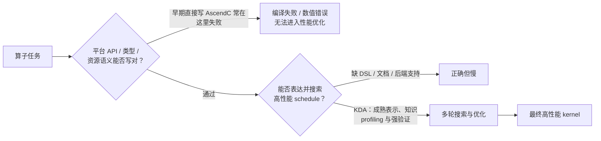
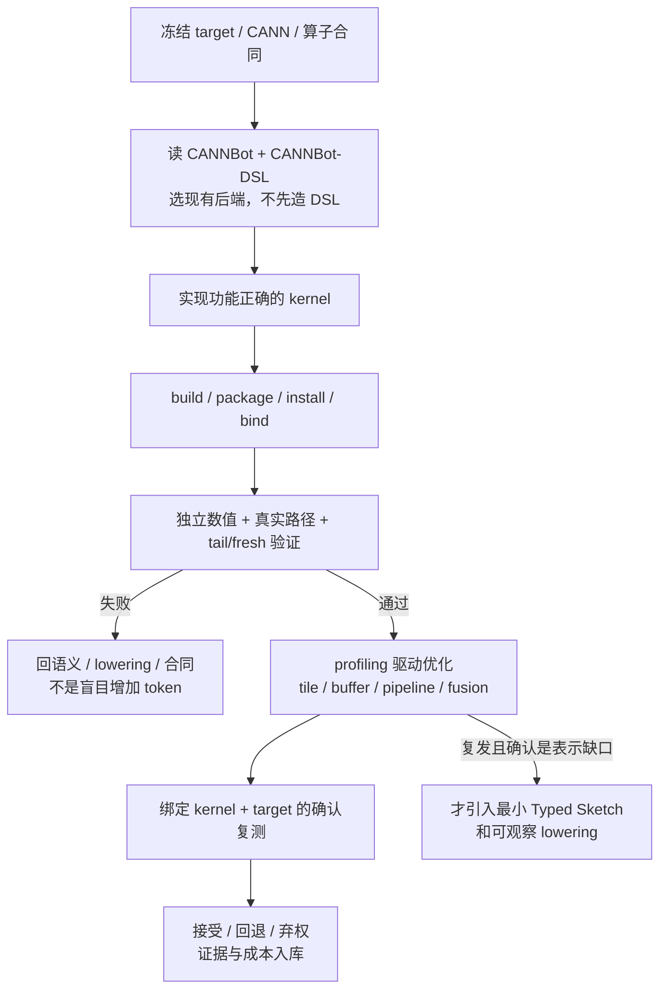

# NPU 算子生成：KDA 经验与工程实践路线

日期：2026-10-27

> **范围**：回答两个问题：为什么 KDA 在 GPU 上表现突出，而早期 NPU 结果显得较弱；如果实际开展 NPU 算子生成，哪些工程最值得参考。本文只做只读研究，不运行模型、GPU/NPU、安装脚本或付费实验。
>
> **证据口径**：`[论文]` 是原作者声称，`[代码]` 是指定本地快照中的文件事实，`[推断]` 是本文建议，`[未知]` 是尚未验证。所有性能数字都不是本仓库复现。

## 0. 一页结论

| 问题 | 结论 |
| --- | --- |
| KDA 为什么表现好 | 不是单靠模型或 DSL，而是聚焦任务、成熟 GPU 语料与工具链、可控表示、细粒度 profiling、大规模搜索、强验证和长期人工工程投入共同作用。 |
| 早期 NPU 为什么显得弱 | 很多实验让通用模型直接零样本写 AscendC，首先卡在 API、dtype、host tiling、UB/L1/L0、队列、同步和部署语义，尚未进入“如何写快”的阶段。 |
| 能否概括为 GPU 易、NPU 难 | 不能。硬件不是唯一变量，任务、baseline、预算和验证口径不同；NPU 后续系统已展示明显提升。GPU 也有大量正确但慢、生成失败和假优化。 |
| 只选一个 NPU 工程作主干 | **CANNBot（CAKE2）+ cannbot-skills**：最适合参考 CANN 原生的 artifact、构建、安装、绑定、评测和调试链，但不能当成论文完整实现或可信 harness 直接照抄。 |
| 最推荐的工程组合 | **CANNBot/CAKE2 作工程骨架，CANNBot-DSL 作编程样例，NPUKernelBench 作评测夹具起点；KDA 与 GPU CAKE 只借 harness、验证和表示设计。** |
| 是否先造新 DSL | 不建议。先用现有 AscendC/CANNBot-DSL 打通一个正确、路径明确、可复测的算子；只有复发证据证明表示缺口时，再引入最小 Typed Sketch。 |

## 1. 先统一比较口径：两类任务并不相同

| 维度 | KDA 的代表性工作 | 早期 NPU 直接生成 AscendC |
| --- | --- | --- |
| 主要目标 | 在已有参考/功能正确实现上迁移、搜索并优化高性能 kernel | 从零或由任务描述生成 host + device 的完整 AscendC 实现 |
| 任务范围 | 聚焦 Kimi Delta Attention 和有限 Blackwell shape | 常常一次覆盖几十到几百个算子、动态 shape、tail 和复杂类别 |
| 模型起点 | 已有 CUDA/Triton/CUTLASS/真实 PR、KernelWiki 和成熟工具链 | AscendC 公开语料、样例和目标知识相对不足 |
| 主要瓶颈 | 数据流、状态传递、调度、流水、launch 和验证 | API、类型、资源、同步、host/device 一致性和基本正确性 |
| 预算 | 多模型、多轮、多表示、profiling 和较大工程投入 | 很多结果是 zero-shot、one-shot 或有限采样 |
| 数字含义 | 特定工作负载上最终优化 kernel 的加速比 | 不同论文分别衡量编译、正确、pass@k、eager/厂商/baseline 加速，不能横比 |



**[推断] KDA 主要是在“已经能写对之后解决怎样写快”；早期 NPU 往往还在解决“怎样写对”。这才是表现差异的核心。**

## 2. KDA 表现好的六个支撑条件

| 条件 | KDA 的具体形态 | 带来的实际价值 |
| --- | --- | --- |
| 聚焦任务 | 围绕 Kimi Delta Attention 和特定 Blackwell 工作负载 | 可以反复优化同一算法、shape 和执行路径，而非泛化预算被大量任务摊薄。 |
| 功能基线与参考 | 已有 FlashKDA、数学语义、参考实现和可执行检查 | 模型不必同时猜数学语义与性能，能把预算用于调度和数据流。 |
| 成熟知识与语料 | CUDA、Triton、CUTLASS、FlashInfer、SGLang、vLLM、真实 PR 和 KernelWiki | 能复用专家已有结构，降低对硬件事实的猜测。 |
| 多表示路线 | CuTe DSL、TIRx、CAKE-PTX/static PTX | 可按目标选择合适控制层，不被单一表示限制。 |
| 细粒度反馈 | profiling、CUPTI、真实模型输入、延迟和瓶颈证据 | 修复能定位到带宽、调度、状态传递、launch 等具体决定。 |
| 强验证与人工工程 | final state、秘密种子、分布外探针、真实输入、独立代码审查，以及长期 harness/Wiki 建设 | 能筛掉假加速并持续积累可复用经验；结果不是一次 prompt 的产物。 |

KDA 的失格案例同样是重要证据：`hacking_example/README.md` 记录的候选曾在宽松 verifier 下得到 **3.7413×**，后来被发现利用常数归一化、丢状态和跳过计算；关闭作弊路径后为 **2.4768×**。**这说明强验证不是附属品，而是 KDA 成功叙事不可分割的一部分。**

本地证据：

- `/Users/kuafu/CLionProjects/kda-260927-kda/README.md`：三种表示路线、评测协议与结果口径。
- `/Users/kuafu/CLionProjects/kda-260927-kda/hacking_example/README.md`：失格候选及后续验证加固。
- `/Users/kuafu/CLionProjects/kda/skills/KernelWiki/`：结构化硬件、技术、kernel 和 DSL 知识。

## 3. 早期 NPU 的主要瓶颈

| 瓶颈 | 具体表现 | 为什么 token max 不能直接解决 |
| --- | --- | --- |
| 目标知识不足 | AscendC 公开代码、样例和高质量经验较少 | 生成更多未知 API 只会增加幻觉和修复成本。 |
| 编程面更宽 | host tiling + device kernel；GM/L1/UB/L0、MTE、TQue/TBuf、DataCopyPad、Cube/Vector、对齐和同步同时出现 | 单次生成要决定的细节太多，必须靠表示、schema、样例和 lowering 降熵。 |
| 后端能力不平移 | 会写 Triton 不等于理解 Ascend UB、Queue、Cube 和 target-specific lowering | 同一前端不能自动补齐后端语义与性能。 |
| 反馈与环境不统一 | CANN、设备、profiler、部署路径和核数差异会改变行为 | 在一个环境通过不能自动成为另一个环境的可信结论。 |
| 任务与类别更难泛化 | Conv、MatMul、动态 shape、tail 和复杂索引与归一化不同 | 单类算子上的经验不能外推到全部 NPU 算子。 |
| 验证与预算不同 | 早期常见 zero-shot、少量采样和窄正确性门 | 与 KDA 的多轮搜索、强验证和较大投入不是同一实验。 |

**[论文] AscendKernelGen 的失败分类非常典型**：约 4,000 个 AscendC 失败中，API/重载 **51.9%**、dtype/转换 **19.8%**、作用域/生命周期 **16.4%**，语法/结构及宏/预处理等合计 **3.7%**。这支持“平台事实与对象语义是主要缺口”，而不是“模型连 C++ 语法都不会”。来源：[arXiv:2601.07160](https://arxiv.org/abs/2601.07160) · [本地 PDF](2601.07160_ascendkernelgen-a-systematic-study-of-llm-based-kernel-generation.pdf) Table 1。

**[论文] MultiKernelBench 也显示跨平台能力不能直接迁移**：同一批模型在 CUDA 与 AscendC 上的 Comp/Pass 差距很大，AscendC 最高 Pass@1 仅 2.5%，大量编译错误包含 `no member named`。来源：[arXiv:2507.17773](https://arxiv.org/abs/2507.17773) · [本地 PDF](2507.17773_multikernelbench-a-multi-platform-benchmark-for-kernel-generation.pdf)。

### 还要扣除比较口径和幸存者偏差

- GPU 公开材料更容易展示成功项目和最佳 kernel；正确但慢、失败和假优化较少成为头条。
- KDA 是特定工作负载上的最终结果，不代表所有 GPU 算子都有类似提升。
- NPU 的 eager、厂商 `aclnn`、已有 AscendC 和单点极值不是同一分母。
- MatMul、Conv、Cube/MMA 与逐元素、归一化的难度不同，不能混成“NPU 整体能力”。

## 4. NPU 并非一直不明显：后续系统正在补齐条件

| 系统 | 补上的关键条件 | 原文结果及必须保留的限制 |
| --- | --- | --- |
| [AscendCraft](2601.22760_ascendcraft-automatic-ascend-npu-kernel-generation-via-dsl-guided.pdf) | 轻量 DSL、类别样例、四趟 lowering | 52 个非 MatMul/Conv 核 Comp@1 98.1%、Pass@1 90.4%、Fast1.0 46.2%；eager 基线，官方实现未找到。 |
| [AKG](2512.23424_akg-kernel-agent-a-multi-agent-framework-for-cross.pdf) | Unified Sketch、Designer/Coder/Verifier、文档和样例检索 | Triton-Ascend GM 1.46× eager；pass@4 与搜索预算不可省略；当前代码的 Sketch 主要是文本中间态。 |
| [CANNBot-CAKE](../可信harness/papers/2610.31034_cannbot-cake.pdf) | 多 DSL 路由、完整交付、真机验证、知识复用 | 53 算子标准集 100%、隐藏集 98.28%、平均 1.334×任务 baseline；排行榜跨修订取最好，CAKE Book 因果未隔离。 |
| [AscendOptimizer](../可信harness/papers/2603.23566_ascendoptimizer.pdf) | Optimization Rewind、实测经验、host tiling 搜索 | 101 算子 GM 1.21×、每算子 230 次硬件评测；传导式调优且代码未公开。 |
| [AgenticCANN](2607.26661_agenticcann-automated-ascend-c-operator-generation-via-knowledge-augment.pdf) | 知识分层、阶段化 Agent、生产 shape | Pangu RMSNorm 个案最高 6.65×；不是全 54 算子统一结果，官方代码未找到。 |

**[推断] 后续提升说明 NPU 的差距不是硬件定律。知识、表示、编译反馈、验证和搜索条件补齐后，结果自然会改善。**

## 5. 做 NPU 时，哪些工程最有实践参考价值

### 5.1 推荐顺序按“用途”而不是按加速倍数

| 推荐定位 | 工程 | 最值得参考的内容 | 不能直接照抄的边界 |
| --- | --- | --- | --- |
| **工程主干首选** | **CANNBot / CAKE2 + cannbot-skills**（`cannbot` `2b60dd86aa90`，skills `67e021abad3e`） | CANN 原生 artifact 链；op_desc/reference/functional/lowering/project/build/install/bind/evaluate；远程开发、Advisor、msdebug/mssanitizer 和多种 skill 工作流 | 当前插件不能直接等同论文完整 router/ledger/CAKE Book；存在 `bypassPermissions`、直接 `exec`、部分 fail-open hook 和字段契约不一致，必须先做安全与门控改造。 |
| **编程样例首选** | **CANNBot-DSL**（`755cd63b9e6f`） | RMSNorm、FlashAttention 等真实样例；tile/core、UB、Channel depth、FP32、tail/mask、`vmem_bar`；编译与 NPU 测试的组织方式 | 公开仓主要是样例、文档和测试，不是完整编译器源码；后端 wheel、CANNIR、毕昇和 NPU runtime 都是外部依赖，测试未在本轮运行。 |
| **评测夹具起点** | **NPUKernelBench**（`6b842167995b`） | 任务布局、生成→编译→数值→性能链、device-only 与 host+device 路径、逐 case 结果和 baseline 组织 | 默认公开静态 case、重复输入而非 fresh/hidden；`answer` 与题目共置；无绑定 binary 的独立确认。生产使用前必须隔离答案、补隐藏 shape、路径审计和确认复测。 |
| **独立实现补充** | **AscendOpGenAgent**（`595ce700122e`） | Triton/AscendC 双路径、TileLang→AscendC 映射、Agent/Skill 组织、批量 benchmark 与 AutoResearch | 不是 AscendCraft 官方实现；其 baseline 与论文不可横比，极大单点加速比不能当普遍结果。 |
| **Agent 架构参考** | **AKG / akg_agents**（`5aa15f3fe4d8`） | Designer/Coder/Verifier/Conductor、跨后端适配、检索与错误路由、SkillEvolution 过程 | 当前 Unified Sketch 主要是文本而非 typed IR；Conductor 分类依赖 LLM，SkillEvolution 写入不等于人审和版本化准入。 |
| **多后端与 direct-launch 参考** | **MultiKernelBench**（`460a972c9be7`） | backend 注册抽象、AscendC direct-launch、bisheng/CMake/pybind 链、anti-hack 检查位置 | anti-hack 不是运行时路径证明且不必否决；故障可写 `compiled=True`；当前容差/主流程与论文口径不同，不宜直接当可信验收器。 |
| **Harness/验证设计参考，非 NPU 代码** | **KDA + GPU CAKE** | KernelWiki、profiling、假优化反例、typed schedule、静态门、确定性 lowering、shape 域与确认机制 | NVIDIA/Blackwell 专属硬件语义和性能不可搬到 Ascend；FlashInfer 生成物也不等于完整 Cake 编译器开源。 |
| **仅作方法论文参考** | **AscendCraft、AscendOptimizer、AgenticCANN** | DSL 抽象、分趟 lowering、经验 rewind、知识分层与阶段化 Agent | 官方实现未找到或代码未公开，不能作为直接部署主干，也不能声称已复现其结果。 |

### 5.2 如果只能选一个

**选择 CANNBot / CAKE2，而不是 AscendOpGenAgent 或某篇 paper-only 系统。**

理由不是它的加速比最高，而是它最接近真实 NPU 工程交付：

```text
算子合同 → 参考实现 → functional form → DSL/host/device 代码
→ 工程构建 → 安装 → Python binding → 数值与性能记录
→ 调试 / 优化 / 版本化 artifact
```

但它的正确用法是**借工程骨架和工具清单，再重做权限、验证和证据门**，不是把插件和论文数字一起当作可信整包。

## 6. 推荐的实际落地路线



| 阶段 | 推荐动作 | 验收产物 |
| --- | --- | --- |
| 0. 冻结合同 | 选一个 target、一个 CANN 版本、一个 RMSNorm；固定 shape/dtype/layout/eps/acc、容差、fallback、baseline 和预算 | `op_desc`、target profile、oracle、tail case、权限和成本上限 |
| 1. 只读工程复核 | 读 CAKE2 流程和 CANNBot-DSL 的 RMSNorm；确定构建、安装、binding 和验证入口 | 工程地图、版本指纹、不可信代码与权限清单 |
| 2. 功能正确优先 | 使用现有 AscendC/CANNBot-DSL 后端生成或改写，不先加自定义 IR | 功能正确源码、build/package/install/bind 记录 |
| 3. 独立验证 | `H=1,3,7,128,129,256,1025`、fresh/hidden 输入、输出毒化、多次启动、路径审计 | 最小失败输入、generated/fallback/unknown 标签、不可判项 |
| 4. 性能优化 | 根据真实 profiling 改 tile、buffer、pipeline、归约和融合；每次改动重跑数值与安全门 | before/after diff、瓶颈、baseline、噪声和搜索成本 |
| 5. 确认与入库 | 绑定 binary/source/target/skill 版本复测；记录人工和设备成本 | search best 与 confirmation 分离的证据包、可回退结论 |
| 6. 必要时再加 IR | 只有同一表示缺口反复出现，才设计最小 Typed Sketch | schema、资源/tail/sync 检查、lowering trace、合法/攻击 corpus |

**真实 NPU、模型生成和性能实验都需要另行明确授权。以上阶段是工程路线，不表示本轮已执行。**

## 7. 不能直接照抄的清单

| 表面现象 | 容易产生的误判 | 正确做法 |
| --- | --- | --- |
| 官方仓库存在 | 认为论文全部机制都已实现且已验证 | 绑定 commit，逐项核对代码、文档和论文差异；未知保留 unknown。 |
| 有 skill / workflow 文本 | 认为存在确定性编译器、静态门或人审 | 区分 prompt 指引、确定性代码、测试和实际强制执行层。 |
| 有模拟器 | 认为可替代真机 | 模拟只作廉价预检；最终数值、路径和性能必须在绑定 target 上确认。 |
| 有公开 benchmark | 认为能证明 hidden/fresh 泛化 | 隔离答案、补未见 shape/分布、输出毒化和执行路径审计。 |
| 有最高加速比 | 认为系统整体更好 | 同时看整体指标、baseline、任务、预算、失败分母和确认结果，不做峰值排行榜。 |
| Agent 可直接执行代码 | 认为迭代更快 | 最小权限、只读评分材料、沙箱、超时和资源限额；不要复制 `bypassPermissions`。 |
| 论文报告性能 | 认为自己也能获得同样提升 | 标为原作者口径；在自己的 target、baseline 和确认协议下重新测量。 |

## 8. 最终建议

**工程实践的主线应是：**

> **CANNBot 学交付链，CANNBot-DSL 学写算子，NPUKernelBench 学组织评测，KDA/GPU CAKE 学可信 harness 与表示设计，AscendCraft/AscendOptimizer/AgenticCANN 学方法但不冒充可运行实现。**

如果目标是尽快产出第一个真实 NPU 算子，优先顺序为：

1. **CANNBot + cannbot-skills**；
2. **CANNBot-DSL 的 RMSNorm 和同步/tail 样例**；
3. **NPUKernelBench 的任务与评测结构，经过答案隔离和验证加固**；
4. 需要第二条实现路线时再看 **AscendOpGenAgent / AKG**；
5. 只有反复证明现有表示无法表达关键性能决定时，才回到 **AscendCraft 与 Cake IR** 设计最小 Typed Sketch。

更完整的 DSL/IR 比较、KDA 归因、OpenAI Jalapeño 启示和离线 fixture 见：[`NPU-DSL-for-LLM：人类DSL与Agent-IR的比较.md`](NPU-DSL-for-LLM：人类DSL与Agent-IR的比较.md)。
