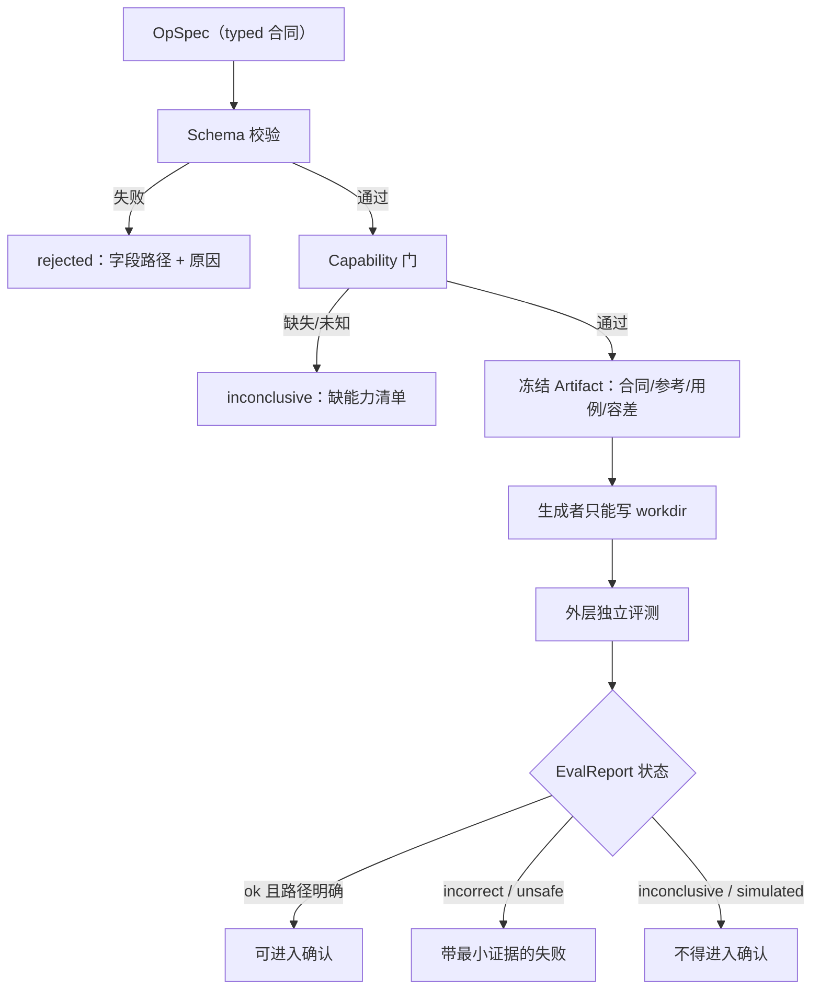
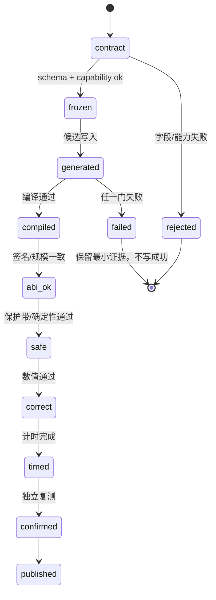

# P0/P1 设计草案：从 CAKE2 机制到我们的工程

日期：2026-10-27

> **状态**：设计草案，未实现、未运行。本文只做对照与方案，不修改工程代码、测试、配置或验收门。
>
> **快照与漂移警告**：本地 HEAD 为 `3fb9ac85bfc7`（main）。核查时工作树里 `tcenv/evaluate.py`、`tcenv/backends/*`、`tcenv/remote/*`、`docs/security.md` 等文件**已被其他会话并发修改**（+568/−136），不是本文所为；`tcenv/contract.py`、`tcenv/schema.py`、`taic/artifacts.py`、`tcenv/task.py` 与 HEAD 一致。因此下文行号只对当前工作树成立，实现前应改用“符号名 + commit/hash”定位。
>
> **输入**：[`CAKE2机制清单与证据分级.md`](CAKE2机制清单与证据分级.md) 的 M01–M07、M13–M21、M34、M36；本地 `tcenv`、`taic`、`docs/security.md` 源码与文档。
>
> **原则**：能复用我们已有的更强机制就复用；只补真实缺口；每个新增门都要有离线 fixture 和 fail-closed 语义。

## 0. 先修正一个前提

CAKE2 和我们不是同一种系统。直接对照容易得出错误结论：

| 维度 | CAKE2 | 本仓库 |
| --- | --- | --- |
| 交付单位 | 可部署 CANN 算子 + binding + 评测记录 | 一个搜索运行（`runs/<target>/...`）+ 候选 kernel + `EvalReport` |
| 生成者 | Claude/Codex 类 Agent + SKILL 指引 | `taic` 通过 `hmz` 启动 `kernel_once` |
| 语言 | AscendC / DSL / easyasc 多 track | 当前主要是 Triton → MSL |
| 判卷 | 插件内脚本为主，门主要写在 SKILL/Agent 里 | `tcenv` 确定性关卡 + 独立确认复测 |
| 证据链 | 逐阶段 artifact + git commit | `run_config.json` + `EvalReport` + `result.json` + `confirm_report.json` |
| 权限 | Agent 带 `bypassPermissions`，评测直接 `exec` | 写核 Agent 限工作目录，外层重评（见 `docs/security.md`） |

**结论：CAKE2 能借的主要是“合同/artifact/阶段语义”，不能借权限与评测实现。** 我们不少对应能力已经强于 CAKE2，不应为了“对齐”而退回去。

## 1. 现有能力基线（只读核对）

### 1.1 已经有、应保留的机制

| 能力 | 我们的现状 | 证据 |
| --- | --- | --- |
| 版本化报告与未知字段拒绝 | `REPORT_SCHEMA_VERSION = 3`；未知字段、过新版本一律拒绝 | `tcenv/schema.py:9-13,46-60,99-121` |
| 请求版本化与必填 `target_id` | `REQUEST_SCHEMA_VERSION = 4`，缺 `target_id` 拒绝 | `tcenv/schema.py:12-13,20-23,123-141` |
| 损坏检查点不当作“未运行” | `read_versioned` 抛 `NeedsInspection` | `taic/artifacts.py:15-46` |
| 原子写 | `write_json_atomic` 先写临时文件再 `os.replace` | `tcenv/schema.py:144-166` |
| 固定关卡顺序 | 编译 → ABI → 安全 → 数值 → 计时，前关失败不进后关 | `tcenv/evaluate.py:411,460,480,575,660` |
| 独立确认复测 | 新种子、`eval_reps×2`、多批中位数、噪声门、`eval_cache=False` | `taic/orchestrator.py:3204-3280` |
| 发布门不回落 | 未绑定源码/未确认/缓存命中/极差过大时标「未确认/不确定」，不退回 `best_speedup` | `experiments/common.py:495-524`；`docs/架构/搜索.md` §发布层 |
| 写核 Agent 权限边界 | 只写工作目录；不能改评测、trust、budget、control；`online=NONE` | `docs/security.md` §正常写核流程 |
| 关键路径禁自动 patch | `SECURITY_CRITICAL` 覆盖 `tcenv/`、`taic/`、`tests/`、`targets/` 等 | `docs/security.md` §永远禁止自动 patch 的路径 |
| 目标/版本绑定 | `run_config.json` 记 target id/backend/backend_version、git 身份、contract/triton 哈希、`task_fingerprint`、agent guidance 哈希 | `taic/orchestrator.py:1012-1046`；`tcenv/task.py:93-140` |
| 覆盖范围声明 | `coverage.kind = sampling | domain_sweep`，带 `scope`、源码哈希与任务指纹 | `tcenv/backends/metal/domain.py:75-150` |
| 形式验证诚实标注 | `verify()` 恒 `unsupported`，不冒充已证明 | `tcenv/evaluate.py:328`；`tcenv/verify.py` |

### 1.2 真实缺口

| 缺口 | 现状 | 风险 |
| --- | --- | --- |
| **算子合同不是 typed schema** | `Contract` 是 MSL 专用（`kernel void`、`[[buffer(n)]]`、grid/threads），见 `tcenv/contract.py:1-18`；没有通用 `op_desc` 结构，也没有 schema 校验器 | 新增 NPU/非 MSL 后端时没有可校验的算子身份；dtype 覆盖、shape 域、layout、fallback、属性枚举无统一门 |
| **合同/参考与“答案隔离”未成体系** | `task_fingerprint` 覆盖 contract/triton/reference/cases/tolerance/flops/min_bytes/meta | 已有哈希，但没有“候选不可读 golden/答案目录”的结构化清单；不同后端 reference 来源仍靠约定 |
| **阶段 artifact 不是一等对象** | 有 `run_config`、`EvalReport`、`result.json`、`confirm_report.json`，但没有统一 artifact ID / 父链 / 阶段状态机 | 难以回答“这次失败属于哪个阶段、由哪个 artifact 产生、能否重放” |
| **诊断不定位到字段/资源/阶段** | `EvalReport.message` 是首条失败说明；`stage` 只有关卡名 | 修复容易误路由；缺少 repair owner 与最小证据字段 |
| **`verification` 恒 `unsupported` 的语义未进发布口径** | 报告恒 `unsupported`，发布层未把“未证明”与“抽样通过”显式分账 | 读者可能把 `status=ok` 当成等价证明 |
| **模拟/不可判没有统一状态词表** | 远程有 `measurement_kind`，但 `EvalReport.status` 没有 `inconclusive`/`simulated` 一等状态 | 易把不可判写成 ok，或把模拟写进确认 |
| **target 能力指纹不完整** | `TargetProfile` 有 `raw_limits` 与 `backend_version`，但无统一 capability 枚举/拒绝语义 | 未知 target 或能力缺失时，行为依赖后端实现 |
| **非 MSL 合同不存在** | `contract.py` 文件头明确承认这是 Metal 合同，B0.5 只让后端把它当不透明对象 | NPU 落地必须新增独立合同，不能复用 MSL 渲染器冒充通用 |

**判断：P0 的核心不是“抄 CAKE2 的 op_desc”，而是把合同、能力、权限、不可判状态变成 typed 且 fail-closed 的一等对象。**

## 2. P0 设计草案：合同、权限与可信基线

### 2.1 目标与非目标

| 目标 | 非目标 |
| --- | --- |
| 一个 target + 一个算子（建议 RMSNorm）有 typed 合同与独立 oracle | 不实现多 DSL router |
| 未知 target/能力/字段/状态一律 fail-closed | 不改动现有评测关卡顺序与容差策略 |
| 明确“生成者可写/不可写”的路径清单 | 不新增真实 NPU 运行 |
| 报告能区分 `ok / incorrect / inconclusive / simulated / unsupported` | 不把 CAKE2 的 `exec` 与 `bypassPermissions` 搬进来 |

### 2.2 结构草案

### 2.3 OpSpec 最小字段（建议，非最终 schema）

| 分组 | 字段 | 为什么必须有 |
| --- | --- | --- |
| 身份 | `op_name`、`category`、`spec_version` | 避免自由字符串与版本漂移 |
| 语义 | `formula`、`attributes`（含默认值/枚举） | 数学意图与属性域不能从名字推断 |
| I/O | `inputs[]`、`outputs[]`：`name/shape_domain/dtype/layout/strides/space` | 支持 shape 域、dtype 覆盖、布局与地址空间检查 |
| 数值 | `acc_dtype`、`eps_policy`、允许的数学路径 | 精度承诺必须可追踪 |
| 域 | `shape_cases[]`（含非整除/空域）、`dtype_cases[]` | 把 tail/shape 域变成可测对象 |
| 验收 | `tolerance`、`baseline`、`fallback_policy`、`oracle_ref` | 候选不得自选裁判 |
| 目标 | `target_id`、`backend`、`capability_required[]` | 未知能力必须阻断 |
| 版本 | `skill_version`/`example_version`（若引用） | 旧知识失效条件 |

**与 CAKE2 的差异**：CAKE2 的 `op_desc_template.json` 只有 `op_name/category/description/shape_info/attributes/test_cases`，没有 layout、acc dtype、fallback、capability 与容差。我们不应照抄它的字段密度。

### 2.4 候选可写 / 不可写边界

| 路径类别 | 生成者 | 理由 |
| --- | --- | --- |
| 自己的工作目录（候选源码、笔记） | 可写 | 现有 `kernel_once` 已如此 |
| 合同、golden、参考实现、用例、容差 | **只读** | 评分材料不得被候选修改 |
| `task.cases`、`distributions`、baseline、计时脚本 | **只读** | 已有 `SECURITY_CRITICAL` 方向 |
| `targets/`、`run_config.json`、`control.json` | **只读** | 防止改 target 或预算 |
| 报告/账本/outbox | **只读** | 防止改写结论 |

### 2.5 P0 验收（离线即可）

| 编号 | fixture | 期望 |
| --- | --- | --- |
| P0-1 | OpSpec 缺 `outputs[].layout`、未知字段、非法 `eps` | 拒绝并给出字段路径 |
| P0-2 | `dtype_cases` 未覆盖声明的全部 dtype | 拒绝，列出缺口 |
| P0-3 | `capability_required` 含 target 未声明能力 | `inconclusive` + 缺能力清单，不生成 |
| P0-4 | 候选尝试写合同/golden/计时脚本 | 权限拒绝并留安全记录 |
| P0-5 | 候选读答案目录或越界路径 | 拒绝；若是结构上不可见，则证明不可见 |
| P0-6 | 结果文件损坏、`total=0`、未知状态、缺 `target_id` | fail-closed，不产生 ok |
| P0-7 | 模拟结果申请进入确认 | 拒绝，标 `simulated` |
| P0-8 | 合同未变但 git 工作树脏、target backend_version 变化 | 指纹失效，要求重测 |

## 3. P1 设计草案：Artifact 与阶段门

### 3.1 目标

把“阶段 + artifact + 状态 + 证据”变成一等对象，使失败能定位、结果能重放、成功不能伪造。

### 3.2 Artifact 图

| Artifact | 现有对应物 | 需要补的字段 |
| --- | --- | --- |
| 合同 | `Contract.describe()` + `contract_description_sha256` | 独立 schema ID、字段级哈希、capability 快照 |
| 参考/functional | `task_fingerprint` 中的 reference | 来源、只读标记、生成方式与版本 |
| 候选源码 | `best.metal`、`candidates/<n>/kernel.metal` | 父候选、schedule 摘要、来源 skill/example 版本 |
| 编译记录 | `EvalReport.compile` | 编译器版本、flags、诊断定位到源码行 |
| ABI 记录 | `EvalReport.abi` | 期望/实际签名、启动规模 |
| 安全/数值 | `EvalReport.safety/correctness` | 最小失败输入、case 名、coverage.kind |
| 计时 | `EvalReport.benchmark` | 采样、基线名/版本、噪声、缓存命中 |
| 确认 | `confirm_report.json` | 绑定 source/binary/target/协议指纹 |
| 发布 | `experiments/common.py` published 结论 | 证据链与不可判原因 |

### 3.3 阶段状态机

**关键规则**：失败分支不得写 `published` 或 `confirmed`；`inconclusive` 既不能前进也不能被当作失败能力统计。

### 3.4 缺失状态的语义扩展（建议）

| 状态 | 含义 | 允许进入确认 |
| --- | --- | --- |
| `ok` | 该模式要求的关卡都通过 | 是（仍需独立确认） |
| `incorrect/unsafe/compile_error/abi_error/rejected/runtime_error` | 明确失败 | 否 |
| `timeout/crash` | 执行中断 | 否 |
| `inconclusive`（新增） | 证据不足、模型不适配、覆盖未知 | 否 |
| `simulated`（新增） | 模拟器结果 | 否，且不得标 `measured` |

**这只新增状态词与使用规则，不改现有 `status` 取值语义**；是否为 `EvalReport` 增加字段、还是仅在发布层派生，需要在实现前单独评审 schema 版本。

### 3.5 P1 验收（离线即可）

| 编号 | fixture | 期望 |
| --- | --- | --- |
| P1-1 | 缺中间 artifact，却出现 `compiled` | 状态机拒绝 |
| P1-2 | 阶段失败后仍写了成功记录 | 拒绝并保留上次成功状态 |
| P1-3 | 源码/hash 与报告不一致 | 发布层标「未确认」 |
| P1-4 | 缓存命中的确认报告 | 标「不确定」，不得发布 |
| P1-5 | 三批极差 > 2% | 标「不确定」 |
| P1-6 | 缺 `target_id`/`backend_version` 的报告 | 读入拒绝 |
| P1-7 | 未知新字段 | 读入拒绝（不回退默认） |
| P1-8 | `coverage.kind=sampling` 却申请 primary | 拒绝 |

## 4. 与 CAKE2 的差异摘要（只列 P0/P1 相关）

| 机制 | CAKE2 | 我们 | 结论 |
| --- | --- | --- | --- |
| 算子合同 | JSON 文本 + SKILL 约定 | MSL `Contract` + 哈希 | **新增 typed OpSpec，不复用 MSL 结构** |
| 阶段 artifact | 有，但主要由 Agent/SKILL 执行 | 有部分记录，缺统一 ID/父链 | 补齐 artifact 图与状态机 |
| 结果 schema | 字段不一致（M21） | 版本化严格拒绝 | **保留我方，不引入 CAKE2 的宽松字段** |
| 权限 | `bypassPermissions` | 工作目录限制 + 关键路径禁改 | **保留我方，拒绝 CAKE2 模式** |
| 代码执行 | 当前进程 `exec` | 子进程评测 + 独立确认 | **保留我方** |
| fail-open | 存在 | 无同类 hook | 不需要引入 |
| 确认复测 | 论文口径为主 | 已实现多批中位数 + 噪声门 | 已有优势，不重做 |
| 不可判语义 | 未统一 | 部分有（`verification: unsupported`） | 补 `inconclusive/simulated` 状态规则 |

## 5. 实施顺序与停止点

| 步骤 | 内容 | 产出 | 是否改代码 |
| --- | --- | --- | --- |
| S1 | 完成 OpSpec 字段与 schema 评审 | schema 草案 + 反例清单 | 否 |
| S2 | 定义 artifact 图与状态转换表 | 状态机文档 | 否 |
| S3 | 实现离线 fixture（P0/P1 共 16 项） | fixture 设计与期望表 | 是（仅测试） |
| S4 | 评审现有 `EvalReport` 版本升级方案 | schema 变更提案 | 否 |
| S5 | 小范围实现 typed OpSpec + 校验器 | 一个算子（RMSNorm） | 是 |
| S6 | 接入 `inconclusive/simulated` 语义 | 报告与发布层 | 是，需单独确认 |

**停止点**：S4 完成前不修改任何评测/发布代码；S5 前必须有明确的人工批准；真实 NPU、模型调用与真机实验另行授权。

## 6. 需要你确认的三件事

1. **OpSpec 是否作为独立文件**，还是先作为 `Contract` 的旁路结构，避免立刻改动 MSL 路径。
2. **`inconclusive/simulated` 是新增 `EvalReport.status` 取值**（需要 schema 版本升级），还是先只在发布层派生（改动更小）。
3. P0 的首个算子是否就是 **RMSNorm**，并且只做离线 fixture、不接 NPU。

在这三点确认前，我建议不再推进代码层设计。
