# 面向 Agent 的领域知识库：KernelWiki 建设与 NPU 验证方法

日期：2026-10-27

> **研究目标**：以 KDA 的中间层 **KernelWiki** 为工程代表，结合当前论文导读中有关知识、技能、经验、记忆与证据库的工作，回答一个更严格的问题：**怎样建设面向 Agent 的 NPU 领域知识库，并验证它内容可靠、检索正确、注入有净收益、失效时可撤回，而不是只积累一仓库文档？**
>
> **边界**：本文是方法论和验证设计，不实现知识库，不运行模型生成实验、GPU/NPU、付费 A/B、安装脚本或下载仓库的 Agent。论文数字均为原作者口径，KDA 数字为团队/项目口径，不是本仓库复现。

## 0. 一页导读

### 0.1 核心判断

**面向 Agent 的领域知识库，不是“文档集合 + 向量检索”，而是一套带证据、作用域、版本、权限、检索、验证和退出机制的生命周期系统。**

| 命题 | 为什么不能直接成立 | 必须补的证据 |
| --- | --- | --- |
| 知识内容正确，所以应该注入 | 可能属于另一芯片、编译器、shape 或瓶颈 | target/version/operator/shape 适用范围与检索硬过滤 |
| 检索到了相关知识，所以会有帮助 | 可能重复、过长、过时、遮蔽合同或包含答案/注入 | 查询金集、上下文预算、排除项、泄漏与注入检查 |
| 注入后分数提高，所以知识正确 | 可能过拟合公开题、利用弱 oracle、改变搜索预算 | 独立 oracle、同预算配对、隐藏/留出任务、反作弊 |
| 一次有用，所以应永久保留 | 模型、编译器、硬件、baseline 和策略前沿都会变 | 版本指纹、重验、移除检验、退役、quarantine 与回滚 |
| 条目越多，库越好 | 噪声、冲突和 token 成本也会增加 | 接受候选的净收益、负迁移率、检索精度与维护成本 |

### 0.2 五层验证模型


| 层 | 要验证的主张 | 典型反例 | 不能用什么代替 |
| --- | --- | --- | --- |
| L0 来源完整性 | 条目能回到原始代码、论文、run 和具体片段 | 来源不存在、摘要歪曲原文、hash 对不上 | 模型自述、引用计数、相似文本 |
| L1 内容与作用域 | 内容在其声明范围内为真，边界和未知项明确 | A 芯片事实用于 B 芯片；tail 结论只测整除 shape | “官方文档”“以前好用”、单 shape 通过 |
| L2 检索与上下文 | 该出现时出现，不该出现时不出现，且交付可读可用 | 错版本条目排第一；隐藏答案泄漏；长文挤掉合同 | 向量相似度、检索命中数、Top-k 固定不变 |
| L3 注入效果 | 在同预算下改善目标指标且不在其他维度回退 | 正确率升但成本暴涨；训练题升、留出题降 | 最好一次加速、library size、agent 自评 |
| L4 生命周期 | 版本变化能触发重验、缩域、撤回与重放 | 新编译器仍召回旧 pragma；删除条目但索引仍注入 | 只追加不退役、覆盖历史、没有快照的“最新” |

### 0.3 证据标记

- **[代码]**：指定本地工程快照中可核的源码/文件事实；只表示本轮只读核过，不表示编译、测试或运行通过。
- **[论文]**：原论文作者声称；数字必须保留任务、模型、baseline、预算、target 与聚合口径，不是本仓库复现。
- **[访谈]**：团队自述或访谈整理，不能当独立对照实验。
- **[推断]**：本文提出的 NPU 设计或验证方案，不是已有系统能力，也不预示实验结果。
- **[未知]**：材料不足或本轮无法复核，不能判断；unknown 不得折算成通过、无风险或零回归。

**本地证据坐标（本轮只读）**：

| 记号 | 本地快照与用途 | 引用规则 |
| --- | --- | --- |
| `KDA` | [`/Users/kuafu/CLionProjects/kda/`](/Users/kuafu/CLionProjects/kda/README.md)，commit `acdd79343c5e9d0c7cb96289f26fd3f1051ce785` | KDA 流程文档的根目录 |
| `KW` | [`/Users/kuafu/CLionProjects/kda/skills/KernelWiki/`](/Users/kuafu/CLionProjects/kda/skills/KernelWiki/README.md)，commit `76d27b56f804e7e7295d4c570e1e5d7eef4b0a75` | **§2 未另写根目录的代码路径均相对于 `KW`**；行号属于该快照 |
| `CAKE2` | [`/Users/kuafu/CLionProjects/dsl_for_llm/cannbot/plugins-community/collaborative-agent-kernel-evolution/`](/Users/kuafu/CLionProjects/dsl_for_llm/cannbot/plugins-community/collaborative-agent-kernel-evolution/agents/cake.md)，所在仓 commit `2b60dd86aa90b148ac0fa3233303479641f0f8f8` | 仅用于核对当前插件快照，不能代替 CANNBot-CAKE 论文全文或证明其完整实现 |

§4 另用七个只读工程快照，短名即该节表内的路径前缀（CAKE2 见上表）：

| 记号 | 本地快照 | commit |
| --- | --- | --- |
| `AHE` | `/Users/kuafu/CLionProjects/dsl_for_llm/agentic-harness-engineering/` | `8b2a55d97590363fe50c3cc6b5e833b020a4bb4c` |
| `MRSI` | `/Users/kuafu/CLionProjects/dsl_for_llm/ModularRSI/` | `ed1e545bc60f050b404474e51ee18021777a0e23` |
| `DVK` | `/Users/kuafu/CLionProjects/dsl_for_llm/daVinci-kernel/` | `9ba953acc591028ff4f073c6f9f62f56a5ef66d3` |
| `AKG` | `/Users/kuafu/CLionProjects/dsl_for_llm/akg/` | `5aa15f3fe4d856eb60cd3b27447e04f5f1fb4dff` |
| `NPUKB` | `/Users/kuafu/CLionProjects/dsl_for_llm/NPUKernelBench/` | `6b842167995b057cdfaa6fc7dddc51e5692f4667` |
| `MKB` | `/Users/kuafu/CLionProjects/dsl_for_llm/MultiKernelBench/` | `460a972c9be7ce18035984321d38b910e27df95f` |
| `FI` | `/Users/kuafu/CLionProjects/dsl_for_llm/flashinfer/` | `b92f1129554c2dfc5c9c993867ddc50f4b6aedd5` |

这些快照只证明“该路径这样写”，不证明代码被启用、被测试通过或在真实目标上有效；本轮未编译、未运行、未跑测试。

`/tmp/dsl_research/*` 仅是已有 PDF 提取文本的阅读辅助，不是独立证据；本文量化结论回到所列本地 PDF 的章节/表格。其他内部学习笔记只用于定位，不作为外部事实的二手证明。论文链接存在、代码路径存在与“内容正确/效果通过”是三件不同的事。

主要阅读入口：[`可信 harness 论文导读`](../可信harness/papers/导读.md)、[`论文价值评估`](论文价值评估.md)、[`NPU 与昇腾资料`](NPU与昇腾资料.md)。访谈材料：[《跑掉四五千万人民币等值 Token 之后……》](<../一个公众号的论文解读/跑掉四五千万人民币等值 Token 之后，两位英伟达工程师重新理解了 Agent：代码不是护城河，时间才是.pdf>)，属于二手整理，引用时保留其自述性质。

### 0.4 文档地图

| 部分 | 回答的问题 | 适合谁直接阅读 |
| --- | --- | --- |
| §1 知识类型 | 文档、RAG、记忆、技能、经验和 oracle 有何区别 | 知识库产品与工程 owner |
| §2 KDA / KernelWiki | 真实工程怎样策展、溯源、检索，效果证据和缺口是什么 | 想以 KDA 为代表做设计的人 |
| §3 论文方法 | 各论文怎样产生、验证、检索、压缩和撤回知识 | 做文献综述与方法选型的人 |
| §4 开源工程源码对照 | 生产系统里知识到底被哪段代码挡住、哪段代码放行 | 想判断机制是否真的落地的人 |
| §5 NPU 参考架构 | 条目 schema、状态机、索引与上下文应怎样设计 | 准备写设计文档或原型的人 |
| §6 验证方案 | 怎样证明内容可靠、检索正确、注入有益且可撤回 | 验证 owner、评测与可信 harness 负责人 |
| §7 RMSNorm 示例 | 一条知识怎样从 run 走到 active/narrowed/retired | 想看端到端实例的人 |
| §8–9 路线与清单 | 下一步先做什么、何时需要真机、如何评审 | 项目推进与发布 owner |

## 1. 领域知识库到底是什么

### 1.1 不是一类东西，而是多种知识共同工作

| 知识类型 | NPU 示例 | 最合适的载体 | 最低准入证据 | 主要失效方式 |
| --- | --- | --- | --- | --- |
| API / ABI 事实 | load/store 签名、参数顺序、dtype/space、launch 规则 | 当前版本 schema + 最小可编译例 + 原文链接 | 当前工具链解析/编译和来源核对 | compiler/DSL 版本变化 |
| 硬件硬约束 | UB/L1 容量、对齐、核数、支持指令、mask 规则 | machine-checkable target profile | 静态负例 + target 实测/官方规格核对 | 芯片、资源模型、runtime 改变 |
| 算子结构样例 | RMSNorm two-pass、online softmax、归约骨架 | 小但完整的样例 + 输入域 + golden + shape 列表 | 编译、数值、tail 和真实路径通过 | 算子结构、shape/domain 或后端不同 |
| 优化经验 | 某瓶颈下 double buffer 的 before/after diff | 瓶颈/适用条件/代码差分/基线/噪声/成本元组 | 正确且实测收益超噪声，最好有移除检验 | target、baseline、瓶颈、版本或策略前沿改变 |
| 失败反例 | tail 填 1、缺 wait、非法 alias、静默 fallback | 最小失败 fixture + 期望诊断 + 合法对照 | 可重放失败；正确对照不误杀；修复后成回归 | verifier 变化、反例被误当优化建议 |
| 原始证据 | PR diff、编译日志、profile、隐藏前 run、论文片段 | 不可变 artifact + hash + 来源指针 | 字节可复核、owner 和时间明确 | 删除、改写、丢失上下文、无法重放 |
| 工作流/诊断程序 | 编译→数值→profile 的排障步骤、可用工具 | 可执行 procedure/skill + 输入输出合同 + 测试 | 沙箱内执行通过、失败路由正确 | 工具接口、权限或运行环境变化 |
| 模型自撰建议 | “应该换更大 tile”“也许可省一次同步” | reported/proposed 队列，不进入可信 active 库 | 只能作为待验证提案 | 把语言流畅当事实，反复自我强化 |

### 1.2 文档、RAG、记忆、技能、经验库不是同义词

| 形态 | 主要回答 | 与本文知识库的关系 |
| --- | --- | --- |
| 文档库 | “人写了什么？” | 可作为原始来源，不代表当前 target 可用 |
| RAG 检索层 | “哪些片段可能相关？” | 只是检索与交付，不负责内容真值或净收益 |
| Agent 记忆 | “过去发生过什么？” | 可含成功、失败、冲突；必须有 provenance 和生命周期 |
| Skill / procedure | “下一步怎样执行？” | 可被执行和测试，不只是散文知识 |
| 优化经验 | “什么条件下哪个变换有效？” | 需要实测、作用域、反事实和退役，不等于文档摘录 |
| 编译器规则 | “怎样合法 lowering/检查？” | 更适合落代码和 corpus，而不是长期提示散文 |
| 评测 oracle | “怎样判定正确/更快？” | 独立于知识生成者，不应由知识条目自行修改 |

**[推断] 建设顺序不应是“先堆向量库”，而应先决定知识类型、各自需要什么证据，以及哪一类错误会进入 Agent 上下文。**

## 2. KDA / KernelWiki：中间层的建设与实例

### 2.1 KDA 为什么需要中间知识层

**[访谈]** 访谈把 KDA 分成三层：**Humanize flow、KernelWiki、细粒度性能反馈**。**[论文]** Humanize Figure 5 又给出第四个不可省略的角色：**FlashInfer 等外部 oracle**。因此，KernelWiki 是生成系统的一部分，不是独立裁判。


| 组件 | 在 KDA 中的职责 | 不能替代什么 |
| --- | --- | --- |
| Humanize flow | 计划、实现、独立审查和小步迭代 | 不能替代领域知识与硬件反馈 |
| KernelWiki | 给 builder 提供可检索的生产经验、代码和文档 | 不能自己证明某条经验适用于当前 shape/target |
| ncu-report-skill | 把 profile 变成可行动的瓶颈证据 | 不能替代知识样例，也不能只给 latency 让模型猜原因 |
| 外部 oracle / reviewer | 判断候选是否正确、是否满足验收与推广条件 | 不能由知识库或 builder 自评取代 |

访谈中的其他经验，对知识库建设有直接影响：

| 访谈内容 | 对知识库设计的启示 | 不应得出的结论 |
| --- | --- | --- |
| GAAC 把 issue/PR 当上下文，频繁迁移后有损压缩，工作区变成 slop | 把稳定证据放在外部可检索层，当前上下文只带必要摘要和指针 | 把所有历史对话和 PR 全文永久塞入 prompt |
| KernelWiki 收集近半年已合并 PR，提炼 know-how 和经验 | 优先有真实工程审查痕迹的来源，并保存 merge SHA、变更文件和代码资产 | “已合并”等于对当前硬件/版本仍正确，或等于有性能证据 |
| NCU 让 Agent 看到 DRAM/L2/SM 瓶颈，而非只有一个 speedup | 知识检索应带瓶颈维度；优化知识要与测量证据相连 | 知识库可以单独解决“正确但慢” |
| 社区 wishlist 要求可复现定义、代表性负载和已知最佳 baseline | 知识使用必须先冻结任务合同和分母 | 只收集 kernel 名称和最佳倍数就能复用经验 |
| 新模型来了先拆 harness，观察后再逐项加回 | 模型升级也要做无库/最小库基线和逐项 add-back | 旧知识库和旧检索规则应无条件永久保留 |
| 公开过程与失败轨迹，方便社区复现和继续迭代 | 原始成功与失败证据都应保留，摘要不能覆盖原文 | 只保存最终 winner 就足够形成可靠经验 |

**[代码]** KDA 根目录的流程文档也强调：任务工作区拥有代码、测试、数据、benchmark 和生成物；候选只有在满足合同并有指标证据时才 promoted，拒绝也要记录原因（`KDA:docs/agent-flow.md`）。这与“先合同、再知识、再独立验收”的顺序一致。

### 2.2 当前实现的数据流：不是一张向量表

**[代码] `KW@76d27b56` 当前实现至少包含五条相关但不同的链路**：候选策展、source 页、wiki 综合页、代码资产和派生查询索引。它们不能用“文档已入库”一句话混过去。


| 层/文件 | 当前实际职责与 owner | 对 NPU 建设有用的机制 |
| --- | --- | --- |
| `candidates/*.yaml` | 人工或外部流程记录 include/defer/exclude 和理由；`generate-pr-pages.py` 只处理 include，defer/exclude 不生成 source 页 | **候选资格与知识 active 分离**；新来源可先 defer，而非自动进入正式知识 |
| `sources/prs/**` | 保存 PR 标题、merge SHA、语言、标签、changed paths、artifact_dir 等来源事实 | 让知识能回到具体上游版本和变更，而不是只留二手摘要 |
| `wiki/**` | 策展编辑综合 hardware/technique/kernel/pattern/language/migration 页面；当前未见通用 wiki 生成器 | 允许人工/Agent 综合，但要把编辑责任和证据范围说清 |
| `artifacts/**` | 另一条资产链：wiki/contest/policy/allowlist → core set → fetch/extract → bundle + PROVENANCE | **有 PR 页面不等于有代码资产**；代码还要经过 core set 和文件 allowlist |
| `queries/*.md` | `generate-indices.py` 从 sources+wiki frontmatter 重建导航页 | 索引是派生物，可以重建，不是事实真源 |
| `query.py` | 实际查询直接扫描 sources+wiki，按 title/tag/body 计分并支持 alias/filter（`scripts/query.py:58-62,85-145`） | 实际检索逻辑要与导航索引区分；评测时必须固定 selector 版本 |
| `get_page.py` / `grep_wiki.py` | 展开页面、来源与资产，支持正文和代码检索 | 短结果与按需钻取可以并存，但必须增加总上下文预算 |
| `validate.py` / `verify_verbatim.py` | 独立离线结构/一致性/本地 hash 检查；后者另做上游逐字节比较 | 校验应拆成 schema、引用、字节、语义、执行和效果，不是一个“验证通过”布尔值 |
| `refresh_candidate_ledger.py` | 搜索新 PR，默认置 defer，更新 searched_at/cutoff/search results；wiki、资产、queries 需另行重建（`:104-180,184-240`） | 新资料默认待审；同时提醒刷新不是单事务的全链路更新 |

**关键设计判断**：include 只表示“进入 source 生成候选”，并不自动等于“有可复现代码”，更不等于“可注入 Agent”。NPU 知识库需要把后续的内容、效用和权限门分别显式化。

### 2.3 Frontmatter、资产与验证强度

| 机制 | 当前实现提供什么 [代码] | 实际能证明 / 不能证明什么 |
| --- | --- | --- |
| 页面类型与受控词表 | source-pr/doc/blog/contest 与 wiki-hardware/technique/kernel/pattern/language/migration；tags、languages、architectures 等受控（`references/schema.md`） | 有助于一致检索和过滤；**不证明标签语义或正文主张正确** |
| `confidence` | `verified/source-reported/inferred/experimental`；`verified` 强制 evidence_basis 含 official-doc + upstream-code，且 source_id 出现在页面 sources（`scripts/validate.py:379-406`） | 是证据结构门；**不会核对每条正文 claim，也不保证引用 source 的真实 category 或结论成立** |
| `reproducibility` | technique/kernel/language 至少 `snippet`，文档称为 compilable code fragment | 当前检查是已知 fence 语言 + 代码特征正则 + 至少三行非空非注释（`scripts/validate.py:150-166`）；**不是编译、运行或 benchmark** |
| `performance_claims` | 记录 gpu/dtype/shape/metric/value/source_id，并检查 source 存在（`:347-376`） | 能保留性能口径和来源；不等于本轮复测，也不等于跨 target 可迁移 |
| `version_sensitive` | 页面指针与 registry 的 applies_to/source IDs 做双向解析（`:631-712`） | 能管理已登记的版本敏感声明；未登记声明不能自动全部发现，不能代替重验 |
| `sources` | wiki 页可声明来源 ID，validator 检查 ID 存在 | 证明引用目标存在；**不证明证据图完整，更不证明来源支持每句话** |
| `PROVENANCE.yaml` | 资产包记录 upstream SHA、asset_mode、文件路径、SHA、生成方式、license 等 | 是**资产包级**溯源，不是句子→证据区间的 claim-level provenance |
| `verbatim` | 固定上游 SHA 保存原文件或 patch；`verify_verbatim.py` 做上游 byte-match | 严格模式可让 mismatch 非零退出；默认 warn-only，且网络/认证失败与内容 mismatch 分开（`scripts/verify_verbatim.py:305-346`） |
| `extracted` | 从 source fenced block 抽取，记录 heading/SHA，可排除伪代码 | 能证明抽取来源和文本一致；不证明代码可编译、正确或许可使用 |
| `derived` | 只允许位于 `artifacts/kernels/*/variants`，要求 derived_from 指向已知页面（`scripts/validate.py:1275-1295`） | 防止派生代码冒充上游；**不验证语义等价或性能** |

这里有一条重要方法论：**“结构校验”与“事实/执行验证”必须分开命名。** `has_compilable_code` 这个函数名和 schema 中“compilable code fragment”的文案，都没有把其实际的 fence 语言、代码特征正则与行数检查升级为编译。KernelWiki 的 `verified`、`snippet`、`benchmarked` 等标签不能被直接读成当前 NPU 意义上的“指定设备编译、数值和性能均已确认”；`source_checked` 也绝不等于 `outcome_verified`。

### 2.4 实例：PR-3106 如何从上游教程变成可检索知识

PR-3106 是 CuTe DSL 教程资产链的较完整实例。


| 步骤 | 可核文件 | 说明 |
| --- | --- | --- |
| 1. 候选策展 | `candidates/cutlass.yaml:283-287` | include 的理由是 CuTeDSL GEMM 教程及 CLC/persistent pattern；不是“所有 PR 都收” |
| 2. source 页 | `sources/prs/cutlass/PR-3106.md:2-35` | 记录 merge SHA、`languages: [cute-dsl, python]`、变更文件与 artifact_dir |
| 3. core manifest | `data/core-prs.yaml:38-41` | 通过 `cute-dsl-tutorial` 而非仅靠 wiki graph 纳入资产范围 |
| 4. 原始代码资产 | `artifacts/prs/cutlass/PR-3106/PROVENANCE.yaml:1-53` | patch 和八个教程文件绑定到 SHA `772fbb26`，各文件另有 sha256 |
| 5. DSL 综合页 | `wiki/languages/cute-dsl.md:97-113` | guide 直接链接 Step 0–6 的教程系列，读者可进入真实代码 |
| 6. 导航与按需代码 | `queries/by-language.md`、`scripts/get_page.py` | 能按语言发现 guide，再展开资产；但 guide 的 `sources` 未包含 PR-3106，证据图不闭合 |

这个实例同时给出正反两条经验：

- **正面**：候选决策、source、代码、hash、综合页和导航各自明确，原始教程没有被摘要替代。
- **警示**：链接到代码不等于来源关系完整；NPU 验证需要显式检查“页面 claim → evidence → asset → 当前适用性”的链条，而不只检查文件存在。

另一个权限提醒也来自该资产包：PROVENANCE 写 `license: inherits-from-upstream`，而教程文件头实际是 `LicenseRef-NvidiaProprietary`（对应 `fp16_gemm_0.py:1-6`）。这不表示一定不能使用，但说明 **license 字段只是声明，仍需读取上游许可证与文件头，不能把本地存在理解为可自由再分发**。

### 2.5 当前实现的验证缺口，正是 NPU 需要补的课

| 缺口 | 当前实例 [代码] | 对 NPU 验证的直接影响 |
| --- | --- | --- |
| 结构标签被误当执行验证 | `snippet` 只做 fence/正则/行数检查 | NPU 必须另做指定 compiler 的编译、ABI、数值、真实路径和性能确认 |
| 证据图不闭合 | PR-3106 已在 guide 的 Full Examples，却不在 guide 的 `sources` | 要检查 claim→source→asset 的完整路径，不能只检查链接能打开 |
| merged 与当前有效混淆 | PR-2366 仍可检索（`sources/prs/cutlass/PR-2366.md:31-32`），后续 revert PR-2370 只在 ledger exclude（`candidates/cutlass.yaml:127-137`），缺 reverted_by/superseded_by | NPU 需要显式 revert/supersede/conflict 状态；merged 只是历史事实 |
| 后续冲突未自动仲裁 | PR-3130 后续修改同一教程适配 4.5-dev（`sources/prs/cutlass/PR-3130.md:5,30-40`），guide 仍推荐 PR-3106（`wiki/languages/cute-dsl.md:97-113`），二者无 supersession | 新 compiler 版本需要触发缩域、冲突并列或重验，不能默认旧 guide 仍适用 |
| 派生内容与上游主张可能不同 | FA4 页面说用 FMA 软件 exp 避开 SFU（`wiki/kernels/flash-attention-4.md:86-113`），derived skeleton 却使用 `__expf/ex2`（`artifacts/kernels/flash-attention-4/variants/01-software-exp-skeleton.cu:4-18`） | derived 标签避免冒充上游，但仍需独立语义/性能检查，不能只做文本一致性 |
| 上下文输出缺总预算 | `--follow-sources` 每源截 500 字符；`--include-code` 遍历全部文件，每文件最多 200 KiB（`scripts/get_page.py:160-215`） | NPU 必须有**全请求总字节/token 上限**、优先级和省略清单，否则代码资产很容易挤爆上下文 |
| 刷新不是原子全链路 | refresh 主要更新候选 ledger/cutoff；wiki、资产和索引另行重建 | 要防止“来源已新、索引仍旧”或 active 状态与检索不一致，并记录各层版本 |
| 上游校验默认可能只警告 | `verify_verbatim.py` 默认 warn-only，`--strict` 才因 mismatch 非零退出 | NPU 发布/active 场景应明确 strict 政策；环境失败不能伪装成校验完成 |
| 比赛与答案缺统一使用政策 | contest schema 区分 official/posthoc/reconstructed/unavailable，但无 embargo/split 过滤；页面同时有 benchmark 配置和代码路径（`sources/contests/gpu-mode-nvfp4/problem-1-gemv.md:33-54,76`） | 持续评测的 NPU 知识库必须增加答案、holdout、时间窗和评分材料隔离，不能等发生泄漏再补 |

这些缺口不是否定 KernelWiki，而是把它从“可参考工程”变成“仍需验证的系统”的必要部分。**NPU 版本应复用其分层与溯源思想，同时把内容、效用、权限和生命周期验证补成硬门。**

### 2.6 KernelWiki 的效果证据应该怎样读

**[论文] [Humanize](https://arxiv.org/abs/2610.08900) §5 Figure 5（[本地 PDF](../可信harness/papers/2610.08900_humanize-judgement-engineering.pdf)）** 描述了一个团队报告的 DSA TopK indexer 48 小时逐步叠加实验：

| 配置 | 团队报告的 mean speedup | 可以怎样解释 |
| --- | ---: | --- |
| K-Search（另一个先前系统） | 1.37× | 是外部对照背景，不是本次组件消融的同一臂 |
| Humanize loop | 3.71× | 流程本身已有明显作用 |
| + KernelWiki | 6.14× | 在该单 kernel、该时间预算和叠加顺序下，知识层与进一步提升同时出现 |
| + ncu-report-skill | 8.58× | 性能反馈又带来提升，说明不能把全部结果归给知识库 |

Figure 5 还说明 builder 会查询 production PR、contest submissions 和 documentation，reviewer 则使用官方 FlashInfer harness 作为 oracle；KDA 的每个 kernel 经历 correct、profiling-guided optimization、shape-aware dispatch 三类计划。

| 证据边界 | 必须保留的限定 |
| --- | --- |
| 单 kernel、team-reported、48 小时；mean speedup 相对 FlashInfer baseline | 不是跨算子、跨模型或 NPU 的普遍效应量 |
| 逐步叠加而非完整因子实验 | 不能分离顺序、交互和剩余预算的影响；不能据此计算“知识贡献率” |
| 各叠加臂的独立重复次数、逐项预算分配和方差 **[未知]** | 不能当作同种子、同预算、带置信区间的配对实验 |
| Humanize 全文自陈 observational | 没有把 KDA 变成受控的 builder 有无 reviewer / 有无知识库研究 |
| 五个 kernel 中两个仍慢于 baseline | 不能用最好案例证明知识库在所有 kernel 都有收益 |
| 访谈中的 B300、TIRx/CAKE-PTX/CuTe 结果 | 是最终 kernel 对 FlashKDA 的团队口径，不是 KernelWiki 的独立消融 |

**正确读法**：KernelWiki 有很强的工程动机和一组方向性结果，说明“可检索的生产经验 + profiling + 独立验证”值得研究；它不是“只要照建一个 wiki 就能提速”的证明。

### 2.7 哪些可以迁移到 NPU，哪些必须重写

| 可以迁移的方法 | 必须重新设计/验证 | 不能直接迁移为 NPU active 知识 |
| --- | --- | --- |
| candidates→sources→wiki/artifacts 的分层与不同 owner | NPU 的 active/candidate/reported/quarantined 状态与每道准入门 | NVIDIA 专属 API、tcgen05/TMEM/TMA/CLC/NVFP4、PTX 和 Blackwell 性能数字 |
| include/defer/exclude 及理由，默认新资料待审 | 内容验证、效果验证、权限验证必须拆开 | 上游 CUDA 代码作为 Ascend 可直接编译/验证的样例 |
| 原始文件、merge SHA、文件 SHA 和三类资产 | NPU 的 claim-level scope 和句子级证据区间；不能只到 bundle | 将 source-reported 或 snippet 直接改名为 NPU verified |
| 受控词表、alias、按语言/症状/ kernel 类型检索 | 按 Ascend target、CANN、operator、shape、瓶颈和阶段的硬过滤 | 把 CUDA 的瓶颈阈值、寄存器/共享内存常数当 NPU 事实 |
| 原文/代码可钻取，摘要只是入口 | 全请求上下文预算、接收者、实际交付 SHA 和省略记录 | 全量 PR/博客/历史轨迹直接注入 |
| 版本 registry 与 freshness 思想 | reverted/superseded/conflict、重验、quarantine、回滚和索引一致性 | `latest`、只追加不退役、merged 永久有效 |
| 保留成功与失败证据，供后续复盘 | held-out、答案/secret/注入隔离和许可证政策 | 将公开比赛答案或评分材料变成后续任务的隐藏答案来源 |

**NPU 版的核心升级不是“把 CUDA 内容替换成 Ascend 内容”这么简单，而是把 `verified` 从证据结构标签提升为可审查的分层证据：指定芯片 + CANN/编译器 + runtime + shape/dtype/layout + 真实执行路径 + 数值 + 确认性能 + 独立效用。**

## 3. 论文中的建设方法：从知识生成到知识验证

### 3.1 把论文放进六个设计决策，而不是按热度排队


| 决策 | 代表工作 | 主要启示 |
| --- | --- | --- |
| 人工/上游策展 | KernelWiki、AgenticCANN | 先控制来源和类型；已合并、官方或专家编写都只是来源资格，不是当前适用性证明 |
| 运行证据产生知识 | CANNBot-CAKE、AscendOptimizer、daVinci、AHE、Harness² | 从真实成功与失败形成候选，但必须保留原始 run、条件和反事实 |
| 技能选择与课程 | SKILL0、SkillRL、PluginRSI | 知识价值随当前策略变化；需要选择、预算和退出，不是整库注入 |
| 可执行知识与诊断 | KernelPro、Compiler-Grounded、SoL-Pi、Voyager | 可执行工具/fixture 比散文更易复核，但维护和权限成本更高 |
| 原始证据与压缩 | Meta-Harness、SoL-Pi、AHE | 原始轨迹、结构化摘要和可回取句柄要组合，压缩必须可校验 |
| 迁移、撤回与反例 | ModularRSI、RRSI、GPU Kernel Scientist | 留出、版本、隔离和污染控制是知识库本身的一部分，不是上线后的补丁；NPUEval 的错版本负迁移见 §3.4 |

### 3.2 NPU / kernel 领域知识：产生、准入与使用

除另标 **[代码]** 或 **[未知]** 外，本表均为 **[论文]** 原作者描述，不是本地复现。“论文未给出某机制”不等于证明该机制在所有实现中不存在。

| 工作 | 知识条目、产生与准入 | 检索/注入与生命周期 | 量化证据与限制 |
| --- | --- | --- | --- |
| **CANNBot-CAKE**<br>[arXiv](https://arxiv.org/abs/2610.31034) · [PDF](../可信harness/papers/2610.31034_cannbot-cake.pdf) §5–7 | CI 成功/失败 run、编译/profile、人工纠正 → 互链 wiki 和错误笔记；附 run IDs、operator、chip、CANN/torch-npu、shape、pass/fail、profile、reviewer。去重后先待审；稳定且反复有用的条目经 issue/PR 人审才晋升静态 skill/reference。 | 按语义、链接、证据质量、硬软件兼容、freshness、review 状态排序。冲突不覆盖旧知，而建 versioned/scoped 页；失效或有害时记录矛盾并开 PR，不是自动删除。 | Ascend 950PR、53 算子：standard **1,060/1,060 cases（100%）**、hidden **4,167/4,240 cases（98.28%）**，38/53 算子全 hidden；每算子 20 standard + 80 hidden，聚合选择 revisions 1.1.0–1.1.2 的各算子最佳结果。它们是**整条 CAKE 系统**结果，不是 CAKE Book 消融；CAKE Book 的因果贡献未隔离，条目复用命中率未报告，§7 将同任务/同预算检索评估列为未来工作。 |
| **AscendOptimizer**<br>[arXiv](https://arxiv.org/abs/2603.23566) · [PDF](../可信harness/papers/2603.23566_ascendoptimizer.pdf) §3.3–3.5、§4、附录A/C | 对强实现做一次移除一个 motif 的 **Optimization Rewind**；只有语义等价、编译正确且硬件退化 `>τnoise` 的对，才蒸馏为 `Title/Bottleneck/Applicability/Expected Effect/Code Diff`。 | compiler/profile 形成 query，dense retriever 按瓶颈和结构适用性取 Top-k；在线重写仍须正确且更快。论文未给出完整的版本过期、撤回机制。 | Ascend 910B2、CANN 8.3、101 个已有正确实现；主比较每算子 230 evaluations，完整系统拆为 20 rewind + 210 online。总体 GM **1.21×**；独立同预算消融中 Stage I **1.16→1.09**（去经验），不是顺序继承中间结果。**同批算子挖经验又在同批评测，作者明确称 transductive autotuning**；跨芯片/CANN/题集与 motif 交互未证。 |
| **AgenticCANN**<br>[arXiv](https://arxiv.org/abs/2607.26661) · [PDF](2607.26661_agenticcann-automated-ascend-c-operator-generation-via-knowledge-augment.pdf) §3、Table 5–6/10、附录C/D | 人工把知识分 L0 编程模型、L1 数学映射、L2 硬件不变量、L3 tiling、L4 API、L5 verified exemplar；原始文档/示例由专家整理。除 L5 名称外，论文未给出独立的逐条知识准入流程。 | 按阶段装配：初始化全量；mutation 用紧凑 L2–L4；编译修复偏 L2/L3/L5；性能调优偏 L3/L4（Table 10）。论文未给出动态入库、过期或撤回。 | **单 LayerNorm 的累积臂**可行性 0→40→60→80→90%；**14 个 elementwise** 为 8/14→10/14→12/14（57%→71%→86%）。附录 C.2 明确其余约 40/54 均耗尽 API budget 且未报，**不能写成 54 题 86%**。每新 pattern 的 taxonomy 成本为 5–8 专家小时。 |
| **daVinci-kernel**<br>[arXiv](https://arxiv.org/abs/2606.16497) · [PDF](2606.16497_davinci-kernel-co-evolving-skill-selection-summarization-and-utilization.pdf) §3.2–3.7、附录A/D | 技能为 `name/description/scope/tags/content`。最佳轮显著优于首轮才摘要；再在原 task 重跑，要求 `r_verify≥max(β,αr1)`，每个被触发 task 选最高分一条，step 末原子 flush 为按训练步的 JSONL 快照。 | BM25 Top-20，再由 LLM 选至多 3 条；选择、策略、摘要联合 RL。论文所述更新只有筛选新增与快照，**未给出退役/删除/撤回**；附录 D 承认冗余和过度 task-specific 技能仍会积累。 | α=β=1.2，训练每 task 16 轨迹、摘要 2 个；训练墙钟 **1734 vs 1466 s/step**（有/无技能），两种评估设置又使评估时间近翻倍。原 task 复现加速不等于跨 task 可迁移；NPU 需要另建执行 reward 和验证环境。 |
| **SKILL0**<br>[arXiv](https://arxiv.org/abs/2604.02268) · [PDF](../可信harness/papers/2604.02268_skill0.pdf) §3、Table 3 | 技能文件按 general/task-specific 分组；给每文件配验证子任务，训练中比较有/无技能的 `Δk`，保留正值、排序并在预算内选择。**这是 on-policy helpfulness，不是知识真值验证。** | 不做语义检索，按当前策略逐步减少技能预算，最终零技能推理；只是从 active context 排除，不是删除知识。 | **ALFWorld、skill-free inference**：Random Select 为 62.9，Filter&Rank&Select 为 87.9；依赖初始 SkillBank、RL 训练和专用验证子任务。**只能借“按当前 policy 撤上下文”，不能当 NPU 在线知识正确性或性能门。** |
| **SkillRL**<br>[arXiv](https://arxiv.org/abs/2602.08234) · [PDF](2602.08234_skillrl-evolving-agents-via-recursive-skill-augmented-reinforcement-lear.pdf) §3–4、Table 1/3 | teacher 从成功与失败轨迹蒸馏 `name/principle/when_to_apply`，分 general/task-specific；低成功率类别再生成/修订。算法直接并集增长，论文未给出逐技能独立执行验证或人审。 | general 常驻，task-specific 按 embedding 取 Top-K（实验 K=6）；库从 55 增至 100，论文未给出版本、过期或撤回。 | Qwen2.5-7B + teacher/RL 口径：原始轨迹替代技能库时 ALFWorld/WebShop success 为 **61.7/50.2**，完整方法为 **89.9/72.7**；不是 kernel 任务，也不是免训练 RAG 对照。**可借结构与失败蒸馏，必须另加可信准入和治理。** |
| **KernelPro**<br>[arXiv](https://arxiv.org/abs/2606.26453) · [PDF](2606.26453_optimizing-cuda-like-a-human-micro-profiling-tools-as.pdf) §3.4、§5.3、附录C/D | 15 个可执行专家工具 `τ=(name,Mreq,θ,trigger,analyze)`；输出 severity、root cause、排序建议、预期收益和可选代码。工具注册本身没有独立效果准入；单次 run 的 Search Memory 也由 LLM 抽取。 | roofline+NCU 先分类，再确定性执行相关工具，把解释后的 guidance 与少量指标注入；工具可由人增删改，论文未给出自动失效撤回。 | **42 任务消融** full/raw/no-feedback GM=**4.00/1.77/3.35**（未解按 1×、speedup cap 25×），raw 比无反馈更差（p=0.0007）。Search Memory 为 1.82 vs 1.72（约 +6%，p=0.181，不显著）。NPU 必须重写 counters、阈值和工具。 |
| **Compiler-Grounded Diagnosis**<br>[arXiv](https://arxiv.org/abs/2607.23089) · [PDF](../可信harness/papers/2607.23089_compiler-grounded-hierarchical-diagnosis.pdf) §3–6 | pattern family/card 记录 preconditions、rewrite、observed evidence、interpretation、anti-signals；来自公开材料和**已验证历史**。retrospective 可映射旧 family 或创建新 family，但论文未给出跨算子复现或人审准入。 | L1 只打开 1–2 个 pattern；证据不足升级 L2 profiling、L3 IR、L4 compiler source。每轮记录 hypothesis/evidence/comparison/next；可刷新 index/family，论文未给出完整退役机制。 | 仅 **37 个成功转换算子、185 cases、15 轮**；最佳轮主证据标签为 33 个 L1 + 4 个 L2，而完整轨迹曾到 L2/L3/L4 的数量为 32/3/4。转换失败者被排除，且缺成本、always-deep 与 retrospective 消融，**过程计数不能证明深层诊断导致加速**。 |

### 3.3 知识库自身的验证、迁移与撤回

**[代码] 本地 CAKE2 只支持更窄的结论。** 当前快照的 `CAKE2:agents/cake.md:71-160` 可见 op_desc/reference/functional 到 lowering/evaluation 的阶段指引；`CAKE2:skills/ascendc-evaluation/scripts/evaluate.py:492-527,637-653` 可见逐 case `PASS/FAIL/ERROR`，JSON 写出 `passed_cases` 与 `geometric_mean_speedup`，而 `all_passed` 是函数返回值（`:656`）并决定退出码（`:710`）。目标树内本轮未定位到论文所述 item-response 四轨 router、`skill_version` 能力账本或 CAKE Book 升格实现；是否在别的分支/仓库实现为 **[未知]**。**因此不能把当前 CAKE2 直接写成论文完整 CAKE Book、router 或评测体系的已核实现，也没有在本轮执行其测试。**

| 工作 | 对知识库验证最有用的机制 | 证据与不能外推之处 |
| --- | --- | --- |
| **AHE**<br>[arXiv](https://arxiv.org/abs/2604.25850) · [PDF](../可信harness/papers/2604.25850_agentic-harness-engineering.pdf) §3、§4 | 原始轨迹→逐任务报告→总览的可下钻证据库；每次修改附 evidence/root cause/expected fixes/at-risk manifest；下一次迭代按任务 delta 核对，报告给出逐 change verdict 与“建议动作”，**文件级恢复由 Agent 按报告自行执行**，脚本本身不回滚。 | 三个有益单组件增益合计 +11.1pp，整体只有 +7.3pp，说明**组合非可加**。修复预测 P/R=33.7/51.4%，回归预测只有 11.8/11.1%，自归因不能替代回归测试。 |
| **Harness²**<br>[arXiv](https://arxiv.org/abs/2610.14224) · [PDF](../可信harness/papers/2610.14224_harness-squared-recursive.pdf) §2、附录D/H | 仅执行对比支持的经验入库；`KEEP_BASE` 合法；条目记录 helped/hurt/no observed effect/confounded。多组件同改或单次 rollout 应优先 confounded；无证据写 NO_ENTRY。 | 无 ground truth 时执行对比不证明正确性。LOO 可能使用未来条目且含重跑，不能解释成在线因果；错误前提也会传播到多候选。**无真值领域只能标行为对比，不能冒充内容验证。** |
| **Meta-Harness**<br>[arXiv](https://arxiv.org/abs/2603.28052) · [PDF](2603.28052_meta-harness-end-to-end-optimization-of-model-harnesses.pdf) §3、§4、Table 3 | 保存所有候选代码、分数、summary/raw trajectories；proposer 用 grep/cat 自主读取，而非预压成固定 skill。适合研究“摘要还是原文”的接口消融。 | online text classification 的 median/best accuracy：**完整接口（scores + code + raw traces）50.0/56.7**，scores-only 34.6/41.3，scores+summary 34.9/38.7。不是“仅原始轨迹”臂，也不证明每条原始知识正确或全量注入最好；TB2 搜索与终评同 89 题。 |
| **SoL-Pi**<br>[arXiv](https://arxiv.org/abs/2609.20519) · [PDF](../可信harness/papers/2609.20519_sol-pi.pdf) §2.1–2.4、§3、Table 1–4 | Evidence-Preserving Reducer 保存原日志，用 schema/source hash/exit status/exact quotes/size 校验 receipt，失败回退原文；ObservationPack 用稳定句柄精确回取。冻结后只做单向 held-out。 | 完整堆栈在 EdgeBench 的 token traffic 降 **44.7–49.0%**；在 **63 个 CPU-only TB4 任务**上 SoL-Pi/Pi/Codex 解题为 **15/18/18**。后者不是 Reducer 单组件消融，不能据此归因于压缩；但也说明成本下降不等于任务无损。Reducer 只证明 receipt 对原日志的限定一致性，不证明日志或诊断为真。 |
| **ModularRSI**<br>[arXiv](https://arxiv.org/abs/2609.14857) · [PDF](../可信harness/papers/2609.14857_modularrsi.pdf) §3–4、附C/K | 五模块函数库、结构化 findings、轨迹记忆和逐函数历史；同任务成败轨迹配对；模块限改、Program Check、Diff Review、随机两任务执行验证、失败按 diff 回滚。 | 非模块和全模块联合进化反而低于基线，支持“收窄修改面”。但两任务门不等于知识内容核验，后续轨迹也含其他改动，不能隔离单知识效应；rollback 不等于完整的知识退役体系。 |
| **PluginRSI**<br>[arXiv](https://arxiv.org/abs/2609.32423) · [PDF](../可信harness/papers/2609.32423_pluginrsi.pdf) §3–4、表4 | 原子插件为 YAML+Python，覆盖 role/tool/skill/memory；单插件变异时其余固定，改善才入库；重组胜过 incumbent 才替换。插件可以独立归因和重组。 | 库从 75 增到 132；但“只加库”接近原 Meta-Harness，去 mutation/recomposition 则显著下降。**库的存在不等于库有用，插件变异与重组才是主要机制**；也没有过期清理。 |
| **Voyager**<br>[arXiv](https://arxiv.org/abs/2305.16291) · [PDF](2305.16291_voyager-an-open-ended-embodied-agent-with-large-language.pdf) §2–4 | 技能为可执行 JavaScript；描述 embedding 为 key、程序为 value，按任务检索 top-5 并可组合。说明“可执行技能”与纯文本经验不同。 | 环境反馈和 GPT-4 self-verification 后入库，无独立逐技能回归、删除或版本撤回。去 self-verification 效果大降，但这不等于其自评是独立真值；不能直接外推 NPU。 |
| **GPU Kernel Scientist**<br>[arXiv](https://arxiv.org/abs/2506.20807) · [PDF](2506.20807_gpu-kernel-scientist-an-llm-driven-framework-for-iterative.pdf) §3–4 | LLM 参与生成/汇总的 `findings` 被提供给后续 Designer/Writer；论文未给出独立逐条真值门、版本和撤回，是“未核摘要可能持续污染”的结构性风险。 | 原文没有量化一次实际污染事故，不能写成已证实事件；但足以提示 **findings 必须先标 reported，不能无审查变 trusted**。单 MI300 kernel、无 profiler，性能结论不能外推。 |
| **RRSI**<br>[arXiv](https://arxiv.org/abs/2609.24972) · [PDF](../可信harness/papers/2609.24972_rrsi-regularized-harness-rsi.pdf) §2–3.3、Table 2 | 用**正则化（不是正则表达式）**约束搜索轨迹：退火编辑预算、历史 credit、leakage screening、噪声下限、成本接受规则与结构 pruning；并不封闭可编辑空间。 | 无正则臂 evolve/OOD/tokens 为 **92.8/40.3/3.80M**，RRSI 为 **90.5/43.6/2.42M**：开发集更高并未转成 OOD 更高或更低成本。说明**开发集变好不能替代留出效用和成本控制**；critic/pruner 也需评估误拒。 |

### 3.4 检索、阶段注入和上下文压缩

| 方法 | 代表证据 | 对 NPU 检索设计的启示 |
| --- | --- | --- |
| 按阶段选择知识层级 | AgenticCANN 初始化给全量，mutation/修复/调优给不同 L0–L5 子集 | 不把同一包知识用于探索、修 API、修数值和性能优化；先确定接收者与当前失败类型 |
| 语义检索 + LLM 选择 + 数量上限 | daVinci BM25 Top-20 后选最多 3 条；SkillRL task-specific Top-K | 相似度只是候选生成，仍需 scope/版本过滤和预算；LLM 选择也不能越过资格门 |
| 瓶颈诊断驱动工具 | KernelPro 先分类，再主动执行相关工具，输出语义 guidance | NPU 可按 UB、copy、sync、Cube/Vector、tail、host tiling 路由工具，不直接倾倒 profile counters |
| 渐进式诊断深度 | Compiler-Grounded L1 pattern → L2 profile → L3 IR → L4 compiler source | 先便宜的模式匹配，证据不足再升级；不要一开始建重型 L3/L4 或全量手册 |
| 原始轨迹按需读取 | Meta-Harness 含 raw traces 的完整接口显著优于 scores+summary | 原始证据不能丢，但应通过 grep/句柄/区域读取，不能等同于全量注入 |
| 可验证压缩与回取 | SoL-Pi 校验 schema/hash/exit/exact quotes/size，失败回退原文 | 摘要要保 source、限制、反例和可回取路径；压缩失真与压缩有用必须分别验证 |
| 错版本知识导致负迁移，**arXiv HTML 证据（本地无 PDF）** | **NPUEval**（[arXiv HTML 2507.14403](https://arxiv.org/html/2507.14403)）：102 个算子、AMD NPU（AIE tile）、Ryzen 9 7940HS；VPU utilization = VPU 执行周期 / 总周期，功能测试不过记 0%。原文称把公开 AIE kernel 组成 RAG 后“improved VPU utilization across the board”，GPT-4.1 提升最明显；**唯一平均 VPU utilization 下降的是 DeepSeek R1**，且它不用向量化样例时得分最好；作者归因为样例中含**Chess compiler 专用 pragma**，与 LLVM-AIE（Peano）不同，Peano 遇到会静默忽略而非报错（附录 D 举 `relu_bfloat16` 由 47% 降到 26%） | 这是“知识正确但不对版本”的可复现机制，不是本文复现结果：它支持把 toolchain 指纹做成硬过滤，并在金集里放“公开但错版本”的负例；**不能**外推成“RAG 在 Ascend 上无效”或具体效应量 |
| target 文档与搜索结构要分开计账，**arXiv HTML 证据（本地无 PDF）** | **JAXBench**（[arXiv HTML 2607.20466](https://arxiv.org/html/2607.20466)）：同一迭代搜索算法下只加 Autocomp TPU 文档，per-sample correctness **5.8% → 37.3%**。作用域：所有臂均从 XLA 编译的 JAX baseline 出发，跑在**单张 TPU v6e**；50 题主对照（17 个 MaxText 生产算子 + 33 个 KernelBench L2 译题）**均用 Gemini 3 Flash**，另有 5 题子集用 Gemini 3.1 Pro 作模型容量消融。预算：Best-of-NN 与两个 iterative 臂固定 **144 samples/题**；Autocomp 是**可比总预算**在 translation/optimization 间分配并 early-stop，实际样本数可低于 144。指标：先把逐题 best speedup **floor 到 1×**（无正确实现也计 1×），再取 50 题 geomean。同轮 Iterative+context **48/50、1.28×**，Autocomp **45/50、1.36×** | 文档解决“不会写”（per-sample 正确率），搜索结构+早停解决“如何更快”（解题数与 geomean 速度不可同时最大化）；**不能**与其他论文横比数字，也不能据此声称“加文档必然提速” |

这两篇本轮只核到 **arXiv HTML 正文**，没有本地 PDF，也没有任何复现（无 GPU/TPU/NPU 运行）；因此它们只用来**定性**区分两种机制，不用来支撑任何跨论文比较或本仓库的因果结论：

| 问题 | 不能只看什么 | 应该测什么 |
| --- | --- | --- |
| 知识是否有帮助 | 加了 RAG 后最好模型的结果 | 同一模型、同一搜索、同一预算下每个模型的变化，包括负迁移 |
| 知识是否适用于当前 target | 文档是否官方、公开、相似 | compiler/runtime/DSL 版本是否精确匹配，错误 pragma/API 是否被硬过滤 |
| 信息与搜索各自贡献 | 最好一次 speedup | per-sample correctness、最终正确任务数、搜索预算和优化阶段分别计量 |
| 上下文是否越短越好 | 压缩比和 token 数 | 任务效果、漏掉的反例、原始证据可回取性和总成本 |

### 3.5 方法论中的共识、张力与反例

#### A. 可以综合的共识

| 共识 | 支撑实例 | 落地到 NPU 的方式 |
| --- | --- | --- |
| 知识要有结构和适用范围 | KernelWiki frontmatter、AgenticCANN L0–L5、AscendOptimizer tuple、CAKE Book scope | schema 必须包含 kind/target/operator/shape/dtype/bottleneck/version，而不是只有正文 |
| 运行证据比自评强，但仍需归因 | AscendOptimizer rewind、daVinci r_verify、AHE manifest、Harness² verdict | 保存 before/after 和原始 run，同时标 helped/hurt/no effect/confounded |
| 检索应按任务和阶段裁剪 | AgenticCANN、daVinci、Compiler-Grounded、KernelPro | 按 target/operator/bottleneck/阶段过滤，再排序和限制条数/字节 |
| 原始证据与摘要都要保留 | KernelWiki artifacts、AHE drill-down、Meta-Harness、SoL-Pi | 默认短摘要+证据指针，支持逐字/逐字节回查和失败回退 |
| 知识库本身需要对照实验和退出机制 | SKILL0、ModularRSI、PluginRSI、RRSI、Harness² | add/remove/LOO、留出、quarantine、retire、回滚，不允许只增不减 |

#### B. 不能简单裁决的张力

| 设计问题 | 支持与反例 | 正确决策方式 |
| --- | --- | --- |
| 原始轨迹还是技能摘要？ | SkillRL 的摘要优于原始轨迹；Meta-Harness 的 raw traces 优于 scores+summary；SoL-Pi 又强调可验证压缩 | 不做宗教式二选一。采用“结构化摘要 + 原始证据可回取”，并在本任务上比较全量/摘要/句柄三种接口与成本 |
| 人工策展还是自动挖经验？ | AgenticCANN 人工 taxonomy 每 pattern 5–8 小时；AscendOptimizer 自动 rewind 产生实测经验；CAKE 采用 CI+人审晋升 | 硬约束/API 可先人工整理，优化经验尽量从实测产生；自动摘要只能成候选，最终仍需独立验证和 owner |
| 长期保留还是随策略淘汰？ | daVinci 指出技能随 policy 前沿失效；SKILL0 逐步撤技能；CANNBot 主要按硬件/软件版本治理 | 同时绑定 target/version 和 model/policy；模型换代也做 add-back，而不是只检查 CANN 版本 |
| 文本知识还是可执行工具？ | KernelWiki 有文档与代码资产；KernelPro/Voyager 用可执行工具/技能 | 能用确定性检查表达的规则优先落工具/fixture；程序需权限、版本和维护，不要把所有经验都写成脚本 |
| 全量记忆还是最小上下文？ | AHE 的长期记忆有益，PluginRSI 单加库收益有限，AHE 组件组合又非可加 | 以接受候选的净收益和回退判断，不以“记忆是否存在”判断；无知识/最小知识必须是基线臂 |

#### C. 必须主动防止的反例

| 反例 | 对应证据 | NPU 防线 |
| --- | --- | --- |
| 文档被误当实测经验 | AscendOptimizer 的 oracle 瓶颈描述和官方 Best Practices 都不能替代检索经验 | 优化经验必须有代码差分、正确性和超噪声实测；文档只作知识来源 |
| merged/official 被误当当前有效 | KernelWiki 的 revert、后续教程冲突和版本敏感问题 | reverted/superseded/conflict 状态、target 指纹、重验和缩域 |
| source_checked 被误当 outcome_verified | CANNBot 的 CAKE Book 只有 operational evidence，未隔离因果 | 内容状态和效用状态分开；未测效果不得写“已证明有用” |
| 快照被误当退役 | daVinci 有 JSONL 快照但无删除/撤回 | 快照用于回放；另需 retire/quarantine 和索引同步 |
| 未核 findings 被当事实 | GPU Kernel Scientist 的 findings 无独立准入；Voyager self-verification 也会误判 | 未核摘要只能 reported；独立 owner 和可执行验证后才能 active |
| 整库增长被当能力提升 | SkillRL 只增不减；PluginRSI 单加库收益有限；AHE 组件非可加 | 报告单条贡献、负迁移、组合交互和总成本，允许 KEEP_BASE |
| 公开样例被当安全知识 | NPUEval（arXiv HTML）的错版本 pragma 让 DeepSeek R1 的平均 VPU utilization 反降；错版本负迁移因此不是假设 | 先硬过滤工具链和版本，检索金集加入“公开但错误”的负例；记录误放与误拒；NPU 侧仍需本地 A5 实测 |
| 单次成功被当跨任务因果 | daVinci 原 task 验证、AscendOptimizer 同题 transductive、Humanize 单 kernel 叠加 | 未见算子/家族/target 的单向留出；结果不得回灌建库 |
| 多组件提升被当单条贡献 | AHE 非可加、Harness² confounded、KDA 的 loop+Wiki+NCU 叠加 | 单条 add/remove、组件组合和交互分开；无法隔离就标 confounded |
| 原始日志或摘要被当真理 | Meta-Harness 支持含 raw traces 的完整接口有价值，SoL-Pi Reducer 只验证限定一致性 | 原始日志也可能是错误诊断；需要独立 oracle 和反例，不由载体决定真值 |

**综合结论**：现有论文没有给出一套已经完整解决“内容正确 + 检索正确 + 注入有因果实益 + 跨域泛化 + 可撤回”的知识库。可取的路线是把各家的局部机制组合起来，再用 NPU 自己的 fixture 和 paired evaluation 验证，而不是复制任何一家的库规模或分数。

## 4. 开源工程源码对照：知识怎样进入生产、验证与撤回

**本节是只读源码核对。** 四组都只读本地快照，没有编译、链接、运行、单元测试、GPU/NPU、模型或付费 A/B。路径以 §0.3 的短名开头，行号属于所列 commit。**“代码存在”只说明该路径实现了某机制**，不说明它被启用、被测过或在目标硬件上产生预期效果；仓库里有 router、quarantine、anti-hack 文件，也不等于它们在本轮验证中生效。

选这四组不是因为它们最有名，而是它们各自公开了**不同的那一段**，合起来正好把 §0.2 的 L0–L4 补齐到可以指着代码讨论：

| 组 | 公开得最清楚的一段 | 仍然缺的一段 |
| --- | --- | --- |
| A AHE + ModularRSI | L0→L3 的**变更台账、预测—复测归因、同任务配对退役** | 内容真值、held-out **效用**接受门（现只有 crash/activation sanity，且 tb2 崩溃证据会回流 repair）、条目级因果 |
| B daVinci-kernel + AKG | L1→L2 的**技能入库、执行复验、快照版本** | 退役/撤回、写入准入（AKG 无人审门） |
| C CAKE2 + NPUKernelBench + MultiKernelBench | L1/L3 的**NPU 交付链与基准验证边界** | 知识条目与候选的关联、隐蔽答案隔离 |
| D FlashInfer | L0→L2 的**source-only manifest、target/scope、宿主绑定** | 生成器/IR/verifier 本体、句子级语义证据 |

### 4.1 A 组：证据归因、manifest 回滚、模块限改与 quarantine

#### （1）可核源码事实

| 机制 | 可核位置 | 实际行为 |
| --- | --- | --- |
| 变更台账字段 | `AHE@skills/agentic-harness-engineering/scripts/generate_manifest.py:23-39,167-178` | 7 个 component、4 个 subtype；`verification.status` 初始 `pending`，`scheduled_at = now + 24h` |
| 证据缺项自动降级 | `AHE@skills/agentic-harness-engineering/scripts/generate_manifest.py:180-190` | 任一 change 的 `failure_evidence`/`root_cause`/`targeted_fix` 为空 → 整份 manifest 标 `draft` 并告警 |
| draft 不阻断 | `AHE@skills/agentic-harness-engineering/scripts/verify_manifest.py:20-31` | `load_pending_manifests` 同时收集 `pending` 与 `draft`；而 `--diff` 路径总是写入空的 `predicted_impact`（`generate_manifest.py:82-96`），因此“证据缺失”只产生 `[WARN]` 与 `partial` 结论，不是硬门 |
| 预测—复测归因 | `AHE@skills/agentic-harness-engineering/scripts/verify_manifest.py:36-96` | 汇总所有 change 的 `predicted_impact.expected_fixes` 与 `at_risk_regressions`，与 `passed`/`failed` 比对；只有**预登记的 at-risk 任务确实失败**才进 `regressions_observed`（`:62-65`）。判定顺序（`:74-84`）：有 regression → revert；否则“有 false prediction 且无已验证修复” → revert；否则“有已验证修复且无 regression” → **keep（即使同时有别的 false prediction）**；其余 → partial |
| verdict 不触发回滚 | `AHE@.../verify_manifest.py:123-143` | 只把 `verification.status/verdict/result` 写回 manifest，**不执行任何文件或工作区操作** |
| 回滚是 Agent 决策 | `AHE@evolve.py:4377,2827-2862` | Phase 2.7 自注“report only, rollback decided by evolve agent”；报告只给出建议动作与“从 `runs/iteration_N/.../workspace/` 恢复哪些文件”，实际恢复由 Agent 做 |
| 归因 verdict | `AHE@evolve.py:2277-2340` | 读 `predicted_fixes`/`risk_tasks`，输出 EFFECTIVE / PARTIALLY_EFFECTIVE / MIXED / INEFFECTIVE / HARMFUL，并把 `unattributed_regressions` 单列 |
| 回滚粒度 | `AHE@evolve.py:2418-2455,4166-4169` | 唯一的**自动**回滚 helper 是“整工作区快照恢复到某迭代”，且只在 **resume 的 Phase 0.05** 被调用；同文件没有“按 verdict 自动回滚”的路径 |
| 预测能力边界（自陈） | `AHE@evolve.py:2287-2289` | 注释承认“哪个文件影响哪个任务”无法精确判定，只使用已声明的 `risk_tasks` |
| 同任务配对退役 | `MRSI@src/harbor/agents/terminus_2_modular/self_evo/confirm.py:29-83` | 只在两臂都跑过的 task 上比较；`reward=None`（infra 错误）跳过，不记在某个变体头上 |
| 退役阈值 | `MRSI@.../self_evo/confirm.py:81-104` | `min_shared=3`、`margin=0.34`；`confirm.py:10-15` 说明 K 小、要留宽松边际，`:115-116` 说明该门“只抓明显有害、不做排名” |
| 退役动作 | `MRSI@.../self_evo/confirm.py:253-300` | 仅对仍 `active` 的变体把 archive status 置 `superseded`；**best-effort，异常被吞**，“confirm 永不中断 run” |
| 模块限改 | `MRSI@design/independent_modules_crossbatch_v1.md:33-51,82-90,114` | 五个方向各 ≤1 个候选机制、≤2 次实现 + LOCAL；不得改评分器/验证规则/控制器；父版本冻结，整包 C 通过才**原子**发布新父版本 |
| 名单式 quarantine | `MRSI@src/harbor/agents/terminus_2_modular/composer/llm_dynamic.py:41-60` | `editor_file_tools`/`passthrough`/`combined_robust` 被显式排除；注释写明 `combined_robust` 是**held-out TB2 回归**后被隔离 |
| 自陈无 held-out **fitness** | `MRSI@.../composer/llm_dynamic.py:12-17` | Composer 按变体 `DESCRIPTION` 做判断，docstring 直说“there is no held-out fitness signal yet; that is a later layer” |
| 自动 sanity 门（crash-only） | `MRSI@src/harbor/agents/terminus_2_modular/self_evo/online_evo.py:105-117,1743-1762,1778-1790` | 固定 4 个 sanity 任务（`fix-git` 等）跑真实 composer；“**only** check that the edited modules still RUN without crashing — we do NOT compare reward”；`parent_mean` 只入日志、从不用于 gate |
| sanity 不达标就丢 staging | 同上 `:1913-1939` | activation 门失败直接 `discard_staging`；crash 先尝试修复，超 `max_gate_repairs` 仍失败则丢弃 |
| **tb2 崩溃证据会回流 repair** | `MRSI@.../self_evo/online_evo.py:1846-1864,1948-2002`、`trajectory_analysis.py:1548-1578`、`task_runner.py:90-100` | crash 循环从 sanity trial 收起 `task`/`exception`/`traceback`/`active bundle`（`:1846-1864`）；`build_sanity_repair_instruction` 把 task 名与 traceback（截断 2000 字符）写进 editor 指令（`trajectory_analysis.py:1548-1578`）；随后 `run_editor` 改 staging 并**重跑同一批 sanity**（`:1948-2002`）。无 `task_dir` 时这些 sanity 任务走 `terminal-bench@2.0`（`task_runner.py:90-100`） |
| 日志自述与代码行为不一致 | `MRSI@.../self_evo/online_evo.py:2577-2592` | 日志写“the editor never sees a tb2 task”，但上面的 repair 路径会把 tb2 的 task 名/traceback 交给 editor；注释另写“tb1 held-out eval, never fed back into this loop”——本文未核到 tb1 执行入口，保持 **[未知]** |
| pin 随 staging/promotion 传递 | `MRSI@.../composer/llm_dynamic.py:99-104` | 注释：pin 住在树里、不走 CLI flag，因此“travels through staging → promotion → held-out eval automatically” |

#### （2）Mermaid 对照图：判定、执行、退役是三件不同的事


#### （3）对 NPU 知识库的可迁移机制

- **台账先行**：每次变更都先写“证据—根因—预期修复/预期风险”，再进下一轮。这是 L0 门的雏形；本快照里缺项只降为 `draft` 并告警，且 `draft` 仍会被校验器读取，因此 **还需另行加硬阻断**。
- **预测—复测闭环**：把“预期变好的任务”与“预期会坏的任务”都预登记，下一轮只按 delta 核对。NPU 侧对应的是 §6.5 的 add/remove 配对与 §6.5.E 的 guard 指标。
- **同任务配对优先于原始通过率**：`paired_delta` 只在共同任务上比较，避免“新条目被选中去做更难的题”造成的选择偏差；NPU 侧应把 `(task, target, seed)` 当配对键，而不是比总通过数。
- **收窄修改面**：一次只动一个模块/一个方向，才能把观测差归给该改动；这与 §6.5.B 的 A4 单条 add/remove 是同一思想。
- **把“判定”与“执行”拆开**：AHE 的脚本只把 verdict 写回 manifest，是否恢复文件由 Agent 看报告决定，而整工作区 helper 只在 resume 跑。NPU 侧应把“判定为应回滚”“实际执行回滚”“探针确认已回滚”拆成三条可核证据（§6.6）。
- **退役要留名单**：quarantine 是显式、可审的名单而不是隐式降权；NPU 侧对应 §5.2 的 `quarantined` 状态与“新请求命中为 0”的探针。

#### （4）不能照搬的限制

| 限制 | 可核依据 | 对 NPU 的后果 |
| --- | --- | --- |
| 同一仓库并存两套 manifest schema | 生成器/校验器用 `predicted_impact.expected_fixes`；演化循环读 `predicted_fixes`/`risk_tasks`（`AHE@agents/evolve_agent/evolve_prompt.md:205-217`、`AHE@evolve.py:2277-2278`） | 若只写其中一套，归因会读到**空预测集**，每个 change 都被判无效。NPU 必须单一 schema + 单一读取方，并加“预测集为空即 fail”的检查 |
| 两套读取目录也不同 | `verify_manifest.load_pending_manifests` 扫 `<workspace>/manifests/`；`evolve.py:2200-2210` 读实验根的 `change_manifest.json` | 两个门可能互相看不到对方的记录，形成“双台账、零对账” |
| 有 sanity 门，但不是效用门；且 tb2 并非单向（此条仅 MRSI；AHE 完全无此类门） | `MRSI@online_evo.py:105-117` 的自述门只查 crash、不比 reward；`:1846-1864,1948-2002` 把 tb2 sanity 的 task 名/traceback 交给 editor repair 并重跑同批；`llm_dynamic.py:12-17` 自陈 composer 无 held-out fitness；tb1 单向 eval 只在注释与 `design/independent_modules_crossbatch_v1.md:114-118` 的 C 批协议里，本文未核到 tb1 执行入口 | 能说“有自动 held-out crash/activation sanity 与 support/tb2 来源分路”；**不能**说它是单向留出或无污染 held-out，也**不能**说它有 held-out 效用接受门。留出效用门与单向性归 §6.5.D，仍需自建 |
| sanity 通过 ≠ 知识有用 | `online_evo.py:1743-1762` 明确不比 reward，`parent_mean` 只记录 | 一条能把 crash 修掉、但让 reward 下降的技能仍能过 sanity；NPU 侧需另加 F-A7 类 fixture |
| 模块限改只是设计稿 | `MRSI@design/independent_modules_crossbatch_v1.md:3` 写明“状态：设计草案，待实现” | 不能写成“ModularRSI 已实现模块限改门”；已实现的是五槽位 `ModuleBundle` 与名单式排除 |
| 退役是 best-effort | `confirm.py:253-300` 吞异常；调用方无重试保证 | 会出现“以为退役了其实没退”；NPU 必须把退役做成可探针验证的硬门（§6.6） |
| 自动回滚不等于 verdict | helper 只在 resume 调用（`evolve.py:4166-4169`），`verify_manifest.py` 不碰文件；文件级恢复是报告里的**建议**，靠 Agent 执行 | NPU 侧必须把“判定”与“执行”分开记账；否则会把“判了 revert”误当成“已回滚”，也无法证明回滚真的发生 |
| 证据缺项只告警 | 上两行的 `draft` 仍入队，且无脚本因 `draft` 退出非零 | 不能把“标了 draft”当“拦住了”；NPU 侧需把缺证据做成 CI 硬失败（§6.2） |
| 归因不等于内容正确 | 两套机制都只在任务结果上比对，不核对条目本身是否为真 | 预测全中只说明“行为变化被预测对了”，仍不是 `outcome_verified` 的内容证据 |

#### （5）对应验证 fixture

| fixture | 构造 | 现行真实行为 / NPU 期望 |
| --- | --- | --- |
| F-A1 缺证据台账 | change 的 `root_cause` 留空 | 现行行为：降为 draft + 告警，但仍被校验器读取；NPU 期望：CI 非零退出，不得进入下一轮 |
| F-A2 空预测集 | 只写 `predicted_fixes` 不写 `predicted_impact`（或反之） | 校验必须 fail（现行两个脚本会静默放过，故需自建检查） |
| F-A3 at-risk 命中 | 预登记的风险任务确实失败 | 现行：进 `regressions_observed`、verdict 写成 revert，**但脚本不回滚**；文件级恢复靠 Agent，整工作区 helper 只在 resume 跑。NPU 期望：另立“回滚已执行 + 探针验证”证据 |
| F-A4 同轮多改 | 两条条目在同一轮同时生效 | 标 confounded，禁止把观测差归给单条 |
| F-A5 共享任务不足 | 某变体只在 2 个共同任务上出现 | 结果为 inconclusive，不得 superseded |
| F-A6 退役探针 | 标记退役后以原名、alias、旧版本查询 | active 命中为 0；含历史回放的可复原句柄 |
| F-A7 crash 通过 ≠ 效用通过 | 技能能跑不崩、但让同一批任务 reward 下降 | sanity 门只报“不崩”；必须另报 reward 差与配对区间，不得因 sanity 通过而晋级 |
| F-A8 留出回流 | 用 tb2 sanity 的 crash 信息去修技能，再重复跑同一批 sanity | 现行：**会回流**（task 名 + traceback 进 repair 指令，修后重跑同批）→ 该批已不是单向留出；NPU 期望：留出集只能单向验收，回流即报泄漏并作废该轮留出 |

### 4.2 B 组：技能选择、执行复验、快照，以及写入准入

#### （1）可核源码事实

| 机制 | 可核位置 | 实际行为 |
| --- | --- | --- |
| 版本化技能库 | `DVK@davinci-kernel/kernel/skill/skill_library.py:1-24,94-166` | 每步一个 `global_step_N.jsonl` 快照；`load_for_step(N)` 取 `max(step) ≤ N`；断点恢复自动带出对应快照 |
| 技能条目字段 | 同上 `:30-55` | `name/description/scope/tags/content/verify_speedup`；`NewSkill` 另标“尚未持久化” |
| 检索 | 同上 `:228-240` | `retrieve_bm25(query, top_k=20)`，依赖缺失时退化为“取前 top_k 个”，且只保留 score>0 |
| 注入上限只是**声明** | `DVK@davinci-kernel/kernel/skill/skill_prompt_builder.py:100-141` | 只把工具 JSON Schema 的 `maxItems` 与描述改成 `top_k` / `max_skills`，属**提示与 schema 约束**，不是运行时截断 |
| summary 路径硬裁剪 | `DVK@davinci-kernel/kernel/skill/skill_summary_env.py:168` | `raw_skills = raw_skills[:max_new_skills]`，这是真的代码截断 |
| selection 路径不截断 | `DVK@.../vllm_async_engine_skill.py:820-827` | 遍历 `raw_selected` 全部条目并逐个解析注入，**没有 `[:top_k]`**；超出 3 条时照单全收 |
| 执行复验门 | `DVK@davinci-kernel/kernel/workers/rollout/vllm_rollout/vllm_async_engine_skill.py:147-150,1486-1492,1395-1496` | 用 turn-1 原任务重跑（greedy，`temperature=0`），通过条件是 `correctness and speedup > 0 and turn1_speedup > 0 and speedup ≥ max(min_abs(1.1), turn1_speedup × 1.2)`。**两个正数前提不能省**：`turn1_speedup=0` 时右侧乘积为 0，缺 `>0` 会把“本来就没加速”误判为通过。另：论文写 α=β=1.2（`max(1.2, 1.2×r1)`），代码默认地板是 1.1 |
| 每条任务只留一条 | 同上 `:1267-1280` | 按 `original_uid` 取 `verify_speedup` 最高的一条进入 staging |
| 快照写入 | `DVK@.../skill_library.py:378-440` | 新快照 = 旧列表 + staged（同名去重为 `_1/_2`），`.tmp` + `os.replace` 原子写；即使无新增也写，保持时间线完整 |
| 只有“加” | 同上（`new_skills = list(self._skills)` 后只 append） | 没有任何删除/退役分支；旧 step 的 JSONL 仍保有该技能，`load_for_step` 照旧会服务它 |
| AKG 文本草图 | `AKG@akg_agents/python/akg_agents/op/sketch.py:31-40,97-118,160-178` | Sketch agent 把 coder 代码转成“通用算子草图”；解析失败时**直接把原始字符串当草图**用 |
| 草图是自由文本，不是 typed IR | `AKG@akg_agents/python/akg_agents/utils/common_utils.py:238-249` | sketch parser 的 schema 就是 `{'sketch': (str, ...)}` 一个字符串字段 |
| 格式约束靠文档 | `AKG@akg_agents/python/akg_agents/op/sketch.py:37,84-90`、`AKG@.../op/resources/prompts/sketch/code_to_sketch.j2:1-4` | `sketch_rule.md`（535 行自然语言 + 伪语法）只在 docstring 里被点名；实际注入提示的是 `SKETCH_DESIGN_v2.md` 与 parser 的 `format_instructions`，两者都无法编译式校验 |
| 技能写入路径 | `AKG@akg_agents/python/akg_agents/op/tools/skill_evolution/common.py:234-295` | `SkillWriter.write` 拼 frontmatter + 正文直接落 `SKILL.md`，**没有 schema/内容/效果校验** |
| 追加式写入 | 同上 `:363-400` | `write_error_fix` 新建或追加，并重建 `## Quick Checklist`；注释要求“调用方负责先去重” |
| 调用链无准入门 | `AKG@akg_agents/python/akg_agents/op/agents/skill_evolution_agent.py:186-215`（空正文早退在 `:199`；error_fix 分支的空正文检查在 `:451-456`） | 解析 LLM 输出 → **空正文则 fail** → 写文件 → 记 success；失败只覆盖解析/空正文/写入异常，**没有语义、效果或人审门** |
| A/B 是可选工具 | `AKG@akg_agents/examples/kernel_related/skill_evolution/run_ab_test.py:18-33` | A/B 批量运行器位于 examples，需人工指定 `--group/--run-dir`，不在写入路径上 |

#### （2）Mermaid 流程图：两条写入路径的差别在“门”的位置


#### （3）可迁移到 NPU 的机制

- **入库前先在原任务复验**：`r_verify` 要求“不劣于原任务的一定倍数”，把“技能在别的题上看着不错”变成“在原题上可执行、可测、可比较”。NPU 侧对应 §6.3 的“优化经验必须有 before/after 与噪声门”。
- **条数上限要区分声明与硬裁**：`maxItems` 只改了 schema/描述；真正硬裁只发生在 summary 解析（`skill_summary_env.py:168`），selection 解析会照单全收（`vllm_async_engine_skill.py:820-827`）。NPU 侧必须在解析后自建 `[:k]` 与总字节上限，并把它当可测项（§5.4、§6.5.A）。
- **快照即回放句柄**：按 step 编号的 JSONL 让“当时模型看到哪一版技能库”可复原，这正是 §6.5.A 要求的“知识快照”。
- **写入与验证解耦**：AKG 的 `SkillWriter` 是纯粹的渲染器，可复用为“候选生成器”，但必须外挂独立准入。

#### （4）不能照搬的限制

| 限制 | 可核依据 | 对 NPU 的后果 |
| --- | --- | --- |
| **快照不等于退役** | `DVK@.../skill_library.py:378-440` 只 append；`load_for_step` 仍能取到旧快照 | 旧技能永远在某个 `global_step_N` 里活着；NPU 必须另有 `retired/quarantined` 状态与索引失效，不能拿“有版本快照”当撤回 |
| 复验是**同题**复现 | `vllm_async_engine_skill.py:1395-1496` 用 `best_traj` 的原 task 与 turn-1 基线 | 不证明跨算子/跨 target 迁移；NPU 需另建 held-out 与 target holdout（§6.5.D） |
| 复验只看“更快 + 正确”，不看知识是否为真 | 同上 | 一条利用了弱验收或错误归因的技能也能过关；需独立 oracle 与反作弊 |
| BM25 缺依赖时静默退化 | `skill_library.py:232-235` | “检索器版本”会随环境变化，实验必须冻结 selector 并记录退化事件 |
| AKG 的 Sketch 不是 typed IR | `common_utils.py:241-247` 的 `{'sketch': (str, ...)}`；`sketch.py:160-178` 解析失败即用原文 | 不能把 Unified Sketch 当“可验证中间表示”：没有类型检查、没有语义等价检查；它只是结构化提示的文本载体 |
| AKG 写入路径 ≠ 强制人审 | `skill_evolution_agent.py:186-215` + `common.py:234-295` | 生成即入库；A/B 在 examples 且需人工触发，不构成准入硬门 |

#### （5）对应验证 fixture

| fixture | 构造 | 期望结果 |
| --- | --- | --- |
| F-B1 复验不达标 | 新技能使 speedup 仅达 turn1 的 1.05× | 不得 stage，不进快照 |
| F-B2 同错版本技能 | 技能内容含旧编译器 pragma | 检索硬过滤拦下；若放过，A5 应测到负迁移 |
| F-B3 退役后回放 | 退役条目在旧 `global_step` 快照中存在 | 新请求命中 0；历史回放标注为历史 |
| F-B4 文本草图冒充 IR | 把 Sketch 当“已验证 lowering”引用 | 必须 fail：无类型/语义检查证据 |
| F-B5 无人审写入 | 新 `SKILL.md` 无 review 记录 | 只能进 candidate，不得进 active |

### 4.3 C 组：NPU 交付链真实执行路径，与基准的验证边界

#### （1）可核源码事实

| 机制 | 可核位置 | 实际行为 |
| --- | --- | --- |
| 构建交付物 | `CAKE2@skills/ascendc-evaluation/scripts/build_and_install.py:136-198` | 在该步进入 `bash build.sh`（msopgen/cmake 工程由上游 skill 生成），再 `.run --noexec --extract` 解包安装（回退单步 `--install-path`），装到 `vendors/customize` |
| 真实执行路径 | `CAKE2@skills/ascendc-evaluation/scripts/evaluate.py:70-80` | 先设 `ASCEND_CUSTOM_OPP_PATH`，再 import `torch_npu`；跑的是装上去的自定义算子，不是模拟器 |
| 逐 case 结论 | `CAKE2@skills/ascendc-evaluation/scripts/evaluate.py:492-527,647-656,710` | 每 case `PASS`/`FAIL`/`ERROR`；JSON 只写 `passed_cases`/`geometric_mean_speedup`/`results` 等（`:647-654`），`all_passed` 是返回值（`:656`）并决定退出码（`:710`），不在 JSON 里 |
| 数值判分（真实条件） | `CAKE2@skills/ascendc-evaluation/scripts/precision.py:258-262,738-744`、`evaluate.py:395-399`、`constants.py:14-46` | `passed = not nan_inf_fail and ans_vs_golden.mismatch_rate == 0`；`mismatch_rate` 只由 `torch.isclose(atol, rtol)` 决定（`:258-262`）。逐 dtype 默认：bf16 `1e-2`、fp16 `1e-3`、fp32 `1e-5`，整型 `0`；但**量化算子的非浮点输出**被覆盖成 `atol=1, rtol=0.0`（±1 LSB，`evaluate.py:395-399`）。**ULP 不参与通过判定** |
| ULP 仅统计 | `CAKE2@skills/ascendc-evaluation/scripts/ulp.py:327,350-361` | `ulp_tol=2` 只用于统计，三个字段对 inf（NaN/Inf 错配）处理不同：`ulp_mean` 用 `dist_for_stats`（把 inf 替换成 `ulp_tol+1`）后取均值；只要 `nan_mismatch>0`，`ulp_max` 直接返回 `float("inf")`；`ulp_miss_rate` 用**未替换**的 `dist > ulp_tol` 计算，inf 自然计为 miss。三者都**不改变 case 的 PASS/FAIL** |
| 性能是**可选测量**，不是门 | `CAKE2@skills/ascendc-evaluation/scripts/evaluate.py:416-451,486-527`、`performance.py:16-26,31-55,78-97` | `_measure_case_perf` 在 `skip_performance` 时直接返回 `({}, 0.0, False)`；msprof 抛异常时只告警 “Continuing with precision-only results...”，同样不计入 geomean。`_run_one_case` 在数值通过后即写 `status=PASS`，不要求性能已测；`all_passed` 只看 status |
| 基准任务内含答案 | `NPUKB@README.md:50-53` | `question/`、`tasks/**/answer/`（官方参考实现）、`validation/`、`api_desc.md` 同树并存（**仓根没有 `answer/`**）；本快照 `tasks/**/answer/` 下实测 **1044 个文件、153 个算子目录** |
| 基准判分：默认值 + AND + 非有限 + 任务覆盖 | `NPUKB@base_config.yaml:37-39`、`NPUKB@framework/utils.py:126-131`、`NPUKB@framework/batch_precision_eval.py:114-122` | 默认 `max_rel_error=max_abs_error=0.001`、`num_correct_trials=1`。**有限值**只有 abs 与 rel **同时**超限才判错（`:130-131`）；reference/output/abs_diff/rel_diff **任一非有限**直接失败（`:126-129`）；任务若定义 `custom_check_precision` 则**优先用任务自己的判分**（`batch_precision_eval.py:114-122`），例如 Cross 用 `0.01`、SwiGlu 按 dtype 用 `1e-5` 或 `0.01` |
| 基准作用域 | `NPUKB@base_config.yaml:9-10,26` | `static_shape_mode: True`、`kernel_only_mode: True`、`compile.mode: msopgen` |
| direct-launch 路径 | `MKB@backends/ascendc_direct_launch_backend.py:1-16,312-360`、`MKB@config.py:28-31` | 从 JSON spec 落源文件 → cmake 构建扩展 → `ModelNew` 走 `<<<>>>` 直启；`ascendc_npu_arch='dav-2201'` |
| 计时口径 | `MKB@config.py:10-13`、`MKB@utils/performance.py:18-43` | `max_turn=1`、`num_correct_trials=5`、`num_perf_trials=100`、`num_warmup=3`；用 `torch_npu.npu.Event` 包 `ModelNew`（`eval_target` 可换成参照实现） |
| AscendC 共用数值检查 | `MKB@utils/correctness.py:26-35` | `_compare_outputs`：先要求 **shape 一致**；任一 tensor 为 **bool** → `torch.equal` 精确相等；其余 tensor → `torch.allclose(atol=1e-4, rtol=1e-4)`。这是 AscendC 后端**共用**的一套检查：**对非 bool tensor 不区分浮点 dtype**、统一 `1e-4`；**bool 走精确相等**；无 ULP |
| anti-hack 实现 | `MKB@utils/cheating_detection.py:1-80,418-447,480-539` | AST allow/deny 名单：禁止 `ModelNew.forward` 可达代码里出现 torch 计算算子（`:418-424`），禁止 `range` 循环里混张量索引与计算（`:428-447`） |
| anti-hack 只是标注 | `MKB@utils/evaluation_utils.py:35-40,66-80` | `cheating=True` 被写进结果字典，但流程**不短路**：仍继续判正确性与性能；树内也无消费者按该字段过滤 |
| anti-hack 的空过条件 | `MKB@utils/cheating_detection.py:504-506` | 找不到 `ModelNew.forward` 时直接 `valid=True` |
| few-shot 选择是静态表 | `MKB@dataset.py:4-10,23-25`、`prompt_generators/ascendc_selected_shot.py:7-13` | `category2exampleop` 只有 5 个类别到 1 个固定样例的映射；缺省 `add` 由 `dataset.py:25` 的 `setdefault` 在**建库时**补，不在选择器里 |
| 公开示例答案 | `MKB@prompts/ascendc_new_model_*.py`（6 个文件，8.7–12.6 KB） | 完整 AscendC 参考答案以 few-shot 形式随仓库分发 |

#### （2）Mermaid 路径对照：三个工程各走各的链，**不是**同一条流水线

下列三条子图互不连接：每个工程的容差、计时与拒收规则都不同，不能拼成“一次交付依次经过全部检查”的叙事。


#### （3）对 NPU 知识库的可迁移机制

- **把“装上去再跑”当默认证据**：`ASCEND_CUSTOM_OPP_PATH` + `.run` 安装 + `torch_npu` 调用这条链，是“真实执行路径”而不是“代码能编译”的具体判据；NPU 知识库的 example 条目应绑定这条链的产物。
- **数值与性能必须分开记账**：判定只看“新增 NaN/Inf + `isclose(atol,rtol)` 全匹配”，ULP 只是统计；性能可被 `--skip-performance` 跳过、失败也只告警。所以“PASS”从不等于“性能已验证”，NPU 条目必须把 `correctness_verified` 与 `performance_verified` 分字段。
- **性能证据带瓶颈维度**：`msprof` 的 `aiv_vec/mte2/mte3/scalar` 与 `aic_mac` 比率让“为什么快”可归因，而不只是 speedup；对应 §3.2 KernelPro 的瓶颈注入与 §5.4 的检索维度。
- **容差口径必须随条目走**：默认值可差 2–3 个数量级（`1e-2` / `1e-3` / `1e-4` / `1e-5`），且**任务可以覆盖默认判分**（NPUKB 的 `custom_check_precision`）；“它通过了”这句话在没有容差、dtype、bool/非有限特例和实际 checker 版本时不可复核。

#### （4）不能照搬的限制：当前 CAKE2 与论文完整 CAKE Book / router 的差距

| 论文里的东西 | 当前快照的状态 | 能说什么 / 不能说什么 |
| --- | --- | --- |
| CAKE Book（条目化经验库 + 升格） | 快照内只有 `cake.md`/`cake-evo.md`/`cake-partial.md` 的流程指引与逐 skill 的 `SKILL.md`；未定位到 Book 的条目 schema、升格与回滚实现 | 能说“流程被写成 skill”；**不能**说“CAKE Book 已实现”或“当前 tests 通过” |
| item-response 四轨 router | 全仓 grep `router` 只命中通用文档导航与 performance-advisor 的 phase router；未见 item-response 参数、`skill_version` 能力账本 | 能说“交付链真实存在”；**不能**把论文的 router/能力账本当已核实现 |
| 同任务/同预算检索评估 | 未定位到检索金集或 A/B 入口 | 论文 §7 把它列为未来工作；本地同样缺 |

四项验证边界，逐项都要写清“代码存在”与“已验证”的差别：

| 边界 | 可核事实 | 能证明 | 不能证明 |
| --- | --- | --- | --- |
| 公开 answer | `NPUKB@README.md:50-53`；`tasks/**/answer/` 下 1044 文件 / 153 算子目录；`MKB@prompts/ascendc_new_model_*.py` 6 个 | 基准任务与参考答案同仓分发，few-shot 策略本身就在注入答案 | 不能证明“模型没读过答案”，也不能证明分数可当未见任务的能力；隔离必须靠环境，不靠保密 |
| 容差 | `NPUKB` 默认 1e-3（有限值 abs/rel **AND**，非有限值另行判错），且任务可 `custom_check_precision` 覆盖（Cross `0.01`、SwiGlu `1e-5`/`0.01`）；`MKB` 的 AscendC 共用检查：shape 相等 + 非 bool `allclose(1e-4)` + bool 精确相等；`CAKE2` 按 dtype 的 `isclose(atol,rtol)`，量化非浮点输出 ±1 LSB（ULP 只报统计） | 各自的判分口径可复核 | 跨基准的“通过率”不可横比；AND 只在有限值上成立，**默认值也不等于全基准统一判分**；把 ULP 或默认表当全部判分条件会错估严格度 |
| direct-launch | `MKB@backends/ascendc_direct_launch_backend.py:312-360`、`config.py:31`（`dav-2201`） | 存在绕开完整自定义算子注册、直接 `<<<>>>` 启动的路径 | 不能证明该路径与正式算子注册路径 ABI/语义等价，也不能证明它被跑过 |
| anti-hack | `cheating_detection.py:1-539`；`evaluation_utils.py:35-40`；空 forward 即 `valid=True`（`:504-506`） | 有可审的静态检查，能把“用 torch 复算”标出来 | 只是**标注**：不短路、树内无消费者、无非 Python 侧检查；不能当防作弊硬门 |

#### （5）对应验证 fixture

| fixture | 构造 | 期望结果 |
| --- | --- | --- |
| F-C1 弱 oracle | 候选在 `ModelNew` 里悄悄调 torch 算子 | anti-hack 命中即拒收（现行仅标注，需自建硬门） |
| F-C2 容差口袋 | 同输出、不同 dtype 下只过最松容差 | 必须同时报 dtype、容差与 ULP，不得只报“通过” |
| F-C3 编译≠运行 | 编译产物在目标设备上安装失败 | 结论只能是 compile 通过 / run 未知，不得进位为 verified |
| F-C4 直启等价 | direct-launch 与注册路径同输入对比 | 两条路径数值/性能一致才可互相引用 |
| F-C5 答案可见 | 把 `tasks/**/answer/`（或 `prompts/ascendc_new_model_*.py`）放在可读路径 | 分数必须标 contaminated，不得并入 held-out |
| F-C6 性能未知 | 用 `--skip-performance`，或让 msprof 抛异常，但数值全匹配 | 现行：case 记 `status=PASS`、`speedup=0.0`、不计入 geomean；NPU 侧只能记 `correctness_verified`，**不得**记 `performance_verified`，也不得把 speedup=0 当“比基线慢” |

### 4.4 D 组：source-only manifest、target/scope、生成 CUDA 与宿主绑定

#### （1）可核源码事实

| 机制 | 可核位置 | 实际行为 |
| --- | --- | --- |
| source-only 声明 | `FI@csrc/gdn/cake/manifest.json` 顶层 `source_only: true`、`binary_artifacts: false` | 交付的是源码，不是预编译二进制；`schema` 为 `flashinfer-cake-gdn-decode-standalone-export-v1` |
| target 枚举 | 同上 `architectures: [sm_100a, sm_103a, sm_107a]`；每个 `outputs[]` 自带 `architectures` | 架构是 manifest 的一等字段；一个 kernel body 可被多个架构共享，按输出分区 |
| scope 冻结 | 同上 `scope`（`decode`/`prefill`/`explicit_backend_policy`） | 文本明确“frozen … 一个列出的非 CP 变体或 fail closed；无外部回退” |
| 变体规模与字段 | 同上 `variants` 共 344 条；`FI@flashinfer/jit/cake_gdn.py:215-228` | 344 条都带 `name/domain/architectures/specializations/source_schedule/tma_abi/host_binding/outputs`；**仅 56 条显式写 `defines`**。`_define_flags` 用 `record.get("defines", record["specializations"])`：键缺席时把 `specializations` 派生成 `-D`；显式 `{}` 则产生**空 flags**（一个 `-D` 都不加）；显式字典也可只给子集 |
| 宿主绑定 | 同上 `host_binding{template, entry, cuda_symbol, module_ident, params, shim_namespace}`；模板在 `host/templates/*.cc.in` | 每个变体指名自己的 TVM-FFI shim 模板与入口符号，绑定关系是数据不是约定 |
| 生成来源指针 | 同上 `source_schedule: "flashinfer.cake_gdn.generated.decode:..."` | 只是一个模块路径式来源指针；本快照内**没有** `flashinfer/cake_gdn/` 包 |
| 生成 CUDA 位置 | `FI@csrc/gdn/cake/README.md:1-8`、`cuda/` 目录 | README 自陈 kernel 由 Cake 生成，布局手工维护，并称对生成原件做逐变体 SASS 等价检查 |
| JIT 装载 | `FI@flashinfer/jit/cake_gdn.py:1-45,54` | 按 manifest 取源码，`nvcc` 编 cubin，嵌进渲染后的宿主 shim；带 filelock 缓存与 sha256；不支持时抛 `CakeGDNUnsupportedError`（`:54`，fail closed） |
| 宿主 shim 字节固定 | `FI@tests/gdn/cake_gdn_host_shim_sha256.json`（344 条） | 渲染出的 shim 有逐变体 sha256 固定值，测试可据此发现漂移 |
| 真实库集成 | `FI@flashinfer/gdn_prefill.py:31-39,334-396,578-595`、`FI@flashinfer/gdn_decode.py:439-461` | 导入失败时 `_cake_gdn=None`、`_HostOffsetsError` 退回 `NotImplementedError`（`:31-39`）；prefill 入口按 device/arch 校验后 `select_cake_gdn_prefill_variant(...)` 再 `load_cake_gdn_kernel`（`:334-396,578-595`）；decode 入口 `select_cake_gdn_decode_variant(...)` 后同法装载（`gdn_decode.py:439-461`） |
| 另一套 manifest schema | `FI@scripts/check_cake_build_manifests.py:1-56`；`flashinfer/<pkg>/build.json` 13 个（递归 `flashinfer/**/build.json` 共 33 个，`cake-build/1`） | 检查器做 in-tree 结构检查（源码 sha256、arch 合法、entry 名与注册表一致、package-data 覆盖、`cake_build.py` 字节一致、“不 import flashinfer”）；它与 gdn 的 source-only manifest 不是同一 schema |
| 门禁 | 同上 `:45-53,126-130,1822-1829` | in-tree 检查“无 CUDA 探测、无编译器”；`--vendored-gate` 需**显式开启**，运行时需 `nvcc` 与 `tvm_ffi`（含其 include 目录）；**默认架构枚举**需可见 GPU，但可显式传 `--arch` 绕开；未实现的 `--built-wheel` 等返回 exit 2 |

#### （2）Mermaid 流程图：从变体记录到库调用


#### （3）对 NPU 知识库的可迁移机制

- **把 target 与 scope 写成 manifest 的一等字段**，并让装载器在 scope 外 **fail closed** 而不是猜；这比“页面里写 applicable_to”更硬，对应 §5.4 的硬过滤与 §5.2 的 `narrowed`。
- **source-only + 来源指针**：交付源码而非二进制，并用 `source_schedule` 记录“哪段生成过程产出它”；NPU 侧等价物是“生成器版本 + 输入 spec + 输出源码 hash”。
- **宿主绑定显式化**：把 shim 模板、入口名、符号名、模块标识写进 manifest，并用 sha256 固定渲染结果；任何“知识→代码”产物都应有这种绑定记录。
- **双层检查分离**：结构检查（`--in-tree`，无编译器、无 GPU）与真编真载（`--vendored-gate`）是两种模式，退出状态有 0/1/2 三级（0 全过、1 有 findings、2 无法运行或未实现）。vendored gate 需 `nvcc` 与 `tvm_ffi`（含 include 目录）；默认架构枚举需可见 GPU，可用 `--arch` 覆盖；装载检查还需 CUDA driver，数值/测试 suite 另配。NPU 侧同样应把 schema 检查与编译/数值检查分开报告。

#### （4）不能照搬的限制

| 限制 | 可核依据 | 对 NPU 的后果 |
| --- | --- | --- |
| **生成器/IR/verifier 不在本快照内** | `source_schedule` 指向的 `flashinfer.cake_gdn.generated` 目录不存在；仓内只有产物（`.cu`、manifest、shim） | 能说“产物与绑定被开源”；**不能**说“Cake IR 编译器/verifier 已完整开源”，也不能引用其形式化保证 |
| SASS 等价是 README 自述 | `csrc/gdn/cake/README.md:5-7` | 未在本轮找到可执行的等价检查入口，故只能记为自述；不得写成“已验证等价” |
| in-tree 检查不看语义 | `check_cake_build_manifests.py:24-27` 明确“never imports flashinfer … no CUDA probe, no compiler” | 结构通过不等于编译通过、更不等于数值/性能通过 |
| 两套 manifest schema 并存 | gdn 用 `flashinfer-cake-gdn-decode-standalone-export-v1`；`build.json` 用 `cake-build/1` | “同一份 manifest 管全部”不成立；NPU 侧应统一 schema 或显式声明两套的关系 |
| scope 是文本而非可执行谓词 | `manifest.json` 的 `scope` 是长文本描述，`specializations` 才是可匹配字段 | 文本 scope 无法自动判定“这条经验是否适用”，仍需 §5.4 的谓词化 scope |
| 无条目级语义证据 | manifest 记录的是编译单元与绑定，不记录“为什么这样 lowering 正确” | 这些产物不能替代 §6.3 的内容验证；它们是 L1 证据，不是 L1 结论 |

#### （5）对应验证 fixture

| fixture | 构造 | 现行真实行为 / NPU 期望 |
| --- | --- | --- |
| F-D1 scope 外设备 | 请求未列出的架构 | fail closed，不得回退到别的变体 |
| F-D2 源码漂移 | 改动 `cuda/*.cu` 一个字节 | 现行：**GDN** manifest 不含 `sha256` 字段（`FI@tests/gdn/test_cake_gdn_decode.py:82` 对 `cake_gdn._manifest()` 显式断言），源码 hash 只进 `_compile_cache_digest`（`jit/cake_gdn.py:257-263`），所以结果是**缓存失效并重编译**，不是被拒。若要“固定 hash 不匹配即拒绝”，那是**待自建硬门**，不是现有行为 |
| F-D2b 固定指纹门（待建） | 条目绑定源码 hash，漂移则拒 | NPU 设计目标：不匹配即 `reject`，且与“换新 hash 后合法重编”分开记账 |
| F-D3 宿主 shim 漂移 | 改模板不改 manifest | shim sha256 不匹配，测试失败 |
| F-D4 结构过、编译不过 | manifest 合法但 `nvcc` 失败 | 只能报结构通过 + 编译失败，不得合并为“通过” |
| F-D5 产物冒充 verifier | 用 manifest 存在性支持“IR 已验证” | 必须 fail：没有 verifier 源码与判定记录 |

### 4.5 四组横向对照：哪些机制可以直接借用，哪些必须自建

| 能力 | A AHE/ModularRSI | B daVinci/AKG | C CAKE2/NPUKB/MKB | D FlashInfer | NPU 知识库应采用 |
| --- | --- | --- | --- | --- | --- |
| 来源与哈希 | manifest 记录变更文件 | 技能含来源快照 | 逐 case JSON、`.run` 包 | **GDN** manifest 无 `sha256`，其源码 hash 只入编译缓存键；GDN 渲染 shim 的 hash 由测试侧固定；另一套 `cake-build/1` 的 `build.json` 则**保存**源码 sha256 并由检查器校验 | 全部要，但须统一到**条目级**，并把“漂移即拒”与“缓存失效”分开 |
| target/version 门 | 无（任务级） | 无（技能无 target 字段） | 无（按基准固定） | **有**（arch + scope + fail closed） | 学 D，扩到 device/compiler/runtime/operator/shape |
| 入库前执行复验 | 无 | **有**（原任务 `r_verify`） | 有（编译 + 数值；**性能可选、不参与 PASS**） | 有（**可选** vendored gate 真编真载；默认 in-tree 不编译） | 学 B 的形式 + C 的强度 |
| 单元级归因 | **有**（预测—复测、配对） | 有（每条 task 一条技能） | 无 | 无 | 学 A，但补“条目 ID 贯穿” |
| 退役/撤回 | 部分（superseded + 名单） | **无** | 无 | 无 | 必须自建（§6.6） |
| held-out | **有**自动 crash/activation sanity；support 与 tb2 **来源分路**，但 tb2 崩溃证据会回流 repair，所以不是单向留出；**无** held-out 效用接受门（composer 无 fitness signal）；tb1 执行入口 **[未知]** | 无 | 无 | 无 | 学 sanity 形式与来源分路；效用门与单向性必须自建（§6.5.D） |
| 留出单向性 | 只有 tb1 的**注释/设计稿**写单向；tb2 sanity 实际参与 repair 回流 | 无 | 无 | 无 | 必须自建执行器与“回流=0”硬检查，并在冻结后只开一次 |
| 答案/抗作弊 | 无 | 无 | 基准含答案，anti-hack 仅标注 | 无 | 必须自建硬门（§6.7） |
| 句子级证据 | 报告级 | SKILL 级 | case 级 | 编译单元级 | 四者都不到句级，须自建 claim→evidence |

**结论**：四组没有一组能直接当“NPU 知识库”。它们各自提供了可复用的**局部件**——A 的台账与配对、B 的入库前复验与快照、C 的真实交付链与容差口径、D 的 target/scope 与绑定——而 §5–§6 的验证方案正是把这些局部件拼成“内容 + 检索 + 效用 + 生命周期”四道门；任何一道缺失，都会退回“代码存在即通过”的误判。

## 5. 面向 NPU 的统一建设方法

### 5.1 参考架构：原始事实与派生知识分离


| 层 | 应该保存什么 | 不应该做什么 |
| --- | --- | --- |
| 原始证据仓 | 原始 PR、源码、论文定位、run artifact、日志、profile、输入/输出合同、hash | 用后写摘要覆盖原文；把失败轨迹删掉只留下成功叙事 |
| 结构化知识库 | 条目 ID、claim、类型、scope、证据、验证状态、版本、owner、冲突和退役关系 | 把 `confidence=high` 当验证；把不同知识类型混成自由文本 |
| 可执行资产 | 最小样例、测试、诊断脚本、schema、target profile、合法/非法对照 | 只保留不可执行的“最佳实践” |
| 派生索引 | 可重建的 embedding/BM25/元数据索引、选择器版本和省略记录 | 把索引当真值来源；索引与 active 状态不一致 |
| 上下文交付 | 与当前任务匹配的短条目、来源指针、必要反例、unknown 和省略项 | 默认整库注入；隐藏被过滤条目；让知识覆盖冻结合同 |
| 生命周期台账 | proposed/active/narrowed/retired/quarantined、原因、证据、审批、快照 | 直接改写历史；没有恢复和回滚；把 retired 当负面知识继续无标记注入 |

### 5.2 条目状态机：active 只是证据状态，不是荣誉标签


| 状态 | 可否进入 Agent 的 active 上下文 | 允许的用途 |
| --- | --- | --- |
| proposed | 否 | 等待来源/权限/内容核查 |
| source_checked | 否 | 证明“有来源”，不能证明“注入有用” |
| candidate | 仅在验证沙箱 | 做 add/remove、负例和效果实验 |
| reported | 默认否；如展示必须显著标未验证 | 失败聚类、形成研究问题，不能当优化事实 |
| active | 仅在与 scope 完全匹配时 | 受版本、预算和权限约束的正式检索 |
| narrowed | 仅在缩后的 scope | 防止把局部有效外推到全 target |
| quarantined | 否 | 独立复核、攻击分析和回滚 |
| retired | 否 | 历史、反例、审计；若作负例须显式标记 |

**例外**：API 事实、硬约束等可以靠确定性内容门进入 active，不必每条都证明“提升性能”。但它们仍需证明 target/version 适用，并参与全库效果与回归评估。优化经验不能用同一豁免。

### 5.3 知识条目 schema（教学构造，不是现有 API）

以下展示字段而非运行结果；本轮没有对应 run，因此状态必须保持 `unknown/proposed`，不能用教学值凑出 active。

```yaml
example_status: teaching_template_not_evidence
entry_id: ascend.rmsnorm.two_pass.v1        # 稳定 ID；改名不换 ID
revision: 3
kind: measured_heuristic                   # api_fact / hard_constraint / example / heuristic / counterexample / procedure
statement: 在声明的内存瓶颈与 shape 域内，two-pass 避免整行常驻片上
action: 第一遍 fp32 平方归约，第二遍再次读取 x 并归一化写出

scope:
  backend: ascendc
  device: ascend-teaching-v1              # 实际使用时必须是真实指纹，不能用 latest
  compiler: cann-teaching-v1
  runtime: runtime-teaching-v1
  skill_version: npu-skill-teaching-v1
  example_version: npu-examples-teaching-v1
  operator: rms_norm
  dtype: [fp16]
  layout: contiguous_row_major
  shape_domain: {m: ">=0", h: "1..4095"}
  bottleneck: onchip_capacity_limited
  acc_dtype: fp32
  exclusions: [requires_cross_core_reduction, nan_inf_contract]

provenance:
  source_type: run_and_code_diff
  source_ids: [run_teaching_001, diff_teaching_007]  # 教学 ID，不指向本轮 run
  source_sha256: unknown
  author: unknown
  reviewer: unknown
  available_at: unknown                 # 用于未来条目与时间切分审计

validation:
  content:
    status: unknown
    required_checks: [schema, minimal_compile, tail_cases, real_execution_path]
    executed: false
    cases: [{m: 1, h: 3}, {m: 2, h: 1025}]
    golden_sha256: unknown
  outcome:
    status: inconclusive                # verified / reported / inconclusive
    protocol: paired_same_model_task_budget_v1
    baseline: frozen_vendor_or_eager_v1
    noise_policy: frozen_noise_v1
    improvement: unknown                # 未授权实测前不得填加速比
    regression: unknown
    heldout: not_run
  independent_review:
    status: pending                     # passed / rejected / pending
    owner: unknown

retrieval:
  keywords: [rmsnorm, reduction, ub, two_pass, fp32, tail]
  summary: 内存不足时可用两遍行扫描；会增加一次 x 全局读取
  evidence_ptr: artifacts/ascend.rmsnorm.two_pass.v1/rev3/  # 教学逻辑指针，未声称文件存在
  context_bytes: 420
  knowledge_snapshot_sha: unknown
  selector_snapshot_sha: unknown
  delivered_context_sha: unknown

lifecycle:
  valid_from_revision: 1
  last_verified_revision: unknown
  supersedes: []
  conflicts_with: [ascend.rmsnorm.full_resident.v2]
  status: proposed
  expires_when: [device_change, compiler_change, baseline_change,
                 model_or_policy_change, skill_or_example_change, contradictory_evidence]

security:
  contains_task_answer: unknown
  contains_secret: unknown
  prompt_injection_review: unknown
  writable_by_candidate: false
```

| 字段组 | 为什么需要 | 常见错误 |
| --- | --- | --- |
| `kind` | 决定验证方式；API 事实与优化经验不能同门 | 所有条目都叫 `tip`，于是没有正确性/效果差别 |
| `scope` | 决定何时允许检索与注入 | 只写 operator，不写 target/version/shape/bottleneck |
| `provenance` | 能回到原文、run、代码 diff 和责任人 | 只有二手总结，没有原始证据和作者/审者 |
| `validation.content` | 证明内容本身在声明域内成立 | 用一次成功 run 代替 tail、路径和合同检查 |
| `validation.outcome` | 证明注入后的净效果及回归 | 把 search best 当确认值，把相关当因果 |
| `retrieval` | 让摘要、证据指针和预算可复核 | 只存 embedding，无法复原实际交付文本 |
| `lifecycle` | 支持重验、缩域、冲突、撤回和重放 | `latest` 覆盖历史， retired 仍被索引召回 |
| `security` | 防答案、secret、注入和候选自改知识 | 把外部 PR 文本当可信指令，把评分材料写入知识库 |

### 5.4 检索：先资格，再相关性，再预算


| 检索维度 | 推荐规则 | 要记录的指标 |
| --- | --- | --- |
| 权限与状态 | active、candidate 沙箱、reported、retired 分开；候选生成者不能提权 | 各状态召回数、越权召回数 |
| target/version | 先硬过滤 device/compiler/runtime/skill/example 指纹 | 错版本召回率、unknown 率 |
| 算子与数据流 | 再看 operator family、归约/搬运/fusion/layout | 相关 precision/recall、跨族误召 |
| shape/dtype | 检查声明域与当前输入，而不是只比形状相似 | 域外注入率、tail 反例召回 |
| 瓶颈 | 优化经验按 memory/compute/sync/occupancy 等症状 | 症状匹配率、负迁移率 |
| 证据与冲突 | 强证据不自动压过适用范围；冲突并列或 abstain | 冲突率、无依据覆盖率、弃权率 |
| 预算与接收者 | 当前修复需要多少就给多少；Designer/Coder/Verifier 不同 | context bytes、被省略项、每接受候选 token |
| 可重放 | 保存 entry/revision、选择器、实际正文、hash、来源和省略原因 | 可重放率、缺正文率 |

### 5.5 原始轨迹、摘要与证据指针怎样组合

| 交付方式 | 优点 | 风险 | 推荐用途 |
| --- | --- | --- | --- |
| 全量原始轨迹 | 信息未压缩，可自己查证 | token 高、噪声大、注入面大、容易引到错误分支 | 按需钻取、失败复盘、独立审查 |
| 自由文本最佳实践 | 短、易读 | 丢失 shape/version/证据，容易被当普遍事实 | 只作 reported 线索，不作可信优化经验 |
| 结构化短摘要 | scope、瓶颈、动作和边界明确 | 编制成本高，仍可能省略关键反例 | 默认 active 注入 |
| 摘要 + 原始证据指针 | 兼顾上下文效率与可核性 | 指针失效或正文不可复原就会破坏证据链 | 推荐的默认交付形式 |
| 可执行 fixture / tool | 可复验、可形成确定反馈 | 维护与权限成本高 | API、硬约束、反例和诊断程序 |

**[推断] 压缩率不是目标。** 应记录压缩后字段是否保留、来源 hash、逐字引文、省略内容、校验退出状态，并在无法验证时回退原文或标 unknown。

## 6. NPU 领域知识库的验证方案

### 6.1 先分清两种验证

| 验证对象 | 核心问题 | 通过也不意味着什么 |
| --- | --- | --- |
| **知识内容验证** | 这条陈述、样例或程序在声明域内是否正确？ | 不意味着它对当前任务相关，更不意味着注入后有收益 |
| **知识使用验证** | 这条知识被检索并注入后，是否在同预算下带来净改善且无不可接受回退？ | 不意味着它能跨 target、算子、模型或未来版本泛化 |

检索正确性属于知识使用验证的前半段：它检查“该条目是否被交付”，不检查“条目是否为真”或“交付是否有益”。内容状态与使用状态必须分别登记：

| 内容证据 \ 使用证据 | `outcome=unknown/not_run` | 配对实验显示净收益 |
| --- | --- | --- |
| 只有来源/schema 检查 | 只能记 `source_checked`，**不是 `outcome_verified`**；优化经验不得 active | 即使分数上升，内容仍未核；不得反推条目为真或直接晋升 |
| 类型对应的内容验证通过 | API/硬约束可按明示豁免 active；优化经验仍只能在沙箱作 candidate | 才可成为限定 scope 的 active 候选；仍需生命周期重验 |
| 内容失败或出现反例 | rejected / quarantined | 仍须 quarantine 并检查弱 oracle、泄漏与偶然收益，不能用收益抵消错误 |

还要区分：kernel 的数值/性能验收只能提供一部分效果证据，**不能证明知识条目为真，也不能证明收益来自知识而不是更多 token、搜索随机性或评测漏洞。** schema、frontmatter、代码 fence、特征正则和行数检查只证明离线结构约定，不能写成最小编译验证。

### 6.2 L0：来源与权限验证

| 检查 | 离线 fixture | 通过条件 | 失败状态 |
| --- | --- | --- | --- |
| 来源存在与定位 | 缺文件、错 PR、错页码、失效路径 | 可定位到原始文件/片段，不只用二手转述 | rejected |
| 内容一致 | 摘要漏掉限制、数字与表格不符、偷换 baseline | 引文逐字/代码一致，限制与数字口径保留 | rejected 或 narrowed |
| artifact 完整 | hash 不符、正文被改、索引指向别版 | 原始字节和元数据可复核 | rejected |
| 权限与 license | 受限代码、私有数据、密钥、个人数据 | 使用、再分发和注入权限明确，secret=0 | rejected / quarantined |
| 注入与答案隔离 | 外部 PR 含命令、公开题答案、隐藏评分材料 | 内容按数据处理；答案/评分材料不进入可信知识 | rejected / quarantined |
| 可重放 | 只有摘要和 embedding，无法恢复实际交付 | 保存 entry/revision/正文 SHA/选择器/省略项 | inconclusive |

### 6.3 L1：按知识类型做内容验证

| 类型 | 最小内容验证 | 真实设备何时必需 | 合法对照与负例 |
| --- | --- | --- | --- |
| API / ABI | 当前版本签名解析、最小编译、类型/重载检查 | 验证真实编译器接受和 ABI 时 | 不存在符号、错参数顺序、旧版本必须拒绝 |
| 硬件硬约束 | schema/单位/资源计算、静态负例 | 容量、指令、对齐和实际资源行为需要核实时 | 超容量、非法指令、未知 target 不得放行 |
| 算子样例 | golden、shape/dtype/layout/tail、路径和多次启动 | 数值、内存安全、同步和真实路径都需目标设备 | 整除合法对照、非整除负例、空域、极端值 |
| 优化经验 | before/after 语义等价 + 正确 + 超噪声性能差 | 必须有绑定 target 的真实测量和确认 | 移除优化应退化；无退化则不能声称经验有效 |
| 失败反例 | 可重放失败 + 期望错误码/阶段/owner | 涉及真实竞态、指令或设备错误时 | 合法对照不误杀；修后成为回归语料 |
| 工作流/工具 | 沙箱内执行、输入输出合同、失败路由和权限 | 工具需要真实 compiler/profiler/device 时 | 无权限、错 target、超时、infra failure 不得算成功 |
| 模型自撰建议 | 只能进 proposed/reported | 需要按对应类型重新验证 | 无来源、无证据或只凭重复出现不得 active |

### 6.4 L2：建立检索与上下文金集

每个查询不只标“相关文档”，还要标 **允许注入、必须排除、允许 unknown**。

```yaml
query_id: q_rmsnorm_tail_001
contract:
  backend: ascendc
  device: ascend-teaching-v1
  compiler: cann-teaching-v1
  operator: rms_norm
  shape: {m: 2, h: 1025}
  dtype: fp16
  bottleneck: onchip_capacity_limited
expected:
  include: [ascend.rmsnorm.two_pass.v1@3]
  exclude:
    - id: ascend.rmsnorm.full_resident.v2
      reason: shape_outside_domain
    - id: generic.cuda.rmsnorm.two_pass.v1
      reason: backend_mismatch
    - id: ascend.rmsnorm.two_pass.v0
      reason: superseded
  unknown_allowed: false
forbidden:
  - contains_hidden_answer
  - contains_untrusted_instruction
  - exceeds_context_budget
```

| 查询类别 | 应测行为 | 指标 |
| --- | --- | --- |
| 精确匹配 | active、同 target、同算子/瓶颈条目被找到 | include recall、首位正确率 |
| 错 target/version | 旧芯片/编译器条目被排除或显式不可判 | 错版本注入率（硬门应等于 0） |
| shape/domain 外 | 不注入域外优化；可给 unknown | 域外注入率、unknown 正确率 |
| 相似但不同瓶颈 | 不因都是 RMSNorm 就强推同一优化 | 瓶颈误配率、负迁移率 |
| 重复与冲突 | 去重；冲突并列或弃权，不按时间偷偷覆盖 | 重复率、冲突处理正确率 |
| 无相关知识 | 允许 no_context/unknown，不强行补全 | hallucinated retrieval 数 |
| 答案与注入 | 隐藏答案、恶意指令、评分脚本不得进入 | 泄漏数、注入成功率（硬门为 0） |
| 预算与压缩 | 保留 scope/反例/来源，超限省略有记录 | 字节、缺失字段、实际交付可重放率 |
| 退役与索引 | retired/quarantined 立即不能进 active 检索 | 退役后召回数、索引滞后 |

### 6.5 L3：知识注入效果的配对验证

#### A. 先冻结公平实验单元与快照

配对键是 `(task, target, initial_seed, initial_artifact)`，不是一次“最好结果”。同一对两臂必须共享模型/提供方版本、解码参数、初始代码、任务合同、工具、非知识 prompt、baseline 与独立 oracle；提供方暗中换模或 endpoint 漂移时必须另分组，不能声称同模型。

| 快照对象 | 必须冻结并记录 | 缺失时如何处理 |
| --- | --- | --- |
| 模型与 harness | 模型 ID/版本、系统提示、解码、工具与 oracle 版本、初始 artifact | 标不可比，不进入同组配对 |
| 知识内容 | `entry_id@revision`、状态、scope、来源/证据时间、正文与资产 SHA、`available_at` | 内容快照不可复原则 `outcome=inconclusive` |
| 检索器 | selector/index/alias/filter 版本、Top-k、排序、冲突与 no-backfill 规则、索引 SHA | 不能把“同库”误当“同检索” |
| 实际交付 | 模型实际看到的完整上下文、知识正文 SHA、token/byte、截断、占位与省略清单 | 只有数据库或 embedding 时不可重放，不能判效果 |
| 任务与 target | dev/validation/held-out、时间 cut-off、shape/dtype/layout、设备/编译器/runtime、baseline、隐藏 oracle | 来源或切分不明则不作泛化结论 |
| 预算与判定 | input/output token、调用/候选数、NPU evaluation、设备时间、wall-clock cap、噪声、主指标、回退/成本门限 | 未预登记则只能探索，不能作验收 |

知识注入也计入 input token。各臂的 **input 总上限、output 生成上限**、LLM 调用、候选数、NPU evaluation 和设备预算必须分别相同；未使用的 input 额度不得转成 output 或额外搜索，不能因为 A0 上下文短就补更多搜索。wall-clock 可另设相同 cap，并同时报告实际耗时。配对使用相同初始 seed，并随机化两臂执行顺序；随机性不可忽略时用预登记重复种子估计噪声，失败、超时和 infra error 不偷偷删除。

#### B. A0–A6 的可执行定义、判定与边界

| 臂 | 可执行定义与特别控制 | 关键对照与指标/判定 | 不能证明什么 |
| --- | --- | --- | --- |
| **A0** | 无外部领域知识，仅冻结合同、通用工具和相同占位格式；不做检索 | 所有臂的参考；报 compile/correct、确认性能、成本和最差 strata | 不能证明模型参数中没有领域先验，也不能把 A0 当弱 baseline 故意压低 |
| **A1** | A0 + 同一来源语料的原始 target 文档/RAG；只用开发集选定检索配置 | A1−A0：原始信息的净效果；同时报错版本注入、负迁移和 token | 不能证明文档内容为真，更不能证明策展有额外价值 |
| **A2** | A1 的来源子集转成结构化 API/硬约束/样例页，只做 L0 来源与 scope 检查；不放实测优化经验 | A2−A1：结构与来源治理的增量；A2 与 A1 总预算相同 | **`source_checked` 不能证明内容正确或 `outcome_verified`** |
| **A3** | A2 + 类型对应内容验证通过的优化经验；冻结知识/检索/交付快照 | A3−A2：内容已核经验的净效果；须过正确性硬门、预登记收益与成本门 | 不能隔离某一条目，也不能证明跨未来任务/版本有效 |
| **A4** | 一族 `A4_i`：A3 对第 `i` 条做 add/remove；强制交付实验用等长无领域信息占位，整库 LOO 不补位 | A3−A4_i 与 A4_i−A3 的配对差、方向一致性、paired CI；逐条预注册并校正多重比较 | 不能证明该条目在别的 scope 有同样因果效应；强制交付臂也不能单独证明自然检索正确 |
| **A5** | A3 + 受控错版本/过期/冲突/答案或注入夹具；分“生产门开启”和“仅为测危害而绕过门”两种沙箱模式 | 门开启时错误注入/泄漏为 0，并测合法条目的误拒；绕门时测负迁移、最差条件和恢复时间 | 不能证明覆盖了所有攻击；绕门危害不是生产配置收益，也绝不是放行理由 |
| **A6** | 将 A3 中同一批证据事件的结构化摘要换成原始轨迹；相同总 token cap、确定性打包/截断与证据覆盖记录 | A6−A3：正确性、任务效果、证据可回取、token/调用/墙钟；比较相同来源而非额外答案 | 不能证明摘要无损，也不能证明“原文总是更好”或把截断缺失算作压缩失真 |

A4 的强制交付用于隔离**条目内容效果**，自然选择器下的整库 LOO 用于隔离**条目在库内被检索使用的效果**；两者不得混写。等长占位只能是不含 operator、硬件或优化建议的冻结文本，并先检查它本身不改变行为；若无法做到中性，保留 token 差并把它列为成本，而非伪造完全匹配。

#### C. 单条 add/remove、整库 LOO 与时间方向

1. **单条双向反事实**：对预注册的每个 active 条目都跑 `A3` 与 `A4_i`，不得只挑事后最有效的条目。add 与 remove 使用同一来源 revision、同一任务/seed 和相同预算；记录该条目是否实际交付以及是否被行为路径使用，但不把模型自评“有用”当证据。
2. **整库 LOO**：对每个 `i` 重建 `K` 与 `K\{i}` 的索引和交付快照，保存 SHA、alias 与省略清单。自然检索下禁止用下一条知识补位，否则测到的是“条目 + 替代条目”的组合；确需允许补位时另标为库级弹性实验，不能归因给单条。
3. **前向因果 LOO 与离线解释 LOO 分开**：验收任务 `T_i` 只能使用其 cut-off 前已存在的证据，并排除 `T_i` 本身、其后代、近重复和答案。用完成库回看每个任务的 LOO 可以读取“未来条目”，只能作离线解释，**不得当作在线因果或泛化证据**；Harness² 对 LOO 的限制正说明这一点。
4. **未来条目泄漏是独立硬门**：报告 `future_entry_delivery=0`、cut-off、来源时间、任务可见时间和去重扫描。检测不到不等于证明无泄漏，标 **[未知]** 并扩大审计；不能用“都是公开资料”豁免。
5. **统计边界**：条目效应报告逐题分布、paired interval 和预注册的多重比较校正。小样本、区间跨噪声带或交付缺失时为 inconclusive，不以均值符号写成“单条已证明有效/无效”。

#### D. 任务划分与 held-out 单向验收


| 切分 | 可以做什么 | 不能做什么 |
| --- | --- | --- |
| Development | 从成功/失败 run 形成候选条目、调 schema 和验证规则 | 用其最终分数声称泛化 |
| Validation | 选择检索器、Top-k、上下文预算和阈值 | 把选择后最好值当独立结果 |
| Held-out operators | 冻结后评价未见算子/家族的迁移 | 将结果回灌知识、检索器、阈值或反复调参 |
| Target/version holdout | 测试旧知识在新设备/编译器上的失效和重验 | 默认同系列芯片等价，或继承旧性能结论 |
| 时间与来源 cut-off | 只用任务前已知证据，排除未来条目、近重复和答案 | 用完成库中的后来证据冒充前向泛化 |

held-out 只能在知识、索引、选择器、实际交付格式、任务合同和判定阈值全部冻结后开启一次单向验收；结果不得回流建库或调参。若根据结果改了任何一项，旧 held-out 已变成开发资料，下一轮必须换新的未见任务/时间片，不能继续称同一套为 held-out。

#### E. 指标体系与净收益判定

| 维度 | 指标 | 为什么必须同时看 |
| --- | --- | --- |
| 生成能力 | compile@1、correct@1、time_to_first_valid、修复轮数 | 判断知识是否帮助“写出来”，而不只看最终 best |
| 真实正确性 | tail/fresh/hidden 通过、真实路径、fallback/unknown、反作弊 | 防止知识教会候选利用弱验收 |
| 确认性能 | 绑定 artifact/target 的确认值、合适 baseline、最差条件 | 防止 search best、平均数掩盖回退 |
| 搜索效率 | token、LLM 调用、工具调用、墙钟、设备时间、time_to_confirmed | 判断知识是否减少试错，而非增加另一种成本 |
| 知识质量 | 来源覆盖、错版本注入、域外注入、unsupported claim、冲突/重复 | 判断知识库自身是否可靠 |
| 检索效果 | include/exclude precision/recall、no-context 正确率、实际使用/引用率 | 命中不等于被用，使用不等于有帮助 |
| 反事实贡献 | add/remove 的配对差、整库 LOO、移除后的退化、跨题一致性 | 把“有条目”与“条目有贡献”分开 |
| 负迁移与最差条件 | 正确/性能分别的负迁移率、最大单题回退、预注册 strata 的最小平均增量 | 防止平均收益掩盖 tail、冷启动、低预算、未见家族或错版本条件下的灾难 |
| 误拒 | 合法知识被过滤率、合法候选被知识/verifier 拒绝率、正确 unknown 与错误 unknown | 防泄漏之外还要证明没有把正确解和正确知识一并杀掉 |
| 泄漏与安全 | future entry delivery、答案/secret/注入、retired/quarantined 再召回 | 防止知识库改变评测答案、权限或退役语义 |
| 总成本 | input/output token、LLM/工具调用、NPU evaluation、墙钟/设备时间 + 人工策展/评审/维护/迁移 | 判断每个被接受候选和每个确认改进的总成本，而非只算 token |

对每对任务/seed 计算 `Δ=M(Ax)−M(Aref)`，低优指标先统一方向；同时给逐题差、分布与 paired interval，而不是只报 pooled mean。**负迁移率**按预登记噪声/回退带分别统计正确性和性能变差的配对占比；**最差条件**报告预注册 strata 的 `min_s mean(Δ_s)` 与 `max_i regression_i`，没有覆盖的 strata 标 **[未知]**，不能按零回退处理。

**净收益不是任意加权的“分数变高”。** 接受规则必须在实验前冻结：所有正确性、泄漏和权限硬门通过；主指标达到最小收益；任何 guard 指标不超过允许回退；总成本不超过预算。若项目需要把多单位合成单一效用 `U`，权重、人工小时折算和噪声规则也须预登记，并同时公开未加权分量。达不到这些条件就是无效、回退或 inconclusive，而不是修改阈值后宣称通过。

**不以 library size、检索次数、token 数、最好一次 speedup 或“模型说有用”作为成功指标。**

### 6.6 L4：版本、撤回与治理验证

撤回不是把数据库字段改成 `retired`，而是让新快照在所有新上下文入口生效，同时保留可审计的历史重放：

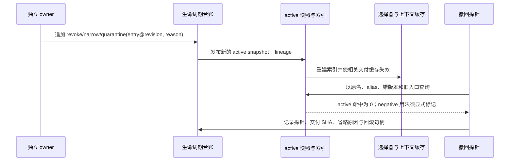

**[推断]** 硬门针对“新请求不得再注入”；历史 run 的重放可以读取旧快照，但必须标为历史而非恢复 active。若台账已撤回而索引、缓存或预组包仍交付，视为撤回失败。恢复旧快照也必须经独立审批并产生新 lineage，不能抹掉撤回事件。

| 场景 | 期望行为 | 必留证据 |
| --- | --- | --- |
| compiler/device 变化 | 相关条目失效或降权，触发重验；不继承旧性能结论 | target fingerprint、受影响 entry 列表、重验结果 |
| 新证据冲突 | 保留冲突和各自 scope，不静默覆盖 | 双方来源、条件、owner、冲突状态 |
| 局部仍有效 | 从 active 改为 narrowed，而不是全留或全删 | 新 scope、剩余有效域、缩域原因 |
| 注入后回退 | quarantine，停止 active 检索并复核 | 失败任务、回归、关联 entry、回滚版本 |
| 规则误拒合法解 | 降低 verifier/检索规则强度前必须人审，不能为了让候选通过而削门 | 合法/攻击 corpus、漏检与误拒、审批 |
| 需要重放历史 run | 恢复 entry/revision、正文、选择器、索引和省略项 | 内容寻址快照、选择器版本、实际交付 SHA |
| 模型换代 | 先无知识/最小知识观察，再逐项恢复必要结构 | 新模型基线、逐项 add-back、成本与回退 |

### 6.7 建议硬门与项目门限

| 门 | 建议性质 | 原因 |
| --- | --- | --- |
| active 条目的来源、scope、target/version、owner 和当前正文 hash 完整 | **建议硬门：100%** | 缺一项就无法判断能否注入或重放 |
| 错版本、域外、retired/quarantined 条目进入 active 上下文 | **建议硬门：0** | 这是检索和权限资格问题，不应拿收益抵消 |
| 隐藏答案、secret、未处理恶意指令进入上下文 | **建议硬门：0** | 属安全与评测完整性，不是平均性能问题 |
| unknown 被当成已验证/已通过 | **建议硬门：0** | unknown 必须保持不可判 |
| 知识/索引/选择器/实际交付快照与 cut-off 可复原 | **建议硬门：全部满足；否则 outcome=inconclusive** | 没有实际交付就不能判断模型看到了什么，也不能重放 |
| held-out 中未来条目、答案、secret、未处理恶意指令进入上下文 | **建议硬门：0** | 时间泄漏与权限问题不能拿平均分抵消 |
| 优化经验有正确性 + 绑定 target 实测 + 噪声 + before/after | **建议硬门：全部满足** | 文档摘录不能直接升格为优化经验 |
| 知识库带来的 compile/correct/performance 改善幅度 | **项目门限：实验前冻结** | 不同任务价值、噪声和 baseline 不同，不能给通用百分比 |
| 允许的 token、设备、人工维护和回退上限 | **项目门限：实验前冻结** | 净收益必须含成本与最差条件，不能只看均值 |
| held-out 的数量与家族覆盖 | **项目门限：按任务域预先声明** | 小样本只能给方向性证据，不能假装统计确定 |

## 7. 一个 RMSNorm 知识条目的完整生命周期（教学例）

本节是条件化设计剧本：run、revision、测量和状态迁移都不是本轮已发生事实。two-pass 的“少占片上空间”是待核内容主张，“注入后更快”是另一项待核使用主张，不能合并成一句话验收。

### 7.1 从证据到 active，而不是从建议到 wiki

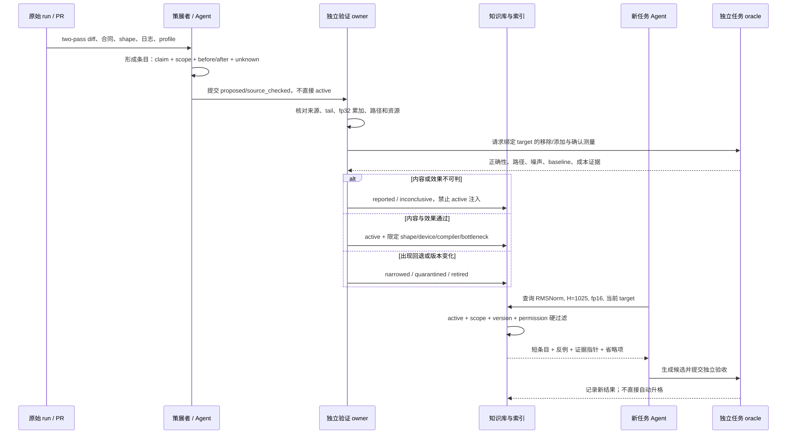

### 7.2 四种处置，unknown 不是通过

| 处置 | 触发证据 | 后续检索行为 |
| --- | --- | --- |
| proposed / inconclusive | 来源未齐、schema/正则之外的内容检查未做、预算不等、没有配对或未跑 held-out | 不进入 active；只可离线审查或在沙箱继续验证，unknown 原样保留 |
| active | two-pass 的声明域内容正确；原实现移除 motif 后退化超噪声；同模型/同题/同预算注入实验在前向留出上有净收益且无不可接受回退 | 仅在匹配 target、shape、瓶颈时给短条目和证据指针，并绑定知识/检索/交付快照 |
| narrowed | 只在 H≤某边界且 UB 受限时有效，较大 H 性能回退 | 只在缩后 shape 域注入，域外返回其他候选或 unknown；具体边界未测前仍写 unknown |
| retired / quarantined | 新编译器改变路径、出现错误 tail、收益不复现、存在更优全行驻留方案 | 新请求的 active 命中为 0；保留历史和反例，缓存同步失效，独立复核后再决定是否重验 |

### 7.3 一个必须被拦截的反例

| 条目 | 表面来源 | 为什么危险 | 应在哪一层拦截 |
| --- | --- | --- | --- |
| “RMSNorm tail load 填 1 与填 0 等价” | 模型在整除 shape 上生成的总结 | 非整除时平方和被污染；整除 shape 恰好掩盖 | L1 内容验证：`H=3,7,1025` 负例；L2 不得进入 active；L3 记录失败但不得升格 |
| “上次这个 chip 的 UB 就是这么大” | 旧设备经验 | 芯片/资源版本变化，可能超容量或布局不一致 | L0/L1 target 指纹与容量复核；L2 错版本排除 |
| “加入这条经验一定更快” | 单次 search best | 可能来自噪声、更多 token、弱 baseline 或选择效应 | L3 同预算配对、确认测量、成本与最差条件 |

## 8. 分阶段建设与验收路线

| 阶段 | 主要工作 | 交付物 | 进入下一阶段的条件 | 是否需要真实 NPU |
| --- | --- | --- | --- | --- |
| P0 盘点与冻结 | 明确知识类型、owner、时间/任务切分、主指标、效用/成本门、权限与 unknown 政策 | schema、状态机、来源/权限清单、cut-off、验证合同 | 所有 active 候选都有类型与证据要求；held-out 和未来条目不参与建库/调参 | 否 |
| P1 离线来源与 fixture | 建原始证据仓、结构化条目、检索金集和攻击夹具 | 来源快照、schema tests、错版本/冲突/泄漏/退役/误拒 fixture | L0 和可离线 L1/L2 检查通过，合法对照不误杀；**schema/正则只记结构通过，不记编译通过** | 否 |
| P2 小型内容验证 | 选少量 API/硬约束/样例，做最小编译和数值验证 | API schema、target profile、RMSNorm 等小样例与报告 | 声明域内内容可靠；真实路径和 unknown 明确 | 需要时另行授权 |
| P3 实测经验与反事实 | 对少量优化做 before/after、移除检验、噪声与确认 | 优化经验元组、代码差分、baseline、成本、验证状态 | 经验满足正确性、实测和反事实要求；不是文档改写 | 是 |
| P4 影子检索与配对评估 | 知识只记录不指导生产；跑 A0–A6、单条 add/remove、整库前向 LOO、留出与负例 | 知识/检索/交付快照、配对效果、负迁移、误拒、最差 strata、成本和人工账 | 证明有净收益或明确哪些类型无效/不可判；无硬门失败，未来条目泄漏为 0 | 是，按实验授权 |
| P5 小范围 active | 只对声明 scope 开启 active，保留快照、回滚、人工审批 | active 清单、选择器版本、实际交付记录、退役与缓存失效机制 | 持续满足硬门和项目门限；撤回探针与历史重放通过 | 是 |
| P6 扩域或停止 | 仅在新证据支持时扩 target/算子；无效类型删除或停用 | 扩域复核或停止报告 | 不以库增长为目标；净收益未知就不扩，负迁移不可接受就停止 | 按需 |

**默认从 P0/P1 开始，而不是先安装向量数据库或下载全部 NPU 文档。** P3 以后涉及真实模型、设备与预算，必须另行明确授权。

## 9. 最终检查清单与阅读顺序

### 9.1 建设评审：十个问题

| # | 问题 | 不合格信号 |
| ---: | --- | --- |
| 1 | 条目属于哪种知识，谁来验证？ | 全都叫 tip/experience，验证责任不明 |
| 2 | 原始证据在哪里，能否逐字/逐字节复核？ | 只有模型总结，来源不可恢复 |
| 3 | scope 是否包含 target/compiler/runtime/shape/dtype/bottleneck？ | 只写“NPU 通用”“所有 shape”“latest” |
| 4 | 内容经过哪种与类型匹配的检查？ | 用成功案例替代 API/资源/tail/路径验证 |
| 5 | 优化经验是否有 before/after、移除检验和噪声？ | 文档摘录直接变成优化事实 |
| 6 | 检索是否先硬过滤，再相关性，再预算？ | 向量 Top-k 直接注入，retired 也能召回 |
| 7 | 是否保存实际交付正文、版本和省略项？ | 只有 embedding，无法重放模型看到了什么 |
| 8 | 是否用同模型/同题/同预算 add/remove、整库前向 LOO 和单向留出验证净收益？ | 只报最好一次结果；用含未来条目的完成库 LOO 冒充在线因果 |
| 9 | 是否记录负迁移、误拒、最差条件、全成本和人工维护？ | 只报平均加速和库规模；未覆盖条件按零回退处理 |
| 10 | 是否能缩域、quarantine、retire、缓存失效、回滚和重放？ | 只追加，不撤回；`latest` 覆盖历史；台账撤回但旧索引仍注入 |

### 9.2 阅读顺序

1. **先看 KDA 的工程位置**：访谈第 3 节（三层结构）与 Humanize Figure 5，理解 KernelWiki 不是独立“知识魔法”，而是 flow + 知识 + profiling + 外部 oracle 的一环。
2. **再看 KernelWiki 当前实现**：按本文 §2 的 sources/wiki/artifacts/query/validation 路径读文件，不以 plan 文档代替实现。
3. **看知识如何产生**：AscendOptimizer 的 rewind、CANNBot-CAKE 的 run→review→promotion、AgenticCANN 的知识分层、daVinci 的摘要与执行校验。
4. **看知识如何交付**：SkillRL 的层次 SkillBank、KernelPro 的工具化经验、Meta-Harness 的原文/摘要接口、SoL-Pi 的证据保留式压缩。
5. **看知识如何验证与退出**：AHE 的预测—复测、Harness² 的 confounded/KEEP_BASE、ModularRSI 的 benchmark-disjoint/module-restricted/rollback、PluginRSI 的单加库反例、SKILL0 的 Δk 思想。
6. **最后设计 NPU 验证**：按本文 P0/P1 离线 fixture 开始，再决定是否值得投入真实 NPU 的 P2–P4；不要先跑全库 A/B。

### 9.3 不能省略的结论边界

- KernelWiki 的组织方式可以提供工程参考，但不能证明 NPU 知识库必然有同样收益。
- CANNBot-CAKE 的 CAKE Book 写入路径不等于其因果贡献已被隔离；本地 CAKE2 快照也不能直接等同于论文完整实现。
- AscendOptimizer 的 transductive 同题挖掘/评测不能当零样本泛化；SKILL0/daVinci 的 RL 机制不能直接变成在线知识门。
- 访谈中的成本、榜单和加速比是团队自述；Humanize 论文明确其总体证据是 observational，KernelWiki 的 48 小时消融也是 team-reported 单 kernel。
- NPUEval 与 JAXBench 只核到 arXiv HTML 正文，未下载 PDF、未复现：NPUEval 的负迁移是 AMD AIE/Chess 与 LLVM-AIE 的 pragma 版本错配；JAXBench 是**单芯片 TPU v6e**上“文档 5.8%→37.3%”与“搜索结构 48/50、1.28× vs 45/50、1.36×”的分离（Best-of-NN 与两个 iterative 臂固定 144 samples/题，Autocomp 为可比总预算且可早停；speedup 先按 1× floor 再取 geomean；主编 Gemini 3 Flash，5 题 Gemini 3.1 Pro 消融）；两者都不能横比、不能外推成 Ascend 结论，也没有进入本文任何因果判断。
- RMSNorm 条目和 A0–A6 配置都是教学/设计，不是已执行实验；未测阈值、加速、负迁移和撤回时延保持 **[未知]**。
- 当前只做只读研究，未运行 KernelWiki 校验器、项目测试、模型或设备，因此所有“测试存在”和“文档声称”都不能写成“本轮验证通过”。

**最终原则：知识库的价值不在于记住多少，而在于能否让正确的知识在正确的 scope 被找到，并能用独立证据证明它有净收益；无法证明时，保留 unknown、缩域或停止，比继续扩张更可信。**
