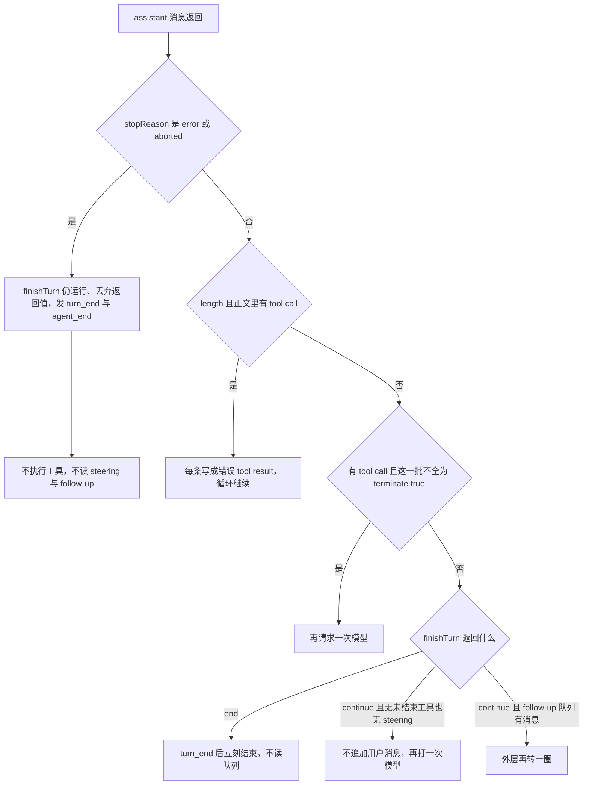

# Pi：一轮怎么编排，交互异常怎么收

## 这篇讲什么

这篇记录的是另一个项目——编程代理 Pi——如何组织一轮对话，以及交互中出错（重试、取消、超时、上下文溢出）时怎么收尾。它不是本仓库的搜索循环。

本仓库读者只需带走三句：

- 实验脚本里的直调按流接收，带空闲超时；
- 空回复要整份重发；
- 截断的工具调用不执行。

Pi 的自动换模型、把历史压成摘要、以及编程代理那种取消，都没有搬进本仓库。细节在文末；现行规则在 [直调与hmz取舍.md](直调与hmz取舍.md) 的「实验脚本直调（不是搜索）」。

事实基线：以下内容对照本地检出 `/Users/kuafu/workspace/pi` 的 `73f8de80bc87`（2026-10-19，`fix(ai): recover from Copilot request-size overflow`）。那个检出不在本仓库里，下面的路径和次数都是 Pi 的，不要当成 `taic` 的默认值。

## 三层结构

Pi 是一个编程代理框架：用户发一句话，框架调模型；模型可以再调工具；工具结果回到同一条会话，直到这一轮不再需要模型。一次交互拆成三层，各管一件事：

| 层 | 目录 | 这一层做完就停在哪 |
| --- | --- | --- |
| 请求 | `packages/ai` | 把供应商的 HTTP / SSE 收成一条 assistant 消息，带 `stopReason` 和可选的 `errorMessage` |
| 循环 | `packages/agent` | 决定还要不要再问、工具插在两次请求之间。循环里没有步数上限，也不重试 |
| 会话 | `packages/coding-agent` | 选模型、自动重试瞬时失败、上下文太长时压缩。失败后不会自动换下一个目录模型 |

`stopReason` 只有这几种：`pending`、`stop`、`length`、`toolUse`、`error`、`aborted`、`deferred`（`packages/ai/src/types.ts`）。拒绝、安全过滤、未知结束原因都收成 `error`，再靠 `errorMessage` 区分。

## 一轮怎么走

入口是 `packages/agent/src/agent.ts` 的 `prompt()`。已经有一轮在跑时它直接抛错；这时调用方用 `steer()` 或 `followUp()` 把消息放进队列。每次 run 新建自己的 `AbortController`。循环拿到的是当时 `messages` 和 `tools` 的浅拷贝；`message_end` 才把消息追加进 `Agent.state.messages`。

每一次发给模型之前，按这个顺序做四步：

1. 先取 steering 队列。coding-agent 默认 `one-at-a-time`，一轮只取最老的一条。在 `prepareRequest` 期间新进来的 steering，要等这一轮结束再取。
2. `prepareRequest` 可以换这一次的 context、模型和思考档。它不读队列。
3. `transformContext` 让扩展改消息。`convertToLlm` 只留下 `system`、`user`、`assistant`、`toolResult`。
4. 注入的 `streamFn` 真正发请求。coding-agent 在 `packages/coding-agent/src/core/sdk.ts` 里把它接成 `modelRuntime.streamSimple`，并带上超时和 provider 重试次数。

流上的 `start` 把半截 assistant 推进本次快照，后续 delta 替换最后一条。`done` 和 `error` 都以 `result()` 的最终消息为准，并发出 `message_end`。请求失败按契约写成流里的 `error` 事件，循环不靠抛异常来表示供应商失败。如果 `prepareRequest`、`transformContext`、`convertToLlm` 或 `streamFn` 真的抛出，`handleRunFailure` 会补一条空文本 assistant：调用方 signal 已 abort 则 `stopReason` 为 `aborted`，否则为 `error`。

一轮正常的 assistant 回来之后：

| 条件 | 接着做什么 |
| --- | --- |
| `stopReason` 是 `error` 或 `aborted` | `finishTurn` 仍会跑，返回值丢掉。发 `turn_end`、`agent_end`。不执行这条消息里的工具，也不再读 steering / follow-up |
| `length`，并且正文里有 tool call | 一个都不执行。每条写成错误 tool result，说明输出顶到上限、参数可能被截断，请重发。然后循环继续，把这些结果交给模型 |
| 有 tool call，且这一批不是全部 `terminate: true` | 再请求一次 |
| `finishTurn` 返回 `{ action: "end" }` | `turn_end` 之后立刻结束，不读队列 |
| 返回 `{ action: "continue" }`，且没有未结束的工具、也没有 steering | 不追加用户消息，再打一次模型 |
| 内层已经停，follow-up 队列还有消息 | 外层再转一圈 |

`packages/agent/src/agent-loop.ts` 的内层是 `while (true)`。只要模型一直返回工具、follow-up 一直有货，或 `finishTurn` 每次都返回 `continue`，循环不会自己停。

### 工具如何执行

工具默认并行（`toolExecution: "parallel"`）。一批里只要有一个工具声明 `executionMode: "sequential"`，整批改成顺序执行。`beforeToolCall` 在校验参数之后、真正执行之前运行，可以拦住这次调用。未知工具、参数校验失败、工具抛错、钩子拒绝，都写成 `isError: true` 的 tool result，然后继续把结果交给模型。顺序执行途中信号已经 abort 时，循环 `break`，后面还没启动的调用不会补结果。

### 一轮结束后的会话收尾

`agent.prompt()` 返回后，会话进入 `AgentSession._handlePostAgentRun()`（`packages/coding-agent/src/core/agent-session.ts`）。用户已经要求停止就结束；否则先看这条 assistant 是不是可重试的瞬时错误，是就退避后再 `agent.continue()`；再看要不要压缩。都不用，就只在队列里还有消息时继续。

## 模型怎么交给这一次请求

启动时 `createAgentSession()` 选一个模型，写进 `Agent` 的初始状态。已有会话优先用分支上记录的选择，前提是目录里还有这个模型、并且提供方已经配了鉴权。恢复不了就记下 fallback 文案，再走 `findInitialModel()`：先用设置里的默认模型，再退到有钥匙的可用模型。

之后每次请求读 `agent.state.model`。`setModel()` 和 `cycleModel()` 改的是这份状态，下次 `prompt()` 才会抄进循环。同一次 run 里直接改 state，进不了已经抄走的 config。要在 run 内换模型，走 `prepareRequest`（这一次请求）或 `prepareNextTurn`（下一轮）。

会话失败之后不会自动换下一个目录模型。名为 fallback 的只有启动时「旧会话的模型不在了或没有鉴权」这一种。虚拟模型可以在扩展的 `route()` 里按请求换物理模型，`reason` 可以是 `user`、`continuation`、`retry`、`direct`；路由抛错或目标没有凭证，这次请求以 error 结束。那是扩展自己写的路由。

Anthropic 请求另有一条供应商侧的 `fallbacks`：模型 compat 里 `allowedFallbackModels` 非空时，`buildParams` 把它写进请求（`packages/ai/src/api/anthropic-messages.ts`）；空则省略。这不是会话自己的主备链。

鉴权只在发出请求之前检查。没有模型、或提供方没有已配置的钥匙，prompt 直接失败；OAuth 会提示重新 `/login`。请求已经发出、401 或「模型不存在」写进 `errorMessage` 之后，会话只按字符串决定是压缩、重试，还是结束这一轮。

## 两层重试

重试分成两层，预算不共用。

| 层 | 覆盖范围 | 判据 | 默认预算 |
| --- | --- | --- | --- |
| 第一层：供应商请求 | 响应头回来之前，包住创建流的那一次调用 | HTTP 状态 / `x-should-retry` / 特定失败类型 | `retry.provider.maxRetries` 默认 0，即不自动重试 |
| 第二层：整轮重试 | 一整轮 assistant 结束之后 | `errorMessage` 字符串是否像瞬时故障 | 首次请求后最多再试 3 次 |

### 第一层：响应头回来之前

`packages/ai/src/utils/provider-retry.ts` 的 `retryProviderRequest` 包住创建流的那一次调用。聊天适配器把 SDK 自带重试关掉（`maxRetries: 0`），改走这里，这样退避睡眠能被取消。流已经开始之后的 SSE 读取不在这个循环里；断了不会从最后一个事件续传，也没有 `Last-Event-ID`。

会再试的情况：

- 响应头 `x-should-retry: true`；
- `status` 为空（连接类 SDK 错误走这里）；
- `408`、`409`、`429`；
- 所有 `>= 500`（含 529）。

直接失败的情况：`x-should-retry: false`、`400` / `401` / `403` / `404`、以及没有 `status` 和 `headers` 字段的普通 `Error`。

退避优先读 `retry-after-ms` 和 `retry-after`。没有这两个头时，是 `min(0.5 × 2^n, 8)` 秒，再乘 0.75 到 1 的抖动。服务端要求的等待超过上限（默认 60 秒）就立刻失败，不睡。调用方信号 abort 时，包括睡眠中途，不再发下一次。

coding-agent 的文档把 `retry.provider.maxRetries` 的默认写成 0（`packages/coding-agent/docs/settings.md`）。设置里不写这个字段时，代码传下去的是 `undefined`，`retryProviderRequest` 用 `?? 0`，效果就是响应头之前也不自动重试。文档要求保持 0，避免额度类错误先被这一层吃掉。

### 第二层：一整轮 assistant 结束之后

会话看 `errorMessage` 的字符串，不看 HTTP 状态码。分类在 `packages/ai/src/utils/retry.ts` 的 `isRetryableAssistantError`：`stopReason` 必须是 `error`，文案命中瞬时故障（过载、rate limit、429、500/502/503/504/520/524、超时、连接重置、`fetch failed`、流在 `message_stop` 或终态事件之前结束，等）。

下面这些即使文案里带 429 也不重试：额度、账单、`insufficient_quota`、`quota exceeded`、OpenCode 的 Go/Free usage limit、ChatGPT 订阅共享额度。`aborted` 不进这个函数。上下文溢出先被会话排除，交给压缩。

会话默认值（`packages/coding-agent/src/core/settings-defaults.ts`）：

| 项 | 默认 |
| --- | --- |
| `retry.enabled` | 开 |
| 第一次请求之后最多再试 | 3 次 |
| 退避 | 2 秒、4 秒、8 秒（`baseDelayMs × 2^(attempt-1)`） |
| 单次退避上限 | 60 秒 |
| 抖动 | 注释写了 jitter，`retryDelayMs` 里没有 |
| 关掉 | `settings.retry.enabled: false`，或 RPC `set_auto_retry` |

重试前，原始会话留下失败的 assistant，投影里用 `context_edit` 把它拿掉，再把 `agent.state.messages` 换成投影，然后 `continue()`。拿掉是因为 `continue()` 在末条仍是 assistant、且队列为空时会抛错。退避睡眠用单独的 `AbortController`；RPC `abort_retry` 或这段时间按 Escape，只打断睡眠，文案发 `Retry cancelled`，不改开关。成功的 assistant（`stopReason` 不是 `error`）把重试计数清零。次数用尽就发 `auto_retry_end`，失败消息留在投影里；下一次用户发言、重新组请求时，`transformMessages` 仍会整段丢掉它。

流读到一半断开，走的是第二层：已经流出的 text / thinking / tool 留在这条 error assistant 上，会话若判定可重试，就整段拿掉再重放这一轮，不是接着半截往下写。`agent_settled` 才表示自动重试、溢出恢复、压缩和队列都不再继续。

摘要请求（压缩、分支摘要）不走 Agent 循环，走 `retryAssistantCall()`，预算和退避与上面同一套 `settings.retry`。事件名是 `summarization_retry_*`。摘要自己是 `error` 或 `length` 时不当作检查点。

## 取消、超时、半截消息

用户取消和超时靠的是「调用方那个 signal 有没有已经 abort」，不是错误类型。Anthropic、OpenAI、Google 的聊天 catch 都是同一句：`signal.aborted` 则 `stopReason: "aborted"`，否则 `"error"`。已经流出的正文留在 `content` 里；流式草稿字段 `partialJson` 会删掉。`start` 之前失败则正文仍为空。

### 两处超时时钟

默认都是 300000 毫秒：

- undici 的 `headersTimeout` 和 `bodyTimeout`（`packages/coding-agent/src/core/http-dispatcher.ts` 的 `DEFAULT_HTTP_IDLE_TIMEOUT_MS`）。这是响应头空闲和响应体空闲，设 0 表示关掉。
- 未单独设置 `retry.provider.timeoutMs` 时，同一个数写进这次 provider 请求的 `timeoutMs`。到点且没有 abort 调用方 signal 的，收成 `error`，文案若像超时，会话层可以重试。

### 取消打到哪一层

`session.abort()` 会停当前 run、停正在睡的重试、停压缩。它不停用户自己敲的 `!` bash；那条用会话另备的 controller，RPC `abort_bash` 只打那一组。工具执行中的 abort 写成 tool result（`"Operation aborted"` / bash 的 `"Command aborted"`），不是 assistant 的 `stopReason: "aborted"`。低层循环见到 assistant 已经是 `aborted` 就结束，不再执行这条消息里的工具。

### 半截消息怎么处理

半截回复会写入会话，UI 也能画出来。下次组请求时，`packages/ai/src/api/transform-messages.ts` 把 `stopReason` 为 `error` 或 `aborted` 的整段 assistant 丢掉，partial 文本、半截 thinking、未完成的 tool call 都不进 payload。后面新的 user 消息会发出去。所以「请继续」发出去时，模型看到的是旧的完整历史加这句新话，看不到被中断的半截。

孤儿 tool call 只在组请求时补，不写回会话。`transformMessages` 第二遍给还没有 result 的调用补一条 `isError: true`、正文 `No result provided` 的结果。`error` / `aborted` 的 assistant 整段已经丢掉，上面的 tool call 不补。真正执行失败的路径不同：校验失败和工具抛错会写成持久的 error tool result，下一步模型能看见。

## 上下文和截断

溢出检测在 `packages/ai/src/utils/overflow.ts` 的 `isContextOverflow`。`packages/ai` 只检测，不压缩。三种判据：

1. `stopReason === "error"`，且 `errorMessage` 命中各供应商的超窗 / 请求过大文案（Anthropic `prompt is too long`、OpenAI `exceeds the context window`、Google 的 input token count、HTTP 413，等）。限流和 Bedrock 的 `Throttling error:` 前缀先被排除，避免 `"Too many tokens, please wait"` 被当成超窗。
2. 静默溢出：`stopReason === "stop"`，且 `usage.input + cacheRead` 大于窗口。注释指向 z.ai。
3. 截断式溢出：`stopReason === "length"`、输出 token 为 0、输入至少达到窗口的 0.99。注释指向小米 MiMo。

会话在 `_checkCompaction()` 里分三种自动情况。压缩总开关关掉时，溢出恢复也不做。

| 情况 | 做什么 |
| --- | --- |
| 超窗错误，或可恢复的 `length`（输出 token 小于模型原本的 `maxTokens`，`isRecoverableLength`） | 拿掉这条 assistant 及其 tool result，压缩，再 `continue()` 一次 |
| 成功的 `stop`，但用量已经超过窗口 | 压缩，不重试。一条已经完成的 assistant 上不能 `continue()` |
| 用量越过阈值 `contextWindow - reserveTokens`（默认留出 16384） | 压缩，不重试。尾部保留约 20000 token（`keepRecentTokens`） |

同一次用户回合里，compact-and-retry 只允许一次。再溢出就发固定错误并停：`Context overflow recovery failed after one compact-and-retry attempt`。这个标志在下一条 user 消息，或一条非 error、非 length 的 assistant 上清除。换过模型的旧错误不会拿来压新模型。早于最近一次压缩的 assistant 直接跳过。

压缩会再调一次摘要模型，同样不走 Agent 循环。摘要切分时可能发两次。摘要失败（`error` 或 `length`、预算用尽、不可重试、或被取消）只发 `compaction_end` / `session_compact_failed`，不再自动重试这一轮。分支末尾已经是一条 compaction 时，`prepareCompaction()` 直接返回，避免空转。

`length` 在循环里不是硬退出。带 tool call 时先按上一节写成错误结果再继续；没有 tool call 的 `length` 会结束低层循环，会话若判定可恢复，再走一次 compact-and-retry。Anthropic 的 `max_tokens`、OpenAI 的 `length` / `max_output_tokens`、Gemini 的 `MAX_TOKENS` 都映射成 `length`。Bedrock 把 `model_context_window_exceeded` 也映射成 `length`，超窗正则对不上这条，只能靠第 3 种用量判据。

空的成功 `stop` 当正常结束，循环不会因此再请求。各转换器回放时会跳过空 assistant，避免供应商拒空 content。

拒绝和安全拦截都收成 `error`，文案不在重试正则里，所以不自动重试：Anthropic `refusal` / `sensitive`，OpenAI Completions 的 `content_filter`，Gemini 的 `SAFETY` 等。消息留在会话里，下次发送整段丢掉。Anthropic 的 `pause_turn` 映射成 `stop`，注释写 resubmit；agent 循环没有因此再发请求的分支。

## 换模型时历史怎么变

所有正式 API 发请求前都走 `transformMessages`。

| 场景 | 处理 |
| --- | --- |
| 同一 `provider + api + model.id` | 保留 thinking；签名和加密 reasoning 即使正文为空也留着，供原模型回放 |
| 换模型 | thinking 整块删除：签名只对原模型有效，明文 thinking 会被新模型当成自己的可见回复 |
| 换模型 | 删掉 tool call 上的 `thoughtSignature` |
| Anthropic / Bedrock | 把 tool call id 收成字母数字和 `_`、`-`，并截到 64，再改写后面的 `toolResult.toolCallId` |
| 目标模型不收图片 | user 图和 tool 图换成占位文字。Anthropic 的 error tool result 不能带图，图会拆到该轮 tool result 后面的 user 消息里 |

工具参数在流里用 `parseStreamingJson`，失败不抛，退到 `{}`。结束后 `parseToolCallArguments` 要求是 JSON object；失败则 `arguments` 为 `{}`，`argumentsError` 带上原文。`validateToolArguments` 看到 `argumentsError` 就抛，循环把它收成 error tool result，下一步交给模型。OpenAI Responses 若 `toolUse` 结束时工具参数还停在半截 JSON，整段变成 `error`；这句不在重试正则里。流在终态事件前断开的那句在正则里，会话会拿掉再试。

## 一张总表

| 发生了什么 | 会话里留下什么 | 接着做什么 |
| --- | --- | --- |
| 响应头之前的 408 / 409 / 429 / 5xx，且把 provider 重试次数调高 | 失败的那次不进上下文 | 同一请求再发，次数默认是 0 |
| 流已开始后断开、过载、超时，文案像瞬时故障 | 原始记录留着失败 assistant；投影里拿掉 | 整轮再试，最多 3 次，2s / 4s / 8s |
| 401、额度、账单、模型不存在、拒绝 | 失败 assistant 留在会话 | 这一轮结束。下次组请求时整段不发给模型 |
| 上下文超窗，或输出没到模型上限就被截断 | 拿掉这次失败及其 tool result，历史换成摘要 | 压缩后再请求一次；再失败就停 |
| 成功回复已经撑过窗口或阈值 | 完成的回复保留，更早的历史换成摘要 | 不重试这一轮 |
| `length` 且带 tool call | 每条工具一条错误结果，要求重发 | 循环继续，把结果交给模型 |
| 工具抛错、参数不是 JSON object、未知工具 | 一条持久的 error tool result | 下一步再问模型 |
| 用户取消 | 半截 assistant，`stopReason: aborted` | 本轮结束。下次发送时整段不发给模型 |
| 工具执行中途取消 | 已跑的写成 aborted 的 tool result；还没跑的洞留在会话里 | assistant 若已是正常的 toolUse，低层循环可能再请求；组请求时给洞补 `No result provided` |

## 本仓库后来采纳的部分

上面是 Pi 在 `73f8de80bc87` 上的做法。当前搜索写内核只走 `hmz` → `pi`；下面的采纳只适用于实验脚本里的直调。

2026-10-20，直调 `taic/llm.py` 采纳了其中能放进一次聊天请求的几条：

- 按流接收；
- 空闲超时；
- 空回复和没有结束原因的流，再发同一份消息；
- 截断的工具调用不执行。

自动换模型、摘要压缩和编程代理的取消没有搬进来。现行规则在 [直调与hmz取舍.md](直调与hmz取舍.md) 的「实验脚本直调（不是搜索）」。这篇不批准一次新的付费搜索。
