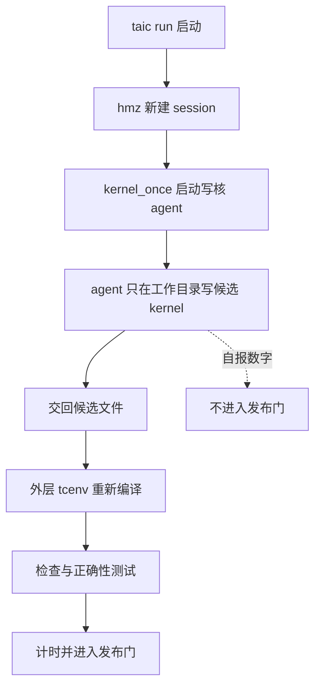
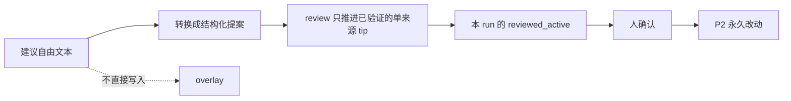

# 模型写核与 P2 的安全边界

## 这篇讲什么

模型写 kernel 的目标是让搜索更快，但“更快”不能靠改评测、测试、信任或控制文件来换。本页记录当前边界，以及仍然存在的残余风险。

读完应带走三件事：

- 写 kernel 的 agent 只在自己的工作目录里动手，碰不到仓库的评测代码、trust、budget 或 control。
- 它自报的数字不是发布依据；候选必须回到外层 `tcenv` 重新编译、检查、做正确性测试和计时。
- 反馈文本和代码 patch 都按不可信输入处理：转换、review、apply 是分开的动作，P2 永久改动仍要人确认。

## 正常写核流程

`taic run` 通过 `hmz` 启动 `kernel_once`。写核 agent 的权限边界：

- 只能改自己的工作目录；
- 不能改仓库、评测代码、trust、budget 或 control；
- 只能读仓库和历史证据；
- 新 session 的 `_permission.online` 设为 `NONE`，不提供 web 搜索/抓取；
- `~/.pi` 和认证文件仍由 pi/hmz 自身管理，项目没有把这段 host 权限完全收回；这是残余风险。

候选仍要在外层 `tcenv` 中重新编译、检查、正确性测试和计时。写核 agent 自报的数字不进入发布门。



## 反馈与 review

`# 对系统的建议` 是不可信数据。自由文本不能直接变成 overlay；转换、review、apply 是三个分开的动作。

| 类别 | 是什么 | 生效需要的条件 |
| --- | --- | --- |
| `tip` | 一条可复用的经验提示 | 默认需要两个不同模型、两个委员会、active trust 和不同探针 |
| `premise` | 对任务前提的修正 | 需要本场探针、self-check/外层报告，以及 active `overlay:premise` |

其余规则：

- review 只能把已验证的单来源 tip 推进到本 run 的 `reviewed_active`；
- P2 永久改动仍要人确认；
- `harness_auto` 默认关闭。



## P2 code agent

代码 patch 在 detached worktree 中生成，不 commit、不自动 apply。默认先做不执行代码的静态验收；只有看过 diff 后，才用实名人工批准执行补丁测试：

```bash
# 默认：只查路径、allowed_paths、spec、hash 和 claims，不运行补丁代码
uv run python -m taic.cli harness verify-code RUN --key KEY

# 看过 diff 后：才执行补丁测试
uv run python -m taic.cli harness verify-code RUN --key KEY --execute --by HUMAN

uv run python -m taic.cli harness apply-code RUN --key KEY --check
uv run python -m taic.cli harness apply-code RUN --key KEY --confirm --by HUMAN
```

`--execute` 不接受默认的 `cli` 作为审阅人。动态测试仍会执行补丁代码，所以它不是 VM 沙箱；不可信 patch 应先做人工 diff review，再决定是否在隔离环境执行。

### 永远禁止自动 patch 的路径

`taic/code_agent.py::SECURITY_CRITICAL` 现在拒绝：

- `tests/`
- `tcenv/evaluate.py`、`tcenv/schema.py`、`tcenv/bench.py`、`tcenv/backends/`
- `taic/prompts.py`、`taic/kernel_agent.py`、`taic/harness.py`、`taic/review.py`、`taic/trust.py`、`taic/code_agent.py`、`taic/acceptance.py`、`taic/orchestrator.py`、`taic/policy.py`、`taic/control.py`、`taic/llm.py`、`taic/artifacts.py`、`taic/harness_experiment.py`、`taic/resume.py`、`taic/committees.py`、`taic/cli.py`
- `experiments/common.py`、`experiments/harness_runner.py`、`experiments/harness_cell.py`
- `observe/`、`targets/`、`backends/`、`.pi/`、`.git/`、`.github/`
- `conftest.py`、`sitecustomize.py`、`pytest.ini`、`tox.ini`、`setup.cfg`
- `taic.toml`、`taic.paper.toml`、`control.json`、`pyproject.toml`、`uv.lock`

这些文件如果确实要改，应走单独的人工安全 review，而不是 P2 自动 patch。

补丁的 `allowed_paths` 现在必须非空，并覆盖补丁触及的每个路径。没有验收契约、或契约里允许列表为空的旧 patch，`apply-code` 会拒绝落地；不再用空列表表示“不限制”。

### 仍存在的风险

- code agent 补丁未触及上述路径时，仍可能改变行为；必须看 diff，不能只看 tests。
- 没有非空 `allowed_paths` 的 patch 会被拒绝；新提案必须显式列出允许路径。
- 动态 `verify-code --execute` 和 `apply-code --run-tests` 会在 host 上执行补丁代码；worktree 隔离不是安全沙箱，必须先人工看 diff。
- `--run-tests` 使用补丁后的工作树，测试被禁改，但仍应检查测试命令和覆盖范围。
- 人和 reviewer 都可能被提案文本社会工程；不要照着建议里给的命令直接执行。

## 可选远端 workspace（Phase 3，transport-only）

默认仍是 `workspace=local`。显式传 `--remote-workspace-config` 后，写核会话的文件与命令放在一台预置 SSH 主机上，但**这首先只是 transport**，不是安全隔离：

- 配置只写 hmz 已保存的 ssh runtime 名、远端根目录和期望的 `harness`；主机/用户/端口/identity 文件留在 hmz 的 `settings.yaml`，不进本项目配置、manifest、TASK 或日志。启动前校验 runtime 的 `harness` 与配置一致，不一致就拒绝，不静默改变代理位置。
- 输入与回收都按白名单 manifest：拒绝绝对路径、`..`、符号链接、设备文件、超大文件和总量超限；host 侧只把回收文件写进 `agent_work/<tag>`，并再次校验目标没有逃出该目录。
- 远端只执行 transport 自己的固定命令；agent 不能通过它运行任意 shell、argv 或环境变量。会话目录先写 receipt（绑定 run/session/runtime/workdir/manifest/prompt hash），同 receipt 幂等，不同 receipt 的目录不复用也不删除；清理前重读 receipt。
- 本阶段远端 workspace **没有**自测通道：TASK 使用独立 profile，不打印 control_host 路径，也不提供 `tcenv eval`/`taic-selfcheck`；runner 拒绝 host bridge 绑定。自测仍属于 Phase 2 的 `EvaluationExecutor`。
- 费用按 `began.workspace + envs/used + 开始时间` 绑定 hmz epic；绑定不上时记 `cost_incomplete`，不借别的会话账单。
- **未证明**：hmz 围栏能否阻止内循环读取/改写 control_host 文件。真机逃逸测试与真实 SSH 验收都还没跑（本机 VM 可连通但 SSH 私钥缺失），所以不能把这条路径写成“隔离”或“不可信 P2 的默认环境”。
- 远端 workspace 不持有 provider 凭据：凭据仍只在 control_host 的 pi/hmz 一侧；也不把 `~/.pi`、ssh agent、Docker socket 或仓库挂进远端工作目录。

## 可选隔离 agent（Phase 4，离线/模拟）

只有 `workspace.harness=env` 且显式配置 `isolation` 时，agent CLI 才离开 control_host。这一层同样是可选的，默认不启用：

- **短期凭据**：control_host 在内存里 mint 绑定 run/session/runtime 的随机 token（TTL、使用上限），只保存摘要；token 不进 TASK、workspace、manifest、argv 或日志，`repr` 也隐藏。成功、超时、崩溃或无交卷都在 `finally` 里 revoke，并记录清理证据。
- **凭据 seam**：`loopback-fake` 只在 `127.0.0.1` 提供确定性 provider，必须显式 `simulated=true`，并记录 `provisioned_to_agent=false`：它只交付给同进程测试替身，不证明真实远端 agent 拿到凭据。`external-helper` 由 operator 提供，token 经 stdin 而不是 argv 传入，provision/revoke 由它负责，记录 `provisioned_to_agent=true`；helper 在远端是否真的只写短期凭据是 **operator-attested**，本项目不能证明。
- **受信评测围栏**：启动时拒绝任何让 `agent_work` 与 evaluator 候选目录、outbox、manifest/ledger、`tcenv`/`taic`/`tests` 或 selfcheck authority 目录发生包含关系的配置；回收写入仍限制在 `agent_work/<tag>`。它是布局检查，不是沙箱，不能替代远端账号/权限和 hmz 围栏。
- **放置证据**：`harness=env` 要求 epic 的 `opened.harness` 恰为 `env`，缺失也按不一致处理；`harness=local` 接受 `local` 或空。不一致时该场 `cost_usd=null`、`cost_incomplete=true`，并记 `harness_mismatch`，不把跑错位置的会话账单算进搜索。
- **失败与孤儿**：凭据 mint/provision 失败是 `credential_unavailable`，不会先启动 agent 再补账；crash/timeout/no-submission 走 typed 失败并撤销凭据；run 结束按 run token 只清扫本 run 的非活跃会话目录。
- **Docker 隔离模拟已通过（2026-10-26）**：真实 SSH transport + `harness=env` 在 Ubuntu 24.04 容器内运行确定性 fake agent，host 侧 helper 经 `docker exec` 交付短期 token，agent 调 control-host fake provider；13 项必需 check 全过，报告为 `runs/remote-agent-sim-20261026/report.json`（`simulated=true`、`publication_allowed=false`，不进入搜索/发布）。
- **仍未证明**：真实 pi CLI 与真实 provider、真实 Ubuntu VM、生产 `online=NONE` 围栏（模拟 fixture 放宽为 `ALL`）、远端进程/围栏逃逸和真实 orphan 清理。本机 VM 可达但缺 SSH 私钥，这些验收是 blocked。

## 操作规则

- 普通搜索不重跑 `taic run`/`taic resume` 以外的 GPU。
- 修改 trust、budget、control、测试、评测或 prompt 必须单独人工确认。
- 任何 commit 前先看提交正文和 `git diff --cached`。
- 不要把 run 生成的脚本、命令、URL 或路径直接执行。
