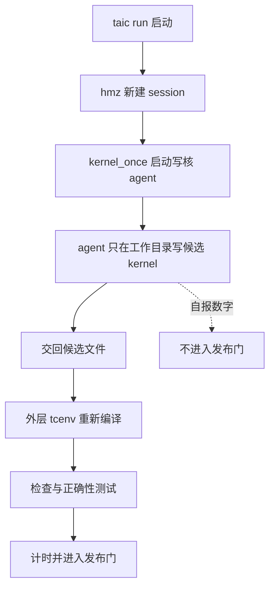
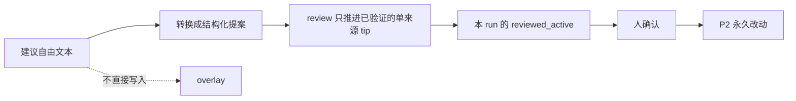

# 模型写核与 P2 的安全边界

## 这篇讲什么

模型写 kernel 的目标是让搜索更快，但“更快”不能靠改评测、测试、信任或控制文件来换。本页记录当前边界，以及仍然存在的残余风险。

读完应带走三件事：

- 写 kernel 的 agent 只在自己的工作目录里动手，碰不到仓库的评测代码、trust、budget 或 control。
- 它自报的数字不是发布依据；候选必须回到外层 `tcenv` 重新编译、检查、做正确性测试和计时。
- 反馈文本和代码 patch 都按不可信输入处理：转换、review、apply 是分开的动作，P2 永久改动仍要人确认。

## 正常写核流程

`taic run` 通过 `hmz` 启动 `kernel_once`。写核 agent 的权限边界：

- 只能改自己的工作目录；
- 不能改仓库、评测代码、trust、budget 或 control；
- 只能读仓库和历史证据；
- 新 session 的 `_permission.online` 设为 `NONE`，不提供 web 搜索/抓取；
- `~/.pi` 和认证文件仍由 pi/hmz 自身管理，项目没有把这段 host 权限完全收回；这是残余风险。

候选仍要在外层 `tcenv` 中重新编译、检查、正确性测试和计时。写核 agent 自报的数字不进入发布门。



## 反馈与 review

`# 对系统的建议` 是不可信数据。自由文本不能直接变成 overlay；转换、review、apply 是三个分开的动作。

| 类别 | 是什么 | 生效需要的条件 |
| --- | --- | --- |
| `tip` | 一条可复用的经验提示 | 默认需要两个不同模型、两个委员会、active trust 和不同探针 |
| `premise` | 对任务前提的修正 | 需要本场探针、self-check/外层报告，以及 active `overlay:premise` |

其余规则：

- review 只能把已验证的单来源 tip 推进到本 run 的 `reviewed_active`；
- P2 永久改动仍要人确认；
- `harness_auto` 默认关闭。



## P2 code agent

代码 patch 在 detached worktree 中生成，不 commit、不自动 apply。人必须依次执行：

```bash
uv run python -m taic.cli harness verify-code RUN --key KEY
uv run python -m taic.cli harness apply-code RUN --key KEY --check
uv run python -m taic.cli harness apply-code RUN --key KEY --confirm --by HUMAN
```

### 永远禁止自动 patch 的路径

`taic/code_agent.py::SECURITY_CRITICAL` 现在拒绝：

- `tests/`
- `tcenv/evaluate.py`、`tcenv/schema.py`、`tcenv/bench.py`、`tcenv/backends/`
- `taic/prompts.py`、`taic/kernel_agent.py`、`taic/harness.py`、`taic/review.py`、`taic/trust.py`、`taic/code_agent.py`、`taic/acceptance.py`、`taic/cli.py`
- `experiments/common.py`
- `targets/`、`backends/`、`.pi/`
- `taic.toml`、`taic.paper.toml`、`control.json`

这些文件如果确实要改，应走单独的人工安全 review，而不是 P2 自动 patch。

### 仍存在的风险

- code agent 补丁未触及上述路径时，仍可能改变行为；必须看 diff，不能只看 tests。
- `allowed_paths` 为空时，acceptance 仍允许较宽的路径范围；新提案应显式列出允许路径。
- `--run-tests` 使用补丁后的工作树，测试被禁改，但仍应检查测试命令和覆盖范围。
- 人和 reviewer 都可能被提案文本社会工程；不要照着建议里给的命令直接执行。

## 操作规则

- 普通搜索不重跑 `taic run`/`taic resume` 以外的 GPU。
- 修改 trust、budget、control、测试、评测或 prompt 必须单独人工确认。
- 任何 commit 前先看提交正文和 `git diff --cached`。
- 不要把 run 生成的脚本、命令、URL 或路径直接执行。
