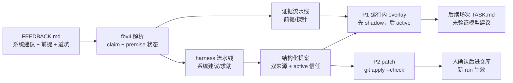

<!-- agent_feedback_charter: v1 -->

# 代理反馈

这一篇是章程，也是拼读的步骤。写核代理要守的规则落在哪个文件里，见 [写核代理读什么.md](写核代理读什么.md)。设计来源是 [human-in-loop_rsi_feedback_20f84da7.plan.md](human-in-loop_rsi_feedback_20f84da7.plan.md)。RSI 外层循环、权限梯度和双来源的理论与完整流程图见 [架构/可信harness.md](架构/可信harness.md)。

## 先看一张图



只有下面三条会进入候选路径：带本场探针、active `overlay:premise` 信任，且匹配 harness 自检记录的 `premise`；两个不同模型且都有 active 信任的同一 `tip`；以及经另一个模型独立 review 判为 useful 的单来源 `tip`（reviewer 还要在该 target/task 有 active `overlay:tip` 信任，且探针本场时间已核验）。自由文本建议仍然只进人工审查。

## 条目身份

一场记录的键是 `run_id#seq`。一条主张的键是 `run_id#seq#digest`。审查文件 `feedback_review.json` 里存的是 `seq:digest`。两种键不能混写。

每条自带题目、dtype、规模、label、轮次、委员会、provider、模型、effort、结局、exit、种子核 label、当时最好成绩。

## 三种种子

种子核是 `best_label`，反馈记录里的字段是 `seed_label`。每场从它改起。「噪声内没换种子」说的是这一颗。

评测种子是 `run_seed` 派生的 `eval_seed`。它决定这批评测用哪批输入。

搜索期种子是停下时正在改的那颗（`search_seed_label`）。确认胜者是换一批输入重测后活下来的那颗（`confirm_winner_label`）。两颗可以不是同一颗。

## 五个小节与 kind

小节是：`需要帮助`、`对系统的建议`、`卡住的原因`、`给下一棒的避坑提示`、`被否决的前提`。

`需要帮助` 是给人的。缺工具、缺权限、缺只有人知道的信息，或要人拍板（同意许可证、sudo、凭据）时当场写。写清缺什么，以及有了它下一步做什么。`kind` 用 `tool` 或 `decision`。这一节里的普通文字只给人看，不会自动进 overlay；但当前解析器也接受这一节里的 `harness-proposal` 块，所以不要把命令或未验证事实写进块里。这一步还能绕开，也要写下来。

`kind` 可以是 `prompt`、`skill`、`tool`、`rule`、`decision`，写多个用逗号分开。没有系统层面的建议或求助时不写 `kind` 行。某一节或条目去掉标点和空白后恰好是「无」「没有」「空」「none」或「n/a」，不算内容，不进条目。以「无」「没有」「暂无」「不需要」「无需」开头的缺席句，如果后面没有明确的动作请求（请、建议、希望、应当、应该、能否、改成、增加、修复等），也不算内容；带解释或数字仍然是占位，审计的 7 条就是这种形状。带有动作请求的条目继续保留。

## 前提三态

`verified`：探针文件、命题、数字都在，并且探针文件在本场目录、仓库，或同运行 `agent_work` 的兄弟目录里可读。探针格可以带参数，也可以写 `r9.p0/sim_w63.py` 这种路径。文件名从这一格里提取，任一文件存在即算读到。

`downgraded`：给了探针名，但文件不可读或路径逃出上面三个根。正文保留命题和数字，写成 `[未验证: 探针文件不存在 | 命题 | 数字]`。按未验证过期。

`unverified`：没有已实测标记。从第一次写出来的那场之后再出现两场，第三场不再放进任务书。复述不把起点往后推。

digest 只认命题。数字、探针文件名、未验证后面的理由不另算一条。`[未验证 | 命题 | 理由]`、`[分析否决: … | 命题 | …]`、`[推理否决: … | 命题 | …]` 和 `[已实测: 探针 | 命题 | 数字]` 在命题相同、括号外没有别的句子时是同一条。先算 digest，再做降级改写。

已实测不进普通提示的 8 条。它单独保留最近 1800 字符，超过就留较新的。同一 digest 只要有一次是 verified，就保持 verified，取最近一次 verified 的正文。未验证、降级和普通避坑共用原来的 8 条和 1200 字符，整段进 `TASK.md` 前再按 1500 字节裁剪。输出顺序是：已实测从旧到新，然后是还没过期的未验证和降级，最后是普通避坑。两笔额度不能互相借用。

## 审查

状态是 `pending`、`adopted`、`rejected`、`done`，以及两个退出待审计但不冒充结论的状态：`info`（未验证/开放问题）与 `obsolete`（空占位、重复或已退役）。复核是 `unchecked`、`confirmed`、`refuted`。

`adopted` 要 `confirmed`，并带 `evidence_source` 和非空证据。`done` 要 `confirmed` 且带非空 `change_ref`；本地固化阶段程序写 `local_patch_sha256`，`taic harness commit` 之后写 `commit:<sha>`，旧记录的 `patch:<sha>` 只作历史。审查表单不要求你填 `change_ref`，但选 `done` 时留空会被接口拒绝。`rejected` 要写备注。`info` 要 `unchecked`。`obsolete` 要写备注（例如 `duplicate of ...`）。每次审查追加到该条的 `history`，不覆盖以前的结论。

审查人不在表单里填，和 git 提交一样自动读取 `git var GIT_AUTHOR_IDENT`；事件记录 `reviewer`、`reviewer_source`、`method`、`batch_id`、审查时的 `git_commit` / `git_dirty`。`method` 默认 `human`，脚本或代理写入时显式用 `agent`/`script`。批量写入可以带 `expected_status`；如果旧状态已经变了，接口拒绝，避免拿过期预览覆盖。

批量入口先预览再写，整个数组全部通过才写一次：

```bash
uv run python -m taic.cli feedback RUN --file reviews.json --dry-run
uv run python -m taic.cli feedback RUN --file reviews.json --confirm --batch-id batch-1
```

`reviews.json` 是数组，每项至少 `seq`、`digest`、`status`、`verification`；建议带打开时看到的 `expected_status`。任何一项失败，整批不写。审查事件另存到 `data/review_events.jsonl`（可用 `TAIC_REVIEW_EVENTS` 覆盖），只存证据/note 的哈希和身份，不复制长原文；有 `verify()` 可检查哈希链，运行 `python -m taic.review_ledger` 验证默认台账。

`pending_total` 仍只数父 claim；看板/`review_feed` 另给 `open_subclaims_total` 和 `open_work_total`（父 pending + 开放子命题）。子命题已进入 SQLite `feedback_subclaims` 索引，父 claim 的 prior/similar 也会匹配子命题文本。

空占位在 fbv4 解析后不再生成 claim；旧 claim 在重建时进入 `feedback_claim_removed` 墓碑，保留 `status` 和 `reason`。重复合并只应在确认同一 `action + scope` 后做，topic 相同不等于同一条。

一条多命题前提可以用 `subclaims` 拆分：父 claim 保持 `info` 或 `pending`，每个子命题各自带 `status`、`verification`、`evidence_source`、`evidence`、`note`，并继承父 claim 的 `backend` / `target_id`；父 digest 不变，看板嵌套显示子命题和 scope。跨 backend 的子命题不得合并统计。旧 `feedback_review.json` 没有该字段仍可读；子命题是审查层身份，不是新的 `feedback.jsonl` claim，不会进入 `taic query` 的 claim 列表。

审查页和 `taic query suggestion` 会带 `prior`：同一 `digest`、同一 `task`、同一 `target_id` 的更早 claim，列出旧 `status`、`note`、`change_ref` 和子命题。它是**精确文本**查询，不是语义相似；改写过的句子 digest 会变，不会自动命中。`rejected` 的旧结论不会自动阻止新审查，但审查前应先看 `prior`；要重开一条被否决的结论，应在 note 里写清新证据或说明为什么旧结论不适用。

在这之上，pending 审查项还会带 `similar`：用 macOS 本地 `NLEmbedding` 句向量找同 `task`+`target_id` 的更早近义 claim，显示相似度和旧结论。它不联网、不调用模型；候选还要有共享的中文/代码 token，避免中文向量高基线把所有泛泛相关的建议都算近义。阈值保守，结果只是检索提示，不是自动判定。英文和中文本地向量分布不同，阈值分开；平台不支持时返回空列表，不拿字符重叠冒充语义。

人在看板顶栏点「N 条代理反馈待审查」，另开 `/reviews` 看所有运行。一场的详情里仍只列这一场。页面按 `feedback_revision` 更新：序号没变不动，变了只换那几张卡片。

## 结构化提案、信任与 overlay

自由文本建议和结构化 `harness-proposal` 不是同一种东西。前者是给人看的线索，后者才带可校验的字段和自动路径：

| 维度 | 自由文本建议 | 结构化 `harness-proposal` |
|---|---|---|
| 写法 | `# 对系统的建议` 下的普通文字 | 围栏 JSON 块，含 `surface`、`scope`、`action`、`evidence`、`rationale` |
| 身份 | 反馈 claim：`run_id#seq#digest` | `proposal_key`，并保留 `claim_digest` |
| 机器校验 | 只做 claim 解析，没有提案 schema | 校验 target/task/dtype、surface、action、探针/自检/信任；tip 还要双来源 |
| 自动 overlay | 不进入 | 通过 quorum/信任后可写 shadow 或 active |
| LLM review | 不会自动送；必须先由人确认并转结构化 | 可按 key 显式 review，或在本 run 的 review 流程中处理 |
| 人工审查 | 是，所有自由文本都先到 `/reviews` 的 claim 队列 | 是；review 只是独立建议，P2 仍要人确认 |
| P2/仓库改动 | 不能直接生成 patch | `tip`/`premise` 可生成 target experience patch；`skill`/`task_wording` 只作 P2 候选，需人改代码 |
| 主要风险 | 注入面大、字段不全、无法绑定探针和 target | 字段仍可能错，但可校验、可审计、可回滚 |
| 当前 flash 例子 | 3 条建议在 `feedback.jsonl`，0 条 review | `harness_proposals.jsonl` 不存在，因此没有 proposal key |

转换路径见下节：**自由文本 → 人确认 → AI 或人转结构化 → 再送 review**。转换不会让原文直接变成可信事实；它只是把原文变成可审查的提案，并保留 `origin=conversion`、`claim_digest`、`confirmed_by`、原模型 `source_author` 和填写方式 `structured_by`。

批量处理这类建议时，先用紧凑查询让 AI 只读预览：

```bash
uv run python -m taic.cli query suggestions --task flash_attention --status pending --limit 20 --preview 80
uv run python -m taic.cli query suggestions --task flash_attention --status pending --limit 20 --offset 20 --preview 80
```

`total_claims` / `total_groups` 是整个过滤集合的总数；`truncated=true` 和 `next_offset` 表示还有下一页。`limit` 只是页大小，不是扫描上限。

选中某一组后，再取全文：

```bash
uv run python -m taic.cli query suggestion --run RUN_ID --seq 4 --digest 9db07fe836501244
```

这两条走 SQLite 索引和按行读取，不把全部 `feedback.jsonl` 一次读进上下文。compact 在 SQL 里先算总数和分组再分页；detail 的提案/review 关联按 `run_id#seq#digest` 精确匹配。项目 skill [`.pi/skills/harness-feedback/SKILL.md`](../.pi/skills/harness-feedback/SKILL.md) 也按这个顺序工作；它的只读统计脚本是：

```bash
uv run python .pi/skills/harness-feedback/scripts/collect_suggestions.py --root runs --format md
```

脚本按 digest 汇总跨 run 的自由文本建议，保留 `run/seq` 来源，并显示是否已转结构化/是否已 review；它不调用模型、不跑 GPU、不写 run。是否转换、送 review、改 harness，仍由人确认。

系统建议可以附一个围栏 JSON 块，字段是 `surface`（`tip` 或 `premise`）、`scope`（`target_id`、`task`、可选 `dtype`）、`action`、`evidence`（`probe`、`measurement`）和 `rationale`。没有块的自由文本只进人工审查；人确认后可以在看板把它转成结构化提案，也可以让 AI 起草字段、再由人确认。转换完成后才走 LLM review，不会因为模型写了自由文本就自动调用 review。

- `premise` 必须有本场工作目录里的探针，且探针的 mtime 不早于本场开始（新记录用 `session_started`；旧记录缺这个字段时标成时间无法验证，不拿 `t` 冒充）；它不走双模型投票，但当前代码要求 active `overlay:premise` 信任，并且匹配一条 harness 写下的 `self_checks.jsonl` 或外层候选报告（同 target、协议、内核 SHA，测量数字一致）；没有匹配记录时不写 overlay，只保留一条 `trusted_record=false` 的提案；harness 自检行可读后再次 settle 才会写成 shadow 或 active。当前代码还要求匹配 `self_checks.jsonl` 或外层候选报告的 target/协议/内核 SHA/数字，但该文件是磁盘记录，不是密码学签名；理论边界和残余风险见 [架构/可信harness.md](架构/可信harness.md) §7。
- `tip` 要两个不同 provider+model、来自 `first`/`second` 两个委员会、都在该 `(target, task)` 上有 active 信任，且两份探针 SHA 不同（复制同一份探针不算第二来源），才写 `harness_overlay.jsonl`。
- 信任登记在 `targets/<target_id>/trust.toml`，键含 target、task、provider、model、effort，并记录提示函数源码、模板常量与技能文档（`taic/prompts.py` 的提示函数与 `HARNESS_RULES`/`MIXED_PLANS`/`WIKI_DOCS`、`taic/kernel_agent.py::render_contract`/`_cap_task`、`taic/harness.py::TEMPLATE`/`write_template`、目标档的 `experience.md`/`device.md`（按 `target_id` 解析）、`taic/flows/kernel_once/skills/taic-tools/SKILL.md`、目标 backend 的 `backends/<id>/skills/*.md`（自动收集））的 sha256（字段名仍叫 `prompt_sha1`）和协议版本。撤销/暂停追加到 `trust_audit.jsonl`，事件名是 `grant`/`suspended`/`revoked`。只有这些提示面文本变化才让旧信任失效；同一文件里的计费、进程或其他非提示代码改动不再影响。目标文档按 `target_id` 解析，不同 target 的文档不同，指纹也不同。
- `search.harness_auto` 默认关；打开后 `harness_shadow` 默认开，未 review 的 quorum overlay 只记录不注入；独立 review 判为 useful、探针本场时间已核验的单来源 tip 会以 `reviewed_active` 进入**本 run 后续场次**，前提是 reviewer 自己在该 `(target, task)` 上有 active `overlay:tip` 信任，否则 review 只存档。永久 P2 仍人审。控制文件只能关闭 overlay。
- overlay 注入 TASK 时带「未验证的模型建议」标题，剥离代码块/命令/控制字符，并受 1800 字符上限裁剪；超出的条目不进 TASK，源记录仍在 `harness_overlay.jsonl`，TASK 不逐条列出被裁掉的条目。`active` 只影响本 run 的后续场次，不是永久固化；永久写入 `targets/` 或共享 harness 仍需 P2 人工确认。
- 仓库级提升只生成 patch：`taic harness patch` 只写补丁；`taic harness apply` 先 `git apply --check`，`--confirm` 才写本地 checkout，不自动提交；默认只写 `targets/<target_id>/experience.md`。共享 prompt/skill 表面需要人另行确认跨硬件适用。

## 追溯

采纳时写下改动落在仓库的哪里。因反馈改系统的提交引用追溯键 `run_id#seq#digest`。

## 去重与保留

同一道题、同一个 digest 合成一条。digest 为空时不能当成同一条。读入旧记录时在内存里补 digest 和被抹掉的命题，`feedback.jsonl` 不回写。

反馈文件随运行目录归档，不单独删。

## 版本

这一份章程的版本行是文首的 `agent_feedback_charter: v1`。

`feedback.jsonl` 的 `format` 是 `agent_feedback`，`v` 是 1。`feedback_review.json` 的 `v` 是 1。同版只加字段。历史文件不回写。新记录带 `session_started`（本场开始时间）；旧记录没有这个字段，转换时只在磁盘上核对探针路径和哈希，并把探针时间标成“无法验证”，不再拿反馈写入时间 `t` 冒充会话开始时间。

代理读物的版本看 `run_config.json` 里 `agent_guidance` 各文件的 sha256。每场的合同就是该场工作区里的 `TASK.md`。

看板指纹末尾的 `fbv4` 是解析版本。它变了，或 `feedback.jsonl` 变短，索引把这一场整份读一次，然后把 `feedback_bytes` 拨到文件末尾。平时从该偏移接着读新行。某一条的正文按记下的行首偏移读，不把整份日志再打开一遍。

## 怎么读一条

1. 看运行结局。搜索过程最好和确认复测是两个数，对外用确认复测。
2. 打开当场的 `report.json` 和 `FEEDBACK.md`。
3. 看来源：模型、轮次、当时的种子核。
4. 复核，并留下证据。探针文件要在磁盘上打得开；新记录用 `session_started` 检查它是否在本场创建，旧记录缺这个字段时只核对路径和哈希，不伪造时间结论。
5. 写下处置和改动落点。

例子：`runs/apple-m4-max/conv2d-feedback-20261021` 的 seq 8、`r7.p0`。分项时间加起来应当等于总时间。这条是给系统的建议，人复核之后才改仓库，不自动变成代码。

## 命令

当 `harness_auto` 打开时，orchestrator 会在下一场前自动调用另一个委员会做 review；也可以手动重跑：

```bash
# 人授予/撤销。信任写入 targets/<target_id>/trust.toml，操作追加到 trust_audit.jsonl。
uv run python -m taic.cli trust grant apple-m4-max conv2d deepseek deepseek-flash \
  --effort high --scope overlay:tip --by 人名 --reason "pilot"
uv run python -m taic.cli trust status apple-m4-max
uv run python -m taic.cli trust revoke apple-m4-max conv2d deepseek deepseek-flash --by 人名 --reason "stop"

# 查看一场的结构化提案/overlay；settle 默认只写影子。
uv run python -m taic.cli harness status RUN_DIR
uv run python -m taic.cli harness settle RUN_DIR --task conv2d
uv run python -m taic.cli harness disable RUN_DIR --by 人名 --reason "pause"

# P2：先看 patch，再 apply --check；最后一歩由人加 --confirm。
uv run python -m taic.cli harness patch RUN_DIR --key KEY
uv run python -m taic.cli harness apply RUN_DIR --key KEY --check
uv run python -m taic.cli harness apply RUN_DIR --key KEY --run-tests --confirm

# 代码类 P2：code agent 在 detached worktree 生成 patch，人确认后应用。
# apply-code 默认先在另一个隔离 worktree 里确认导入该 worktree 的代码并跑离线套件，再改主 checkout。
uv run python -m taic.cli harness implement RUN_DIR --key KEY
uv run python -m taic.cli harness apply-code RUN_DIR --key KEY --check
uv run python -m taic.cli harness apply-code RUN_DIR --key KEY --confirm --by 人名
```

看板上，结构化提案里 review 有用的那一行有「固化」按钮，做的是同一步：只改 `targets/<target_id>/experience.md` 并记下 `local_patch_sha256`，不自动 `git commit`；最终 `change_ref` 留待提交后写入。命令行 `apply --confirm` 仍可用。共享 prompt/skill 仍按人审处理。

P2 代码路径也以 `status=local` 记录 `code_promotion`，保存 `paths`、`patch_sha256` 和源 claim。`taic harness commit` 现在同时接收 `promotion` 与 `code_promotion`；提交前在独立 Git index 中暂存待提交路径，从 HEAD 顺序重放并比较补丁快照，再以该快照生成提交；缺失或哈希不匹配的 patch 会被拒绝，避免把同一文件里的无关改动一起提交。补丁清单还会拒绝 `tasks/`、`tcenv/gpulock.py`、`taic/trust.py`、`targets/*/trust.toml`、`control.json` 和凭据文件。

```bash
uv run python -m taic.cli harness commit RUN_DIR --message "..." --by 人名
```

### 独立 review

```bash
uv run python -m taic.cli harness review RUN_DIR --key PROPOSAL_KEY --task conv2d
```

review 是另一个 provider/model 的只读回合：它把建议当 **untrusted data**，不改 kernel/TASK，只写 `HARNESS_REVIEW.json`。提示词现在带一个有界证据包：原始自由文本、`surface/scope`、探针路径/哈希/节选、匹配的 self-check 行、候选报告摘要，以及外层程序算出的“已验证/缺失”。这些外层检查与提案正文分开标注，模型不能把文字声称当成已验证事实。预算按最终提示词、该模型的实际 input/output 单价、最大输出 token，以及 pi/skill 上下文的 cache read/write allowance 现算，不写死金额；实际成本与 `prompt_sha256` 写入 `harness_reviews.jsonl`。转换提案的默认 reviewer 会避开原 claim 的委员会；写原始 claim 的模型也不能 review 它。review 结果只把单来源 tip 推进到**本 run 的 active**（后续场次可见，运行结束失效）；它不能替代永久 P2 固化，P2 仍要人确认。看板上的一次实例（kimi 审核 deepseek 的 `ab` 子命令提案，结论有用、P2 仍待人工固化）在 [架构/可信harness.md](架构/可信harness.md) 第 5.3 节。

## 自由文本 → 人确认 → 结构化 → review

这是一条显式的人工闸门，不是自动转换：

1. 模型在「对系统的建议」里写自由文本；它进入反馈 claim，`harness_proposals.jsonl` 仍没有条目。
2. 人看过原文后，在「结构化提案」面板点 **人确认后转结构化**，填 `surface`、`action`、证据和可选理由；或者把同样的字段交给 AI/code agent，用 `taic harness convert ... --mode ai --confirm` 写入。`--confirm` 必须由人加，`confirmed_by` 记下确认人。
3. 转换只写本 run 的 `harness_proposals.jsonl`，不调用模型，不产生 `harness_reviews.jsonl`。
4. 人再点「送 LLM review」，或运行 `taic harness review RUN --key KEY --task ...`。review 仍是只读的独立回合，只影响本 run 的 active 判定；P2 永久固化仍要人确认。

`tip`/`premise` 转换需要本场探针；`skill`/`task_wording` 是 P2 候选，可以没有探针，但 review 通过也不等于自动改仓库。转换行保留 `origin=conversion`、`claim_digest`、原始建议文本和 `confirmed_by`，便于追溯；如果修正已转换的提案，用 `harness convert --supersede OLD_KEY` 追加新提案，旧行不删除，新行在 `conversion.replaces` 记录旧 key，源 claim 可同时标为 `info`。另外把原模型写在 `source_author`，把填写/确认方式写在 `structured_by`。转换行的顶层 `provider/model/committee` 为空，因此一次转换本身**不构成**模型作者的 tip quorum，也不会被算成两个独立来源之一。review 只可把带本场时间已核验探针的单来源 tip 推进到本 run 的 `reviewed_active`，reviewer 还必须独立于该 key 的所有作者；旧记录时间无法验证时 review 只存档。P2 review 永远不会变成 tip overlay。
