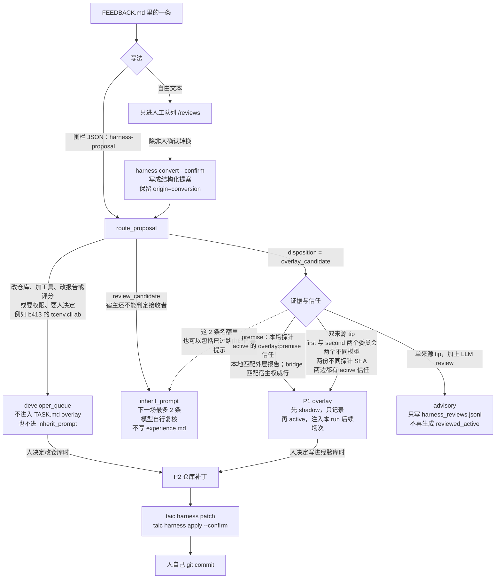
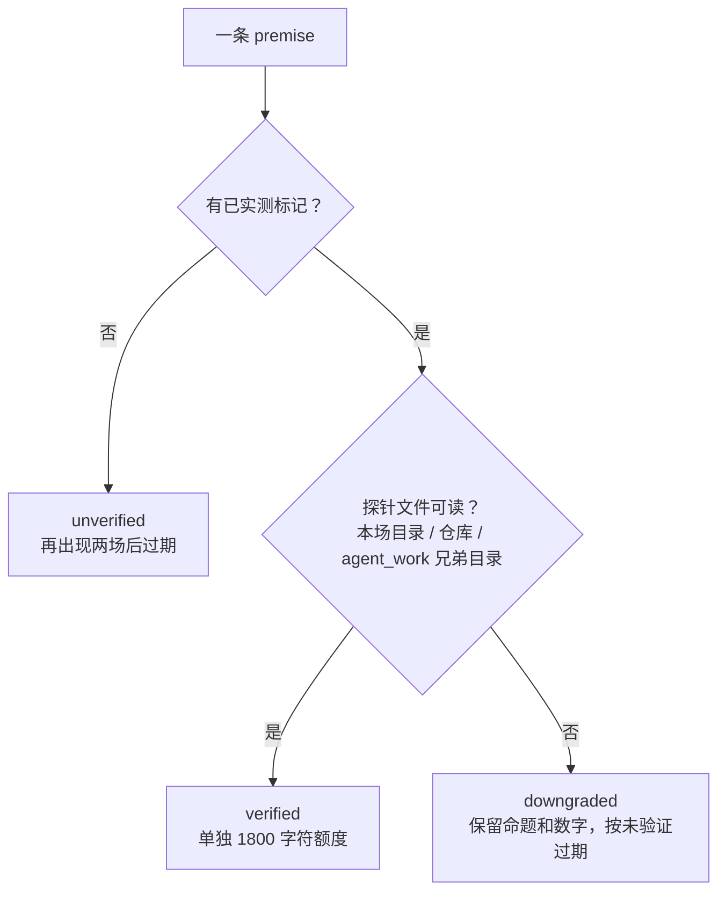

<!-- agent_feedback_charter: v1 -->

# 代理反馈

这一篇是章程，也是人核对单条反馈的操作步骤。早期草稿把这套步骤叫做「拼读」；这里改成可执行的顺序：先认编号，再看它什么时候过期，再做人审和落地。写核代理要守的规则落在哪个文件里，见 [写核代理读什么.md](写核代理读什么.md)。设计来源是 [human-in-loop_rsi_feedback_20f84da7.plan.md](可信harness/human-in-loop_rsi_feedback_20f84da7.plan.md)。外层改进循环、权限梯度和双来源的理论见 [可信harness/架构与理论.md](可信harness/架构与理论.md)。

实验结果不只散落在本章程：付费/GPU 实验的任务、成本、数字、结论和证据位置统一登记在 [实验与尝试索引](可信harness/实验索引.md)，新实验结束后必须回写，避免只留下会被清理的 `runs/` 目录。

## 这篇讲什么

- 写核模型在每一场会话（session）里写 `FEEDBACK.md`；解析后成为本 run（一次搜索）`feedback.jsonl` 里的一条 claim（主张）。
- 反馈先按写法分开。自由文本只进人工审查。围栏 JSON（`harness-proposal`）先经过 `route_proposal`；只有接收者允许、并且过了证据与信任的条目，才可能变成 overlay，也就是注入后续场次 `TASK.md` 的建议。
- 自动路径只剩两种入口，门槛都是「证据 + 信任」：带探针的 `premise`、双模型 quorum 的 `tip`。独立 review 判 useful 的单来源 `tip` 现在只作 advisory，不再自动激活 overlay。永久改仓库仍由人确认。

先统一几个词，后文不再重复解释：

| 词 | 在这里指什么 |
| --- | --- |
| claim（主张） | 一条反馈的机器身份，键是 `run_id#seq#digest` |
| digest | 由命题文本算出的摘要，用来判断两条是不是同一条 |
| 种子核（seed kernel） | 每场开始时可改的那一份最好内核，字段名 `seed_label` |
| 评测种子（eval seed） | 由 `run_seed` 派生，决定这一批评测用哪批输入 |
| 场次（session） | 一次写核会话；一轮一场，常写作 `r1.p0`、`r9.p0` |
| quorum | 同一建议的法定票数：`tip` 要两个不同模型的独立来源 |
| P1 / 运行内 overlay | 只在本 run 后续场次生效，运行结束失效 |
| P2 / 仓库候选 | 生成 patch，人确认后落本地 checkout，之后才谈 git 提交 |
| shadow / active | shadow 只记录 overlay、不注入 TASK；active 会注入后续场次 |
| `route_proposal` | 宿主函数。它不采信模型自报的受众，自行判断这条结构化提案进开发者队列、交给下一场复核，还是有资格再去走 overlay 门槛 |
| `developer_queue` | 要改仓库、加工具、改报告或评分、或者要人批权限的提案。只排队给人，不注入 `TASK.md` |
| `inherit_prompt` | 当前题目里最多 2 条待复核提示，交给下一场写核模型自行采纳或拒绝。不写 `experience.md`，也不因此激活 overlay |
| advisory | 只写入 `harness_reviews.jsonl` 的审阅意见。2026-11-03 起不再因此生成新的 `reviewed_active` |
| fbv4 | 反馈解析器的版本号，出现在看板指纹末尾。它变了，索引会把这一场整份重读一次 |

## 反馈与提案四级分流

一条 `FEEDBACK.md` 进系统之后，宿主用 `route_proposal` 决定它能走多远。模型在提案里填写的受众只是提示。下图是现行分流。



读图时先记住四条：

1. 自由文本停在 `/reviews`。只有人执行 `harness convert --confirm` 之后，它才变成可校验的提案。转换本身不构成模型作者的一票。
2. `b413` 那种给 `tcenv.cli` 加 `ab` 子命令的请求，路由结果是 `developer_queue`。它不进入 `TASK.md` 的 overlay，也不进入 `inherit_prompt`。
3. `inherit_prompt` 从 `review_candidate` 和已经过路由的 `overlay_candidate` 里最多取 2 条，交给下一场模型自己判断，不写经验库。图上的虚线就是这 2 条名额。它不代替证据门，也不激活 overlay。P1 还要过探针、信任，以及前提或双来源这两道门槛。
4. 单来源 `tip` 即使 review 认为有用，也只留 advisory。2026-11-03 起 `settle` 不再生成新的 `reviewed_active`。P2 用 `taic harness patch` 和 `taic harness apply --confirm` 写本地 checkout，git 提交由人来做。

能自动变成 overlay 的，只有下面两条，而且 `route_proposal` 必须先判成 `overlay_candidate`：

1. **`premise`（前提，路线 P）**：带本场探针，本 run 有 active `overlay:premise` 信任。普通本地模式下只有外层候选报告能匹配；host bridge 模式另可匹配宿主权威自测行。
2. **双来源 `tip`**：两个不同模型提出同一个 `tip`，且两边都有 active 信任。

**单来源 `tip` + 独立 review** 曾是第三条（reviewer 还要在该 target/task 有 active `overlay:tip` 信任，且探针本场时间已核验）。2026-11-03 起 `settle` 不再生成新的 `reviewed_active`：review 只写 `harness_reviews.jsonl`，不写 `harness_overlay.jsonl`；历史 `reviewed_active` 行仍可读作证据（见 `taic/harness.py` 的 `settle` 结尾注释）。review 本身也要 `harness_review` 打开才会自动调用。

自由文本建议仍然只进人工审查。

## 条目身份

一场记录的键是 `run_id#seq`。一条主张的键是 `run_id#seq#digest`。审查文件 `feedback_review.json` 里存的是 `seq:digest`。两种键不能混写。

每条记录自带上下文：题目、dtype、规模、label、轮次、委员会、provider、模型、effort、结局、exit、种子核 label、当时最好成绩。

## 三种种子

同名不同物，先分清：

| 名字 | 字段 | 它是什么 |
| --- | --- | --- |
| 种子核 | `seed_label`（= `best_label`） | 每场从它改起。「噪声内没换种子」说的是这一颗 |
| 评测种子 | `eval_seed`（由 `run_seed` 派生） | 决定这批评测用哪批输入 |
| 搜索期种子 | `search_seed_label` | 停下时正在改的那颗 |
| 确认胜者 | `confirm_winner_label` | 换一批输入重测后活下来的那颗；可以和搜索期种子不是同一颗 |

## 五个小节与 kind

小节固定五个：`需要帮助`、`对系统的建议`、`卡住的原因`、`给下一棒的避坑提示`、`被否决的前提`。

`需要帮助` 是给人看的。缺工具、缺权限、缺只有人知道的信息，或要人拍板（同意许可证、sudo、凭据）时当场写，写清缺什么，以及有了它下一步做什么。`kind` 用 `tool` 或 `decision`。这一节里的普通文字只给人看，不会自动进 overlay；但当前解析器也接受这一节里的 `harness-proposal` 块，所以不要把命令或未验证的事实写进块里。这一步即使能绕开，也要写下来。

`kind` 的取值与写法：

- 可用值：`prompt`、`skill`、`tool`、`rule`、`decision`；写多个用逗号分开。
- 没有系统层面的建议或求助时，不写 `kind` 行。
- 某一节或条目在去掉标点和空白后恰好是「无」「没有」「空」「none」或「n/a」，不算内容，不进条目。
- 以「无」「没有」「暂无」「不需要」「无需」开头的缺席句，如果后面没有明确的动作请求（请、建议、希望、应当、应该、能否、改成、增加、修复等），也不算内容。带解释或数字仍然是占位，审计的 7 条就是这种形状；带有动作请求的条目继续保留。

## 前提三态

前提（`premise`）是「模型声称的事实」。它按证据强弱分三态：

| 状态 | 判定条件 | 后果 |
| --- | --- | --- |
| `verified` | 探针文件、命题、数字都在，并且探针文件在本场目录、仓库，或同运行 `agent_work` 的兄弟目录里可读 | 按已实测保留，单独占额度 |
| `downgraded` | 给了探针名，但文件不可读，或路径逃出上面三个根 | 正文保留命题和数字，改写成未验证形态（见下表之后），按未验证过期 |
| `unverified` | 没有已实测标记 | 从第一次写出来的那场之后再出现两场，第三场不再放进任务书；复述不把起点往后推 |

降级改写后的形状是 `[未验证: 探针文件不存在 | 命题 | 数字]`。

探针格可以带参数，也可以写 `r9.p0/sim_w63.py` 这种路径。文件名从这一格里提取，任一文件存在即算读到。



digest 只认命题。数字、探针文件名、未验证后面的理由，都不另算一条。下面四种写法在命题相同、括号外没有别的句子时是同一条：`[未验证 | 命题 | 理由]`、`[分析否决: … | 命题 | …]`、`[推理否决: … | 命题 | …]`、`[已实测: 探针 | 命题 | 数字]`。处理顺序是先算 digest，再做降级改写。

已实测前提不进普通提示的 8 条。它单独保留最近 1800 字符，超出就留较新的。同一 digest 只要有一次是 verified，就保持 verified，取最近一次 verified 的正文。未验证、降级和普通避坑共用原来的 8 条和 1200 字符。这些仍是 `peer_tips` 的生产者字符额度，两笔额度不能互借；输出顺序是已实测从旧到新，然后是还没过期的未验证和降级，最后是普通避坑。进入 TASK 时不再另做 1500 字节裁剪，而是与 overlay、宿主账本一起清洗并共享 5400 字节态势预算，超限时先缩短这一层。

## 审查

状态是 `pending`、`adopted`、`rejected`、`done`，以及两个退出待审计但不冒充结论的状态：`info`（未验证/开放问题）与 `obsolete`（空占位、重复或已退役）。复核是 `unchecked`、`confirmed`、`refuted`。

| 状态 | 含义 | 写入时必须满足 |
| --- | --- | --- |
| `pending` | 待审查 | 复核必须是 `unchecked` |
| `adopted` | 采纳 | 复核为 `confirmed`，并带 `evidence_source` 和非空证据 |
| `done` | 已落地 | 复核为 `confirmed`，且 `change_ref` 非空 |
| `rejected` | 否决 | 复核为 `confirmed` 或 `refuted`，并写备注 |
| `info` | 未验证 / 开放问题 | 复核必须是 `unchecked` |
| `obsolete` | 空占位、重复或已退役 | 必须写备注（例如 `duplicate of ...`） |

`change_ref` 怎么写：本地固化阶段程序写 `local_patch_sha256`；`taic harness commit` 之后写 `commit:<sha>`；旧记录的 `patch:<sha>` 只作历史。审查表单不要求你填 `change_ref`，但选 `done` 时留空会被接口拒绝。每次审查追加到该条的 `history`，不覆盖以前的结论。

审查人不用在表单里填，程序像 git 提交一样自动读取 `git var GIT_AUTHOR_IDENT`。事件记录 `reviewer`、`reviewer_source`、`method`、`batch_id`、审查时的 `git_commit` / `git_dirty`。`method` 默认 `human`；脚本或代理写入时显式用 `agent`/`script`。批量写入可以带 `expected_status`；如果旧状态已经变了，接口拒绝，避免拿过期预览覆盖。

批量入口先预览再写，整个数组全部通过才写一次：

```bash
uv run python -m taic.cli feedback RUN --file reviews.json --dry-run
uv run python -m taic.cli feedback RUN --file reviews.json --confirm --batch-id batch-1
```

`reviews.json` 是数组，每项至少 `seq`、`digest`、`status`、`verification`；建议带打开时看到的 `expected_status`。任何一项失败，整批不写。审查事件另存到 `data/review_events.jsonl`（可用 `TAIC_REVIEW_EVENTS` 覆盖），只存证据/note 的哈希和身份，不复制长原文；有 `verify()` 可检查哈希链，运行 `python -m taic.review_ledger` 验证默认台账。

计数口径：`pending_total` 仍只数父 claim；看板/`review_feed` 另给 `open_subclaims_total` 和 `open_work_total`（父 pending + 开放子命题）。子命题已进入 SQLite `feedback_subclaims` 索引，父 claim 的 prior/similar 也会匹配子命题文本。

空占位在 fbv4 解析后不再生成 claim；旧 claim 在重建时进入 `feedback_claim_removed` 墓碑，保留 `status` 和 `reason`。重复合并只应在确认同一 `action + scope` 后做，topic 相同不等于同一条。

一条多命题前提可以用 `subclaims` 拆分：父 claim 保持 `info` 或 `pending`，每个子命题各自带 `status`、`verification`、`evidence_source`、`evidence`、`note`，并继承父 claim 的 `backend` / `target_id`；父 digest 不变，看板嵌套显示子命题和 scope。跨 backend 的子命题不得合并统计。旧 `feedback_review.json` 没有该字段仍可读；子命题是审查层身份，不是新的 `feedback.jsonl` claim，不会进入 `taic query` 的 claim 列表。

审查页和 `taic query suggestion` 会带 `prior`：同一 `digest`、同一 `task`、同一 `target_id` 的更早 claim，列出旧 `status`、`note`、`change_ref` 和子命题。它是**精确文本**查询，不是语义相似；改写过的句子 digest 会变，不会自动命中。`rejected` 的旧结论不会自动阻止新审查，但审查前应先看 `prior`；要重开一条被否决的结论，应在 note 里写清新证据或说明为什么旧结论不适用。

在这之上，pending 审查项还会带 `similar`：用 macOS 本地 `NLEmbedding` 句向量找同 `task`+`target_id` 的更早近义 claim，显示相似度和旧结论。它不联网、不调用模型；候选还要有共享的中文/代码 token，避免中文向量高基线把所有泛泛相关的建议都算近义。阈值保守，结果只是检索提示，不是自动判定。英文和中文本地向量分布不同，阈值分开；平台不支持时返回空列表，不拿字符重叠冒充语义。

人在看板顶栏点「N 条代理反馈待审查」，另开 `/reviews` 看所有运行。一场的详情里仍只列这一场。页面按 `feedback_revision` 更新：序号没变不动，变了只换那几张卡片。

## 结构化提案、信任与 overlay

自由文本建议和结构化 `harness-proposal` 不是同一种东西。前者是给人看的线索，后者才带可校验的字段和自动路径：

| 维度 | 自由文本建议 | 结构化 `harness-proposal` |
|---|---|---|
| 写法 | `# 对系统的建议` 下的普通文字 | 围栏 JSON 块，含 `surface`、`scope`、`action`、`evidence`、`rationale` |
| 身份 | 反馈 claim：`run_id#seq#digest` | `proposal_key`，并保留 `claim_digest` |
| 机器校验 | 只做 claim 解析，没有提案 schema | 校验 target/task/dtype、surface、action、探针/自检/信任；tip 还要双来源 |
| 自动 overlay | 不进入 | 通过 quorum/信任后可写 shadow 或 active |
| LLM review | 不会自动送；必须先由人确认并转结构化 | 可按 key 显式 review，或在本 run 的 review 流程中处理 |
| 人工审查 | 是，所有自由文本都先到 `/reviews` 的 claim 队列 | 是；review 只是独立建议，P2 仍要人确认 |
| P2/仓库改动 | 不能直接生成 patch | `tip`/`premise` 可生成 target experience patch；`skill`/`task_wording` 只作 P2 候选，需人改代码 |
| 主要风险 | 注入面大、字段不全、无法绑定探针和 target | 字段仍可能错，但可校验、可审计、可回滚 |
| 当前 flash 例子 | 3 条建议在 `feedback.jsonl`，0 条 review | `harness_proposals.jsonl` 不存在，因此没有 proposal key |

转换路径见下节：**自由文本 → 人确认 → AI 或人转结构化 → 再送 review**。转换不会让原文直接变成可信事实；它只是把原文变成可审查的提案，并保留 `origin=conversion`、`claim_digest`、`confirmed_by`、原模型 `source_author` 和填写方式 `structured_by`。

批量处理这类建议时，先用紧凑查询让 AI 只读预览：

```bash
uv run python -m taic.cli query suggestions --task flash_attention --status pending --limit 20 --preview 80
uv run python -m taic.cli query suggestions --task flash_attention --status pending --limit 20 --offset 20 --preview 80
```

分页语义：`total_claims` / `total_groups` 是整个过滤集合的总数；`truncated=true` 和 `next_offset` 表示还有下一页。`limit` 只是页大小，不是扫描上限。

选中某一组后，再取全文：

```bash
uv run python -m taic.cli query suggestion --run RUN_ID --seq 4 --digest 9db07fe836501244
```

这两条走 SQLite 索引和按行读取，不把全部 `feedback.jsonl` 一次读进上下文。compact 在 SQL 里先算总数和分组再分页；detail 的提案/review 关联按 `run_id#seq#digest` 精确匹配。项目 skill [`.pi/skills/harness-feedback/SKILL.md`](../.pi/skills/harness-feedback/SKILL.md) 也按这个顺序工作；它的只读统计脚本是：

```bash
uv run python .pi/skills/harness-feedback/scripts/collect_suggestions.py --root runs --format md
```

脚本按 digest 汇总跨 run 的自由文本建议，保留 `run/seq` 来源，并显示是否已转结构化/是否已 review；它不调用模型、不跑 GPU、不写 run。是否转换、送 review、改 harness，仍由人确认。

系统建议可以附一个围栏 JSON 块，字段是：

- `surface`：`tip` 或 `premise`
- `scope`：`target_id`、`task`、可选 `dtype`
- `action`
- `evidence`：`probe`、`measurement`
- `rationale`

没有块的自由文本只进人工审查；人确认后可以在看板把它转成结构化提案，也可以让 AI 起草字段、再由人确认。转换完成后才走 LLM review，不会因为模型写了自由文本就自动调用 review。

### G4 证据等级字段

新提案、overlay、路线 M 留痕、宿主配对证据和 host bridge 自测行带 `evidence_level` 与 `evidence_provenance`。等级按**谁运行**分类，不按文字听起来多可靠分类：

| 等级 | 实际来源 |
| --- | --- |
| `model_claim` | 模型只说了这件事，没有可辨认的执行证据 |
| `model_script` | 模型自己的脚本/探针，或模型工作目录里无法证明宿主工具调用的提名 |
| `fenced_host_tool` | 模型在围栏里调用宿主工具；例如 host bridge 写下的宿主权威行 |
| `host_process` | 外层候选报告或宿主自己重跑的配对比较 |
| `human_confirmed` | 宿主核验过的人工确认，带确认人和证据指针 |

模型在 JSON 里自填等级、`host_evidence` 或 `confirmed_by` 不能自升。把自由文本确认转换成结构化提案，也不等于人确认了其中的测量。模拟证据的 `level` 单列成 `simulated`，原执行者保留在 `runner_level`；`rank=null`、`promotion_allowed=false`，不能沿这五级上升，也不进入硬件确认、发布、catalog 或 brief。

等级是证据来源标签，不是 trust、quorum 或激活授权。`harness status` 的 `evidence_levels` 只汇总这些标签。

### 路线 P 的本地边界

`premise` 与 `tip` 的门槛不同：

- `premise` 必须有本场工作目录里的探针，且探针的 mtime 不早于本场开始（新记录用 `session_started`；旧记录缺这个字段时标成时间无法验证，不拿 `t` 冒充）；它不走双模型投票，但要求 active `overlay:premise` 信任。**普通本地模式下，工作目录里的 `.selfcheck/self_checks.jsonl` 和 `self_checks.jsonl` 都是模型可写镜像，`_self_check_rows` 不用它们激活；本地只有外层候选报告能匹配。** host bridge 模式则可以读取宿主权威日志，这一行按 G4 标为 `fenced_host_tool`，不冒充外层 `host_process`。
- 匹配仍要求 `status=ok`、native build、非模拟、同 target/协议/内核 SHA，并且测量数字一致。路线 M 的宿主配对行不自动成为路线 P 的外层候选报告。
- `record_proposals` 在记录提案时计算 `trusted_record`；`settle` 只消费这个持久化门位，不重新扫描后来出现的自测行。因此“稍后再跑一次 settle”不会升级旧的 `trusted_record=false` 提案。没有匹配记录时只保留提案，不写 overlay。磁盘记录仍不是密码学签名；理论边界和残余风险见 [可信harness/架构与理论.md](可信harness/架构与理论.md) §7。
- `tip` 要两个不同 provider+model、来自 `first`/`second` 两个委员会、都在该 `(target, task)` 上有 active 信任，且两份探针 SHA 不同（复制同一份探针不算第二来源），才写 `harness_overlay.jsonl`。

信任登记在 `targets/<target_id>/trust.toml`，键含 target、task、provider、model、effort，并记录提示函数源码、模板常量与技能文档的 sha256。参与指纹的提示面文本包括：

- `taic/prompts.py` 的提示函数与 `HARNESS_RULES`/`MIXED_PLANS`/`WIKI_DOCS`
- `taic/kernel_agent.py::render_contract`/`_cap_task`
- `taic/situation_block.py` 的完整源码（统一态势清洗、固定标题、预算与缩减规则）
- `taic/harness.py::TEMPLATE`/`write_template`
- 目标档的 `experience.md`/`device.md`（按 `target_id` 解析）
- `taic/flows/kernel_once/skills/taic-tools/SKILL.md`
- 目标 backend 的 `backends/<id>/skills/*.md`（自动收集）

字段名仍叫 `prompt_sha1`，内容已是 sha256；另外记录协议版本。撤销/暂停追加到 `trust_audit.jsonl`，事件名是 `grant`/`suspended`/`revoked`。只有这些提示面文本变化才让旧信任失效；同一文件里的计费、进程或其他非提示代码改动不再影响。目标文档按 `target_id` 解析，不同 target 的文档不同，指纹也不同。

开关与生效范围：

- `search.harness_auto` 默认关；打开后 `harness_shadow` 默认开，未 review 的 quorum overlay 只记录、不注入。
- 独立 review 判为 useful 的单来源 tip **只存档**：它不再以 `reviewed_active` 进入后续场次，历史行只在旧 run 的决策记录里作证据（旧 run 续跑时其 overlay 行仍按当时写下的 `shadow` 标志读）。`harness_review` 默认关（`taic/llm.py` 的 `SearchConfig`），打开后才会自动调用另一个委员会评审。永久 P2 仍人审。控制文件只能关闭 overlay。
- active overlay 作为统一态势块的第一层进入 TASK，标题仍明确它是「未验证的模型建议」，不是合同或事实。第二层是宿主账本，第三层是队友未核实线索（前序避坑与待复核建议）。三层经过同一清洗管线：去控制字符与代码围栏分隔线，动态正文里的 Markdown 标题降级为普通文本，宿主固定结构标题最后再加。
- 三层共用 `dynamic_budget_bytes=5400`，来源是原相关源 cap 的合计 `1800+900+1500+1200`，固定标题与清洗输出也计字节。它不是每层各拿一笔，也不把字符数当字节数。清洗先跑；预算不足时依次缩短 `peer_unverified`、overlay，最后才用 `clip_ledger_text` 按整行缩短宿主账本（丢最旧行、保留能放下的 footer）。`candidate_bytes > budget_bytes` 时回执始终是 `over_budget=true`，成功缩短记 `status/delivery=truncated`，不把溢出伪装成未超预算。正常长中文提示不会删除 TASK。只有调用方显式给出更小预算才抛出 `SituationBudgetError`、不写/不留旧 TASK；不做 TTL、置信度淘汰或宿主保底摘要。
- 原有 `TASK_MAX_BYTES` / v2 `effective_max` 不变，静态合同不因态势块裁切。态势块按 `min(5400, 实际剩余 room)` 重算，更大的 TASK 余量不会抬高 5400 上限；能单独放下的账本必须保留，只有固定标题与账本仍放不下才整块省略并记 `stopped`。`sessions/<label>/task_delivery.json` 的 `situation.layers` 分别记录三层源字节、清洗后字节、实际送达与省略。路线 M 仍是 shadow，不因此转 active。
- G5 的 `settle` 逐门留痕在 `harness_settle_traces.jsonl`，路线 M 留痕仍分开；`harness status` 同时暴露 `settle_traces`、`route_m`、`task_delivery` 与 G4 `evidence_levels`。
- `active` 只影响本 run 的后续场次，不是永久固化；永久写入 `targets/` 或共享 harness 仍需 P2 人工确认。
- 仓库级提升只生成 patch：`taic harness patch` 只写补丁；`taic harness apply` 先 `git apply --check`，`--confirm` 才写本地 checkout，不自动提交；默认只写 `targets/<target_id>/experience.md`。共享 prompt/skill 表面需要人另行确认跨硬件适用。

## 追溯

采纳时写下改动落在仓库的哪里。因反馈改系统的提交引用追溯键 `run_id#seq#digest`。

## 去重与保留

同一道题、同一个 digest 合成一条。digest 为空时不能当成同一条。读入旧记录时在内存里补 digest 和被抹掉的命题，`feedback.jsonl` 不回写。

反馈文件随运行目录归档，不单独删。

## 版本

这一份章程的版本行是文首的 `agent_feedback_charter: v1`。

`feedback.jsonl` 的 `format` 是 `agent_feedback`，`v` 是 1。`feedback_review.json` 的 `v` 是 1。同版只加字段，历史文件不回写。

新记录带 `session_started`（本场开始时间）；旧记录没有这个字段，转换时只在磁盘上核对探针路径和哈希，并把探针时间标成“无法验证”，不再拿反馈写入时间 `t` 冒充会话开始时间。

代理读物的版本看 `run_config.json` 里 `agent_guidance` 各文件的 sha256。每场的合同就是该场工作区里的 `TASK.md`。

看板指纹末尾的 `fbv4` 是解析版本。它变了，或 `feedback.jsonl` 变短，索引把这一场整份读一次，然后把 `feedback_bytes` 拨到文件末尾；平时从该偏移接着读新行。某一条的正文按记下的行首偏移读，不把整份日志再打开一遍。

## 怎么读一条

1. 看运行结局。搜索过程最好和确认复测是两个数，对外用确认复测。
2. 打开当场的 `report.json` 和 `FEEDBACK.md`。
3. 看来源：模型、轮次、当时的种子核。
4. 复核，并留下证据。探针文件要在磁盘上打得开；新记录用 `session_started` 检查它是否在本场创建，旧记录缺这个字段时只核对路径和哈希，不伪造时间结论。
5. 写下处置和改动落点。

例子：`runs/apple-m4-max/conv2d-feedback-20261021` 的 seq 8、`r7.p0`。分项时间加起来应当等于总时间。这条是给系统的建议，人复核之后才改仓库，不自动变成代码。

## 命令

当 `harness_auto` 与 `harness_review` 都打开时，orchestrator 才会在下一场前自动调用另一个委员会做 review，而且只作 advisory；也可以手动重跑：

```bash
# 人授予/撤销。信任写入 targets/<target_id>/trust.toml，操作追加到 trust_audit.jsonl。
uv run python -m taic.cli trust grant apple-m4-max conv2d deepseek deepseek-flash \
  --effort high --scope overlay:tip --by 人名 --reason "pilot"
uv run python -m taic.cli trust status apple-m4-max
uv run python -m taic.cli trust revoke apple-m4-max conv2d deepseek deepseek-flash --by 人名 --reason "stop"

# 查看一场的结构化提案/overlay；settle 默认只写影子。
uv run python -m taic.cli harness status RUN_DIR
uv run python -m taic.cli harness settle RUN_DIR --task conv2d
uv run python -m taic.cli harness disable RUN_DIR --by 人名 --reason "pause"

# P2：先看 patch，再 apply --check；最后一步由人加 --confirm。
uv run python -m taic.cli harness patch RUN_DIR --key KEY
uv run python -m taic.cli harness apply RUN_DIR --key KEY --check
uv run python -m taic.cli harness apply RUN_DIR --key KEY --run-tests --confirm

# 代码类 P2：code agent 在 detached worktree 生成 patch，人确认后应用。
# apply-code 默认先在另一个隔离 worktree 里确认导入该 worktree 的代码并跑离线套件，再改主 checkout。
uv run python -m taic.cli harness implement RUN_DIR --key KEY
uv run python -m taic.cli harness apply-code RUN_DIR --key KEY --check
uv run python -m taic.cli harness apply-code RUN_DIR --key KEY --confirm --by 人名
```

看板上，结构化提案里 review 有用的那一行有「固化」按钮，做的是同一步：只改 `targets/<target_id>/experience.md` 并记下 `local_patch_sha256`，不自动 `git commit`；最终 `change_ref` 留待提交后写入。命令行 `apply --confirm` 仍可用。共享 prompt/skill 仍按人审处理。

P2 代码路径也以 `status=local` 记录 `code_promotion`，保存 `paths`、`patch_sha256` 和源 claim。`taic harness commit` 现在同时接收 `promotion` 与 `code_promotion`；提交前在独立 Git index 中暂存待提交路径，从 HEAD 顺序重放并比较补丁快照，再以该快照生成提交；缺失或哈希不匹配的 patch 会被拒绝，避免把同一文件里的无关改动一起提交。补丁清单还会拒绝 `tasks/`、`tcenv/gpulock.py`、`taic/trust.py`、`targets/*/trust.toml`、`control.json` 和凭据文件。

```bash
uv run python -m taic.cli harness commit RUN_DIR --message "..." --by 人名
```

### 独立 review

```bash
uv run python -m taic.cli harness review RUN_DIR --key PROPOSAL_KEY --task conv2d
```

review 是另一个 provider/model 的只读回合：它把建议当 **untrusted data**（不可信数据），不改 kernel/TASK，只写 `HARNESS_REVIEW.json`。

提示词现在带一个有界证据包：原始自由文本、`surface/scope`、探针路径/哈希/节选、匹配的 self-check 行、候选报告摘要，以及外层程序算出的“已验证/缺失”。这些外层检查与提案正文分开标注，模型不能把文字声称当成已验证事实。预算按最终提示词、该模型的实际 input/output 单价、最大输出 token，以及 pi/skill 上下文的 cache read/write allowance 现算，不写死金额；实际成本与 `prompt_sha256` 写入 `harness_reviews.jsonl`。

转换提案的默认 reviewer 会避开原 claim 的委员会；写原始 claim 的模型也不能 review 它。review 结果只写 `harness_reviews.jsonl`，单来源 tip 不会因此进入本 run 的 active（历史 `reviewed_active` 行只作证据）；它不能替代永久 P2 固化，P2 仍要人确认。看板上的一次实例（kimi 审核 deepseek 的 `ab` 子命令提案，结论有用、P2 仍待人工固化）在 [可信harness/架构与理论.md](可信harness/架构与理论.md) 第 5.3 节。

## 自由文本 → 人确认 → 结构化 → review

这是一条显式的人工闸门，不是自动转换：

1. 模型在「对系统的建议」里写自由文本；它进入反馈 claim，`harness_proposals.jsonl` 仍没有条目。
2. 人看过原文后，在「结构化提案」面板点 **人确认后转结构化**，填 `surface`、`action`、证据和可选理由；或者把同样的字段交给 AI/code agent，用 `taic harness convert ... --mode ai --confirm` 写入。`--confirm` 必须由人加，`confirmed_by` 记下确认人。
3. 转换只写本 run 的 `harness_proposals.jsonl`，不调用模型，不产生 `harness_reviews.jsonl`。
4. 人再点「送 LLM review」，或运行 `taic harness review RUN --key KEY --task ...`。review 仍是只读的独立回合，只留下 advisory 记录，不改变 overlay 的 active 判定；P2 永久固化仍要人确认。

`tip`/`premise` 转换需要本场探针；`skill`/`task_wording` 是 P2 候选，可以没有探针，但 review 通过也不等于自动改仓库。转换行保留 `origin=conversion`、`claim_digest`、原始建议文本和 `confirmed_by`，便于追溯；如果修正已转换的提案，用 `harness convert --supersede OLD_KEY` 追加新提案，旧行不删除，新行在 `conversion.replaces` 记录旧 key，源 claim 可同时标为 `info`。另外把原模型写在 `source_author`，把填写/确认方式写在 `structured_by`。

转换行的顶层 `provider/model/committee` 为空，因此一次转换本身**不构成**模型作者的 tip quorum，也不会被算成两个独立来源之一。review 现在只写 `harness_reviews.jsonl`：带本场时间已核验探针的单来源 tip 也只留 advisory 记录，不再推进到 `reviewed_active`；reviewer 仍必须独立于该 key 的所有作者。P2 review 永远不会变成 tip overlay。

## 作用域

一条 claim 带四个标签：题目、后端、芯片、是否模拟。前三个已经在记录里。查询用 `taic query suggestions --backend`。`simulated` 用 `declares_simulation`：`measurement_kind="measured"` 不能盖住 `measurement_type="simulated"`，`evidence_level` 和 `evidence_provenance` 里的模拟声明也算。`result.json`、`run_config.json`、`execution.json` 有一份可读时以文件为准，文件没声明模拟就不再看反馈记录。都没有时缺省为否。

一颗芯片上测出的数默认属于（题目，芯片）。在第二颗芯片上重现之后，才上升到后端层或通用层。语言语义和任务合同这类不是测量的事实，可以直接放在上层。

模拟报告沿用 `tests/support/npu_sim/varlen_worklist.py` 已写明的规则：`simulated=true`，`publication_allowed=false`。模拟测量不进入确认、发布、catalog 和 brief。

## 等数据的工作

下面这些项里，已经写明「已完成」或给出命令的已经落地。其余仍等数据或具名批准。具名批准人、δ 和可容忍超支都还空着。

| 项 | 现在的状态 |
| --- | --- |
| E1 | 已结案：会话侧由只读的 `tcenv ab` 承担；`tcenv paired-compare` 与桥的 `--paired` 保留，但不再写进任务书。 |
| E2 | 本次只落地统一态势块，没有 P1 转 active。新指纹与允许集差分见 `tests/support/golden/shared/acceptance-epochs/20261116-g6-situation-block.json`；旧 grant 仍需人重签。 |
| G1 路线 M / 路线 D | 路线 M 的宿主配对机制已完成，且仍是 **shadow-only**：路线 M 的影子行不进 TASK；`settle(..., shadow=False)` 不改变它。路线 D 仍不自动换种子，任何真实决策实验另需指标与批准。 |
| G2 路线 P | 已完成：本地只有外层候选报告能匹配；bridge 权威行另列，规则未改。 |
| G3 路线 R | G1 上线后仍有写不成两核对照的数字型主张时再做 |
| G4 证据等级 | 已完成 CPU 机制与字段：五种执行者，模拟态单列且不升级。 |
| G5 逐门留痕 | 已完成：逐 key 门迹、状态查询与最终 TASK 字节回执，不改激活。 |
| G6 统一态势块 | 已完成 CPU 机制：三层一道清洗、一笔 5400 字节预算、peer→overlay→账本缩短、逐层回执；严格小预算才停止。没有自然 run 的效果结论。 |
| G7 账本两级键 | 等 `task_ledger` 在真实 run 打开后的账本 |
| G8 经验草稿 | 见下方「经验草稿」。不自动写 `experience.md`，不自动升 `verified` |
| G9 提示面变更与重签 | 就是 E1 和 E2。每次只改 `tests/support/live_anchors.json` 的 `prompt_sha1`，并在 `tests/support/golden/shared/acceptance-epochs/` 追加记录。本轮 E2 已更新锚点；后续提示面变更仍需各自具名批准。 |
| G10 聚类视图 | `taic query suggestions --cluster`。只读。先按后端、是否模拟、路由意图分区。模拟态取读取正文的同一条反馈记录；`result.json`、`run_config.json`、`execution.json` 里的测量声明优先。区内 macOS 用 `NLEmbedding`，其他平台用 `lexical_overlap`。结构化提案把完整对象交给 `route_proposal`，相似度只比 `action`。一簇里每对都要直接达到阈值。每个 digest 保留全部 run、seq、digest、status，并带只读的 `expected_status`。超过 2000 条或正文读不到时视图是 incomplete，不把残缺输入当成完整批次；`--jsonl` 也会打出这条警告 |
| G11 `taic.note` | 见下方「taic.note」。写标注并回话；重复建议在写下时消掉。`.notes` 写不了时追加 `NOTES.md`；`FEEDBACK.md` 仍是自由文本原路径 |
| G12 上层作用域 | **只读作用域审计已完成**：`taic harness audit-experience`。正式后端层/通用层晋升仍等第二颗真实芯片或第一个真实 NPU run。 |
| G13 模型健康度 | **只读原型与首个 active 专属指标已完成**：观测台模型健康度列，加上 `observe/health.py` 的 `overlay_activity` / `smoke_summary`（`/api/v2/model-stats` 的 `overlay`、`smoke`）。只报历史与盘上描述统计，不参与授权；更多授权决策仍等更多 active 数据。 |

## G12 / G13 只读实现（2026-11-20）

G13 在观测台模型费用表增加健康度，只读汇总现有 run/session/feedback：会话结局、候选 ok、未交核、前提降级、人工 adopted/done 与 rejected/refuted、never-auto 门迹，以及已有成本/token。页面明确标注「历史 run 的描述统计；P1 的激活状态在 overlay 视图里单列；不参与授权」。`observe/health.py` 不修改 trust、run_config、overlay 或委员会。

候选状态分三类：明确 ok、EvalReport 明确非 ok、不可判定。`old_format`/`unreadable`/`missing` 是读取状态，`unchanged`/`duplicate`/`external_duplicate` 未送评测，均不进入 ok 比例分母；不可判定与无候选关联分别报告。未交核只认 `agent_no_submission`。只有空白 premise 时全部字段为 null，不写成 0。never-auto 只数真实路线 M 门迹，历史没有门迹就显示 unavailable。

active overlay 的专属只读指标在同一个健康度端点里（不另建数据层）：

- `overlay_activity()` 复用盘上的 `harness_proposals.jsonl`、`harness_overlay.jsonl`、`harness_decisions.jsonl`、`harness_control.json` 与 TASK 送达回执（`render-check/` 与 `sessions/*/`），把每条 `(run, proposal_key)` 的 **proposal → shadow → active → delivered → disabled** 分开列出。active 之后的会话结局分两种边界：本 run 写下的 `active_from` 用 `seq >= active_from`；跨 run 复制来的 active 行（配对 smoke 的 treatment run 就是这种）的 `active_from` 属于 source run，不能过滤本地会话，只用送达回执的会话 label 关联本地索引，无法确定时留 `None`，不写成 0 场。路线 P（premise）、路线 M 和普通 tip 各自汇总；M 的影子行不会因为 active 字段出现而被当成 active。条目带 proposal key、surface、target/task、证据等级、`trusted_record`/`probe_time_verified`、`source_run`/`source_seq`、`active_source_run`/`active_boundary`，送达带字节数与省略数。没有这些文件的历史 run 是 `coverage=unavailable` 或逐环节 `null`，不写成 0；只有 proposal 的 key 只计 `proposals_only`，不逐条展开。`disabled` 是 run 级开关（`harness_control.json`），缺字段或 `null` 留 `unknown`；字节字段缺失或非整数也留 `unknown`，不补 0。一份合并回执无法拆到多个 active key 时只在 `run_deliveries` 列一次，逐 key `delivered` 保持 `None`。
- `smoke_summary()` 只读 `paired_smoke_result.json` 的已写结论：一对、成本 $0.519934296、control confirmed 1.0405464310、treatment confirmed 0.8345098497、`verdict=inconclusive`、`publication_allowed=false`、`adopt_overlay_for_effect=false`。这些是行为观察，不是效果数字。
- 两个文档都带 `effect_rate: null` 与说明：**active 状态不是效果**。激活、送达和 confirmed 数字不合成任何「有用率」；单个 active run 足以开始指标统计，但不足以做自动停权、模型淘汰或效果判定；自动化停权与效果结论都需要更多 active 数据与单独授权。

G12 提供只读经验作用域审计：

```bash
uv run python -m taic.cli harness audit-experience
uv run python -m taic.cli harness audit-experience --json
```

`taic/experience_scope.py` 输出每节的 target、Confidence、题目、来源、宿主重跑指针、边界声明、Metal/NPU 专属标记和模拟声明；复用 `valid_host_pointer` 并检查文件存在。只有结构化字段或证据路径明确证明时才报 task/target mismatch，无法判断则为 unknown；旧条目缺新字段标 legacy，不当作伪造。当前真实审计为 15 节、16/16 指针有效且存在、0 warning、0 simulated section。

这两项都不跑 GPU、不调用模型、不改经验正文或提示指纹，也不创建后端层/通用层经验库。G12 的正式跨 target 晋升与 G13 的正式 P1 授权语义没有提前实现。

## 经验草稿

`taic harness draft-experience` 生成一节 `Confidence: reported` 的芯片层草稿。小节写明题目、来源、本机实测、边界和反例，并写明未验证。来源是反引号包住的 runs、docs、tcenv 或 taic 路径。落点只出现在正文里：`targets/<id>/experience.md`。命令不改这个活文件；`--out` 若指向它会被拒绝。

缺题目、来源、实测、边界、反例中的任何一项，或带上 `--simulated`、非空理论、或 `--layer` 不是 `chip`，都不生成草稿。理论解释留在 N5 的对照表，不写进这一节。

现有提示过滤器对没有 `题目`、`落点`、`芯片`、`未验证` 这些新草稿行的旧 verified 小节仍只看 `Confidence: verified`。新草稿只要还留着其中任一行，就要有恰好一条有效的 `宿主重跑` 指针，否则整节不进提示。只把 `reported` 改成 `verified`、或再删掉 `题目` 与 `落点` 中的一行，过滤结果里都没有这一节。`validate_section` 同样拒绝没有指针的新草稿。

人把草稿改成 `verified` 时要补宿主重跑指针：

```bash
uv run python -m taic.cli harness draft-experience \
  --target apple-m4-max --task gemm_silu --title "寄存器里做完 SiLU" \
  --source runs/example/report.json --measurement "1.8252 us" \
  --boundary "只覆盖 fp16 small" --counterexample "GLOBAL scratch 不省 FLOPs" \
  --out /tmp/gemm-silu-draft.md

uv run python -m taic.cli harness draft-experience --set-verified \
  --draft /tmp/gemm-silu-draft.md \
  --host-rerun runs/example/host_paired_comparisons.jsonl \
  --target apple-m4-max --out /tmp/gemm-silu-verified.md
```

升 verified 只接受恰好一节完整的芯片层 reported，并重新检查题目、实测、边界、反例、模拟态和理论。指针必须属于这一节：`runs/` 下的 `.json`、`.jsonl`、`.md`，或 `runs/` 后面还有一层路径。路径里的 `.` 或 `..` 不合格。一句测量数字或 URL 也不合格。`--set-verified` 只写 `--out`。`--set-verified --simulated` 直接拒绝。

`candidate_patch` 不再追加 `- [harness …]` 裸 bullet。`tip` / `premise` 且路由是 overlay 时，必须带齐 practice 字段，生成同样的 reported 小节。practice 从人工 convert、CLI 的 `--practice-json` 和看板转换表单进入提案；`practice.task` 必须和 scope 的 task 一致，非空 practice 进入 proposal key、复核材料和验收身份。换过测量或边界却留着旧 key 时，`write_patch` 不生成草稿。开发者请求在生成之前拒绝。外层 `simulated`、`measurement_kind`、`measurement_type`、`evidence_level`，以及 evidence、provenance 或 `evidence_provenance` 里的同类声明，都不生成这节草稿。`practice` 上的这三项和 `evidence_provenance` 在规范化后仍留在提案里，并写成 `practice.simulated=true`。测量正文里出现 `simulated`（例如 `simulated 1.2 us`）同样拒绝。`convert_feedback` 和 `record_proposals` 保留记录上的这些声明：`simulated` 为真，`measurement_kind` 写成 `simulated`，分级后的 `evidence_level` 仍是 `simulated`。没有这些声明的旧记录仍按非模拟分级。

## taic.note

`taic note` 与 `python -m taic.note` 写一条模型标注并回话。不调用模型，不上 GPU，不编造测量文件里没有的数字，也不把这条命令写进任务书。

回话按这个顺序：

1. 建议小节（「对系统的建议」「需要帮助」）里，同一小节已经有相同 digest，或近义程度达到聚类阈值时，回话 `duplicate`。近义比较前两边都先投影到 `action`，没有 action 再用 `peer_action`；投影为空不连接。近似 action 可以消重，不同 action 即使外壳相同也不消重。精确重复只消掉锚定那次出现之后的同文坐标：第一条、或这次 note 匹配到的已有请求留在原状态，更晚的同文 seq 标成 `info`。消重记下 `anchor_seq` 和 `anchor_t`，按这次出现的序号判断；note 当时没有序号时，用记录时间再按序号留下最早的一次。不再按 digest 把整段 run 里的每一次出现都改成 `info`。`verification` 仍是 `unchecked`，重复原因写在 `note`。公开评审只接受 `unchecked`、`confirmed`、`refuted`，`info` 必须配 `unchecked`。近义句只消掉新的 digest，原来那句不同的 digest 仍可待审。人已经保存的状态优先，不覆盖。
2. 已知请求按精确 digest、整句或完整 id 命中，正文里仅仅包含某个 id 或 digest 的子串不算命中。来源有三处：`work/.notes/requests.json`、这次 `--run` 的 `feedback.jsonl`，以及 observe 索引里其他 run 的 claim。相对 `--run` 先按当前目录展开再解析，立即刷新用的是这个目录。索引命中带回最新人工状态：保存过的 `reviewed_at` 优先于默认 pending。另一场已经由人工标成 `done` 时，这场回话是 `known_request`，状态是 `done`。正文本身就是那条 16 位 digest 时也算命中，不限小节。建议小节里，命中的是请求表、建议小节或其他 run 的同一 digest 时，这次重复会把当前 run 上的新 claim 消掉；其他 run 里人已经保存的状态不改写。命中其他小节只回话。非建议小节只回话。消重缓存写在 run 的 `.notes/dismissed.json`，工作目录在 `agent_work/` 下时也写那一份。这份 sidecar 不是评审权威：读队列时要能从本场 claim、标注或宿主索引重新证明锚点和重复关系，证不出来就不改状态。只有可解析时间戳和 `near` / `known` / `later-seq` 的伪造文件，不能把一条没有先前建议的新 pending 改成 `info`。写入有跨进程锁，临时文件按进程和随机名分开。坏的时间戳跳过，不让读取崩溃，也不当成一次消重。文件写下后立刻重算这场已经入索引的 run，不必再改 `feedback_review.json`。run 指纹同样包含 `.notes/dismissed.json` 和 `agent_work/*/.notes/dismissed.json`，下一次同步也会重放。人已经保存的状态优先。
3. 正文点名的 SHA（16–64 位十六进制）或内核文件名，对得上工作目录里的 `self_checks.jsonl`、宿主自测权威日志，或权威宿主配对文件，并且这一行是真实测量时，回话 `already_measured`，带回该行已有的数字以及 status、applied。自测行的文件名键是 `name`，例如 `a_1x4w4.metal`；也认 `kernel`、`source`、`path_a` 和 `path_b`。工作区镜像删掉后仍读 `authority_log(work / '.selfcheck')`。这条宿主自测行可以回数字，但 `host_evidence` 与 `counts_as_hardware` 仍为假，不把它当成外层 host-process 或可发布的配对证据。超时、失败、未应用或没有数字的行不算已测。同一 SHA 有多行时，按文件顺序取最后一条真实测量；权威日志排在镜像之后，镜像里的同名行盖不住它。权威配对的数字包括 `median_a_s`、`median_b_s` 和 `ratios`。`counts_as_hardware` 只在这条记录来自 `host_evidence_path`、该行 `host_evidence` 为真、且没有声明模拟时为真。模拟看 `declares_simulation`，也看 `evidence_level` 和 `evidence_provenance`：权威宿主行可以只有后两处，没有顶层 `simulated`。模拟数可以返回，但不能当成硬件证据。工作区里的 `paired_comparisons.jsonl` 是提名，同名的 `host_paired_comparisons.jsonl` 也不是证据。这种回话不消掉建议。
4. 都没有时回话 `recorded`。

结构化记录写在 `work/.notes/annotations.jsonl`。`.notes` 建不出来时，同一行 JSON 追加到 `NOTES.md`，并标 `fallback`；之后的消重会读这些行。消重没有写到盘上时返回 `NoteError`，CLI 退出码是 5，不回报已经消掉。会话清理保留 `.notes`。`FEEDBACK.md` 仍是模型写自由文本的原路径，这条命令不改它。

默认用词面重叠判断近义，避免每次标注都加载句向量。`--embed` 才用和聚类视图相同的平台打分：macOS 用 `NLEmbedding`，其他平台用 `lexical_overlap`。精确 digest 和整句会查 observe 索引里的其他 run。近义比较仍只看当前工作目录和当前 run，不把全部建议送进聚类。

```bash
uv run python -m taic.cli note --work WORK --text "remeasure <sha>" --section note
uv run python -m taic.cli note --work WORK --run RUN --section 对系统的建议 --text "..."
```

## 本轮反馈处理留下的待办（2026-11-19）

上面两张表是 G 系列的状态；这一节只记**这一轮处理反馈之后仍然悬着**的事，以及它们各自的证据。全部可以用 `uv run pytest -q -m 'not gpu'` 复核：本轮把失败数从 51 降到 7，剩下的 7 条就是第 4–7 项。

### 1. 已修复：同窗口对照的系统性偏差来自重复校准批量（2026-11-21）

历史观察保留：`eval-v2 --timed --control` 三次独立运行曾为 1.0262 / 1.0262 / 1.0358，区间不含 1.0；独立 executor 的 `tcenv ab` 约为 1。2026-11-21 又复现一次 control=1.036577、区间 `[1.028630, 1.048928]`，同时 ab=0.9992。

根因不是“共享 runner 必然有害”，而是同一个 `cand_run` 以两个名字进入 `tcenv.bench.interleaved` 后被 `choose_iters` **独立校准两次**。外部日志直接记录同一 callable 在候选臂选 `k=10`、对照臂选 `k=17`。wall 时间包含固定命令缓冲编码/提交开销，不同 k 把这份开销摊成不同的每迭代值，于是同字节伪造出约 3% 比值。另一个必须保留的区别是：control 的配对比使用 wall-clock 批量样本，`ab` 使用 GPU timestamp；两者不能混称同一种统计量。

修复落在 `tcenv/bench.py`：**同一 callable 对象只校准一次，所有别名共用同一个 k**；不同 runner 仍独立校准。没有新增第二个 executor，没有改 0.98/1.02 带或晋级阈值，无 control 的报告仍走原路径。CPU 回归用固定开销模型钉住“旧代码会选 3/7，新代码只校准一次并共用 3”。

修复后同一 conv2d paper 探针连续三次全部通过（[原始摘要](可信harness/aa-calibration-recheck-2026-11-21.json)）：

| 次序 | 独立 ab GPU 比值 | 共享 control wall 比值 | control 区间 | 区间含 1 |
|---|---:|---:|---|---|
| 1 | 0.9985 | 1.003202 | [0.994255, 1.009807] | 是 |
| 2 | 0.9942 | 1.003254 | [0.973401, 1.012055] | 是 |
| 3 | 0.9961 | 0.993781 | [0.979899, 1.009884] | 是 |

首次修复后的外部校准日志确认候选/对照只调用一次 `choose_iters`，共用 `k=10`。因此这项测量缺陷闭合；但 `resolvable_relative` 仍只是**每个实测窗口自己的分辨率**（本三次为 0.78%–1.93%），不能被解释成所有窗口都保证达到 0.5%。

### 2. 每线程寄存器数：不可得，已定性，不要再造命令

`MTLPipelineOption` 只有 `ArgumentInfo` / `BindingInfo` / `BufferTypeInfo` / `FailOnBinaryArchiveMiss` / `None`，没有寄存器选项；`MTLComputePipelineState` 只暴露 `maxTotalThreadsPerThreadgroup`、`threadExecutionWidth`、`staticThreadgroupMemoryLength`，三者仓库都已记录（`max_total_threads` / `execution_width` / `static_tg_bytes`）。寄存器压力唯一真实信号是 xctrace 的 `graphics-compiler-spill-events`，v2 候选已能取到（`tcenv profile` 报 `spill_events` / `spilled_bytes` / `tables.spills=True`）。

所以 `tcenv.cli regs` 造出来只能是编数。这条反馈按「无法满足」关闭，理由留在这一节。

### 3. 真机复测窗口

```bash
uv run python scripts/probe_timing_window.py \
  --task conv2d --dtype fp16 --size paper \
  --kernel tests/support/golden/metal/conv2d_portfolio/variants/paper/kernel.metal
```

2026-11-19 首跑（这台机器 `macos-27.2.1`）：`ab` 报 `timed_by=gpu_timestamp`、中位 559.4 µs，与 `--timed` 的 558.0 µs 一致（ratio 1.002）；墙钟旧路径对同一颗核报 784–794 µs；`profile` 报 `dispatch_group=2`、`spill_events` 1071–1161、`spilled_bytes` 497–539 KB。第 1 项已于 2026-11-21 修复并复测闭合；本节的 2026-11-19 数字保留作历史基线。

### 4. G0 包的 `worktree_head` 锚点

`tests/shared/test_acceptance_governance.py::test_status_is_clean_and_d3_is_an_approved_document_update` 报 `跨硬件算子生成分工-G0` 的 `worktree_head` 未登记，是这条测试唯一的失败项。G0 在 `d338849` 就关闭了，把今天的 HEAD 登记成它的依赖锚点等于声称它今天被复核过——那是假锚点。

要做：二选一。给 G0 记一条带 `scope` 的历史锚点说明，读的人不会误当成"今天仍然通过"；或者让 `worktree_head` 这项检查只覆盖未关闭的包。两种都要动治理语义，属于决策。

### 5. P2-S / P2-U 的「默认会话逐字节相同」边界已失效

G9 把 `ab` 段写进任务书，`current_prompt_sha1` 因此两次移动（`92887fd… → 4167b255… → c8d56847…`）。同一个原因让 `tests/support/golden/metal/hw_off.json` 的 32 条 `system_prompt` 摘要全变——那份已经用生成器重录。

但 `test_experience_search_prep` 与 `test_experience_overlay_injection` 断言的是"默认会话与 P2-S 付费实验的对照臂逐字节相同"。那个等式现在**真的不成立**了。把边界记录改成今天的渲染，等于声称那次付费实验跑的是含 `ab` 段的提示——伪造出处，所以记录不改。

要做：在 P2-S / P2-U 的结论里补一条失效声明——实验结论（`verdict=no_gain`、`adopt_overlay=false`）对它当时那份提示仍然成立，但"默认会话逐字节相同"这个不变量不能用当前任务书复现。

### 6. 三条负载敏感用例

`test_remote_npu_bundle_cleanup`（2 条）、`test_remote_job_worker_bridge`、`test_observe_scale` 在 `-n auto` 下红、`-n 0` 下 84 passed。它们断言的是超时和 p95 延迟，放宽阈值就是削弱断言，不做。要么单独跑，要么给它们自己的标记。

### 7. `test_track_mt1b_build_seam` 需要 staged 前端

`no staged TileLang install under /tmp/shapeforge-frontends/tilelang-0.1.15`。要 `SHAPEFORGE_TILELANG_STAGING` 指向真实前端，是环境问题，仓库内改不了。

### 8. G8 已经端到端走过一遍（2026-11-19）

`gemm_silu` REG small 用真机重跑升成了第一条**带宿主重跑指针**的 `verified` 经验：`runs/host-rerun-gemm_silu-reg-small-20261119/stdout.txt`（candidate 1.6864 µs、mlx 2.9060 µs、1.4991 倍、cv 0.0297）。提示面确认包含这一节，`current_prompt_sha1` `c8d56847… → 5c4b8f60…`，纪元 `20261119-experience-gemm-silu-reg`。

一个容易误判的点：`system_prompt_v2` 里每节只出**一行索引**（`- 题目 (keywords: …)`），正文、`来源` 和 `宿主重跑` 都不进系统提示。验证晋升是否生效要看那一行索引在不在，不要拿指针去 grep 系统提示——它本来就不在那儿。

两个由此确认的约束，下一条晋升时会再遇到：

- `--set-verified` 的指针必须在 `runs/` 下。P2-S 冻结叠加层在 `tests/support/golden/…`，**永远不能**直接升 verified；2026-11-17 那批 fresh run 目录已经清了，所以要升就必须重跑一次。
- 剩下五条（conv2d paper 全局 U、conv2d small、bitdelta REG、GEMM Split-K、SEQ 切链）各自需要一次同类的真机重跑。最便宜的是这次做的 `gemm_silu`；`conv2d paper`（600 µs × 多轮）和 SEQ（八个 fresh subject）都贵得多。

库里那 **13 条** 早期 `verified` 小节的离线证据审计已完成，见 [经验盘点 2026-11-20](可信harness/经验盘点-2026-11-20.md)：8 条有可直接补上的现存宿主报告，5 条缺原始测量产物、需要重跑，**不是 13 条都要重跑**。第一批随后已执行：8 条补指针、5 条暂降 `reported`，纪元 `20261120-experience-evidence-backfill`。第二批 5 条真机重跑也已完成：4 条按新数字恢复，32 fragment 旧结论被推翻并重写；现为 **14 条 verified / 14 个有效指针**，纪元 `20261120-experience-five-reruns`。

### 9. G 系列里仍等数据的

G7 等 `task_ledger` 在真实 run 打开后的账本；G3 等 G1 上线后仍写不成两核对照的数字型主张。G12/G13 的可安全部分已分别落地为只读作用域审计和只读健康度原型；G13 现在还有首个 active 专属指标（overlay 生命周期与配对 smoke 摘要），通用原型和首个 active 专属指标都已完成。仍等数据的是 G12 的正式跨 target 晋升（第二颗真实芯片或第一个真实 NPU run）与 G13 的正式授权语义——那需要更多 active run，而不是继续等第一次激活；单个 active run 只能开始统计，不能据此自动停权或判定效果。G1-M 仍是 shadow-only，G1-D 仍不自动换种子，G7 仍等真实账本。

E1 的处置本轮已定：会话侧的入口由只读的 `ab` 承担，死代码 `taic/kernel_agent.py::_paired_command` 已删；`tcenv paired-compare` 与桥的 `--paired` 路径保留但不再写进任务书，所以不再需要为 E1 单独具名批准。

## P1 premise 激活与配对 smoke（2026-11-20）

一条由真实 DeepSeek 会话基于官方 r1.p0 `--timed` 报告写出的 premise，经 `record_proposals` 得到 `trusted_record=true`、`probe_time_verified=true`、`evidence_level=host_process`，proposal key 为 `f142f237a50ab0ef`。默认 settle 先写 shadow；随后明确执行 `--active`，无模型渲染确认 treatment TASK 恰好一份 overlay、control 为零、system prompt 不含 overlay，动态区之外的静态 TASK 逐字节相同。送达回执为 `delivered`，overlay 807 字节、省略 0。

之后做了一场 control/treatment 配对 smoke：同一 conv2d fp16 small、同一 start candidate `069609db…`、同一 run_seed 7、同一个 deepseek-flash，每臂一场改进会话。总账单 **$0.519934296**（预算上限 $3）。原始材料在 `runs/apple-m4-max/p1-overlay-smoke-{control,treatment}-20261120/`，汇总在 `runs/apple-m4-max/p1-premise-20261120/paired_smoke_result.json`。

| 臂 | 行为 | 变体文件 | confirmed speedup（非发布数字） |
| --- | --- | ---: | ---: |
| control | 实现 Winograd F(2×2)，并处理 IEEE 直接回退 | 11 | 1.0405464310 |
| treatment | 多次提到 MLX，仍做 direct-GEMM 局部扫参；认为需要换算法但未尝试 Winograd | 34 | 0.8345098497 |

结论只有 **行为不同、效果不可判（inconclusive）**。一对样本不能把算法选择或 confirmed 差异归因于 overlay，也不能宣称负收益；`adopt_overlay_for_effect=false`、`publication_allowed=false`。若要效果结论，必须另行授权 AB/BA 多对实验。smoke 结束后，源 run 和 treatment run 的 overlay 都已 disable，事件与证据保留，防止未来 resume 意外注入。

## G1-D 配对决策审计（2026-11-20）

新增只读命令：

```bash
uv run python -m taic.cli harness audit-seed-decisions
uv run python -m taic.cli harness audit-seed-decisions --json
```

`taic/seed_decision_audit.py` 扫描现有 `paired_comparison.json`，把配对方向与 `result.json` trace 里的真实决策对照。配对记录里的 `changes_seed` 恒为 false，只描述观测边界，不能拿来判断有没有换种子；实际决策只看 `improved` / `within_noise`。`diff+a_faster` 才支持 replace，`diff+b_faster` 才反对 replace，`too_noisy` 永远不可判。schema-1 的 `gpu=true` 也不冒充 GPU 时间戳。

当前真实审计（[原始 JSON](可信harness/seed-decision-audit-2026-11-20.json)）：

- 39 份配对文件，27 次实际执行、12 次未执行；
- **1 次可判且与实际 replace 一致**，候选/旧种子约 1.0697；
- **26 次 too_noisy**，其中 18 次实际 replace，但这些仍不能算误判；
- 0 次明确冲突，27 次旧记录都未标 `timed_by`。

结论是 **no_observed_misdecision**，不是“现有规则已证明最佳”。可判覆盖只有 1/27，不能据此改 `relation_to_best`，也不能据此启动 G1-D 真实换种子实验。下一项应先提高可判配对覆盖，再讨论决策规则。

## G6 自然 run 动态预算审计（2026-11-21）

新增只读命令：

```bash
uv run python -m taic.cli harness audit-dynamic-budget
uv run python -m taic.cli harness audit-dynamic-budget --json
```

`taic/dynamic_budget_audit.py` 分开统计静态合同、整个动态区、统一态势块和其他动态块。只看 `situation=delivered` 会漏掉 NOTES、证据和历史仍被同一 TASK 预算挤掉的情况。

当前 238 份回执、54 个 run（[原始 JSON](可信harness/dynamic-budget-audit-2026-11-21.json)）：

- 静态合同送达 3,813,347 B，**省略 0 B**；
- 动态区送达 1,037,862 B、省略 292,532 B，**21.99% 被省略**；146/238 份回执有省略，`over_budget=0`；
- 统一态势块自身送达 605,395 B、省略 0；其中 peer_unverified 594,601 B、overlay 1,614 B、host_ledger 0；
- 被挤掉的是其他块：上一轮 NOTES 176,304 B、自测对照 51,247 B、现场证据 35,460 B、最近的历史 24,135 B、当前现场 5,386 B；块级账目不一致为 0。

因此结论是 **situation_delivered_but_other_blocks_were_cut**：G6 保住了静态合同和统一态势块，但把省略转移到了其他上下文，不能宣称动态负担已经下降。下一步应先评估这些被省略的信息是否影响搜索，再决定是否调整预算或保留顺序；不能只根据 situation 的 0 省略继续压缩。

### G6 省略与结果的轮次分层分析

`taic harness audit-omission-impact [--json]` 进一步把会话按 init、r1–2、r3+ 分开，避免把后续轮次自然降低的新 best 率误算成省略的伤害。真实结果见 [dynamic-omission-impact-2026-11-21.json](可信harness/dynamic-omission-impact-2026-11-21.json)：

| 轮次 | 无省略会话新 best | 有省略会话新 best |
| --- | ---: | ---: |
| init | 31/31 | — |
| r1–2 | 14/29（48.3%） | 9/23（39.1%） |
| r3+ | 2/5（40.0%） | 19/122（15.6%） |

r1–2 的省略组低 9.15 个百分点，但这只是**关联**：r3+ 的省略会话有 122 个、无省略只有 5 个，省略与轮次、run 复杂度和候选成熟阶段明显混杂，不能做因果判定，也不能据此调大或调小预算。下一步若要回答信息损失是否影响搜索，必须做内容级重复度评估或受控配对，而不是继续比较这些汇总比例。

### G6 被省略 NOTES 的内容级重复度

`taic harness audit-omission-content [--json]` 用上一候选的报告、NOTES.md 和 trace 的 `improved` 精确重建被省略原文，并用回执 `source_bytes` 校验；不一致就不分析。当前 129 份省略 NOTES 中，128 份逐字节重建成功，1 份缺 result，0 份重建不一致。

重建后的原文与当前 TASK 其他内容做字面匹配（[原始 JSON](可信harness/omission-content-audit-2026-11-21.json)）：

- 字面共享比例中位数 **0.2070**，平均 0.2164，最大 0.4668；
- 90/128 低于 0.25，38/128 在 0.25–0.75 之间；
- **没有一份达到 0.75 的“mostly duplicate”阈值，也没有一份超过 0.50**。

这否定了“被省略的 NOTES 基本都是现成重复文本”的说法，但**不能反向证明这些内容重要或省略有害**：低字面重复也可能是换了一种说法的重复，高字面重复也可能含关键反例。当前证据不支持通过删 NOTES 来省预算；若要判断价值，下一步是人工抽查高/低重复样本，或做同内容、仅省略指定段的受控配对。

### G6 六份省略 NOTES 的样本复核

按“共享最高 2、最低 2、中位数 2”固定抽样并直接读原文，结果见 [样本复核](可信harness/omission-sample-review-2026-11-21.md)。六份全部含会改变后续方向的信息：冷窗口与测量口径、Winograd 非有限语义、正确但慢的 F(4,3) 骨架、F(4x3) 的 36864 B 上限、寄存器悬崖、已否决的 warp 摊薄和不要重试的微调。

因此，字面共享低不能解释成低价值，字面共享高也不等于可删。当前证据不支持整块删 NOTES 来省预算；若还要缩减，应只做指定信息的保留/删除受控实验，并保留有效约束、资源边界、被否决前提及数字和测量口径。

### G6 指定信息保留/删除实验：render-only 准备完成

`experiments/omission_controlled_experiment.py` 已生成一对受控 TASK（[计划 JSON](可信harness/g6-retain-delete-plan-2026-11-21.json)）。control 恢复完整上一轮 NOTES，treatment 只保留当前有效约束、测量口径、资源边界和否决结论，删除版本流水账；NOTES 以外的字节逐项相同。控制文本 25,212 B，处理文本 22,755 B，NOTES 本身从 3,448 B 降到 991 B。

真实模型行为实验仍未执行。若批准，下一步是同 start candidate、run_seed=7、同一 deepseek-flash，各一场，合计预算上限 $3，只作 smoke，不作效果发布。

### G6 指定信息保留/删除：一场真实配对 smoke

同 start candidate `391757…`、run_seed 7、同一 deepseek-flash，control 用完整 NOTES，treatment 用 991 B 的精简 NOTES。总成本 **$0.548509332**（预算上限 $3）。原始结果见 [result JSON](可信harness/g6-retain-delete-result-2026-11-21.json)。

- control 实现 fp32 2D Winograd + IEEE 直接回退，confirmed 1.0382561414；
- treatment 先尝试 fp16 1D Winograd，精度失败后回到 direct-GEMM，confirmed 0.9532563012。

关键行为结论不是“精简导致信息丢失”：treatment 在 NOTES 中明确使用 `f43n=3.813`、`f43s=4.782`、fp32 U/V 与 direct 同误差、寄存器/装载限制和 `ab`/`--timed` 边界，说明**保留的约束确实送达并被采用**。差别是两条模型路线选择，而单对无法把路线或 confirmed 差异归因于 NOTES 长度。

因此 `effect_verdict=inconclusive`、`information_loss_observed=false`、`adopt_compact_notes=false`、`publication_allowed=false`。这为“精简可以保留指定约束”提供了一个实例，但没有证明它有加速收益，也没有证明完整 NOTES 必须保留。没有新的 AB/BA 计划前，不再为这一 premise 追加付费。

### G6 同一 NOTES 实验在 k3.1-pro 上的泛化 smoke

按用户要求改用 kimi-code/k3.1-pro，两臂总上限提高到 $6。实际总成本 **$2.4404836**。同一 start candidate、seed 和 NOTES 配置，结果见 [k3.1 结果 JSON](可信harness/g6-retain-delete-k31-result-2026-11-21.json)。

- control confirmed 0.9513967825，未找到合格替代；
- treatment confirmed **1.0501001334**，使用 fp32 Winograd 与直接回退。

这与 DeepSeek 的方向相反：DeepSeek 是 control 较好，k3.1-pro 是 treatment 较好。说明**模型选择是主要混杂项**，不能把结果归因于 NOTES 长度。treatment 的候选本身可作为后续内核优化线索，但不是“精简 NOTES 有效”的证据。结论仍是 `inconclusive`、`adopt_compact_notes=false`、`publication_allowed=false`。若要正式效果结论，需要按模型分层的 AB/BA 多对实验和新授权，不再用单对比较。

### G1-D 精确 SHA 重测与影子回放（2026-11-21）

新增 `taic harness audit-seed-recheck [--json]`，对旧配对按记录中的 `sha_a/sha_b` 精确找回源文件并重测，避免 `paired-sources` 被后续轮次覆盖后错配。所有重测保留为 `paired_comparison_recheck.json`，不覆盖旧证据。

27 份重测全部完成，全部 `timed_by=gpu_timestamp`（[原始 JSON](可信harness/seed-decision-recheck-2026-11-21.json)）：

- 可判从 **1/27 提升到 13/27（48.1%）**：8 次与原决策一致、5 次不一致；
- 10 次 too_noisy、4 次 no_diff，共 14 次仍不可判；
- 5 个不一致分别为：e1sbtmo4/r2（b_faster vs replace）、wx3mde7p/r8（a_faster vs tie）、nwqxxnmx/r1（b_faster vs replace）、2khade2v/r8（b_faster vs replace）、abx595xo/r4（b_faster vs replace）。

这些冲突**不是 relation_to_best 的错误证明**：重测与原评测不是同一窗口。影子规则（只有 diff+a_faster 才换种子）显示，9 个 run 中替代胜者有 0 个更好、6 个更差、3 个相同。于是 `decision_change_recommended=false`：应把它读成“决策对窗口敏感”，而不是“按重测方向换种子会更好”。若要真实改规则，需要另做同窗口、重复确认的决策实验。
