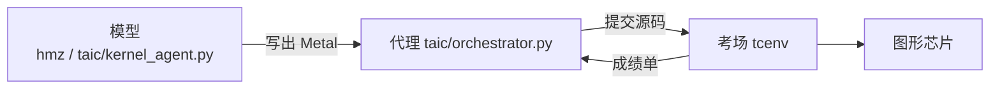

# 代理理论，以及它和这个仓库的关系

这是一份学习笔记，不是操作手册。仓库怎么跑见 [架构说明.md](架构说明.md)，做不到什么见 [诚实说明.md](诚实说明.md)。

先记住三句：

1. 没有一门叫「大模型代理学」的新理论。开源代理多，是因为同一套老循环已经做成了程序。
2. 这个仓库对得上三块：模型写文字，搜索程序决定留谁，评测程序执行并打分。默认两个模型轮流写，不是从头到尾同一个对话。
3. 理论用来判断「这一改有没有好处」。对不上事实的做法，不因为名字经典就加进来。

## 模型、代理、考场

一次搜索就是：评测给出观察，搜索程序决定下一步，当值的模型交出一份 Metal 源码，评测再执行。图里的「模型」是这一轮当值的那一个。`taic.toml` 里 first 是 `deepseek-flash`，second 是 `kimi-k3`。不写 `--preset` 时走论文预设：大约 15 美元，最多 100 轮，连续 12 轮没有新种子就停。

| 常见叫法 | 在本仓库 | 它做什么 |
| --- | --- | --- |
| 模型 | `taic/kernel_agent.py` 通过 hmz 启动的当值模型；模型和委员会配置来自 `taic/llm.py`。直调 chat 只给实验脚本，仍走 `taic/llm.py` | 读题目和成绩单，写出下一份源码。它不碰图形芯片 |
| 代理 | `taic/`，核心是 `orchestrator.py` | 安排轮次：先写、写错就改、交卷后评测、只留明显更快的、钱或轮数到了就停 |
| 考场 | `tcenv/` | 编译、查安全、对答案、计时，把一段人话交回。提示词里说的 harness 就是它 |
| 试卷 | `tasks/` | 第四块。题目、标准答案、现成库。不是上面三者里的任何一个 |

换模型不用改考场。论文里用的是别的模型，这里只要接口兼容就能换。当前 hmz/pi 搜索里，这两件事是 `TASK.md` 里的命令：读 `msl_reference.md`，以及 `tcenv eval --quick`。`lookup_msl` 和 `quick_check` 仍实现在 `taic/tools.py`（当前只有测试/显式调用使用），当前搜索不注册它们，对应能力改由 TASK 命令提供。

Codex、DeepSeek、智谱、Grok、OpenClaw 这些开源代理，产品各写各的，并没有各自的一条定律。OpenClaw 的文档把 harness 定义成「实现某一次运行循环的程序」，Pi 是它内置运行时的旧名字。那是工程分工用的词，不是一条定理。

## 能当教科书的理论

下面每一条都先说主张，再说它在这个仓库里落在哪。出处写在节末，方便去查原书，不必先背人名。

### 1. 代理和环境的循环

代理观察，做出动作，环境给出新的观察。这是所有后面理论的底子。

这里的观察是成绩单，动作是一份 Metal。模型是「看见历史后说出下一个动作」的函数。代理是决定何时停、留哪一版的外壳。考场是环境的接口。

### 2. 理性代理

在自己相信的前提下，选期望收益最大的动作。收益要单独定义，不能把「模型说自己很好」当成收益。

这里的收益是加速比：比现成库快几倍，并且必须安全、抽查算对。略快但没超过测量误差的，不算赢。贴住理论最快、再改也过不了噪声门槛时，搜索会停（`stop_at_roofline`）。现成库已经快过那个下界时，目标改成库的时间，而不是一个算错了的下界（`target_note`）。

### 3. 部分可观察的决策过程

世界有隐藏状态。代理只能看见一部分。动作改变状态，并带来奖励。数学名字是 POMDP。

模型看不见图形芯片，只能读成绩单。这就是部分可观察。它解释了「为什么必须有考场」，不告诉你提示词该怎么写。

### 4. 有限理性

算力、记忆、时间、钱都有限，所以找一个够用的解，不找数学上的最优。

不写预设时的上限是大约 15 美元、最多 100 轮、连续 12 轮没变快就停。`--preset base` 才是 50 美元、12 轮、连续 6 轮。成绩单写进 TASK 时和失败反馈各截到约 1000 字节，默认只抽 1 份第一稿。这些都是有限理性：钱、轮数和上下文都有限，所以找一个够用的解。

### 5. 信念、愿望、意图

信念是它认为现在为真的东西，愿望是目标，意图是已经承诺、不会每一步都推倒的计划。这套叫 BDI。

这里的愿望是「比当前最好更快」。信念主要是成绩单加最近试过的改法。意图比较弱：每一轮都可以换一组改法。这不一定是缺陷。见下一节为什么没有把「承诺瓶颈」做成功能。

### 6. 认知架构

Soar、ACT-R 这一支做了几十年。要点是：把问题拆成目标，把成功经验收成下次能用的技能，而不是每次从零想。

`backends/metal/skills/` 里的笔记是写死的技能，不是从这次运行里编译出来的。`--from` 才是「把上次赢的那份拿来接着改」，而且必须你自己指明目录。默认仍从头写，因为重复性实验要的是独立样本。

### 7. 经典规划

先有目标，再有带前提和效果的操作，然后搜索一条计划，然后执行。STRIPS、分层任务网络是这一支。

这里的「规划」是模型写的一段自然语言，没有机器可检查的前提。所以不能靠它自己填的标签来删方案。

### 8. 反应式

少做世界模型，感知到就动作。和「先做完整计划」是两极。

编码代理通常两头都要：外面有轮次，里面是一圈很紧的自查。当前 hmz 搜索用 `tcenv eval --quick` 命令；chat function-calling 路径才有 `quick_check` 函数。

### 9. 强化学习

从奖励里学出「看见什么就做什么」。教科书里的做法会改模型权重。

这里不改权重。失败写成成绩单和反馈，进入下一场的 TASK；对话本身不带过去。这是口头上的强化学习，不是那本教科书里的算法。

### 10. 多个代理

多个代理各有目标，用明确的通信协议协作。

本仓库是一个搜索进程、一个考场、两个轮流当值的模型。没有把规划、写代码、评卷拆成三个会互相聊天的模型。

## 大家在用，但还不是理论

这些影响很大，查得到论文，还没有变成「从模型规模推出代理一定成功」的定律。

| 做法 | 它只说明了什么 | 在这里 |
| --- | --- | --- |
| ReAct | 先想一句，再做一个动作，再读观察 | 一轮：规划，改稿，评测 |
| Reflexion | 失败写成一段话，留给下一次 | 成绩单喂回模型 |
| 工具调用 | 动作里除了说话，还有可执行的函数 | `taic/tools.py` 里的 `lookup_msl`、`quick_check`（当前 hmz 搜索不注册，用 TASK 命令） |
| 思维树 | 在文字层面试几条思路再打分 | 当前每轮一场会话、一个交卷；不是多分支树 |
| 上下文压缩、技能文件 | 上下文装不下时的工程办法 | 系统提示尽量稳定，技能按主题摘 |

## 拿这些理论看这个仓库时，不该加什么

「慢在搬数据还是慢在计算」由题目的运算量和字节量对上这台机器的峰值算出来（`tcenv/backends/metal/profile.py` 的 `roofline`）。同一道题每一轮都是同一个答案，成绩单里已经写了，笔记里也写了该怎么改。

所以这些做法没有好处，没有做成功能：

- 再让模型承诺这句瓶颈。它几乎不会在轮次之间翻转，所谓「被证据推翻再换计划」不会触发。
- 让模型自己给方案贴「访存」或「计算」的标签，再按标签删方案。标签错了会丢掉有用的分支；不贴又滤不掉。
- 规划失败时才用到的三份通用改法，少发其中一条。省下的是罕见失败路径上的一次请求。

形式证明也没有加。没有面向 Metal 的证明器，`tcenv/verify.py` 固定回答「不支持」，而且这个结果不决定过不过。详见诚实说明。

## 名字和出处

查阅用。

| 名字 | 去哪看 |
| --- | --- |
| 代理与环境、理性代理 | Stuart Russell、Peter Norvig，《人工智能：一种现代方法》 |
| POMDP | Martin Puterman 的马尔可夫决策过程；Kaelbling、Littman、Cassandra 1998 年的综述 |
| 有限理性 | Herbert Simon |
| BDI | Michael Bratman，《意图、计划与实践理性》；Rao 与 Georgeff |
| Soar / ACT-R | Allen Newell、John Laird；John Anderson |
| STRIPS | Fikes 与 Nilsson，1971 |
| 反应式 | Rodney Brooks，1986，包容结构 |
| 强化学习 | Richard Sutton、Andrew Barto |
| 多智能体 | Michael Wooldridge |
| ReAct | Yao 等，2022 |
| Reflexion | Shinn 等，2023 |

## 11. 本仓库的 RSI 外层回路

经典理论解释单次“观察—动作—奖励”循环；这里还多一层：**把反馈变成下一次 harness 的候选改动**。它不是改模型权重，而是改 TASK 措辞、技能、经验库和审查规则；改动是否生效由外层实测、双来源证据和人工信任决定。完整架构、权限梯度、信任生命周期和影子/P2 流程图见 [架构/可信harness.md](架构/可信harness.md)。

一句话区分两层：

- 内层：模型写内核，`tcenv` 判分，搜索决定留哪一版。
- 外层：反馈改进“下一轮怎样写”的 harness，但仓库改动仍由人确认，且只在来源 target/task 上先试用。
