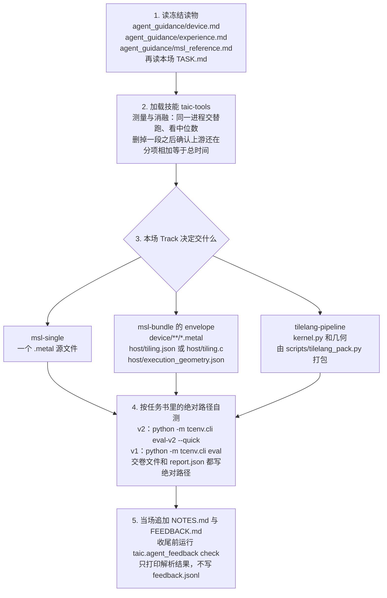
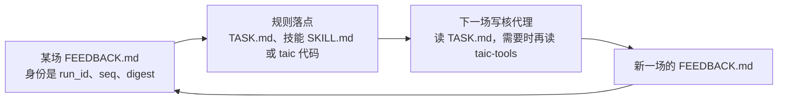

# 写核代理读什么

这一篇给人看，用来核对：写核代理该读哪份文件，一条规则又写在哪个落点里。正在写核的模型读本场工作目录里的 `TASK.md`；要做测量或消融时，再读技能 `taic-tools`。它不读这篇。

每条规则都指回一次真实搜索：`runs/apple-m4-max/conv2d-feedback-20261021`（2026-10-21）。编号、过期和人工复核见 [代理反馈.md](代理反馈.md)。下文的 **seq** 是该次运行 `feedback.jsonl` 里的反馈序号；`r1.p0` 这类标签是当场会话名，一轮一场。

## 两个倍数，对外只用确认复测

同一次搜索会留下两个倍数：

| 数字 | 它是哪一次测量 | 写不写进 `TASK.md` |
| --- | --- | --- |
| 1.728 | 搜索过程中最好的一版，会话 `r19.p0` | 不写。写核代理改不了确认复测 |
| 1.690 | 换一批输入做确认复测之后的倍数 | 对外只报这个 |

## 单场写核代理从读题到交卷的完整流程

一场会话按五步走。前两步只读开跑时冻住的材料，第三步才写候选，第四步用任务书里印好的绝对路径自测，第五步在收尾前把笔记和反馈写完。



`uv run --directory <repo>` 会把工作目录换成仓库根。任务书里的交卷文件和 `report.json` 因此必须是绝对路径。

## 规则怎样进到下一场



改规则就改「写在哪」那一列，不要改 `TASK.md` 的临时副本。想推翻一条规则时，先按「依据」列把那次反馈重算一遍。

| 列 | 内容 | 怎么用 |
| --- | --- | --- |
| 规则 | 代理要遵守的一句话 | 判断它属于任务书约束，还是技能里的方法 |
| 写在哪 | 规则的落点文件或函数 | 改规则就去改这里 |
| 依据 | 真实运行里的哪一场、哪一条反馈 | 推翻规则前先复算这条证据 |

## 规则落点

| 规则 | 写在哪 | 依据 |
| --- | --- | --- |
| 交卷文件依 Track 而定。`msl-single` 的文件名是「题目-dtype-规模-场次.metal」；这一版合格并且更快，就用 `cp` 复制成交卷名。`msl-bundle` 交一份 envelope，里面是 `device/**/*.metal`、`host/tiling.json` 或 `host/tiling.c`，以及 `host/execution_geometry.json`。`tilelang-pipeline` 交 `kernel.py` 和几何，由 `scripts/tilelang_pack.py` 打包。还没有合格版时放最近一版，不把种子原文抄进去 | `TASK.md` 的「约束」。收尾提示在 `taic/flows/kernel_once/__init__.py` 的 `_wrap`：单文件路径已经在就不重写，不在就 `cp`。bundle 与 TileLang 走各自的 `track_style` | 交卷文件不存在，就是这场没有交回内核。第二个委员会（second）的 12 场里，7 场没有写出 `FEEDBACK.md`（会话 `r2`、`r4`、`r6`、`r8`、`r10`、`r14`、`r18`）。其中 5 场连 `NOTES.md` 也没有，因为收尾回合先写核，笔记排在后面 |
| `NOTES.md` 和 `FEEDBACK.md` 在当场追加，不要留到收尾再补 | `TASK.md` 的「这个系统怎么工作」 | 同上 |
| 自测命令里的交卷文件和 `report.json` 使用绝对路径。对种子复测时，换成绝对路径的 `kernel.metal` | `TASK.md` 的「验证命令」「评测命令」和「当前现场」 | 反馈 seq 2（会话 `r1.p0`）、seq 6（会话 `r5.p0`）、seq 22（会话 `r21.p0`）：`uv run --directory` 把工作目录换成仓库之后，相对路径找不到文件 |
| 前提只写文末那两种模板。探针格只写一个文件名 | `TASK.md` 的「这个系统怎么工作」 | 反馈 seq 10（会话 `r9.p0`）把「会不会算错」和「误差多大」分成两条。会话 `r20` 到 `r23` 又自创了一种竖线格式，因为上一场提示里就是那样写的 |
| 写完运行 `uv run --directory <repo> python -m taic.agent_feedback check <work>/FEEDBACK.md --work <work>`。它只打印解析结果，不写 `feedback.jsonl` | `TASK.md` 里给出的命令使用绝对路径 | 降级、空 digest、占位和截断要在交卷前看见 |
| 比较两版或做消融之前，先读技能的「测量」节：同一进程里交替跑，看中位数；删掉一段之后确认上游还在；分项相加等于总时间 | `taic/flows/kernel_once/skills/taic-tools/SKILL.md` 的「测量」 | 反馈 seq 4（会话 `r3.p0`）三次 `--timed` 相差几十微秒。seq 6 和 seq 8（会话 `r5.p0`、`r7.p0`）做消融时把上游一起删掉，或者 sink 只活在永不成立的分支里。seq 8 的分项加起来不等于总时间。seq 18（会话 `r17.p0`）要求配对比较 |
| 动手前先读本目录的 `device.md` 和 `experience.md`，再查仓库 `docs/`，以及本运行 `agent_work/*/NOTES.md` | `TASK.md` 的「这个系统怎么工作」 | 反馈 seq 1（会话 `init`）把 `experience.md` 里的「32 个累加器片段就溢出」用到了这道题上 |
| 某一节没有内容，就整节省略。整份都没有内容，就不要建 `FEEDBACK.md` | `TASK.md` 里「没有内容就不要写」那几句 | 15 条「需要帮助」里，7 条是「无。」，1 条是「（空）」 |
| 缺权限、sudo、许可证或凭据时，当场写 `# 需要帮助`。即使能绕开，也要写。这类命令不进自动提案 | `TASK.md` 的「这个系统怎么工作」点出时机；`HARNESS.md` 写清缺什么、下一步，以及不进运行内 overlay | `harness-pilot-active-20261022` 的会话 `r1.p0` 碰到 `sudo xcodebuild -license` 之后继续计时，没有写这一节 |
| 已实测的前提按命题去重，单独保留最近 1800 字符，不占普通提示的 8 条。未验证、降级和普通避坑共用 8 条和 1200 字符；整段进 `TASK.md` 之前再按 1500 字节裁剪。未验证和降级从写出的那场再出现两场 | `taic/agent_feedback.py` 的 `peer_tips_for`。给人看的说法在 [代理反馈.md](代理反馈.md) | 反馈 seq 13（会话 `r12.p0`）：会话 `r9` 的 fp16 实测数字没有进下一场提示 |
| `device.md`、`experience.md`，以及后端 reference skill（Metal 下是 `msl_reference.md`），在新运行开始时冻进 `run_dir/agent_guidance/`。`run_config.json` 记下这三份和 `SKILL.md` 的 sha256 | `taic/orchestrator.py` 的 `_agent_guidance_record` | 这几份以前每场都从仓库现拷。运行中途改了仓库，后面几场就会读到新版 |

前提只写下面两种。方括号里的竖线是分隔符：

```text
[已实测: 文件名 | 一句命题 | 数字和单位]
[未验证 | 一句命题 | 为什么没测]
```

`experience.md` 的反馈 seq 12（会话 `r11.p0`，矩阵单元与 FMA 的实测速率）已经入库。seq 12 的第二部分（报告稳定打印各分项消融）仍是开放项。harness 的 P2 自动追加只写一行 `- [harness <proposal_key>] <action>`，溯源在 `harness_decisions.jsonl`。人工入库的条目要写机器、日期和来源运行。
