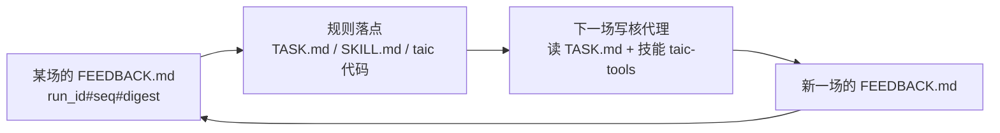

# 写核代理读什么

这一篇给人看。写核的代理不读这篇。它读这场的 `TASK.md`，需要时再读技能 `taic-tools`。下面每条规则写在哪个文件里，以及它对应 `runs/apple-m4-max/conv2d-feedback-20261021`（2026-10-21）里的哪一条反馈。编号规则在 [代理反馈.md](代理反馈.md)。

两个数字先说明白：搜索过程最好是 `r19.p0` 的 1.728 倍，确认复测是 1.690 倍。对外用后面这个。代理左右不了确认复测，所以这句话不写进 `TASK.md`。

## 怎么用这张表

表里三列不是同一类东西：

| 列 | 内容 | 怎么用 |
| --- | --- | --- |
| 规则 | 代理要遵守的一句话 | 判断它属于「任务书约束」还是「技能方法」 |
| 写在哪 | 规则的落点文件或函数 | 改规则就去改这里，不要改 `TASK.md` 的临时副本 |
| 依据 | 真实 run 里的哪一场、哪一条反馈 | 想推翻规则时先复算这条证据 |

一张图看规则是怎么转起来的：

| 规则 | 写在哪 | 依据 |
| --- | --- | --- |
| 交卷文件是 `{题目}-{dtype}-{规模}-{场次}.metal`。自测合格且更快就用 `cp` 复制过去。还没有合格版时放最近一版，不抄种子 | `TASK.md` 的「约束」。收尾提示在 `taic/flows/kernel_once/__init__.py` 的 `_wrap`：文件已经在就不重写，不在就 `cp` | 交卷文件不存在就是这场没交回内核。second 委员会 12 场里 7 场没写出 `FEEDBACK.md`（`r2` `r4` `r6` `r8` `r10` `r14` `r18`），其中 5 场连 `NOTES.md` 也没有，因为收尾回合先写核，笔记排在后面 |
| `NOTES.md`、`FEEDBACK.md` 当场追加，不要留到收尾 | `TASK.md` 的「这个系统怎么工作」 | 同上 |
| 自测命令里的交卷文件和 `report.json` 是绝对路径，不要改成相对路径。对种子复测时换成绝对路径的 `kernel.metal` | `TASK.md` 的「验证命令」「评测命令」和「当前现场」 | seq 2（`r1.p0`）、seq 6（`r5.p0`）、seq 22（`r21.p0`）：`uv run --directory` 把工作目录换成仓库，相对路径找不到 |
| 前提只写两种：`[已实测: 文件名 \| 一句命题 \| 数字和单位]`、`[未验证 \| 一句命题 \| 为什么没测]`。探针格只写一个文件名 | `TASK.md` 的「这个系统怎么工作」 | seq 10（`r9.p0`）：「会不会算错」和「误差多大」是两条。`r20` 到 `r23` 用了自创的竖线格式，因为上一场提示里就是那样写的 |
| 写完跑 `uv run --directory <repo> python -m taic.agent_feedback check <work>/FEEDBACK.md --work <work>`。它只打印解析结果，不写 `feedback.jsonl` | `TASK.md` 里给出的命令是绝对路径 | 降级、空 digest、占位和截断要在交卷前看见 |
| 比较两版或做消融之前读技能的「测量」节：同一进程交替跑、看中位数；删掉一段之后确认上游还在；分项相加等于总时间 | `taic/flows/kernel_once/skills/taic-tools/SKILL.md` 的「测量」 | seq 4（`r3.p0`）三次 `--timed` 差几十微秒。seq 6、seq 8（`r5.p0`、`r7.p0`）消融把上游一起删掉，或 sink 只活在永不成立的分支里。seq 8 分项加起来不等于总时间。seq 18（`r17.p0`）要求配对比较 |
| 动手前先读本目录的 `device.md` 和 `experience.md`，再查仓库 `docs/`、本运行 `agent_work/*/NOTES.md` | `TASK.md` 的「这个系统怎么工作」 | seq 1（`init`）把 `experience.md` 里的「32 个累加器片段就溢出」用到了这道题上 |
| 某一节没话说就整节省略。整份没有内容就不要建 `FEEDBACK.md` | `TASK.md` 里「没有内容就不要写」那几句 | 15 条「需要帮助」里 7 条是「无。」，1 条是「（空）」 |
| 缺权限、sudo、许可证、凭据时当场写 `# 需要帮助`。能绕开也要写。命令不进自动提案 | `TASK.md` 的「这个系统怎么工作」点出时机；`HARNESS.md` 写清缺什么、下一步，以及不进 overlay | `harness-pilot-active-20261022` 的 `r1.p0` 碰到 `sudo xcodebuild -license` 后继续计时，没有写这一节 |
| 已实测的前提按命题去重，单独保留最近 1800 字符，不占普通提示的 8 条；未验证、降级和普通避坑共用 8 条和 1200 字符，整段进 `TASK.md` 前再按 1500 字节裁剪。未验证和降级再出现两场 | `taic/agent_feedback.py` 的 `peer_tips_for`。人读的说法在 [代理反馈.md](代理反馈.md) | seq 13（`r12.p0`）：`r9` 的 fp16 实测数字没进下一场提示 |
| `device.md`、`experience.md`、与后端 reference skill（Metal 下是 `msl_reference.md`）在新运行开始时冻进 `run_dir/agent_guidance/`。`run_config.json` 记下这三份和 `SKILL.md` 的 sha256 | `taic/orchestrator.py` 的 `_agent_guidance_record` | 这几份以前每场从仓库现拷，跑到一半改仓库，后面几场就读到新版 |

`experience.md` 的 seq 12（`r11.p0`，矩阵单元与 FMA 的实测速率）已入库；seq 12 的第二部分（报告稳定打印各分项消融）仍是开放项。harness 的 P2 自动追加只写一行 `- [harness <proposal_key>] <action>`，溯源在 `harness_decisions.jsonl`；人工入库的条目要写机器、日期和来源运行。
