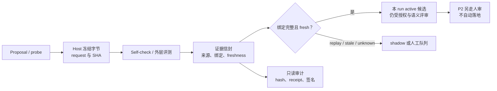

# plan-04：证据链与可信执行记录

状态：设计计划，尚未实现。本文只做离线设计；默认步骤不调用模型、不使用 GPU，也不改变现有发布门。

## 当前决定

- **本批只做**：只读证据盘点与审计，区分谁写的记录、绑定了什么、是否回放、哪些字节未验证；缺失一律 `unknown/downgraded`。
- **输入**：run 内 proposal/probe、self-check、outer report、outbox/receipt 与 overlay/P2 引用；不重放 GPU。
- **本批不做**：旧 host 记录降级为 shadow 的产品切换、第二套 `legacy_exception` 批准格式、签名改造或任何 active 变化；这些须另批并走信任授权。
- **完成产物**：proposal → probe → self-check/outer result → overlay/P2 的只读链条与孤儿/缺失清单，不重跑 kernel。
- **失败去向**：先读 `logs/pytest/triage/triage_summary.md` 及 handoff；`evidence audit` 与新测试未实现前不得写成已通过。

## 1. 角度与问题

本文只讨论一条测量或 probe 证据从**产生、绑定、消费到事后审计**的链路。必须把两个问题分开：

1. **谁写下的这条记录？** 是 agent、工作区镜像、宿主进程、外层 orchestrator，还是远程受信评测服务；这决定来源与完整性上限。
2. **这条记录证明什么？** 一次内核计时只能证明指定字节、配置和执行端产生过某个报告，不能自动证明任意 probe 被执行，更不能证明一条泛化的硬件命题。

因此，`trusted_record=true` 不应再是结论的全部；机器还要能回答来源、绑定、freshness、是否回放、验证过哪些字节，以及未能验证什么。已知差距已经写在 `docs/可信harness/架构与理论.md:407-421` 和 `docs/可信harness/架构与理论.md:411-419`：本机 self-check 不是签名，下一步是外层报告绑定与评测器签名。

目标证据链可概括为下图；这里全是后续设计，不代表当前已实现或自动获得 active/P2 权限。



外部材料只作动机：KDA 的强外部 judge、逐元素 + relative-L2 双门、强制终态输出、真实负载与 secret-seed probe 说明“判断在提出者之外”的价值；这些细节来自团队既有评审，本文未重新核验。2606.10749 的 provenance-aware state 也只提供方向，不替代本仓库的绑定测试（`docs/可信harness/papers/导读.md`）。

## 2. 目标 / 非目标

### 目标

- 建立可机读的证据信封、证据强度、绑定状态和 freshness 状态；等级由宿主验证后推导，不能由 agent 自报。
- 从执行入口保留完整 `EvaluationResult`/receipt/provenance，避免到 `premise` 门前只剩几个报告字段。
- 让 active 证据绑定同一 run/session/target/protocol/kernel/probe/evaluator epoch，并显式区分真实执行、缓存和回放。
- 提供严格只读的离线审计：重算哈希、核对引用和验签，不重跑 kernel，不改写历史 run。
- 最后才复用并补齐远程签名、轮换和泄露降级路径；无密码学时也有可用的宿主绑定中间档。

### 非目标

- 不决定谁能获得 grant、何时 shadow/active 或如何撤销权限；那是 plan-03。
- 不评价提案是否写得好、reviewer 是否独立或硬件命题是否过度泛化；那是 plan-05。
- 不重设计差分、容差、正确性、反作弊或确认发布门（plan-01），也不设计 sandbox、注入和进程隔离（plan-06）。
- 不把签名当作数值真实性证明，不自动 P2，不默认进行真实远程、GPU 或付费验证。

## 3. 现状证据与缺口

### 3.1 已经绑定、已经钉住的部分

- `_fresh_probe` 要求相对路径、解析后仍在本场 work、文件存在，并记录 SHA-256；有 `session_started` 时要求 mtime 不早于开始前 1 秒，缺开始时间则标为未验证（`taic/harness.py:236-275`）。`settle` 还要求 `probe_time_verified` 和 probe SHA（`taic/harness.py:864-895`）。
- host authority 路径不读 agent 可控的 `HOME`，而由 OS 账户数据库推导，并以 canonical 目录哈希命名（`tcenv/selfcheck.py:27-46`）；写入时尝试设置目录 0700、文件 0600（`tcenv/selfcheck.py:113-125`）。`premise` 只读 authority log，不读工作区 mirror（`taic/harness.py:469-490`），伪造 mirror 和 simulated 行已有回归测试（`tests/shared/test_harness.py:404-427`）。
- split-control bridge 由 host 固定 task/target/run/session 等配置（`taic/selfcheck_bridge.py:49-83`），self-check 禁用缓存（`taic/selfcheck_bridge.py:111-141`）。host 写 timed 行时已带 target/protocol/kernel SHA、`request_id`、`request_digest`、`receipt_id` 和 measurement kind（`taic/selfcheck_bridge.py:255-292`）。
- `trusted_premise_record` 已过滤非 `ok`、simulated、不同 target/protocol/kernel，并将文本数字与 `candidate_us` 或 `speedup` 对账（`taic/harness.py:518-569`）。orchestrator 在外层 `status=ok` 时构造报告证据并重算提交内核 SHA（`taic/orchestrator.py:2471-2482`）；无 self-check 时的 outer-report 路径已有测试（`tests/shared/test_harness.py:430-450`）。
- 远程侧并不是“完全没有签名”：`EvaluationResult` 已有 report/provenance/evidence/receipt/signature 信封（`tcenv/evaluation.py:263-297`），service 可签 HMAC（`tcenv/remote/service.py:690-692`），client 与 outbox 都会在校验/回放时验签或拒绝未配置密钥的签名（`tcenv/remote/client.py:462-473`、`taic/evaluation_outbox.py:111-120`）。
- 通用 tool broker 已记录 request/result、request digest、manifest 与 handler source 哈希（`tcenv/tools/broker.py:100-127`）；但这不等于 `premise` 已获得与 probe/session 绑定的受信 `tool_probe` 回执，后者仍被明确列为未实现（`docs/架构/执行运行时与设备扩展.md:395`）。

### 3.2 明确的伪造面、回放面与语义断点

- authority log 仍是本机 JSONL，不是签名；权限位和“append-only”只防部分误写，不能抵抗同账户/宿主被控制后的整文件重写。宿主写入失败还会退回只留 mirror（`tcenv/selfcheck.py:162-171`），所以缺失必须降级而不是补造信任。
- probe SHA 目前只在提案侧，self-check 行没有 probe SHA；mtime 也是可修改的文件元数据。于是一个“新 probe 文件 + 同内核计时行”并不能证明该 probe 被执行，更不能证明它测的是该 premise。
- `_measurement_has` 从整段文字取任一非零数，单位不参与比较；容差是 `max(0.01, |number| * 1%)`（`taic/harness.py:493-515`）。同一个绝对值用于微秒和无量纲 speedup，且文本中的另一个数字也可能误配。
- 正式评测在 orchestrator 中被还原为 `EvalReport` 返回（`taic/orchestrator.py:1357-1451`），到 premise 门时丢了完整 provenance/receipt/signature、request 和缓存来源。搜索又存在复制报告与缓存复用路径（`taic/orchestrator.py:1492-1505`），outer report 不必然是“本场新测”。
- outbox 的同 request/digest/epoch 回放是幂等特性，不是新测量（`taic/evaluation_outbox.py:122-182`）。当前没有把 `executed_at`、`observed_at` 和 replay origin 分开，审计就无法诚实地区分二者。
- run 目录是原始事实、SQLite 是派生索引（`docs/架构/数据层.md:27-36`）；但证据文件归档/裁剪后，仅存路径和 SHA 不能保证仍可重放内容（`docs/架构/数据层.md:125-133`）。本地台账没有外部锚定时，也不能声称防恶意篡改。

## 4. 证据强度分级方案（后续设计，本批只审计不切换 active）

新增 `evidence_level`，同时使用独立的 `binding_status`、`freshness` 和 `verification` 字段；等级只表示**来源与可验证完整性**，不表示命题为真。下表是证据可驱动行为的上限，仍须满足 plan-03 的 grant 和 plan-05 的人审，不是自动许可。

| level | 来源与最低验证 | 最远可驱动行为 |
| --- | --- | --- |
| `E0_AGENT_CLAIM` | FEEDBACK/自述数字，无独立产物 | 只存档，不驱动 shadow、active 或 P2 |
| `E1_WORKSPACE_ARTIFACT` | 工作区 probe/mirror；只能核路径、内容 SHA、mtime | 只进人工队列，不能作为 measured premise |
| `E2_HOST_RECORD` | host authority 或 host tool 记录；本地、未签名，基本 target/protocol/kernel 绑定 | 只能 shadow。旧格式是否继续驱动 active 是单独产品决定，必须复用 plan-03 的具名授权与适用范围，**不得用 `legacy_exception` 另造第二套批准格式**；未作该决定前一律只读/降为 shadow，不能靠「现役」事实自动延命 |
| `E2H_HOST_BOUND_EXECUTION` | **无密码学的务实中间档**：host 执行时写下 request/digest/receipt（若有）、epoch、时间和实际执行的 probe SHA，并能交叉核对 | 同 run active；可形成 P2 人审材料，但不能自动 P2 |
| `E3_OUTER_EVALUATION` | orchestrator 直接保留的外层报告/完整信封，request、candidate、epoch、来源和 freshness 均可核 | 同 run active；P2 仍需具名人审与独立验证 |
| `E4_REMOTE_SIGNED` | 预期 site/epoch/key 下的远程服务签名，收信及每次回放均验签 | 完整性高于 E3，但行为上限不提高；仍不自动发布或 P2 |

旧记录缺字段时标 `LEGACY_UNVERIFIED`，不得凭文件名、路径或 `trusted_source` 字符串升级。缓存/回放可以把来源评为 E3/E4，但 `freshness=replay` 会另阻止它充当“本场新测”。

`evidence_level` 与验证语义正交：`verification={kind:formal|execution|model_judgment|intrinsic|none,statement_digest,checker_or_config_digest,coverage}` 另记验证对象和覆盖范围；`formal` 还必须绑定待证命题、proof artifact 与 checker，执行通过不等于正确，model/intrinsic 不得冒充 execution/formal。E4 只提高“谁签了哪些字节”的保证，不提高验证语义。
每份可消费记录还须标 `evidence_role=result|process|contrast`；process/contrast 不能单独满足 measured premise。更长的 trace、更多同模型 probe 或另一个模型的 judge/probe 都不提升 level，也不能把 `supports` 改写成 correctness/premise_verified。

## 5. 绑定与新鲜度设计

### 5.1 一份证据信封要绑什么

建议新增版本化 sidecar，而不先改坏旧 JSONL；至少包含以下宿主生成或冻结的字段：

- 身份：`schema_version`、`evidence_id`、`kind=selfcheck|formal|tool_probe`、`source_class`、`evidence_role`、推导出的 `evidence_level`。
- 会话：`run_id`、`session_id`、会话 label；`feedback_seq`/`proposal_key` 在 `_record_feedback` 对账时补绑，不能由模型填写；另存 `claim_id`、`claim_digest`、`revision_of_claim_digest`。
- 执行：`request_id`、`request_digest`、`receipt_id`、`site_id`、`evaluator_epoch`、`measurement_kind`、`cache_policy`、`origin=executed|cache|outbox_replay`、`execution_attempt_id`、`reproduction_of`、`executor_config_digest`；配置摘要覆盖实际 harness/model/环境、stage 清单和 detector 版本。
- 对象：`task_fingerprint`、task/dtype/size、`target_id`、`protocol_version`、实际候选字节的 `kernel_sha256`；probe 还必须有 `probe_sha256` 和 `probe_request_digest`。
- 过程：result 只放终态/measurements；process 另存 host 可见的 `stage_records[{stage,status,reason,request_digest,artifact_sha256}]`、`stage_manifest_digest`、`trace_digest`、`trace_completeness`、`termination_reason`，stage 状态区分 `passed|failed|skipped|not_run|blocked`；contrast 存 baseline/candidate evidence id 与 matched-config digest。
- 失败信号：确定性 `observation={signal,detector_id,detector_version,source_artifact_sha256,coverage}` 与模型 `attribution` 分栏；后者固定为 `hypothesis`，`coverage=partial|unknown` 时“未检出”不得写成“未发生”。
- 审计：host 的 `executed_at`/`observed_at`、会话起止、结构化 measurements、artifact 的相对路径/字节数/SHA，以及可选 signature/key id；密钥和 token 永不入信封。

绑定规则如下：

1. run/session/target 来自 `SelfCheckConfig` 或 `EvaluationRequest` 的 host 配置；seq 只用于 feedback/proposal 对账，request id 才是执行幂等键。request digest 继续绑线上请求与候选字节（`tcenv/evaluation.py:153-178`、`tcenv/evaluation.py:356-360`），candidate SHA 必须重算；同时保留可重算 digest 的 canonical request/执行描述符和 candidate artifact，只存 digest 不能事后证明 run/session。
2. 每次使用前重核 receipt/request/candidate，epoch 必须匹配当前 evaluator 与 run 的 `execution.json.observed`（`taic/orchestrator.py:1414-1426`）；formal 远程结果再与 outbox 对账，同 receipt 不同 digest 是冲突，不是第二条证据。
3. host 在执行前读取并冻结 probe 字节，记录“读到的 SHA 就是执行的 SHA”，并保存 host-owned 快照或有界内容描述符；之后路径被替换只会使审计失败，不能静默通过。
4. `kind=selfcheck` 的内核计时行不能冒充 `tool_probe`。没有 probe 执行绑定时，只可写 `supports=kernel_measurement`，不得写成“probe 验证了 premise”；命题语义是否超出测量仍交人审。
5. overlay 不只保存 `evidence_sha256`，还保存 evidence id、record digest、level 和绑定策略版本；消费时重新验证，而不是永久相信首次 settle 的布尔值。
6. result 与 process 以同一 `execution_attempt_id` 对账；必需 stage 缺失、失败或 `not_run` 时不得从终态成功反推其已通过。`trace_completeness` 只表示相对 host stage manifest 的覆盖，不表示 agent 自述完整或命题语义完整。
7. 以 probe 验证修订效果时，host 在执行前冻结 `contract_digest`（`change_digest`、目标对象、`should_fix`/`at_risk` 及各自预期观察），事后逐项链接 `expected_observation_id → evidence_id → confirmed|missed|regressed|untested|inconclusive`；aggregate verdict 不得吞掉 miss/regression。合同只增加可审计绑定，不提升 level，也不能用旧证据填新预测。
8. revision/contrast 链接不可改写；local pairwise 只支持该比较范围，不能声称全局或单调改进。缓存 baseline 仍是 replay，同一输出的重复读取也不是独立测量。事后 judge/score 只能生成带 `observed_at` 的派生记录并链接原 evidence id，不得回写原执行时的 `verification`、`supports` 或 `freshness`。

### 5.2 probe 时间、数字、单位与容差

- mtime 只保留为诊断。`freshness=fresh|replay|stale|unknown`：`fresh` 要求 `origin=executed`、独立 `execution_attempt_id`（有 receipt 时亦须独立）、执行位于当前 run/session 窗口，且 claim/contract/probe/kernel/epoch/executor 配置均为当前摘要；任一对象修订后旧证据标 `stale` 并保留具体 binding mismatch。缺 host 时间则为 `unknown`，不能拿反馈落盘时间顶替。
- 新格式用 `measurements:[{metric,value,unit,evidence_id}]` 代替“从一句话找数字”。`candidate_us` 统一规范到 `us`，speedup 统一为无量纲 `ratio`；缺单位、单位冲突、非有限值、非法值域或多个不同记录同时歧义匹配均失败关闭。
- 旧文本兼容仍按现行 `max(0.01, |number| * 1%)`，并明确 0.01 在 candidate_us 行是微秒、在 speedup 行是 ratio；不为新格式暗中放宽。新格式保存容差策略版本和实际 delta，容差只用于展示值对账，不把两次执行合成一次。
- 一个数字匹配只证明报告字段与提案引用一致；它不证明 probe 命令、测量对象或 premise 文本语义相同。

### 5.3 缓存、复用与可回放性

- 原始 `executed_at`、origin 和 evidence id 永不因缓存命中而改写；新的读取只增加 `observed_at` 和引用。复制证据不会提高等级，也不会产生第二次独立测量。
- self-check 当前已禁缓存；新增字段要覆盖本地 formal cache、复制报告和 outbox replay。active 的“本场新测”只接受 `freshness=fresh`；replay 可进人工队列或明确标名的 shadow。
- “可回放”分两层：离线审计能重算 digest、核对 artifact、receipt 和签名，这是默认验收；重新执行同一 request 是计算复现，可能使用 GPU/付费服务，**需人工授权**，绝非默认。计算复现必须产生新 evidence id/attempt/receipt（若有）/`executed_at` 并以 `reproduction_of` 指向原记录；不得改写原记录或仅凭同 request digest 把多次读取算作多次执行。
- artifact 丢失、快照 SHA 不符或 epoch 缺失时保留记录并降级为不可驱动，不能从 SQLite 摘要反推原始证据已存在。

## 6. 可选签名与哈希链路径

1. **先复用现有信封。** 不另造一套只给 premise 的签名格式；以 report/provenance/evidence/receipt 的 canonical 字节为基础（`tcenv/evaluation.py:325-348`），补上版本化 key id、issued_at 和 evidence/probe 描述符。run/session 经 request digest 间接入签名，签名中仍要可独立核对。
2. **谁签、密钥在哪。** 只有受信 evaluator/RemoteService 在 worker 终态校验后签，agent、workspace 和 bridge 不签。HMAC 私钥只放 evaluator host 的 0600 文件或受控密钥服务，验签副本走现有 `signature_key_file` 配置；均不得进入 repo、run、日志或模型环境。
3. **如何验证。** 收信、outbox 完成/回放、premise settle 和离线审计都验证 canonical bytes、key id、site/epoch、request/receipt/candidate/probe 绑定；未知 key、缺 key、坏签名或跨 session 引用失败关闭，不得静默按未签名记录继续 active。
4. **HMAC 的边界。** 验签者也持同一密钥，因此它不是对第三方的不可抵赖证明；若需要公开审计，再单独评估非对称签名，不把它列为前置条件。
5. **哈希链只做辅助。** host 日志可写 `prev_record_digest` 和本行 digest，并周期性把链头锚定到受控外部存储或签名记录。没有独立锚点时，攻击者可整链重算；哈希链只能帮助发现截断/局部改动，不能证明来源、时间或数字。
6. **泄露降级。** 按 key id 撤销并轮换，冻结该 key 新证据的 E4 资格，旧证据进入隔离/人工复核并按剩余独立绑定降级；保留原记录与撤销事件。任何重测或远程恢复都**需人工授权**，不能自动重跑。
7. **签名不能证明“数字是真的”。** 它只证明某密钥持有者签了这些字节；错误评测器、错误输入、被攻陷的受信端、缓存旧值、合法回放以及“报告支持不了命题”都可能在有效签名下发生，可信时钟也不是附带获得的。

## 7. 分阶段步骤

- **Phase 0（本批）：只读审计与证据清单。** 输出 proposal → probe → self-check/outer result → overlay/P2 的来源、绑定、freshness、孤儿引用、SHA/epoch/receipt/signature 与 unknown；只写 stdout 或显式报告，不重跑 kernel、不改 run。
- **后续阶段（本阶段不实现）。** 宿主双写、结构化 measurement、active 规则变化、签名/远程受信记录分别立项。旧 host 记录是否降为 shadow 是单独产品决定，须走 plan-03 的授权，不新增第二套 `legacy_exception` 批准格式；签名仍放最后。

## 8. 验收标准

本批只验收只读审计：每条证据能回答“谁写、签/写了什么、绑到哪个请求和对象、是否本场新测、哪些项未验证”；缺 artifact、epoch、probe 执行关系必须显式 `unknown/downgraded`。伪造 mirror、跨 run/session/target/protocol/kernel/probe/epoch、旧 mtime、cache/outbox replay、单位混淆和坏签名只作为**只读攻击矩阵**回放，不改变 active。失败先读 `logs/pytest/triage/triage_summary.md` 及 handoff。

```bash
# 当前已有回归
uv run pytest -q -n 0 tests/shared/test_harness.py
uv run pytest -q -n 0 tests/shared/test_selfcheck.py tests/shared/test_selfcheck_bridge.py
uv run pytest -q -n 0 tests/shared/test_evaluation.py tests/shared/test_evaluation_outbox.py tests/shared/test_remote_client.py

# 本批实现后才可运行：只读证据审计与新测试
uv run python -m taic.cli evidence audit RUN_DIR --json
uv run pytest -q -n 0 tests/shared/test_evidence_chain.py
```

旧记录降级、E2H/active 规则、`legacy_exception`、签名与真实设备/远程复验均为后续，不是本批完成条件。

## 9. 风险、回滚、边界与参考

- **迁移风险：** 字段多、旧记录不全。以 sidecar 和版本化策略降低耦合；旧记录标未知而非伪造补齐。回滚只停止新 consumer/新 active 规则，保留证据与审计结果；撤销已发 overlay 走 plan-03 既有控制。
- **过严或过宽：** 过严会把历史证据全部废弃，过宽会把 replay 当新测。用 shadow 差异报告校准，但不以通过率自动放松绑定；容差策略变更必须版本化并人审。不得以 `legacy_exception` 作为第二套批准格式或永久豁免；旧证据若需保留 active，必须另批并复用 plan-03 的授权范围与到期约束。
- **宿主/密钥风险：** host 被控制时 E2/E2H 都可伪造，HMAC 验签端泄露也能伪造。不能把 local 当安全边界（`docs/架构/执行运行时与设备扩展.md:513`）；泄露后按第 6 节降级，而非删除证据。
- **语义风险：** 最强执行记录也可能支持不了 premise 的广泛措辞；plan-04 只交付可追溯证据包，不替 plan-05 下结论。
- **边界：** plan-01 管数值/正确性/发布门，plan-03 管授权与撤权，plan-05 管评审质量和命题语义，plan-06 管不可信代码的运行隔离；本文只定义这些决定所依赖的证据来源、完整性、绑定、freshness 与审计。

## 附录：文献与变更索引

只作查阅，不再逐轮重述正文；论文数字均未在本仓库复现。

| 日期 | 影响位置 | 证据文件 |
| --- | --- | --- |
| 2026-10-25 | 文献对应的正文规则与边界 | `2607.15524_recursive-harness-self-improvement.pdf`、`2608.10178_one-recipe-many-harnesses.pdf`、`2607.07663_rsi-survey-bounded-to-autonomous.pdf`、`2610.14224_harness-squared-recursive.pdf`、`2606.10749_secure-llm-agents.pdf` |
| 2026-10-26 | 当前决定、阶段、验收与跨 plan 归属 | `审核意见-plan-01至09.md` |
