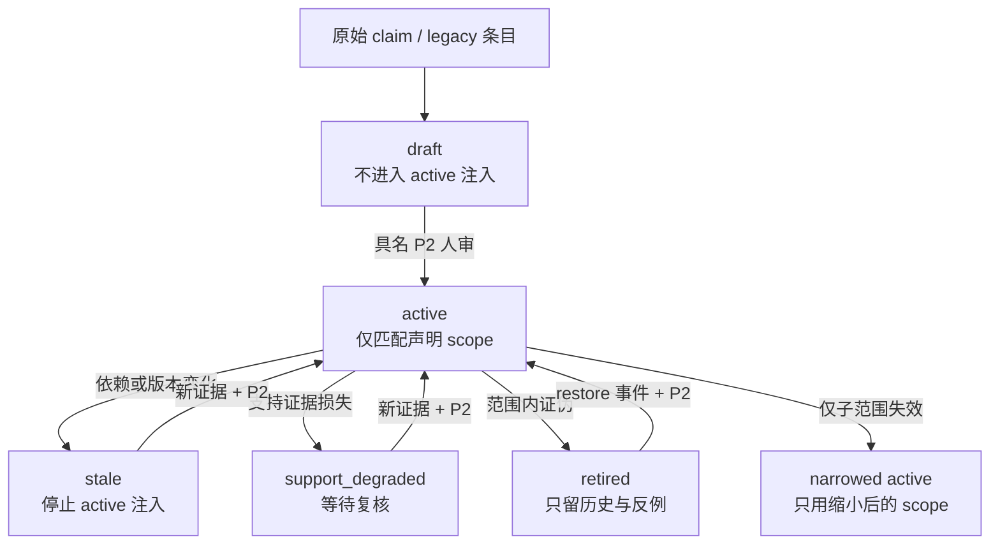

# plan-07：经验知识生命周期

状态：设计计划，尚未实现。默认只做只读盘点、离线测试与 dry-run；不改变现有搜索、信任、提示或发布门。任何真实模型评审、搜索或设备重验均为「需人工授权」，且不是默认步骤。

## 当前决定

- **本批只做**：先数条目/字节与来源；第一批行为仅不透明 `entry_id`、单 key 撤回、`reported`/retired 不进入 staging/TASK。
- **输入**：`targets/<id>/experience.md`、run feedback/overlay/peer、staging 与 TASK 渲染结果。
- **本批不做**：artifact/composition、跨 target 迁移、自动写入/删除、复杂重验或 GPU/付费评审；条目确实增长后再单独立项。
- **完成产物**：只读盘点、旧条目 ID 映射、撤回与检索退场离线测试；原始反馈和审计历史不改写。
- **失败去向**：先读 `logs/pytest/triage/triage_summary.md` 及 handoff；`experience audit` 未实现前不得当成现有命令。

## ① 角度与问题

本文追踪一条主张的完整生命：**入库、标注、过期、纠错、删除、迁移、减量**。核心不是把更多反馈塞进 wiki，而是让 active 语料始终可追、可反驳、可退场；原始反馈与审计历史则另处完整保留。

当前断点是：run 内提示会老化，claim 索引有退役墓碑，但仓库经验的 P2 生成器只会追加一行，没有经验条目的统一身份、反向依赖、重验和退场协议（`taic/harness.py:1172-1207`）。因此「看板上已 refuted」不等于「下一场不再读到」，更不等于「已入库经验被修正」。

设计遵循三条仓库既有原则：未经验证的反馈不能自动变成知识（`docs/KDA框架与本工程对比.md:173`）；scope 是命题的一部分，不是检索时的可选过滤器；删除 active 内容不等于删除历史。KDA² 的「删错、收紧标签、改善搜索」是方向（`docs/外部框架经验.md:186-193`），不是自动写入许可。

下文的状态迁移可先看这张图；每次恢复或修订仍须新证据与具名 P2，历史事件不擦除。



## ② 目标 / 非目标

### 目标

- 为经验建立稳定 `entry_id`、来源与证据引用、精确适用范围、验证时间、反例、替代关系和生命周期状态，同时读取现有 Markdown 与 `[harness <key>]`。
- 从被证伪的父 claim 或子命题反向找到所有派生经验；run 内能停止后续注入，仓库级能经人审修正、缩窄、替代或退役。
- 明确同 target 跨 run、跨 task/dtype/protocol/target/model/effort 的迁移规则；默认不扩大原命题范围。
- 将 active、candidate、archive 分开，建立条数/UTF-8 字节预算、确定性排队与完整冻结清单，避免知识挤掉当前成绩和失败反馈。
- 先交付严格只读质量报告，再交付人审标注/退场，最后才评估任何自动写入。

### 非目标

- 不重做证据签名与证据分级（plan-04）、review rubric 与命题语义裁判（plan-05）、信任生命周期（plan-03）、效果实验（plan-02）、注入与沙箱（plan-06）、评测正确性门（plan-01）。
- 不把 `Confidence`、`useful`、重复出现次数或 quorum 当作永恒真值；不承诺经验库一定提速，效果判断只走 plan-02 接口。
- 不重写 `feedback.jsonl`，不自动 apply/commit/push，不自动删除共享经验、skill、审计或原始 run；不默认做 GPU/付费重验。

## ③ 现状证据

### 3.1 通道、写权限与退场能力

| 通道 | 谁能写、谁能改 | 谁能删/如何失效 | 当前范围与缺口 |
| --- | --- | --- | --- |
| `peer_tips` | 写核 agent 写 `FEEDBACK.md`，宿主解析进本 run 日志 | 原始日志只追加；未验证/降级前提两场后退出注入 | 只读本 run（`taic/agent_feedback.py:281-374`）；但同 digest 曾 verified 后，后来 downgraded 副本不会撤回它，且此处不消费 review verdict |
| P1 overlay | 结构化提案经宿主 settle/review 写事件；人可禁用 | run 结束失效；`harness_control.json` 只能整 run 关闭（`taic/harness.py:1006-1019`） | 读取核对 target/task/protocol（`taic/harness.py:1090-1149`）；`active_until` 目前写 `None`，无单 key retract（`taic/harness.py:924,981`） |
| target `experience.md` | 模型只能提案；人生成/应用 P2 patch，之后本地/提交 | 人可经 Git 编辑，但现有生成器无退场动作 | `candidate_patch` 只追加 `- [harness key] action`；key 虽隐式绑定 scope，正文没有显式 scope、反例或重验元数据（`taic/harness.py:1172-1207`；`targets/apple-m4-max/experience.md:99`） |
| `device.md`、backend skills、`taic-tools` | 人/P2 修改；共享 prompt/skill 不在默认 experience patch 内（`taic/harness.py:1182-1185`） | 只能由人做仓库变更；无逐条生命周期 | `device.md` 保存当前设备事实；skills 保存语言、诊断和测量程序。`backends/metal/skills/profiler_evidence.md:3` 只有散文式 supersedes，没有机器关系 |
| observe claims/review | agent 提供原文；评审追加 `feedback_review.json` 历史 | parser 重建或 run 退役可删派生 claim 并留墓碑（`observe/feedback.py:224-260,555-650`） | `feedback_claim_removed` 不是经验墓碑；原始反馈随 run 归档、不单独删（`docs/代理反馈.md:224-228`） |
| 可选 measured-pair index | 离线程序从候选报告生成 JSON；显式配置才读取 | 重建索引，不是人工知识退场 | 候选 `ok/speedup` 与静态特征共现不等于确认或因果；只按 `(bound, feature)` 聚合，缺完整 scope 与来源边（`taic/experience.py:59-105,130-178`）；启用后还明确排除同题样本（`taic/orchestrator.py:2877`） |

### 3.2 条目质量与职责重叠

- 手写经验段已有 `Keywords/Confidence/来源/本机实测/边界/反例`，是好的迁移基础（`targets/apple-m4-max/experience.md:6-18`）；但末尾 `[harness]` bullet 没有这些字段，现有测试也不要求 protocol/model/effort、首次/最近验证或替代关系（`tests/shared/test_wiki_experience.py:33-60`）。
- 文件头说 `reported` 不进提示词（`targets/apple-m4-max/experience.md:6-7`），测试注释却承认没有检索强制，只检查正文带未验证字样（`tests/shared/test_wiki_experience.py:62-71`）；staging 又整份复制 `experience.md`（`taic/kernel_agent.py:856-873`）。这是结构性缺口，不宣称已发生具体污染事件。
- `targets/apple-m4-max/device.md:13-14` 与 `targets/apple-m4-max/experience.md:70-88` 重复 threadgroup 上限/驻留结论；peer tips、overlay、经验也都可能讲同一坑。职责应固定为：peer 是本 run 战术交接，overlay 是本 run 已放行试验，experience 是有 scope 的本机经验，device 是当前设备事实投影，skills 是可复用程序/语言参考。
- 两条流水线的真值标准仍按既有架构分开（`docs/可信harness/架构与理论.md:87-128`）。premise 的 `verified/unverified/downgraded`、review 的 `adopted/done/refuted` 与经验生命周期是三根不同的轴，不能互相覆盖（`docs/代理反馈.md:80-118`）。
- 工具或中间件改动应落成带宿主验收的代码 P2，而不是再写一条长期散文；一次性措辞默认留在 run。AHE 将主要增益归于 tools/middleware/长期记忆而非系统提示散文，仅作为这一路由的外部动机（`docs/可信harness/papers/导读.md`）。
- `prior` 是同 task/target 的精确 digest 查询，`similar` 只给 pending 人审提示（`docs/代理反馈.md:139-141`）；`query suggestions` 按 digest 分组且链接只代表一条代表记录（`observe/suggestions.py:173-183,240-278`）。三者都不能直接当合并或迁移证明。

## ④ 知识条目模型建议

入库路径固定为：原文先保留完整 claim key；自由文本只由 `free_text_suggestions` 列候选，`convert_feedback` 必须经人 `confirm=True` 才转结构化，并保留原作者与 conversion 链（`taic/harness.py:1433-1645`）。随后才按 plan-04/05 的证据与评审结论形成 draft/P2 patch；人 apply 后才成为 active 经验。run overlay 的 active 不等于仓库经验 active，自由文本更不能直接入库。

`experience.md` 仍是人可读的当前投影；生命周期事件只追加到独立台账，SQLite/检索索引永远是可重建派生物，延续原始事实与索引分离的原则（`docs/架构/数据层.md:9,29`）。每条至少包含：

| 字段 | 语义与约束 |
| --- | --- |
| `entry_id`、`revision`、`content_sha256` | ID 由宿主一次性分配且不随正文变（不复用、不改写），正文修正增 revision；哈希用于核对，不以相似文本冒认身份；`proposal_key` 只是可重算的派生索引，不是身份 |
| `kind`、`statement/action`、`delivery` | 区分 device fact、measured heuristic、workflow、reference；决定投到 experience/device/skill/archive，不能混为 tip |
| `artifact/composition`（后续，本批不实现） | 可复用 tool/skill/memory/workflow 以不可变 `artifact_id@version`、内容 SHA、entrypoint/interface、config schema、依赖与兼容范围标识；composition 另固定 workflow SHA、精确版本、alias/config；纯散文为 `not_applicable` |
| `source_refs` | 保存完整 `run_id#seq#digest`、子命题的父键 + `text_sha256`、`proposal_key`、报告/补丁/`change_ref` 和作者；digest 或 proposal key 单独不够 |
| `derivation` | trace 蒸馏的新条目保存 `raw_trace → normalized_trace → analysis_report → statement` 的定位、内容 SHA 和分析器版本；聚合报告不另算独立支持，无法回溯原文时仅可 draft |
| `evidence_refs` | 引用 plan-04 的 `evidence_level/binding_status/freshness`，本计划只消费，不另造等级或签名 |
| `scope` | 显式 target/task/dtype/size/protocol/model/effort，另记 backend/task fingerprint 与必要的 compiler/runtime/library/calibration 版本或执行清单引用；`unknown`、`not_applicable`、人工声明的通用范围三分，空值绝不等于 `*` |
| `environment_dependencies` | 逐项记录环境常量、隐含假设及运行时/目的端 config 来源；`general` 标签不能代替该清单或将 unknown 变成通用 |
| `first_verified_at`、`last_verified_at` | 取支持证据的实际验证时间；阅读、复制、review 或改标签不刷新，另存 `last_reviewed_at` |
| `counterexamples` | 每条带 scope、证据引用和观察时间；区分「范围内证伪」「范围外边界」「仅削弱一条支持」 |
| `relations` | `supersedes/superseded_by/narrows/derived_from/contradicts`；跨 target 迁移用 `derived_from`，不让新条目抹掉旧 target 的有效结论 |
| `lifecycle` | `draft/active/stale/support_degraded/retired` 加 reason/actor/time；证据强度与 active 状态不得互相推导 |
| `render` | 短正文、Keywords、优先级和实际渲染字节；长证据留在链接后，不与正文一起挤 TASK |

兼容策略：现有 `##` 段按 `legacy` 读取，缺字段写 `legacy_unknown`，不补造时间或 scope；旧 `Confidence=verified` 不能自动映射成 plan-04 的高等级。经人审的 legacy 条目可在过渡策略下保留 active，但标 `LEGACY_UNVERIFIED` 并排入复核；`reported` 映射为 draft，退役内容不进 active 检索。

现有 `- [harness <key>] <action>` 必须仍是合法 v0 条目；迁移时为这类条目分配不透明 `entry_id`，并把 key 记成它的 alias，**不要让 entry_id 由 key 派生**。原因：`proposal_key` 对归一化 action 取哈希（`taic/harness.py:219-233`），任何改写 action 的修订都会换 key；若 ID 跟着 key 变，就会同时得到「ID 稳定」和「重写即新条目」两个互相矛盾的语义。改写 action 时，源条目保留原 ID 并增 revision，新 key 记为 alias，用 `supersedes` 连接旧 key；旧 run 的提案/patch 链接不失效。迁移只生成人审 patch 和 ID 映射，不批量静默重写历史。

以下 artifact/composition、复用库与跨域组合均为后续另纸，不是本批字段或验收：

可复用库区分「可检索版本」与「本场组合」：mutation 只创建新 artifact candidate，recomposition 只创建新 composition candidate；离线接口、依赖和配置验收加具名 P2 后才能 active。论文中的 minibatch 改善或库复用不是本仓库的入库门。**也不要反过来把生命周期机制当成收益来源**：PluginRSI §4.4 Table 4 里，只给基线加插件库的 held-out 在三个 solver 上是 +1 / −2 / −3（Kimi 63.00→64.00、GPT 60.00→58.00、GLM 59.00→56.00），**该消融中收益有限且跨 solver 不一致**；插件变异与 harness 重组则各自贡献显著（去掉后 69.00→57.00 / 59.00）。§4.5 的复用加速没有被这张表推翻，但它的后续优化就在 held-out 100 题上运行（App. E p.16），不是干净的 held-out 证据。本文的 `entry_id`/revision/退场/预算是为可审计、可纠错、可减量而付的固定成本，预期回报是「错误知识能被找到并撤回」，不是搜索变快。

composition 必须枚举实际选择的 artifact，available/active 不等于 selected；不得把库中全部 active artifact 自动堆叠。改选择、alias/config 或 workflow 都产生新 composition revision，原版本和原组合仍可审计。

## ⑤ 纠错与删除机制

1. **发现。** 人审 `refuted`、新反例、证据哈希/产物失效、协议或依赖版本变化、重复审计、空占位墓碑都只先生成影响报告；模型自报「已推翻」本身不是删除授权。
2. **反向定位。** 用 `source_refs` 的完整 claim key、子命题文本哈希和 `evidence_refs`，以及 artifact → composition 的精确版本边查依赖；`proposal_key` 只作二级索引。多命题前提只让受影响子命题连到对应经验，不能凭父 digest 全部判假（`observe/feedback.py:337-365`；`docs/代理反馈.md:137`）。
3. **判定影响。** 同命题且反例落在声明 scope 内，列为 retire 候选；只损失一份支持证据则标 `support_degraded`；反例只覆盖子范围则提出 narrowed revision；范围外反例只补边界，不误删原结论。
4. **占位墓碑不等同证伪。** fbv4 会排除空占位并给旧记录写 `fbv4 empty placeholder` 墓碑（`observe/feedback.py:514-552,623-640`）。若经验来源指向这种 claim，应标 provenance suspect 并人审；墓碑只有 status/reason 时不能反推原命题为假（`docs/可信harness/架构与理论.md:418`）。
5. **过期/重验触发。** protocol、task fingerprint、dtype/size、target/backend/calibration、编译器或库版本变化，使对应条目 stale/out-of-scope；model/effort/prompt 变化只影响依赖它们的 workflow tip。证据文件丢失或 SHA 不符降级为不可验证；时间阈值若需要，必须逐类由人配置，本文不虚构统一天数。
6. **run 内撤回。** 以完整 claim key 保存撤回证据，再按同 run 的 digest + scope 撤下对应 peer 组，修正「曾 verified 永久黏住」；不能拆出受影响子命题的原文可整条停止注入，但不据此判其他子命题为假。overlay 追加按 proposal key 的 `retract` 并填 `active_until`，其他 key 不受影响；原始 JSONL 均不改，整 run disable 仍是紧急手段。
7. **仓库删除必须 P2 + 具名人审。** code agent 可起草修正/退役 patch，不能批准；先 preview、覆盖生命周期的离线测试和 diff，再由人 apply local、之后 commit 回填 `change_ref`。停止检索/注入可以是确定性的收窄，物理删除 active 正文和共享 skill 不得自动执行；提示指纹变化后的信任处理交 plan-03，不能为逃避重签而保留错文。
8. **在途 run 不回写冻结指导。** 仓库退役只保证新 run 使用新 active 视图；由人给旧 run 追加 `guidance_tainted` 审计标记，不改冻结正文。若错误必须立即停止消费，由人停止该 run；修正后另开 run 属「需人工授权」，不能用 corrective overlay 冒充删除，也不能偷偷改 `agent_guidance`。
9. **墓碑与历史。** 新增 append-only `targets/<id>/experience_events.jsonl`，记录 entry/revision/content SHA、retire/narrow/supersede/restore、理由、来源与反例、操作者、patch SHA/change_ref；退役全文移到不注入的 `targets/<id>/experience-archive.md`，active 文件不堆墓碑。不要复用语义不同的 `feedback_claim_removed`。
10. **重验。** 默认只做离线引用/哈希核对；真实 Metal probe、搜索或付费 review 均「需人工授权」。新重验只追加证据并经 P2 更新 `last_verified_at`，restore 也新增事件，绝不擦掉旧反例。

修订 patch 必须携带 `base_entry_id`、`base_revision`、`base_content_sha256`；apply 前基版本不匹配即失败，结果另增 revision 并追加事件，避免并发的 narrow/restore/retire 相互覆盖。已登记 key 的增删另走 `rekey` 事件（旧 key → 新 key，同 entry + revision，理由与审批人必填）；两个 entry 声称同一 key 属于冲突，必须人审，不得后写覆盖。相邻 revision 的 pairwise preference 只保留为有 scope 的证据引用，不能单独作为 retire/restore 依据，「未预测到回归」也不清除反例。

artifact 退役的影响沿精确版本边传播：新 run 不得选择引用它的 composition，影响报告列出 dependent IDs；仓库 composition 的 retire/re-pin 仍走具名 P2，旧 manifest、包正文与事件均保留。

## ⑥ 迁移规则

默认规则是：**run 级内容不迁移；仓库 active 内容只在已声明 scope 内复用；人工迁移创建 destination-scoped 新条目，不扩大源条目。** 源证据只覆盖原硬件、任务与执行条件，未经目的端复核就把相关性写成通用事实，会放大分布漂移和共同偏差。同名 task、相同 roofline bound、相似句子或 `@variant` 基名都不是适用性证据；现有 measured-pair 的 `exclude_task` 也只是跨题召回，不是迁移白名单。

| 迁移 | 默认 | 人工迁移所需材料 |
| --- | --- | --- |
| 同 target、同 task/dtype/protocol，跨 run | active 仓库经验可按 scope 读取；peer/overlay 不复制 | 源 entry、未 stale 证据、当前 scope 匹配；不另把旧 P1 事件提升为知识 |
| 同 target，跨 task 或 size | 不迁移 task 特化结论 | 源证据、目标 task fingerprint、适用性分析与反例检查；性能命题还需目标场景的宿主绑定测量（若需 GPU 则「需人工授权」），再具名 P2 |
| 跨 dtype 或 protocol | 不迁移 | 新 scope 的兼容性与测量/复现记录（若需 GPU 则「需人工授权」）；protocol 不同表示不可直接比较，不表示原结论自动为假 |
| 同 task，跨 target/backend | 不迁移，尤其不复制峰值和固定倍数 | 源条目、目标设备/后端属性、同 task/dtype/protocol 的目标端证据和边界；设备重测「需人工授权」 |
| 跨 model/effort | 模型相关 workflow tip 不迁移；硬件事实不因换作者自动失效 | 作者与命题 scope 分开；硬件命题须与原模型无关，模型相关建议须有目标模型/effort 的复现，效果声明交 plan-02 |
| 工具/中间件/冻结文档，跨模型族 | 只可作为候选，不自动标通用 | 版本化 artifact、宿主离线验收、目标环境兼容记录；AHE 的跨族结果不是本仓库通行证 |

`general/environment` 仅是检索与放置标签。re-scope patch 必须列 `environment_dependencies`：generalize 只有在环境依赖已移除或参数化、源 scope 离线回归通过、目的 scope 证据与具名 P2 齐备后，才可创建 destination-scoped 新条目；localize 则提出 narrowed revision/环境 override。两者都只产人审 patch，绝不自动 apply/promote，不改源 scope 或历史。

artifact 迁移还须验收目的端 composition 的接口、配置和依赖；单个 artifact 曾 active 不代表其组合可复用。PluginRSI、Harmony、AHE 的跨模型/跨 benchmark 报告只可作外部 `source_ref`，绝不能替代 destination evidence。

`unknown` scope 一律不能跨边界；`reported` 只能进 destination 的 draft/人工队列。迁移事件保存 `source_entry_id`、新旧 scope、目的证据和批准人；源条目不删、不改写为全局。多次从不同 run 复述同一旧笔记也不构成独立目的证据。

## ⑦ 减量与可读性

- **先分库再检索。** active 只放当前可用短条目；draft/stale 只进人审队列；retired 与长证据进 archive。staging、`SkillIndex` 和 outline 只读取 active，机器执行 `reported` 不进提示词，而不是靠正文自觉声明。
- **去重分三级。** 同 entry/revision 可在派生视图确定性折叠；同规范化 statement/action + 完整 scope 只生成 merge 候选；topic、关键词或 embedding 相似只能排队。人审合并必须保留全部来源、反例和较窄边界，不能挑掉不利测量（`docs/可信harness/架构与理论.md:402`）。
- **矛盾不合并成平均真相。** 用子命题、scope 和 `contradicts/narrows` 表达分歧；不得让 LLM 自动摘要多条数字，也不得因重复次数多就压过较新的反例。
- **三级预算。** 每条 `max_entry_bytes`、每 target active `max_entries/max_active_bytes`、每场 `task_knowledge_bytes` 都必须是有限配置，按实际 UTF-8 渲染字节计。具体数值由 Phase 0 的现状分布和 TASK golden 提出、Phase 3 人审冻结；本文不预写无依据数字，未配置的新选择器不得自动注入新增经验。
- **候选库也不能无限受理。** 每 target 增加有限 `max_candidate_entries/max_candidate_bytes`，按 `(entry_id, revision, content_sha256)` 确定性排队；超限仅进入不注入的 backlog 并输出人审报告，不自动晋升为 active，也不删除原始提案、candidate、archive 或事件。数值与三级预算一起冻结，历史快照继续内容寻址去重。
- **预算不是互相挪用。** 现有 TASK 上限实现为 12,000 字节（`taic/kernel_agent.py:55,608-621`）；overlay 先受 1800 字符限制，进 TASK 又受 1800 字节裁剪（`taic/harness.py:86,1124-1149`；`taic/kernel_agent.py:621`），peer 段另受 1500 字节裁剪。背景经验不能挤掉必需合同、当前种子/成绩和失败反馈。
- **不只看 TASK。** `WIKI_DOCS` 会把 experience 并入 `SkillIndex`，不开工具时 `full_text()` 还直接进入 system prompt（`taic/prompts.py:17,132-138`）；预算报告必须分别覆盖系统提示、冻结工作区读物和 TASK，不能靠把同一知识换个通道来避开上限。
- **知识内部排队。** 精确 scope 的当前反例/安全边界优先，其次本 run active overlay、未过期 peer，再次精确 scope 的 active experience，最后通用背景；先按 scope/lifecycle 过滤，再按证据可核性、最近验证与字节数确定性排序，重复次数不是真值权重。
- **整条取舍。** 超限丢弃低优先级整条，不在句中截断；manifest 与 TASK 省略注记记录被省 entry ID 和原因。当前 overlay 已按整行停止，但不逐项列出被裁条目（`docs/代理反馈.md:216`），新报告要补上可审计性。
- **检索也减量。** `SkillIndex` 当前按二级段和 Keywords 词面检索（`taic/tools.py:43-57,99-129`）；只为 active 建索引，把 scope/反例纳入标签。archive 不参与默认 Top-K，避免「删错」后又被检索回来。
- **冻结必须能复原正文。** 现有 run 会复制 device/experience/reference 并记哈希，`SKILL.md` 却留在加载位置只记哈希（`taic/orchestrator.py:965-989`）；哈希能发现漂移，不能单独复原内容。新 manifest 应记录所有实际交付文件的 source path、内容 SHA、字节数、entry/revision、选择器版本、省略项和 git 状态，并保存每份正文的内容寻址快照，包括 backend skills 与 `taic-tools`。
- **golden 证明冻结。** 同一冻结输入必须得到逐字节相同的 active 文档、技能副本和 TASK 知识段；开跑后改仓库不影响旧 run，新 run 才产生新 manifest。沿用现有 `system_prompt.txt` 与 resume 读旧 system 的方向（`taic/orchestrator.py:960-961,1167-1168`），golden 与生成代码同提交并记录重录原因（`tests/README.md:132-154`）。

## ⑧ 分阶段步骤

1. **Phase 0（本批）：只读盘点。** 数各通道条目、UTF-8 字节、来源/scope/证据缺口、bare harness bullet 与 staging/TASK 实际渲染；只写 stdout，不改 run/repo/SQLite。
2. **Phase 1（本批）：三项最小行为。** 为旧条目分配不透明 `entry_id` 并保留 key alias；实现单 key retract；让 `reported`/stale/retired 不进入 staging、outline 或 TASK。先 shadow 比较旧新交付，再由人启用。
3. **后续另纸，本阶段不实现。** artifact/composition、跨 target 迁移、候选/三级预算全量接线、自动写入/删除和真实重验，等盘点证明条目增长后分别立项。

## ⑨ 验收标准

本批只验收盘点与三项最小行为：

- legacy 富条目与 bare `[harness]` 往返可读；`entry_id` 不随 action/proposal key 改写，旧新 key 都能回到同一 revision 链，冲突进人审。
- peer/overlay 单 key 撤回后不再注入且不影响其他 key；原 JSONL 不变，跨 run/target/task/protocol 不可见。
- `reported`/stale/retired 不进入 staging、outline 或 TASK；缺字段保持 unknown，原始审计不删。
- audit 在临时副本前后文件哈希不变，不发模型、不占 GPU、不刷新索引。

```bash
# 现有回归与本批新增测试（新增文件实现后才可运行）
uv run pytest -q -n 0 tests/shared/test_experience_lifecycle.py tests/shared/test_experience_guidance.py
uv run pytest -q -n 0 tests/shared/test_agent_feedback.py tests/shared/test_harness.py tests/shared/test_wiki_experience.py
# 本批实现后：uv run python -m taic.cli experience audit --repo . --json --no-index-refresh
```

artifact/composition、复杂迁移、候选预算、真实 Metal staging/golden 和自动写入均为后续验收，不列入本批命令。失败先读 `logs/pytest/triage/triage_summary.md` 及 handoff。

## ⑩ 风险、回滚、边界与参考

| 风险 | 防线与回滚 |
| --- | --- |
| 错误反例导致误删，或过窄 scope 让知识不可用 | 先影响报告、人审 P2、archive + 事件台账；恢复旧 revision 用新 restore 事件，不改写反例 |
| legacy 迁移补造证据、双写元数据漂移 | 缺字段标 unknown；Markdown 当前投影与事件台账做一致性校验，SQLite 可重建；未入库只关闭新 renderer，已入库用反向 P2 patch 恢复上一 revision，事件不删 |
| 预算隐藏关键反例或快照体积膨胀 | 精确 scope 反例优先、省略 ID 可审计；正文快照去重，archive 不进 prompt，旧 run 不被重写 |
| 旧经验反复自证、迁移造成共同偏差 | 复述不增加独立性；来源/反例同显，效果与跨域结论分别交 plan-05/02，不靠自动降重解决 |

边界：plan-01 管评测语义；plan-02 管效果与迁移实验；plan-03 管谁能授权；plan-04 管证据来源、绑定、freshness 与签名；plan-05 管 review 和 refuted 是否成立；plan-06 管不可信内容与执行安全。本计划只拥有经验身份、依赖、scope、退场、迁移、减量和冻结复现。

## 附录：文献与变更索引

只作查阅，不再逐轮重述正文；论文数字均未在本仓库复现。

| 日期 | 影响位置 | 证据文件 |
| --- | --- | --- |
| 2026-10-25 | 文献对应的正文规则与边界 | `2609.32423_pluginrsi.pdf`、`2610.15150_harmony-harness-multiobjective.pdf`、`2607.15524_recursive-harness-self-improvement.pdf`、`2604.25850_agentic-harness-engineering.pdf` |
| 2026-10-26 | 当前决定、阶段、验收与跨 plan 归属 | `审核意见-plan-01至09.md` |
