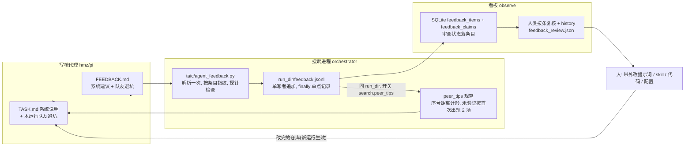
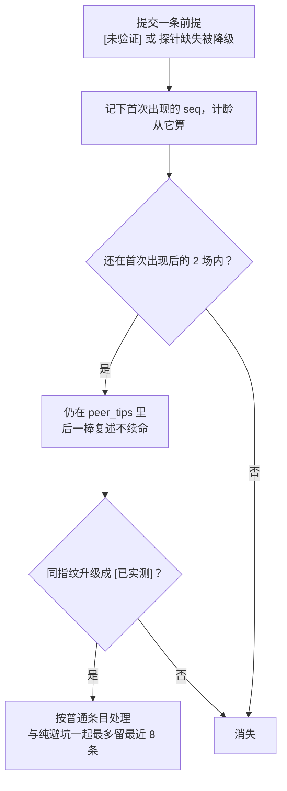

# Human in the loop RSI：代理反馈与同任务队友交接双通道

## 这篇讲什么

这是一份实施计划（Human in the loop RSI，把人的复核放进自我改进循环）。核心只有一句：**主线是产出正确且快的 kernel（算子），反馈通道只服务这条主线。**

计划把代理写的 `FEEDBACK.md` 拆成两条受众与生命周期都不同的通道：

| 通道 | 给谁看 | 活多久 | 存在哪 | 谁能改 |
| --- | --- | --- | --- | --- |
| 系统级 | 人（审查后带外改仓库） | 长期 | `run_dir/feedback.jsonl` + 看板待审列表 | 只有人；下一轮 LLM 不读、也无权改系统 |
| 队友级 | 本任务下一棒 agent | 短期，只在当前 `run_dir` | 每场开场时现算，写进 `TASK.md` | 编排器现算；严禁跨运行、跨 task |

## 背景与目标

上一程的教训有两条：

1. **搜索卡住不是模型不会写核**，而是一条未实测的前提在笔记里活了四轮，且能推翻它的数据从没出现在代理眼前。
2. **真工程坑会被覆盖**：某一轮踩出的坑（如 `float8` 是保留字、`simd_any` 在分支内死锁）过了两轮就被新 `NOTES.md` 覆盖掉了。

因此本计划把 `FEEDBACK.md` 明确拆成**两条受众与生命周期不同的通道**：

1. **系统级通道（长期，给人类审查，绝不传给下一轮 LLM）**：针对提示词、`SKILL.md`、工具或评测/流程规则的求助与修改建议。下一轮 LLM 没有权限改系统，读到反而会误以为规则已变，所以只进 `feedback.jsonl` 与看板待审查列表，由人借助工具复核后在带外改仓库。
2. **队友级通道（短期，仅限当前 `run_dir`，严禁跨运行、严禁跨 task）**：本轮在这道题上踩过的具体坑，以及本轮放弃某方向所依据的前提。每场开场时由编排器从本运行的 `feedback.jsonl` **现算**，带硬警示头写进 `TASK.md`。

为了不把未验证前提固化得比以前更久，队友级通道有三条硬规则：

- 未验证前提按**首次出现**起只活 2 场（后一棒复述同一句不续命，只有升级为已实测才重新计时）；
- 自称「已实测」但探针文件不存在的，自动降级为未验证；
- 空串不算指纹（整场没有非空条目就不产生指纹），避免纯避坑条目因为空指纹互相顶掉。

## 主次原则

- **主次不变**：系统的主线是产出正确且快的算子，反馈通道只为这条主线排障。
- **自述不等于证据**：代理在 `FEEDBACK.md` 里写的话和它自测的数字同级——都是自述，不改变换种子、`agent_failed` 计数、预算和停机规则。
- **先复核再定方向**：每条系统建议在定方向之前，先由人借助探针、评测或代码核对复核并留下证据。
- **不中途换系统**：正在跑的搜索不中途换系统提示，系统级改动只对新启动的搜索生效。

## 分批落地

分批落地，第一批内部再加一道闸：

| 批次 | 内容 | 闸门 |
| --- | --- | --- |
| **1a（先行）** | 合同与 `peer_tips` 注入、`taic/agent_feedback.py`、收集落盘 | 离线单测与 golden 过闸后才动看板 |
| **1b** | SQLite 瘦表、看板展示与按条审查接口 | 1a 过闸 |
| **第二批** | 编写 `docs/给写核代理的教程.md`（及 `system_tutorial.md` 快照）与 `docs/代理反馈.md`（管理章程与拼读合册） | 积累真实条目后 |

## 第一步：把系统讲给代理听，并注入同任务队友避坑提示（合同与技能）

### 合同：加一节「这个系统怎么工作」

在 [taic/kernel_agent.py](../../taic/kernel_agent.py) 的 `render_contract` 里，「# 晋升标准」之后、「# 当前现场」之前加一节「# 这个系统怎么工作」（最小不变式说明）：

- 你在一场接力里：两个委员会轮流，一轮一场新会话，对话不带过去；往下传的有 `kernel.metal`、`NOTES.md`、外层成绩单，以及本运行内的「队友避坑提示」。
- 外层判卷是机械的：全量评测、三级贴核检查、确认计时绑源码指纹；你自报的数字不进种子、不进发布加速比。
- 固定的是合同签名、容差、围栏和预算；可质疑的是笔记、文档、提示词和队友留下的前提（与已有「前提要自己测」一节呼应）。
- 你可以读整个仓库（`docs/`、评测源码），只能写本目录。
- 措辞要守住主线（不能鼓励提早放弃）：**本场的主产出始终是 `kernel.metal`**。`FEEDBACK.md` 写短、最后写：给系统的建议只给人看，有人在看板复核后改仓库；给下一棒的避坑提示只在本运行内往下传，不跨题目；放弃某个方向所依据的断言必须写进「被否决的前提」节，不要夹在避坑里。

### 注入位：`SessionBrief.peer_tips`

在 `SessionBrief` 新增 `peer_tips: str = ""`。在 `# 当前现场` 里（`上一轮 NOTES` 之后），当 `brief.peer_tips` 非空时渲染：

- 固定警示抬头：`本任务前序避坑提示（队友交接，仅限本运行参考；凡未附探针文件名与实测数字的硬件/算法上限断言，一律按未验证处理，鼓励你写探针翻案）：`
- 下接现算的条目（每条带来源场次、委员会/模型与当时结局，如 `[r5 first/deepseek-flash, evaluated 0.818x]`）。
- 不排除上一场：上一场的 NOTES 传下去时截断在 4000 字（[taic/orchestrator.py](../../taic/orchestrator.py) 的 `_notes_for_next`，292–297 行），排除会让超长部分两头都丢；每条才 250 字，重复成本远小于丢失。

### 读回 `FEEDBACK.md`

同文件改 `run_kernel_agent`：

- `AgentResult` 加 `feedback: str = ""`；在读 `NOTES.md` 的同一处（409 行附近，超时分支也走这里）限长读 `FEEDBACK.md`：用 `open().read(16385)` 只取前 16384 字（多读一字用于判定超长），不存在时为空串，不算失败。
- 清理旧文件**不在这里做**：hmz 不在 PATH 时在本函数删文件之前就抛错（359–362 行），脚本注入的 runner 也不走这个函数。清理统一放在编排器（第三步）。

### wrap 提示写收尾顺序

在 [taic/flows/kernel_once/__init__.py](../../taic/flows/kernel_once/__init__.py) 的 `_WRAP` 提示里写明收尾顺序：先保存最好的 `kernel.metal`，再写 `NOTES.md`，最后用几行写 `FEEDBACK.md`。

## 第二步：FEEDBACK 的双通道格式约定与解析器

工作目录根部一份 `FEEDBACK.md`（记为 `format: "agent_feedback"`, `v: 1`），首行是分诊标签，后接五个固定小节（标题逐字写进合同，解析靠标题行切分，缺节或自由发挥都保留原文）：

| 小节标题 | 受众 | 写什么 | 长度上限 |
| --- | --- | --- | ---: |
| `# 需要帮助` | `system` | 缺的工具、权限、信息，或需要人拍板的决定；写清有了它下一步做什么 | 1200 字 |
| `# 对系统的建议` | `system` | 哪条提示词、`SKILL.md` 条目、评测反馈或流程规则让你走弯路；能给改法就给改法 | 1200 字 |
| `# 卡住的原因` | `diagnostic` | 没有留下更好内核时必填：数值、速度、工具还是时间卡住 | 800 字 |
| `# 给下一棒的避坑提示` | `peer` | 只写这道题上已经实锤的具体坑（MSL 编译陷阱、threadgroup stride/对齐越界、探针已测出的局部耗时） | 500 字（单次限 500 字） |
| `# 被否决的前提` | `peer` 与人 | 本轮放弃某方向所依据的断言，每条必须标成 `[已实测: ...]` 或 `[未验证]` | 1000 字 |

`# 卡住的原因` 只作诊断展示，不单独触发待审查（否则每个不顺的场都进徽标，人很快就不看了）。

**首行标签：** `kind: prompt|skill|tool|rule|decision|none`，**可多值**（如 `kind: tool, prompt`）。

- `tool` 含工具与权限缺失，`decision` 是需要人拍板的事；只留避坑、无系统建议时写 `none`。
- 非法值丢弃，全部非法时归为 `none`；写入记录时规范化为无空格逗号串（如 `tool,prompt`），供看板分词筛选。

**`# 被否决的前提` 的两种标记：**

- `[已实测: 探针文件 | 测的命题 | 数字]`，例如 `[已实测: probe_fmma.py | fp32 操作数 simdgroup 8x8 乘加速率 | 15.09 TFLOP/s]`。必须写出「测的命题」，因为探针测的东西可能和断言不是一回事（r1 的 `wino_precision_sim.py` 测的是 fp16 路径误差，并没有测「矩阵单元只吃 fp16」）。
- `[未验证]`。

**解析器放 `taic/agent_feedback.py`（新文件）**，不放 `observe/`：

- 现在 `taic` 不 import `observe`、反之 `observe` 多处 import `taic`（已核实），解析、指纹、探针检查、现算都属于搜索侧；
- `observe/feedback.py` 只做合并展示与聚合，从 `taic.agent_feedback` import 纯函数；
- 注意避开已有 `taic/feedback_extra.py` 的名字。

### 解析规则（先解析、再封顶，顺序写死）

- 先在 16384 字上限内切节、切条目，再按节封顶存入记录：系统两节各 1200 字，卡住的原因 800 字，避坑 500 字，前提 1000 字；`raw` 另存一份 4096 字截断版仅供展示。
- 任一处被砍（文件超 16384、节超限、`raw` 被截）置 `truncated: True`。这样系统节再长也不会把最后的队友两节切掉。
- 条目切分：每节按 `- ` 开头的行切条目，没有列表项的节整体算一条。
- 受众标注：每条带 `audience`：`system`（需要帮助 / 对系统的建议）、`diagnostic`（卡住的原因）、`peer`（避坑 / 前提）。只有 `system` 条目和前提条目进审查流；`diagnostic` 条目状态恒为 `info`，不占待审计数。

### 按条目算指纹（`digest`）

- 哈希输入 = 节名 + 条目正文（先剥掉开头的 `[已实测: ...]` / `[未验证]` 标记再归一化），所以同一断言后来被实测升级时指纹不变，能认出是同一条的升级而不是新条。
- 归一化：转小写；用 `(?<![A-Za-z])\d+(?:\.\d+)?` 去掉数字字面量，这样 `fp16`/`fp32` 这类标识符会保留，跟在汉字后面的数字（如"约790µs"）也能去掉；再去掉标点与多余空白，取 sha1 前 16 位。
- 整场没有任何非空条目时不产生指纹，**空串不算指纹**，避免纯避坑条目因为空指纹互相顶掉。
- 指纹只能识别几乎原文相同的重复；不同模型的同义说法由审查人用 `topic` 标签合并（见第五步）。

## 第三步：编排器收集、落盘与 `peer_tips` 现算

在 [taic/orchestrator.py](../../taic/orchestrator.py) 里：

### 1. 分发前清理陈旧文件

`work` 已知处（1264 行）在调用 runner 之前删掉残留的 `NOTES.md` 和 `FEEDBACK.md`，真实 hmz 与脚本 runner 两条路都覆盖；同时记下本场开始时间。启动失败路径若还要读文件，只认修改时间不早于本场开始的（清理已删旧文件，这只是兜底）。

### 2. 解析一次，全程共用

会话一返回（或 hmz 异常分支读到文件）就调用 `taic.agent_feedback.parse_feedback` 解析一次，结果存在本场局部变量里。转录瘦字段和落盘共用这一份，不重复解析：

- 解析点在记账与 `StopRun("cost_incomplete")`（1288–1290 行）之前，保证那条路上的转录事件（1289 行）也带字段。
- `self._agent_event` 加瘦字段：`feedback_kinds`、`feedback_sections`（非空小节名列表）、`feedback_chars`。hmz 异常分支手工拼的转录事件（1282 行）同样带上（读不到文件时为空）。转录不抄全文。

### 3. 单一记录点，不漏任何退出路径

- `_one_session` 的会话部分包进 `try/finally`，`finally` 里调用一次 `self._record_feedback(...)`，入参含已解析结果、`outcome_or_none`、`cand_or_none` 和 `exit`。
- `exit` 取值写死：

| `exit` | 含义 | 代码位置 |
| --- | --- | --- |
| `normal` | 正常结束 | — |
| `cost_incomplete` | 花费账目不全 | 1288–1290 行 |
| `hang_circuit_breaker` | 触发挂死熔断 | 1304–1306 行 |
| `eval_error` | `_eval` 自身抛异常 | — |
| `agent_exception` | hmz 起不来等 | 1278–1287 行 |

- 中断类路径上 `outcome` 若尚未判定就留空、候选字段留空，另外用 `exit` 说明原因，不许把没评测的场写成 `evaluated`。
- `finally` 里任何 OSError 吞掉，不中断搜索，也不许覆盖正在传播的异常。
- 在 `_file_session_notes`（1339 行）同处，若有反馈，往候选目录写一份 `FEEDBACK.md` 副本（中断路径没有候选目录时只落 `feedback.jsonl`）。

### 4. `run_dir/feedback.jsonl`：单写者，直接追加

- 写者只有编排器一个进程，照 `Transcript.log`（[taic/llm.py](../../taic/llm.py) 443–447 行）打开后追加一行即可，不加锁、不整文件重写。
- `seq`（1-based，与 `run_id` 组成追溯键 `run_id#seq`）由编排器在内存维护：启动/续跑时扫一遍已有文件取最大 `seq`，之后每记一条自增。所有读这个文件的代码（现算、索引同步）都**跳过任何解析失败的行**，不只容忍末尾半行——进程中途被杀留下的半行在续跑追加后会变成中间坏行。
- 仅当反馈文本非空时追加。字段：`format: "agent_feedback"`、`v: 1`、`seq`、`t`、`task`、`dtype`、`size`、`label`、`round`（从标签解析，`init` 类标签记 `null`）、`committee`、`provider`、`model`、`effort`、`outcome`、`exit`、`candidate_status`、`candidate_us`、`seed_label`、`best_speedup`、`kinds`、`truncated`、`work_dir`、`sections`、`items`、`unverified_premises`、`raw`。
  - `work_dir`：相对路径 `agent_work/<tag>`，里面有代理当时看到的原版 `TASK.md`。
  - `items`：`[{section, audience, text, digest, premise}]`。`premise` 取 `verified`、`unverified`、`downgraded` 之一，不属于前提的条目为空。
- **探针文件存在性检查**：`[已实测: 文件 | ...]` 的路径先按该场 `work_dir` 解析，再按仓库根解析；解析后必须落在工作目录或仓库内（绝对路径同理校验），否则或文件不存在时 `premise = "downgraded"`，交接文本里改写成 `[未验证: 探针文件不存在]`，`raw` 保留原文。
- 系统版本不重复记：`run_config.json` 已有 `git_commit`、`git_dirty`、`system_prompt_sha1`（517–524 行），按 `run_id` 关联。

### 5. `peer_tips` 从文件现算，不存内存状态

**严禁跨运行、严禁跨 task。**

- 纯函数 `peer_tips_for(run_dir)` 只读本 `run_dir/feedback.jsonl`，绝不扫描其它运行目录，签名不吃轮次（初始场标签是 `init`/`init2`，1384–1387 行，没有轮次可言）。
- `_session_brief`（1357 行）开场时调用：普通场和初始场（`seedless`）都注入，第一次初始尝试时文件为空、自然无内容；续跑天然一致，`resume.py` 不需要单独重建。

**计龄与寿命：**

- 计龄用序号距离：条目所在记录的 `seq` 与文件当前最大 `seq` 之差。
- 同一指纹只留最新一条文本，但保留**首次出现的 seq**。
- 寿命：前提条目若最新状态仍是 `unverified` / `downgraded`，只在首次出现后的 2 场内出现（序号差 < 2），后一棒原样复述不续命；一旦某次以同指纹升级为 `verified`，按普通条目处理。已实测前提与纯避坑条目最多保留最近 **8 条**。
- 长度：单条 250 字，合计 2000 字；放不下时从最旧的开始丢。

- 开关：[taic/llm.py](../../taic/llm.py) 的 `SearchConfig`（与 `max_hangs`、`relay_budget_usd` 同一个 dataclass，152–173 行）加 `peer_tips: bool = True`。它随 `asdict(self.search)` 自动写进 `run_config.json`（516 行），可以用 `search_ab` 对比开和关；关掉时 `SessionBrief.peer_tips` 恒为空串。

### 6. 顺带补上续跑丢失的交接

`_notes_summary` 与 `_failure_feedback`（436–437 行）目前续跑时不会恢复，续跑后第一场看不到上一轮的 NOTES。续跑时从本运行最后一场的 `agent_work/<tag>/NOTES.md` 和最后一个候选的报告重建这两项，规则与 `_one_session` 里一致；没有就保持空串。此项有独立测试，若与反馈通道冲突可单独拆出，不阻塞 1a。

## 第四步：索引瘦表与看板展示（1b）

为守住 [docs/架构/可观测.md](../../docs/架构/可观测.md) 的热路径纪律（空闲帧只看 `runs/` 自身 mtime，绝不逐个扫目录），把反馈元数据纳入 SQLite 索引。

### 1. 升级 [observe/index.py](../../observe/index.py)（`INDEX_SCHEMA_VERSION = 3`，自动删库重建）

- `_fingerprints`（459 行）的 `extra` 加上 `feedback.jsonl` 和 `feedback_review.json`。这同时会改变 `detail_stamp`（[observe/query.py](../../observe/query.py) 79–87 行含 `fp_extra`，已核实），审查后已打开的详情页也会刷新。
- 新表 `feedback_items`（每场一行）：`run_id, seq, t, task, dtype, size, label, committee, provider, model, outcome, exit, kinds, has_system, pending_claims, unverified_premises, PRIMARY KEY (run_id, seq)`，并建 `task`、`model` 索引。其中 `pending_claims`、`unverified_premises` 在同步时由条目级状态汇总得出。
  - `has_system`：`kinds` 含非 `none` 值，或「需要帮助 / 对系统的建议」任一非空（卡住的原因不算，见第二步）。
- 新表 `feedback_claims`（每条一行，审查状态落在这里）：`run_id, seq, digest, section, audience, premise, status, verification, topic, change_ref, reviewed_at, PRIMARY KEY (run_id, seq, digest)`，并建 `digest`、`topic`、`status` 索引。`status` 默认：`system` 与前提条目为 `pending`，`diagnostic` 条目为 `info`。
- `_ingest(directory)` 在该运行指纹变化时调用 `observe.feedback.sync_run_index(conn, run_id, directory)`：读该运行的 `feedback.jsonl` 与 `feedback_review.json`，**先按 `run_id` 删掉两张表的旧行再重写**，不存大文本。
- 暴露 `get_index().refresh_feedback(run_id, directory)`：审查写接口落盘后立即同步并 `_bump()` revision，因为已结束的运行不会在 `tick()` 空闲帧里被重扫。
- **删除与重置同步清理**：`drop_archived`（958–960 行，删除只有 [observe/deletions.py](../../observe/deletions.py) 这一条调用路径）与切换 `runs_root` 时的重置（368 行）都要清掉两张新表的对应行，否则已删的运行会一直占着计数。

### 2. 新增 [observe/feedback.py](../../observe/feedback.py)（只做合并、聚合与展示，解析在 `taic/agent_feedback.py`）

- `entries(run_dir)`：打开单场详情时合并 `feedback.jsonl` 与 `feedback_review.json`；每条附证据预填用的数字：该场候选目录（按条目的 `label` 定位 `candidates/*_<label>/report.json`）的微秒数、cv 与 roofline，找不到候选报告时退回种子报告，并带上来源路径字段供界面标注；另附 `targets/apple-m4-max/calibration.json` 峰值。
- `summary_from_index(conn, *, task=None, model=None, kind=None, status=None)` 用 SQL 返回（`kind` 筛选用 `(',' || kinds || ',') LIKE '%,tool,%'` 形式的分词匹配，不用子串）：
  - `pending_total`：`status = 'pending'` 的 `system` 条目与前提条目总数（按条计，纯交接里未审的前提也算，因为 fp32 那次正是这种前提；人可以按条关掉它，徽标清得掉）；
  - 高频主张：按 `topic` 聚合，没有标签的按 `digest`（连 `feedback_items` 取模型与任务），列出出现在多少个运行、被哪些模型提过；
  - 修后新提出（启发式提示，不是定论）：某 `topic`/`digest` 已有条目标 `done` 后，**另一个**运行（启动时间晚于该审查的 `reviewed_at`，且条目自己的 `t` 更晚）又提出同一主张时标记出来，措辞就叫「修复后新提出，待人确认」；
  - 过滤后的条目索引。

### 3. 接线

接线 [observe/detail.py](../../observe/detail.py)、[observe/query.py](../../observe/query.py)、[observe/app.py](../../observe/app.py) 与 [observe/static/index.html](../../observe/static/index.html)：

- `overview` 增加 `feedback_pending`（从索引读，O(1)）与高频/修后新提出摘要；顶栏显示「N 条代理反馈待审查」徽标，支持按 `task`、`model`、`kind` 筛选定位到运行。
- `run_detail` 增加 `feedback` 键（完整条目、校准峰值、当场报告摘要及来源）。
- 运行详情新增「代理反馈与队友交接」块：按场分组、按条渲染。来源标签（题目、轮次/标签、委员会、`provider/model:effort`、结局与 `exit`、当时最好加速比、`work_dir`），分开展示系统建议、诊断与队友避坑，前提条目带 `verified` / `unverified` / `downgraded` 芯片，每条带自己的审查状态与审查表单。
- **所有反馈文本一律经 `esc()`（`index.html` 238 行）再进 `innerHTML`**。`raw` 是模型写的，页面又持有能调写接口的令牌，不转义就是注入入口。

## 第五步：人类按条审查接口与工具复核预填（1b）

### 写接口

在 [observe/actions.py](../../observe/actions.py) 增加写接口（沿用回环 Host、`X-Observe-Token`、同源检查和 `resolve_run` 路径校验）：

- `POST /api/runs/<run>/feedback/<seq>/claims/<digest>/review`
- 请求体：`{status, verification, evidence_source, evidence, note, topic, change_ref}`
  - `status`：`pending` | `adopted` | `rejected` | `done`
  - `verification`：`unchecked` | `confirmed` | `refuted`
  - `evidence_source`：`report` | `calibration` | `probe` | `code` | `other`
  - `topic`（可选）：审查人起的短标签，把不同措辞的同一主张合并。
  - `change_ref`：提交号或改动的文件路径。

### 状态组合校验（不合法直接 400）

| `status` | 允许的 `verification` | 还要求什么 |
| --- | --- | --- |
| `pending` | 只能配 `unchecked` | — |
| `adopted` | 必须配 `confirmed` | `evidence_source`、`evidence` 非空 |
| `rejected` | 可以配 `refuted`，也可以配 `confirmed`（属实但不值得改） | 必须写 `note` |
| `done` | 必须配 `confirmed` | `change_ref` 非空，这样「建议、复核、改动」的追溯链才是闭合的 |

### 落盘与即时刷新

- 在 `_lock_for(run_id)`（`actions.py` 196 行）保护下对 `run_dir/feedback_review.json` 做读、改、写，结构 `{"v": 1, "claims": {"<seq>:<digest>": {...当前状态, "history": [...]}}}`，用 `control.write_json_atomic` 原子替换。两个标签页同时审同一运行的不同条目也不丢更新。
- 每次审查往该条的 `history` 追加一条 `{t, status, verification, evidence_source, note, topic, change_ref}`，顶层字段取最新一条——章程要的追溯不能被覆盖掉。
- 写完立即 `get_index().refresh_feedback(run_id, run_dir)`（同步时把审查状态并入 `feedback_claims`、把计数汇总回 `feedback_items`），返回更新后的单条 claim JSON，前端原地替换并刷新徽标。

### 证据一键预填

选 `calibration` 时填入本机 fp16/bf16/fp32 实测 TFLOP/s 与带宽；选 `report` 时填入该场候选报告的微秒数、cv 与 roofline（来源路径同时显示，种子报告要标明）。

## 第六步：定方向前的工具复核规矩（Human-in-the-loop 操作准则）

审查不是读一遍点按钮，每类反馈对应固定复核工具：

| 反馈类型 | 复核怎么做 | 结论怎么标 |
| --- | --- | --- |
| 前提与硬件断言类（如「某类型进矩阵单元就慢」「某指令不存在」） | 先看预填的 `calibration` 峰值；不够细的按 `SKILL.md` 的 Probes 配方写几十行小探针实测。还要核对代理引用的探针测的命题是否就是它断言的命题 | 数字对不上标 `refuted`（备注写实测值），对得上才标 `confirmed` |
| 工具与权限缺失类 | 用 `rg` 对照仓库现有技能、围栏和 `tcenv` 子命令 | 已有入口代理没找到的，标 `rejected` 并注明位置，真缺的才由人带外修改 |
| 提示词与流程建议类 | 采纳后由人在带外改代码/提示词，必须跑过离线单测与 golden；影响搜索策略的改动用 `search_ab` / `contract_menu` 对照验证，不直接裸改默认 | 改完把条目标成 `done` 并填 `change_ref` |

**复核边界：**

- 不许为验证一条建议而新开付费搜索（`taic run` / `resume`）；几十行探针与离线复算不花接口钱、秒级完成，是复核的标准手段。
- 离开付费搜索就验不了的建议，保持 `unchecked` 搁置。

## 第七步：文档与测试

### 文档更新（随代码同步落）

- [docs/架构/搜索.md](../../docs/架构/搜索.md)：补双通道反馈（`taic/agent_feedback.py`、`feedback.jsonl` 落盘、`peer_tips` 按序号现算与 `search.peer_tips` 开关、不改换种子与失败计数规则、续跑补回 NOTES 交接）。
- [docs/架构/可观测.md](../../docs/架构/可观测.md)：补两张表（`INDEX_SCHEMA_VERSION = 3`）、待审计数（按条）、按条 review 接口与状态组合，文件表加 `observe/feedback.py`。

### 自动化测试（1a 过闸后才做 1b）

- [tests/shared/test_kernel_agent.py](../../tests/shared/test_kernel_agent.py)：`FEEDBACK.md` 读入 `AgentResult.feedback` 且限长；合同含系统说明、"核是主产出"、五个小节名与"断言写进被否决的前提节"；传入 `peer_tips` 时带警示抬头；无 `FEEDBACK.md` 时完全兼容。
- `tests/shared/test_agent_feedback.py`（新）：纯避坑条目不产生空指纹、不互相顶掉；中文数字（"约790µs"）被剥离、`fp16`/`fp32` 保留；升级标记不改指纹；不同节同文不撞指纹；`kind` 多值规范化与非法值兜底；探针文件不存在或路径逃逸时降级；超长文件里系统节被封顶后避坑与前提两节仍完整；未知版本 `v: 99` 只展示原文不报错。
- [tests/shared/test_orchestrator.py](../../tests/shared/test_orchestrator.py) 与 [tests/shared/test_relay.py](../../tests/shared/test_relay.py)：
  - 分发前陈旧 `NOTES.md` / `FEEDBACK.md` 被删，启动失败读到的不是上一场文件；
  - 留下 `FEEDBACK.md` 后，`feedback.jsonl` 字段齐全、候选目录有副本、转录带瘦字段；
  - **五条退出路径都只记一次且字段正确**：正常、`cost_incomplete`（`outcome` 留空、候选为空）、`gpu_hang_circuit_breaker`、`agent_exception`、`_eval` 抛异常（`exit = eval_error`）；
  - 坏行容忍：`feedback.jsonl` 中间有一行截断 JSON 时，后续记录仍能解析、`seq` 继续自增；
  - **现算与隔离**：`init` 失败留下的避坑出现在 `init2` 的 `peer_tips` 里；第 1 场避坑出现在第 3 场；同指纹新替旧但未验证按首次出现计龄（r1 写、r2/r3 复述、r4 消失，升级为已实测后留下）；超过 8 条淘汰最旧；另一个 `run_dir` 时为空；`search.peer_tips = false` 时为空。
- [tests/shared/test_resume.py](../../tests/shared/test_resume.py)：续跑后的 `peer_tips` 与不中断时一致；`_notes_summary` / `_failure_feedback` 被补回；`seq` 接着已有最大值。
- `tests/shared/test_observe*.py`：
  - 两张表入库且重同步不留重复行；`feedback_pending` 只计 `system` 与前提条目中 `pending` 的条数，`diagnostic` 不计；按条标审后计数立即下降、纯交接的未验证前提也能被关掉；热帧 `tick()` 不扫目录；
  - `drop_archived` 与切换 `runs_root` 后两张表对应行清空、计数归零；
  - 对已结束运行 `POST .../claims/<digest>/review` 后计数变化、返回更新后的条目；并发审同一运行的两个条目都落盘；连审两次 `history` 有两条；
  - 状态组合非法时返回 400（`adopted` 缺证据、`done` 缺 `change_ref`、`rejected` 缺 `note`、`pending` 配 `confirmed`）；
  - 修后新提出：标 `done` 后另一个更晚启动的运行提出同一 `topic` 时被标记，同运行内不算；
  - 证据预填取候选目录报告并带来源，缺失时退种子报告且标注；
  - 含 `` 的反馈在页面渲染时被转义。
- 按 [tests/support/hw_golden.py](../../tests/support/hw_golden.py) 运行 `--record` 更新 golden；跑通除 `test_orchestrator_gpu.py` 外的全套离线测试。

## 第八步：第二批（积累真实条目后执行）——代理教程与管理章程合册

等第一批通道跑起来、收到真实条目后，按实际出现的卡点类型补齐两篇文档并登记进 [docs/README.md](../../docs/README.md)：

- 新增 `docs/给写核代理的教程.md`（运行启动时冻结为 `run_dir/system_tutorial.md` 快照，每场复制到工作区供代理查阅，续跑读快照）。
- 新增 `docs/代理反馈.md`（前半为管理章程：追溯键 `run_id#seq` 与条目键 `run_id#seq#digest`、`work_dir` 与 `run_config.json` 的版本关联、状态组合与 `change_ref` 闭环、审查 `history`、`topic` 合并、修后新提出的判定口径、版本兼容规则；后半为给 AI 与人的拼读指南，配 `conv2d` fp32 探针实操样板）。

## 不做

- 不把系统级建议（`# 需要帮助` / `# 对系统的建议`）或人类的审查回复自动注入下一场会话；人改完仓库，新运行自然生效。
- 不跨运行、不跨 task 传递 `peer_tips`（严防一道题的特定形状假设污染另一道题）。
- 不因反馈给代理新权限、新工具或放宽围栏；不用 hmz 钩子强制代理写反馈。
- 不让反馈影响换种子、失败计数、预算、停机和发布加速比。
- 不凭未复核（`unchecked`）的条目改系统默认或重开已否决方向；不在正在跑的搜索中途换系统提示。

**已知残余风险：** 避坑节里夹带的方向性断言绕开前提标记（无法机械识别），只靠合同要求与警示头约束；「修后新提出」是启发式提示，最终由人确认。
