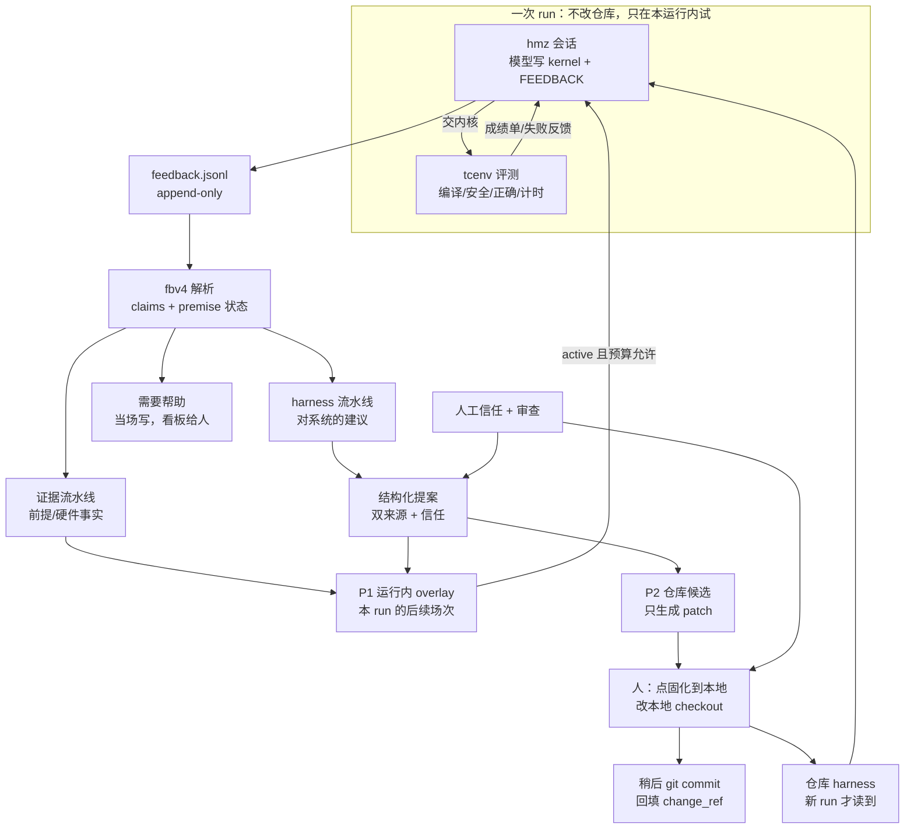
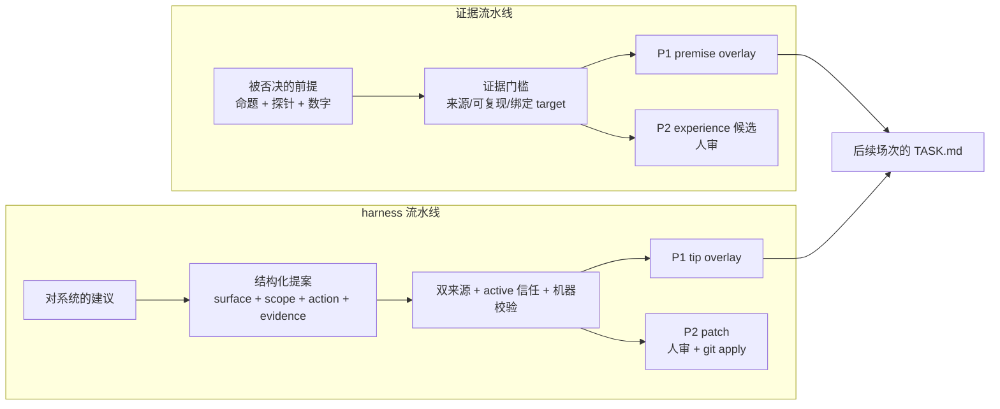
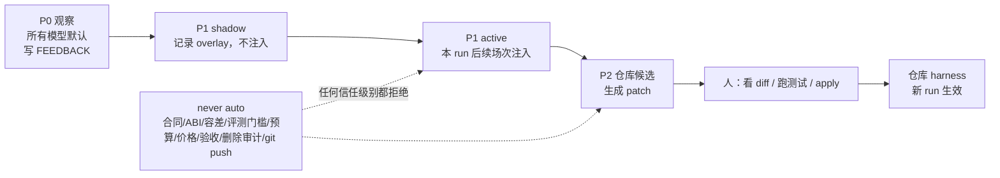
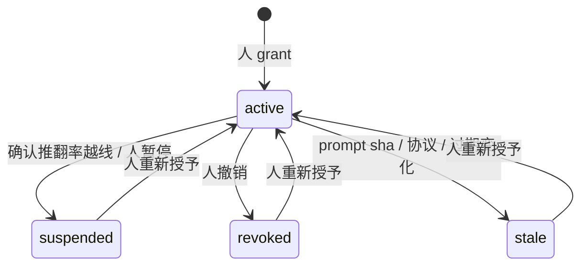
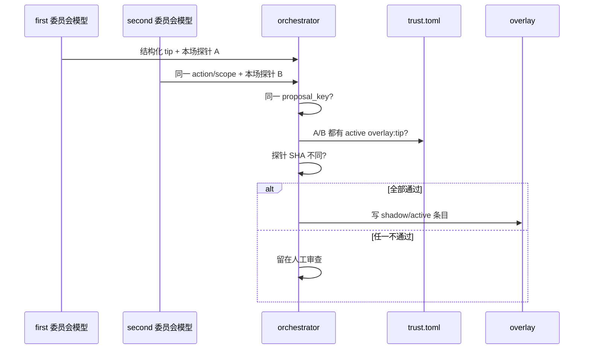
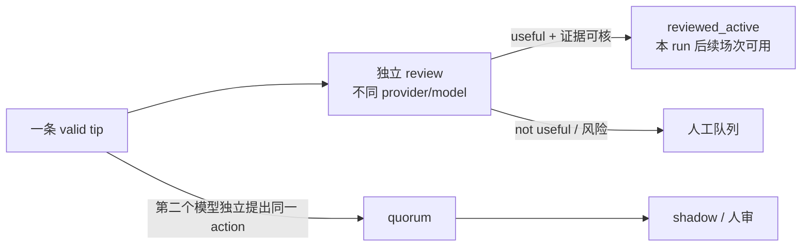
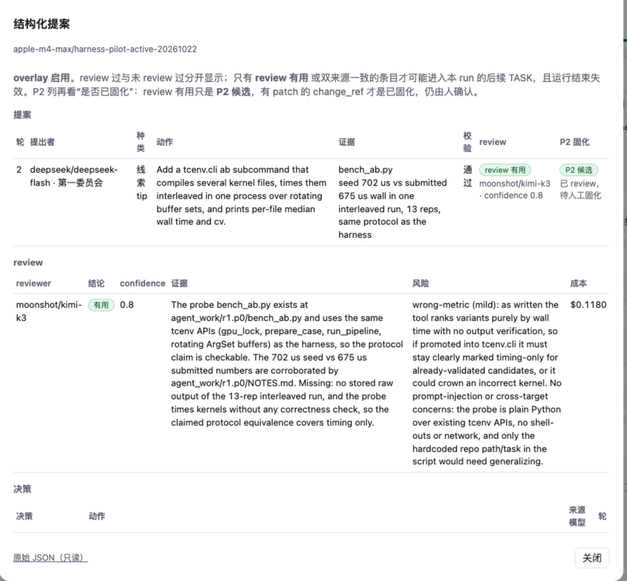
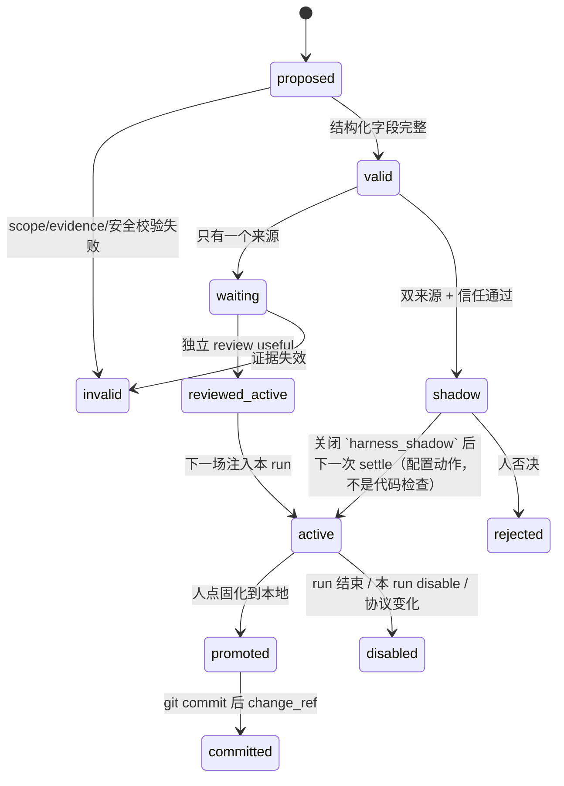

# 可信 harness：RSI 架构与理论

这一篇回答三个问题：这个仓库的“自我改进”到底改什么、为什么反馈要分成两条流水线、以及什么权限可以自动生效。操作细节在 [代理反馈.md](../代理反馈.md)，数据布局在 [数据层.md](../架构/数据层.md)，落地代码和已验证边界在 [实现交接.md](实现交接.md)。

## 0. 一句话

**模型不改权重；改进的是下一次会话看到的 harness。** 外层搜索用实测内核成绩做目标，用人工授予的信任和双来源证据决定哪些 harness 建议可以先在**本运行、本硬件、本任务**内试用；仓库级改动仍然由人看 patch、跑测试、提交。



这张图的三个边界很重要：

1. **运行中不换仓库文件。** 开跑时 `agent_guidance` 已经冻结并记了 sha256；P1 只能走独立的 overlay，否则同一 run 前后条件不一致。
2. **P1 只在本运行内。** 它默认在运行结束失效，不自动跨 run、跨 target 传播。
3. **P2 不是自动合并。** 人点“固化到本地”后，改动先进入本地 checkout。正在跑的 run 仍读开跑时冻结的 `agent_guidance/` 快照；下一个新 run 重新冻结后立刻能读到。git 提交和 `change_ref` 是后置的追溯步骤，不阻塞本地使用。

## 1. RSI 是什么，不是什么

### 1.1 这里的 RSI

RSI（recursive self-improvement，递归自我改进）常被理解成“模型改自己的权重”。本仓库不做这件事。这里的 RSI 是**外层改进回路**：

- 被改进的对象是 harness：TASK 合同措辞、技能文件、工具提示、经验库、反馈规则、验收流程。
- 改进的依据是外层评测：内核是否安全、正确，是否真的更快。
- 改进的载体是反馈：模型在会话中写下的建议、被否决的前提、踩过的坑。
- 改进的闸门是人：信任由人授予，仓库变更由人确认。

所以它是“**用搜索产生反馈，用反馈改进下一次搜索的 harness**”，不是“模型训练自己”。这也解释了为什么模型自报的数字不能直接当证据：模型是提出者，不是裁判。

### 1.2 为什么不是直接把建议写进提示词

直接把自由文本写进 TASK 或系统提示，会遇到四个问题：

1. **自证循环**：模型提出一条提示，下一场看到它，按它做，然后“验证”它有效。
2. **分布漂移**：一条在 conv2d 上有效的提示，可能让 flash_attention 变慢；换硬件后更不可比。
3. **注入面**：TASK 是模型读的指令文本，模型写的建议里可以藏命令、路径或“忽略合同”。
4. **审计断裂**：没有来源、证据、投票和 change_ref，事后无法判断一条规则是谁、为什么、在哪个硬件上加的。

两条流水线、权限梯度、信任和双来源，都是对这四个问题的工程回答。

### 1.3 理论坐标

这些不是本仓库发明的定律；它们只是帮助我们判断一个设计有没有必要：

| 概念 | 在本架构里的落点 | 它解释什么 |
| --- | --- | --- |
| 代理—环境循环 | 模型写核、`tcenv` 给成绩、搜索选种子 | 为什么模型需要外部评测，而不是自报 |
| 有限理性 | 预算、轮数、12KB TASK、单场 token 上限 | 为什么只找“够好”的 harness，不追求最优 |
| Reflexion / 经验回写 | `NOTES`、`peer_tips`、被否决前提 | 为什么失败要写成下一位能读的记录 |
| Human-in-the-loop RSI | 信任由人授予、P2 由人 apply | 为什么自动改进不直接改仓库 |
| 关注点分离 | 证据流水线 / harness 流水线 | 为什么两类反馈不能共用一个真值标准 |
| 能力型授权（least privilege） | P0/P1/P2、scope、target/task | 为什么权限要按对象和范围切小 |
| 独立验证 | 双来源、两个委员会、不同探针 SHA | 为什么单一模型的重复不算证据 |
| 影子/金丝雀发布 | P1 shadow、批量回滚 | 为什么先记录、不先注入 |
| Goodhart / reward hacking | 指标分开、Wilson 下界、人审 | 为什么“通过率高”不能直接当信任 |
| 供应链/来源 | prompt sha、协议、内核 sha、探针 sha、change_ref | 为什么每个自动结论都要能追溯 |
| 分布漂移 | target/task/协议/模型版本绑定 | 为什么一个硬件的结论不能复制到另一个 |

#### 2026 年 RSI-harness 文献定位

2026 年的工作已把「不改权重、改 harness」变成独立方向。它们与本仓库的分歧不在是否自我改进，而在**谁提供证据、谁批准生效、在哪里验证泛化**。下面七篇只作方法参照，效果未在本仓库复现；完整书目见 [papers/导读.md](papers/导读.md)。

| 文献 | 对本架构的直接约束 |
| --- | --- |
| AHE（`papers/2604.25850_agentic-harness-engineering.pdf`） | decision observability 要求每次编辑先留下可证伪预测，再用下一轮任务结果核对；组件与经验也要可回滚、可钻取，不能把 review 的 useful 当效果证据。 |
| RRSI（`papers/2609.24972_rrsi-regularized-harness-rsi.pdf`） | harness 演化会过拟合训练任务。采纳时要看泄漏筛查、OOD 复测、噪声门槛和编辑复杂度，不能只看分布内提升。 |
| Ecdysis（`papers/2609.11677_ecdysis-runtime-harness-training.pdf`） | 失败可能来自模型而非 harness；跨任务复现的失败才是更强的系统性证据。单次失败不能自动变成修改理由。 |
| Ouroboros（`papers/2608.08311_ouroboros-reviewed-core-evolution.pdf`） | reviewed commit 成为后续运行时，与 P2 同构；但其部署只有一条长期 lineage，且作者承认 LLM reviewer 会共享盲区，不能把它的评审或 SOTA 当成独立证明。 |
| PluginRSI（`papers/2609.32423_pluginrsi.pdf`） | 经验优先沉淀为可独立改进、可复用的插件库，而不是整段 prompt 散文；插件入库与组合仍需要授权和验证。 |
| Huxley-Gödel Machine（`papers/2510.21614_huxley-godel-machine.pdf`） | benchmark 分数不等于继续自我改进的潜力（metaproductivity-performance mismatch）。不能按一次 search best 推断演化路径的价值，本仓库也不假装能计算其 CMP。 |
| RSI 综述（`papers/2607.07663_rsi-survey-bounded-to-autonomous.pdf`） | 用「改进什么 × 闭环程度」区分有界自我改进与开放式 RSI；评估器本身也是改进对象。P0/P1/P2 正是按人授权限制闭环程度。 |

因此，本仓库的目标不应写成「让 harness 自己越改越好」，而应写成：**让每次修改都有可证伪预测、独立证据、明确 scope 和可撤销授权**。按当前实施价值，先读 AHE、RRSI、Ecdysis；准备动 P2 时读 Ouroboros；做经验库时加 PluginRSI，讨论选择标准时加 HGM；RSI 综述用于查词表和限制，不必通读。

这些概念只解释“为什么这样设计”；真正的边界仍以代码、测试和审计记录为准。

## 2. 两条流水线：事实与建议分开



### 2.1 为什么必须分开

两条线的**真值标准不同**：

| | 证据流水线 | harness 流水线 |
| --- | --- | --- |
| 典型内容 | “fp16 操作数进矩阵单元会慢一倍” | “看板应把验证过的提示和未验证提示分开渲染” |
| 怎样算成立 | 探针/评测记录复现数字 | 失败测试、可复现命令、代码审查、双模型一致 |
| 谁最懂 | 写探针的模型 + 人 | 两个委员会的独立模型 + 人 |
| 自动去向 | 本运行经验层 / 硬件 experience 候选 | 运行内 tip overlay / P2 patch |
| 失败模式 | 伪探针、单位错、结论过度推广 | 提示注入、单模型偏见、自证循环、跨任务误用 |

如果混在一起，算法结论的数量会抬高模型“改 harness”的可信度；反过来，一个擅长改工具的模型也会被当成硬件事实的权威。两者都不对。

### 2.2 证据流水线

计划第 3 节的原则是：**数字要来自 harness 自己能复核的执行记录**，而不是模型随手写的文件。理想门槛包括：

- 记录由评测命令或外层评测写出，绑定 `target_id`、`protocol_version`、内核 sha、探针 sha。
- 数字和单位能对上；探针测的命题就是被否决的命题，不是相邻问题。
- 代理自写的探针只能当“带出处的线索”，不能自动标成已证实。

**当前实现**：代码检查探针文件在提案者本场目录、mtime 晚于本场开始、SHA 存在，要求 active `overlay:premise` 信任，并读取本场 `self_checks.jsonl` 或外层候选报告，核对 target、协议、内核 SHA 和测量数字。匹配不上时 `premise` 不写 overlay，只保留一条 `trusted_record=false` 的提案；等本场自检行可读后再次 settle，才会写成 shadow 或 active。它仍不是密码学签名，恶意代理理论上可伪造本机记录；不要把 P1 当形式证明。详见 §7。

### 2.3 harness 流水线

系统建议必须变成结构化提案，而不是一段自由文本：

- `surface`：`tip` 或 `premise`（P1）；`skill`、`task_wording` 只能走 P2。
- `scope`：`target_id`、`task`、可选 `dtype`；跨硬件或跨任务不共享投票键。
- `action`：一句祈使句，不能带命令、代码围栏或路径重定向。
- `evidence`：本场探针/测试/可复现命令。
- `rationale`：自由说明，只作展示。

没有结构化块的建议仍然可以进人工审查；它只是不参与自动 overlay。人确认后可以把自由文本转成结构化提案，AI 也可以起草字段，但转换和送 review 都必须由人显式触发。两种建议的逐项对照表在 [代理反馈.md](../代理反馈.md#结构化提案信任与-overlay)。这样不会因为“模型不会写 JSON”而丢掉人类想看的信息，也不会把自由文本直接执行。

## 3. 权限梯度：能力单调、最小授权



| 层级 | 谁能做 | 作用范围 | 生命周期 | 失败时 |
| --- | --- | --- | --- | --- |
| P0 观察 | 所有模型 | 本场反馈 | 随 run 归档 | 只影响审查队列 |
| P1 shadow | 自动，但只记录 | 本 run | 运行结束失效 | 人看影子记录 |
| P1 active | 双来源 + 信任（`harness_shadow=false` 时直接 apply），或独立 review 判 useful 的单来源 tip | 本 run 后续场次 | 运行结束/disable 失效 | 可整批停用，不改仓库 |
| P2 patch | 人确认 | 来源 target/task | 先写本地 checkout，稍后 git commit；新 run 重新冻结 guidance 后读到 | diff/测试/回滚 |
| never auto | 无人授权也不做 | — | — | 直接拒绝 |

### 3.1 为什么 P1 要按 run 隔离

- 开跑时指导文件已经冻结；如果运行中改仓库，前半场和后半场不是同一实验条件。
- 12KB 的 TASK 预算有限，overlay 必须和成绩单、失败反馈、NOTES 一起排队，不能无限膨胀。
- 一个 run 的结论只在这个 run 的 target/task 上成立；跨 run 复制会绕过信任和证据检查。

### 3.2 active 不是永久固化

这三个词不要混：

| 状态 | 含义 | 生效范围 | 谁决定 |
| --- | --- | --- | --- |
| `shadow` | 只记录，不注入 TASK | 本 run 可见的审计文件 | 自动 |
| `active` | 注入本 run 的**后续场次** TASK | 当前 run，运行结束失效 | 独立 review / 双来源 + 信任 |
| P2/promotion | 先写本地 `targets/<id>/experience.md` 或共享 harness | 下一个新 run 重新冻结 guidance 后读到；正在跑的 run 继续用旧快照 | 人在看板点固化 + `taic harness commit` |

所以“review 后可用”指 `active`，不是永久固化；永久固化仍然是 P2，必须人工判断。

### 3.3 code agent 是 P2 的默认实现者，不是信任来源

未来修改 `tcenv`、`observe` 或提示词的代码，默认交给 code agent（hmz/pi）实现；人也可以直接实现。实现者是谁不改变审批权：它应该是 P2 的**实现者**，不是新的自动信任来源。现在大多数改动事实上由 AI 完成，所以更要把“实现”和“批准”拆开：

| 角色 | 谁 | 权限 |
| --- | --- | --- |
| 提案者 | 搜索中的模型 | 写 FEEDBACK / 结构化提案 |
| 评审者 | 另一个 provider/model | 只读 review，给 useful/risk |
| 实现者 | **code agent（默认）或人** | 读已批准提案，生成 patch、补测试；不能 merge/自批 |
| 批准者 | 人（或独立的低风险审批者） | 看 diff/测试，确认后 apply/commit，记录 `approved_by` |

流程：

```text
approved proposal
  -> code agent in a worktree
  -> offline tests（当前没有 prompt golden 门）
  -> diff for a person
  -> human applies locally
  -> later git commit -> change_ref=commit:<sha> + implemented_by + approved_by
```

约束：

- 实现者（AI 或人）不继承模型对 overlay 的信任；工作对象是**已批准的变更**，不是自由改 harness。
- AI 实现者不允许自己批准、自己 commit、自己改 `trust.toml`/`budget`/`control`；人实现时也不能自己批准自己的 P2。
- 同一变更的 `implemented_by` 和 `approved_by` 必须是不同角色；AI 默认是前者。
- 必须用独立 worktree/工作区，不能直接改正在跑的搜索目录。
- 任何“改审查代码、改 change_ref 校验、改 P2 审批”的元变更，也走同一条 P2；不能用一个自动循环绕开人。
- 它生成的 `change_ref` 应该是 commit 哈希，不是模型自由文本；本地阶段的追迹用 `local_patch_sha256`。
- 人点“固化到本地”后，变更立刻写本地 checkout；之后 `taic harness commit` 只提交这些路径，并把 `change_ref` 回填为 `commit:<sha>`。

当前已提供 `taic/code_agent.py` 和 `taic harness implement/apply-code`：code agent 在独立 worktree 生成 patch；`apply-code` 默认先在另一个隔离 worktree 跑离线套件，人确认后才 apply 到主 checkout；它不会自动 commit/merge。target experience 也走同一条“先本地、后提交”路径。

### 3.4 为什么 P2 先本地固化、后提交

P2 改的是仓库，影响所有后续运行。自动写文件等于让模型间接改合同、评测或共享提示。正确流程是：

1. 生成 unified diff。
2. 展示 diff，`git apply --check`。
3. 跑离线测试；CLI 的 `--run-tests` 当前只跑 `tests/shared/test_agent_feedback.py`、`tests/shared/test_kernel_agent.py`、`tests/backends/metal/test_hw_feedback.py`，没有 prompt golden 门。
4. 人确认后先 apply 到本地 checkout；此时记录 `status=local` 和 `local_patch_sha256`，不写最终 `change_ref`。
5. 人稍后运行 `taic harness commit`，只提交这些路径；提交成功后才写 `change_ref=commit:<sha>`。
6. 共享表面（TASK 合同、`taic-tools`、系统提示）额外确认跨硬件适用。

`change_ref` 由提交步骤写下，形如 `commit:` 加提交号；`patch:` 只代表旧的本地 patch，不应再作为最终追溯号。审查页把一条标成 `done` 时，应在提交后回填 `commit:`。

## 4. 信任：委托的权限，不是模型声望

信任登记回答的是：**在这个 target、这个 task 上，这个人是否愿意让这个 provider/model/effort 的提案参与自动生效？**



信任键包含：

- `target_id`、`task`、`provider`、`model`、`effort`；
- `prompt_sha1`、`protocol_version`；
- `scopes`（如 `overlay:tip`）、`expires_at`、`granted_by`、`reason`、`evidence_run`。当前自动判定只查 `overlay:tip`/`overlay:premise`；`propose:skill`/`propose:task_wording` 可以登记，但没有自动放行路径。

设计要点：

1. **信任不等于模型分数。** 指标（已审数、合理率、Wilson 下界、confirmed 推翻计数、占位率、已实测率）只帮人决定是否授予；授予动作本身是人做的。
2. **按硬件和任务切开。** 在 M4 Max/conv2d 上可信，不代表在另一个 GPU 或 flash_attention 上可信。
3. **会过期。** 提示函数源码、模板常量与技能文档（`taic/prompts.py` 的提示函数与 `HARNESS_RULES`/`MIXED_PLANS`/`WIKI_DOCS`、`taic/kernel_agent.py::render_contract`/`_cap_task`、`taic/harness.py::TEMPLATE`/`write_template`、目标档的 `experience.md`/`device.md`（按 `target_id` 解析）、`taic/flows/kernel_once/skills/taic-tools/SKILL.md`、目标 backend 自动收集的 `backends/<id>/skills/*.md`（跳过 `_template`））的 sha256（字段名仍叫 `prompt_sha1`）或评测协议变了，旧信任失效；同一文件里的非提示代码改动不影响。模型换了版本、effort 变了，也不能沿用。目标文档按 `target_id` 解析，不同 target 的指纹不同。
4. **可撤销、可暂停。** 人可随时按 target 撤销；`sync_trust_status` 在同一 target/task 有至少 8 条已审 claim、来自至少 2 个 run、confirmed refuted 率 ≥25% 时自动暂停，恢复仍由人做。没有 `prompt_sha1` 的旧条目不会被当成对所有提示面有效；`check` 直接判为 stale。
5. **追加式审计。** `trust_audit.jsonl` 记录每一次 `grant`/`suspended`/`revoked`，不覆盖历史。

## 5. 双来源：两个独立模型，不是两次复述



一致的定义：

- 两个不同的 `provider+model`；
- 来自 `first` 和 `second` 两个委员会；
- 都在该 `(target, task)` 上有 active 信任；
- 提出同一 `proposal_key`（target/task/surface/action 规范化形）；
- 两份探针的 SHA 不同（复制同一份探针不算第二来源）。

### 5.1 为什么是两个模型，而不是一个模型说两次

单一模型的偏好会稳定地重复；两次复述看起来像“多票”，其实是同一个误差源。两个委员会至少要求两个不同的服务/模型，降低单模型偏见和单点故障。

### 5.2 为什么还需要人

双来源仍不是形式证明：

- 两个模型可能读到同一份旧笔记，犯同一个错；
- 复制文字后各写不同探针，仍可能通过；
- 模型可能学会“写一个容易通过的探针”，而不是验证命题；
- 双来源只证明“两个模型都提出了”，不证明“建议真的让搜索更好”。

所以 P1 默认影子，P2 必须人审；自动只负责把候选缩小到值得人看的一小批。

### 5.3 独立 review 与双来源的区别

两个模型独立写出同一 action 的概率很低。另一种召回方式是：第一个模型提出 tip，另一个 provider/model 做一次**只读 review**，判断是否有用、风险是什么、下一步怎么验。



review 不是第二个独立提出，不能替代 quorum；它只把探针本场时间已核验的单来源 tip 推进到**本 run 的 active**，运行结束就失效。reviewer 自己还必须在该 `(target, task)` 上有 active `overlay:tip` 信任，且独立于同 key 的所有作者；否则 review 只存档，不生成 `reviewed_active`。P2 review 不能生成 tip overlay，永久固化仍由人确认。review prompt 必须把建议标成 untrusted data，禁止改 kernel/TASK，只允许写 `HARNESS_REVIEW.json`。

review 的输入不是一句改写后的 action，而是一个有界证据包：原始自由文本、`surface/scope`、探针路径/哈希/节选、匹配的 self-check 行、候选报告摘要，以及外层程序算出的“已验证/缺失”。外层检查与提案正文分开标注；模型不能把文字声称当成已验证事实。外层检查只放程序算出的布尔值和数字，`self_checks.jsonl` 里的自由文本不进入这一节，避免把代理可写内容冒充为外层事实。旧反馈行没有 `session_started`、或旧 proposal 行没有 `probe_time_verified` 字段时，探针时间明确标成“无法验证”，而不是拿反馈写入时间替代。转换提案的 reviewer 默认避开原 claim 的委员会，写原 claim 的模型也不能 review 它。实际审阅的提示词哈希写入 review 记录，事后可核对模型当时看到的材料。

review 的预算不能写死 $0.2：按 reviewer 的实际 input/output 单价、prompt 长度和最大输出 token 算：

```
input_tokens       = max(1000, ceil(prompt_bytes / 3))
output_tokens      = max(128, min(4000, requested))
cache_read_tokens  = 120000   # pi/skill context read allowance
cache_write_tokens = 16000    # first-call cache write allowance
expected_usd = input_tokens/1e6 * price_in
             + output_tokens/1e6 * price_out
             + cache_read_tokens/1e6 * price_cache_read
             + cache_write_tokens/1e6 * price_cache_write
budget_usd = max(0.01, expected_usd * 4)
```

不同的模型价格不同，贵的 reviewer 得到更大的预算；缓存读/写也计入，不能只看 REVIEW.md 的字数。实际成本另记到 `harness_reviews.jsonl`。实测 Kimi review：`harness-pilot-active-20261022` 的第一个提案旧预算 $0.252、实际 $0.118；同一 run 的第二个提案用缓存 allowance 公式估算 $0.147、预算 $0.588，实际 $0.1677。第二次 shadow（`...b`）的 review 实际 $0.1063。

下面是这次审核在看板上的样子。运行 `apple-m4-max/harness-pilot-active-20261022`，第 2 轮 first 委员会的 deepseek-flash 提出一条 `tip`：给 `tcenv.cli` 加交替计时的 `ab` 子命令。second 的 kimi-k3 做只读 review，结论是有用，confidence 0.8，成本 $0.118。校验已通过，所以它是 **P2 候选**，截图时徽标还写着待人工固化；该 run 后来已本地固化并提交，决策表因此会有 `promotion`/`promotion_commit`，历史截图不等于当前状态。



## 6. 影子、状态机与回滚



### 6.1 影子先行的理由

影子模式把“记录”和“注入”分开：

- 影子期只写 `harness_overlay.jsonl`，TASK 里不出现；
- 人可以比较影子条目和未启用场次的 unchanged 率、成本、失败类型；
- 确认没有把合同/命令/未验证事实带进 TASK 后，才打开 active。

这是部署里的 canary/shadow 思路，不是额外模型调用：影子条目的生成仍然只来自已有会话反馈。代码不检查“人已复核影子”这条记录；打开 active 的实际操作是把 `harness_shadow` 设为 false（CLI 对应 `--no-harness-shadow`），或在调用 `harness.settle` 时传 `shadow=False`；CLI `harness settle --active` 也写 active。

### 6.2 生效时的保护

- TASK 标题固定为「未验证的模型建议（不是合同，不是事实）」。
- 剥离代码块、命令、控制字符；拒绝 shell 语法和 never-auto 关键词。
- overlay 最多 1800 字符；超出的条目不进 TASK，源条目仍在 `harness_overlay.jsonl`，TASK 不逐条记录被裁掉的条目。
- `target_id`、`task`、`protocol_version` 不匹配就丢弃；resume 也逐条校验。
- 运行目录里的 `harness_control.json` 只能关闭，不能开新权限；关闭后 active 条目不再进入 TASK。

### 6.3 P2 的状态

P2 成功不是“模型说可以”，而是：

```
proposal -> patch -> git apply --check
        -> (可选) taic harness apply --run-tests 跑 3 个离线测试文件
        -> 人点固化到本地（写本地 checkout）
        -> 新 run 重新冻结 guidance 后读到
        -> taic harness commit -> change_ref=commit:<sha>
```

看板的「固化到本地」只做本地 apply，不跑离线测试或 prompt golden；要跑测试用 `taic harness apply --run-tests`（当前只跑 3 个反馈/契约测试文件）。code agent 的 `apply-code` 写 `code_promotion`/`status=local`，`change_ref` 为空；它默认先在另一个隔离 worktree 里应用 patch 并跑离线套件，通过后才改主 checkout，并拒绝 `tasks/`、trust、control、凭据等路径。`taic harness commit` 同时接收 `promotion` 与 `code_promotion`，只提交记录的路径，并在提交前校验待提交 patch 的哈希，在独立 Git index 中从 HEAD 顺序重放并比较暂存快照；成功后回填 `change_ref=commit:<sha>`。

失败可以丢弃 patch；已经应用的可以 revert。共享 prompt/skill 不默认写入，必须单独确认跨硬件影响。

## 7. 设计基线与当前实现的差距

这一节是给审阅者的，不是给模型的。计划第 3–6 节描述的是目标架构；当前代码只实现了其中一部分。

| 设计基线 | 当前实现 | 风险 |
| --- | --- | --- |
| 证据来自 harness 可信执行记录 | P1 `premise` 校验 self-checks 的 target/协议/内核 SHA/数字，但文件非签名 | 代理可伪造本机记录 |
| `premise` 也需更强门槛 | `premise` 不需要双模型投票，但需要 active 信任 + 匹配的 self-checks/外层报告；否则不写 overlay，只留一条 `trusted_record=false` 提案 | 单模型错误前提仍可能进 shadow；伪造本机记录仍可能绕过 |
| 独立性靠“证据产自本场” | 只比较探针 SHA 不同 | 复制文字 + 各写不同探针仍可能通过 |
| P1 关闭用只追加 disable 事件 | 当前是 `harness_control.json` 覆盖写，不写决策日志 | 历史理由只保留最后一次；审计只能看控制文件当前值和 mtime |
| 活动 claim 与历史审计分开 | 当前使用 `info`/`obsolete` 状态和墓碑；空占位重建时写入 `feedback_claim_removed` | 与计划第 7 节的“不新增状态”不同；审阅时按当前实现读 |
| 重复按同一 action+scope 确认 | 曾显式执行 `--merge-topic`，复核后由 `experiments.revert_topic_merges` 把 10 条改回 pending | topic 不是等价关系；不要按 topic 批量关 |
| 付费试点后再扩大 | 2026-10-22 已跑三次 shadow/active 试点（当时约 $6；第三次目录后来续跑，当前约 $7.10，见 [试点结果.md](试点结果.md)），但样本小，且 active overlay 没有真正进入 TASK | 仍没有质量结论；active 对搜索的影响未验证 |

这些不是“文档没写”，而是**文档必须写清楚**：当前 self-checks 只是本机记录，不是密码学签名；付费试点仍要靠人工复核。若要把 `premise` 当强证据，下一步应引入评测器签名/外层 report 绑定。

## 8. 失败模式与防线

| 失败模式 | 表现 | 防线 | 残余风险 |
| --- | --- | --- | --- |
| 自证循环 | 模型提出提示，下一场按提示做，再“证明”提示好 | 影子期、双来源、人审、P2 测试 | 影子期也可能被模型看到？当前影子不注入 TASK |
| 提示注入 | 建议里藏命令/路径/“忽略合同” | 纯文本、拒绝 shell/never-auto、固定标题、预算裁剪 | 语义注入仍可能影响模型判断 |
| 证据伪造 | 自写探针、改 mtime、复制探针 | 本场目录、mtime、SHA 不同；self-checks 的 target/协议/内核 SHA/数字匹配 | 本机 self-checks 不是签名，恶意代理仍可伪造 |
| Goodhart | 只优化“容易通过的提案” | 分离指标、Wilson 下界、人工审查、P2 | 指标本身可被选择偏差影响 |
| 分布漂移 | 换模型/硬件/任务后旧 tip 变坏 | target/task/protocol/prompt 绑定、过期 | 同 target 内的任务相似性仍可能误导 |
| 单模型偏见 | 同一模型两次提出同一建议 | 两个 provider+model、两个委员会 | 两个模型可能共享训练数据/笔记 |
| 跨硬件污染 | 把一个 target 的经验复制到另一个 | 所有 key 带 target；overlay/P2 过滤 | 人工复制仍可能绕过 |
| 审计丢失 | 删 run、重建索引、覆盖文件 | append-only 日志、墓碑、review history | 2026-10-22 时 18 条空占位墓碑已补齐；墓碑只有 status/reason，不保存正文 |
| 预算挤占 | overlay 挤掉成绩单/失败反馈 | 固定优先级、12KB 预算、被裁记录 | 仍需看实际 TASK 字节 |

## 9. 和计划第 3–6 节的对应

| 计划节 | 理论主题 | 本文位置 | 代码/操作 |
| --- | --- | --- | --- |
| 3 两条流水线 | 证据与建议的真值标准不同 | §2 | `taic/harness.py` surface；`taic/agent_feedback.py` premise |
| 4 权限分级 | 能力单调、最小授权、run/target 隔离 | §3 | P0/P1/P2、`harness_control.json`、P2 patch |
| 5 信任登记 | 委托权限、过期、指标辅助 | §4 | `taic/trust.py`、`trust.toml`、`trust_audit.jsonl` |
| 6 结构化提案与双来源 | 结构化、独立性、影子、回滚 | §5–6 | `harness_proposals.jsonl`、`harness_overlay.jsonl`、`harness_decisions.jsonl` |

## 10. 读法与文件

建议顺序：

1. 本文 §0–§3：先理解 RSI 和权限梯度。
2. [代理反馈.md](../代理反馈.md)：条目、状态、审查和命令。
3. [数据层.md](../架构/数据层.md) §5.1.1：文件、索引、信任和 overlay 的落盘。
4. [实现交接.md](实现交接.md)：当前代码、测试、已知边界。
5. [代理理论.md](../代理理论.md)：经典代理理论；本文不重复那部分。

相关文件：

## 11. 建议验收、效果实验与受限工具（2026-10-24）

这几项把「模型说有用」和「 harness 确实变好」分开。实现见 `taic/acceptance.py`、
`taic/harness_experiment.py`、`taic/code_agent.py` 与 `tcenv/tools/`。

1. **分类证据。** `hardware_premise` 保留探针和测量绑定。新的无探针 `tool` /
   `reporting` / `wording` 建议必须给 `evidence.reproduction` 与 `evidence.expected`；
   不需要为了符合格式而编造 GPU 数字。带探针的旧 tip 与旧自由文本转换仍可读取、
   走人工 P2。P1 的 tool/reporting 建议不能修改判分、容差、预算、信任或协议。
2. **验收合同。** `AcceptanceSpec` 绑定 proposal、一次有用 review、scope、允许路径、
   预期行为、验收检查、效果指标、对照与回滚条件。`harness implement` 把合同交给
   code agent；`verify-code` 只在隔离 worktree 跑实现验收，不 apply 主 checkout。
   模型报告的验收项只是声明，`host_verified` 才表示宿主检查通过。
3. **效果实验。** `plan-experiment` 要求已验收的 patch，绑定契约摘要、patch 摘要、
   配置模板、protocol、配对 seeds 和每臂预算，默认只写 dry-run 计划，不调用模型或
   GPU。两个显式标志 `--allow-spend --allow-gpu` 加具名 `--by` 才能把计划标为
   authorized；这个命令仍不执行实验。`collect-experiment` 只读两个已完成 run 的
   run_config、result、trace、feedback 与工具证据。`validate-effect` 由具名人员记录
   效果判断，测量程序不会自行批准晋升。硬件 premise 不走这类 A/B 计划。
4. **分层状态。** `reviewed`、`implemented`、`experiment_validated`、`local`、
   `committed` 是五个独立事实。带新合同的 `apply-code` 需要同一份 patch 的效果复核；
   老 patch 可以显式 `--legacy-unvalidated` 走人工路径，但不能冒充已验证效果。
   `harness status` / observe 的 `harness_board` 返回 `acceptance_specs` 与里程碑。
5. **工具不是插件市场。** `metal.time_msl` 由仓库静态注册。manifest 固定
   `tool_id/version/handler/request_schema/result_schema/capabilities/limits`，
   请求不能指定 import 路径或 handler。broker 复用清敏环境、进程组清理、GPU 锁和
   `evaluate.supervise` 心跳超时；工具结果绑定请求与 manifest，由宿主写入
   `tool_evidence/`。一次 Python 探针仍属于本 run；跨 run 复用必须走工具 P2。
   `kernel_once` 只有 `probe:execute` 与 `tool:invoke`；`code_patch` 只有
   `tool:propose` 与 `harness:implement`。这些能力不授予晋升权。
6. **边界。** manifest 摘要证明登记文件没变，不是 Python 源码的密码学签名；
   `git_commit/git_dirty` 与效果实验的 patch 绑定补充 provenance。角色限制与 hmz
   fence 不是对恶意本机代码的完整安全沙箱。`metal.time_msl` 只测一个
   `[[buffer(0)]]` 核的墙钟耗时，不证明数值正确性。已有显式实验执行器；
   计划、执行、采集和效果复核是分开的命令，真实执行仍需人另行授权。
   本轮只有 dry-run/mock 验证，没有真实付费 A/B 结果。

## 12. 采纳效率与可复现验证（2026-10-24 文档修订）

1. **按 patch 风险分级。** `classify_change` 对规格与实际 patch 重算风险：
   `offline_only` 只给有宿主检查的只读增量路径，仍要隔离验收与具名人工批准；
   `paired_required` 需要搜索对照；`human_gated` 覆盖任务语义、判分、GPU/预算/信任/
   审批逻辑及验收规则本身。`tcenv/report.py` 的模型反馈变化和执行/GPU 相关改动不能
   借“只读报告”降级。模型自报 tier 不是放行依据。
2. **宿主验收。** `taic/acceptance_checks.py` 登记 `check_id` 与固定离线检查，模型
   只能引用 ID。`verify-code` 在已打 patch 的隔离 worktree 逐项执行，保留真实退出码、
   证据摘要和 spec/patch 摘要。旧文本用 `verify-legacy --by ... --check-id ...`
   具名升级，绑定原文、确认人和真实检查；未登记的检查不能冒充宿主已验证。
3. **工具身份。** 模型请求里不再接受 `role`；宿主调用方把 `session_role` 放入
   broker 生成的子进程信封。`tool_impl.toml` 另绑 `handler_source` 和源码摘要，
   broker 与 worker 导入前都核对。摘要是漂移检测，不是密码学签名。
   `scaffold-proposal` 只生成不可执行草稿，不注册、不授权、不运行。
4. **实验判定（v2）。** **(a) 现状（已实现，2026-10-24）。** v2 计划冻结 `base_commit`、
   完整委员会与 effort、输入/运行配置、配对 seed、总预算、最小效应、方向、样本数和
   护栏。成本/时间用 log ratio，比例用差值。样本门槛目前只有**一个** `min_pairs`
   （`taic/harness_experiment.py:186-195`，默认 3、允许范围 3–100）；`paired_effect`
   （`:483-529`）按固定 seed 的 percentile bootstrap 给区间，`meets_effect` 成立且
   护栏未越界就在 `:529` 返回 `supports_effect`，**没有 `refuted` 分支**。
   执行授权人不能成为唯一效果复核人。
   **已知缺口（不是已修）：** 3 对也可能得到零宽/极窄区间并越过阈值。下面的 `d` 用
   plan-02 的定向约定——**已取成「越大越好」**（lower 指标取反）；而源码 `paired_effect`
   存的是原始 `treatment-control`/log ratio，lower 用 `hi < -min_effect` 判定。在该
   约定下 `d=[1,1,1]` 的 bootstrap 区间是 `[1,1]`、`d=[1,1,0.9]` 是 `[0.9,1]`，
   `min_effect=0.5` 时两者都会被判成 `supports_effect`；若改用源码原始符号、把同一组
   数当 `d` 喂给 `direction=lower`，`hi < -0.5` 不成立，只会 `inconclusive`。也就是说
   「是否出现伪支持」取决于符号约定，而现行规则没把这两件事写清。无论哪种约定，这些
   区间本身都没有可声称的 nominal 覆盖率。
   **(b) 本批规划（plan-02，未实施）。** 近期只做预测、dry-run、宿主送达与探索性保护：
   3 对只给描述性结果和 `inconclusive`，不得出确认词或采纳。`confirmatory_min_pairs`
   在有效校准授权出现前是**不存在**，不是近期待填参数；真实 unchanged-control 校准、
   覆盖率/功效推导与确认性 verdict 均另见[确认性效果实验-另纸.md](确认性效果实验-另纸.md)。
   合成零效应数据只能测实现，不能解锁确认或采纳。当前 `evaluation_rules` 仍只有
   `min_pairs`，本节 (a) 的缺口仍存在，不能声称「3 对已被阻断」。
5. **真实执行路径。** `execute-experiment` 默认 dry-run：按 seed 交错 AB/BA，从同一
   commit 分别创建 control/treatment worktree，并校验导入来源。`--execute` 还需要
   authorized plan、`--allow-spend --allow-gpu --by` 和每 cell/总额预算检查。
   cell 使用自己的 Python import path，不共用主 checkout。已完成 cell 不重复收费；
   失败保留，不伪造结果。原始 TOML 与运行记录分开，control 的空 change 统一为空串。
6. **采纳成本。** `harness adoption` 追加每条提案的评审、实现、实验成本和阶段；
   未发生的阶段为 0，已发生但缺账单为未知。`harness shortlist` 对历史建议去重并
   给出至多 10 条候选与证据缺口，不自动实现或晋升。历史短名单不是效果证据。

补充命令：

```bash
uv run python -m taic.cli harness verify-legacy RUN_DIR --key KEY \
  --by NAME --check-id reporting.offline_contract --legacy-text "原验收文本"
uv run python -m taic.cli harness execute-experiment RUN_DIR --plan PLAN.json
uv run python -m taic.cli harness adoption RUN_DIR
uv run python -m taic.cli harness shortlist RUN_DIR [OTHER_RUN ...]
uv run python -m tcenv.tools.cli scaffold-proposal PROPOSAL.json --out NEW_DIR
```

`execute-experiment` 不加 `--execute` 不启动模型/GPU。`scaffold-proposal` 不产生
执行权限。实验 dry-run 会创建隔离 worktree 和配置，不等同于只读查询。

常用只读/离线命令：

```bash
uv run python -m taic.cli harness status RUN_DIR
uv run python -m taic.cli harness verify-code RUN_DIR --key KEY
uv run python -m taic.cli harness plan-experiment RUN_DIR --key KEY \
  --seed 7 --seed 11 --budget-usd 1.25
uv run python -m taic.cli harness collect-experiment RUN_DIR \
  --plan PLAN.json --control CONTROL_RUN --treatment TREATMENT_RUN
uv run python -m taic.cli harness validate-effect RUN_DIR \
  --result RESULT.json --valid --by NAME --reason "paired evidence reviewed"
uv run python -m tcenv.tools.cli list
uv run python -m tcenv.tools.cli check REQUEST.json
```

`verify-code` 会跑离线 pytest；`plan-experiment` 与 `collect-experiment` 不发模型
请求、不占 GPU。`tcenv.tools.cli invoke` 必须另加 `--allow-gpu` 才会执行 Metal 探针。

相关文件：

| 文件 | 职责 |
| --- | --- |
| `taic/agent_feedback.py` | 解析 FEEDBACK、占位、digest、premise 状态 |
| `taic/harness.py` | 结构化提案、quorum、overlay、P2 patch |
| `taic/trust.py` | 信任登记、审计、scope/协议/prompt 校验 |
| `taic/orchestrator.py` | 会话后记录提案、settle、注入 active overlay |
| `observe/feedback.py` | 审查状态、墓碑、索引追平 |
| `observe/trust.py` | 按 target/task/model 的指标 |
| `targets/<id>/trust.toml` | 人工授予的信任 |
| `runs/<run>/harness_*.jsonl` | 提案、决策、overlay 的运行内记录 |
