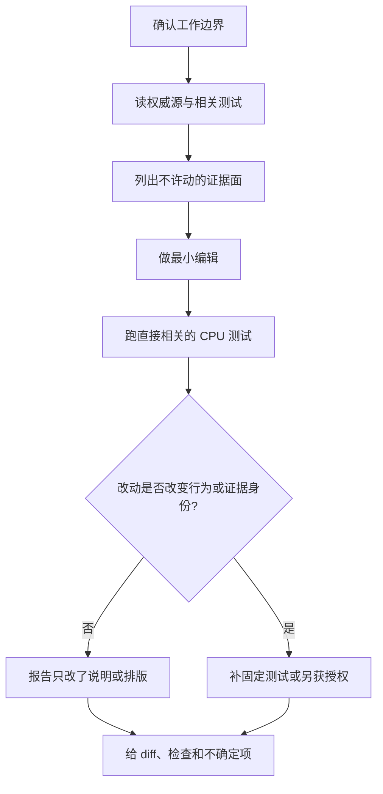

# Agent 新手第一课

这篇写给第一次用编程 agent 参与 ShapeForge 的人。读完这一篇，你应该能回答三件事：我现在动的是候选还是 harness；哪些文件不能碰；怎样留下一个别人能复核的最小改动。

如果你只是要改仓库，不启动搜索，也不需要 GPU 或模型授权。默认做只读调查和 CPU 测试；真实 GPU、付费模型、`taic run`、`taic resume` 都要用户明确开口。

## 先分清两类工作

ShapeForge 里最容易犯错的一步，是把“让某个内核变快”和“改 harness 怎么评测它”混在一起。

| 工作 | 你改什么 | 谁验收 |
| --- | --- | --- |
| 候选工作 | 算法、融合、分块、Host Tiling、执行几何、候选源码 | 任务合同、ABI、安全与测量边界 |
| harness 工作 | 任务加载、评测、分派、证据、索引、发布门、文档与测试 | 仓库的固定测试、历史证据和人工授权 |

新手先记住：**不要为了把评测做绿而改 harness。** 候选不行就修候选；证据不够就标 `unknown`、`blocked` 或“没有授权”，不能改门槛。

## 第一个小时的阅读顺序

不要从最大的设计文档开始。按这个顺序读，先知道今天是什么，再读历史。

1. `AGENTS.md`：项目边界、当前状态、不可改证据。
2. `README.zh-CN.md` 或 `README.md`：公开项目边界，不读旧 Triton 描述当现状。
3. [agent-skills.md](../agent-skills.md)：你该加载哪份技能，技能权威源在哪里。
4. 与任务直接相关的一篇架构文档，例如搜索、评测、数据层或 Scratch。
5. `tests/README.md`：哪类测试能跑，失败时读哪里。

历史文档带日期时，数字、run 路径、测试计数和结论只对那一天成立。它们可以用来理解为什么现在这样做，不能用来证明今天仍然这样。

## 一份安全的读题清单

动手前先写下五句话：

1. **这件事归候选还是 harness。**
2. **权威文件是哪一份。** 不从另一篇转述里猜实现。
3. **会移动什么身份。** 包括候选 SHA、几何、artifact、digest、prompt 指纹、任务包闭包。
4. **允许跑什么检查。** CPU 测试可以；GPU、付费搜索和真实设备要另行授权。
5. **成功时用什么证明。** 一个测试节点、一个 diff、一个报告字段，还是一个明确标为未验证的判断。

写不下来就先只读。把“我还没确定”写进报告，比补一句听起来完整的结论更好。

## 最小改动怎么落地



### 先动哪些文件

- 修一个明确错误的说明：改直接文档，并链接到当前代码或权威文档。
- 改一个明确 bug：改最小代码路径，同时加能抓住这个 bug 的测试。
- 改公共合同、发布、容差、预算、权限或信任：不要顺手做。先问。

### 默认不要碰

- `tests/support/golden/**` 的冻结证据；
- `targets/*/{experience,device}.md`；
- `backends/*/skills/**` 与 `taic/flows/**/SKILL.md` 的提示面；
- 已完成纪元、验收包、manifest 和历史 run；
- 凭据、模型原始 transcript、供应商资料。

需要改这些面时，先停下来告诉用户原因和会移动的指纹，不要先改再问。

## 常用检查

安全 CPU 套件：

```bash
uv run pytest -q -m 'not gpu and not llm and not slow'
```

改文档或技能入口时，先跑：

```bash
uv run pytest -q -n 0 tests/shared/test_docs_integrity.py
```

只看一个失败时，单进程复现：

```bash
uv run pytest -q -n 0 <nodeid>
```

失败报告先看 `logs/pytest/triage/triage_summary.md`，其中 `BEGIN_AI_FAILURE_HANDOFF` 到 `END_AI_FAILURE_HANDOFF` 的 JSON 是复现依据。不要为了让测试通过而删除断言、给 GPU 测试加 skip，或放宽容差。

## 新手最容易说错的八句话

| 别说 | 改成 |
| --- | --- |
| Triton→Metal 还是当前对照路径 | 这条比较基线已经退役；Triton 只留在历史文本里 |
| 搜索最好值就是确认加速比 | 只有 fresh confirmation 绑定同一候选后才可能进入确认结论 |
| CPU/协议通过就是 GPU 通过 | 分开写 CPU、真实 Metal、模拟和未授权 |
| NPU 模拟说明真机可用 | 清微 NPU 目前只有离线模拟，不能给真机正确性或性能 |
| 这个测试以前有 126 个，现在也一样 | 历史测试计数只对当时有效，今天重新收集或引用新纪元 |
| 文档说有，所以代码一定有 | 打开当前代码核对；文档只能作为线索 |
| 历史证据可以顺手更新 | 冻结证据不改，新证据放新阶段或新纪元 |
| 这个命令只是读一下 | 确认它是否会写索引、扣费、调用模型或访问 GPU |

## 给 agent 下任务时怎么写

给编程 agent 一个好任务，比给它一个很大的目标更有用。包含五部分：

1. **目标**：要改哪一个具体行为或哪一句话。
2. **证据**：当前代码位置、失败节点、文档矛盾点。
3. **边界**：只改哪些文件，哪些文件只读。
4. **检查**：运行哪一个测试，不能运行什么。
5. **回报**：列实际 diff、检查输出和仍不确定的项。

差的写法是“把仓库都看一下，顺便修修”。那会得到大面积、难审、彼此冲突的改动。

## 继续读

- 第一次写内核：读 [Kernel 生成新手第一课](Kernel-生成新手第一课.md)。
- 第一次读性能或确认结果：读 [Kernel 测量与证据入门](Kernel-测量与证据入门.md)。
- 需要整理自由文本反馈：读 `.pi/skills/harness-feedback/SKILL.md`。
