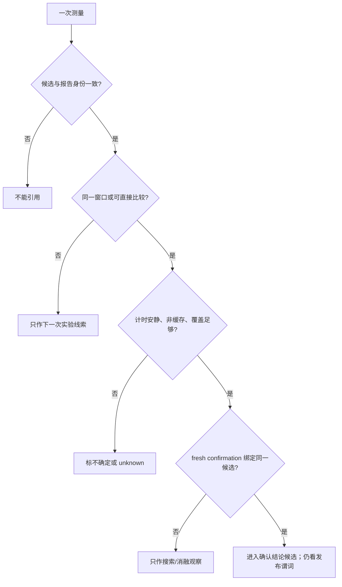

# Kernel 测量与证据入门

这篇写给第一次读 ShapeForge 成绩单的人。它回答一个常见问题：一个数字到底是“这次自测看见的”“搜索当前采用的”，还是“可以对外说的确认结论”。

先记住一句：**测量、搜索选择、确认和发布是四件事。** 前一关的数字不能自动升级成后一关的证据。

## 四种数字分别能说什么

| 数字 | 从哪里来 | 可以怎么用 | 不能怎么说 |
| --- | --- | --- | --- |
| quick 结果 | 一次正确性检查 | 判断这版是否先值得继续 | 不能当性能 |
| timed 自测 | 本场窗口里的正确性与计时 | 决定下一版怎么改 | 不能说已经发布 |
| ab 比较 | 两个或多个候选在同一 GPU 窗口交错计时 | 做消融或选下一版 | 不能当发布证据 |
| fresh confirmation | 搜索种子复核后再换 fresh 种子复测 | 进入确认结论的必要证据 | 仍不表示无条件生产授权 |

搜索期的 `best_speedup` 是从多次嘈杂测量里挑出来的最好观察，天然偏乐观。它可以帮助下一轮写核，不能当作对外加速比。

## 一份报告按什么顺序读

不要先找最大的加速比。按这个顺序读：

1. **身份**：候选 SHA、任务、dtype、size、target、backend、协议是否一致。
2. **正确性**：所有 case、最终 `read_write` 状态和 workspace 是否通过。
3. **计时边界**：reps、cv、是否缓存命中、是否 timing uncertain。
4. **基线**：和哪一个登记 baseline 比；强弱基线不能混写。
5. **覆盖**：这是 small、paper、某个 variant，还是整个声明域。
6. **结论等级**：搜索观察、同窗口对照、fresh confirmation，还是没有可发布结论。



## 正确性先于计时

正确性不是“输出差不多”。本仓库按任务的 `tolerances + scaled_error` 判断，还检查最终 `read_write` 状态和声明的 workspace 清理规则。下面这些都不能靠性能数字抵消：

- 少写一个输出或 final state；
- 越界写保护带；
- 修改只读输入；
- 用旧 scratch 冒充本轮新结果；
- 候选没覆盖时把 fallback 的结果和时间算成 variant 的；
- 只在搜索种子上通过。

所以读性能时先确认正确性是 `ok`，再读时间。

## 同窗口为什么重要

同一个 kernel 在两次独立运行里可能差几个百分点；机器上其它程序、缓存状态和输入数据都会改变时间。因此比较两个版本时：

1. 用两个 SHA 明确不同的完整候选；
2. 在同一进程、同一 GPU 窗口里交替发射；
3. 读中位数和逐轮配对比，而不是两个独立中位数相除；
4. 加一份同字节 control（术语：拿同一候选再启动一次），估计这段窗口能分辨的最小差异；
5. 如果 A/B 差异小于这段窗口的分辨能力，就标“不够判”，不硬说 A 更快。

`tcenv ab` 就是给这类消融用的只读工具。它不写 self-check ledger、不扣 timed 配额，也不产生 `promotable` 结果。

## roofline 不是“离峰值还有几倍”的口号

roofline 先问：这件事理论上至少要算多少 FLOP、至少搬多少字节。

- 计算密集时，看接近实测矩阵或 FMA 峰值多少；
- 访存密集时，看接近实测带宽多少；
- 只有模型下界，没有真实最优；`roofline.bound_kind=reference_algorithm` 不是硬件承诺。

一个候选达到峰值的 80% 不一定好：它可能算错、覆盖很窄、fallback 占了大头，或基线太弱。反过来，离峰值较远也不一定坏：当前形状可能太小，启动和同步开销已经主导。

## 搜索、确认、发布不要混

| 层 | 看什么 | 一句边界 |
| --- | --- | --- |
| 搜索选择 | 当前窗口里是否值得换种子 | 只影响下一轮，不是对外结论 |
| 同窗口消融 | 某个改动是否带来净收益 | 证明这个改动，不证明全域 |
| fresh confirmation | 搜索种子复核 + fresh 种子复测，身份逐字段绑定 | 发布前的必要条件 |
| publication | 发布谓词、计时安静、身份和授权 | `publication_allowed=false` 时不发布 |

当前 v2 的确认只针对优胜候选：先按搜索种子 `reps=3` 复核，再按 fresh 种子 `reps=15` 复测。旧的 `confirm_batches`、`confirm_top` 是遗留字段，不要按 v1 的挑战者池理解。

## 这六种说法要改

| 错误说法 | 为什么错 | 正确写法 |
| --- | --- | --- |
| 搜索看到 1.57×，所以确认 1.57× | 搜索最好值有选择偏差 | 写搜索最好值；确认值另列 |
| `ab` 里 A 快，所以发布 A | `ab` 是只读消融 | 写同窗口中位数、控制和不适用边界 |
| 这颗 kernel 很快 | 没有身份、形状、基线和计时窗口 | 写任务、dtype、size、SHA、baseline、中位数和 cv |
| 缓存报告等于重测 | 缓存命中不是新执行 | 写 `cache_hit`，需要 fresh 时重跑 |
| 模拟 NPU 和真机一样 | 模拟不能证明真实设备正确性或性能 | 写 `simulated=true` |
| 几何平均 1.10×，全域达标 | 几何平均可以遮住某个 shard 的回归 | 每个 shard 独立过门，再谈汇总 |

## 读一个结论前先问十个问题

1. 候选源码 SHA 是否写清？
2. 任务、dtype、size、target、backend 是否写清？
3. 比较的是哪个登记 baseline？
4. correctness 是否覆盖任务声明的 case？
5. 最终 `read_write` 状态是否也正确？
6. 时间来自 wall、GPU timestamp，还是融合命令缓冲？
7. reps、cv、是否缓存命中是否写清？
8. 这是搜索期、ab、还是 fresh confirmation？
9. fallback 或 domain 外实例有没有混进 variant 成绩？
10. 当前是否允许 publication？

有一个回答不了，就把结论降级，不要补故事。

## 一条可复核证据的最小格式

```text
Claim: <只写一句话命题>
Candidate: <任务/dtype/size/track/SHA>
Baseline/control: <比较对象与 SHA>
Measurement: <命令、reps、窗口、cache_hit、timing_uncertain>
Result: <中位数、cv、逐轮比或身份状态>
Counterexample: <失败 case、误差或 unknown>
Boundary: <不能外推到什么 shape、target、task、backend>
```

少一项就标 unknown。`unknown` 不是失败；伪造一个完整证据链才是失败。

## 继续读

- 还没写过第一颗候选：[Kernel 生成新手第一课](Kernel-生成新手第一课.md)。
- 第一次参与仓库协作：[Agent 新手第一课](Agent-新手第一课.md)。
- 搜索选择、确认与发布的完整规则：[架构/搜索.md](../架构/搜索.md)。
- 正确性、计时边界和报告字段：[架构/评测.md](../架构/评测.md)。
- 结果、索引与发布原因码：[架构/数据层.md](../架构/数据层.md)。
