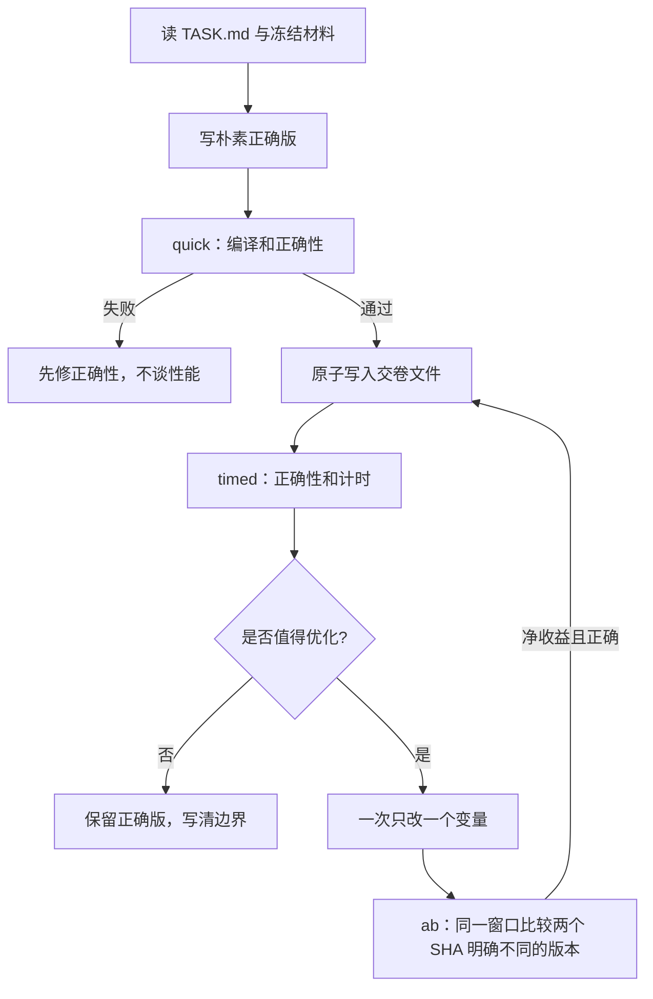

# Kernel 生成新手第一课

这篇写给第一次生成 Metal 内核的人，也写给正在任务目录里工作的写核 agent。目标不是第一课就写出最快内核，而是写出一颗**正确、可复现、能解释下一步为什么改**的候选。

本仓库的真实写核过程从本场 `TASK.md` 开始。本文帮你理解任务书里的概念，不替代任务书，也不授权运行 GPU 或付费搜索。

## 一句话路线

先让最朴素的版本正确，再每次只改一个变量。每一次都把源码、自测数字和取舍写进 `NOTES.md`。搜索最好值只是搜索过程里的观察，不是对外发布。

## 进入任务目录后先读什么

按这个顺序读，不要先看别人的最终内核：

1. `TASK.md`：交什么文件、跑哪两条命令、当前种子是谁。
2. `device.md`：这块芯片实测的带宽、算力和 threadgroup 上限。
3. `experience.md`：在这块芯片上已经验证过的经验和边界。
4. `msl_reference.md`：这个编译器真正支持的 Metal API。
5. 需要测量或消融时，再读 `taic-tools` 技能的测量节。

如果你人在仓库根目录，不身处任务工作目录，可以另读 `tasks/<op>/opspec.json` 和 `tasks/<op>/reference.py` 理解题目。写核会话里，权威输入仍是本场 `TASK.md`。

## OpSpec 在说什么

用 `tasks/relu/opspec.json` 看一个最小任务：

```json
{
  "spec_version": 2,
  "op_name": "relu",
  "symbols": {"N": {"min": 1}},
  "tensors": {
    "x": {"role": "input", "dims": ["N"], "access": "read"},
    "y": {"role": "output", "dims": ["N"], "access": "write"}
  },
  "sizes": {
    "small": {"N": 65536},
    "paper": {"N": 16777216}
  }
}
```

逐项翻译成候选边界：

- `x` 是输入，只读；`y` 是输出，必须写满。
- `N` 是运行时合同里的符号，不能在源码里硬编码 `65536` 或 `16777216`。
- `small`、`paper` 是两个实例；通过 small 不等于通过 paper。
- 容差、dtype、case 和基线都在任务合同里，不由候选自选。

`reference.py` 是独立 oracle（术语：判断答案对错的参考实现）。候选不能 import 它，也不能通过改写输入、缓存答案或调用库函数绕过它。

## 第一颗候选先写最简单形态

以逐元素 ReLU 为例，第一版只应表达“一个线程处理一个元素”。下面是概念示意，不是能直接交的候选；真实槽位、合同头、启动表达式以 `TASK.md` 生成的合同为准：

```metal
kernel void relu_like_kernel(
    device const half* x,
    device half* y,
    constant uint& n,
    uint i [[thread_position_in_grid]])
{
    if (i < n) {
        y[i] = max(x[i], half(0));
    }
}
```

这一版要回答的是：

- 是否每个合法 `i` 都写了一个 `y[i]`；
- 是否没有越出 `x` 和 `y` 的边界；
- 是否保留了 NaN、负零和 dtype 规则；
- 是否没有硬编码本次 `N`、本次种子或本次基线。

不要为了“看起来专业”第一版就加 simdgroup MMA、双缓冲、流水线或 scratch。那些都要先证明当前形状真需要。

## 从正确到更快的顺序



### quick 与 timed 不是一回事

| 命令 | 能证明什么 | 不能证明什么 |
| --- | --- | --- |
| `--quick` | 编译和当前输入上的正确性 | 它更快，或它在 fresh 输入上也对 |
| `--timed` | 正确性和这一次自测窗口里的计时 | 搜索或发布一定接受它 |
| `tcenv ab` | 两个或多个版本在同一 GPU 窗口里谁更快 | 它不是发布证据 |
| fresh confirmation | 换输入后同一候选能否被绑定复测 | 它不是无条件生产授权 |

### 交卷文件要原子替换

一旦一个版本通过验证，就先保存它，再试下一版。推荐流程：

```bash
cp candidate.metal submission.tmp
mv submission.tmp submission.metal
```

不要原地写交卷文件：进程被杀时可能留下半份文件。没有通过版本时，保留最新工作版本；不要把种子或旧 `kernel.metal` 复制成交卷来让命令通过。

## 这些词先按白话理解

| 术语 | 白话 |
| --- | --- |
| thread | GPU 上最小的一条执行通道 |
| threadgroup | 一组能共享 threadgroup memory、能用 barrier 同步的线程 |
| grid | 这次 kernel 启动的所有线程 |
| simdgroup | Metal 上一组能一起做矩阵或归约操作的相邻线程 |
| workspace | 任务声明的临时缓冲；用途、容量和清理规则都在合同里 |
| scratch | 候选声明的跨 stage 中间缓冲；不是白送的缓存 |
| baseline | 同任务登记的现有实现，用于比较；不是参考实现 |
| fallback | 候选没覆盖某个输入时使用的独立通用实现 |
| fresh | 搜索没见过的输入或种子，用来复查结论 |

## 第一次失败怎么查

| 状态 | 先查 | 不要做什么 |
| --- | --- | --- |
| `compile_error` | 合同头之后的源码行号、Metal API 是否存在于 `msl_reference.md` | 加未声明 include 或凭印象换 API |
| `abi_error` | 槽位、名字、dtype、读写角色、启动几何 | 改 harness 让签名通过 |
| `incorrect` | 一个最小 case、一个输出位置、误差尺度 | 放宽容差 |
| `unsafe` | 越界、只读输入被改、scratch 生命周期 | 删安全检查或掩盖副作用 |
| `timeout` / `crash` | 先保留现场和候选字节，再看是否死循环或资源过多 | 在同一 self-check 目录继续强跑 timed |
| `unchanged` | 当前候选与已有候选是否逐字节相同 | 为绕过重复而改空白 |
| `duplicate` | 是否与本场更早候选或外部候选相同 | 加无意义差异制造“新候选” |

## 新手不要做的十件事

1. 不硬编码 shape、case、seed 或基线时间。
2. 不把搜索没见过的新输入写进候选判断。
3. 不调 PyTorch、MLX 或其它库来替候选完成计算。
4. 不伪造输出、缓存输出或只通过 guard band 校验。
5. 不把 `experience.md` 的一句话搬到当前形状，不看它声明的边界。
6. 不用一次 `--timed` 排名两个版本；同一窗口交替测。
7. 不把 `ab` 名次说成发布结果。
8. 不为“优化”删除正确性检查、fallback 或尾块处理。
9. 不改任务合同、ABI、容差或 harness 来让候选过。
10. 不等到最后再写 `NOTES.md` 和 `FEEDBACK.md`。

## 收尾时留下什么

`NOTES.md` 至少写四行：

- 这一版改了什么；
- 源码文件名或 SHA；
- quick/timed 的数字和 cv；
- 为什么保留或放弃。

`FEEDBACK.md` 只写对后续有用的命题。实测的命题写文件名、数字和单位；未测的命题明确写未验证。硬件能力、register 压力或某条指令是否存在，没有 probe 就不要写成事实。

## 继续读

- 先掌握本仓库的 agent 边界：[Agent 新手第一课](Agent-新手第一课.md)。
- 再理解 quick、timed、ab 和 confirmation 的证据等级：[Kernel 测量与证据入门](Kernel-测量与证据入门.md)。
- 需要跨 stage 复用中间结果时，先读 [中间结果复用与 Scratch Workspace](<../架构/中间结果复用与Scratch Workspace.md>)。
