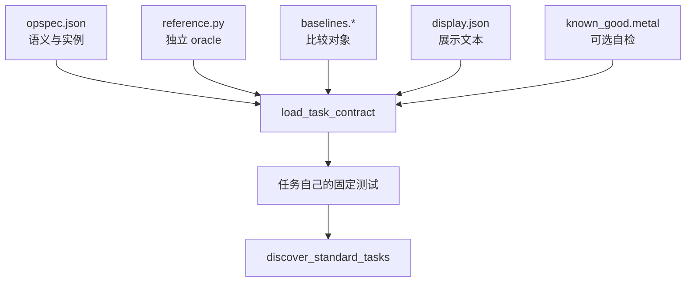

# OpSpec 任务作者专业指南

这篇写给要在 `tasks/<op>/` 新增一道 OpSpec v2 任务的专业贡献者。目标不是“让 loader 能读”，而是让这道题的语义、oracle、基线、容差和负例都能被独立复核。

新题不是一次性能实验。没有明确授权时，只做离线/CPU 验证；真实 Metal、fresh confirmation、付费搜索和 publication 另行立项。

## 完成定义

一道新题达到可评审状态，至少满足八条：

1. `load_task_contract` 能装载默认实例；
2. `discover_standard_tasks` 能发现它，且不与其它目录冲突；
3. 每个声明的 `(dtype, size)` 都能实例化；
4. `reference.py` 能独立给出正确输出；
5. 输入生成确定、覆盖声明的 case，并能被负例戳穿；
6. 基线只用于比较，不参与 correctness oracle；
7. 有固定测试钉住合同、oracle、ABI、基线和至少一类反例；
8. 文档明确写清哪些验证尚未授权。

## 目录先按合同写

标准入口只允许这份文件集：

| 文件 | 必需性 | 职责 |
| --- | --- | --- |
| `opspec.json` | 必需 | 语义、符号、attrs、张量、数值、case、size、工作量和发现信息 |
| `reference.py` | 必需 | 独立 oracle：`reference(inputs, attrs)` |
| `reference.json` | 可选 | oracle 的补充数据；由 reference loader 按合同读取 |
| `baselines.json` + `baselines.py` | 可选但必须成对 | 登记比较对象与 runner；不判断对错 |
| `display.json` | 可选 | 给 TASK 的展示文本；不能代替数学合同 |
| `known_good.metal` | 可选 | harness 自检核；不是 reference，也不是 baseline |

同目录不能再放 `task.py`、`track.json`、`kernel_triton.py` 或 `naive.metal`。这些 v1 标记文件会让目录成为混装并直接拒绝。



## 先写语义，再写实现

按下面的顺序设计，不要先写 Metal。

### 1. 公式与边界

`formula` 只写数学事实：输入、输出、特殊值、原地状态、workspace 用途。不要写“应该用什么算法”或“应该快多少”。

例如 ReLU 的边界包括：非正值写 `+0`、NaN 传播、dtype 输出、连续布局。FlashAttention、KDA 或 MoE 这类题还要写清掩码、状态、序列边界和 final state。

### 2. symbols 与 attrs

- `symbols` 是形状符号，例如 `N`、`H`、`D`、`total_tokens`。
- `attrs` 是任务的整数或枚举参数，例如 `SEG`、`BASE`、`STEP`。
- 不要为了让候选好写而把本该是 attrs 的东西伪装成形状符号。

每个符号给 `min`；每个 attr 给 `dtype`、`default` 和 `domain`。attrs 与 reference/baseline 的重复常量必须由测试钉住，防止两份文本漂移。

### 3. 张量与 workspace

每个张量写清 `role`、`dims`、`dtype`、`layout`、`strides`、`space`、`access`。

- `global` 是普通 ABI 输入/输出；
- `workspace` 是候选/任务声明的临时存储，不进 oracle 输入，也不作为结果差分；
- `read_write` 是会被候选原地修改的合同状态，correctness 必须检查最终状态。

以 `tasks/affine_ramp` 为例：`x` 是 global input，`y` 是 global output，`scale_tab` 是 workspace output。baseline 只能拿 `contract.inputs`，自己重算 ramp，不能读候选 workspace。

### 4. 数值与容差

容差是任务合同，不是让测试通过的旋钮。

- 说明 `acc_dtype`、输出舍入和是否 `exact`；
- 按 dtype 写 `rtol` / `atol_rel`；
- 有特殊尺度时写 `error_scale`，不要拿全局常数掩盖局部坏点；
- 容忍库误差的放宽必须有测量依据和上限，不能为让候选过而放宽。

### 5. case 与输入生成

输入生成必须确定：同一 case、seed、实例得到同一输入。至少考虑：

| 覆盖 | 问什么 |
| --- | --- |
| normal | 普通分布是否通过 |
| tiny / subnormal | 小值、次正规数、零和负零是否处理正确 |
| large / outlier | 大值、溢出、异常幅度是否不掩盖错误 |
| ieee | NaN、Inf、特殊位型是否按公式传播或拒绝 |
| tail / boundary | 非整除、尾部、资源边界是否覆盖 |
| handoff / state | 跨 stage 状态是否按声明生命周期传递 |

如果某类输入构造不出来，测试要显式说 `not_constructible` 或 `unknown`，不能用普通输入冒充。

### 6. size、usage 与默认实例

每个 size 写符号取值和 `usage`。没有 baseline 的 size 不要标 `benchmark`，否则会把“只能 correctness”伪装成“有性能结论”。`discovery.default_instance` 决定省略 dtype/size 时装载哪一个实例，必须真实存在。

### 7. 工作量与 roofline

`work_accounting.flops` 和 `min_bytes` 是参考算法的最小工作量，不是硬件承诺，也不是候选必须采用的算法。不要为了把利用率写高而低估字节数或 FLOPs。

## reference.py 必须独立

oracle 拥有数学定义；候选、harness 和 baseline 都不能替它作证。

- 不 import 候选、harness、`tcenv` 或 baseline；
- 不把候选源码、报告或运行目录当输入；
- 确定输出 dtype 和舍入；必要时在 fp64 中计算；
- 不把 baseline 输出复制成 reference；
- 不读取环境变量、当前时间或运行目录状态。

`known_good.metal` 只是可选的完整 v2 自检核。没有它时要明确“无参考内核”，不能静默跳过。

## baseline 不是 oracle

`baselines.json` 登记名字、框架、implementation id/version 和参数；`baselines.py` 提供 runner。两者必须成对，登记集合与 runner 键集合一致。

baseline 只能回答“候选相对它多快”，不能回答“候选是否对”。如果 baseline 和 reference 需要同一组常量，可以有意重复一份，但要用测试证明两份一致。

```text
正确性：reference.py + tolerances + scaled_error
计时比较：baselines.json + baselines.py
自检：known_good.metal（可选）
发布：fresh confirmation + publication 谓词
```

## 形状组合与变长不是默认项

只有当任务真的需要时，才进入 shape portfolio、L1 `seq_lens` 或 L2 `capacity + workload_profiles`。三种形状档不能混写。

- 固定档：符号有固定取值；
- L1：canonical `seq_lens` 派生总形状；
- L2：容量与 resolved 形状分开，padding poison 在 logical 区域外逐字节校验。

新增这些能力会改变 opspec/instance digest、pack digest、ABI 和验收范围。不要把旧任务的固定档改写成 varlen 来绕开测试。

## 必须写哪些测试

新题至少放一组自己的 CPU 测试，而不是借用别题 fixture。

| 测试 | 必须钉住什么 |
| --- | --- |
| discovery | 能被 `discover_standard_tasks` 发现，task id/op 不冲突 |
| contract load | 默认实例装载成功，没有混装文件 |
| every instance | 每个 dtype/size 的符号、attrs、容差都能实例化 |
| independent oracle | 手算或独立路径与 `reference.py` 一致 |
| input determinism | 同 case/seed/实例输入一致，不同 seed 不伪装 fresh |
| ABI/space | global/workspace/read_write 的 span、dtype、access 符合合同 |
| baseline closure | 登记集合与 runner 键集合一致，baseline 不读候选 workspace |
| negative case | 缺文件、坏 dims、混装、基线漂移或坏输入被 typed 拒绝 |

真实 Metal 测试只有在明确 GPU 授权时运行，并单独标 `-m gpu`。CPU/协议通过不能写成真实 Metal 通过。

## 身份会怎么移动

改 `opspec.json`、`reference.py`、baseline、display 或 known_good，都可能改变任务指纹、pack digest、实例 digest、assembled header 或评测身份。

- 不改旧纪元、验收包或历史 run 来证明新题；
- 新证据放新阶段或新测试；
- 任务包闭包变化时更新当前锚点和文档；
- prompt 面变化会移动 `current_prompt_sha1`，需要重签授权。

## 提交前检查单

```text
[ ] opspec/reference 是本题唯一语义来源，没有第二份手写合同
[ ] 所有 dtype/size 都有实例化测试
[ ] reference 不 import harness、候选或 baseline
[ ] case 覆盖 normal、边界、特殊值和至少一个会失败的方向
[ ] baseline 不参与 correctness，runner 与登记闭集一致
[ ] workspace/read_write 的最终状态检查有测试
[ ] 没有 v1 标记文件混入
[ ] CPU 测试通过；GPU/付费/fresh/publication 状态明确未授权或另列
[ ] 新文档写清适用 shape、target、backend 和不能外推的范围
```

## 继续读

- 现行题目目录与 v1 对照：[架构/题目.md](../架构/题目.md)。
- OpSpec v2 字段、几何与 varlen：[架构/v2协议参考.md](../架构/v2协议参考.md)。
- workspace 与基线分离的完整例子：`tasks/affine_ramp/` 和 `tests/shared/test_affine_ramp_task.py`。
- 新结果如何被独立复核：[内核证据复核专业指南](内核证据复核专业指南.md)。
