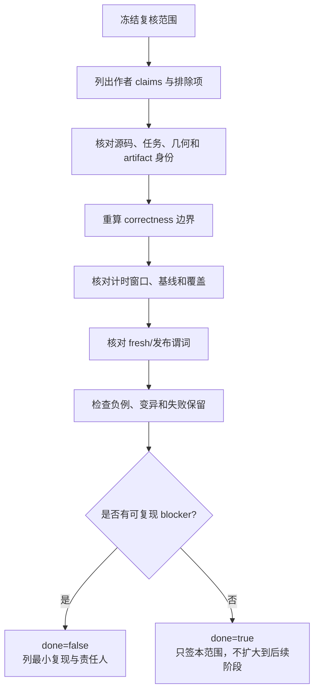

# 内核证据复核专业指南

这篇写给独立 reviewer：你收到的不是一句“测试全过”，而是一颗候选、一次搜索、一个远程评测结果或一个阶段包。你的职责是复核证据链，不是复述作者结论。

复核默认只读。没有明确授权时，不运行 GPU、付费模型、`taic run`、`taic resume` 或真实远程设备；CPU 重算、文档核对和聚焦测试通常足够发现大部分问题。

## 先界定复核范围

先写下四个边界：

1. **subject**：哪颗候选、哪次 run、哪个 manifest 或哪个阶段包；
2. **claims**：作者声称完成了什么，区分机制、正确性、性能、远程、NPU、发布；
3. **excluded**：什么明确不在范围内，例如 fresh、paid、production、Graph、第三条 DSL；
4. **权限**：你能跑哪些 CPU 检查，不能运行什么。

没有这四项，先退回，不要开始“看一遍”。

## 证据等级不要混

| 证据 | 能证明 | 不能证明 |
| --- | --- | --- |
| 构建证据 | 源码按某个工具链构建过 | correctness、性能或发布 |
| CPU/协议测试 | 合同与机制在 CPU 上成立 | 真实 GPU 或真实设备 |
| 真实 Metal 机制验收 | Metal 上该机制成立 | 性能推广、全域或 publication |
| 搜索 best | 搜索窗口里见过的好值 | fresh 复测或发布 |
| 同窗口 ab | 某个改动在这段窗口的净差异 | 生产结论 |
| fresh confirmation | 换输入后同一候选可复测 | 无条件 production 授权 |
| NPU simulation | 协议在离线模拟中成立 | 清微真机 correctness/performance |

`publication_allowed=false` 是当前的对外口径。复核报告中不能把 `available`、`eligible` 或 search best 说成 published。

## 标准复核流程



### 1. 核身份，不看自报 JSON

至少核对这些身份：

- `candidate_sha256` 与 `provenance.source_sha256`；
- 任务目录、dtype、size、track、backend、target；
- ExecutionGeometry / ResolvedGeometry；
- bundle、artifact set、native descriptor；
- `evaluation_input_digest`、evaluator epoch、protocol version；
- prompt 指纹与 trust 状态（如果涉及注入或经验）。

自报 JSON 只是线索。能从源码和冻结 manifest 重算的就重算；不能重算的字段标 `unknown`，不要写成已验证。

### 2. 核 correctness 的实际边界

correctness 不只是 `status=ok`。检查：

- 所有声明 case 是否都执行；
- 最终 `read_write` 状态是否比较；
- workspace、scratch、padding poison 是否按合同检查；
- guard band、只读输入、越界和未初始化依赖是否有负例；
- fallback 是否独立，fallback 时间/正确性是否被混成 variant 成绩；
- 每个 shape portfolio shard 是否独立过门。

如果作者只给“全套测试通过”，问他要具体测试节点和失败面，不接受总数代替覆盖。

### 3. 核计时，不只看中位数

计时复核至少问：

1. 时间来自 wall、GPU timestamp、融合命令缓冲，还是 host 自测？
2. reps、cv、rotation、warmup、cache_hit 是什么？
3. 基线是哪一个登记项，强弱是否明确？
4. 比较是否同一窗口、同一输入、同一候选 SHA？
5. fallback、setup、Host prepare 是否按合同计入或排除？
6. `timing_is_uncertain`、`speedup_withheld`、quiet timing 是否成立？
7. 搜索 best、ab、fresh confirmation 有没有混写？

两个独立中位数相除不是同窗口对照。`ab` 名次不是发布。缓存命中不是 fresh execution。

### 4. 核 fresh confirmation 与发布

当前 v2 只对优胜候选执行一次 `confirm_subject`：搜索种子 `reps=3` 复核，再 fresh 种子 `reps=15` 复测。复核时检查：

- sidecar 的 identity/verdict 是否由 `verify_subject_document` 重算；
- 搜索报告、confirmation 报告、transport 和候选摘要是否绑定；
- `confirmed_values` 是否等于 fresh 报告；
- 计时是否安静且不是缓存；
- `confirm_batches`/`confirm_top` 是否被误当成现行 v2 行为。

发布谓词不成立时，结果只能写 search best、eligible、correctness-only 或 unknown。

### 5. 核负例与变异

没有负例的验收通常还没有证明边界。优先要求：

- 少写输出、部分写、越界、consumer-first；
- 旧 handoff、未发布 flag、伪造 resolved shape；
- fallback 混入、guard 重叠、多匹配、域外输入；
- manifest、entry SHA、blob、provenance 被改；
- replay、resume、旧 attempt、epoch 不匹配。

复核者可以做只读变异：复制证据到临时目录，改一个字段，预期 verifier 拒绝。不要改原冻结包。

### 6. 核成本与中断

如果阶段涉及真实搜索或实验：

- run ledger、session rows、model totals 是否分层；
- 孤儿 init、resume、recovery、interrupted root 是否归到正确 run；
- `cost_incomplete` 是否被补成 0；
- 承诺上限、实际花费和批准人是否对应；
- 未完成 pair 是否被当成完整样本。

成本不是效果证据，但错误成本会让阶段账本失真。

## 按 subject 使用的检查清单

### 一颗候选

- [ ] 源码 SHA 与报告一致；
- [ ] ABI、geometry、coverage plan 归候选，不是 harness 发明；
- [ ] correctness 含最终状态和 workspace；
- [ ] 独立 fallback 存在且不算 variant；
- [ ] 每个 variant 身份稳定，guard 不重叠；
- [ ] timed/ab/confirm 的证据等级写清。

### 一次搜索 run

- [ ] run_config、seed、委员会、track、预算冻结；
- [ ] 候选状态包括 ok/incorrect/unchanged/duplicate，不只看 best；
- [ ] resume/replay 不混 fresh；
- [ ] confirmation 绑定同一候选；
- [ ] 发布原因码与 `publication_allowed` 一致；
- [ ] 成本账本完整或明确 incomplete。

### 一次远程评测

- [ ] site allowlist、evaluator epoch、request digest；
- [ ] outbox 幂等、accepted/evidence/provenance；
- [ ] TLS/mTLS 与签名字段；
- [ ] 本地 staging 不等于生产多站点；
- [ ] remote observation 不冒充 publication。

### 一次 NPU 模拟

- [ ] `simulated=true`；
- [ ] 模拟器输入来自真实 host work list，不是手写结果；
- [ ] 任何真机结论标 unavailable/blocked；
- [ ] 不把模拟时间当真实设备性能；
- [ ] NPU-P0 状态不变。

## 常见假阳性

| 现象 | 为什么危险 | 处理 |
| --- | --- | --- |
| 测试数量很大 | 数量不证明覆盖，可能全是同一条路径 | 要节点名、分层和负例 |
| 一个新纪元 manifest | manifest 只证明文件集合存在 | 重算 verifier 与关键字段 |
| 独立 review `done=true` | 可能只签了一个很窄范围 | 抄范围，不扩大到生产 |
| `available` Track | 可被选择不等于搜索生产开放 | 查默认交付与授权 |
| 真实 Metal 一次成功 | 不证明性能或 fresh | 分开机制、计时、fresh |
| NPU 协议全过 | 仍是模拟 | 标 simulation-only |

## reviewer 输出格式

`done=false` 至少写：

```text
Blocker: <一句可复现的问题>
Scope: <它挡住哪一个 claim，不挡哪些>
Reproduce: <文件、命令、测试节点或最小变异>
Expected/actual: <合同要求与实际观察>
Evidence: <源码/测试/报告路径与行号>
```

`done=true` 只签本次范围：

```text
Scope signed: <只签哪些 subject 与哪些 claims>
Checks rerun: <实际运行的 CPU/文档/重算检查>
Not signed: <GPU、fresh、paid、publication、后续阶段等>
Residual unknowns: <仍需后续证据的项>
```

不要把“没有发现 blocker”写成“全部生产可用”。

## 继续读

- 新题如何写出可复核证据：[OpSpec 任务作者专业指南](OpSpec-任务作者专业指南.md)。
- 后端/target/Track 的接入边界：[后端与目标接入专业指南](后端与目标接入专业指南.md)。
- 搜索、确认与发布：[架构/搜索.md](../架构/搜索.md)。
- 正确性与计时边界：[架构/评测.md](../架构/评测.md)。
- 独立复核案例与冻结包：`docs/可信harness/` 与 `tests/support/golden/`。
