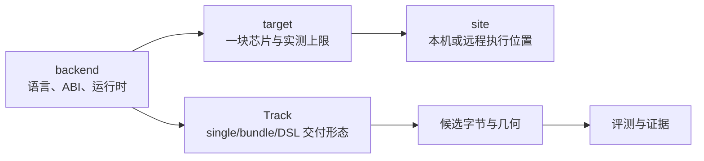

# 后端与目标接入专业指南

这篇写给要接入新 backend、target 或 Track 的专业贡献者。它把四层概念分开：backend 是语言与运行时，target 是一块芯片，Track 是候选交付机制，site 是远程执行位置。四者不能互相替代。

没有真实设备授权时，只做接口、CPU 和模拟验收。`simulated=true` 永远不能写成真机 correctness 或 performance。

## 先判断该不该新增 backend

新增 backend 的成本很高。先问：

| 情况 | 应该做什么 |
| --- | --- |
| 同一语言、同一 ABI、另一块芯片 | 新增 target，不新增 backend |
| 同一芯片上的另一种候选交付机制 | 新增 Track 版本，不新增 backend |
| 另一种语言、ABI、编译器或执行运行时 | 才可能新增 backend |
| 只是想换一个库或 wrapper | 改任务 baseline 或候选，不新增 backend |
| 只有模拟器 | 可以离线协议接入，但不能标真实设备可用 |

## 四层边界



- **backend**：实现 `tcenv.backends.base.Backend` 协议；
- **target**：`targets/<id>/target.toml` 绑定 backend，保存设备匹配、limits、calibration、device/experience/trust；
- **Track**：`(track_id, track_version)` 描述候选如何交付，例如 `msl-single`、`msl-bundle`、`tilelang-pipeline`；
- **site**：local 或远程 evaluator，不改变任务语义。

## 新增 backend 的最小工作包

### 1. 从模板开始，但模板不等于可用

复制 `backends/_template/` 到 `backends/<id>/`，写 `backend.toml`：

```toml
schema_version = 1
id = "<id>"
version = "<代码版本>"
entrypoint = "tcenv.backends.<id>.backend:<Class>"
```

registry 会拒绝这些情况：

- id 与目录名不一致；
- `schema_version` 不是 1；
- entrypoint 不在 `tcenv.backends.` 下；
- 类加载失败；
- 类里的 `id` 或 `version` 与 toml 不一致。

skills 和 wiki 不会让一个 backend 可运行；entrypoint 必须实现协议。

### 2. 父进程侧只做文本和 CPU

父进程 hook 不能初始化设备运行时。至少明确：

- `screen`：候选源码静态边界；
- `parse_launch` / `validate_launch`：候选声明的启动如何解析和拒绝；
- `device_matches` / `limit_notes`：target 声明与真实探测如何匹配；
- `calibration`：峰值带宽与算力从哪里来；
- `compiler_baseline`：没有就返回空，不编造对照。

如果某能力不存在，返回 `unsupported`、空 dict 或 typed refusal，不要返回看似真实的占位值。

### 3. worker 侧拥有真实运行时

worker hook 才接触设备：

- `context()`、`probe()`；
- `prepare_case()`；
- baseline runner 构建；
- 编译、launch、计时和 spot check；
- coverage 与设备 descriptor。

每个 hook 都要回答：真实执行、模拟、不可用还是未实现。模拟结果必须显式 `simulated=true`，不得混入真实报告。

### 4. 不为协议造“中立”假象

当前仓库仍有 Metal 专属历史合同。`tcenv.contract.Contract`、`tcenv.verify`、GPU lock、某些计时与 profiling 语义不是天然 backend-neutral。

新 backend 遇到这些边界时，应显式拒绝或另开适配阶段，不要把 Metal 假设改名后宣称通用。

## 新增 target 的最小工作包

target 是“这块芯片上测到了什么”，不是 backend 的副本。

### 1. 写 target.toml

至少需要：

```toml
schema_version = 1
id = "<target-id>"
backend = "<backend-id>"
status = "reserved"
display_name = "<人类可读名称>"

[device]
match_name_contains = "<探测名片段>"
match_family = "<设备 family>"
calibration_device_name = "<标定名>"

[limits]
# 只写这台设备实测或协议确认的上限
```

`status = "active"` 才能启动 `taic run` 或 `tcenv eval-v2`。新 target 先保持 `reserved`，证据齐了再由人改。

### 2. 标定必须用这台设备

`tcenv calibrate` 测出的值写用户缓存；仓库里的 `calibration.json` 只是历史初始值。不要抄 vendor datasheet，也不要从另一块芯片复制 527 GB/s、14.8 TFLOP/s 这类数字。

`device.md` 写给模型和评审看的实测摘要；`experience.md` 只收这块芯片上的经验，带证据、边界和反例。两者都在 prompt 指纹里，改动会影响 trust。

### 3. limits 与 scratch 配额

`[limits]` 是代码校验和候选设计的边界。模板里的默认值来自 apple-m4-max；新芯片必须自己声明：

- `max_buffer_index`；
- `max_threads_per_threadgroup`；
- `max_threadgroup_memory_bytes`；
- `counter_sample_us`；
- `max_scratch_buffers`；
- `max_total_scratch_bytes`。

没有实测依据就标 unknown 或保持 reserved，不继承另一台机器的配额。

## 新增或开放 Track

Track 描述“候选交什么”，不描述“这个 backend 是否存在”。

### 当前规则

`backends/metal/tracks.json` 的 registry 以 `(track_id, track_version)` 为键：

- `interface_only`：可冻结 replay/interface，不作为 selectable 生产交付；
- `available`：可被新 run 选择；
- 新 run 默认选最高 selectable 版本；
- resume/replay 必须按记录版本重建，缺版本 typed 拒绝。

### 开放新版本的最低证据

一个 Track 版本从 `interface_only` 到 `available`，至少需要：

1. 候选字节、打包和 unpack 身份；
2. 合同/ABI/几何反射；
3. correctness 负例；
4. 真实 backend 构建或明确 source-only 边界；
5. resume/frozen replay 身份；
6. 独立复核；
7. 文档写清它仍不等于 speedup publication。

不要用“能注册”或“能打包”代替这些证据。

## 远程 site 不改变语义

远程 quick/formal evaluator 只改变执行位置。它必须额外证明：

- site/device/backend/build/task pack/calibration/protocol 组成的 evaluator epoch；
- request digest、outbox 幂等和 evidence provenance；
- 签名、allowlist 与 measurement kind；
- resume 不混用旧 attempt 或不同 epoch。

本地 staging 成功不等于多站点生产可用；远程 Metal 成功不等于 NPU 真机接入。

## 验收测试怎么放

| 层 | 测试 | 边界 |
| --- | --- | --- |
| registry/loader | backend.toml id、entrypoint、版本、路径逃逸 | CPU |
| backend protocol | screen、parse、validation、device matching、空能力 | CPU/fake backend |
| target | reserved 不运行、limits、calibration 优先级 | CPU |
| task/task pack | staged pack 重建与 digest | CPU |
| track | interface_only/available、最高版本、resume 固定版本 | CPU |
| real device | probe、compile、correctness、timing | 需 GPU/设备授权 |
| simulation | `simulated=true`、publication false | 不能当真机 |

shared 测试不能 import 具体 backend；Metal 专属测试放 `tests/backends/metal/`。

## 接受标准

```text
[ ] backend/target/Track/site 四层命名没有混用
[ ] backend.toml 与类 id/version 一致
[ ] 父进程 hook 不初始化设备
[ ] 所有未实现能力 typed refusal，不返回占位真值
[ ] target 保持 reserved，直到真实标定与评审完成
[ ] calibration/device/experience 是本芯片证据
[ ] scratch 与 threadgroup 配额不是从 apple-m4-max 抄来
[ ] Track interface_only/available 与证据等级一致
[ ] 模拟结果不会进入真实 correctness/performance/publication
[ ] 有独立 reviewer 的 scope-signed 结论
```

## 常见错误

1. 把新增 target 说成新增 backend；
2. 把 `available` Track 说成默认搜索交付；
3. 从 `_template` 复制 apple-m4-max 的数字；
4. 在父进程 import 时初始化设备；
5. 用 vendor datasheet 冒充实测 calibration；
6. 用 source-only probe 冒充真实 dispatch；
7. 把模拟器 report-only 结果写成设备证据；
8. 为了让测试过而给能力返回空成功。

## 继续读

- backend 与 target 的基本定义：`backends/README.md`、`targets/README.md`。
- 远程执行、outbox 与设备扩展：[架构/执行运行时与设备扩展.md](../架构/执行运行时与设备扩展.md)。
- 新结果如何复核：[内核证据复核专业指南](内核证据复核专业指南.md)。
- 新任务如何接入：[OpSpec 任务作者专业指南](OpSpec-任务作者专业指南.md)。
