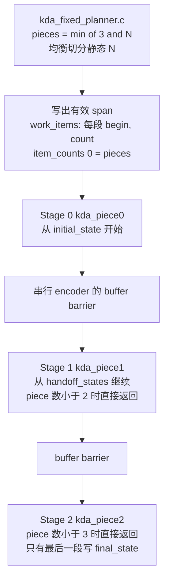

# 固定长度 KDA 标准任务与复杂 msl-bundle 示例

## 三阶段 bundle 怎么执行

这个示例是候选自己的三阶段管线，不是 harness 里的 KDA 调度器。Host 只根据静态 `N` 切分；device 按切分结果递推。真实 Metal、fresh 计时和付费搜索都还没有跑，下图描述的是源码里的数据流，不是一次 GPU 轨迹。

`kda_fixed_planner.c` 取 `pieces = min(3, N)`，再做均衡切分：`base = N / pieces`，余数 `N % pieces` 分给前面的 piece，每个 piece 加 1。它只发布 `work_items`（每段一个 `[begin, count]`）和 `item_counts[0] = pieces`。`handoff_states` 由 device 写，Host 不写。

三个 Metal kernel 都会发射。`item_counts[0]` 里的 piece 数小于 stage 编号时，该 stage 直接返回。stage 0 从 `initial_state` 读入；后面的 stage 从上一段写入的 `handoff_states` 读入。编号等于 `pieces - 1` 的那段把终态写入 `final_state`，更早的段写入 `handoff_states`。stage 之间用现有的串行 Metal encoder 和 buffer barrier 定序。这份固定长度示例的 workspace 里没有 `handoff_flags`；带 flag 协议的是 `tasks/varlen_kda` 的 `piece_handoff.metal`。`taic-launch` 只做交叉审计，dispatch 以 bundle 的 `execution_geometry.json` 为准。

| N | pieces | work item `[begin, count]` |
| --- | --- | --- |
| 1（`single`） | 1 | `(0, 1)`。stage 1 与 stage 2 看到 piece 数后返回。stage 0 写 `final_state` |
| 14（`small`） | 3 | `(0, 5)`、`(5, 5)`、`(10, 4)` |
| 17（`tail`） | 3 | `(0, 6)`、`(6, 6)`、`(12, 5)` |

`paper` 档是 `N=256`、`H=8`、`D=64`，同一公式得到 3 段。`handoff_states` 的容量是两槽（最多 3 段需要 2 次交接），尺寸 `2 * H * D * D` 个 fp32。

## `tasks/kda` 与 `tasks/varlen_kda`

| | `tasks/kda` | `tasks/varlen_kda` |
| --- | --- | --- |
| 形状合同 | 固定 `[N, H, D]`。`initial_state` / `final_state` 为 `[H, D, D]` | L1 用 `seq_lens` 固定总长和段数；另有 L2 `capacity` 档。V6 六档是 `D=128`、`H=64/96`、`total_tokens=8192` 的 L1 |
| 序列边界 | 没有 `cu_seqlens`，没有 varlen case-domain，没有 capacity / resolved | `cu_seqlens` 是运行时输入。L1 的其他合法切分是 Evaluation Case；L2 在容量内改变本次 total/count |
| 本页示例在做什么 | native64 planner 按静态 `N` 切成至多 3 段，三个 Metal piece stage 用 `handoff_states` 交接 | Dyn-0 的 `prep_chain.metal` 与 `piece_handoff.metal` 已在真实 Metal 上验收；V6 的 `chunked_gform.metal` 是 msl-single |
| Host 是否读取本次分段 | 这个 planner 只读静态形状，不读取变长边界 | L1/L2 的 Host Program 可以读取本次 `cu_seqlens` 再写 work list |
| 已验收 | 任务合同、planner 字节和 bundle 预检。CPU 聚焦测试 12 条通过 | V0–V6 的机制与 V6 规模验收另见 `docs/架构/varlen支持计划.md` |
| 还不能从本页推出的结论 | 真实 Metal 正确性、fresh 性能、付费搜索 | V6 的 8.72×–10.38× 只相对朴素 Torch-MPS，不属于本页这个固定长度 bundle |

## 当前结论

固定长度 KDA 已有独立的 OpSpec v2 标准任务 `tasks/kda`，以及一个候选拥有的
**native64 Host Program + 三个 Metal device stages + fp32 state handoff** 的复杂 bundle 示例。
目前完成的是**任务合同、native planner 和 bundle 离线/CPU 验收**；尚未执行真实 Metal kernel、
fresh 性能确认或付费模型搜索，不能据此发布 correctness/performance 数字。

这不是把 `varlen_kda` 的单序列档换个名字：固定任务没有 `cu_seqlens`、varlen case-domain、
`total_tokens/num_seqs` 或 capacity/resolved 语义。

## 标准任务

`tasks/kda/` 包含：

- `opspec.json`：固定 `[N,H,D]` 输入 ABI，`initial_state/final_state[H,D,D]`，fp32 递推；
- `reference.py`：独立 fp64 token-by-token oracle 和 normal/wide_range/outlier 输入生成；
- `baselines.py` + `baselines.json`：登记的 `torch_mps` 逐 token baseline，只用于未来的同边界计时；
- `known_good.metal`：独立的固定形状 naive 候选，不把 bundle planner 当成 Harness 规则。

档位为 `single(N=1)`、`small(N=14)`、`tail(N=17)` 与 `paper(N=256,H=8,D=64)`。
`bind_task("kda", ...)` 的 discovery default 是 small；`tcenv tasks` 保持现有“优先 paper、缺失时
回退任务默认档”的行为，因此默认列表显示 `kda paper` 和 `varlen_kda mixed`。

## 候选拥有的复杂 bundle

示例由三个真实文件组成：

| 文件 | 作用 |
| --- | --- |
| `tests/support/golden/shared/hostprogram/kda_fixed_planner.c` | native64 C99 planner，输出 work list 和有效 span |
| `tests/support/golden/metal/kda/host_piece_handoff.metal` | 三个 KDA piece kernels 和 fp32 state handoff |
| `tests/support/kda_fixed_bundle.py` | 生成 `host/execution_geometry.json` 并打包普通 msl-bundle envelope |

planner 对 N 做 `pieces=min(3,N)` 的均衡切分：

- N=1：`[(0,1)]`；
- N=14：`[(0,5),(5,5),(10,4)]`；
- N=17：`[(0,6),(6,6),(12,5)]`。

它只发布 `work_items` 与 `item_counts` 的有效 span，不写 device-owned handoff state。
这个 planner 只依赖静态形状，不冒充输入驱动调度或 Host 性能优化。

device 端每个 stage 处理一个 piece：stage 0 从 `initial_state` 开始，后续 stage 从
`handoff_states` 继续，最后一个 active stage 写 `final_state`。stage 间使用现有 serial Metal
encoder + buffer barrier，不使用跨 threadgroup 自旋。`taic-launch` 仅作 executor 交叉审计，
dispatch 仍以 bundle 的 ExecutionGeometry 为权威。

Harness 没有新增 KDA 专用 planner、任务名注册表或调度规则；切分、work list、stage 和 handoff
都属于候选。

## 已执行的非 GPU 验收

`tests/shared/test_kda_fixed.py` 与 `tests/backends/metal/test_kda_bundle.py` 共 **12 passed**：

- 固定 ABI 不含 varlen 边界，final-state 形状和 workspace 容量正确；
- 手写单 token 递推证明“先 decay 当前 state，再计算 residual”；
- normal/wide_range 输入可重放且 initial state 非零，baseline 包闭合；
- native planner 在 single/small/tail 上逐字节发布上述 work spans，target 视图变化不影响结果；
- bundle 预检保留 native Host 与 `kda_piece0/1/2` 三 stage；
- 单 device source 不能冒充 bundle，缺 `host/tiling.c` 被 typed 拒绝。

任务发现、冻结迁移与 v2 映射回归为 **78 passed、1 个既有条件 skip**。`tcenv tasks` 的
OpSpecError 回退也已修复并有回归测试：没有 paper 的 varlen 任务不再让整张任务表失败。
最终完整 CPU 快速套件为 **4561 passed、13 skipped**。

## 尚未执行

真实 Metal 需要单独授权后，通过正常 `evaluate_candidate(..., track_id="msl-bundle")` 路径验证：

1. small/tail/single 的 output + final_state；
2. 实际 host span、三 stage dispatch、buffer barrier 和 workspace poison；
3. 缺失/陈旧 handoff、跳过 producer、错误 final-state 等负例；
4. search 与 fresh confirmation 的身份和 E2E 计时边界。

付费 `taic run/resume` 仍未授权、未启动。本示例不是 V6 性能证据，也不是新的 P3 发布结论。
