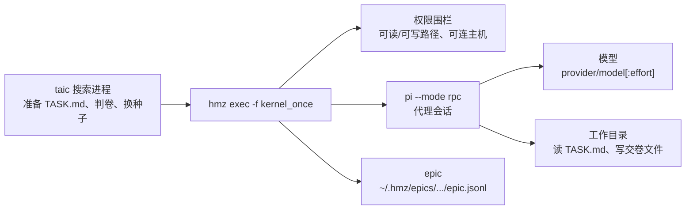

# hmz

`hmz` 是别人写的启动器，用来驱动已经登录的编程代理。搜索写内核只走 `hmz exec`，跑一场 `kernel_once`。`--kernel-agent off` 拒绝启动。换种子和确认仍在 `taic`。搜索不再单独发规划请求。`flame_chase` 是 `hmz` 自带的双代理轮流，本仓库的搜索不用它。

## 这篇讲什么

- `hmz` 只负责**启动与围栏**：它不写内核，也不判卷；判卷在 `taic`。
- 真正的模型调用发生在 `pi` 里，`pi` 由 `hmz` 拉起。链子是 `taic` → `hmz` → `pi` → 模型。
- 本仓库只给 `hmz` 一份流程 `kernel_once`：一个角色 `assistant`，写完一颗内核就停；两个委员会的轮换由搜索进程负责。
- `loop_protocol: flame_chase_1` 只是续跑协议标签，不代表调用 `flame_chase`。



源码不进入本仓库。2026-10-19 装上的发布包是 PyPI 的 `hmz` 0.2.0；2026-10-24 已升级到 0.2.2（PyPI 2026-10-24 的最新发布）。本机源码已快进到 `19b3dc59`（2026-10-24）；PyPI 0.2.2 的 release tag 是 `c2946aa`，两者是不同分支。其中 `flame_chase` 与 `e2013a4` 相同，仍是 48 行。搜索仍只调用 `kernel_once`；`run_config.json` 的 `loop_protocol: flame_chase_1` 只是续跑协议标签。搜索循环、上下文和判卷仍在 [搜索.md](搜索.md)。

## 它是什么

`hmz` 是一个 Python 程序。它不写内核，也不判卷。它启动已经装在本机的编程代理，给这场套上会话、权限围栏和一份运行记录。编程代理再去调用模型。本工程选用的代理是 `pi`。`pi` 是 Node 程序，也不是本仓库写的。

一条写内核的调用是：

```text
hmz exec -f taic/flows/kernel_once
    -a assistant=pi/<provider>/<模型>[:effort]
    -p turn_output_tokens=<这一场的输出 token>
    -p turn_minutes=<主回合分钟>
    -p wrap_output_tokens=<收尾回合的输出 token>
    -p wrap_minutes=<收尾回合分钟>
    -p submit_name=<交卷文件名>
    -p seed_name=kernel.metal
    -p budget.duration=<整场分钟>m
    --json
    -- "Read TASK.md in this directory and do it. Write the finished kernel to <交卷文件名>. The search does not read kernel.metal."
```

参数要点：

- `submit_name` 是 `{题目}-{dtype}-{规模}-{场次}.metal`。少了它，`kernel_once` 会回落到 `submit.metal`，而搜索只读 `TASK.md` 里写的那份交卷文件。
- `seed_name` 默认也是 `kernel.metal`；它只用于收尾提示里点名种子文件，实际写入的种子文件由搜索按本场契约放置，交卷文件仍由 `submit_name` 决定。
- `--json` 让 `hmz` 把 `spent` 等记录写成一行行 JSON，搜索据此记账。

单场美元上限是剩余预算和 `relay_budget_usd`（默认 2 美元）里较小的那个，再按该委员会的输出单价换成 `turn_output_tokens`。不是把剩余美元原样交给 `budget.cost`。

`kernel_once` 是本仓库的流程：一个角色 `assistant`，写完一颗内核就停。两个委员会的轮换在搜索进程里。轮到谁，就把那个委员会的模型写进上面的 `pi/...`。

## 它内部的四层

| 层 | 代码落点 | 一场里发生什么 |
| --- | --- | --- |
| 流程 | `flame_chase` 或本仓库的 `kernel_once` | 决定几个角色、每场是否新开会话、任务句子是什么。`flame_chase` 只有一个循环：两个角色轮流，每场 `spawn` 再 `run` 同一句任务 |
| 代理会话 | `pi --mode rpc` | 模型在这里。`pi` 用自己的 `read`、`write`、`bash` 改文件、跑命令 |
| 权限围栏 | `hmz internal fence` | 限制这场能读哪些路径、能写哪些路径、能连哪些主机。`/tmp` 可写。`~/.cache` 和 Clang 的默认模块缓存不可写。`TMPDIR` 指到这场自己的临时目录 |
| epic | `~/.hmz/epics/<工作区>/<时间>-<编号>/epic.jsonl` | 一行一件事：开始、打开了哪个会话、花费、结束。不另抄 `pi` 说过的话。那些话在 `~/.pi/agent/sessions` |

`hmz` 的网页按 epic 显示一场：谁上场、何时开始和结束、怎么结束、花了多少。搜索看板读同样的四行，并另读 `pi` 会话的末尾。两边都不把 epic 当成成绩单。

## 技能怎么交到 pi

流程目录下的 `skills/<名字>/SKILL.md` 要由角色用 `_skills` 点名。`hmz` 才把它放进这场进程的虚拟家目录。不放进工作区。`pi --mode rpc` 不信任工作区里的 `.pi/skills`，也不加载工作区里的 `.pi/mcp.json`。

本仓库的技能是 `taic/flows/kernel_once/skills/taic-tools/SKILL.md`。它让代理读 `msl_reference.md`，并按 `TASK.md` 里的命令做 `--quick` 和 `--timed`。计时用机器上那把 GPU 锁。主回合有输出 token 和时长上限；到了上限，同一会话再写一次 NOTES，把核写进 `TASK.md` 里的交卷文件。`kernel.metal` 是种子，外层不读。

KDA 教 Nsight 是同一条路。`skills/ncu-report-skill/SKILL.md` 写明先测、再对症状、再写计划，并给出可照抄的 `ncu` 命令。`flame_chase` 自己不跑剖析。代理用终端执行技能里的命令。

## 本工程用了什么，不用什么

| 用 | 不用 |
| --- | --- |
| `hmz exec`、`kernel_once`、本机 `pi`、权限围栏、代理会话、epic 的四行摘要、技能目录 | `flame_chase` 排整次搜索；`hmz web` 当搜索看板；Claude、Codex、Kimi Code、litellm；把 Humanize 源码搬进本仓库 |

`taic/` 没有 import 或调用 `flame_chase`；上面那个 `flame_chase_1` 字符串不是调用它。不用 `flame_chase` 排班，是因为两个委员会已经在搜索里轮换。下一场读到的是新写的 `TASK.md`：当前核、成绩单和上一场失败反馈。由它排整次搜索，会把计时和换种子交回代理。写内核的那一场不弱：上场的仍是 `pi`。判卷比 `flame_chase` 多，它不判卷。

搜索不再单独规划。模型调用只发生在 `hmz` 拉起的 `pi` 里。`lookup_msl` 和 `quick_check` 不注册进当前搜索。

可观测层按需启动一个 `hmz web --no-open --port 0 --attached` sidecar，作为查看 epic/session 的辅助窗口。它只读 Humanize 的会话视图，不读搜索候选、确认门或 trust，也不作为发布证据；主看板仍是 `python -m observe`。详见 [可观测.md](可观测.md) 的「hmz web 辅助窗口」。
