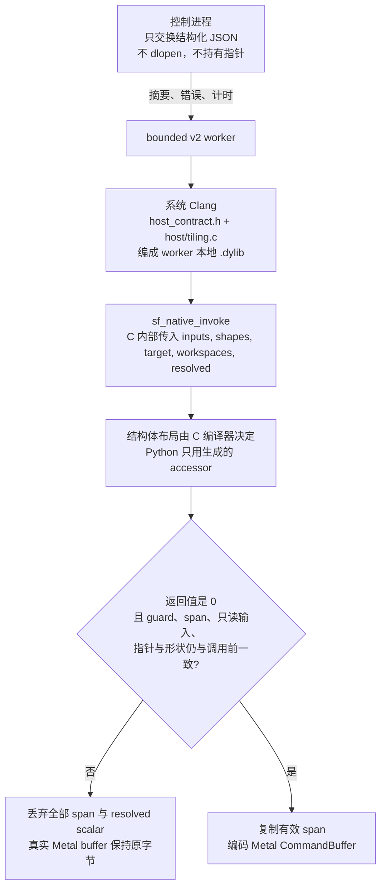

# ShapeForge Native Host Program ABI（独立设计）

状态：**native64 ABI 已接入生产构建/执行路径，CPU/协议与真实 Metal correctness/timing 均已验收；
V5 的 L2 continuous-batching 与 V6 六档 Metal 验收已完成，P2-F 已重录。本文的微秒表仍是小 fixture，不是 speedup 发布**。

已验证：独立头生成器、真实编译字节的 assembled digest、native digest 重放、有效 span、
guard/read-only/metadata/shape/target/pointer 调用后校验、typed large-input read、fresh replay、
最终 dylib 符号边界、bounded worker 的 segfault/timeout 回收，以及 NPU 模拟的 native parity。
`MetalHostProgram` 已使用 `native_sha256 + execution_backend=native-c99`，HostRunEvidence 为
`tcenv.hostprogram.run.2`。旧 Wasm runtime/toolchain/probe 和 `wasmtime` 依赖已删除。

候选自有的代表性 varlen 示例实现成本模型、range partition、LPT 整链分配、稳定 worker 分组、
有界 pieces、partial tail、逐段状态 handoff 和空序列 `final_state`，并对比 balanced/cost-lpt。
这些算法仍只属于候选，不进入 harness 调度器。

真实 Metal 已通过 native Host Program **10/10**、V1 **11/11**、V2 Dyn-0 **19/19**，合计
**40/40**；CPU/协议/负例 **128 passed**。三次独立未插桩 full evaluation 的 Host wall 中位数为
**7.583 µs**，native Host 为 **4.584 µs**，candidate median 为 **238.994 µs**，Device 为
**64.374 µs**。C planner 本体插桩中位数约 **0.167 µs**。完整数据流、原始三次测量和
Wasm/初版 native 对比见 `docs/架构/native-host-program-数据流耗时报告.md`。该结果只覆盖当前
小 fixture，不是 speedup 发布。V6 六档的正确性门是 `tests/backends/metal/test_varlen_v6_chunked_gpu.py`，倍数边界见 `AGENTS.md`。P2-F 见 `tests/support/golden/shared/shape-portfolio-阶段验收/P2/F.md`。

## 架构与信任边界

控制进程只接收结构化结果：摘要、span、错误和计时。候选 `.dylib` 的编译、加载和执行都在 bounded v2 worker 里。控制进程不 `dlopen`，也不接收 native 指针。`.dylib` 不进入 `ArtifactBundle.entries`。

C 编译器拥有五个结构体的布局：`SfHostInputs`、`SfHostShapes`、`SfHostTarget`、`SfHostWorkspaces`、`SfHostResolved`。Python 不计算 `offsetof`，也不把指针传进 `sf_native_invoke()`。该函数无参数；五个结构体由 C 内部传给候选的 `host_tiling()`。

返回 0 之后，worker 再次核对指针、capacity、`elem_nbytes`、shape、target、resolved scalar、输入元数据、guard 和只读输入。全部通过，才把有效 span 复制到真实 Metal workspace，并编码 CommandBuffer。任一非 0 返回、trap、越界 span、guard 被破坏、只读输入被改写或 worker 超时，全部 span 与 resolved scalar 丢弃，真实 buffer 不发生部分写入。



字段级合同在第 3–7 节。一次调用的耗时拆分在 `docs/架构/native-host-program-数据流耗时报告.md`。

## Workspace 三态

每个 workspace 在 Host Program 路径上有且只有一种初始化政策。有效 span 按元素 `offset + count` 提交，未写尾部不按最大容量整块清零。

| 状态 | 谁写下初始字节 | Device 侧 | 用来抓什么 |
| --- | --- | --- | --- |
| `host` | CPU 写有效 span。证据里的未写政策记为 `host` | 不再对这块做 fill | 候选自己的 plan、work list、flag |
| `device_zero` | Host 不写这块。证据里记为 `declared-zero`，对应 geometry 声明了 `zero` 的块 | 清零与 device stage 编进同一个 CommandBuffer | 设备需要的零初始状态，并且清零留在计时窗内 |
| `none` / poison | 不清零。证据里记为 `poison-sentinel` | poison 字节留在原处 | 内核在写入之前就读了这块；poison trial 会把它暴露出来 |

`host` 与 `device_zero` 不能落在同一块上。对 `host/tiling.c`，这块要么由 Host Program 初始化，要么由 geometry 的 `zero` 声明交给 device fill，两种所有权互斥。envelope 在分配和计时之前拒绝这个组合，避免运行到一半才发现后写的一方覆盖了先写的一方。既有 `host/tiling.json` linear 计划仍按原来的「先 fill、再由 host 写」顺序，不受这条互斥约束；同一候选也不能同时交付这两个 host 文件。

```text
同一块 workspace，Host Program 路径上三选一

host
  CPU   [ 已写 span | 未按容量整块清掉的尾部 ]
  GPU   不对这块 fill

device_zero
  CPU   这块的 span 为空
  GPU   清零和后续 kernel 在同一个 CommandBuffer

none / poison
  CPU   不清理
  GPU   poison 字节留着；依赖未初始化内容的试验会失败

host 写  +  geometry 把同一块声明为 zero
  envelope 阶段拒绝
  真实设备上不会出现「先写 plan，再被 device 清零盖掉」
```

### 最小与代表性验证证据

- `tcenv/hostprogram/native_contract.py`：独立 native64 头生成和最小编译入口，不 import 生产合同
  模块 `contract.py`（旧的 `_layout()` Python 偏移模型已不存在）；
- `tests/shared/test_native_host_abi.py`：C ABI、span、guard、失败和 replay；
- `tests/shared/test_native_host_device.py`：最小 Host span → Device consumer；
- `tests/support/golden/shared/nativehost/varlen_host_device.c`：**测试候选**，不是 harness
  planner；通用 range-cut/LPT 与状态递归，不含 CUDA/CANN 机制；
- `tests/shared/test_native_host_varlen.py`：两种候选策略 × 八种分布，对独立 Python 参考逐值
  比较，并负向验证缺失 handoff 和非法分段。

偏斜用例 `[1,1,1,1,10]` 的候选固定点成本模型结果：balanced worker loads 为
`[3940,486,486,486]`，cost-lpt 为 `[3454,972,486,486]`，模型 makespan 从 3940 降为 3454，
两种策略的 output/final_state 完全一致。**这只是调度成本模型验证，不是 Metal 墙钟性能结论。**

最终 CPU 安全回归（排除三个明确 deferred 的 P2 测试文件）为 **4412 passed / 13 skipped**。
唯一失败是既有 `test_remote_job_worker_bridge` 在并行高负载下的 2 秒墙钟阈值（实测 2.87s），
串行复现以 0.94s 通过；它不是 native 路径回归。此前发现的 `pyyaml` 未声明依赖和并行
segfault 测试 deadline 已修复，相关并行复验为 `105 passed / 1 skipped`。上面的 4412 是当时的回归计数。P2-F 与 V6 六档后来完成；这组 40/40 与 cv=0.021 仍只是小 fixture，不是 speedup 发布。

这份 ABI 用于 Metal 生产路径的 Host Program，替代此前的 Python ↔ Wasm 执行方式。
它不是 KDA 或 CAKE2 ABI 的复制品，也不是旧 Wasm ABI 的 64 位修补版。

**总原则：学习 KDA/CAKE2 的通用工程思想和算法机制，不学习它们绑定 CUDA、Ascend、CANN 的
平台、芯片和专用工具链。**

要学习的是：

- Host+Device 协同交付；
- 按真实输入做调度，而不是只按静态 shape 猜；
- work list、成本模型、负载均衡、partial tail、状态 handoff；
- 把 Host Tiling 编译成本机代码，避免解释器边界；
- 可检查的 artifact、独立 reference、真实测量和证据驱动优化。

不学习的是：

- CUDA 的 CTA/SM 模型、raw pointer、tensor map、bit packing、acquire/release 自旋；
- Ascend 的 AIC/AIV、TilingData、TilingKey、AscendC、CANN package 与专用 API；
- 任何把 KDA 的固定 `D=128`、chunk=64、CUDA graph 或 CAKE2 的 shape case 当成通用合同的做法。

## 1. 目标与边界

Host Program 是候选交付物的一部分，负责根据**本次真实输入**做调度、生成 work list、写有效
workspace span，并提供 resolved scalar。它运行在**有界 worker** 内，由本机 Clang 编译为
worker-local `.dylib`，通过薄的 C ABI 调用。

设计目标：

- 去掉 Python ↔ Wasm 的 Store/Linker/实例化与多次复制成本；
- 保留候选算法自由，不把 KDA 的 LPT/range-cut 或 CAKE2 的 TilingKey 内置进 harness；
- 保持 ShapeForge 的 OpSpec、workspace、正确性、计时和证据身份；
- 原生代码永远不在控制机进程中执行。

## 2. 交付物与身份

| 交付物 | 归属 | 约束 |
| --- | --- | --- |
| `host/tiling.c` | 候选 | 受限 C99，包含候选自己的 planner |
| `host_contract.h` | harness 生成 | 由 OpSpec/ABI 派生，强类型字段、容量和 accessor |
| `host/execution_geometry.json` | 候选 | 仍是唯一静态几何声明 |
| `host.dylib` | worker build | 仅 worker-local，编译一次复用 |
| `HostRunEvidence` | harness | 记录实际输入、有效 span、resolved scalar、时间与错误 |

身份字段：

```text
program_sha256          = sha256(host/tiling.c)
assembled_host_sha256   = sha256(实际完整 C 编译单元：生成 ABI/支持代码 + host/tiling.c)
native_sha256           = sha256(host.dylib bytes)
compiler_version        = clang --version 首行
execution_backend       = native-c99
worker_identity         = bounded-v2-worker
```

`native_sha256` 进入 `NativeExecutable.descriptor["host_program"]`，从而影响 `native_digest`。
`.dylib` 不进入 `ArtifactBundle.entries`，也不塞进 `BuildOutcome.payloads`。
控制机只接收摘要和结构化结果，不接收 native 指针。

同一 worker 进程内按 native/assembled/program 摘要、`memory_bytes` 与 `used_workspaces` 复用已加载
的 module；换了 worker 就必须重编译，且必须逐字节复现 `native_sha256` 与 `assembled_host_sha256`，
否则 `HostProgramError` 拒绝执行。

## 3. C ABI：由编译器定义布局，Python 不猜偏移

候选只调用一个入口：

```c
int32_t host_tiling(const SfHostInputs *inputs,
                    const SfHostShapes *shapes,
                    const SfHostTarget *target,
                    SfHostWorkspaces *workspaces,
                    SfHostResolved *resolved);
```

`SfHostInputs`、`SfHostShapes`、`SfHostTarget`、`SfHostWorkspaces`、`SfHostResolved` 都由
`host_contract.h` 定义。字段名称、dtype、numel、capacity 和访问方式来自 OpSpec 与候选几何。

**Python 不计算 `offsetof`、不读取裸结构体、不修改候选指针。** 所有地址和 span 都通过生成头
提供的 accessor 获得：

```c
int32_t  sf_native_invoke(void);  // C 内部传递五个强类型子结构体；Python 不传指针
uintptr_t sf_native_input_cu_seqlens_address(void);
uintptr_t sf_native_workspace_work_items_address(void);
uint32_t  sf_native_workspace_work_items_offset(void);
uint32_t  sf_native_workspace_work_items_count(void);
uint32_t  sf_native_shape_total_tokens(void);
```

这些 accessor 由 harness 根据合同生成。候选可以直接使用强类型字段：

```c
const int32_t *cu = inputs->cu_seqlens;
workspaces->work_items_count = n_items;    // 字段在 C 结构体里是展平的，没有 work_items.count
workspaces->work_items_offset = 0;
```

未声明的名字在 Clang 编译期直接报错，不需要运行时猜名字或数组下标。

## 4. 内存模型：ABI 元数据与 Workspace Storage 分离

Native ABI 有两类独立内存，不能混用：

### 4.1 ABI 元数据

包含：

- `SfHostShapes`：编译期 symbols/attrs；
- `SfHostTarget`：target profile 公开的整数参数；
- `SfHostResolved`：本次调用真实的 resolved scalar。固定 shape 与 L1 实例的
  `total_tokens`/`num_seqs` 已经是静态 shape 字段，所以它们的 `SfHostResolved` 仍是历史上的
  `{ uint32_t reserved; }`（生成 header 逐字节不变，既有 assembled digest 与 descriptor 长度继续
  有效）。只有 L2 capacity 实例才有真字段 `total_tokens`/`num_seqs`：capacity 形状留在
  `SfHostShapes`，resolved 形状随每次调用变化；
- 输入/workspace 的真实指针、capacity、offset/count、elem_nbytes。

它们由生成的字段 accessor 提供：mapped 输入的 `sf_native_input_<name>_abi_address()` 与
`sf_native_workspace_<name>_abi_address()` 返回 ABI 里记录的地址，`sf_native_shape_<name>()`、
`sf_native_target_<name>()`、`sf_native_workspace_<name>_{capacity,offset,count,elem_nbytes}()`
返回字段值。`sf_native_abi_address()` 只属于最小 probe 合同 `tcenv/hostprogram/native_contract.py`，
生产 ABI 没有这个整块入口。worker 只允许在 ABI 声明范围内写入元数据。

### 4.2 Workspace Storage

包含 mapped 输入和 workspace 的内容。每块是独立的 C region，有：

- 强类型 `data[]`；
- 前后 32-byte guard sentinel；
- 独立的真实地址，由 `sf_native_input_<name>_address()` 或
  `sf_native_workspace_<name>_address()` 提供。

Python 不计算 region 的结构偏移；span 的 `offset/count` 是元素单位，由生成 accessor 返回。

Metal 路径上 mapped 输入可以直接绑定到共享缓冲区地址（`sf_native_bind_mapped_inputs`），这块
region 只在 CPU/NPU 路径上装真实输入；workspace 始终由候选写进 region，提交时再复制到真实
Metal buffer——计时路径由 C 的 `sf_native_commit_spans` 先校验全部 span 再一次性复制，audit
路径由 Python 收集 span 后写入。

输入与 workspace 不能重叠。未分配 workspace 的指针为 `NULL`，候选若返回非空 span，整个调用失败。
禁止把 `0xFFFFFFFF` 当成合法地址或合法“未初始化值”。

## 5. 输入 ABI：小输入直接映射，大输入按需读取

| 输入类型 | 交付方式 | 约束 |
| --- | --- | --- |
| 小张量（如 `cu_seqlens`、`scale`） | 映射为 worker 地址空间的强类型指针：Metal 绑定共享缓冲区地址，CPU/NPU 复制进 native region；单张量 ≤ 64 KiB 且全部 mapped 合计 ≤ 1 MiB | 只读；每次调用绑定本 case 的真实输入 |
| 大张量（如 q/k/v/g） | 只提供 `id/numel/elem_nbytes` 元数据（`SfTensorMeta`，语义 dtype 由 `elem_nbytes` 与任务声明确定） | 不提供指针，禁止默认全量复制 |
| 大输入读取 | `sf_input_read_<dtype>(id, elem_off, (uintptr_t)dst, count)` | typed callback；id/dtype/范围校验，记录实际读取区间 |

只读输入（`access=read`）才能进入 Host Program。`read_write` 输入由 device 独占，不能被 Host
读写。

Mapped 输入在每次调用都指向本 case 的真实存储（Metal 是地址绑定，CPU/NPU 是复制），不能按 build
缓存其值；shape/target/指针等结构元数据可以复用，但不能复用 fresh 输入的计算结果。

## 6. Workspace 与有效 Span

每个 workspace 只有一个连续有效 span。`SfHostWorkspaces` 里每个 workspace 展平成五个字段，没有
嵌套结构体（下面以 `work_items` 为例）：

```c
uint32_t *work_items;            // 指向 worker 内的 region；提交时复制到真实 Metal buffer
uint32_t  work_items_capacity;   // 元素上限
uint32_t  work_items_offset;     // 候选填写的起始元素
uint32_t  work_items_count;      // 候选填写的有效元素数
uint32_t  work_items_elem_nbytes;
```

规则：

- `offset + count <= capacity`；
- `count == 0` 合法，表示本次不写；
- per-core 布局必须打包进这一个 span，不在 ABI 中引入多段写；
- 只复制有效 span 到真实 Metal workspace；
- 未写尾部用 poison/sentinel，device 必须按 count/resolved shape 停止；
- 不按 max capacity 全量写或全量清零。

每个 workspace 另外生成 `SF_WS_<NAME>_CAPACITY_ELEMS`/`SF_WS_<NAME>_ELEM_NBYTES` 与
`SF_HOST_USE_<NAME>` 编译期宏，候选可以直接在 planner 里做分配与容量判断。

Host 初始化三态：

- `host`：CPU 清零/写 span，device 不再 fill；
- `device_zero`：host 不写，fill 与 device stages 在同一个 CommandBuffer；
- `none/poison`：不清零，用 poison trial 抓未初始化依赖。

Host 写与 `device_zero` 同块冲突在 envelope 阶段拒绝。

## 7. 调用与原子提交

每次调用顺序：

1. worker 恢复 ABI、写入本次 target 与**本次 resolved scalar**（`sf_native_set_resolved_*`），
   复制/绑定 mapped 输入，然后快照合同（`sf_native_capture_contract`/`capture_inputs`）；
2. 调用无参数 `sf_native_invoke()`，由 C 传递五个强类型子结构体给候选；
3. 若返回 0，读取 accessor 给出的 offset/count；
4. 重新校验所有 pointer、capacity、elem_nbytes、shape、target、resolved scalar、input metadata、
   guard 和只读输入（候选改写任一 resolved 字段即整次调用失败）；
5. 校验通过后，才把有效 span 复制到真实 workspace。

候选源码在投影期先过静态预检（`tcenv/hostprogram/precheck.py`）：拒绝任何 `#include`、`#pragma`、
`#import`、libc/进程/文件/网络调用、函数指针、inline asm/varargs，以及 `sf_native_*` 内部入口；
`SfHostWorkspaces` 别名、对 `workspaces` 赋值或取地址也被拒（否则名字扫描无法审计写入块与
host/device-zero 归属）。编译命令是 `-nostdlib -fno-builtin -Wl,-undefined,error`，候选不能依赖
任何宿主符号。

build 还用 `nm`/`size` 检查最终 `.dylib`：任何未解析宿主符号、候选自定义导出或超过
`memory_budget_bytes` 的静态存储都在加载前拒绝。动态 runaway 仍由外部 watchdog 处理。

**任何非 0 返回、native trap、span 越界、guard 破坏、read-only 修改、非法 import 或 worker 超时，
全部 span 与 resolved scalar 都丢弃，不能部分提交。**

原生代码只能在有界 worker 中编译、加载和执行。控制机不 `dlopen` 候选库，不接收指针，不把
worker 崩溃伪装成候选正确性失败。

## 8. HostRunEvidence

沿用现有 `HostRun`/`HostWorkspaceSpan` 的语义，不另造一套 planner 或证据：

```text
schema_id = tcenv.hostprogram.run.2
candidate_sha256 / program_sha256 / assembled_host_sha256
native_module_digest / native_digest / execution_backend=native-c99
backend_id / target_id / platform
input_reads[]       = 实际读取的输入区间与 digest
workspace_writes[]  = 有效 span、字节数、digest
unwritten_policy    = host / declared-zero / poison-sentinel（`declared-zero` 就是声明 `zero`
                      的 device_zero 块）
resolved_scalars    = 本次实际值（从生成 accessor 回读，不是调用方的期望）
resolved_shape      = L2 的 resolved 形状文档（capacity/full_capacity/profile id；L1/fixed 为 None）
evaluation_input_digest = 本次实际输入的可重放身份：L2 绑定声明的 workload profile id/canonical
                      seq_lens 与字节推出的 resolved total/count（scope 明确为
                      boundary-bytes+shape-metadata+declared-profile，不是整输入内容哈希）；
                      L1 沿用现有规则
geometry_digest / launch_geometry_digest（按 Dyn 级别）
input_dependent / preprocesses_inputs / inside_timing
host_status / typed_error / error_detail
host_tiling_wall_ns / native_wall_ns / device_kernel_ns / end_to_end_wall_ns / timing_mode
digest_mode         = audit（benchmark 合并时写入：digest 与 reads/writes 来自 audit launch，timed 只合并中位数时间）
simulated / publication_allowed
```

审计与计时分离：

- correctness 和 warmup 采 digest、读区间和实际 dispatch；
- timed 只记录耗时，不计算 sha256、不生成 JSON；
- Host Program 的 wall time 包含在 candidate E2E 中，不能像 KDA 的 prepare 一样放到计时外；
- `device_kernel_ns` 只作诊断，不能代替 E2E 发布谓词。

构建期还强制 lifecycle 的 `inside_timing`/`input_dependent`/`preprocesses_inputs` 全为 true，否则
拒绝绑定 Host Program；写到没有任何 possible stage 能绑定的 workspace 也在构建期拒绝
（分配范围是 possible stage 的并集）。

## 9. 与 KDA / CAKE2 的关系：只取通用部分

### 可以学习的通用机制

| 通用思想 | ShapeForge 的落地方式 |
| --- | --- |
| Host+Device 是协同交付物 | `host/tiling.c` + device source + `host/execution_geometry.json` |
| Host 根据真实输入派生调度 | 候选读取实际 `cu_seqlens`，生成自己的 work list |
| 变长工作项和成本模型 | 候选选择 LPT、range-cut、均衡切分或自己的 planner，harness 不内置 KDA 算法 |
| 长链/尾块/状态管理 | 候选声明 handoff state/flags，harness 检查 partial tail 和逐段 `final_state` |
| 原生 Host Tiling | 受限 C99 编译为 worker-local 本机代码，薄 C ABI，不再 Python↔Wasm |
| Artifact + 验证 + 实测反馈 | candidate/build/evaluation identity、独立 reference、真实 Metal 验收和 fresh confirmation |
| shape 特化与回退 | 现有 shape portfolio、exact one-of-N、独立 generic fallback |

### 明确不学习的平台部分

- **CUDA**：CTA/SM 数量与驻留、raw pointer、tensor map、CTA item bit packing、CUDA graph、
  跨 CTA 自旋/acquire/release flag；
- **Ascend/CANN**：AIC/AIV、TilingData、TilingKey、AscendC、CANN package、msopgen、msprof；
- **KDA 专用形状和计时**：固定 D=128、chunk=64、prepare 在计时外、只测 replay；
- **CAKE2 专用路由/交付**：DSL router、CANN 构建绑定和专用知识库格式。

这些不是“通用最佳实践”，而是它们在特定硬件和工具链上的实现方式。ShapeForge 只学习它们
**为什么需要 Host+Device、为什么需要调度、为什么需要状态协议、为什么需要实测证据**，
再用自己的 OpSpec、ABI、Metal worker 和 NPU 模拟实现。

### 保留 ShapeForge 的责任

OpSpec、候选自由、worker 边界、fresh/unseen、输入身份、原子提交、正确性、E2E 计时和证据。
这不是把 KDA/CAKE2 的 ABI 换皮，而是把它们的通用经验转译成我们的合同。

## 10. 实施状态与下一步

已完成：

0. **V5 L2 continuous batching（CPU/协议与真实 Metal 机制）**：L2 capacity 实例的 `SfHostResolved` 有 `total_tokens`/
   `num_seqs` 真字段与生成 accessor，Python 每次调用写入、C 合同检查拒绝改写、HostRun 回读记录；
   `resolved_shape`/`evaluation_input_digest` 进入 HostRunEvidence；L1/fixed header 逐字节未变。
   复核后：一次连续执行按 ordered case 保留**全部** HostRun 文档（内容相同的重复 correctness trial
   去重，失败 run 与成功 run 字段集相同并带本次 resolved 形状/输入身份），另记每次调用的
   `launch_runs`（phase/ordinal/case/trial/resolved 形状/digest/provider），不按冻结 dispatch 签名
   去重；`evaluation_input_digest` 的 scope 明确为边界字节 + 形态 + 声明 profile，并由
   `prepare_v2_case`/comparator 校验字节推出的 resolved total/count 等于声明 profile。
   真实 Metal `test_varlen_capacity_gpu.py` 3/3 已通过：同一 build 执行 9 个 resolved batches、
   连续 mixture、resolved 篡改拒绝；公开 portfolio evidence 同时保留 ordered launch/batch 记录。
   一次 full mixture candidate median 193.07 µs（cv 0.0445）、native Host 7.375 µs、device
   22.791 µs，speedup withheld，不是 P2/V6 发布结论。
1. 独立 native64 ABI、最小 Host+Device 与代表性候选示例；
2. 独立 work-list oracle 差分、真实 assembled/native digest 重放；
3. `MetalHostProgram` 生产绑定和 `tcenv.hostprogram.run.2`；
4. bounded probe worker 的 crash/timeout 与控制机不加载验证；
5. NPU native parity（仍 `simulated=true/publication_allowed=false`）；
6. 删除 Wasm runtime/toolchain/probe、旧 Wasm32 renderer 和 `wasmtime` 依赖。

下一步按授权执行：

1. 小 fixture 的 Host wall 已稳定低于 10 µs；后续按 workload 分解大输入 reads 和更大 span 成本；
2. P2-F 已在安静窗口重录 freeze/golden/evidence/manifest；历史 start-surface 锚点仍拒绝漂移；
3. V5 L2 与 V6 六档 Metal 验收已完成。V6 倍数只相对登记的朴素 Torch-MPS baseline。付费搜索与 NPU-P0 仍未完成；
   P3-B/P3-C 已在之后完成（`tests/support/golden/shared/shape-portfolio-阶段验收/P3/C.md`）。

真实 Metal descriptor/run2、dispatch、workspace、非零返回/非法 span 等负例均已复验；timed
`native_wall_ns` 与 Host/E2E 一样记录 timed 中位数，不再混入 audit 调用时间。
