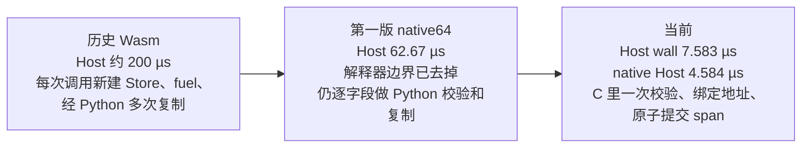
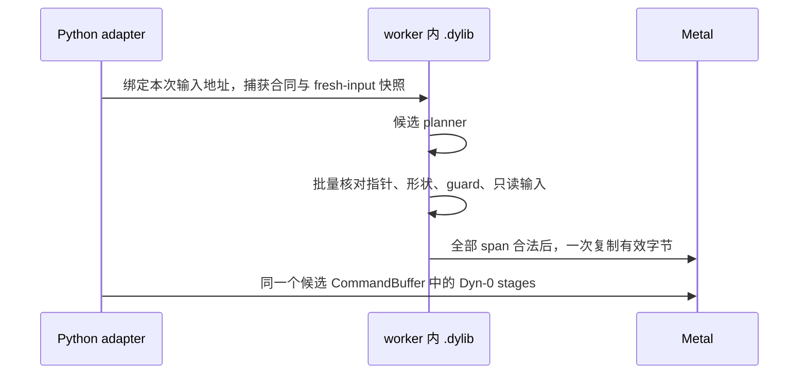

# Native Host Program 数据流耗时报告

状态：**优化已完成，当前小 fixture 的 Host wall 稳定低于 10 µs**。
测量对象是 `varlen_kda / fp16 / mixed` 的 native64 Host Program + Dyn-0 Metal stages。
这不是 P2 发布结果，也不是 V6 真实规模性能结论。

## 耗时瀑布：微秒花在哪里

下面三组数字都来自本文后面的测量，画在一起是为了看比例。它们不是把一次调用切成互不重叠的三段。第 1 节的 candidate / Host wall / native Host / Device 来自同三次未插桩 full evaluation 的中位数。C planner 的 0.167 µs 来自另一次 `SF_NATIVE_PROFILE=1` 插桩运行，正式中位数不用那一次。

```text
未插桩中位数。横条按 240 µs 对齐，一格约 6 µs。
Host 与 Device 各自是 wall 测量，不能和 candidate 中位数相加。

candidate median   238.994 µs  |########################################|
Device              64.374 µs  |###########                             |
Host wall            7.583 µs  |#                                       |
native Host          4.584 µs  |#                                       |  含在 Host wall 里

同一小 fixture 的 Host 路径，三代实现。横条按 200 µs 对齐。

历史 Wasm          ≈200     µs  |########################################|
第一版 native64     62.67   µs  |#############                           |
本次 Host wall       7.583  µs  |##                                      |
本次 native Host     4.584  µs  |#                                       |

插桩那一次的 Host wall 是 8.208 µs，用来看 Host 内部，不替换上面的 7.583。
横条按该次最大的一段（约 3.25 µs）对齐。

Python/runtime/profile 余项   3.250 µs  |####################|
input_prepare 绑定地址        1.750 µs  |###########         |
capture 合同与输入快照        0.875 µs  |#####               |
validate 批量合同校验         0.792 µs  |#####               |
collect 校验并提交 span       0.583 µs  |####                |
setup                         0.458 µs  |###                 |
metal_commit adapter 余项     0.333 µs  |##                  |
C planner 本体                0.167 µs  |#                   |
```

候选算法本身在这颗小 fixture 上只占插桩 Host 的 0.167 µs。从大约 200 µs 降到 4.584 µs，降的是进出 Host 的边界成本。candidate 中位数从 Wasm 的约 443 µs 到第一版 native 的 299.58 µs，再到 238.994 µs；Device 中位数仍有 64.374 µs，所以整段 wall 的下降比例小于 Host 单独的下降比例。Host wall 约为第一版 native 的 1/8.3、Wasm 的 1/26。这些比值只描述本报告里的同一个小 fixture。





Timed 路径去掉的是中间对象：不为每个输入构造 Python bytes，不逐字段调用几十个 accessor，不在计时样本里算 digest。Audit 仍在计时样本之外读取真实输入、计算 digest 并写出 HostRunEvidence。第 4 节列出每一项优化；第 1 节保留原始三次运行。

## 1. 结论

三次独立、未插桩的 bounded-worker full evaluation 均为 `ok`：

| 运行 | candidate median | cv | Host wall | native Host | Device | HostRun E2E |
| --- | ---: | ---: | ---: | ---: | ---: | ---: |
| 1 | 238.994 µs | 0.0379 | 7.583 µs | 4.584 µs | 64.374 µs | 239.250 µs |
| 2 | 236.091 µs | 0.0180 | 8.166 µs | 4.750 µs | 60.874 µs | 239.749 µs |
| 3 | 242.587 µs | 0.0219 | 7.542 µs | 4.584 µs | 66.103 µs | 241.041 µs |
| **中位数** | **238.994 µs** | **0.0219** | **7.583 µs** | **4.584 µs** | **64.374 µs** | **239.749 µs** |

第三次因测量噪声自动进行了第二次 attempt；没有选最低值或删除高值。三次 candidate cv 都低于
0.05。

与此前实现相比：

| 版本 | Host | candidate/E2E | 说明 |
| --- | ---: | ---: | --- |
| 历史 Wasm fixture | ≈200 µs | ≈443 µs | Python↔Wasm 边界占主要成本 |
| 第一版 native64 | 62.67 µs | 299.58 µs | 已去掉 Wasm，但仍有逐字段 Python 校验/复制 |
| **本次优化** | **7.583 µs（Host wall）** | **238.994 µs（candidate median）** | C 批量校验 + 地址绑定 + C 直接 span 提交 |

当前 fixture 下，Host wall 耗时约为第一版 native 的 **1/8.3**、Wasm 的 **1/26**；
candidate median 相比第一版 native 约降低 **20%**，相比 Wasm 约降低 **46%**。这些比值仅描述
本报告中的同一小 fixture，不能外推为所有任务的发布 speedup。

## 2. 优化后的完整数据流

```text
Metal shared input buffers
  │  地址按 ArgSet 生命周期缓存；不缓存输入值
  ▼
批量输入地址绑定（每次调用）
  │  fresh input 仍由本次 planner 实际读取
  ▼
C 捕获合同 + 输入快照
  ▼
C candidate planner
  ▼
C 批量校验：shape / target / pointer / metadata / guard / read-only
  ▼
C 先校验全部 workspace span，再直接提交到 Metal shared workspace
  ▼
一个候选 CommandBuffer
  ▼
Dyn-0 Metal device stages
```

Timed 路径不再执行以下工作：

- 不为每个 mapped input 创建 `HostInputRead` Python 对象；
- 不把 mapped input 先复制成 Python bytes，再复制进 native region；
- 不逐字段调用几十到上百个 Python/ctypes accessor；
- 不为每个 workspace span 创建 Python bytes 中间对象；
- 不在 timed 样本中计算 digest 或生成 JSON。

Audit 仍在计时样本之外读取真实输入、计算 digest、收集有效 span 并形成完整 HostRunEvidence。
**减少的是 timed 中间对象与边界复制，不是减少正确性检查。**

## 3. 插桩分解

另做一次 `SF_NATIVE_PROFILE=1` 的独立 full evaluation。该运行用于分解，不用于上面的正式性能
中位数，因为 `perf_counter_ns()` 和 profile 记录本身会增加少量开销。

| 阶段 | 插桩中位数 | 实际工作 |
| --- | ---: | --- |
| setup | 0.458 µs | 身份复用检查、恢复预期合同、重置 span/guard |
| input_prepare | 1.750 µs | 批量绑定全部 Metal 输入地址；timed 无 Python bytes 复制 |
| capture | 0.875 µs | C 捕获合同和 fresh-input 快照 |
| planner | **0.167 µs** | 候选 C planner 本体 |
| validate | 0.792 µs | C 批量合同/read-only/guard 校验 |
| collect | 0.583 µs | C 校验全部 span 并直接提交 Metal shared workspace |
| metal_commit（adapter 余项） | 0.333 µs | Python adapter 的剩余提交/计时工作 |
| Python/runtime/profile 余项 | ≈3.250 µs | HostRun/Timing 对象、调用边界、计时和 profiling 开销 |
| **Host wall（该插桩运行）** | **8.208 µs** | 含上述所有 Host 工作 |
| native Host（该插桩运行） | 5.291 µs | 不含 Metal adapter 的剩余工作 |
| Device（该插桩运行） | 68.499 µs | Metal stages |
| HostRun E2E（该插桩运行） | 244.541 µs | 完整 wall 路径 |

插桩分解中的各段不应被当成严格可加的 GPU 管线模型：Host/Device/E2E 各自是实际 wall 测量，
Python/profile 余项是 Host wall 与显式插桩段之间的差值。正式结论使用第 1 节未插桩的三次测量。

## 4. 做了哪些优化

### 4.1 C 侧批量合同校验

新增生成代码捕获预期合同和输入快照。shape/target 只在身份变化时重新设置；每次调用仍恢复
合同、捕获 fresh input，并在 planner 后检查：

- input/workspace pointer；
- capacity、elem_nbytes、numel；
- metadata-only 输入；
- shape/target；
- guard sentinel；
- read-only 输入内容。

这些检查从大量 Python accessor 调用合并成 C 内批量操作。

### 4.2 Metal shared-memory 地址绑定

`GuardedBuffer.mem` 通过零拷贝 `memoryview` 获取 worker 内地址。地址映射和打包数组只按真实
ArgSet/GuardedBuffer 生命周期缓存，**不按输入值缓存**。每次调用仍批量绑定当前地址、捕获当前
输入并执行 planner，因此 fresh case 不会复用旧 plan。

NPU/CPU 路径仍可以把输入复制到独立 native region；两条路径使用同一合同和 HostRun 语义。

### 4.3 Timed 不创建审计对象

Audit 创建 reads、span bytes 和 digest；timed 只保留实际工作、时间与提交，不构造不会进入最终
证据的逐输入/逐 span 审计对象。最终 timed HostRunEvidence 的 reads/writes/digest 来自独立 audit
运行，时间来自未插桩 timed 样本。

### 4.4 C 原子提交有效 span

生成的 `sf_native_commit_spans()` 分两遍执行：

1. 校验所有 workspace 是否已分配、offset/count 是否满足 capacity、目标地址是否有效；
2. 全部通过后，才把有效 span 复制到 Metal shared workspace。

负例证明：任何非法 span 出现时，目标 buffer 的每个字节都保持不变。audit 仍走 Python
bytes/digest 路径；timed 不再先构造 Python span bytes 再复制一次。

### 4.5 ArgSet 地址与辅助对象缓存

输入地址、workspace 地址、打包数组、reader 和 zeroed 集合按 ArgSet 生命周期复用。缓存项持有
原对象，避免 id 重用造成别名。这里没有缓存输入值、planner 结果或 workspace 内容。

## 5. 正确性与证据回归

- 真实 Metal：native Host Program 10/10、V1 11/11、V2 Dyn-0 19/19，合计 **40/40 passed**；
- CPU/协议/planner/NPU parity/portfolio/最小 Host+Device/负例：**128 passed**；
- 直接 C 提交负例：非法 span 及 `0xFFFFFFFF + 2` 溢出尝试下，全部校验完成前目标字节不变；
- 三次正式测量的 native call 与 CommandBuffer 分别为 170/170、150/150、475/475；
- audit=1，stage_args 重建=0，只读输入重拷=0；第三次 attempts=2 是噪声重试，不是挑选结果。

## 6. 边界与后续

- 这是小 fixture 的 Host 优化结果，不是 P2 发布 speedup，也不是 V6 D=128/H=64/96 真实规模结果。
- 大输入 typed read callbacks、更多/更大 workspace span、不同 planner 的成本仍需分别测量。
- Host Program 仍在要求的 E2E 计时边界内；没有把 prepare 移到计时外。
- 没有删除 fresh-input、read-only、guard、span、原子提交或独立 correctness 检查。
- P2 freeze/golden/evidence/manifest 后来已在安静窗口重录（P2-F，`--write-golden`/`--record-evidence`/
  `--write-manifest`，见 `tests/support/golden/shared/shape-portfolio-阶段验收/P2/F.md`）；本节的测量边界不变。
