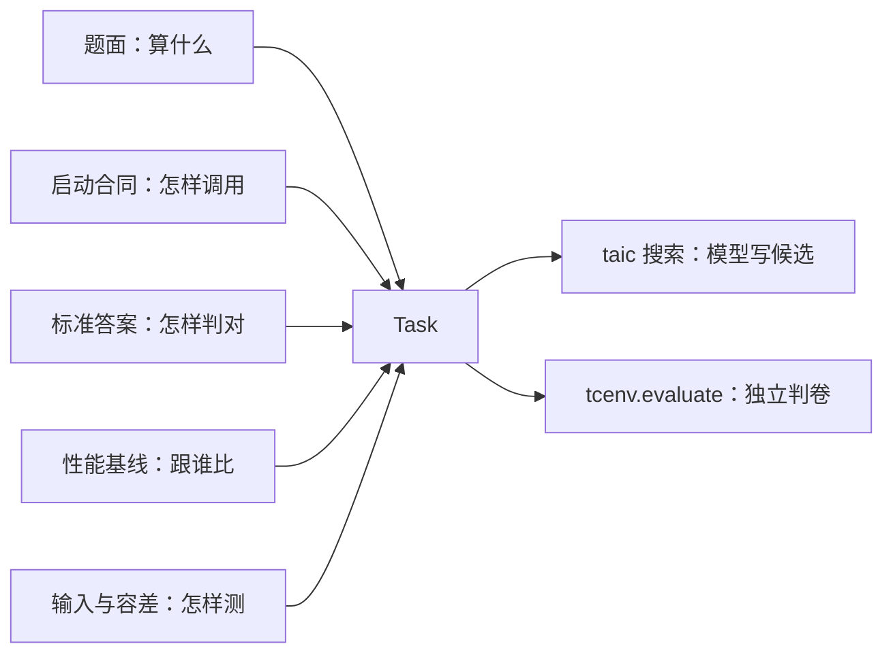
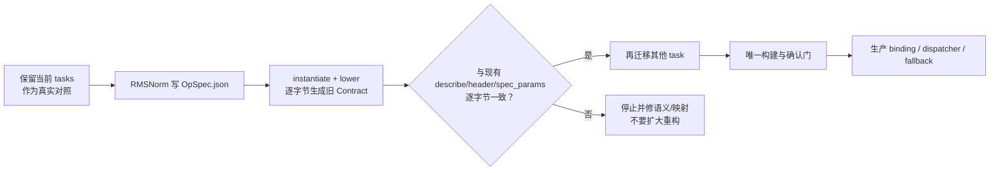

# `tasks/` 现状：有什么用、为什么不够、怎样演进

日期：2026-10-28

> **一句话结论**：当前 `tasks/` 不是无意义的玩具，它是**有真实 Metal 编译、数值和性能判卷的写核评测夹具**；但它不是生产算子库，也不是完整的 OpSpec、发布系统或 NPU 实现。
>
> **本文状态**：只读解释，未执行模型、GPU/NPU 或安装脚本。示例命令按是否需要设备和模型分别标注。

## 0. 先回答“有没有用”

| 问题 | 答案 |
| --- | --- |
| `tasks/` 是生产算子库吗？ | **不是。** 不能把它当成 PyTorch/MLX 那样的 RMSNorm/GEMM 调用库。 |
| 它是不是玩具？ | 若误当工业产品，确实像玩具；若当**写核 Agent 的题目、标准答案、基线和自检材料**，它是实用工具。 |
| 它对谁有用？ | 写核 Agent、评测器、性能/验证工程师、做搜索与回归实验的人。 |
| 它能直接部署吗？ | 不能。缺少生产 binding、注册、dispatcher、发布证据包、灰度和回滚。 |
| 对 NPU 有用吗？ | 目前只有设计和模拟参考价值；真实实现仍是 Metal，NPU backend/设备未实现。 |

## 1. 当前这套 `tasks/` 到底是什么

一次写核任务实际需要五类信息：



| 信息 | 当前承载 | 用途 |
| --- | --- | --- |
| 题面 | `kernel_triton.py` | 给模型看的 Triton 规格文本，主环境不执行 |
| 启动/ABI 合同 | `Contract` | 固定 kernel 名、grid/threads、buffer 槽位、dtype、shape 和编译期常量 |
| 标准答案 | `reference` | CPU 上的参考计算，用于数值差分 |
| 自检核 | `naive.metal` / `reference_sources` | 已知正确、但不一定快的目标 kernel，验证评测系统本身 |
| 输入生成 | `gen_inputs` + `cases` | 按分布和 seed 生成 normal/tiny/large/ieee 等输入 |
| 容差 | `rtol`、`atol_rel`、`exact` | 决定什么误差可接受 |
| 性能基线 | `baselines` | MLX、torch_mps 等厂商或框架实现，供计时比较 |
| 任务身份 | `task_fingerprint`、contract/triton 哈希 | 绑定任务、缓存、运行记录和确认结论 |

**因此，`tasks/` 是“写核—判卷”所需的输入包，不是最终交付的 kernel 包。**

## 2. RMSNorm 的三个文件分别怎么用

| 文件 | 正确用法 | 常见误解 |
| --- | --- | --- |
| `tasks/rmsnorm/task.py` | 用 `build(dtype, size)` 装配评测任务：选择 shape、合同、参考、输入、baseline 和容差 | 不是生产 RMSNorm 的 Python API，也不是完整 OpSpec |
| `tasks/rmsnorm/kernel_triton.py` | 给 Agent 看的算子规格与优化起点 | 不是给主 Python 环境直接执行的参考实现 |
| `tasks/rmsnorm/naive.metal` | 用已知正确的 Metal 核检查编译器、ABI、数值和安全门 | 不是性能最优实现，也不应直接当生产发布候选 |

`SHAPES = {"paper": (4096, 4096), "small": (64, 512)}` 是当前任务的两档形状；`threads=(256,1,1)` 是当前 Metal 启动策略。**前者是 shape 实例，后者是后端启动决定，不应该在未来继续混藏在同一个 builder 中。**

## 3. 现在它具体有什么用

### 3.1 给模型一道边界明确的题

模型不是只拿到“写一个 RMSNorm”这句话，而是能拿到：

- 数学语义与 Triton 规格；
- 输入输出 dtype、shape、参数槽位；
- 固定或允许调整的启动合同；
- 已知约束、示例和反馈。

这减少的是语义与 ABI 猜测，**但不能保证模型真的算对或算快**。

### 3.2 自检评测系统本身

`naive.metal` 是已知正确实现。把它交给同一个 `evaluate()`，可以区分：

- 是评测器/编译器/ABI/安全门本身坏了；
- 还是模型候选写错了。

这是它非常重要、但容易被忽视的价值。

### 3.3 独立判卷

评测器用 `reference`、输入分布、容差、保护带和多次启动检查候选，不只听模型自报“我写好了”。

当前关卡顺序是：

```text
编译 → ABI → 安全 → 数值 → 计时
```

数值通过只表示这次检查通过，不等于形式等价，也不等于更快。

### 3.4 比较不同候选和调度方案

同一道题可以比较：

- 不同模型/委员会生成的候选；
- 不同 tile、线程组、buffer、流水或算法变体；
- 候选与 naive、厂商库和编译基线的性能；
- 搜索最好值与后续独立确认值。

### 3.5 做回归与实验

`Task` 同时被 `taic.orchestrator` 和 `tcenv.evaluate` 使用，搜索和判卷共享同一题面与合同。`task_fingerprint` 让缓存、运行和确认能够绑定任务身份，减少“拿另一道题的证据冒充本题”的风险。

## 4. 现在怎样实际使用

### 4.1 只读查看，不需要设备或模型

```bash
# 看 RMSNorm 的说明、合同、ABI 桩和 Triton 题面
uv run python -m tcenv.cli show rmsnorm --size small

# 看全部任务的 grid/threads/args/min_bytes/flops
uv run python -m tcenv.cli tasks --size small

# 查看已有搜索的结论（只读）
uv run python -m taic.cli brief RUN_DIR
```

### 4.2 用已知正确核做自检（需要明确 GPU 授权）

```bash
uv run python -m tcenv.cli naive rmsnorm --size small --quick
```

这条路不调用 LLM，没有模型费用，但会真实编译和执行 Metal kernel。

### 4.3 评测自己的 kernel（需要明确 GPU 授权）

```bash
uv run python -m tcenv.cli eval rmsnorm /path/to/kernel.metal --size small --quick
```

`--quick` 只做编译、ABI、安全和数值；完整评测还会做性能测量。

### 4.4 让模型搜索（需要另行明确模型费用与 GPU 授权）

使用 `taic run` / `taic resume`。它们不是“运行 tasks 目录”，而是启动完整的：

```text
新会话生成候选 → 外层独立评测 → 反馈 → 搜索 → 确认复测
```

**以上命令都只是使用示例，本文没有执行。**

## 5. 为什么当前还不够

### 5.1 它是 MSL 专用题夹具，不是中立语义合同

| 问题 | 具体表现 | 后果 |
| --- | --- | --- |
| 语义与启动策略混在一起 | RMSNorm 的数学语义、shape 与 `threads=256` 都写在 `build()` | 无法中立复用到 NPU；启动策略也不易单独审查 |
| 没有独立 OpSpec schema | `Contract`、`Task`、`Task.meta` 分别承载不同事实 | 新增字段容易形成双真相，AI 也不知道该信哪份 |
| 容差/参考/baseline 与任务装配耦合 | 这些信息只有 Python 实现和调用约定 | 难以独立版本化、检索、校验与迁移 |
| `meta` 是 dict | `ieee_*`、`domain_case`、`source` 等没有 typed schema | AI 无法可靠枚举、拒绝未知键或做字段级诊断 |
| `spec_text` 固定为 Triton 模板 | 每条 IR/DSL 路线没有独立题面和技能绑定 | 多 IR/DSL 时容易把一种模板硬套给所有后端 |

### 5.2 当前题目不是隐藏的生产 oracle

`tasks/` 中的 reference、naive source、shape 和 baseline 都是可读工程材料，主要为了开发与评测，**不是完整的防作弊隐藏测试集**。

可信验收还需要：

- fresh/hidden shape 和输入分布；
- 输出毒化、输入不变性与多次启动；
- generated/fallback/unknown 执行路径分账；
- 计时后 fresh-input 复验与绑定源码/target 的确认；
- 候选不可修改 golden、容差、计时与评分材料。

因此不能因为某个候选通过 `tasks/` 的公开用例，就宣称它对所有输入正确或可以发布。

### 5.3 没有生产交付层

| 当前已有 | 工业仍缺 |
| --- | --- |
| 候选 `best.metal` | 可部署包、binding、安装与版本注册 |
| `result.json` / `confirm_report.json` | 签名 release manifest、证据包和发布 owner |
| target/backend 记录 | 明确的 site/epoch allowlist 与生产环境绑定 |
| 搜索与确认结果 | 按 shape/target 的 dispatcher、显式 fallback、灰度与回滚 |
| 反馈与经验文本 | 有来源、实测、版本、适用域、退役条件的知识生命周期 |

### 5.4 只有 Metal 真实实现

`tasks/` 的当前题面、naive 源码、baseline、启动几何和计时逻辑主要围绕 Metal/MSL。NPU 侧即使复用部分语义，也还缺：

- 独立 backend 与 target profile；
- CANN/SDK/驱动、构建与安装路径；
- host tiling、UB/L1/L0、同步与 launch 证据；
- 真实数值、路径、性能与站点验收。

**不能用 Metal 的任务证据宣称 NPU 已支持或已提速。**

## 6. 从当前 Task 到目标结构的映射

| 当前 `tasks/` 字段/文件 | 未来归属 |
| --- | --- |
| `formula`、Triton 语义、dtype/layout/acc、容差政策、用例域 | **OpSpec.json**：唯一语义事实源 |
| `SHAPES` | OpSpec `sizes`，并增加 `usage = golden / benchmark`，避免 tail 自动进入性能域 |
| `grid` / `threads` / math / launch 形式 | **BuildProfile**：后端与启动配置 |
| `contract` | 由 `lower(instance, build_profile)` 派生的 DTO，不再手写 |
| `kernel_triton.py` | 每个生成 track 独立的 `spec_text` / skills |
| `reference`、`gen_inputs` | 独立、只读的验证 artifact，不变成 OpSpec 字符串 |
| `naive.metal` / `reference_sources` | 按 backend 绑定的已知正确参考 artifact |
| `baselines` | 带版本、target 与测量协议的 baseline registry |
| `rtol` / `atol_rel` / `exact` | OpSpec `numerics.tolerance_policy` |
| `flops` / `min_bytes` | 唯一推导器或唯一显式字段，禁止两处分别手写 |
| 候选源码 | candidate artifact + `candidate_sha256` |
| `result.json` / `confirm_report.json` | BuildEvidence + release manifest + dispatcher 输入 |

## 7. 推荐的演进方式



### 不建议的做法

- 一次性把全部 task 改成另一套格式，却没有逐字节回归；
- 把 `threads`、CANN、soc/core/UB 全塞进 OpSpec，重新制造后端耦合；
- 只用“通过当前 tasks”证明生产正确与性能；
- 为了多 IR/DSL 复制多份语义合同；
- 把 `best.metal` 直接当生产 release。

### 建议的顺序

1. 先把 RMSNorm 的当前事实写成 OpSpec；
2. 用 `instantiate + lower` 逐字节复现当前 Contract 与 `spec_params`；
3. 证明无行为变化后，再迁移其他 task；
4. 接入统一构建与确认门；
5. 最后才讨论生产 dispatcher 和真实 NPU。

## 8. 最终判断

| 角度 | 判断 |
| --- | --- |
| 作为写核 Agent 的题夹具 | **有用且已经实用**：题面、合同、参考、输入、基线、判卷和确认链都存在 |
| 作为验证器自检工具 | **很有用**：`naive` 能区分 harness 问题与候选问题 |
| 作为 AI 友好的长期语义格式 | **不足**：需要 OpSpec.json、typed schema、明确权威和字段级诊断 |
| 作为生产算子系统 | **明显不足**：缺 binding、注册、dispatcher、发布证据、灰度与回滚 |
| 作为 NPU 实现 | **尚未成立**：当前真实实现是 Metal，NPU 仍需独立后端与真机验收 |

**所以最准确的定位是：保留 `tasks/` 作为真实评测与回归材料，同时用 OpSpec/BuildProfile 把它们升级成可复用、可校验、可发布的工业合同，而不是把当前 tasks 全删掉或继续当生产库使用。**

相关设计：

- [`构建执行与证据语义升级-plan.md`](构建执行与证据语义升级-plan.md)
- [`附录A：OpSpec与specialize`](构建执行与证据语义升级-plan-附录A-OpSpec与specialize.md)
- [`决策与对比记录`](构建执行与证据语义升级-决策与对比记录.md)
