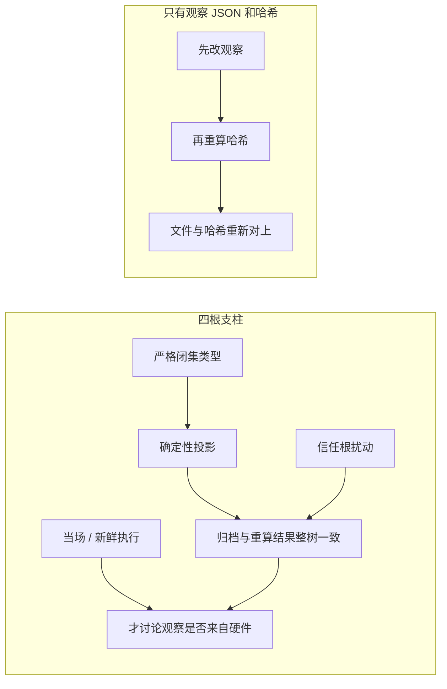

# 上游证据防伪与测试严格性盘点（KDA / CAKE2 / cannbot）

> 调研 commit：KDA workflow `acdd793`、KDA kernels `f539baa`、cannbot `b699c32`。
> 全部只读调研，未修改上游。本文解决一个问题：**我们担心的“证据可被伪造”，上游是否做过同类严谨测试。**
> 结论先给：**绝大多数没有；但同一个 cannbot 仓库的其它插件里有工程级做法，值得直接借鉴。**
> 本文是只读盘点，不改变已经关闭的 P0、P1、P2 的完成状态。方法讨论见 [`证据验收方法-问题与架构建议.md`](证据验收方法-问题与架构建议.md)，那份文档同样不改写这三段的验收结论。

## 0. 先看可信验收的四根支柱

后文用这四根支柱看上游有没有做过同类测试。四根要同时在，少一根，一份手改过的 JSON 仍可能通过。

「原始观察 JSON + 哈希」只证明哈希算完之后字节没变。攻击者可以先改观察，例如把错误计数从 1 改成 0，再重算哈希。文件和哈希重新对上。只比较这一对，检查就会接受一份伪造观察。确定性投影进一步证明报告是由这些观察算出来的，仍然不证明观察来自硬件。

| 支柱 | 白话 | 上游盘点里怎么用 |
| --- | --- | --- |
| 确定性投影 | 用同一段纯函数，从冻结输入和原始观察重算整份报告，再整树比较。冻结输入是合同和候选字节；原始观察是运行声称发生的事 | 看上游是否用原始延迟重算加速比，还是直接相信报告里的数字 |
| 严格闭集类型 | 只接受声明过的字段和精确类型。`true` 不能当成 `1`。闭集是指名单以外的字段一律拒绝 | 看 `true`、空容器、缺字段会不会静默变成合法数值 |
| 信任根扰动 | 原归档不动，临时副本里只改一个外部事实。验收器若仍接受，说明结论在自证。信任根是放在被检文件之外的事实 | 看有没有「改一字节、改依赖、伪造签名」之后必须失败的负例 |
| 当场 / 新鲜执行 | 用候选没见过的输入再跑一次。这是新的运行，不是把存档再读一遍 | 看评测集是否由被测方自己携带。自己带题，等于没有这根支柱 |



KDA 与 CAKE2 的评测链大多还没有前两根。cannbot 里 npubench 的 HMAC 回执更进一步：公开哈希谁都能重算，没有私钥就做不出签名。那是「文件由持钥方签发」的证据，仍然不是清微设备或本仓库某一次 GPU 运行的证明。本盘点不据此重开 P0、P1、P2。

## 1. 五维对照

| 维度 | KDA workflow `acdd793` | KDA kernels `f539baa` | CAKE2 评测链路 | cannbot 其它插件 |
|---|---|---|---|---|
| ① 身份摘要测试 | 部分（重算文件 sha256，但身份行无测试） | 无（有内容寻址缓存，0 测试） | 无（commit_hash 由 agent 自写） | **有**（HMAC 回执 + 篡改负例） |
| ② 篡改负例 | 无 | 无 | 无 | **有**（伪造 HMAC / 伪 CI / 改依赖） |
| ③ 重算式验证 | 仅重算哈希 | 无 | 部分（golden 为同源自证） | **有**（speedup 由 latency 重算、TOCTOU 重哈希） |
| ④ schema 校验 | 无 | 无 | 无（无 jsonschema，无版本字段） | 有（手写 schema 常量 + 版本比对） |
| ⑤ held-out 验证 | 无 | 无（6 个打分 shape 有手调 plan） | 无（被测方可自带 test_cases） | 无 |

注意两处反直觉事实：

- **KDA `acdd793` 是工作流文档仓库**，第一方代码只有 `scripts/export_huggingface.py`（325 行），
  测试只有 `tests/test_export_huggingface.py`（16 函数 / 33 用例），**无 CI**。
  所谓“KDA 的 kernel 验证、基准、晋升规则”全是文档文字。
- **CAKE2 评测链路约 1000+ 个 pytest 用例其实是文档代码块语法检查**
  （`tests/test_code_snippets.py` 解析 452 个 md 里的 1339 个 cpp + 573 个 python 片段），
  实质语义测试约 100 个，且 **未接入 CI**（`tests/run-gates.sh:46-48` 只注册依赖图一项）。

## 2. KDA：几乎没有可对标的证据测试

`acdd793` 第一方全部内容：README/CLAUDE/CONTRIBUTING/LICENSE、`docs/agent-flow.md`、
`prompts/basic-flow.md`、`scripts/export_huggingface.py`、`tests/test_export_huggingface.py`。
`skills/KernelWiki` 与 `skills/ncu-report-skill` 是 git submodule（第三方）。

有的（且质量不错）：

- 构造型前置校验，副作用之前拒绝：`scripts/export_huggingface.py:52-63`
  （`type(config.version) is not int` 拒绝 `true`、`repo_id` 正则、空 capabilities、符号链接拒绝）。
- 失败不留半成品：`:227-268` 临时目录 staging + rename；测试 `tests:165-182, 221-231`。
- 内容摘要：`_snapshot_solution()` `:70-90`，身份 `:271`。

缺的：

- **没有任何“改一字节后旧 identity 必须失效/拒绝”的负例**。`:271` 那行身份无测试覆盖。
- `tests:312-314` 遍历的是 metadata 自己的 `digest["files"]`，且**没有断言它非空**——空 dict 会 vacuous 通过。
- 无 exactly-one 分派、无 fallback、无 held-out、无计时验证、无 golden、无 CI。
- 18 个负例里 6 个只 `pytest.raises(ValueError)` 不断言理由；`match="entrypoint"` 一条覆盖 4 种不同缺陷。

`f539baa` 那一份**没有任何 pytest/unittest 文件**，但有四处值得直接借鉴的机制（见 §5）。

## 3. CAKE2 评测链路：结构性自证

最严重的三条：

1. **golden 不是独立 oracle。** `skills/ascendc-evaluation/scripts/evaluate.py:347-358`
   里 `golden = ref_model.cpu()(fp64)`，`ref` 与 `golden` 是同一个类，且 `reference` 本身由 LLM
   从 `op_desc` 生成（`skills/reference-generation/SKILL.md:9`）。reference 错 → golden 一起错 → kernel 通过。
2. **评测集由被测方持有。** `docs/EVALUATION_INSTRUCTION.md:209` 允许每个进化变体自带 `test_cases.py`；
   `skills/ascendc-evaluation/SKILL.md:99-103` 指导执行者自己创建编辑它。全仓无 held-out。
3. **证据无 schema / 无内容摘要 / 无篡改检测。** `commit_hash` 由 agent 跑完后自己写回
   `evaluation_results.json`（`skills/git-version-management/SKILL.md:142-166`），与被测源码无内容绑定；
   `permissionMode: bypassPermissions`，同一 agent 可改 kernel、test_cases、`constants.py`、结果 JSON。
   `stop-gate` 只读这个 JSON 的字段（`hooks/check_eval_done.sh:24-56`）。

同一类“隐式类型/默认值”缺陷也存在：

- `DEFAULT_TOLERANCES` 无 `float64` 条目，`precision.py:706` 于是**静默套用 bf16 最松容差**；
  非 bf16/fp16/fp32 的 ULP 直接返回 0（`precision.py:192-202`），ULP 永远“完美”，且无测试。
- pass/fail 公式在代码里唯一（`precision.py:743-744`），但主入口 `SKILL.md:208-217` 写的是**另一套**公式，
  且 ULP 完全不参与判定——文档与代码互相矛盾。

它的强项（真实存在、有单测）：

- ULP 的 NaN/Inf/跨零/次正规、`>2^24` 整数精确性：`test_ulp.py`、`test_ulp_zero_ordering.py`、
  `test_evaluation_scripts.py:252-278`。
- 多输出数量不一致硬失败，防 `zip` 截断：`normalize_output_triple` + `test_evaluation_scripts.py:442-481`。
- 容差收紧/放宽必须改变判决：`test_fp64_oracle_mismatch.py:24-36`。

性能侧的**反面教材**（正好是我们 P3 要防的）：

- `scripts/ascend_performance_test.py:400` 对所有 kernel 行取 `Task Duration` 中位数：
  一个 fallback 成 N 个算子的实现，真实墙钟是 N 个之和，中位数只取其中一个 → **fallback 被系统性高估**。
- ref 与 custom 是两次独立 profiling run，无交替 A/B（`performance.py:203-224`），单跑一次定生死。
- `op-dashboard/scripts/dashboard_parsers.py:48-62` 的 docstring 自认遇到过 “ModelNew=Model 镜像跑”
  （speedup≈1.0 的自证跑法），而检测方式是**看目录名里有没有 `_ref_tuning_`**——改名即绕过。

## 4. cannbot 其它插件：工程级，值得对标

这是本次调研最重要的发现：**同一个仓库里，别的子系统的证据防伪比我们想象的严格。**

### 4.1 HMAC 回执 + attempt nonce（最强）

- 写：`plugins-community/ascendc-port-orchestrator/engine/src/scripts/orchestrator/npubench/npubench_build_receipt.py:433-450`
  —— 先算 `payload_sha256`（canonical JSON，`sort_keys`、`allow_nan=False`），再用 32 字节私钥算
  `receipt_auth_hmac`，原子落盘。
- 私钥安全：`:485-515`，`0o600`、`O_NOFOLLOW`、拒绝符号链接/硬链接/组或世界可读、长度必须 32。
- 读回：`:544-565` 重算 payload 摘要 + `hmac.compare_digest`，任一失败 `return False`（fail closed）。
- 防重放：`npubench_o5_runner.py:500` `secrets.token_hex(16)` 作为 `build_attempt_id`，
  `:152-154` 与 `expected_attempt_id` 不等即失效。
- 用**当前** SoC/工具链重建期望身份，而不是信回执自述：`npubench_o5_runner.py:206` 有明确注释。
- 负例：`tests/ut/test_npubench_o5_runner.py:486-533`——换 SoC、新签名回执使旧回执陈旧、
  **伪造 payload 后重算 `payload_sha256` 使哈希自洽，再把 HMAC 改 `"0"*64`，必须判 `target_build`**。

这条几乎就是“我们担心的自证问题”的教科书答案：**攻击者能重算公开摘要，但算不出 HMAC。**

### 4.2 不信自报指标，用原始值重算

- `plugins-official/triton-op-generator/workflows/evaluate_performance.py:32-37`：
  注释直接写 “The report's displayed speedup is rounded; it cannot decide exact parity”，
  于是用两份 `avg_latency_ms` 相除重算。
- 负例：`tests/test_performance_policy.py:58` 把 `framework.avg_latency_ms` 改成 `0.999999`，必须不通过。
- `performance_effect_evidence.py:84-98` `_verified_receipts()`：结果被接受**之前**再全量重哈希一次
  （TOCTOU 防线），不符即 `raise ValueError(...dependency changed...)`；负例 `test_confidence_effect_policy.py:380`。
- `:641-665` `verify_proof()` 从原始 CSV 重算统计量与存证比对；负例 `:366`（伪 CI 必须被拒）。

### 4.3 陈旧/归属必须有显式失效账本

- `hccl-op-generator/workflows/scripts/validate_aicpu_artifacts.py:1328-1369`：
  `stale = artifact_identity(header) != index["source_identity"]`；陈旧必须在 index 标 `valid:false`
  **并且**在 `invalidated_artifacts` 留带 `reason` 的记录，否则 `INVALIDATION_REQUIRED`。
- 负例：`test_validate_aicpu_artifacts.py:624`（先报错，补齐记录后才通过）、`:691`（嵌套 estimate 身份陈旧
  即使外层正确也被拒）。
- 裁决文件唯一权威：`harness/workflow-orchestrator/scripts/orchestrator.py:390-404` 派发前归档旧裁决，
  归档失败就拒绝派发；`tests/test_orchestrator.py:1420-1432` 用 “文本谎称 pass” 验证
  **文件裁决优先于文本叙述**。

### 4.4 构造型类型边界（和我们踩过的坑完全同源）

- `evaluate_performance.py:20-22`：`isinstance(value, bool)` 先行 + `math.isfinite`，
  负例 `test_performance_policy.py:63` 用 `[None, nan, inf, 0, -1, True]` 全测一遍。
- `validate_aicpu_artifacts.py:421-427` 同款；负例 `:755-785` 覆盖 `True/False/"2500"/[]/{}/0/-1/nan/inf/-inf`
  以及 `10**400` 必须被接受——**类型边界两侧都测**。

### 4.5 但它们的 CI 也没接

`.gitcode/workflows/cannbot-actions.yml` 无 `pytest`；`tests/run-gates.sh:46-48` 只注册依赖图一项。
`orchestrator.py:452` 注释自认 “可能因 agent 越权直改 status.json”，无防护、无测试。

## 5. 该抄什么、不该抄什么

**该抄（按优先级）**

1. **HMAC 回执 + attempt nonce**：公开摘要谁都能重算，私钥不能。这解决了我们 P1 反复纠结的
   “Raw Observation 在离线归档中仍是自述”——给 P2 的 fresh confirmation 加一层真实签名回执，
   比继续加字段检查有效得多。注意私钥必须由上层 harness 持有，不能放在 agent 可写目录。
2. **接受结果前重算 + TOCTOU 重哈希**：对应我们的“重投影后整树比较”，但多了“验证期间依赖不得变”这一步。
3. **陈旧证据必须有显式失效账本**：对应 P2 的 manifest 激活/撤销；比“加了 stale 检查”更强的是
   **要求留下带 reason 的 invalidated 记录**。
4. **不信自报指标，用原始值重算**：对应 P3 的 speedup——必须由候选/基线中位数重算，不能信报告里的数字。
5. **毒化 + 逐位复现**（KDA kernels `kda_backward_packed.py:13094-13110`）：两次毒化输出缓冲，
   要求 `torch.equal`，同时证明“每个输出都被写过”和“可重复”。

**不该抄**

1. **同一类自证 reference**（CAKE2 `evaluate.py:347-358`）。
2. **被测方自带评测集**（`EVALUATION_INSTRUCTION.md:209`）——我们必须保留 held-out 由 harness 派生。
3. **信自报的 speedup / commit_hash**（`git-version-management/SKILL.md:142-166`）。
4. **对 kernel 行取中位数当墙钟**（`ascend_performance_test.py:400`）——多算子/fallback 实现会被系统性高估，
   这正是 P3 两本账要解决的问题。
5. **用目录名/文件名启发式判作弊**（`dashboard_parsers.py:48-62`）——改名即绕过。

## 6. 对我们现有结论的影响

- 之前说“上游没有 P1 那类证据门，所以不存在他们的验收器也有同样的洞”——**仍然成立**：
  KDA 无 kernel 证据链，CAKE2 评测链路无 schema/摘要/篡改检测，方向不同。
- 但“上游没做过严格测试”这个说法**需要修正**：cannbot 的 npubench / ops-perf / hccl / workflow-orchestrator
  确实做过，而且比我们现在的 P1 更强的一点是**有私钥**。我们靠的是“外部 expected digest + 重跑”，
  它们靠的是“HMAC + nonce”。
- 因此 P2 的证据设计应把 **HMAC 回执 + attempt id** 列为候选机制，而不是只做“外部钉住的摘要”。
  两者可组合：HMAC 证明“这个回执确实由该次受控构建产生”，重投影证明“这份证据确实是该输入的确定性投影”。

## 7. 复核方式

本文每条结论都可用下列命令复核（只读）：

```bash
# KDA workflow 只有文档 + 一个导出脚本
git -C /Users/kuafu/CLionProjects/kda ls-files | grep -v '^skills/'
# KDA kernels 零测试文件
git -C /Users/kuafu/CLionProjects/kda-260927-kda ls-files | grep -c 'test'
# CAKE2 golden 与 ref 同源
sed -n '347,358p' /Users/kuafu/CLionProjects/dsl_for_llm/cannbot/plugins-community/collaborative-agent-kernel-evolution/skills/ascendc-evaluation/scripts/evaluate.py
# HMAC 回执与篡改负例
sed -n '433,470p;540,566p' /Users/kuafu/CLionProjects/dsl_for_llm/cannbot/plugins-community/ascendc-port-orchestrator/engine/src/scripts/orchestrator/npubench/npubench_build_receipt.py
sed -n '486,533p' /Users/kuafu/CLionProjects/dsl_for_llm/cannbot/plugins-community/ascendc-port-orchestrator/engine/src/scripts/orchestrator/tests/ut/test_npubench_o5_runner.py
# 重算式 speedup 与负例
sed -n '18,40p' /Users/kuafu/CLionProjects/dsl_for_llm/cannbot/plugins-official/triton-op-generator/workflows/evaluate_performance.py
sed -n '55,70p' /Users/kuafu/CLionProjects/dsl_for_llm/cannbot/plugins-official/triton-op-generator/tests/test_performance_policy.py
```
