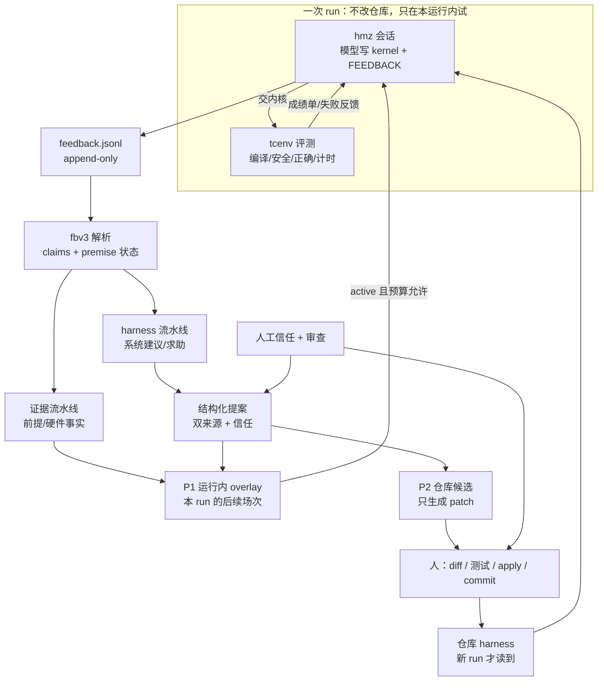
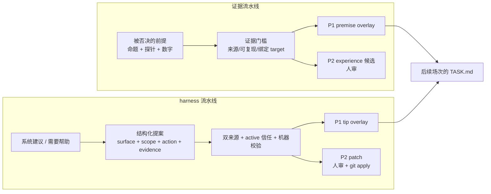
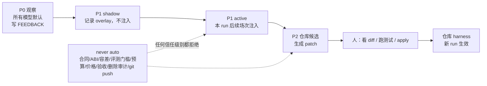
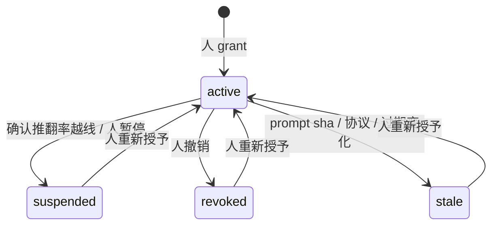
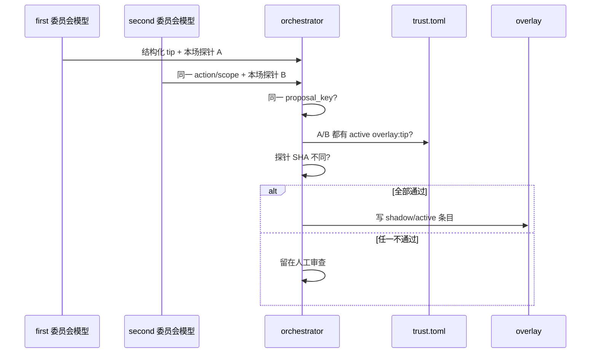
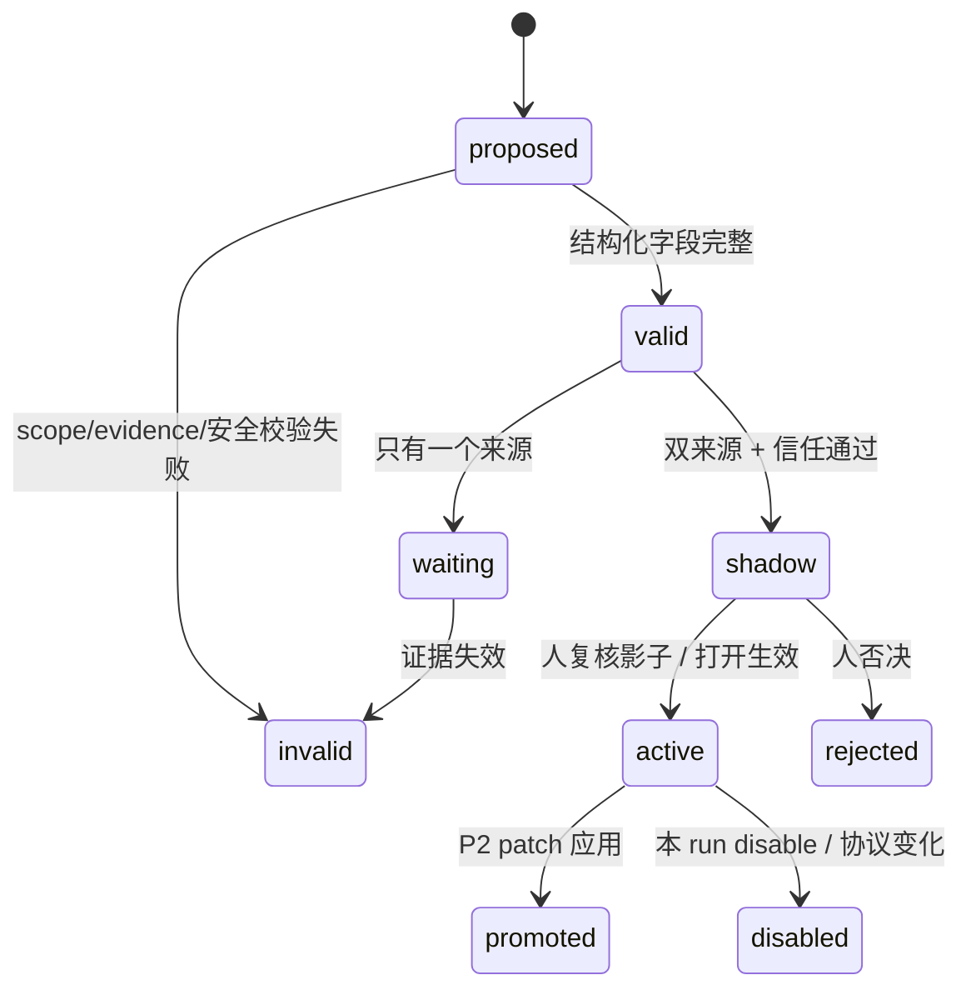

# 可信 harness：RSI 架构与理论

这一篇回答三个问题：这个仓库的“自我改进”到底改什么、为什么反馈要分成两条流水线、以及什么权限可以自动生效。操作细节在 [代理反馈.md](../代理反馈.md)，数据布局在 [数据层.md](数据层.md)，落地代码和已验证边界在 [可信harness实现.md](../可信harness实现.md)。

## 0. 一句话

**模型不改权重；改进的是下一次会话看到的 harness。** 外层搜索用实测内核成绩做目标，用人工授予的信任和双来源证据决定哪些 harness 建议可以先在**本运行、本硬件、本任务**内试用；仓库级改动仍然由人看 patch、跑测试、提交。



这张图的三个边界很重要：

1. **运行中不换仓库文件。** 开跑时 `agent_guidance` 已经冻结并记了 sha256；P1 只能走独立的 overlay，否则同一 run 前后条件不一致。
2. **P1 只在本运行内。** 它默认在运行结束失效，不自动跨 run、跨 target 传播。
3. **P2 不是自动写入。** 它把模型建议变成可审的 patch；人确认后才进入仓库，且下一次新 run 才生效。

## 1. RSI 是什么，不是什么

### 1.1 这里的 RSI

RSI（recursive self-improvement，递归自我改进）常被理解成“模型改自己的权重”。本仓库不做这件事。这里的 RSI 是**外层改进回路**：

- 被改进的对象是 harness：TASK 合同措辞、技能文件、工具提示、经验库、反馈规则、验收流程。
- 改进的依据是外层评测：内核是否安全、正确，是否真的更快。
- 改进的载体是反馈：模型在会话中写下的建议、被否决的前提、踩过的坑。
- 改进的闸门是人：信任由人授予，仓库变更由人确认。

所以它是“**用搜索产生反馈，用反馈改进下一次搜索的 harness**”，不是“模型训练自己”。这也解释了为什么模型自报的数字不能直接当证据：模型是提出者，不是裁判。

### 1.2 为什么不是直接把建议写进提示词

直接把自由文本写进 TASK 或系统提示，会遇到四个问题：

1. **自证循环**：模型提出一条提示，下一场看到它，按它做，然后“验证”它有效。
2. **分布漂移**：一条在 conv2d 上有效的提示，可能让 flash_attention 变慢；换硬件后更不可比。
3. **注入面**：TASK 是模型读的指令文本，模型写的建议里可以藏命令、路径或“忽略合同”。
4. **审计断裂**：没有来源、证据、投票和 change_ref，事后无法判断一条规则是谁、为什么、在哪个硬件上加的。

两条流水线、权限梯度、信任和双来源，都是对这四个问题的工程回答。

### 1.3 理论坐标

这些不是本仓库发明的定律；它们只是帮助我们判断一个设计有没有必要：

| 概念 | 在本架构里的落点 | 它解释什么 |
| --- | --- | --- |
| 代理—环境循环 | 模型写核、`tcenv` 给成绩、搜索选种子 | 为什么模型需要外部评测，而不是自报 |
| 有限理性 | 预算、轮数、12KB TASK、单场 token 上限 | 为什么只找“够好”的 harness，不追求最优 |
| Reflexion / 经验回写 | `NOTES`、`peer_tips`、被否决前提 | 为什么失败要写成下一位能读的记录 |
| Human-in-the-loop RSI | 信任由人授予、P2 由人 apply | 为什么自动改进不直接改仓库 |
| 关注点分离 | 证据流水线 / harness 流水线 | 为什么两类反馈不能共用一个真值标准 |
| 能力型授权（least privilege） | P0/P1/P2、scope、target/task | 为什么权限要按对象和范围切小 |
| 独立验证 | 双来源、两个委员会、不同探针 SHA | 为什么单一模型的重复不算证据 |
| 影子/金丝雀发布 | P1 shadow、批量回滚 | 为什么先记录、不先注入 |
| Goodhart / reward hacking | 指标分开、Wilson 下界、人审 | 为什么“通过率高”不能直接当信任 |
| 供应链/来源 | prompt sha、协议、内核 sha、探针 sha、change_ref | 为什么每个自动结论都要能追溯 |
| 分布漂移 | target/task/协议/模型版本绑定 | 为什么一个硬件的结论不能复制到另一个 |

这些概念只解释“为什么这样设计”；真正的边界仍以代码、测试和审计记录为准。

## 2. 两条流水线：事实与建议分开



### 2.1 为什么必须分开

两条线的**真值标准不同**：

| | 证据流水线 | harness 流水线 |
| --- | --- | --- |
| 典型内容 | “fp16 操作数进矩阵单元会慢一倍” | “看板应把验证过的提示和未验证提示分开渲染” |
| 怎样算成立 | 探针/评测记录复现数字 | 失败测试、可复现命令、代码审查、双模型一致 |
| 谁最懂 | 写探针的模型 + 人 | 两个委员会的独立模型 + 人 |
| 自动去向 | 本运行经验层 / 硬件 experience 候选 | 运行内 tip overlay / P2 patch |
| 失败模式 | 伪探针、单位错、结论过度推广 | 提示注入、单模型偏见、自证循环、跨任务误用 |

如果混在一起，算法结论的数量会抬高模型“改 harness”的可信度；反过来，一个擅长改工具的模型也会被当成硬件事实的权威。两者都不对。

### 2.2 证据流水线

计划第 3 节的原则是：**数字要来自 harness 自己能复核的执行记录**，而不是模型随手写的文件。理想门槛包括：

- 记录由评测命令或外层评测写出，绑定 `target_id`、`protocol_version`、内核 sha、探针 sha。
- 数字和单位能对上；探针测的命题就是被否决的命题，不是相邻问题。
- 代理自写的探针只能当“带出处的线索”，不能自动标成已证实。

**当前实现**：代码检查探针文件在提案者本场目录、mtime 晚于本场开始、SHA 存在，要求 active `overlay:premise` 信任，并读取本场 `self_checks.jsonl`，核对 target、协议、内核 SHA 和测量数字。匹配不上时 `premise` 只写 shadow。它仍不是密码学签名，恶意代理理论上可伪造本机记录；不要把 P1 当形式证明。详见 §7。

### 2.3 harness 流水线

系统建议必须变成结构化提案，而不是一段自由文本：

- `surface`：`tip` 或 `premise`（P1）；`skill`、`task_wording` 只能走 P2。
- `scope`：`target_id`、`task`、可选 `dtype`；跨硬件或跨任务不共享投票键。
- `action`：一句祈使句，不能带命令、代码围栏或路径重定向。
- `evidence`：本场探针/测试/可复现命令。
- `rationale`：自由说明，只作展示。

没有结构化块的建议仍然可以进人工审查；它只是不参与自动 overlay。这样不会因为“模型不会写 JSON”而丢掉人类想看的信息，也不会把自由文本直接执行。

## 3. 权限梯度：能力单调、最小授权



| 层级 | 谁能做 | 作用范围 | 生命周期 | 失败时 |
| --- | --- | --- | --- | --- |
| P0 观察 | 所有模型 | 本场反馈 | 随 run 归档 | 只影响审查队列 |
| P1 shadow | 自动，但只记录 | 本 run | 运行结束失效 | 人看影子记录 |
| P1 active | 双来源 + 信任 + 影子复核后 | 本 run 后续场次 | 运行结束/disable 失效 | 可整批停用，不改仓库 |
| P2 patch | 人确认 | 来源 target/task | 仓库提交，新 run 生效 | diff/测试/回滚 |
| never auto | 无人授权也不做 | — | — | 直接拒绝 |

### 3.1 为什么 P1 要按 run 隔离

- 开跑时指导文件已经冻结；如果运行中改仓库，前半场和后半场不是同一实验条件。
- 12KB 的 TASK 预算有限，overlay 必须和成绩单、失败反馈、NOTES 一起排队，不能无限膨胀。
- 一个 run 的结论只在这个 run 的 target/task 上成立；跨 run 复制会绕过信任和证据检查。

### 3.2 为什么 P2 只生成 patch

P2 改的是仓库，影响所有后续运行。自动写文件等于让模型间接改合同、评测或共享提示。正确流程是：

1. 生成 unified diff。
2. 展示 diff，`git apply --check`。
3. 跑离线测试和 prompt golden。
4. 人确认后 apply，写 `change_ref` 或提交号。
5. 共享表面（TASK 合同、`taic-tools`、系统提示）额外确认跨硬件适用。

`change_ref` 是追溯链的闭合点：没有它，`done` 不成立。

## 4. 信任：委托的权限，不是模型声望

信任登记回答的是：**在这个 target、这个 task 上，这个人是否愿意让这个 provider/model/effort 的提案参与自动生效？**



信任键包含：

- `target_id`、`task`、`provider`、`model`、`effort`；
- `prompt_sha1`、`protocol_version`；
- `scopes`（如 `overlay:tip`）、`expires_at`、`granted_by`、`reason`、`evidence_run`。

设计要点：

1. **信任不等于模型分数。** 指标（已审数、合理率、Wilson 下界、confirmed 推翻率、占位率、已实测率）只帮人决定是否授予；授予动作本身是人做的。
2. **按硬件和任务切开。** 在 M4 Max/conv2d 上可信，不代表在另一个 GPU 或 flash_attention 上可信。
3. **会过期。** prompt 或评测协议变了，旧信任失效；模型换了版本、effort 变了，也不能沿用。
4. **可撤销、可暂停。** 人可随时按 target 撤销；confirmed 推翻率越线时自动暂停，但恢复仍由人做。
5. **追加式审计。** `trust_audit.jsonl` 记录每一次 grant/suspend/revoke，不覆盖历史。

## 5. 双来源：两个独立模型，不是两次复述



一致的定义：

- 两个不同的 `provider+model`；
- 来自 `first` 和 `second` 两个委员会；
- 都在该 `(target, task)` 上有 active 信任；
- 提出同一 `proposal_key`（target/task/surface/action 规范化形）；
- 两份探针的 SHA 不同（复制同一份探针不算第二来源）。

### 5.1 为什么是两个模型，而不是一个模型说两次

单一模型的偏好会稳定地重复；两次复述看起来像“多票”，其实是同一个误差源。两个委员会至少要求两个不同的服务/模型，降低单模型偏见和单点故障。

### 5.2 为什么还需要人

双来源仍不是形式证明：

- 两个模型可能读到同一份旧笔记，犯同一个错；
- 复制文字后各写不同探针，仍可能通过；
- 模型可能学会“写一个容易通过的探针”，而不是验证命题；
- 双来源只证明“两个模型都提出了”，不证明“建议真的让搜索更好”。

所以 P1 默认影子，P2 必须人审；自动只负责把候选缩小到值得人看的一小批。

## 6. 影子、状态机与回滚



### 6.1 影子先行的理由

影子模式把“记录”和“注入”分开：

- 影子期只写 `harness_overlay.jsonl`，TASK 里不出现；
- 人可以比较影子条目和未启用场次的 unchanged 率、成本、失败类型；
- 确认没有把合同/命令/未验证事实带进 TASK 后，才打开 active。

这是部署里的 canary/shadow 思路，不是额外模型调用：影子条目的生成仍然只来自已有会话反馈。

### 6.2 生效时的保护

- TASK 标题固定为「未验证的模型建议（不是合同，不是事实）」。
- 剥离代码块、命令、控制字符；拒绝 shell 语法和 never-auto 关键词。
- 受 12KB 预算裁剪；被裁掉要记录，不静默丢失。
- `target_id`、`task`、`protocol_version` 不匹配就丢弃；resume 也逐条校验。
- 运行目录里的 `harness_control.json` 只能关闭，不能开新权限；关闭后 active 条目不再进入 TASK。

### 6.3 P2 的状态

P2 成功不是“模型说可以”，而是：

```
proposal -> patch -> git apply --check -> 离线测试/golden -> 人确认 -> apply
        -> change_ref -> 仓库提交 -> 新 run 才读到
```

失败可以丢弃 patch；已经应用的可以 revert。共享 prompt/skill 不默认写入，必须单独确认跨硬件影响。

## 7. 设计基线与当前实现的差距

这一节是给审阅者的，不是给模型的。计划第 3–6 节描述的是目标架构；当前代码只实现了其中一部分。

| 设计基线 | 当前实现 | 风险 |
| --- | --- | --- |
| 证据来自 harness 可信执行记录 | P1 `premise` 校验 self-checks 的 target/协议/内核 SHA/数字，但文件非签名 | 代理可伪造本机记录 |
| `premise` 也需更强门槛 | `premise` 不需要双模型投票，但需要 active 信任 + 匹配的 self-checks 记录；否则只写 shadow | 单模型错误前提仍可能进 shadow；伪造本机记录仍可能绕过 |
| 独立性靠“证据产自本场” | 只比较探针 SHA 不同 | 复制文字 + 各写不同探针仍可能通过 |
| P1 关闭用只追加 disable 事件 | 当前是 `harness_control.json` 覆盖写 | 文件被重写时历史事件不在文件内；审计要看决策日志 |
| 活动 claim 与历史审计分开 | 当前使用 `info`/`obsolete` 状态和墓碑；空占位重建时写入 `feedback_claim_removed` | 与计划第 7 节的“不新增状态”不同；审阅时按当前实现读 |
| 重复按同一 action+scope 确认 | 曾显式执行 `--merge-topic`，复核后由 `experiments.revert_topic_merges` 把 10 条改回 pending | topic 不是等价关系；不要按 topic 批量关 |
| 付费试点后再扩大 | 只准备离线工具，没有跑 `taic run/resume` | 没有真实的质量/成本结论 |

这些不是“文档没写”，而是**文档必须写清楚**：当前 self-checks 只是本机记录，不是密码学签名；付费试点仍要靠人工复核。若要把 `premise` 当强证据，下一步应引入评测器签名/外层 report 绑定。

## 8. 失败模式与防线

| 失败模式 | 表现 | 防线 | 残余风险 |
| --- | --- | --- | --- |
| 自证循环 | 模型提出提示，下一场按提示做，再“证明”提示好 | 影子期、双来源、人审、P2 测试 | 影子期也可能被模型看到？当前影子不注入 TASK |
| 提示注入 | 建议里藏命令/路径/“忽略合同” | 纯文本、拒绝 shell/never-auto、固定标题、预算裁剪 | 语义注入仍可能影响模型判断 |
| 证据伪造 | 自写探针、改 mtime、复制探针 | 本场目录、mtime、SHA 不同；self-checks 的 target/协议/内核 SHA/数字匹配 | 本机 self-checks 不是签名，恶意代理仍可伪造 |
| Goodhart | 只优化“容易通过的提案” | 分离指标、Wilson 下界、人工审查、P2 | 指标本身可被选择偏差影响 |
| 分布漂移 | 换模型/硬件/任务后旧 tip 变坏 | target/task/protocol/prompt 绑定、过期 | 同 target 内的任务相似性仍可能误导 |
| 单模型偏见 | 同一模型两次提出同一建议 | 两个 provider+model、两个委员会 | 两个模型可能共享训练数据/笔记 |
| 跨硬件污染 | 把一个 target 的经验复制到另一个 | 所有 key 带 target；overlay/P2 过滤 | 人工复制仍可能绕过 |
| 审计丢失 | 删 run、重建索引、覆盖文件 | append-only 日志、墓碑、review history | 18 条空占位墓碑已补齐，但墓碑只有 status/reason，不保存正文 |
| 预算挤占 | overlay 挤掉成绩单/失败反馈 | 固定优先级、12KB 预算、被裁记录 | 仍需看实际 TASK 字节 |

## 9. 和计划第 3–6 节的对应

| 计划节 | 理论主题 | 本文位置 | 代码/操作 |
| --- | --- | --- | --- |
| 3 两条流水线 | 证据与建议的真值标准不同 | §2 | `taic/harness.py` surface；`taic/agent_feedback.py` premise |
| 4 权限分级 | 能力单调、最小授权、run/target 隔离 | §3 | P0/P1/P2、`harness_control.json`、P2 patch |
| 5 信任登记 | 委托权限、过期、指标辅助 | §4 | `taic/trust.py`、`trust.toml`、`trust_audit.jsonl` |
| 6 结构化提案与双来源 | 结构化、独立性、影子、回滚 | §5–6 | `harness_proposals.jsonl`、`harness_overlay.jsonl`、`harness_decisions.jsonl` |

## 10. 读法与文件

建议顺序：

1. 本文 §0–§3：先理解 RSI 和权限梯度。
2. [代理反馈.md](../代理反馈.md)：条目、状态、审查和命令。
3. [数据层.md](数据层.md) §5.1.1：文件、索引、信任和 overlay 的落盘。
4. [可信harness实现.md](../可信harness实现.md)：当前代码、测试、已知边界。
5. [代理理论.md](../代理理论.md)：经典代理理论；本文不重复那部分。

相关文件：

| 文件 | 职责 |
| --- | --- |
| `taic/agent_feedback.py` | 解析 FEEDBACK、占位、digest、premise 状态 |
| `taic/harness.py` | 结构化提案、quorum、overlay、P2 patch |
| `taic/trust.py` | 信任登记、审计、scope/协议/prompt 校验 |
| `taic/orchestrator.py` | 会话后记录提案、settle、注入 active overlay |
| `observe/feedback.py` | 审查状态、墓碑、索引追平 |
| `observe/trust.py` | 按 target/task/model 的指标 |
| `targets/<id>/trust.toml` | 人工授予的信任 |
| `runs/<run>/harness_*.jsonl` | 提案、决策、overlay 的运行内记录 |
