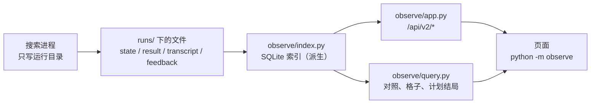
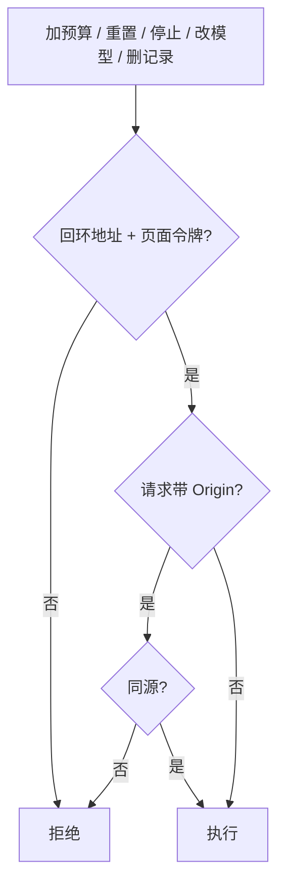

# 可观测

这一篇回答：看板怎样读已经落在磁盘上的搜索，以及哪些按钮会花钱或停进程。搜索进程自己把进度写成运行目录里的文件，不导入 `observe`。看板是另一个进程，它读这些文件。确认加速比只走 `experiments/common.py` 的 `conclusion_of_run`。写入口的权限检查仍在 `observe/actions.py`。进程怎么分工见 [架构说明.md](../架构说明.md)。数据怎么存、怎么索引、怎么查见 [数据层.md](数据层.md)；本文只讲看板。

## 这篇讲什么

- **只读为主**：搜索进程只管往运行目录写文件；看板另起进程，读文件、建索引、供页面。
- **一个发布口径**：所有确认加速比都从 `conclusion_of_run` 算出，页面不自己拼数字。
- **写操作要过关**：加预算、重置、停止、改下次模型、删记录要求回环地址加页面令牌；反馈审查/转换/本地固化另走 `observe/actions.py` 的人工闸门。
- **增量刷新**：页面靠 `index_revision`、`turns_revision`、`feedback_revision` 三个版本号决定重画什么。



## 实验清单

批量驱动在启动第一个子搜索之前，把 `experiment.json` 写到实验根目录。写手在 `experiments/manifest.py`。

版本 1 的字段：`experiment_id`（相对 `runs/` 的路径）、`kind`（`suite` / `repeatability` / `search_ab` / `contract_menu` / `committee_ab` / `single`）、驱动名、创建时间、git 提交、冻结条件、`config_hash`、`arms`、`budget_extensions`。

`config_hash` 是冻结条件的规范化 JSON 的 SHA-256。臂的开关差量不进这个哈希。两臂可比，是因为它们共享这份哈希，并且只在差量上不同。

冻结条件或已有臂的差量变了，写手拒绝，调用方换一个新目录。补跑只往已有臂的目录列表里加子目录。新臂可以补上，不能改旧臂的差量。抬预算追加到 `budget_extensions`（子目录、新上限、时间），不改冻结条件。

接入的驱动：`search_ab`、`repeatability`、`contract_menu`、`run_suite`、`committee_ab`（只写清单，不启动搜索）、`p1_runs`。`p1_runs` 的 `summary.json` 仍是结果表。单次 `taic run` 不写清单，索引把它记成 `kind=single`。

## 索引

库文件是 `data/observe.sqlite`，测试用 `OBSERVE_DB` 换路径。`meta.index_schema_version` 与这份代码不一致时，删库重建；同版本内只有 `_create()` 里列出的防御性补列，没有通用迁移。

写连接只有索引器一个：`journal_mode=WAL`，`synchronous=NORMAL`，`busy_timeout=5000`。页面查询可以另开只读连接。

主要表（完整字段、写入规则和规模见 [数据层.md](数据层.md)）：

| 表 | 一行是什么 |
| --- | --- |
| `runs` | 一次搜索。花费有当前读数 `spent_usd` 和只升不降的 `spent_max_usd`。`turn_bytes` 是 `transcript.jsonl` 已经投影到的字节偏移。`feedback_bytes` 是 `feedback.jsonl` 已经读过的字节。`feedback_review_fp` 是审查文件的 `(mtime_ns, size)`。`feedback_parser` 是读这些行时的解析版本 |
| `turns` | 一条模型事件的瘦行，从 `transcript.jsonl` 投影而来。删库后按偏移从 0 重建。不是第二份日志 |
| `candidates` | 一颗候选的索引行：status/stage/speedup/within_noise/eligible/kernel_sha256/protocol_version |
| `sessions` | 一场 hmz：committee/model/outcome/cost/token。和 `runs.model`（第一委员会）不同，这里按会话 |
| `experiments` | 一份清单或一个实验队列 |
| `arms` | 一臂的差量、计划次数、第一份核对过的 `task_fingerprint` |
| `ledger` | 进入总额的搜索。推断行和 `binding=drift` 的行不在这里 |
| `ledger_carryover` | 切换时从 `data/books.sqlite` 读出的一笔结转 |
| `watched` | 目录的 mtime，用来决定这一帧要不要重新列出子目录 |

`runs` 上有 `experiment_id`、`arm_id`、`target_id`、`status`、`started_at`、`binding` 的索引；排序用 `runs_live_started` / `runs_live_speedup` / `runs_live_spent` 表达式部分索引，确认列表用 `runs_confirmed`。

`meta.index_schema_version` 现在是 **12**。版本号对不上就删库重建。`_create()` 会尝试补齐 `feedback_claims.rev`/`subclaims_sha256`、`runs.feedback_bytes`/`feedback_review_fp`/`feedback_parser`/`backend`/`backend_version`、`feedback_items.line_at`/`placeholder_items` 以及墓碑的若干列；这些 `ALTER TABLE` 是对同版本旧表的防御性补列，不是跨版本迁移机制。新增列或表仍要 bump 版本。

| 表 | 一行是什么 |
| --- | --- |
| `feedback_items` | 一场会话的反馈。`has_system` 表示有面向系统的内容（`kinds`、求助段或系统建议段）。`pending_claims` 是这场还没审完的条数。`line_at` 是这一行在 `feedback.jsonl` 里的字节偏移 |
| `feedback_claims` | 一条主张。审查状态在这里，不在整场上。`diagnostic` 和纯避坑是 `info`，不进待审计数。`rev` 是这条最后一次变化时的 `feedback_revision`，没变的条目保持旧值 |
| `feedback_subclaims` | 一条父 claim 下的子命题。父 claim 的 `subclaims_sha256` 指向这组子命题 |
| `feedback_claim_removed` | 一条已经从日志里消失的主张。开放着的审查页靠它删掉对应卡片 |

### 反馈怎么追平

`feedback.jsonl` 只追加。文件没变长时，索引只看大小，不打开内容。变长了从 `feedback_bytes` 读完整的新行，把行首记到 `line_at`。审查页要某一条的正文时，按这个偏移读那一行。`feedback_review.json` 变了，只更新已有条目的审查字段，不读日志。日志变短，或 `feedback_parser` 和解析版本 `fbv4` 不一致，才把这一场整份读一次，然后把偏移拨到文件末尾。`meta.feedback_revision` 只在有条目新增、改过或删掉时加一。

两份反馈文件仍算进运行指纹，所以一场的状态变化仍会进索引；反馈追平本身不再跟着状态文件把整份日志再解析一遍。审查写入后立刻追平这一场，已结束的运行不用等下一帧。删除运行时，主张先写入 `feedback_claim_removed`，再从表里删掉。

### 待审计数与 `/reviews`

待审计数是 `status = pending` 的条数，系统建议和未验证前提都算；`info`（未验证/开放问题）和 `obsolete`（空占位/重复/退役）不算待审，但仍留在索引和墓碑里。

顶栏在这个数大于 0 时显示按钮「N 条代理反馈待审查」。点它另开 `/reviews`，按硬件、任务、运行三层列出主张，不限于当前打开的那场。三层默认收起。在某一层上右键，菜单按这一层现在的开合来：收起时是展开当前层，已经展开时是折叠当前层。下面还有没打开的层才出现展开所有，下面已有打开的层才出现折叠所有。筛选在浏览器里完成。

第一次打开按 200 条一页取快照（`limit`/`offset`，页面循环取完；全量导出只走 `?full=1`，带字节上限与 `truncated`）；之后 `GET /api/v2/feedback?since=<rev>` 在序号没变时只回 `same`，变了只回 `rev` 更大的条目和墓碑。页面只替换这些卡片。

### 按条审查

`POST /api/runs/<run>/feedback/<seq>/claims/<digest>/review` 按条写审查。`adopted` 必须已复核并带证据，`done` 必须已复核并带非空 `change_ref`，`rejected` 必须写备注。审查表单不要求你填 `change_ref`，但选 `done` 时留空会被接口拒绝。

详情「代理反馈与队友交接」按条列出小节、前提、`status` 和「处理」，不显示「已固化/未固化」；是否写入经验文件看「结构化提案」的 P2 列。每次审查追加到该条的 `history`，不覆盖以前的结论。写完用索引确认这条主张还在，不把整份日志再解析一遍来找它。

解析在 `taic/agent_feedback.py`，看板侧的合并和聚合在 `observe/feedback.py`。一场反馈若撞上小节字数上限，详情在该场标题下显示「已截断：」加上小节名，例如「已截断：给下一棒的避坑提示」。编号、过期和复核规则在 [代理反馈.md](../代理反馈.md)。

### 账本总额怎么重建

重建的输入是四份：`runs/`、只读的 `data/books.sqlite`（仅当还没有结转文件）、`ledger_carryover.json`，以及换库前从旧库抄出的 `ledger_preserved.json`。只扫 `runs/` 得不出账本上已经记下、目录却已不在的那些花费。

删除（`drop_archived`）故意保留 `ledger` 行；索引因版本不符或文件损坏要 `_discard` 时，先把这些行写进 `ledger_preserved.json`，新库建好后按只升不降的 upsert 放回，再删掉这个文件。结转文件的 `sha256` 对不上时拒绝建库。

总额是：结转的 `total_usd`，加上 `ledger` 里 `started_at` 不早于结转时刻的 `spent_max_usd`。没有结转时，总额就是 `ledger` 的合计。删掉 `observe.sqlite` 再按这四份输入重建，这个数不变。`books.sqlite` 在结转写好之后只读留着，不在这次切换里删除。

### 指纹、回合投影与冷建

指纹是 `state.json`、`result.json`、`run_config.json`、确认文件与 `best.metal`、以及 `budget_events.json` / `ledger.json` / `resume.lock` / `feedback.jsonl` / `feedback_review.json` 的 `(mtime_ns, size)`；还包含获胜候选的 label/路径、`candidates/` 目录、最近的 `experiment.json`。末尾还有反馈解析版本 `fbv4`。解析规则变了，已结束的运行会重新入库，不用改 `feedback.jsonl`。

`transcript.jsonl` 不在指纹里。已结束的搜索在冷建时不投影 transcript，`turn_bytes` 留在 0；打开这一场的回合列表才按字节偏移建行，删掉索引后仍从 transcript 重建。已经投影过的一场，结束那一帧若还有新行，会把尾巴补上。正在跑的搜索在指纹相同的那一帧仍按 `turn_bytes` 追平回合，并且只递增 `meta.turns_revision`。

冷建时间跟着目录数走，不跟着 transcript 的总字节数走；打开一场回合列表的时间跟着这一场 transcript 的字节数走。列表和历史请求不扫目录；SSE 后台帧以及 `overview`（经 `experiment_jobs`）、`experiment_jobs`、`compare`、`ledger` 等读接口会调用增量 `tick()`，不再逐请求全量 `sync_known()`。`tick()` 看 `runs/` 自己的 mtime 发现新目录，每 10 秒做一次完整 `watched` 扫描，运行中的 run 每帧追平；目录没变就不 `listdir`。因此这些读接口可能更新派生索引，但不重新全量入库，也只保证有界新鲜而非每次都与磁盘强一致。显式 `refresh()` / `sync_known()` 仍保留给运维全量核对、删除/缺失核对与重建。候选报告进入 `candidates` 表（status/stage/speedup/kernel_sha256/protocol_version）；详情页仍可读原始 `report.json`。

特征格子按源码 sha 去重后再算 `feature_signature`，签名按源码 sha 缓存；`state.json`/`result.json` 改变会重建格子，但相同源码不重算。第一次打开一场仍有冷算成本。

发布加速比在读到该运行时用 `conclusion_of_run` 算一次。计时是否安静、源码指纹是否绑定，仍由该函数判定。

## 旧目录

`observe/legacy.py` 是唯一允许猜的地方。它从父目录的 `summary.json` / `menu.json` / `repeatability.json` 和目录名（`fa_on_1`、`trial_2`、`<契约>/trial_N`）推断实验、臂和 trial。推断行的 `source=inferred`、`binding=none`。对照可以显示，不下判定。旧目录归档之后可以删掉这个文件。

## 臂是否还是同一次实验

清单上的子运行会再对一次 `run_config.json`。差量里的键必须等于该运行的设置；冻结条件里的题目、dtype、规模、预算也必须对得上。同一臂上第一份核对通过的 `task_fingerprint` 留给后面的运行。

对不上的行记 `binding=drift`，不进该臂的统计，页面单独列出。

## 对照

`observe/query.py` 读取派生索引，读前可按上述路径增量追平。一臂给出次数、发布加速比的中位数和最小最大、确认成功的次数、`fast_p`（`suite_metrics`）、花费、`gain_per_usd`。契约菜单沿用 `contract_menu.judge`。其他实验只给描述数字；发布数字少于 2 个时写「样本不足以判定」。推断组写「不下判定」。

记分用美元。一次搜索内部的尝试不按墙钟画成岛。

## 运行详情

打开一次运行才读它的 `candidates/`。详情头部还显示该运行当前的总预算、已花与剩余：总预算取当前值（含通过 control 加的预算，括号里是初始值）；剩余为负时显示 0 和超出额，并带预算告警标签。

模型费用表优先由 `GET /api/v2/model-stats?run=<id>` 的实时聚合填充，`result.model_totals` 作为旧运行/未投影会话的回退。它展示 cache_read、cache_write、`cache_read_per_output`、`usd_per_1m_output` 和 `cost_per_session_usd`，并给出成本覆盖 `sessions_with_cost / sessions`：场均的分母按约定是全部会话，覆盖不全时成本效率是下界。会话成本表按场列出 label、模型、结局、工具调用、输出 token、缓存重读/输出比、记录成本和实际每百万输出成本；无法计算的比率显示 `—`。两表与 `taic query sessions/models` 使用同一读模型口径：聚合先 SUM 再除，零输出或缺失/非法成本不产生 Infinity。

会话成本表来自 `GET /api/v2/runs/{id}/sessions`，不在请求时解析 pi 会话全文。`Index.ensure_sessions` 用 `sessions_fp` 比较 transcript 的 `(mtime_ns,size)`，用 `sessions_bytes` 只投影新增完整行；首次、文件变短或等长内容改写走全量重建，不再每次删表重扫。两个游标都在 `meta`，删除/移动 run 或切换 runs_root 时清理，不增加表列或 schema 版本。接口的 `stamp` 由源指纹、总会话数和 limit 组成：没变时先回 `same`，不进入投影；变化时才增量追平并取新行和 `model-stats?run=<id>`，超过 limit 后的新增也会改变 stamp。运行中由 `turns_revision` 触发，不另开定时轮询。表里的“工具调用”是 `runtime.tool_calls`，不是模型回合；`result_turns` / `failed_turns` 也分别只是 result 终态和失败终态计数，不能当总模型回合数。KPI 只是对已有 token 和记录成本做算术，`sessions` 没有 `cost_incomplete` 列，不能据此断言历史账单完整。transcript 大于 1MB 且不是 `flame_chase_1` 时 sessions 仍按原规则不投影，模型费用回退到 `result.model_totals`。

`timing` 给 `started_at`、`ended_at`、`elapsed_s` 和 `ended_at_estimated`：运行中用当前时间算已运行时长，不填结束时间；结束的运行用最后一次落盘时间作结束时间，中断的运行明确标成最后记录。页面每秒更新一次运行中时长。

特征格子用 `taic/policy.py` 的 `feature_signature`，每格只留搜索期内最快的一颗，并标出它是不是发布胜者。格子不打模型分。

计划结局只在该运行的 `run_config.json` 里 `plan_ledger` 为真时，用 `taic/plan_ledger.py` 从已有 `trace` 和历史行重建。2026-10-19 之后新启动的搜索默认有这个开关。更早启动的运行这一块为空。页面不显示优先分或置信。候选表和每颗候选目录里的 `feedback.txt` 是评测进程写下的成绩单，不是模型自己的笔记。学自哪里、和 KDA 笔记的差别，见 [外部框架经验.md](../外部框架经验.md)。

运行详情 JSON 带 `pending_evaluation`：它从 `evaluation_outbox/` 汇总 pending/unavailable 请求及最近错误码；它不是候选成绩，不参与发布或确认。运行详情当前不单独暴露 `execution.json` 的评测模式。完整的状态机见 [执行运行时与设备扩展.md](执行运行时与设备扩展.md)。

## 页面与接口

`python -m observe` 监听 `http://127.0.0.1:8765`（`OBSERVE_PORT` 可改）。页面在启动时读入。

页面布局：

- 上面一块里是预算告警、实验、对照和运行名单，可以一起收起。收起按钮贴在这块的上沿，名单往下滚时它还在。预算告警的名单可以收起，标题上的计数留着，收起按钮在名单外面。实验名单列在上面这一块里，不单独收起。
- 实验、对照、运行各是一块：实验左边蓝线，对照左边黄线，运行上沿绿线。实验表的列是目录、种类、操作，操作里是删除按钮。
- 运行名单和下面的详情平分窗口里剩下的高度，各自在框内滚动。一边收起时，另一边占满剩下的高度。
- 详情内部是单列：预算事件、回合、特征格子、计划结局、反馈都按原顺序排在同一列，任何宽度都吃满可用宽度。没有侧栏或抽屉，窄屏也不再有「侧栏」开关；旧的 `aside`/`aside-open`/`setDetailAside`/`toggleDetailAside`/`handleDetailAsideClick` 与对应 CSS 已删除，`patchDetailColumn` 只维护主列。
- 顶栏的实验、对照、运行、分析会打开这一块并滚到对应位置（分析面板见 `数据层.md` §5.3.1）；「最佳」和「失败」另开「检索」小窗，分别读 `/api/v2/best` 与 `/api/v2/failures`，点表格行跳到该运行。
- 顶栏的「术语」弹出搜索框，用白话解释这块页面上的固定说法，例如计划结局里的 validated_win、falsified。
- 顶栏的「hmz web」用于打开可选的会话辅助窗口；`hmz` 不可用时按钮隐藏。它只提供 agent/epic 会话探索，不参与候选、确认或发布。
- 顶栏的「结构化提案」只在选中一场时出现。

「结构化提案」面板：

- review 有用的一行有「固化到本地」按钮，点下去把这句话立刻写入本地 checkout 的 `experience.md`（`status=local`，`local_patch_sha256`），不等 git；徽标显示「本地已固化 · 待 git 提交」。之后运行 `taic harness commit RUN --message ...` 只提交这些路径，成功后才回填 `change_ref=commit:<sha>`。
- 点开是这一场的提案、review、决策和 overlay 表，数据来自 `/api/v2/harness/<run>`，底部另给原始 JSON 的链接。
- 提案表把「未 review」「review 有用」「review 不建议」分成不同徽标，并显示 reviewer/confidence；另有一列 P2 显示「未固化」「固化到本地（P2 候选）」「不建议固化」「本地已固化」「已固化」；本地阶段已带 `local_patch_sha256` 和 `applied_by`，`tests_run` 为空时决策表写「未记录测试」；`commit:<sha>` 要等 `taic harness commit` 之后才回填。
- 当前代码不写 `promotion_approval`；看板只在旧记录里遇到这个事件时合并显示，作为兼容。旧记录没有 `applied_by` 时不画「确认人」一行，也不标「审计缺失」。旧的 `patch:<sha>` 记录视为本地固化、尚未提交，不冒充最终 `change_ref`。
- overlay 表把「影子·不注入」「生效·独立 review（本 run）」「生效·双来源」分开，避免把 review 过的条目和没 review 的条目看成一样。
- 没有提案时面板写明只有模型在反馈的「需要帮助」或「对系统的建议」里写出 `harness-proposal` 代码块才会有条目。

搜索详情：

- 下面是选中那次搜索的详情。标题栏写这场的题目；还在跑时，呼吸灯和「进行中」留在标题栏上，收起后仍能看见。已结束、已中断也写在同一栏。
- 详情只发 L1 摘要。候选、预算事件、特征格子、计划结局、代理反馈各自是一块收起的详情；
  展开哪块才请求哪块，合着的块不读该面板依赖的文件（候选报告、反馈正文等）。
- 候选表紧挨确认点，在委员会交接前面。
- 「委员会交接」是一块可折叠的块，内容随 L1 摘要一起来，不单独发请求（没有 `/handoff` 端点，`data-fold="handoff"` 不是 `data-lazy`）。它的展开态跟回合 / epic-pi / 会话成本一样写进 URL 的 `folds=`，刷新或深链后恢复；候选等面板的展开态走 `panels=`，两者都只在 URL 里，不用 localStorage。
- 花费账本从顶栏打开，占下面，数据来自 `/api/v2/ledger`，另用 `/api/records/deletions` 列出删除记录。
- 按时间排的名单从新到旧：运行列表、候选序号、预算事件、委员会轮次、计划结局、特征格子、账本月份。运行列表的接口本来就是新的在前。特征格子仍是每个签名留最快的一颗，行序按这个签名第一次出现的先后倒过来，新出现的在上。
- 评测阶段（安检、编译、签名、内存安全、对答案、计时）和该候选内核开头的代码不占详情。双击候选表的序号才弹出。候选表只在评测写出报告后有一行。

模型回合：

- 模型回合是一块能展开的列表。一场 hmz 是一行：委员会、模型、token、算出来的美元、自测次数和超时、结局。展开里是这些数。直调留下的聊天回合仍显示发出、思考、收到和工具。正常返回、工具调用、超时重试、空回复、长度截断和搜索中止的一支都在这行里。
- `transcript.jsonl` 仍是唯一写者。索引按字节偏移把新行压成瘦行，写进 `turns` 表；删掉 `observe.sqlite` 会按同一份记录重建。系统提示、内核草稿和密钥不进这张表。`label` 只用于展示。
- 分页按组走：`turns` 每行带投影时算好的 `grp`，相邻同标签共组，同名 label 再次出现、空 label 每条各成一组。往上翻的游标是这一页最旧一组里最小的 `seq`（`cursor`），新契约同时给 `grp_cursor`；请求接受 `before`（旧 seq 游标）与 `grp`（组游标）。两条组查询都走 `turns_run_grp`，本页的行按 `grp BETWEEN` 闭区间取，读行数只随本页组的事件数增长，不随整场回合数增长。
- 单组超过 400 条事件时只取最新 400 条参与聚合，并在这行标 `truncated_events`；截断下推到 SQL，不会先整组读进内存。显式读全量用 `GET /api/v2/turns/{id}?grp=<g>&all=1`，这是唯一会读完整一组事件的路径。
- 正在生成的预览只写在 `llm.json` 的 `inflight` 里，大约 1 秒并且增长至少 2KB 才落盘，请求结束就从 inflight 里去掉，不进持久日志。
- 选中一场时，页面每 2 秒询问 `/api/v2/turns/`。重画时已经展开的回合保持展开，新到的回合默认收着。文件戳没变就不回正文，也不查 `turns` 表。回合偏移变了就回到最近 40 条，并丢掉已经翻上去的更早页；只有预览变了就留着那些更早页。
- 正在跑的搜索即使详情指纹没变，也会在这一帧按 `turn_bytes` 追平，并且只递增 `turns_revision`，不重画候选、确认和预算。详情带 `detail_stamp`。这个戳没变时，再次打开详情不重算特征格子。
- `--kernel-agent pi` 的一场仍画 hmz epic 和 pi 输出，规划回合走同一块列表。epic 按 hmz 读一场的方式列出开始、打开的会话、花费和结束，不抄任务全文。pi 输出只取最新一场会话文件的末尾约 256KB，最近 40 行，文件没变时不重画。会话文件在两处找：`<epic>/<场次>/sessions/pi/sessions/`（hmz 0.2.2 起，pi 的家目录被 link 进 epic）与 `~/.pi/agent/sessions`（更早的 hmz）。找 epic 目录时用两种名字：运行目录名原样，以及把非字母数字压成连字符后的样子，因为 hmz 的目录名会把运行名里的 `_` 换成 `-`。
- 没有 `kernel_agent` 记录的旧运行，只有已经出现 hmz 工作区或 `agent` 事件时才算 `pi`。密钥形状的字串不显示。这张表限高，多出来的行在表内滚动。搜索还在跑时，in_progress 和 running 旁边有一盏绿色呼吸灯。配色沿用改索引之前的蓝灰卡片。

| 方法与路径 | 作用 |
| --- | --- |
| `GET /api/v2/overview` | 首屏只回反馈计数（响应 <1KB） |
| `GET /api/v2/live` | 按需的 GPU 快照、在跑的搜索/评估、心跳、任务与实验队列 |
| `GET /api/v2/patrol` | 首屏「进行中 / 需要注意 / 最近结果」巡检（§6.4）：固定键集合、响应 ≤1536B |
| `GET /api/v2/runs` | 过滤、排序、keyset cursor，单页最多 100 行 |
| `GET /api/v2/runs/{id}` | L1 摘要：状态、预算、发布、确认点、胜者、计时、停止原因、评测进度、待评测与交接。查询 `stamp` 与 `detail_stamp` 相同则不重算 |
| `GET /api/v2/runs/{id}/detail` | 摘要 + 全部面板（v1 的 `GET /api/runs/{id}` 同义）；`trace`/`confirmations` 不再拷贝，改用 `/raw` |
| `GET /api/v2/runs/{id}/candidates?status=&stage=&limit=&cursor=&stamp=` | 候选面板：候选行与轨迹标记，可按状态/阶段过滤与 keyset 翻页。逐颗 `report.json` 与内核 `(mtime_ns,size)` 组成面板戳，`stamp` 相同只回 `same` |
| `GET /api/v2/runs/{id}/candidate/{label}?stamp=` | 单颗候选：完整 `report.json`、有界内核片段与相对报告路径；带 `stamp` 短路 |
| `GET /api/v2/runs/{id}/feedback?stamp=` | 反馈列表：序号、标签、轮次、kinds、claim 计数与状态；不内联 claim 正文、证据、历史与 `raw` |
| `GET /api/v2/runs/{id}/feedback/{seq}?stamp=` | 单条反馈全文（含 claim 正文、证据、历史、`raw` 与本机标定） |
| `GET /api/v2/runs/{id}/timeline` · `/budget-events` · `/llm` · `/grid` · `/plan` | 各自的按需面板；都带 `stamp` 短路。`timeline` 的等锁泳道来自索引里的 `lock_spans`，不再整读机全局事件日志；历史被删过时带 `truncated_history` |
| `GET /api/v2/runs/{id}/raw?key=state\|result\|confirm` | 原始文件，显式调试用 |
| `GET /api/v2/runs/{id}/sessions?stamp=` | 该 run 的 hmz 会话与派生 KPI；stamp 相同只回 `same`，不回正文 |
| `GET /api/v2/publications?task=&target=&dtype=&size=&stamp=` | 发布史：目录事实 + 环比（`delta_vs_prev`/`is_best_so_far`，同 `comparability_key` 才比）+ 当前发布判定与原因码 + 来源可用性；解析不到来源的行不进环比 |
| `GET /api/v2/gap?protocol_epoch=&task=&target=&stamp=` | 落差与每美元：`published` 来自发布门、未发布只计数、跨纪元 400、每 task 样本 <5 只给点、cv 与落差的 Spearman 仅在 n≥20 时给 |
| `GET /api/v2/committees?task=&stamp=` | 委员会有效性：单位是 session，按 task+纪元分桶，成本先 SUM 再除（覆盖不足标下界），空委员会单列 |
| `GET /api/v2/noise?task=&stamp=` | 噪声：候选 cv 的 p10/p50/p90（最近秩）、reps 分布、cache_hit 覆盖率（缺失不算 false） |
| `GET /api/v2/harness/{id}` | 结构化提案、overlay 与决策；文件是源，缺目录返回 404 |
| `GET /api/v2/suggestions` | 自由文本系统建议的 compact 视图：按 digest 聚合、短 preview；支持 task/target/model/status/limit/offset/preview；返回 total/truncated/next_offset |
| `GET /api/v2/suggestion` | 按 `run/seq/digest` 取一条完整建议、转换状态和 review |
| `GET /api/v2/failures` | 非 ok 候选，按状态/题目/签名过滤；`--sig` 同时匹配候选指纹与 `sessions.failure_sig`（前缀不同，不会混簇）。会话指纹来自“整轮没有内核”的会话，命中前会按需懒投影 sessions（只读有 transcript 的 run，冷建本身仍 0 字节 transcript），候选已命中时不投影 |
| `GET /api/v2/best` | 已确认内核，按发布加速比排序 |
| `GET /api/v2/model-stats?run=` | 按会话的模型汇总；`run` 可选。含成本覆盖及 cache_read_per_output、usd_per_1m_output、cost_per_session_usd |
| `GET /api/v2/experiments?limit=&cursor=` | 实验列表（keyset 游标，单页 ≤100） |
| `GET /api/v2/experiments/{id}` | 一臂对照 |
| `GET /api/v2/budget` | 预算横幅 |
| `GET /api/v2/ledger` | 按算子和月份的花费 |
| `GET /reviews` | 全部审查。和首页同一份页面，只显示跨运行的主张列表 |
| `GET /api/v2/feedback?limit=&offset=&full=` | 主张列表。不带 `since` 是一页快照（`next_offset`），分页单位与 `total` 都是 claim（一条 record 可有多条 claim，同单位才不会提前说完）；`full=1` 才是全量导出，字节上限对**最终序列化 body** 生效（envelope、`calibration`、`truncated` 都算在内，超了继续收缩行）；`since` 等于当前 `feedback_revision` 时只回 `same` |
| `GET /api/v2/stream` | 推送 `index_revision`、`turns_revision`、`feedback_revision` 和变化了的运行 id。`revision` 与 `index_revision` 相同 |
| `GET /api/v2/turns/{id}` | 回合尾窗，按组翻页。`before` 是已显示的最旧一组的最小 seq，`grp` 是组游标；`grp=<g>&all=1` 读回该组全量聚合。`stamp` 没变且没有游标时不查 turns 表 |
| `GET /api/v2/pi/{id}` | pi 会话末尾和 epic。查询 `stamp` 没变则不带回正文 |
| `GET /api/records/deletions?limit=&cursor=` | 删除记录：时间、种类、名字、IP、理由、次数（字节游标 + 每页 ≤96KB，`truncated` 表示还有下一页） |
| `POST /api/runs/{id}/budget` | 加预算（回环地址 + 页面令牌） |
| `POST /api/runs/{id}/harness/convert` | 人确认后把一条自由文本建议转成结构化提案 |
| `POST /api/runs/{id}/harness/{key}/review` | 另一个 provider/model 的只读 review（会调用模型） |
| `POST /api/runs/{id}/harness/{key}/promote` | 把 review 有用的提案固化到本地 checkout（不跑测试） |
| `POST /api/records/delete` | 带理由删除已结束的记录 |
| `POST /api/settings/model` | 改下一次搜索两个委员会的模型 |
| `POST /api/budget/reset` | 重置全部可续运行的预算与上限 |
| `POST /api/stop` | 停止全部搜索 |
| `GET /api/hmz-web` | 查询可选的 `hmz web` sidecar 状态；只有回环地址且带页面令牌时才返回 URL |
| `POST /api/hmz-web` | 按需启动 `hmz web`；已有进程则复用 |
| `DELETE /api/hmz-web` | 停止由看板启动的 `hmz web` |

非 SSE 响应带 `ETag` 和 gzip；`If-None-Match` 命中返回 304。

### hmz web 辅助窗口

`hmz web` 是 Humanize 自带的 epic/session 浏览器，不是本仓库的搜索数据源。看板的「hmz web」按钮按需启动：

```text
hmz web --no-open --port 0 --attached
```

- `--port 0` 选一个空闲的 loopback 端口；
- `--no-open` 不自动打开浏览器；
- `--attached` 让子进程在父进程退出或关闭 stdin 时结束；
- 看板捕获它打印的 URL，在新标签页打开；URL 带访问 key，只返回给带页面令牌的请求；
- 它只显示 `~/.hmz/epics` 和 pi session，不读 `runs/`、`candidates/`、`result.json`、确认门或 trust；
- 不用 iframe、不代理、不抓取它的 HTML，也不把它返回的会话状态写回搜索数据。

这层是旁路观测：主看板仍是候选、确认、预算和 review 的唯一入口。`hmz web` 可以启动或 steer epic，所以只应作为人工查看会话的窗口，不能用来绕开 `taic` 的预算、换种子和确认规则。

### 三个版本号

| 版本号 | 何时增加 | 页面反应 |
| --- | --- | --- |
| `index_revision` | 取索引版本和活状态版本里较大的一个，只增不减 | 变了才重拉详情 |
| `turns_revision` | 只在回合表变化时增加 | 变了只重画回合列表 |
| `feedback_revision` | 只在主张新增、改过或删掉时增加 | 审查页只跟它，不因为别的运行改了状态就重拉主张列表 |

活状态是 GPU 锁目录和 `tcenv` 的现场文件，几份，不进索引。空闲时大约一秒看一次，不再每 0.1 秒重扫整棵 `runs/`。

只读的 `/api/history` 和 v1 `/api/runs/{id}` 已按 §11.5 下线；页面与新读模型只用 `/api/v2`。

### 写操作与删除

加预算、重置、停止、改下次两个委员会的模型、删除记录，写操作要求回环地址和页面令牌。同源只在请求带了 `Origin` 时检查。



删除还要一条理由。删除算子按题目名把该算子下已结束的搜索一起归档，日志里同时写下这次请求的 IP。目录从 `runs/` 挪到索引旁边的 `deleted/`，删除动作追加到 `deletion_log.jsonl`，这份日志没有删除接口。花费账本的金额不减。正在跑的搜索会让整次删除被拒绝。`run_id` 先做路径检查，再经索引解析。若绕过看板直接 `mv`/`rm` 运行目录，需要显式执行 `uv run python -c 'from observe.query import refresh; refresh()'` 做全量核对；普通 `tick()` 不负责把所有失联目录标成 `missing`。

## 规模

这一台机器上 GPU 同一时刻只有一个评测子进程，活运行是个位数。大批量指已经结束的历史目录变多。列表和对照查 SQLite。热帧不进入 `candidates/`。

**2026-10-25 的 10,000 合成 run 实测**：首次入库 `sync_known` 15.2s；改前稳态 `experiment_jobs` / `compare` / `ledger_report` 分别为 2.883s / 3.040s / 3.007s。改后探针分别测窗口首个请求（cold，强制 watched mtime 扫描）与窗口内热请求（warm）：cold 为 49ms / 49ms / 54ms，warm 为 <1ms / <1ms / 4ms，`read_sync_calls=0`，均低于 200ms。cold 分支还直接给 `_refresh_watched` 计数并要求 `cold_watched_scans=3`，避免节流实现变化后冷测静默退化成热测。`read_sync_calls=0` 只证明没有调用 `sync_known`；`tick()` 仍有周期 watched mtime 扫描，不能把它说成“完全没有全目录扫描”。

**2026-10-22 的 10 万合成 run 实测**：冷建 `sync_known` 157.6s、热 `tick` 6ms、`history` 0.83s、列表第一页 4ms、`best_confirmed` 0.5s；冷建仍是 O(N) 的一次性成本。不承诺多机汇总。

**2026-10-27 PR23–PR27 的实现与实测（同一台机器，合成语料）**：

- PR23 便宜对账：root 只解析一次；无符号链接的普通目录用字符串前缀，遇到链接才 `realpath`（结果按目录缓存），`_note_dir` 用 `os.scandir` 计数；`detail._rel` 与 `legacy.infer` 同样不再逐目录 `realpath`。3000 场热 `sync_known` 从 1.113s 降到 0.516s（−53.6%）；10,000 场热 `sync_known` 1.71–1.82s（本机连测 5 次；plan 上限 2.0s，留出余量）。热帧 `Path.resolve` 0 次；逐 run 的边界检查用缓存的 `lstat`/`realpath`，普通目录每场最多一次 `lstat`（plan 允许 ≤2）。符号链接语义不牺牲：`_rel`/`_within_runs` 按真实路径判归属，根内别名保持 canonical run id，祖先链接指向根外一律拒绝；普通无链接目录只多一次 `lstat` 并按目录缓存，冷建每场一次、热帧只碰点名的 run。
- PR24 写者日志：`<runs>/.index_journal/<pid>.jsonl`，白名单行 `{"run","path","at"}`；每进程一个分片、4MB 原子轮转到 `.1`、不 fsync；索引器按 `(分片, offset, inode)` 消费。写点挂在 `taic.control.write_text_atomic`/`append_jsonl`/`acquire_run_lock` 与 `tcenv.events` 的文件日志线程（不是排队中的 `publish` 调用点）。健康日志帧**先消费 journal**，新目录只 stat `runs/` 根与 `run_parents` 里的父目录（不再遍历全部 `watched`），随后只核对点名的 run；40/80 场同一变更的 `Path.stat` 次数分别约 63/68（不随 run 总数线性增长），未点名的 run 一个都不 stat。`experiment.json` 的行会让该实验下已索引的子 run 一起复核。只改 1 场的 10,000 场热帧：0.261s、`_ingest` 1 次。轮转/截断/删日志都退回一次全量对账，结果与干净重建逐字段一致。
- PR25 端点：`/api/history` 与 v1 `/api/runs/{id}` 下线；`/api/v2/patrol` 已接到真实 Route（此前前端请求 404），固定键集合、HTTP 200 且响应 ≤1536B 有回归；`/api/v2/overview` 只留反馈计数，GPU/活运行/任务/实验队列移到按需的 `/api/v2/live`；`feedback` 首次快照分页（`limit/offset`，全量只走 `?full=1` 且有字节上限）、`experiments` 加 keyset 游标、旧 `/api/stream` 别名下线（真实 404，白名单只留 `/api/v2/stream`）、`records/deletions` 改成**字节游标 + 条数/字节双上限**（每页 ≤96KB，长 `reason` 截到 512 字符，`truncated` 表示还有下一页；200 条 8KB 理由的日志实测每页 ≤96KB），ledger 的 N+1 改一次 `GROUP BY month, operator`、两个进程内缓存改成 256 项 LRU、suggestions 的提案/评审预读一次。审计其余全量端点：`publications` 已有 `PUBLICATION_ROWS` 截断与 `truncated.rows`，`failures`/`search`/`suggestions`/`runs`/候选/回合都有 limit；`raw` 只取三份有界快照。游标端点表与 `app.routes` 的差集在白名单 `/`、`/reviews`、`/api/v2/stream` 内；304 命中时 `json_reads`/`dir_lists` = 0。keyed patch 删除本轮缺失的可选块时同步删除其 patch 缓存，同 run 续跑后 `stop/seed/winner/pi` 重新出现会按原 HTML 重画。
- PR26 冷建并行：`sync_known()` 在冷建且 ≥64 场时用 `ProcessPoolExecutor`（默认 `min(8, cpu)`，`OBSERVE_INDEX_WORKERS` 覆盖）在子进程做纯读，主进程单写 SQLite；进程池不可用/抛错整批退回串行。payload 读取前后各算一次窗口键（state/result/config/候选文件/上行清单），不一致就重试，三次仍不稳返回 None 交回串行的 stat/read/post-stat 路径；`_ingest` 收到 payload 后再算一次窗口键，和 payload 记录的不一致就丢弃 payload 回串行。旧内容不会被绑到新指纹。10,000 场冷建：4 worker 约 5.9–6.2s（含符号链接解析、payload 读写窗口与入库前 post-check；本机语料比 plan 的 16.86s 基线小；并行/串行所有业务表与 `runs_fts`/`cands_fts` 全表逐字段一致（排除 `meta` 与 FTS 影子表，并用非空 `failure_members`/`confirmed_best`/`run_rollup`/FTS 行防止空表假绿）；机器高负载时接近 6s 上限）。
- §11.2 汇总读模型：`query.rollup()` 读 `run_rollup`，默认把 400 天以前的桶按（月, `task/dtype/size/target_id/protocol_epoch`）相加，**只在读时合并、存储仍是按天**；返回的每行都带完整分组键，任何一行都不可能跨 dtype 或跨纪元求和。10k 行的逐桶对拍（写入走生产的 `_rollup_adjust`）与「旧桶并月不改存储」各有一条测试。它目前没有 HTTP 面板消费（plan 没有为它设计端点），是给后续汇总面板预留的读模型。
- PR27 1M 契约：`run_rollup` 由 `_upsert_run` 同事务维护（先减旧桶再加新桶，删除/失联走同一规则），键含 `day/task/dtype/size/target_id/protocol_epoch`；减法对 `confirmed` 与 `published_sum` 都传负号，`published_max` 重算时排除正在删除/改写的行（删除唯一 confirmed run 后 confirmed=0、published_sum=0、max=NULL，与逐行 GROUP BY 一致）。冷建不投影 sessions（只记 `transcript_bytes` 便宜标记，首次读 `sessions`/`model_stats` 懒投影），`>1MB` 的上限对 `flame_chase_1` 同样生效；冷建读 transcript 字节 = 0。六条不变量各一个测试；重建对拍包含非空 `kernel_history`（目录史）与 `gpu_events`/`gpu_waits`/`lock_spans`（保留的事件文件）。100k 的首页与第 1000 页门禁在 `-m slow` 下通过（本机 116–126s，含建 100k 目录）；`analysis` 的 150ms C 目标在高负载机器上会抖动（单独跑通过，与 100k 门禁同进程时偶发超限）。

合成数据的计时用 `python -m experiments.observe_bench` 打印：热缓存下 1000 个已结束运行的冷建、空闲一帧、默认列表页、400 个候选的详情。冷文件缓存只有 `purge` 成功时另报一行，不并进热缓存那一档。这不是每次测试的门槛。

## 架构约定与数字口径

这次工业化改造留下这些不可破坏的约定；改它们等于推翻改造前提。

- `runs/` 是原始事实，`data/observe.sqlite` 是可删重建的派生索引；当前 `INDEX_SCHEMA_VERSION = 12`，同版本只用 `_create()` 的防御性补列，新增列/表必须 bump。
- `runs_page` 的 `(排序值, run_id)` keyset 与四条表达式部分索引**不要动**：10k 合成下首页 0.5ms、第 21 页仍 0.5ms。
- `turns` / `sessions` / `feedback` 按字节偏移追平，`detail_stamp` / `sessions stamp` 短路，SSE 只推 revision 与变化 run id。
- `changed.append` 与 `_bump()` 必须成对：这是精准刷新成立的前提，有守卫测试。
- `suggestions` 先 compact 再 detail；`brief` 不含正文/源码/绝对路径；HTTP 一律 ETag+gzip；输出过 `taic/redact` 脱敏。
- 既有预算：`TASK.md` 12KB、transcript 默认不落正文、>1MB 且非 flame 的 transcript 不投影 sessions、`scratch` 50MB、`deleted` 30 天 TTL、成本先 SUM 再除、`protocol_epoch` 分桶、`conclusion_of_run` 是唯一发布权威。
- 前端：统一 `esc()`、请求竞态 token、reviews 的 revision 增量 patch、`content-visibility`、`prefers-reduced-motion`。
- 测试：`tests/shared/`、无 observe golden、请求路径禁止 `sync_known()`、UI 断言走 Node/jsdom 而不是真实浏览器。
- **语料范围**：任何「候选」统计只认 `runs/**/candidates/*/report.json`（与 `_upsert_candidates` 的 glob 一致）。`agent_work/*/report.json` 是会话种子成绩单，`runs/<x>/report.json` 是模拟/汇总报告，都不是候选；只能靠这个 glob 排除，不能枚举目录名。

数字分三档，写文档与 PR 时必须能分清：

| 标记 | 含义 |
| --- | --- |
| A | 本机当前工作区实测（合成数据用 `experiments/scale_probe.py` 同规则目录） |
| B | 文档此前记录的实测，带日期 |
| C | 校准目标，**未测过**；不得写成收益 |

改造前基线（2026-10-25，A；63 场运行 / 795 份候选报告）：

| 指标 | 值 |
| --- | --- |
| 详情（11 候选 / 84 claim） | 136,657B / 380.7ms（其中 feedback 93,525B） |
| `runs?limit=50` | 36,155B，中位 744B/行 |
| `/api/v2/overview` | 7,842B（GPU 块占 5,224B，前端当时只读一个整数） |
| `gpu_events.jsonl` | 2.1MB / 15,600 行，页面只用 40 行 |
| `query failures` 默认 50 行 | 16,183B |
| 10k `history()` / `budget_report()` / 窄 7 列投影 | 63.3 / 74.4 / 14.7ms |
| 10k 冷建 / 热 `sync_known` / 无全扫 `tick` | 16.86s / 3.07s / 0.0s |
| 10k 目录纯 stat | 22.8ms |
| 3k `_rel` 改字符串相对路径 | 0.909s → 0.580s（−36%） |
| 100k 冷建 / 热 tick（B） | 157.6s / 6ms |

## 失败指纹与语料口径

- `sig = sha256_hex(status + "\u001f" + stage + "\u001f" + normalized(message))[:16]`，实现只有 `observe/failure_sig.py` 一份；`sessions.failure_sig` 同源但前缀为 `session`，会话失败与候选失败不混簇。
- `normalized()` 的顺序是契约：先 `taic/redact` 脱敏 → POSIX/Windows 路径 → 回合标签 `r?.p?` → 十六进制 → 张量/形状 → 引号内容 → 数字 → 空白折叠并取前 160 字符。**数字规则刻意不含前导负号**：`got -#` 与 `got #` 分别是符号错与量级错两类不同 bug，合并会丢掉一组真实故障。
- `failure_members` 与候选同事务先删后插，重复摄取不累加；簇计数永远 `GROUP BY sig` 派生；`observed_at` 取 `runs.started_at` 而不是摄取时间；没有 `n=0` 墓碑，簇消失就是消失。
- 两个语料分名：`corpus_disk`（795 份候选报告，仅用于指纹研究）与 `corpus_index`（索引 788 行；差额 7 来自缺 state/result/config 的目录，它们永远不会被当 run 摄取）。2026-10-25 实测：disk 288 失败 / 22 签名 / 前 6 覆盖 92.01%，index 285 / 22 / 91.93%。基线只能由 `experiments/failure_corpus.py` 重算更新。

## 1M 契约：只守不变量，不设 1M 延迟门禁

本机 10k 冷建 16.86s，线性外推 1M ≈ 28 分钟、索引约 2.5GB，跑不起可重复的 1M 门禁。所以自动门禁停在 **100k**（`-m slow`，约 3 分钟），不写 1M p95 验收；1M 只靠这些不变量约束，每条都有测试：

- 读路径不解码 O(N) `row_json`：首页/巡检/预算只走窄列或汇总表。
- 全量端点都有游标与字节上限（见「页面与接口」）。
- 热路径不读运行目录：`dir_lists`/`open()` 计数为 0。
- 新表都有明确重建源：`failure_members`/`kernel_history`/`run_rollup`/`confirmed_best`/`runs_fts`/`cands_fts` 从 `runs/`+`kernels/` 重建；`gpu_events`/`lock_spans` 从**保留的事件分片**重建，轮转不等于删除。
- 证据不静默消失：删除只经 `deletions`+`gc`；blob prune 默认 dry-run 且期限长于 30 天。
- 冷建不读 transcript：冷建不投影 sessions，首次读 `sessions`/`model_stats` 才懒投影，`flame_chase_1` 同样受 >1MB 上限；验收断言冷建的 transcript 读入字节 = 0。
- 汇总键不可混算：任何分组都含 `dtype/size/task/protocol_epoch`。

## 不做

- 不用搜索期的 `best_speedup` 填发布加速比
- 不给推断组或 drift 行补缺失数字
- 不把模型自报的优先分、置信或九维打分写进格子
- 不在一次搜索内部再拆岛，不按墙钟比较串行评测的两条轨迹
- 不做多机汇聚、不做图谱式可视化
- 不重写为 SPA、不引入构建链：单页 + 现有 Python 后端 + 请求时按 mtime 读模板，改 HTML 刷新即生效；改 app/索引模块仍需重启
- 不新建第二份 Session/Run 事实源；分析面板不产出新数字，发布口径只走 `conclusion_of_run`
- 不做跨题目平均：委员会/模型按 task + `protocol_epoch` 分桶，`n<5` 只给点不判胜负
- 不做实时 token 流（写者与读者是不同进程，`llm.json.inflight` 的 1 秒预览够用）
- 不存 transcript 正文；不删 `runs.row_json`（它是详情缓存），只是热路径不再解码它
- 不做只读 SQL / MCP 层：任意 SQL 面会让调用方依赖 schema 内部形状、绕过 L0/L1 字节预算并形成第二个公共 API；机器接口就是 `patrol` + `taic query` 的固定形状
- 不把 `run_detail` 当 AI 接口；不在请求路径调 `sync_known()`；不为可观测新增模型请求
- 不修改 deepseek-harness

## 文件

| 文件 | 职责 |
| --- | --- |
| `experiments/manifest.py` | 清单的写入和校验 |
| `observe/index.py` | SQLite 索引、指纹、结转、只升不降的花费 |
| `observe/feedback.py` | 按字节偏移追上 `feedback.jsonl`，单独套上审查记录，并按条给出增量 |
| `observe/simcache.py` | 句向量与相似结论的持久缓存（`<主索引 stem>.similar.sqlite`，派生可删），含后台预热线程 |
| `observe/legacy.py` | 旧目录推断 |
| `observe/query.py` | 列表、对照、详情上的格子和计划结局 |
| `observe/detail.py` | 单次运行的时间线、确认点、委员会交接 |
| `observe/app.py` | `/api/v2`、显式游标表、按需的 `/api/v2/live`；ETag/gzip |
| `taic/retrieval.py` | `taic query` 的读模型，和看板共用 `observe/query.py`；`runs`/`capabilities` 默认不写索引（`runs` 在 `OBSERVE_REFRESH_ON_READ=1` 时会先 `tick()`），`best`/`failures`/`sessions`/`models`/`suggestions` 会先 `tick()` 追平。注意 `taic query` 不花钱、不上 GPU，但不是绝对不写：`tick()` 和 `borrow()` 会更新派生索引 |
| `taic/gc.py` | `data/deleted` 的 30 天保留期报告/清理 |
| `observe/actions.py` | 权限检查与人工闸门：加预算、重置、停止、改模型，以及反馈审查/转换/本地固化 |
| `observe/deletions.py` | 带理由删除已结束的记录。目录挪到索引旁的 `deleted/`。账本金额不减 |
| `observe/budget.py` | 超预算、耗尽、接近预算 |
| `observe/settings.py` | 改下次搜索的默认模型 |
| `observe/progress.py` | 事件订阅 |

## 反馈相似结论的读取路径

- 首屏 `/api/v2/feedback` 不再为每条待审 claim 算语义近邻（`similar_attached=False`；旧的 eager 行为保留为 `?similar=1`）。此前 90 条待审 claim 各算一次句向量，首屏实测 2.8s。
- 前端只在**展开某场运行**时调 `/api/v2/runs/{id}/similar`，同一 rev 只取一次、收起的组不发请求；单场最多 200 条并带 `truncated`。
- 句向量按（模型 epoch + 语言 + 归一化文本）内容寻址持久化；近邻按 claim 缓存并带语料键（更早候选的条数与最大 rev），出现新的更早候选或候选被改写即失效重算。缓存只存检索结果，评审状态仍以当前评审文件为准。
- `observe.app.main()` 启动后台预热线程（TestClient 不启动），每次只推进一条 claim 并让出 GIL；稳态请求只读缓存。本机实测：首屏 2.8s → 0.04–0.10s；单场相似 3.9s → 预热后 0.05–0.06s，进程重启后仍 0.05s。
- 预热不占主索引的写锁：它用 `observe.index.reader()` 的只读连接（WAL 并发读），而不是 `borrow()`。`borrow()` 会在 yield 期间一直拿着全局 `_WRITE`，旧实现因此让每个请求排队等一整条 claim 的重计算。
- 工作发现是廉价的：预热先发三条不 JOIN 的聚合查询（待审集合、子命题、语料条数与评审代际）算状态指纹，指纹与上次收敛时相同就直接返回，不再逐条待审 claim 算语料键。本机 90 条待审 claim 实测：空闲轮从 181 条 SQL / 9.4ms 降到 4 条 / 0.07ms（每 2 秒一次）。语料键按（task, target, t）分组算一次，同场 run 的待审 claim 共用。
- 缓存库有行数上限（`similar` 4096 行、`embeddings` 8192 行），预热收敛时调 `simcache.prune()` 从 `at` 最旧的行开始删，库不会只增不减；删掉的行下一次预热按需重写。缓存是派生物，不进备份。
- 相似结果按**发起请求时的反馈 rev** 记账：飞行中 rev 前进时旧响应被丢弃（不写进新 rev 的卡片）并立刻按新 rev 重新取；`applyReviewFeed` 先把 rev 推进再 paint，增量 rev 的展开组才会真的再取一次。

## 浏览器人工验收（PR20–PR22）

计划 §10.5/§10.6 要求 Chrome 与 Safari 的真实人工清单。本节只记录实际执行过的项；未执行的项保持未勾选，不用 Edge/CDP 或 Node 断言替代。

- [ ] Chrome 稳定版真实窗口：760/620/480/320px 四档容器查询（详情恒单列、所有面板在同一列）、交接折叠块展开/收起后刷新保持（URL `folds=handoff`）、滚动保持、coarse pointer/44px 命中区、reduced-motion、DOM 节点与行数。
- [x] Safari 真实窗口：同一组宽度与单列布局、交接折叠块展开态刷新保持、滚动保持、reduced-motion 与命中区（2026-10-27 人工确认 A–E 全项通过）。
- [x] Edge 真实窗口人工验收（2026-10-27，操作者本人执行，A–E 全项确认通过；仍不计作 Chrome/Safari）。
- [x] Chromium 替代测量（仅布局证据，不计作 Chrome）。

2026-10-27 的 Edge 人工验收在 `http://127.0.0.1:8899/` 与 `/reviews` 上执行，结果为操作者逐项确认：
A 760/620/480/320px 四档无整页横向滚动、详情单列铺满且无「侧栏」开关、320px 下关闭与搜索可达；
B 交接折叠块展开/收起正常且刷新后展开态保持（URL `folds=handoff`）、候选与种子链收起不取数展开才取、运行列表/详情正文/回合三处滚动刷新后保持；
C 运行行键盘可达（↑↓/Enter/Space）、模态首控件聚焦与焦点圈定、Escape 关闭并回焦、右键菜单动作有按钮或键盘等价、coarse pointer 下命中区 ≥44px（`detail-toggle` 已随侧栏移除，不在检查集合内）；
D 数值列右对齐等宽数字、长 run_id 省略号+title+复制、暗色对比正常、reduced-motion 下动效降级；
E `/reviews` 首屏分组即时出现（相似结论持久缓存+后台预热），展开某 run 才发 `/similar`。
本节只记录人工确认通过的项，未填具体像素数值；像素级数值沿用下面那次 headless 测量，但其中的侧栏结论已作废。

替代测量使用 Microsoft Edge `Edg/156.0.4314.42`（macOS，CDP，headless），打开
`http://127.0.0.1:8877/?run=apple-m4-max%2F20261025-070409_conv2d_fp16_deepseek-flash_g5yab2vc&panel=candidates&folds=turns`。
760/620/480/320px 四档均为 `innerWidth == scrollWidth`（760/620/480/320），`detail-panel` 宽 728/588/448/288；容器宽度大于 620 时 `.detail-split` 为单列、aside `static` 可见；620/480/320 时 aside `fixed` 隐藏，`#detail-aside-toggle` 可见，点击后覆盖抽屉打开且可见（620/480 为 340×900，320 为 294×900）。**这段的侧栏结论已作废**：测量时详情还是主列+侧栏两列；现在详情恒为单列，`aside`、`#detail-aside-toggle` 与抽屉都不存在（见「页面布局」）。宽度、`innerWidth == scrollWidth`、DOM 节点与滚动保持的结论仍然有效。DOM 节点 1368，运行行 50，候选行 11；通用 `.excerpt` 为 `max-height:220px; overflow-y:auto`，候选阶段弹窗内的 `.excerpt` 为 `42vh`（实测 378px，仍 `overflow:auto`）。

480px 的 coarse pointer 仿真 `pointer:coarse=true`：`#term-open` 50×44、`#copy-link` 56×44、`#detail-toggle` 50×44、`#feedback-badge` 156×44、`button.quiet` 44×44。reduced-motion 仿真下 `.breathe` 的 `animation-duration` 从 `1.6s` 变为 `1e-05s`。真实 Chromium 中设置并 reload 后，运行表 `scrollTop=200`、`#detail-body=150`、`#turns-live=120` 均保持，sessionStorage 分别为 `observe-runs-scroll=200` 和 turns 键 `120`。

2026-10-27 的 Safari 人工验收在同一套清单上执行（开发菜单的响应式设计模式 760/620/480/320px、系统「减弱动态效果」与深色外观），操作者确认 A–E 全项通过：单列布局与无横向滚动、交接折叠刷新保持（`folds=handoff`）、候选/种子链懒加载、三处滚动保持、键盘与焦点圈定、44px 命中区、数字与长 id 样式、暗色与 reduced-motion，以及 `/reviews` 首屏即时与展开才取 `/similar`。未填具体像素数值。

Chrome 仍未测：本机未安装 Google Chrome，保持未勾选，列为人工待办。Edge 与 Safari 的真实窗口人工验收均已完成（见上），Edge 只计作 Edge；PR20–PR22 其余可执行验收已全绿，PR23–PR27 已按 §13 落地并通过独立评审。
