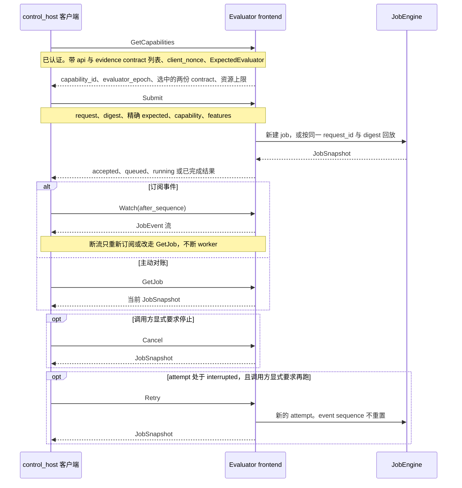

# 对外评测服务协议（tcenv.remote.v1）

状态：**Phase 2C1 外部合约规范**，2026-10-25（2026-10-26 补充执行面说明）。本文与
[`proto/tcenv/remote/v1/evaluator.proto`](../../proto/tcenv/remote/v1/evaluator.proto)
共同定义目标接口。**Phase 2C2 的持久 job/attempt engine、2C3 的 gRPC/TLS adapter
与 2D1 的制品/工具/conformance 已实现；2D2 的本地模拟 Docker 验收已通过**
（见 §12 与 `runs/grpc-sim-20261025/report.json`）。生产 worker 执行面为每次 attempt
一个一次性容器（`runs/container-sim-20261026/report.json` 是 CPU fake-backend 的真实
VM 容器验收）；这两份报告都只是模拟/CPU 基线，**不是**生产设备验收。真实远程站点、
真实 GPU/NPU 与真实设备发布**尚未验收**。legacy SSH 数据面已于 2026-10-27
删除，旧 run 不再可 resume；本文中的“必须/
不得/只允许”是兼容性要求，不是对未实现能力的现状声明；worker 采用进程还是容器属于
evaluator 内部实现，不改变本协议的任何 RPC、字段或摘要。

## 1. 范围与固定形态

v1 只定义 control_host 到 evaluator frontend 的对外数据面：版本化 gRPC + TLS +
Protobuf。`Evaluator` 服务只有 `GetCapabilities`、`Submit`、`GetJob`、`Watch`、`Cancel`、
`Retry` 六个 RPC，不增加 shell、任意路径、通用 JSON 命令或报告改写入口。

### 六个 RPC 的调用顺序

控制机（control_host）是发起搜索的一侧。evaluator frontend 是设备侧对外的 gRPC 入口。grant 是每次 RPC 在认证 metadata 里单独携带的短期授权，不写进消息体。`evaluator_epoch` 把站点、设备、构建、任务包、标定和执行语义捆成一份测量身份；轮换证书、grant 或 HMAC key 本身不改变它。

一次正式评测按下面的顺序调用。`Cancel` 和 `Retry` 不是每次都出现。



`Submit` 只创建或回放，不会因为 `Watch` 断流而自动再提交。`Retry` 只对 interrupted 的 attempt 建立新 attempt。字段号、独立 `BlobChannel` 和两种摘要见 §10。

部署形态固定如下：

- **单租户**：一个 frontend/设备信任域只服务一个客户组织，不设 tenant id、跨租户队列或租户计费。
- **每设备 single-active、non-HA**：每个 `device_id` 对应一个 frontend、一个持久队列、一个
  device lease owner 和一份持久状态。多设备部署独立 frontend，不隐藏全局路由或全局串行队列。
- 多副本、自动故障转移和共享 SQLite 不是 v1 能力；HA 必须另有共享事务存储、lease fencing
  和恢复设计。
- formal 与 selfcheck 共用传输、摘要、job/attempt、租约和审计，但 grant、模式白名单及配额分离。
  `tool_probe` 不伪装成 `EvalReport`，其 typed API 不在本六 RPC 合约内。
- local `LocalEvaluator`、agent→host Unix-socket selfcheck bridge、service→worker
  的私有边界（本地开发为进程，生产为一次性容器）不因此改为 gRPC。容器执行面的
  镜像以 sha256 镜像 ID 固定，其 digest 通过既有 `worker_build`（`+img:<digest>`）
  和 attempt 的 `container_image_digest` 记录进入证据；不新增 RPC 字段，也不改变
  `evidence_contract_id`/`api_contract_id`。

候选源码和报告均是不可信数据。认证、签名和隔离不证明候选安全，也不替代静态检查、
正确性、进程组超时和设备健康检查。

## 2. 消息、类型与资源上限

`.proto` 是唯一外部 schema 来源。安全、身份、授权结果、摘要和状态字段必须使用明确的
message/enum/scalar；不得以无版本 `google.protobuf.Struct`、`Any` 隧道或 JSON 字符串代替。
`google.rpc.Status.details` 使用标准 `Any` 打包 typed detail 不属于业务 JSON 隧道。

所有实现必须遵守以下 v1 硬上限；frontend 可在 `ResourceLimits` 中公布更低上限：

| 项目 | v1 硬上限/编码 |
| --- | --- |
| `source` | `bytes`，最多 1,000,000 字节；不是 `string` |
| `reps` | `uint32`，1..10,000 |
| `queue_timeout_ms` / `candidate_timeout_ms` | `uint32`，1..3,600,000，包含端点 |
| `cases` | 最多 128 项，每项为非空 UTF-8 文本 |
| report/evidence blob | 每项最多 16,000,000 字节，frontend 可降低 |
| request/job/attempt/run/session ID | 有界不透明 ASCII ID，见 canonical contract 校验 |
| 宽 uint64 计数器（`lease_fence`、`session_sequence` 及未来可能超过 2^53-1 的计数器） | 十进制字符串；不得经 IEEE-754 浮点转换 |
| `OpaqueBlob.size_bytes` | **JSON 整数**，范围 0..16,000,000；不是十进制字符串，也不经过浮点转换 |
| `request_id`/`attempt_id`/`run_id`/`session_id`/`site_id`/`device_id`/`target_id` | 有界不透明 ASCII ID，最多 160 字节；正则见 canonical contract |
| `kind`/`mode`/`cache_policy` | 最多 32 个 UTF-8 字节，且只能取 §4.1 的枚举映射 |
| `task`、单个 `case` | 非空 UTF-8 文本，分别最多 256 字节 |
| `dtype`/`backend`/`protocol_version` | 非空文本，分别最多 64 字节 |
| `size` | 非空文本，最多 128 字节 |
| `worker_build`/`backend_version` | 非空文本，分别最多 256 字节；外部 v1 不允许空构建标识 |
| `schema_id`/`media_type`/`key_id` | 非空文本，分别最多 160 字节；`key_id` 另受标识符字符集约束 |
| `issued_at` | RFC 3339 UTC 文本，最多 40 字节；v1 canonical receipt 固定 3 位小数秒（毫秒），亚毫秒 Timestamp 必须拒绝而不是截断 |
| `task_fingerprint`/`candidate_sha256`/`evaluator_epoch` | 64 个小写十六进制字符 |
| `task_pack_digest`/`calibration_digest` | 外部 v1 必须是 64 个小写十六进制字符，不能为空；local-integrated 的空值不是外部 v1 provenance |

`seed` 是 `optional string`：缺失表示 `None`，存在时必须是 `0` 或不带前导零的非负十进制
字符串，范围为 0..2^64-1。缺失与 `"0"` 不同。字符串形式保留超过 2^53-1 的种子。
`cases` 是具 presence 的 message：缺失表示使用服务端任务默认集合；存在但 `names=[]`
表示显式空集合。二者不得合并成同一个默认值。

`EvaluatorProvenance.attempt_id` 与 `request_digest` 也具有显式 presence。capabilities 中两者
必须缺失；job accepted/queued/running 快照必须有 request digest，attempt 尚未分配时
`attempt_id` 可缺失；result/receipt 中两者必须存在。所有 critical enum 的零值都是
`UNSPECIFIED`，在要求语义的 RPC 中必须拒绝；未知 enum 数值同样 fail closed，不得按默认值执行。

`OpaqueBlob` 必须同时携带 `schema_id`、`media_type`、`size_bytes`、实际 `data` 的
SHA-256 和 `data`。接收方必须先检查大小和摘要，再按允许的 schema/media type 解码。
摘要覆盖原始 blob 字节，不是其解码后对象。日志不得记录完整 blob 或源码。

## 3. 握手与三类身份

### 3.1 GetCapabilities

客户端先调用经过认证的 `GetCapabilities`，提供：

- 非空的 `api_contract_ids`、`evidence_contract_ids`（服务端不得用默认值补全空列表）；
- `required_features`、一次性高熵 `client_nonce`；
- 必须存在的 `ExpectedEvaluator`，其中 site/device/target 非空；expected worker build、
  task pack digest 和用于 resume 的 evaluator epoch 可选（空为 wildcard）。
  省略整个 `expected` message 或省略 site/device/target 必须拒绝，不能按任意站点处理。

v1 初始 ID 为：

```text
api_contract_id      = tcenv.remote.v1.evaluator-api.1
evidence_contract_id = tcenv.remote.v1.evidence.1
request/receipt digest = sha256-rfc8785-v1
result signature       = hmac-sha256-v1
```

服务端必须回显 client nonce，返回独立 `server_nonce`、短期 `capability_id`、所选两个
contract ID、`evaluator_epoch`、完整 provenance、target/mode、feature bits 和资源上限。
选择的 contract 必须出现在客户端列表中。`valid_for_ms` 为 1..300,000；capability 必须绑定
frontend 实例、grant scope、三类身份和 feature 集，过期或实例更换后不得用于 Submit/Retry。

feature token 是有界、可比较的能力名称，不是任意描述文本。客户端发现缺失 feature 时必须在
Submit 前失败；服务端在 Submit/Retry 时仍必须重新检查，拒绝未知或已知但不支持的 feature，
并在 `EvaluationErrorDetail.missing_features` 中返回缺失集合。不得只信任客户端内存中的握手结果。
`required_features` 是通信协商，不是执行参数，因此不进入 request digest。

### 3.2 三类身份不得混算

1. **evaluator_epoch** 只绑定影响测量可比性的 site/device/backend/backend_version/target/
   worker_build/task_pack/calibration/执行语义。`protocol_version` 是执行语义的一部分。
2. **api_contract_id** 绑定实际使用的 RPC、字段语义和 required features；不是整个 proto
   文件的盲哈希。无关 RPC 或注释变化不得迫使测量 rebaseline。
3. **evidence_contract_id** 绑定 canonical document、request digest、receipt ID、结果签名和
   验证规则。

host 在 run/outbox 中分别固定三者。每个 Submit/JobRef/result 都必须闭环校验；跨三者不得回放。`Capabilities` 顶层的 `evaluator_epoch/api_contract_id/evidence_contract_id` 必须与 `provenance` 中对应字段完全一致；`JobSnapshot.request_digest` 也必须等于 `provenance.request_digest`。期望值不一致是 `FAILED_PRECONDITION`，持久结果内部不一致是 `DATA_LOSS`，不得任选一份继续。
API 或 evidence 升级不自动改变测量 epoch；执行语义变化才强制新测量基线。证书、grant 或
HMAC key 轮换本身不改变 epoch。resume 默认要求三者不变，不能用缺省值伪装新 gRPC run。

`SubmitRequest.expected` 和 `JobRef.expected` 必须完整、精确，不允许 capabilities 中的
worker/task-pack/epoch wildcard。宿主发布仍需自己的 site/epoch allowlist；
`measurement_kind` 和 `publication_allowed` 只是第二道校验。模拟结果即使认证和签名正确也
不得发布。

## 4. 请求摘要与源码绑定

### 4.1 Canonical request document

新算法为 `SHA256(RFC8785(digest_document))`，算法名 `sha256-rfc8785-v1`。**不得对普通或
 deterministic Protobuf 序列化字节计算跨语言摘要。** canonical JSON 只允许本协议校验过的
子集：ASCII 字段名、有效 Unicode 字符串、null/bool、安全整数、array/object；禁止 float、
NaN/Infinity、非安全整数和重复/未知关键字段。超出安全整数范围的 uint64 用十进制字符串。

request digest document 的精确形状为：

```json
{
  "document_type": "tcenv.remote.v1.request-digest",
  "document_version": 1,
  "digest_algorithm": "sha256-rfc8785-v1",
  "request": {
    "kind": "formal_eval",
    "run_id": "run-id",
    "session_id": "session-id",
    "task": "task-name",
    "dtype": "fp16",
    "size": "small",
    "target_id": "target-id",
    "task_fingerprint": "64-lowercase-hex",
    "candidate_sha256": "64-lowercase-hex",
    "mode": "quick",
    "seed": null,
    "reps": 15,
    "queue_timeout_ms": 30000,
    "candidate_timeout_ms": 420000,
    "cases": null,
    "fast_bench": false,
    "require_contract_launch": false,
    "validate": false,
    "measure_serial": false,
    "cache_policy": "reuse"
  }
}
```

枚举值到 canonical 字符串的映射是协议的一部分，不得直接输出 Protobuf enum 名称：

| Protobuf enum | canonical 字符串 |
| --- | --- |
| `EVALUATION_KIND_FORMAL_EVAL` | `"formal_eval"` |
| `EVALUATION_KIND_SELFCHECK` | `"selfcheck"` |
| `EVALUATION_MODE_QUICK` | `"quick"` |
| `EVALUATION_MODE_TIMED` | `"timed"` |
| `EVALUATION_MODE_FULL` | `"full"` |
| `EVALUATION_MODE_VALIDATE` | `"validate"` |
| `CACHE_POLICY_REUSE` | `"reuse"` |
| `CACHE_POLICY_REFRESH` | `"refresh"` |
| `CACHE_POLICY_DISABLED` | `"disabled"` |
| `MEASUREMENT_KIND_MEASURED` | `"measured"` |
| `MEASUREMENT_KIND_SIMULATED` | `"simulated"` |

实际文档不得含排版空白；示例中的 ID/hex 只是形状说明。上述 20 个执行字段必须全部显式
存在，包括 false、null 和其他默认值。kind/mode 组合及 cache policy 沿用业务校验。
`task_fingerprint` 必须由服务端从只读任务包重算并比对；mismatch 是 protocol/evaluator
问题，不是候选 compile error。

摘要不包含整份源码。`candidate_sha256` 是对**实际收到、实际编译的 source bytes**计算的
SHA-256；在严格解码为支持的文本格式之前即可计算和核对。不得做换行转换、Unicode 规范化、
trim、BOM 删除或二次改写。改变一个尾空格或 CRLF 都必须改变 candidate digest 和 request digest。

摘要排除 `request_id`、`attempt_id`、grant/credential/TLS 身份、RPC deadline、trace/retry/stream
sequence、lease fence、capability/required features、三类期望身份以及所有本地路径。三类期望
身份不是缺失绑定：它们必须与 digest、grant scope 一起存入幂等记录并逐 RPC 比较，只是不作为
执行输入重复哈希。未知请求字段必须拒绝，不能让新执行参数悄悄逃出摘要。

`request_id` 是幂等键，不是摘要输入。同一 request ID + 不同 digest 必须拒绝；同一 digest
但不同期望身份或 grant scope 也不得回放旧 job。Submit 携带的 request digest 必须由服务端重算，
不一致时拒绝。

服务端在 durable accept 前还必须拒绝：

- Protobuf 请求中本合约不认识的字段，包括嵌套 `EvaluationRequest.cases`、`ExpectedIdentities`
  和 `JobRef` 等；未知字段不能悄悄逃出 request digest。
- 非严格 UTF-8 的 `source` 字节；必须按实际收到的字节计算 `candidate_sha256` 后再拒绝，不得
  做替换字符或二次编码。
- 不属于已部署任务包 `(task, dtype, size)` 的 `task_fingerprint`；一个 fingerprint 只能绑定
  一个题目三元组。

### 4.2 秒到整数毫秒

线上 canonical document 只接受 `_ms` 整数字段，不接受 `queue_timeout_s` 或
`candidate_timeout_s`。现有秒值必须在 host/legacy 边界转换一次，规则为：

1. 将十进制秒解释为精确十进制数，要求有限且大于零；现有 Python float 先取其 `str(value)`。
2. 乘以 1000 后向正无穷取整（ceiling），不做截断或银行家舍入。
3. 结果必须在 1..3,600,000 内，否则拒绝。

例：`0.0001 → 1`、`1.2340 → 1234`、`1.2344 → 1235`、`0.1 → 100`、`3600 → 3600000`。
其他语言应传精确十进制字符串或已经规范化的整数毫秒，不得各自对二进制浮点乘积截断。
RPC deadline 是客户端本地策略，不进入请求或摘要，可按 queue + candidate + 收尾余量计算。

## 5. Job、attempt 与恢复语义

### 5.1 两级状态机

逻辑 job 以 request ID 标识；实际执行以服务端分配的 attempt ID 标识。一个 job 同时最多一个
active attempt。

```text
accepted → queued → running → completed
                    │    │  └→ interrupted ──显式 Retry──→ queued（新 attempt）
                    │    ├────→ failed
                    │    └────→ cancelled
                    └→ interrupted / failed / cancelled
```

实际实现可在 accepted/queued/running 的每个持久边界记录更细 attempt 状态，但不得改变以下语义：

| 状态 | 含义 | Submit 回放 | Retry |
| --- | --- | --- | --- |
| accepted/queued/running | 已接受，可能等待或执行 | 返回当前快照，不新建 attempt | 禁止 |
| interrupted | 可恢复的旧 attempt/基础设施中断 | 只返回 interrupted | **只允许此状态** |
| completed | 已有不可变 result；候选 compile_error/incorrect/crash 也属于 completed + report | 回放同 attempt/result | 禁止 |
| failed | 不可重试的基础设施/策略/协议终态 | 回放终态 | 禁止 |
| cancelled | 取消已落终态 | 回放终态 | 禁止 |
| expired | 保留期 tombstone，不是候选结果 | 返回明确 expired | 禁止 |

candidate timeout/crash 是设备侧 `EvalReport`，不是 RPC `DEADLINE_EXCEEDED`，也不是 job
`failed`。`JobFailure` 只描述 infrastructure/policy/protocol，带 `failure_domain/retryable`；
`failed` 必须不可重试，可重试中断进入 `interrupted`。

Submit 必须在同一持久事务中校验 digest/身份/grant、创建或读取幂等记录并预占 quota，接受后
才可 enqueue。重复 Submit 只创建或幂等回放，可恢复必要的持久 enqueue，但不得分配新 attempt。
终态不可改写。运行中 attempt/fence 先落盘再启动 worker；result/receipt/attempt/quota/终态先
同事务提交，再发送最终响应或事件。

### 5.2 Retry、Cancel、GetJob

- `Retry` 必须指定当前 `interrupted_attempt_id`，并在 Retry 前重新 GetCapabilities 取得新
  capability。request ID/digest、run/session/kind/target grant scope、epoch 和两个 contract
  必须不变。成功时分配**新的** attempt ID、单调递增的 lease fence 和 retry index，重新排队；
  不利用旧 attempt aging 插队，不重复预占逻辑 job 的 reservation，并受最大 attempt 数限制。
- completed/failed/cancelled/expired 均不可 Retry；failed 不表示“再试一次”。并发 Retry 只能一个
  成功创建新 attempt。Watch 断流、RPC timeout 或客户端自动重试不得隐式调用 Retry。
- `Cancel` 是按 JobRef 的幂等取消请求，设置 `cancel_requested` 并终止 worker 进程组和设备租约。
  RPC 返回不等于已经取消；最终状态由 GetJob/Watch 确认。若 job 已经 completed/failed，返回原终态，
  不得改成 cancelled。关闭 Submit/Watch 的客户端流不等于 Cancel。
- Submit 结果不明时先 GetJob。`NOT_FOUND` 只表示当前 grant scope 中没有可见的已接受记录，
  不泄露其他 session，也不表示候选失败。只有确认未接受时，客户端才在有界宽限期后以完全相同
  payload 重试 Submit；已接受但 interrupted 的 job 只能显式 Retry。

### 5.3 Watch 与 progress

`Watch` 只能附加到已有 job，以 `after_sequence + optional attempt_id` 续传。每个 `JobEvent`
必须携带 request ID、lease fence 和 job 内单调递增的 sequence；Retry 不重置 sequence。`attempt_id` 采用 optional presence：只有首个 attempt 尚未分配的 accepted snapshot 可以缺失；任何 progress、Retry、Cancel 或 result 事件都必须携带 attempt ID，不能用空字符串冒充。
事件不含 host 路径，host 校验后才写入自己固定的 progress 路径。

事件只保留有界窗口。`after_sequence` 早于窗口时，服务端必须先发送完整 snapshot event，再续发
新事件；慢消费者可合并为最新 snapshot，不得无界占用内存。**attempt 过滤不能被 retention gap
或终态 snapshot 绕过**：若 `attempt_id` 指定的不是当前 attempt，服务端不得返回另一个 attempt
的 snapshot，必须返回空事件或 `FAILED_PRECONDITION`。Watch 断开只触发重新 attach 或有界
GetJob 轮询，不取消 worker。长任务客户端必须支持 keepalive，不得把一条 stream 的 deadline
当作设备执行期限。

## 6. Receipt、结果签名与 lease fencing

### 6.1 Attempt-scoped receipt

每次 attempt 的 receipt 至少绑定 request ID、attempt ID、request digest、candidate digest、
lease fence、session sequence 和 UTC issue time。receipt 的 `issued_at` 是 HMAC 覆盖的 canonical 字符串；v1 固定使用毫秒精度（恰好 3 位小数秒）。
服务端/客户端从 `google.protobuf.Timestamp` 重建 receipt 时，如果 `nanos % 1_000_000 != 0` 必须拒绝
（`INVALID_ARGUMENT`），不得截断成毫秒后再验签，否则签名覆盖的字节会被悄悄改变。

receipt ID 是
`SHA256(RFC8785(receipt_id_document))`，其中“canonical(request_id, attempt_id, request_digest)”
精确指：

```json
{
  "document_type": "tcenv.remote.v1.receipt-id",
  "document_version": 1,
  "digest_algorithm": "sha256-rfc8785-v1",
  "request_id": "request-id",
  "attempt_id": "attempt-id",
  "request_digest": "64-lowercase-hex"
}
```

同一 job 的不同 attempt 必须有不同 receipt ID；旧 request-scoped receipt 不能冒充新合约。
同一 receipt ID 对应不同结果字节是证据损坏（`DATA_LOSS`），不是普通去重。

### 6.2 HMAC result envelope

新可发布外部结果必须验证 `hmac-sha256-v1`。v1 只支持 **host-controlled HMAC-SHA256
verifier**，不提供第三方独立验签或不可否认性，不把 HMAC 换名为公钥签名。host keyring 至少
32 字节/key，按 site + key_id 选择密钥。`ResultSignature.signature` 是原始 32 字节；canonical
文档和 golden 中用小写 hex。接收方还必须检查 `ResultSignature.algorithm == "hmac-sha256-v1"` 和原始签名字节长度为 32，再按 host 信任的 site + key_id keyring 验签；不得由消息自报的 algorithm 或 key_id 单独选择信任策略。

签名输入就是 RFC 8785 字节，HMAC-SHA256 直接覆盖这些字节，不额外预哈希，也不是 Protobuf bytes，形状为：

```json
{
  "document_type": "tcenv.remote.v1.result-signature",
  "document_version": 1,
  "signature_algorithm": "hmac-sha256-v1",
  "key_id": "site/key-version",
  "provenance": {"...": "complete typed provenance"},
  "report": {"schema_id": "...", "media_type": "...", "size_bytes": 1, "sha256": "..."},
  "evidence": null,
  "receipt": {"...": "complete typed receipt"}
}
```

实际 canonical receipt 的 `lease_fence/session_sequence` 是十进制字符串，时间是 UTC RFC3339。
签名覆盖完整 provenance、完整 receipt、report/evidence descriptor 和 key ID；不只签 report
或 receipt ID。接收方还须核对 blob bytes 与 descriptor、receipt ID 与三元组、provenance 与
receipt 的 attempt/digest、result 与固定三类身份。未签名、key ID 不受信或验证失败的结果只能
拒绝或作为明确诊断，不得进入发布链。

每次 attempt 分配持久、单调的 `lease_fence`。worker 只有在 attempt ID/fence 仍为当前值时才能
取得设备并提交结果。服务重启先核对并清理旧 worker/lease；旧 worker 未确认死亡前不得启动新
attempt。旧 fence 的结果只能作诊断，不得覆盖有效终态。生产容器执行面把
`execution_kind/container_id/container_image_digest/container_runtime` 与 attempt 同事务
持久化：create 先于 start，重启后按持久 container id（create 输出丢失时按确定性名字 +
attempt label）清理；Kill→Delete→verify 未被确认时 job 进入 quarantine，客户端只能看到
quarantined 的非终态/取消态，必须人工释放，不能借 Retry 跳过清理。

canonical receipt 的 `issued_at` 固定为毫秒精度（恰好 3 位小数秒）。从
`google.protobuf.Timestamp` 重建 receipt 时，`nanos % 1_000_000 != 0` 必须拒绝，不能截断后
再验签；否则 HMAC 覆盖的字节会改变。SQLite WAL、`synchronous=FULL`、
`BEGIN IMMEDIATE` 和单写者是 v1 目标持久化约束，不构成 HA 或 exactly-once 承诺。

## 7. gRPC status 与 typed error detail

RPC/认证/传输结果使用标准 gRPC status。需要丰富错误时，通过标准
`grpc-status-details-bin` 携带 `google.rpc.Status`，其 details 使用 `google.rpc.ErrorInfo`、
`google.rpc.RetryInfo` 和 `type.googleapis.com/tcenv.remote.v1.EvaluationErrorDetail`。
不得另造平行错误 JSON。metadata 只放有界、脱敏的 request/attempt/digest/contract 信息，不得放
源码、token、私钥、任意 host path 或完整报告。

| 情况 | gRPC code | 说明/重试 |
| --- | --- | --- |
| 字段缺失、非法 enum/presence、digest/source 不符、整数越界 | `INVALID_ARGUMENT` | 修正请求；不得当候选错误 |
| 缺少、无效或普通过期的 grant | `UNAUTHENTICATED` | 续期同 scope grant 后可重查 |
| formal/selfcheck/scope 越权、撤销的 grant/identity | `PERMISSION_DENIED` | 不得自动换身份 |
| 当前 scope 中 job 不可见 | `NOT_FOUND` | 仅用于 Submit 后对账，不是候选失败 |
| 同 request ID 对应不同 digest | `ALREADY_EXISTS` | 不得覆盖或新建 attempt |
| epoch/API/evidence/capability 不符、缺 feature、Retry 非 interrupted | `FAILED_PRECONDITION` | 重新握手/显式恢复；不得静默降级 |
| queue/active attempt/Watch/stream/DB/message/auth-rate 上限 | `RESOURCE_EXHAUSTED` | 可在 RetryInfo 指示后退避；不得先写满磁盘 |
| 并发状态修改或当前 fence 冲突 | `ABORTED` | 先 GetJob 对账，不盲目 Retry |
| 暂时服务/存储/设备基础设施不可用 | `UNAVAILABLE` | 可附 RetryInfo；不是 candidate crash |
| RPC 本地或服务端调用期限 | `DEADLINE_EXCEEDED` | 先 GetJob；不是 candidate timeout |
| 持久状态或同 receipt 不同结果字节损坏 | `DATA_LOSS` | fail closed，需人工/恢复流程 |
| 未实现的 RPC/版本入口 | `UNIMPLEMENTED` | 不开 insecure/legacy fallback |
| 其他已脱敏内部错误 | `INTERNAL` | 不伪造候选 verdict |

`UNAVAILABLE`、`DEADLINE_EXCEEDED`、TLS 错误和 Watch 断开均不得映射成 candidate crash/timeout。
durable job outcome 才表示评测结果。基础设施失败、队列超时和 quota reservation 的结算必须按
是否实际执行区分；selfcheck 基础设施失败不写权威计时记录、不计次数。

## 8. TLS、mTLS、grant 与 host-only verifier

生产必须 TLS，校验受信 CA、SAN/hostname，禁止 insecure channel。split-control 使用**共享 host
mTLS identity + 每 RPC 短期 session grant**，不使用每场 client certificate。frontend 直接终止
TLS/mTLS，每个 device 只暴露一个受防火墙 allowlist 保护的 listener；未验收的 L7 proxy 不得
终止或转发身份。GetCapabilities 也必须认证，health 仅 loopback 或认证访问。外部 v1 的 `worker_build`、`task_pack_digest`、`calibration_digest` 和 `evaluator_epoch` 都必须非空；local-integrated 的空 `worker_build/task_pack_digest/calibration_digest` 只是本地兼容形状，不能被外部服务复制来伪造可比较的 epoch。

- 每个 `Submit/GetJob/Watch/Cancel/Retry` 都重新授权 metadata 中的 grant；连接级认证不能替代
  每 RPC run/session/kind/target/mode/quota scope。formal grant 不得用于 selfcheck，反之亦然。
- 认证失败限速同时统计语法合法但未知/过期/已 supersede 的 grant，以及因撤销而失败的 grant；
  未认证 RPC 不能通过使用格式正确的随机 token 绕过限速。
- metadata、Authorization、私钥和完整 token 不进入 proto、digest、业务日志或 manifest。
- 共享 host mTLS 私钥、formal grant 和 HMAC keyring 只能由 fence 外 host evaluator client/
  credential helper 持有，不得进入 workspace、TASK、argv 或 agent 可读环境。同 UID 的 0600
  不是独立安全边界。
- agent 只获得短期、selfcheck-only capability。host 进程对每 endpoint 可共享 channel，但 grant
  必须按调用注入；不得把长期 formal 凭据交给 agent。

job store 保存 grant subject 与 run/session/kind/target scope，不保存原始 token。普通过期后，
已接受 job 可继续，但过期 grant 不能发起新 RPC；同 subject/scope 的续期 grant 可重新
GetJob/Watch/Retry。安全撤销立即禁止新 Submit/Retry 和读取，并由服务端取消关联 active attempts；
不能依赖已撤销 token/证书再调用 Cancel。selfcheck session 撤销只影响该 session 的 selfcheck，
不得取消 formal。

正常 mTLS 轮换不中断已接受 job；安全撤销证书指把叶子证书 DER 的 SHA-256 放入 frontend
启动时加载的 0600 静态撤销表（`--revoked-client-certificates`），每个 RPC 在授权 grant 前
比对。该表是 TLS 栈不支持 CRL/OCSP 时的逐证书撤销机制，不是在线 CRL/OCSP 获取；
文件格式或权限不合法时 frontend 拒绝启动。HMAC 正常轮换时新 job 用当前 key，
旧 key 至少保留到历史结果过期且只能验历史；泄露撤销时立即从可信 keyring 删除，相关结果不得
再发布。**撤销历史 key 不能阻止 frontend 重启**：服务端把受影响 result 隔离并扣留，其他 job
继续服务；host outbox 对 completed 结果也要按当前可信 keyring 拒绝重放（保留原结果，只记录
`signature_key_revoked` 诊断）。grant/cert/key 轮换均不自动改变测量 epoch。

## 9. 保留期、时间与可用性承诺

- 原始源码和临时目录在 job 终态后删除；编译临时文件使用 job 独立、最小权限目录。崩溃转储、
  日志和备份也受同一清理策略。
- 最终 report/evidence/receipt 和必要 attempt 诊断保留期可配置，且不得短于 control host 的
  resume 保留期；首版默认 30 天。幂等 tombstone 至少覆盖结果保留期，event 只留有界窗口。
- TTL 后 GetJob 可返回 `JOB_STATE_EXPIRED` tombstone；不得把同一 request ID 当作新 job 给出
  不同结果。当前 scope 连 tombstone 也不可见时按 `NOT_FOUND`，不得泄露他方记录。
- grant 过期、撤销、retention 和持久 deadline 以服务端时间为准；运行中超时使用 monotonic
  clock，落盘绝对时间用 UTC，重启后按持久 deadline 重算剩余 TTL。证书/grant 临期只允许配置的
  有限时钟偏差，超出 fail closed；客户端时钟不参与新鲜度判定。
- non-HA 的 RPO 仅是持久卷上已 fsync 的事务；磁盘/站点丢失的 RPO 由备份周期决定。RTO 包括
  运维重启、数据库恢复、旧 worker/lease 清理和设备健康检查。恢复后非终态 job 先隔离检查，
  不得自动重跑。

协议承诺是**持久幂等回放与经过测试的重复抑制**，不是 exactly-once 执行。网络、客户端或
进程崩溃窗口仍需 GetJob 对账和显式 Retry；不得用 request ID 或 HMAC 宣称所有路径恰好执行一次。

## 10. 兼容性、生成物与旧证据

package、六个 RPC 名和 field number 稳定；删除字段必须 reserve。v1 内只允许经 feature/digest
协商的可选增量，breaking change 开并行 v2 及新的 API/evidence contract。发布 proto、
`evaluator.desc` 和可重复生成的 Python message/stub；CI 必须运行生成物 drift check 和
`tests/shared/test_remote_grpc_contract.py::test_v1_schema_changes_are_backward_compatible_with_the_frozen_baseline`。
冻结基线是 `tests/support/golden/remote/evaluator_v1_baseline.desc`：每个已有 field 的
number/type/label/presence/oneof/default 必须不变，删除字段必须 reserve，枚举值和六个 RPC 的
名称、输入输出及 streaming 语义必须不变。只有新增字段/兼容能力的改动才可保留在 v1；
不兼容改动必须开 v2。

### 冻结合同、字段号与摘要

`EvaluationRequest` 的 1–22 号是 v1 基线字段。删除其中任何一个都必须 reserve 原号，不能把后面的字段挪上来补位。request digest 的算法名是 `sha256-rfc8785-v1`：对 RFC 8785 规范化后的 JSON 做 SHA-256，不对 Protobuf 序列化字节计算。下表「进入 v1 digest」指 §4.1 那 20 个执行字段；`false`、`null` 也要显式出现。

| 号 | 字段 | 类型 | v1 request digest |
| --- | --- | --- | --- |
| 1 | `kind` | `EvaluationKind` | 进入。canonical 字符串是 `formal_eval` 或 `selfcheck` |
| 2 | `request_id` | `string` | 不进入 |
| 3 | `run_id` | `string` | 进入 |
| 4 | `session_id` | `string` | 进入 |
| 5 | `task` | `string` | 进入 |
| 6 | `dtype` | `string` | 进入 |
| 7 | `size` | `string` | 进入 |
| 8 | `target_id` | `string` | 进入 |
| 9 | `task_fingerprint` | `string` | 进入。64 个小写十六进制字符 |
| 10 | `candidate_sha256` | `string` | 进入。对实际收到、实际编译的 source 字节计算，不做换行、Unicode 规范化、trim 或去 BOM |
| 11 | `source` | `bytes` | 不进入。上限 1,000,000 字节 |
| 12 | `mode` | `EvaluationMode` | 进入。canonical 为 `quick`、`timed`、`full` 或 `validate` |
| 13 | `seed` | `optional string` | 进入。缺失是 JSON `null`，与 `"0"` 不同 |
| 14 | `reps` | `uint32` | 进入。范围 1..10,000 |
| 15 | `queue_timeout_ms` | `uint32` | 进入。范围 1..3,600,000，含端点 |
| 16 | `candidate_timeout_ms` | `uint32` | 进入。范围与 queue timeout 相同 |
| 17 | `cases` | `CaseSelection` | 进入。缺失是 `null`；message 存在但 `names` 为空是显式空集合 |
| 18 | `fast_bench` | `bool` | 进入 |
| 19 | `require_contract_launch` | `bool` | 进入 |
| 20 | `validate` | `bool` | 进入 |
| 21 | `measure_serial` | `bool` | 进入 |
| 22 | `cache_policy` | `CachePolicy` | 进入。canonical 为 `reuse`、`refresh` 或 `disabled` |

23–27 是后来追加的 NPU 字段，只由 `tests/support/` 的测试组合根提供。它们不进入上表的 v1 digest。生产入口 `python -m tcenv.remote.grpc_service` 在 dialect 的 `npu_source` 为真时拒绝启动；source、blob、bundle、build 四个 NPU dialect 都把该标志设为真。各版本自己的 digest 形状见 [执行运行时与设备扩展](执行运行时与设备扩展.md) §8.1–§8.4。

| 号 | 字段 | 类型 | 合同 |
| --- | --- | --- | --- |
| 23 | `candidate_digest` | `CandidateDigest` | NPU 源码身份：`algorithm` + `value`。legacy v1 拒绝，继续使用 10 号 `candidate_sha256` |
| 24 | `execution` | `NpuExecutionSpec` | NPU 执行形状。legacy v1 拒绝 |
| 25 | `blob_ref` | `BlobRef` | `npu-blob`，`document_version` 3。只放内容身份，字节不进这六个 RPC。legacy 与 `npu-source` 拒绝 |
| 26 | `bundle` | `ArtifactBundle` | `npu-bundle`，`document_version` 4。与内联 `source` 互斥。更早的 contract 拒绝 |
| 27 | `build` | `BuildRequest` | `npu-build`，`document_version` 5。更早的 contract 拒绝 |

独立数据面和结果签名不占用 `EvaluationRequest` 的字段号：

| 名称 | 位置 | 规则 |
| --- | --- | --- |
| `BlobChannel` | package `tcenv.remote.blob.v1`，与六个 RPC 不同 service | 七个 RPC：`BeginUpload`、`WriteChunk`、`CommitUpload`、`AbortUpload`、`GetBlob`、`ReadChunk`、`StreamBlob`。大块字节走这条通道。`build_server` 只在传入可选 `blob_channel` 时注册，生产组合根不传 |
| request digest | `sha256-rfc8785-v1` | `SHA256(RFC 8785 JSON)`。覆盖 §4.1 的请求文档，不覆盖 Protobuf 字节，也不覆盖整份源码 |
| result signature | `hmac-sha256-v1` | HMAC-SHA256 直接覆盖 result-signature 文档的 RFC 8785 字节，不额外预哈希，也不是公钥签名。`ResultSignature.algorithm` 必须等于 `hmac-sha256-v1`，原始签名 32 字节 |

同一个 `tcenv.remote.v1` package 里后来还追加了 NPU 专属增量：
`EvaluationRequest.candidate_digest=23`、`execution=24`、`blob_ref=25`、`bundle=26`、
`build=27`，以及 `CandidateDigest`/`NpuExecutionSpec`/`BlobRef`/`ArtifactBundle`/
`BuildRequest` 等 message；六 RPC 与 1..22 号字段不变。它们属于
`tcenv.remote.npu-source|npu-blob|npu-bundle|npu-build` 这套独立 API/evidence
contract（`document_version` 2–5），只由 `tests/support/` 的测试组合根提供，
生产入口 `python -m tcenv.remote.grpc_service` 对 `npu_source` contract 直接报错；
本文的摘要、receipt 与签名规则仍然只描述 v1。各版本的字段与证据规则见
[执行运行时与设备扩展](执行运行时与设备扩展.md) §8.1–§8.4。同族的独立 package
`tcenv.remote.blob.v1` 还定义 `BlobChannel`（7 个 RPC，含 `StreamBlob`），与六 RPC
共用监听但不同 service/message；`build_server` 只通过可选 `blob_channel` 参数注册，
生产组合根不传。

本仓生成工具固定为 protoc 29.3 + grpc_python_plugin 1.69.0；Python 包由锁定的 `codegen` dependency group 提供：

```bash
uv run --group codegen python scripts/generate_evaluator_proto.py
uv run --group codegen python scripts/generate_evaluator_proto.py --check
```

Python message import 只需要 protobuf，stub import 才需要可选 grpcio。`tcenv.remote.contracts`
和 `LocalEvaluator` 不得 import grpc；local 默认路径不得新增 socket、证书或 gRPC server 依赖。

旧 artifact 继续按各自固定的 Python canonical JSON digest、receipt 和 HMAC 规则
读取与验证；不得把旧算法改名为 RFC 8785，不重签、不改写历史，也不跨算法回放幂等记录。
legacy SSH 数据面已经删除，旧 run 不再可 resume，但旧证据的只读验证仍然保留。
新 `sha256-rfc8785-v1`、attempt-scoped receipt 和 `hmac-sha256-v1` canonical result document
只用于新 gRPC 合约。

## 11. 2C1 验收边界

本阶段离线合约验收覆盖：六 RPC descriptor、字段类型/presence、源码字节、canonical digest
及包含/排除规则、整数毫秒与溢出、attempt receipt、key ID/HMAC、legacy 不变，以及至少 Python
和 Go 两个独立实现的 golden。golden 位于 `tests/support/golden/remote/evaluator_v1.json`，
Go verifier 位于 `tests/support/remotecontract/`；没有 Go 时测试必须明确 skip，有 Go 时必须实际
执行，不得只让 Python 实现与自身比较。

2C2/2C3/2D1 的实现证据不在本文范围内，见 §12；本文仍只定义兼容性要求，不把本地模拟验收
当作真实站点、真实设备或真实 NPU 的实现证据。

## 12. 实现状态与证据（2026-10-25）

已实现并通过离线/本地验收：

- **持久核心（2C2）**：`tcenv/remote/job_store.py` + `job_engine.py`；SQLite WAL、
  `synchronous=FULL`、`BEGIN IMMEDIATE`、单写者 owner lock、job/attempt 两级状态机、
  lease fence、quota、receipt、retention/tombstone、backup/restore 与恢复隔离。
  测试：`tests/shared/test_remote_job_engine.py`、`test_remote_job_recovery.py`。
- **gRPC adapter（2C3）**：`tcenv/remote/grpc_contract.py`、`grpc_server.py`、
  `grpc_client.py`；六 RPC、每 RPC grant、required features、presence/enum/溢出/
  消息大小、Submit 只创建/回放、Retry 只 interrupted、Cancel、Watch/GetJob
  续传与对账、attempt/fence/receipt/HMAC 验签、TLS/mTLS、keyring 轮换/撤销、
  clock skew。测试：`tests/shared/test_remote_grpc_adapter.py`、
  `test_remote_grpc_tls.py`。
- **对外制品（2D1）**：生产入口 `python -m tcenv.remote.grpc_service`、镜像
  `deploy/remote-evaluator/`、`scripts/remote_evaluator_admin.py`、
  `scripts/remote_evaluator_client.py`、`python -m tcenv.remote.state_admin`、
  `tcenv/remote/task_pack.py`。Python conformance 与独立 Go 客户端：
  `tests/shared/test_remote_conformance.py`、`test_remote_go_conformance.py`。
- **模拟集成（2D2）**：macOS → Docker Desktop Linux VM → 测试专用 fake backend，
  49 项必需矩阵（TLS/grant/key/fault/restart/quota/rollback/cleanup，另有
  未签名结果、真实前一镜像回滚与静态逐证书撤销）；报告
  `runs/grpc-sim-20261025/report.json`，`simulated=true`、
  `publication_allowed=false`。`status=passed` 只在全部必需 check 实际通过且
  post-cleanup 证据为 final 时成立；必需项失败、缺失或 blocker 一律为
  `failed`/`blocked`。该报告不是搜索 run，不写 run_config.json，不进入
  confirmed/catalog/brief，也不覆盖 `runs/npu-sim-*`。

legacy SSH 数据面、`RemoteEvaluatorPool` 和 forced-command 入口已于 2026-10-27
删除；远程配置必须显式 `transport=grpc`，旧 legacy manifest 不再可 resume。历史 artifact
的 digest/provenance/HMAC 只读验证仍保留，不构成旧服务继续存在的承诺。

未完成/未验收：真实 GPU/NPU、NPU SDK、真实模型与性能；真实远程站点与发布许可；
CRL/OCSP 网络获取（仅有重启加载的静态叶子证书撤销表）；多副本/HA/exactly-once；
用户自管 Ubuntu VM 的完整 split-control（本次 Docker Desktop Linux VM 只作为本地模拟环境，
报告已标注 `container_host` 与 `ssh_data_plane=false`）。
