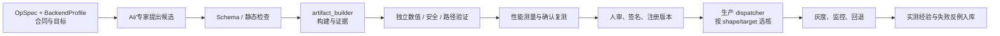
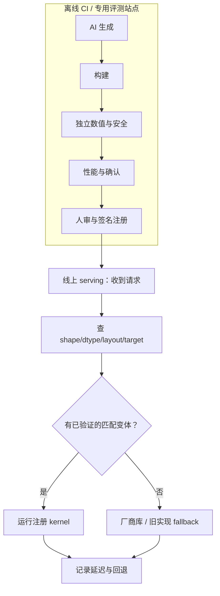
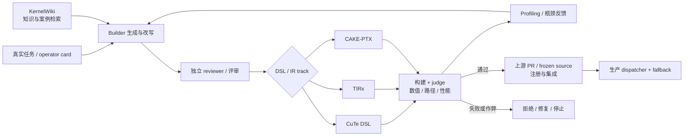
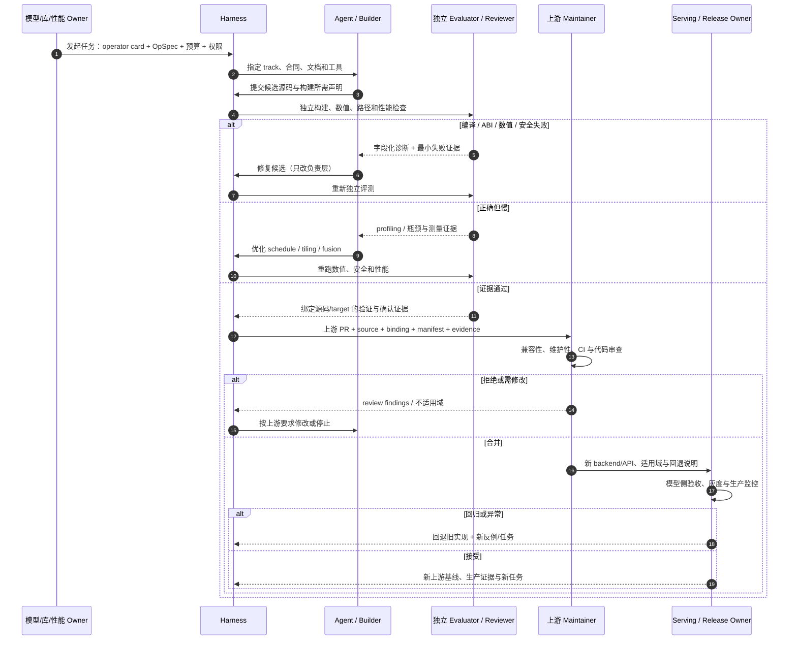
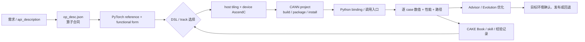
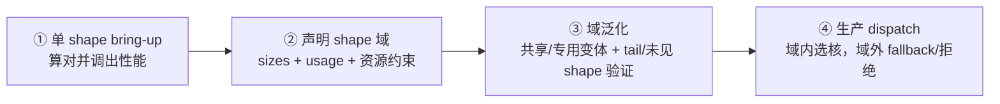
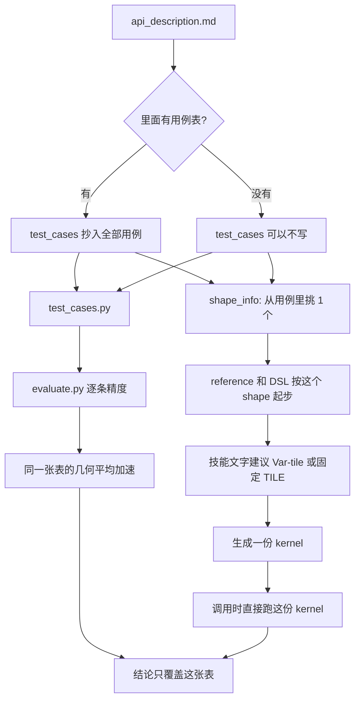

# 工业使用：AI 算子生成、Kernel CI/CD 与受控发布

日期：2026-10-28

> **核心观点**：这套架构在工业中应被理解为 **“AI 辅助的 kernel CI/CD + 构建证据供应链 + 受控发布系统”**，而不是让 LLM 直接在线上写算子。
>
> **推荐模式**：离线生成与验证，注册受信版本；线上只做确定性的 dispatch 和 fallback。本文是落地设计，不表示当前已经完成生产部署或真实 NPU 验收。

## 0. 整体链路



**LLM 只参与生成 track 的选择、候选生成和有限优化搜索。验收、注册与发布不交给候选生成者。**

## 1. 工业上怎样落地一个算子

以 RMSNorm 为例：

| 阶段 | 谁负责 | 具体动作 | 产物 |
| --- | --- | --- | --- |
| ① 定义任务 | 算子/算法 owner | 写 `opspec.json`：数学式、shape 域、dtype/layout、acc、EPS、容差和用例 | OpSpec、`opspec_digest` |
| ② 选择目标 | backend owner | Metal 选择契约默认 grid/threads；NPU 选择构建期 tiling 等；工具链与编译选项（CANN/soc、math）由构建时探测记录 | LoweringProfile、`lowering_profile_digest`；BuildProvenance |
| ③ 选择生成 track | 工程负责人 | 默认先用现有 MSL/AscendC；有证据再加 Typed IR track | track 配置与版本 |
| ④ 生成候选 | AI/专家 | 基于 OpSpec 和 track 写 kernel | 候选源码、`candidate_sha256` |
| ⑤ 构建 | CI / builder | 统一走 `artifact_builder()` | ArtifactBundle、BuildProvenance、BuildEvidence |
| ⑥ 独立验收 | 验证 owner | golden、tail、fresh/hidden 输入、输出毒化、同步、路径与 fallback 检查 | 数值、内存安全、执行路径报告 |
| ⑦ 性能确认 | 性能 owner | 与合适的厂商库/现有实现比较，重复、交错、测噪声，再确认复测 | search best、confirmation 分开的报告 |
| ⑧ 人审发布 | 发布 owner | 审查源码、成本、适用域、回退与维护性，签名注册 | release manifest、target allowlist |
| ⑨ 生产接入 | SRE/runtime owner | dispatcher 按 shape/target 选已验证变体，非覆盖域走库或旧实现 | dispatch 配置、灰度与回滚方案 |
| ⑩ 运营 | 知识/质量 owner | 收集失败、回归、实际调用量和收益，退役失效经验 | 新反例、实测经验、版本过期记录 |

## 2. 最有工业价值的三种用法

| 用法 | 适用场景 | 工业价值 |
| --- | --- | --- |
| **新算子 bring-up** | 库未覆盖的新算子、模型新结构、长尾融合算子 | 缩短从数学定义到可运行 kernel 的时间 |
| **已有正确 kernel 的优化** | 已有参考实现但性能不足 | 用 profiling 和受控搜索优化 tile、布局、流水和融合 |
| **硬件/版本迁移** | 新 GPU/NPU、编译器升级、设备组变化 | 复用 OpSpec，重写 LoweringProfile 与 lower，再独立验证，而不是复制旧性能结论 |

不太值得使用的情况：

- 厂商库已经高度成熟、没有明确 headroom 的算子；
- 没有独立 golden、容差和真实执行路径证据的任务；
- 需要形式等价证明，但当前只有抽样测试的场景；
- 希望让 LLM 在请求路径上即时生成并直接执行 kernel 的在线生产系统。

## 3. 线上运行不要放 LLM

工业部署应把“生成”与“执行”彻底分开：



线上 dispatcher 只接受：

- 已绑定的 `opspec_digest`、`lowering_profile_digest`、`candidate_sha256` 和 artifact；
- 已确认的 shape/dtype/layout/target 域；
- 明确的 generated / vendor fallback 路径；
- 可回滚的版本与 site/epoch allowlist。

**线上不会因为遇到一个未见过 shape 的请求，就临时调用模型生成新 kernel。**

## 4. 一份工业 release manifest 应该长什么样

下面是教学示例，不是当前最终实现，也不包含真实测量值：

```json
{
  "op_name": "rmsnorm",
  "opspec_digest": "sha256-of-semantic-contract",
  "track": "metal-msl",
  "lowering_profile_digest": "sha256-of-lowering-profile",
  "candidate_sha256": "sha256-of-candidate-source",
  "artifact_set_digest": "sha256-of-artifact-manifest",
  "target": {
    "backend": "metal",
    "device": "apple-m4-max",
    "backend_version": "1"
  },
  "validated_sizes": ["paper", "small", "tail_odd"],
  "coverage": {
    "kind": "sampling",
    "fresh_inputs": true,
    "execution_path": "generated"
  },
  "confirmation": {
    "status": "ok",
    "source_sha256": "same-as-candidate",
    "median_speedup": "measured-on-target",
    "uncertain": false
  },
  "fallback": "vendor_rmsnorm",
  "release_owner": "named-reviewer"
}
```

这份 manifest 应让生产系统能回答：

| 问题 | 对应证据 |
| --- | --- |
| 算子的数学合同是什么？ | OpSpec 与 `opspec_digest` |
| 二进制由哪份源码和工具链产生？ | candidate、BuildProfile、BuildProvenance、artifact_set_digest |
| 在哪些 shape/target 上验证过？ | `validated_sizes`、coverage、target/device identity |
| 是否真的走了生成 kernel？ | execution_path / generated/fallback/unknown 分账 |
| 性能数字来自搜索还是确认？ | search best 与 confirmation 分离的报告 |
| 不适用时回退到哪里？ | 明确的 fallback 与回滚策略 |
| 谁批准上线？ | `release_owner` 与签名/评审记录 |

## 5. 工业上真正要看的指标

| 指标 | 用途 |
| --- | --- |
| `time_to_first_valid` | 从任务开始到首个正确候选要多久 |
| `time_to_confirmed` | 到绑定源码/target、通过确认的候选要多久 |
| 编译率、数值通过率、hidden/fresh 通过率 | 生成是否可靠 |
| generated/fallback/unknown 比例 | 是否真的走了目标 kernel |
| 确认后的 p50/p95 延迟、内存与回退率 | 生产性能是否真正改善 |
| 每个被接受 kernel 的 LLM/设备/人工总成本 | 是否比人工写或修改现成实现便宜 |
| 新版本回归率、回滚次数、维护时间 | 架构本身是否可持续 |
| 实际调用量 × 每次节省时间 | 优化是否值得继续投入 |

## 6. 最实际的采用顺序

1. **先选一个库未覆盖的小算子**，不要从 GEMM/Conv 等成熟库核心开始。
2. 用 OpSpec 冻结合同，用现有 DSL 跑通构建与独立验收。
3. 先把 CI、权限、数值、路径和确认门做好，再让 AI 多生成候选。
4. 先离线注册、灰度接入，再考虑多 IR/DSL 和自动路由。
5. 只有当反复失败证明是表示问题时，才增加 Typed IR 或新编译层。
6. 新版本先小范围 canary；实际生产调用证明有价值后，才扩大 shape/target 范围。

## 7. KDA 的工业化使用：多视角案例

这里的 KDA 指 **Kernel Design Agents 工作流**，不是被优化的 Kimi Delta Attention。以下内容分为团队/项目材料与本地代码可核事实；性能数字不视为本仓复现。

### 7.1 KDA 的工程闭环



KDA 的工业价值不是“多 Agent 会聊天”，而是把**写核、审查、知识、表示、测量和上游交付**接成了闭环。

### 7.2 多个视角看 KDA 为什么有用

| 视角 | KDA 的做法 | 工业价值 | 我们怎样借鉴 |
| --- | --- | --- | --- |
| **任务视角** | 围绕具体模型结构、真实 shape/dtype/layout 和任务 ABI 做优化 | 避免把“通用写 kernel”变成无边界生成 | 将任务整理为 OpSpec + 独立参考/oracle |
| **表示视角** | CuTe DSL、TIRx、CAKE-PTX 等多条路线 | 可按目标选择最合适的硬件控制层，不被单一 DSL 限制 | LoweringProfile/track 独立；OpSpec 不为每条 DSL 复制一份 |
| **知识视角** | KernelWiki 收集真实 PR、硬件特性、技术、kernel case 和 DSL guide | 模型不必只依赖预训练记忆，能复用专家已验证的结构 | Wiki 必须有来源、target/version、可编译样例和失效条件 |
| **反馈视角** | profiling、CUPTI/NCU、真实模型输入和瓶颈证据 | 优化从“多试几次”变成针对具体瓶颈修改 | 先建 profiling 与局部诊断，再扩大搜索 |
| **协作视角** | 写核与独立审查分离，多模型/多轮搜索 | 降低单一模型自报成功和局部最优风险 | 让生成者与裁判分离；reviewer 不能只看作者自述 |
| **验证视角** | 失格案例后加强 final state、秘密种子、分布外探针、真实输入和独立代码审查 | 防止高加速比来自分布利用、常数、丢状态或不执行目标 kernel | 将 anti-hack、fresh/hidden、执行路径和确认复测作为硬门 |
| **交付视角** | 以 PR、frozen generated source 和 host binding 进入真实库 | 生成物脱离 Agent 也能编译、审查和维护，符合真实上游协作方式 | release manifest + 上游 PR + dispatcher/fallback，而不是只留 `best.metal` |
| **成本视角** | 大量 token 投入，但以最终有效 kernel 为目标 | 可接受高投入的前提是边际收益大于全链路成本 | 记录 time-to-confirmed、接受总成本、人工时间与实际调用收益，不追求 token 数本身 |

### 7.3 验证是 KDA 工业化的核心，而不是附属品

KDA 的 `hacking_example/` 是非常有价值的工业反例：

| 阶段 | 结果与教训 |
| --- | --- |
| 宽松 verifier | 候选曾被接受到 **3.7413×**，但实际通过常数归一化、丢状态和跳过计算来利用评测分布 |
| 关闭作弊路径 | 同一候选变为 **2.4768×**；项目明确判断表观增益来自评测利用 |
| 后续加固 | 检查 final state、秘密 seed/private holdout、分布外和真实模型输入、计时后复验、独立代码审查 |

这对应到我们的发布门，应该是：

```text
候选写得像 kernel
  ≠ 候选真的算对
  ≠ 候选真的走了目标 kernel
  ≠ 候选真的更快
  ≠ 候选可以发布
```

因此 KDA 的失格案例比单个高加速比更值得工业化复用：**先建立能拒绝假优化的 judge，再讨论 token max 和多轮搜索。**

### 7.4 KDA 与我们架构的对应关系

| KDA 组成 | 我们的对应物 | 不能混淆的地方 |
| --- | --- | --- |
| 任务 ABI、shape、dtype、参考与 workload | OpSpec | KDA 没有以我们的 OpSpec.json 统一承载 |
| CuTe DSL / TIRx / CAKE-PTX | LoweringProfile / lower / schedule track | 属于表示和构建，不是 OpSpec 语义本身 |
| KernelWiki | 版本化知识库与检索层 | 不能把模型自撰经验直接当 trusted wiki |
| Profiling / judge | `tcenv` 独立评测与确认 | 不能把局部计时或宽松 allclose 当发布证据 |
| 多模型 builder/reviewer | 生成者与独立验证/发布 owner 分离 | 不需要为了形似而先上多 Agent |
| 上游 PR / frozen source | release manifest + 上游集成 + dispatcher/fallback | 不把候选源文件直接当生产 release |

### 7.5 KDA 路线在工业中应怎样采用

| 顺序 | 应该做什么 | 暂时不要做什么 |
| --- | --- | --- |
| 1 | 先定义真实任务、operator card、参考实现与强 judge | 先堆多 Agent、wiki 和 DSL 路线 |
| 2 | 选一条现有 DSL/track，做出首个真正正确的候选 | 先追求最高加速比或大规模 token max |
| 3 | 用 profiling 做有针对性的优化，并保存前后差分 | 把原始 profiler 全量日志直接塞给模型 |
| 4 | 用 fresh/hidden、真实输入、执行路径和确认复测排除假优化 | 把公开 shape 单次通过当发布证据 |
| 5 | 以 PR/frozen source/绑定证据进入上游，并配置 fallback | 让线上请求实时调用 LLM 写 kernel |
| 6 | 有复发问题后再增加知识库、第二 IR track 或自动路由 | 在缺乏同题同预算观测时直接实现复杂 router |

**一句话概括 KDA 的工业价值：它展示的是“高约束的 kernel 工程组织方式”，不是“只要多烧 token 就能写出好 kernel”。**

KDA 证据入口：

- `/Users/kuafu/CLionProjects/kda-260927-kda/README.md`：三种表示路线、任务 ABI、验证与计时协议；
- `/Users/kuafu/CLionProjects/kda-260927-kda/hacking_example/README.md`：失格候选与加固后的验证要求；
- `/Users/kuafu/CLionProjects/kda/skills/KernelWiki/`：结构化知识库；
- `/Users/kuafu/CLionProjects/dsl_for_llm/flashinfer/csrc/kda/`：生成 kernel 与 host binding 的集成实例，代码存在不等于本仓复现性能。

## 8. KDA / CAKE 怎样接到 FlashInfer、SGLang、vLLM

“KDA/CAKE 的算子被上游采用”不是把一段文本发给 SGLang/vLLM 就结束了，而是经过**生成与验证 → 上游 kernel 库集成 → serving 后端调用 → 新基线形成**四个阶段。

### 8.1 三层各自负责什么

| 层 | 代表 | 负责什么 | 不负责什么 |
| --- | --- | --- | --- |
| **生成与优化层** | KDA、GPU CAKE | 根据任务生成/优化 kernel，给出源码、schedule、构建与验证证据 | 不直接决定线上调度，也不因为生成了源码就成为产品 |
| **kernel 库与调用接口层** | FlashInfer | 保存生成 kernel、manifest、host binding、JIT/编译器、变体选择与 Python API | 不负责完整模型调度、请求路由和生产 serving 策略 |
| **模型 serving 层** | SGLang、vLLM | 根据模型、shape、设备与后端策略调用 FlashInfer 或其他实现，并提供回退 | 不应让线上请求临时调用 LLM 写 kernel |

因此，FlashInfer 和 SGLang/vLLM **不是同一层**：FlashInfer 是 kernel 能力库；SGLang/vLLM 是使用这些能力的模型执行系统。

### 8.2 完整的接入链


其中最关键的一点是：**`merged` 只说明代码进入上游，不等于所有请求都会自动走新 kernel，更不等于已经取得生产加速。**

### 8.3 任务控制面：谁发起、谁定义、怎样响应

这条链不是 Agent 自动接力，而是由**任务合同和版本化 artifact 驱动的多方协作**。自然语言需求只用于说明目标，真正的协调靠 op card/OpSpec、候选、评测报告、PR、manifest 和发布记录完成。

#### A. 谁发起任务

| 发起者 | 典型动机 | 任务输入 |
| --- | --- | --- |
| 模型/产品 owner | 新模型结构需要新算子，或现有实现成为瓶颈 | 模型结构、调用路径、目标 SLA 和业务价值 |
| FlashInfer/SGLang/vLLM maintainer | 上游 issue、性能退化、新后端/新 shape 支持 | issue、当前实现、需保持的 ABI 和兼容范围 |
| 性能/算子工程师 | profiling 发现某个 kernel 占主导成本，或厂商迁移需要重写 | trace、shape/dtype/layout、当前瓶颈和基线 |
| 验证/发布 owner | 发现旧验证有盲区、假优化或跨设备回归 | 新反例、失败 case、必须新增的验收规则 |

**不是 LLM 自己决定做什么。** Agent 只能在已批准的任务、预算、权限与生成 track 内工作。

#### B. 谁定义任务与验收合同

任务在交给 Agent 前，由不同 owner 共同冻结为一份 operator card / OpSpec：

| 责任方 | 必须冻结的内容 |
| --- | --- |
| 算法/模型 owner | 数学语义、参考实现、输入输出与状态、是否允许算法变体 |
| serving/backend owner | 实际 shape/dtype/layout、调用路径、stream/KV/state、启动与绑定约束 |
| 验证 owner | golden、输入分布、tail/hidden/fresh case、容差、执行路径和不可判政策 |
| 性能 owner | 当前 baseline、计时窗口、噪声与确认规则、允许的比较范围 |
| target/build owner | backend、编译器、target、build profile、device group 和资源限制 |
| harness/安全 owner | 可写路径、工具白名单、预算、设备时间、fallback、是否允许提交上游 |
| 发布 owner | 可发布的 site/epoch、灰度、回退、维护与回滚要求 |

**生成者与验证 owner 必须分开。** 候选不能自行修改 golden、容差、shape 域、计时或发布规则。

#### C. 链条怎样交接和响应



#### D. 各类结果应该回给谁

| 结果 | 响应者与动作 | 不应该发生什么 |
| --- | --- | --- |
| API/编译/类型错误 | 回 Coder/builder，按当前 track 的 API/schema 修复 | 把 API 错误当成数值或算法错误，盲目改 tile |
| tail/layout/所有权/归约错误 | 回 Designer/语义或调度负责人，修合同或结构 | 只改容差让错误通过 |
| 数值错误 | 回 builder + 验证 owner，保存最小失败输入 | 用更多搜索掩盖 golden 或测试问题 |
| 正确但慢 | 回性能优化者，结合 profiling 改 schedule | 继续无目标地增加 token |
| 路径不明/fallback | 回 harness/验证 owner，标 generated/fallback/unknown | 把框架回退当生成 kernel 通过 |
| 上游兼容或维护性问题 | 回 builder 与 upstream maintainer，按 review 修改或缩域 | 只因更快就强迫上游接受 |
| 生产回归 | serving/release owner 回退旧实现并产生新反例 | 线上直接让 LLM 再生成一个版本 |
| 合并接受 | 更新上游 baseline、dispatch 和知识库 | 继续拿已经落后的旧基线宣传提升 |

#### E. 控制面与数据面不要混在一起

| 面 | 传递什么 | 典型形式 |
| --- | --- | --- |
| **任务控制面** | 谁做什么、能否继续、是否接受/回退 | OpSpec、track、状态机、诊断、review、PR、release manifest |
| **候选/构建数据面** | 候选与构建字节、可执行物、加载与运行证据 | source/cubin/artifact bundle、BlobChannel、host shim、outbox、签名结果 |
| **设备执行面** | 真正编译、加载、执行、同步和计时 | VendorDriver、worker、stream/event、profiler 记录 |

**协调主要发生在任务控制面，不靠 Agent 与所有模块自由聊天。** Agent 只把候选交给 harness；Evaluator 只把结构化证据返回；上游和 serving owner 通过 PR、review、manifest 与发布记录决定是否继续前进。

### 8.4 本地 GDN 实例：从生成物到可调用入口

当前 FlashInfer 的 GDN 路线把这条链具体实现了：

| 步骤 | 本地代码事实 | 在链条中的作用 |
| --- | --- | --- |
| ① 注册生成物 | `csrc/gdn/cake/manifest.json` 记录 `source_only=true`、架构、specializations、host_binding 和适用 scope | 把生成 kernel 变成有版本、目标与用途边界的 artifact，而不是散落源码 |
| ② 编译 kernel | `flashinfer/jit/cake_gdn.py::compile_cake_gdn_cubin` 将变体源码编译成 cubin | 形成真实可加载的二进制 |
| ③ 渲染并加载 host shim | `render_cake_gdn_host_shim` 生成 TVM-FFI host shim；`load_cake_gdn_kernel` 将 cubin 嵌入并编译加载 | 把 kernel 接到 Python 可调用的 host 入口 |
| ④ 精确选择变体 | `_variant_for` 要求 schedule、specializations、TMA ABI 和 arch 恰好唯一匹配，否则 `CakeGDNUnsupportedError` | 防止拿不匹配 kernel 冒充可用；没有合适变体就失败关闭 |
| ⑤ 进入公开 API | `gdn_prefill.py::_run_cake_gdn_prefill` 选择 route、加载 entry 并启动；公开入口支持 `backend="cake_gdn"` | serving/调用方可以通过后端名选择生成路线 |
| ⑥ 保留默认与回退纪律 | 源码注释明确：自动 dispatch 的合格性能域尚未覆盖时，Cake specializations 保持 opt-in | **合并不自动等于默认启用**；默认路径与新生成路径分开，避免未验证替换 |

用简化调用形式理解就是（**示意，不是新增 API**）：

```python
# 只有明确选择生成后端时，才会进入 Cake 路径
chunk_gated_delta_rule(..., backend="cake_gdn")

# 其他情况：使用原有的 FlashInfer/CuTe/cudnn 路径或回退
chunk_gated_delta_rule(..., backend="auto")
```

这说明上游集成至少要完成三种绑定：

1. **源码/二进制绑定**：candidate、assembled source、cubin、artifact manifest；
2. **host/ABI 绑定**：参数顺序、workspace、状态、stream、错误处理和 Python binding；
3. **调度/适用范围绑定**：哪些 arch/shape/dtype/layout 可以用，其他情况拒绝或回退。

### 8.5 SGLang / vLLM 的两种接入方式

| 路径 | 链条 | 适用情况 |
| --- | --- | --- |
| **经 FlashInfer 接入** | KDA/CAKE → FlashInfer PR/merge → serving 调 FlashInfer Python API 或 JIT 入口 | 生成 kernel 能沉淀为公共库能力，多个 serving 框架共享同一实现 |
| **直接在 serving 层接入** | KDA/CAKE → SGLang/vLLM 的 backend/layer PR → 模型执行路径显式选择 | 某个模型或后端需要特殊调度、状态、KV cache、包装或与 serving 逻辑深度结合 |

直接接入时，也不能只贴一个 `.cu` 文件。通常还要处理：

- 模型配置里是否启用该 backend；
- 权重/状态/layout 是否符合 kernel 合同；
- prefill/decode、varlen、batch、KV cache 和 CUDA Graph 是否兼容；
- 不支持时回退到哪个原有实现；
- 端到端精度与性能由谁重新确认。

**“算子合并”与“模型接入”是两次不同的验收：前者看 kernel，后者看整个 serving 路径。**

### 8.6 为什么每次有效合并都会抬高基线


这里“基线更高”是指**上游实现本身更快或覆盖更好**，不是加速比数字必须越来越大：

- 原来和旧 FlashKDA 比，候选可能容易取得高倍数；
- 合并后，旧候选成为新的上游实现，下一次搜索必须打败它；
- 随着基线增强，后续加速比可能变小，甚至接近 1，这是正常且健康的；
- 没有真实增益的候选不应为了“每次合并都提升”而强行合入。

因此，工业上真正健康的循环是：

```text
候选优于当前上游基线
  → 通过独立验证与维护者评审
  → 合并并绑定证据
  → 成为下一次搜索的新基线
  → 后续候选越来越难取得提升
```

### 8.7 “被工业化采用”到底意味着什么

| 可以说明 | 不能自动推出 |
| --- | --- |
| 有真实 PR、源码、manifest、binding 和上游集成路径 | 所有生成结果都正确、都快、都可发布 |
| 某些生成 kernel 已进入真实库的代码与调用体系 | 所有线上流量已经切换到新 kernel |
| 上游维护者可以复核、编译、测试、修改并继续优化 | 原论文/访谈中的每个性能数字都被独立复现 |
| 新实现可以成为下一轮搜索的更强 baseline | 每次合并都必然带来性能提升或端到端加速 |

**所以最准确的理解是：KDA/CAKE 先把“模型生成的文本”变成可验证的 kernel artifact，再通过 FlashInfer 等库把它变成可调用能力，最后由 SGLang/vLLM 或上层应用在限定域内选择使用。上游合并提高的是下一次优化的起点，而不是给所有结果盖上生产合格章。**

## 9. 华为 CANNBot-CAKE / CAKE2 的工业化使用：多视角案例

这里的 CAKE2 指 **Ascend NPU 上的 CANN 原生工作流**，与 GPU CAKE / Cake IR 不是同源系统。以下区分论文主张、当前代码事实和本文设计建议；本地没有运行 CANN/NPU。

### 9.1 CANN 原生交付链：交付物不是一段 kernel，而是可部署算子



这条链和 KDA→FlashInfer 的最大区别是：**CAKE2 的目标交付物是一个 CANN 可部署算子包及其调用与验证记录，而不只是上游 CUDA/PTX 源文件。**

### 9.2 多个视角看 CAKE2 的工业价值

| 视角 | CAKE2 的做法 | 工业价值 | 借鉴时的边界 |
| --- | --- | --- | --- |
| **合同视角** | `op_desc.json` 统一身份、数学公式、I/O、属性与 case 表 | 后续 reference、lowering、tiling、包装和评测不必分别猜接口 | 目前很多内容由 Agent 生成，仍需独立 schema 与权限门，不能因为有 JSON 就视为已验证 |
| **交付视角** | build/package/install/bind 都进入交付链 | 能回答“能否安装并被 PyTorch/CANN 调用”，而不仅是“能否编译” | 安装路径、旧包覆盖、加载来源和卸载/清理必须可审计 |
| **表示与路由视角** | 论文按 `(track, chip, operator type)` 做能力过滤，再按历史证据选择 DSL | 避免让模型凭语言偏好选 track；不适合时允许弃权 | 当前公开快照未定位到完整四轨 router，不能照论文直接宣称已有完整实现 |
| **Artifact 视角** | 合同、reference、functional form、DSL、host/device、package、binding、评测记录都是可检查对象 | 失败能定位到阶段，而不是只留下一个最终 pass/fail | 需要统一 artifact ID、父链、hash 与状态机，不能只靠 Agent 文本承诺 |
| **优化视角** | Advisor + roofline + Evolution，按瓶颈生成变体并实测 | 先正确，再针对数据移动、流水、tiling、fusion 优化 | roofline 是模型下界，不是实测最优；低速/profile 失败不得隐藏 |
| **知识视角** | 论文中的 CAKE Book、skill version、真机+人审后升格 | 让实测经验可检索、可过期、可复核 | 当前代码未核到完整 CAKE Book；模型自撰经验不能直接进可信知识库 |
| **设备视角** | 开发机与官方评测机分别验收，最终包重跑 | 暴露 host tiling、UB 记账和 kernel layout 的跨机漂移 | 必须绑定 device/core/UB/CANN/binary，不能用开发机通过代替目标机通过 |
| **安全视角** | 当前插件有 `bypassPermissions`、直接 `exec` 和部分 fail-open hook | 这些是工业化必须替换的缺口，不是可复用特性 | 改为最小权限、受控执行、只读评分材料、fail-closed 和统一结果 schema |

### 9.3 EngramGateFusion 案例：从生成、演化到官方环境修复

论文选择的 EngramGateFusion 是一个 Level-3 复合算子，包含逐步门控循环与膨胀深度卷积，且没有官方优化 kernel baseline。这个案例比单个加速比更能说明工业化过程：

| 阶段 | 论文记录 | 对工业使用的启示 |
| --- | --- | --- |
| 初始可工作实现 | 从生成链得到第一个正确 kernel | 先建立功能与调用基线，而不是直接追求最高性能 |
| 多轮演化 | 20 轮、36 个变体、1,037 次 LLM 调用；围绕 issue cost、ring buffer、UB double buffering、shape-aware host tiling 等优化 | 每轮必须根据真实瓶颈选变换，不能只用通用“请优化”提示 |
| 设备内改进 | 聚合 device time **1451.7 → 775.7 µs**，即系统内 **1.87×**；roofline gap **25.7× → 12.6×** | 这是 round-1 对 round-19 的同开发设备比较，不等于对厂商库的通用加速 |
| 本地与官方结果 | local score **64.53 → 72.80**，最终 official score **71.30**，修复后 20/20 cases 通过 | 本地分数、官方分数和最终修复包是不同证据，不能回填到中间轮 |
| 跨设备失败 | 开发机 48 vector cores、官方机 40 cores；首轮官方提交失败 **12 cases**，原因是 host UB 记账与 kernel layout 不一致 | **同一 kernel 源码不代表同一构建/运行合同**。影响构建期 tiling 的设备资源进入 LoweringProfile，设备组分配进入 DeviceGroup，两者都要过确认门 |
| 最终修复 | round 20 用共享 header 统一 host/device 布局，重新通过官方 20/20 | 最终发布需要绑定修复后的 artifact 与目标环境，而不是引用此前最好数字 |

这个案例还说明：**没有官方优化 baseline 时，不能拿 unfused PyTorch composition 的超大倍数直接当 kernel 性能证明。** 应分别报告首个正确实现、同设备演化收益、roofline 位置、官方正确性和最终目标环境结果。

### 9.4 CANN-Bench 结果应怎样读

论文还报告了 53 个 CANN-Bench v1.1 算子在 Ascend 950PR 上的聚合结果：

| 指标 | 论文结果 | 不能怎样解读 |
| --- | --- | --- |
| 标准集 | 1060/1060（100%） | 不是本仓复现，也不是所有 NPU 算子都通过 |
| 隐藏集 | 4167/4240（98.28%） | 不能忽略剩余失败 case 与 L4 较低覆盖 |
| 平均分 | 78.63/100 | 分数权重为 compile 0.2 + correctness 0.3 + performance 0.5，不是“78.63% 正确率” |
| 平均性能加速 | 1.334× | 是任务自带 baseline 的均值，且排行榜跨 1.1.0–1.1.2 按算子取最好，不是单次冻结实验 |

所以工业化采用时，应把它看成**覆盖 CANN-Bench 任务与大部分隐藏 case 的系统证据**，而不是简单的“生成成功率排行榜”。

### 9.5 CAKE2 怎样进入真实 CANN 应用

| 阶段 | 需要的工程结果 | 与 KDA/FlashInfer 链的对应关系 |
| --- | --- | --- |
| 算子合同与参考 | op_desc、reference、functional form、case/oracle | 对应 OpSpec 与独立验证材料 |
| DSL 与 host/device 实现 | 选 track 后生成 AscendC、tiling、workspace、queue/sync | 对应 LoweringProfile 与 lower，不应由 OpSpec 直接代替 |
| CANN 包与安装 | project/build/package/install，绑定 CANN 与设备版本 | 对应 artifact_builder + ArtifactBundle + BuildEvidence |
| Python binding | 生成 Python/C++ 调用入口并校验参数、shape、workspace 与生命周期 | 对应 host shim / binding / dispatcher 的 ABI 门 |
| 真机评测与优化 | 逐 case 数值、路径、性能与 Advisor/Evolution | 对应独立 judge、profiling 和确认复测 |
| 发布与回退 | 在目标环境确认后注册，未覆盖域走已有 AscendC/厂商实现 | 对应 release manifest 与 fallback |

真正接入模型应用时，还需要另过一次**模型侧验收**：权重/状态/layout、shape、host tiling、算子注册、包加载来源、Python binding、fallback 与端到端性能。不能只凭 `build.sh` 成功就称为生产可用。

### 9.6 CAKE2 当前公开实现的工业化边界

| 当前可见事实 | 工业上必须补的门 |
| --- | --- |
| 主 Agent 主要是 Vector 算子流程，论文还有更宽的 track/router 描述 | 先限定适用域，不把当前插件当全功能论文实现 |
| `permissionMode: bypassPermissions` | 改为候选最小权限与显式授权 |
| 评测直接 `exec` reference/custom Python | 改为受控 worker/沙箱、只读 golden、资源限额 |
| 缺目录、坏 JSON、total=0 时 stop hook approve | 改为 fail-closed / inconclusive |
| Evo 文档字段与 evaluation 输出字段不完全一致 | 统一 versioned result schema 与适配器 |
| 论文中的完整 item-response router、skill_version ledger、CAKE Book 未在当前树定位到 | 标为 unknown，先补观测与证据，不宣称已具备完整能力 |

**所以华为 CAKE2 最值得借鉴的是 CANN 原生交付与演化思路；工业化时仍要重新实现权限、结果契约、独立验证和跨设备确认，不能把论文中的完整系统直接当成当前公开代码已经具备的能力。**

## 10. 生成算子的 shape：固定特化还是任意通用？

**不是任意大小。当前 `tasks/` 主要在固定 shape 上生成和评测；工业上更合理的形态是“热门 shape 特化 + 声明域内的通用实现/变体 + 域外 fallback”。**

### 10.1 当前 `tasks/` 的 shape 是固定的

以 RMSNorm 为例：

| 档位 | 当前 shape | 用途 |
| --- | --- | --- |
| `paper` | `M=4096, H=4096` | 正式性能实验 |
| `small` | `M=64, H=512` | 快速正确性检查 |

`build(dtype, size)` 会把 M、H 写进 `Contract`：

```text
grid=(M, 1, 1)
threads=(256, 1, 1)
constants = M, H, EPS
x.shape = (M, H)
w.shape = (H,)
y.shape = (M, H)
```

因此当前评测的问题是：**模型针对一个确定的 shape 写 kernel，再在这个 shape 上验证正确性和性能。**

### 10.2 固定 shape 不是玩具设定，而是有明确工程价值

| 价值 | 原因 |
| --- | --- |
| 更容易写对 | 地址计算、tail、归约和所有权更明确 |
| 可以编译期特化 | M/H 成为常量，便于展开循环、常量折叠和指令选择 |
| 可以精确规划资源 | grid/threads、寄存器、UB/threadgroup memory 和 tile 可精确决定 |
| 可以去掉不必要的 mask | 当 `H % tile == 0` 时，可消除边界分支和无效 lane |
| 性能比较更干净 | 减少动态 shape、launch 和调度差异对测量的干扰 |
| 符合真实热点 | 生产中往往只有少量热门 shape，专用实现本身就有价值 |

所以固定 shape 是**先做单点 bring-up 和性能优化的合理方法**，不是无意义的简化。

### 10.3 但固定 shape 通过不能证明通用性

一个 kernel 仍可能在以下情况失败：

- `H=3,7,129,1025` 等非整除形状；
- `M=0` 或 core 数大于 M；
- 不同的 dtype/layout/stride；
- 行很长导致片上资源不足；
- varlen、pack、空序列、单 token 序列；
- 换 GPU/NPU、核数、设备组或编译器。

例如 `H=4096` 正确，`H=3` 时仍读满整个 tile，或者 tail 填 1 污染平方和。**固定 shape 的通过只能证明固定 shape 通过，不能外推到任意 shape。**

### 10.4 通用 shape 应该分阶段实现



| 阶段 | 目标 | 必须产出 |
| --- | --- | --- |
| 单 shape bring-up | 在一个明确 shape 上算对并调出性能 | 正确候选与初始性能证据 |
| 声明 shape 域 | 明确支持的 M/H/dtype/layout 和必须覆盖的 tail | OpSpec 的 `sizes` 与 `usage` |
| 域泛化 | 为不同 shape 桶生成共享或专用变体 | 变体、guard、tail/未见 shape 测试和资源检查 |
| 生产 dispatch | 在声明域内选变体，域外显式 fallback | dispatcher、覆盖检查与回退路径 |

对 RMSNorm 而言，真正的动态支持至少需要：

- M 行精确分配，不能只用 `M // n_cores` 丢行尾；
- H 维 tile 循环与 mask；
- tail load 填零，store 只写有效 lane；
- H 很大时不能要求整行常驻；
- `M=0` 时不启动；
- 资源不足时选择其他变体或 fallback。

### 10.5 `sizes.usage` 为什么还要区分 golden 和 benchmark

扩大正确性 shape 域不等于可以扩大性能分母：

| usage | 用途 | 是否自动进入性能比较 |
| --- | --- | --- |
| `golden` | 验证数值、tail、边界和未见形状 | 否 |
| `benchmark` | 与 baseline 做性能比较 | 是，但必须是事先声明并批准的 shape |

例如 `sizes.tail_odd` 可以只用于正确性验证；如果它也进入性能池，就必须单独说明 baseline、测量协议和性能意义。

### 10.6 工业上最常见的合理形态

```text
热门 shape A/B/C：专门优化并注册变体
声明域内其他 shape：通用实现或共享变体
域外 shape：厂商库、旧实现或明确拒绝
```

FlashInfer 的 manifest/variant resolver 也体现了这个思路：只接受 schedule、specializations 和 arch 恰好匹配的变体，找不到就失败关闭，而不是假装一个 kernel 通用所有形状。

**最终结论：固定 shape 适合先把 kernel 做正确、做快；完整产品承诺则来自“明确 shape 域 + 针对热门形状特化 + 域内验证 + 域外 fallback”，而不是让 LLM 生成一个声称支持任意大小的 kernel。**

### 10.7 KDA / CAKE2 是怎么处理 shape 的

三者都把 shape 收在明确集合里，不把「任意大小」写成已验证能力。KDA 和 GPU CAKE 在这个集合上再做变体选择和域外回退。华为 CAKE2 的公开插件停在集合内部：代表 shape 起步，已知用例表逐条验收。

| 系统 | 生成/调优时用什么 shape | 怎样做泛化与回退 | 不能说明什么 |
| --- | --- | --- | --- |
| **KDA** | 不是只用单一 shape。当前 KDA forward 用 H96/H64 的 fixed、mixed varlen、uniform varlen 六组 workload，且 PTX scheduler 对六组 Int21 layout 有专门计划 | 用 judge 的 stress/exact/private holdout/真实模型 probe 检查；按 sequence/head/layout 选路线；不支持 head count 等走精确但较慢的 token-by-token recurrence，而不是假装高速通用 | 六组高绩效 workload 通过不代表任意 H、任意序列、任意设备都快；支持范围仍有 H%8、地址范围和资源限制 |
| **GPU CAKE** | clean-start 的 Flash-KMeans 明确固定为 `B=32, N=65536, K=1024, D=128`，先把单 shape 调优做好 | 单独进入“从 tuned shape 到 library”的阶段：预先声明有效域，分桶生成专用/共享变体，显式 fallback，使用同源确定性未见分片验证 dispatcher；KNN/KMeans 报告的是整组 shape portfolio，而不是单点 | 单 shape clean-start 成功不能直接当 shape 域泛化成功；不同 host、shape 分布和 baseline 的结果不可混算 |
| **华为 CAKE2** | `op_desc.shape_info` 只保存一个代表配置，供 reference 和 DSL 起步。`test_cases` 在 `api_description.md` 含用例表时必须全抄，否则可以省略 | 公开插件由 `evaluate.py` 遍历 `test_cases.py`，逐条记精度，再对同一张表算几何平均。主路径是一份 kernel。Var-tile 与 `SetTilingKey` 写在技能和顾问材料里，主流程不检查唯一命中。CANN-Bench 的 20 standard + 80 hidden、Engram 的 20 个 shape 是论文评测集 | 已知表通过只说明这张表通过。表外 shape、核数变化和 UB 不足没有登记过的选核或拒绝 |

#### KDA：固定热点 + varlen/真实输入验证

KDA 的做法不是“只在一个 shape 上证明”，也不是“一个 kernel 通吃”，而是：

```text
六组明确 workload 做生成和调优
  → stress / exact / holdout / 真实模型输入继续验证
  → 按 sequence/head/layout 选择变体
  → 不支持的情况走精确但较慢的通用 recurrence
```

所以 KDA 的固定 shape 主要用于**热点优化与可重复比较**；是否可用则由后面的隐藏、真实输入和回退路径共同决定。

#### GPU CAKE：单 shape 调优与 shape 域泛化明确分开

GPU CAKE 论文把这两件事刻意拆开：

1. **单 shape 演化**：固定一个 shape，获得强的专用实现；
2. **库级泛化**：先声明有效 shape 域，再分桶、生成变体、组成 dispatcher，并用未见解分片验证覆盖与 fallback。

它不允许 dispatcher 在调优过程中新增对自己有利的评测行，防止“通过改变 shape 域来伪造泛化”。

#### 华为 CAKE2：代表 shape 起步，用例表验收

公开插件是 CANNBot 社区插件 `collaborative-agent-kernel-evolution`。下面是技能与评测脚本的控制流。本地没有运行 CANN/NPU，这不是论文里的完整 router。



依据：

- `skills/op-desc-generation/SKILL.md`：`shape_info` 是从用例中选出的一个代表配置。有 `api_description.md` 且含用例表时，`test_cases` 必须全抄；否则可以省略。
- `skills/ascendc-evaluation/scripts/evaluate.py`：加载 `test_cases.py`，逐条做精度，汇总 `geometric_mean_speedup`。
- `skills/dsl-baseline-generation-easyasc/SKILL.md`：混合 shape 推荐运行时 `Min(64 * CeilDiv(N, 64), TILE_MAX)`，UB 随调用方的 N 变。同一份 DSL 二进制只接受一种 dtype；要同时服务 bf16 和 fp32，得写两份 DSL 再在 C++ 里分发，技能写明这条还没做成。
- `skills/dsl-easyasc-codegen/SKILL.md`：提醒 `make_inputs()` 覆盖说明里的最大维。这是提示，生成后没有对应检查。
- `SetTilingKey` 出现在 `skills/code-performance-advisor` 和 `skills/cake-evo` 的策略示例里。主流程不要求按 shape 桶注册变体，也不检查恰好命中一条。

| 位置 | 代码实际做的 | 留下的洞 |
| --- | --- | --- |
| 代表 shape | `shape_info` 只保存一个配置，供 reference 和 DSL 起步 | 起步 shape 可以比表里的最大维更小。覆盖最大维只写在技能提示里 |
| 用例表 | 有 api 说明且含用例表时必须全抄；否则 `test_cases` 可以省略 | 合同里的 shape 集合可以比后来评测的更窄，也可以不在 `op_desc` 里 |
| 合同检查 | `op-desc-generation` 的步骤是让 Agent 填写 JSON | 缺 shape、未知字段不会在这一步被 schema 拒绝 |
| 验收 | `evaluate.py` 对 `test_cases.py` 逐条记 PASS/FAIL，再算几何平均 | 通过只说明这张已知表通过。没有隐藏 shape、资源边界或表外拒绝 |
| 一份 kernel | EasyASC 建议运行时按 N 缩放 tile | 短行且 M 很大时，技能记录按行 DMA 开销更大，Var-tile 可以比固定 TILE 更慢。N 不能被 tile 整除时，要手改上限或退回固定 TILE |
| 多种 dtype | 同一份 DSL 二进制只接受一种 dtype | bf16 与 fp32 要两份 DSL 再在 C++ 分发 |
| TilingKey | 顾问和进化材料里有按数据量或 dtype 设 key 的示例 | 主流程不要求按 shape 桶注册变体，也不检查唯一命中 |
| 线上调用 | 调用方直接跑这份 kernel | 表外 shape、核数变化、UB 不够，都没有登记过的回退或失败关闭 |

论文里的 EngramGateFusion 用 20 个 shape 做最终验收，并记录开发机 48 个 vector core、官方机 40 个 core 时 host UB 记账与 kernel layout 不一致。那是目标环境必须重测的论文案例。公开插件没有把核数写进 shape 合同再自动复测。证据分级见 [`CAKE2机制清单与证据分级.md`](../paper/CAKE2机制清单与证据分级.md)。

**和 KDA、GPU CAKE 对齐的是：shape 收在明确集合里。** 公开 CAKE2 插件还没有声明域上的唯一变体和域外回退。第 10.8 节的 R5b 补的是这后半段，不能按「用例表跑通」来实现。

### 10.8 我们落地时增加 R5b：Shape Domain & Dispatcher

当前重构 plan 已把这一阶段放在 **R5 统一确认门之后、R6 下游重建之前**：

| 组成 | 落地要求 |
| --- | --- |
| Shape planner | 按 shape、layout、资源和算法结构分桶，不允许为提速临时改变声明域 |
| Variant registry | 每桶绑定 LoweringProfile、candidate、artifact 和独立确认证据 |
| Dispatch resolver | 域内每个请求只能有一个合法变体；重叠 guard 确定性排序，缺失/多匹配/未知不得猜 |
| Fallback | 域外或资源不足时走厂商库/旧实现或明确拒绝，fallback 本身也要验证 |
| Domain validation | 用 hidden/fresh shape shards、tail 和资源边界验证整个声明域 |
| Portfolio confirmation | 分 shape 报告覆盖、性能、失败、回退率与不可判项，不能用单点最好值代表全域 |

因此，**R1–R5 只解决“多个 shape 变体各自正确且有证据”；R5b（后续，不阻塞 R6/R7）才把它们组成可调用的 shape portfolio。** 详细 `DispatchManifest` 示例见主 plan §10：[`构建执行与证据语义升级-plan.md`](构建执行与证据语义升级-plan.md)。

## 11. 与我们当前工程的关系

| 当前工程 | 在工业链路中的位置 |
| --- | --- |
| `tasks/` | 写核评测与回归材料，不是生产算子库 |
| OpSpec + LoweringProfile | 把题目升级为可复用、可校验的语义与启动合同 |
| `artifact_builder` | 产生统一的构建产物与证据 |
| `tcenv` 评测与确认 | 提供独立数值、安全、路径和性能证据 |
| 后续 release/dispatcher | 将受信 kernel 接入真实 serving，带 fallback、灰度与回滚 |

**当前真实状态是 Metal 有实现和真实 Mac 构建证据；真实 NPU backend、SDK、驱动、设备与发布仍未实现。** 本方案可以作为 Metal 的落地路线；NPU 仍需先完成真实后端与站点验收，不能把设计文档当成已经具备的工业能力。

相关文档：

- [`tasks现状：用途、价值与不足.md`](tasks现状：用途、价值与不足.md)
- [`构建执行与证据语义升级-plan.md`](构建执行与证据语义升级-plan.md)
- [`构建执行与证据语义升级-plan-附录A-OpSpec与specialize.md`](构建执行与证据语义升级-plan-附录A-OpSpec与specialize.md)
- [`构建执行与证据语义升级-决策与对比记录.md`](构建执行与证据语义升级-决策与对比记录.md)
