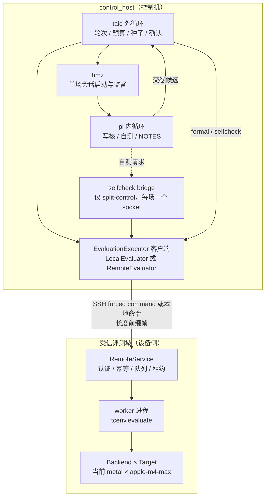
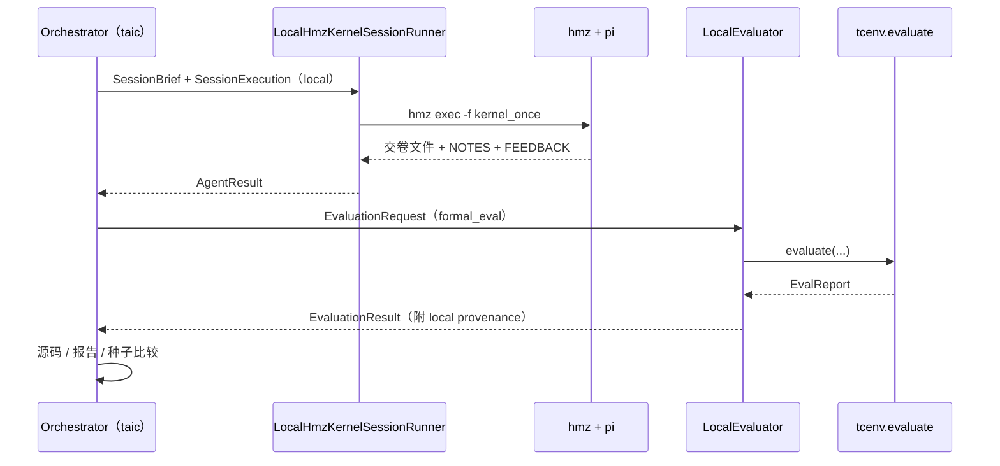
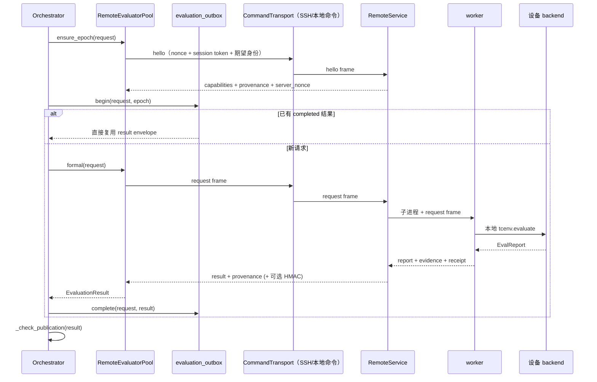
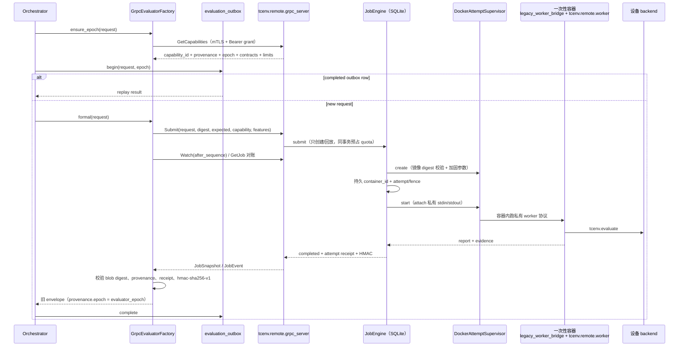
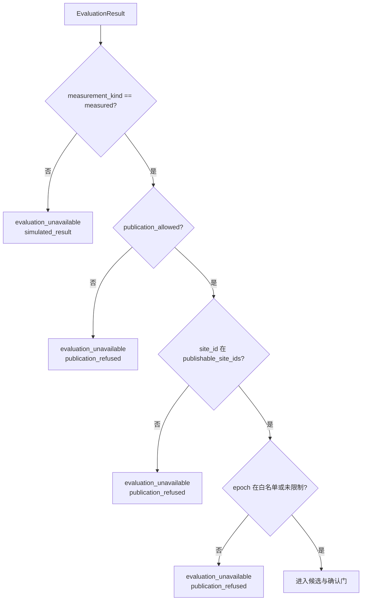
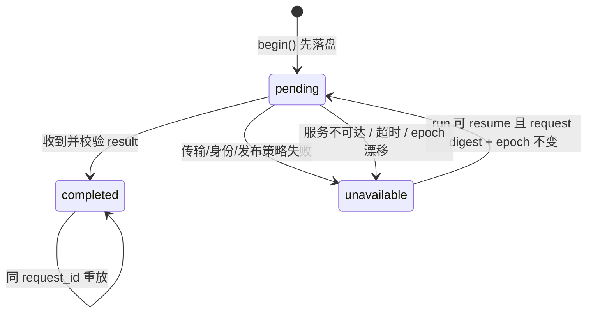
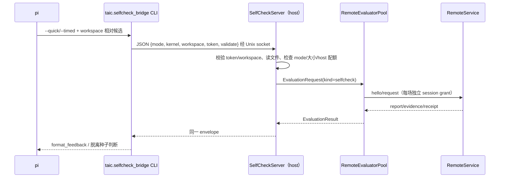
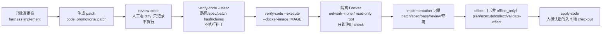
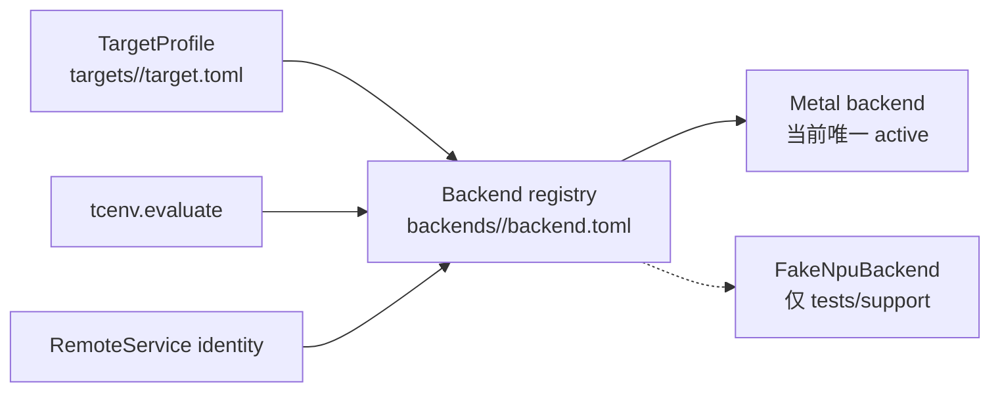

# 执行运行时与设备扩展

状态：当前实现记录（2026-10-26）。默认仍是本机 `local-integrated`；远程评测的 `legacy-ssh` 与 gRPC/TLS 代码、Phase 2C/2D1 制品、本机 Docker 2D2 模拟验收（49 项必需矩阵，含真实前一镜像回滚与容器删除后的 cleanup 证据）、P2 静态/隔离动态验收、Phase 3 的**可选 SSH workspace transport**，以及 Phase 4 的**可选隔离 agent 运行时**已落地；Phase 4 的 Docker 隔离 fake-agent 模拟已通过（`runs/remote-agent-sim-20261026/report.json`，13/13，`simulated=true`）。**生产外部评测的执行面已改为每次 attempt 一个一次性容器**（Docker Engine/containerd 管生命周期，`AttemptSupervisor` + `DockerAttemptSupervisor`），并在既有 Ubuntu ARM VM 上用 CPU-only fake backend 通过 11 项必需 check（`runs/container-sim-20261026/report.json`，`simulated=true`、`publication_allowed=false`）。真实 SSH/VM transport 验收、hmz 围栏逃逸测试、真实主机上的 `harness=env` 与真实 pi/provider 验收、真实 NPU、真实远程站点/设备发布、CRL/OCSP 网络获取、schema-breaking 降级、HA 与旧数据面删除尚未落地。Phase 3 仍只能标 transport，Phase 4 只能标模拟隔离，不能声称生产围栏或真实远端代理已验收。plain Docker + runc 只证明 cgroup/namespace 生命周期，不是不可信代码的完整安全边界；gVisor/Kata 未实现、未验收。Phase 3 的 SSH 超时问题**没有**被这次工作修复，SSH 只允许带外管理，不是评测数据面。

设计与评审过程在 [执行运行时与设备扩展-plan.md](执行运行时与设备扩展-plan.md)。那份是计划，不是当前实现说明。设备 backend/target 的独立计划见 [backend 协议与 GPU 实现计划](backend协议与GPU实现-plan.md)，Phase 2.5 的模拟验收细则见 [远程评测模拟验收计划](远程评测模拟验收-plan.md)，gRPC 对外协议见 [对外评测服务协议](对外评测服务协议.md)，部署/轮换/备份见 [远程评测部署与轮换](远程评测部署与轮换.md)。

本文回答四个问题：

1. 一次搜索里，写核会话在哪里运行，评测请求交给谁；
2. 本地与远程评测各自经过哪些接口、文件和信任检查；
3. 自测、P2 补丁、设备 backend 分别落在哪一层；
4. 当前哪些只是计划、哪些已经有代码和验收证据。

## 1. 两层循环，三个位置

系统有两层循环：

- **外循环**是 `taic`：决定轮次、委员会、预算、换种子、确认和发布。`hmz` 是外循环里的单场会话启动器，只负责启动、围栏、超时和回传费用，不是第二套搜索控制。
- **内循环**是编程代理（当前只有 `pi`）：在一场会话里读 `TASK.md`、写候选、自测、改候选、写交卷文件。它不决定搜索的下一轮。

默认只动三个位置：内循环在哪里写核、评测请求提交到哪个受信执行端、设备差异由哪个 Backend × Target 处理。



本机设备时，`RemoteService` 这一块换成本机 `LocalEvaluator`，其余搜索流程不变。远程设备时，`pi` 默认仍在 control_host；只有自测和正式评测走远程受信服务。

> 关键边界：远程评测是否可信，靠的是设备侧受信执行域，不是 `pi` 和设备的物理距离。`pi` 就近只改善自测延迟与工具可用性，不构成信任来源。

## 2. 当前支持的组合

计划里的三个命名 Profile 是设计语言；当前代码实际支持的是下面这些组合。

| 计划 Profile | 当前实现 | 入口 | 说明 |
| --- | --- | --- | --- |
| `local-integrated` | 已实现，默认 | 不传 `--remote-evaluator-config` | `LocalHmzKernelSessionRunner` + `LocalEvaluator` + 本机 `hmz`/`tcenv` |
| `split-control` | 已实现，显式选择 | `taic run --remote-evaluator-config FILE` | `pi`/workspace 仍在 control_host；新 run 用 `GrpcEvaluatorFactory`（gRPC/TLS），历史 run 保留 `RemoteEvaluatorPool`（`legacy-ssh`） |
| `device-site-colocated` | **Phase 3 transport + Phase 4 隔离 agent（均只离线/模拟验收）** | `taic run --remote-workspace-config FILE` | `harness=local` 时 agent 仍在 control_host；`harness=env` + 显式 `isolation` 时 agent CLI 在预置主机上，凭据走 scoped token seam |

另外几条边界：

- 远程评测不是 `taic.toml` 里的 `[execution]` Profile 开关。当前实现用一份独立 JSON（`--remote-evaluator-config`），并把实际执行方式写进运行目录的 `execution.json`。
- 远程 workspace 同样是可选 JSON（`--remote-workspace-config`），默认不传；不传时 `LocalHmzKernelSessionRunner` 照旧，`execution.json` 不写 `workspace` 块，agent 事件不带 `identity`。
- 远程 workspace 没有自测通道：与 `--remote-evaluator-config` 同时使用时只装 formal 评测，不装
  host self-check bridge；CLI 会明确记一行说明，而不是先建 bridge 再在会话里失败。
- Phase 3 只证明 transport 与 canonical 布局，**不证明隔离**：真实主机上的 hmz 围栏逃逸测试尚未运行（见 §3.4、§10）。`pi` 搬到设备站点是 Phase 4，尚未实现。
- 当前 active target 只有 `apple-m4-max`，backend 是 `metal`。`sim-npu` 只存在于测试 support 目录，不是可运行的 target，也不能进入发布。
- 当前没有真实 NPU、CUDA、ROCm 或第二个 target。

## 3. 一次评测的完整路径

### 3.1 本地路径



本地路径的候选源码仍由 `tcenv.worker` 子进程编译和计时；`LocalEvaluator` 只是把现有 `evaluate()` 包成统一的 `EvaluationRequest`/`EvaluationResult`，不改变 Metal 的编译、ABI、安全、差分和计时语义。

### 3.2 split-control 路径



要点：

- **先握手，再提交。** `RemoteEvaluator.connect()` 发送 `hello`，核对协议版本、client nonce、session token、site、worker build、target 和 task pack；把服务端返回的 `provenance` 固定为本次 evaluator epoch。nonce 重放、身份或 build 不匹配会拒绝连接。
- **评测控制端与设备执行端分开。** 客户端可以在 control_host，服务端在设备站点；两者之间只走结构化请求与帧流，不接受 shell、任意路径、`docker exec` 或“把报告改成 ok”。
- **设备侧计时闭合。** 服务端 worker 在设备侧调用 `tcenv.evaluate`；网络往返只发生在提交与回传，不进入 candidate 计时窗口。
- **服务端串行租约。** 当前 `RemoteService` 一次只跑一个 active job；队列按 formal 优先、selfcheck 随年龄提升（默认 60 秒后同优先级），避免一个 run 的自测被另一个 run 的 formal 永久饿死。取消会终止 worker 进程组。
- **worker 独立进程。** service 只负责认证、队列、租约和 supervisor；每个 job 起独立 `python -m tcenv.remote.worker`，stdout 只走帧，stderr 只留短诊断。service 还会把 worker 的有界 progress 快照转成 `progress` 帧，并在 worker 退出前 drain 终态。

### 3.3 gRPC/TLS split-control 路径（当前新 run）



与 `legacy-ssh` 的关键差异：

- **一个持久 job/attempt engine**：连接级 `_authenticated/_grant` 不再承载业务授权；每个 RPC 重新授权 metadata 中的 grant，Submit 只创建/回放，Retry 只对 interrupted 建新 attempt。
- **三类身份分开**：`evaluator_epoch`（测量可比性）、`api_contract_id`、`evidence_contract_id` 分别固定在 `execution.json`/outbox，结果逐项校验；TLS、grant、HMAC key 轮换不改变测量 epoch。
- **Watch 不是取消**：断流只触发重连/GetJob 对账；显式 `Cancel`、job/租约 TTL 和超时才终止 worker 进程组。
- **TLS/mTLS 直接终止在 frontend**：共享 host mTLS identity + 每 RPC session grant；host 进程每 endpoint 一个 channel；`GrpcEvaluatorFactory` 不新建每场证书，也不保留 idle/LRU 池。
- **服务端拒绝不能“悄悄放过”的输入**：任务 fingerprint 绑定 `(task,dtype,size)`；未知 Protobuf 字段、非严格 UTF-8 source、空 contract offers/缺失 expected、旧 attempt 的 Watch filter 都 fail closed；合法但未知的 grant 计入认证失败限速。
- **撤销不拖垮 frontend**：历史 HMAC key 被撤销时，受影响的 completed result 在服务端隔离并扣留，store 仍可启动；正常轮换保留旧 key 时历史结果仍可验证。receipt `issued_at` 只接受毫秒精度，亚毫秒 Timestamp 拒绝而不是截断。
- **worker 仍是私有边界**：gRPC 服务端用 `tcenv.remote.legacy_worker_bridge` 包住生产 `tcenv.remote.worker`，外部 API 不暴露 shell、路径或 `tcenv.worker` 的本地字段。

#### 3.3.1 生产执行面：每次 attempt 一个一次性容器

`JobEngine` 只通过窄接口 `AttemptSupervisor`（create/start/wait/kill/delete/status）
操作执行端；队列、幂等、quota、lease fence、结果合约和事件仍是同一个
`JobEngine`，没有第二套实现。

- **生产组合根用容器**：`python -m tcenv.remote.grpc_service` 默认
  `--worker-execution container`；frontend 进程需要 Docker Engine 访问（本机
  socket 或 `--docker-host`）和 `docker` CLI，worker 容器则永远不拿 socket。
  该模式要求 `--worker-image` +
  `--worker-image-digest`（sha256 镜像 ID），并强制
  `--worker-build` 以 `+img:<同一个 digest>` 结尾，使签名 provenance 绑定实际
  镜像。attempt 行另存 `execution_kind/container_id/name/image/runtime`。
- **生命周期顺序**：claim 先持久化 `running + attempt + lease fence +
  execution_kind` → `docker create` → 持久 `container_id` → `docker start --attach`
  → 写请求字节。create 与 attach 之间崩溃时按确定性容器名 + attempt label 回收。
  `docker create` 本身报错/超时也可能已经在 daemon 侧建出容器（caller 没有 id）：
  此时按名字 + label 清理并确认不存在才允许 Retry，清不掉就 quarantine。
- **取消与 start 的边界**：请求字节只在持久 attach 之后写；start 前在 Cancel
  RPC 同一把锁内重读持久 cancel 标记，已取消就不 start；`kill` 遇到 `created`
  容器直接强制删除（没有进程可 signal，删掉才能证明并发 `docker start` 不会让它
  跑）。`docker inspect` 报 exited 但缺 exit code 时按 supervisor 失败处理，不
  降级成候选 timeout。
- **跨 build / 跨执行面的旧队列**：容器 frontend claim 到的 queued job，若接受时
  的 `provenance.worker_build` 不带本前端固定镜像的 `+img:<digest>`，则 fail closed
  （interrupted + quarantine，不创建容器）；反过来的镜像情形也拒绝（进程 supervisor
  claim 到带 `+img:` 的 job 不执行、不签名）：既不丢 digest，也不把旧镜像/另一种
  执行面的队列签成“这个镜像跑过”。
- **加固参数**：`--init --read-only --network none --cap-drop ALL
  --security-opt no-new-privileges`、pids/memory/cpu 上限、数值非 root user、
  `/tmp` 与 `/scratch` 两个 tmpfs、无 bind mount、无 Docker socket、host 环境不
  透传、env 经 0600 env-file（create 后删除）且拒绝凭据形状键名；候选源码只走
  私有 stdin 帧，不进 Docker argv。
- **停机与残留**：timeout / Cancel / 正常退出都 Kill → Delete → verify；
  verify 认 `docker inspect` 和 `docker ps --filter label=tcenv.attempt=...`，
  不认命令退出码。容器、cgroup、重名容器、attach 客户端或 host tmp/env 任一残留
  都 fail-closed：不提交结果，job quarantined 且 Retry 被拒，人工
  `release_quarantine` 才能重试清理。Cancel 对容器同步等待 teardown；旧
  attempt/fence 的迟到结果仍被 `complete_attempt` 拒绝。
- **恢复**：前端重启先按持久 `container_id` 清理（或按名字 + label 校验）再标
  `interrupted`；清理无法验证时 quarantine，不自动重跑 running attempt。durable
  attempt 的 `execution_kind` 与当前 supervisor 不一致时 fail-closed，不猜。
- **local 不变**：`LocalEvaluator`、本地 agent、Unix-socket selfcheck bridge 和
  `ProcessAttemptSupervisor`（本地开发）保持原行为；进程模式必须显式
  `--worker-execution process --allow-process-worker`，没有静默回退。

验收与边界：`tests/shared/test_remote_container_supervisor.py`（fake Docker CLI，
真执行 worker 命令）与 `test_remote_container_engine.py` 覆盖参数、顺序、超时、
取消、残留 quarantine、崩溃重放、kind mismatch 以及上面的歧义 create / start 边界
Cancel / 跨 build 旧队列 / 无 exit code 四类 fail-closed；
`test_remote_container_docker.py`
（`TAIC_DOCKER_CONTAINER_TESTS=1`）在真实 CPU 容器上验证只读 rootfs/无 socket/无
网络/tmpfs；`runs/container-sim-20261026/report.json` 是既有 Ubuntu ARM VM 上的
真实容器验收（11/11，`simulated=true`、`publication_allowed=false`，CPU fake
backend），Cancel/崩溃都要求 worker 已在实际执行候选（`docker top` 看到子进程），
timeout 要求 cgroup/容器/进程/临时路径全部确认清理，正常结果的 HMAC 由验收端
用 signing key 独立重算。**plain Docker + runc 不是完整不可信代码安全边界**；
`--worker-runtime-profile gvisor|kata` 与 `--worker-runtime` 只是记录/透传字段，
未实现未验收，不能声称支持。该执行面与 Phase 3 的可选 SSH workspace transport
无关：SSH 只允许带外管理，不是评测数据面，Phase 3 的超时问题也没有因此修复。

### 3.4 可选 SSH workspace transport（Phase 3，transport-only）

默认路径不经过这一节。只有显式传入 `--remote-workspace-config FILE` 时，`kernel_once`
的同一个会话才把 workspace 放到一台预置的 SSH 主机上。它证明的是**文件传输与 canonical
布局**，不是隔离：主机侧 hmz 围栏是否能阻止内循环读取或改写 control_host 文件，还没有在
真实主机上跑过逃逸测试，因此当前只能标 `transport-only`。

实现分四层：

- **配置与预检**（`taic/workspace_env.py`）：配置只写 hmz 已保存的 ssh runtime 名、远端根目录
  与 `harness` 期望（`local`/`env`）。ssh 主机、用户、端口、identity 文件都留在 hmz 自己的
  `settings.yaml` 里，不进本项目的配置、manifest 或日志。启动前读取该 runtime，`harness`
  与配置不一致就拒绝，防止 Phase 3 的 `harness=local` 静默变成远端代理（或反向）。
- **受限 manifest**：staging 只接受脚本声明过的普通文件；拒绝绝对路径、`..`、符号链接、
  设备文件、逐文件与总量超限。回收同样按相对路径白名单与大小上限读取，整批回收还有累计字节
  上限；host 侧再解析一次目标是否仍在 `agent_work/<tag>` 内。所有远端路径都从配置 root 逐段
  检查，任一组件是符号链接就拒绝（会话目录、子目录、叶子文件都在内），`mkdir` 之前也先走一遍
  检查。运行时 `settings.yaml` 里保存的 workdir 必须为空或等于配置 root，否则拒绝启动，避免
  staging 一个目录而 agent 在另一个目录运行。
- **receipt 与幂等**：每条远端目录先写 `.taic/session.json`，`receipt_id` 绑定 run、session、
  runtime、远端 workdir、manifest digest 与 prompt surface digest。读取时按同一组字段重算
  digest，不信任文件里存的 id：被篡改的 receipt 是 broken receipt，不会被当成有效身份，也不会
  阻止按 marker 清理/清扫。同 receipt 重放是幂等；不同 receipt 的目录既不复用也不删除，只报
  conflict。清理前重读 receipt，受 `keep_workspace` 显式保留开关约束；该开关必须是 JSON
  boolean，`"false"` 不会被悄悄转成 true。
- **固定命令、超时与清理**：远端只执行本文件里几种固定命令（`mkdir`、原子 `cat > tmp && mv`、
  `test -f`、`wc -c`、`cat`、`rm -rf` 验证过的 session 目录），不接受 agent 传来的 shell、
  argv、环境变量或任意路径。每次调用都有超时并杀本地进程组；超时/断连/缺失文件/超大文件
  都是 typed `WorkspaceError`，不会伪装成候选编译或计时结果。

会话侧：

- `taic/flows/kernel_once` 增加一个**可选** `remote_workspace` Env 角色；不传 `-e` 时角色缺席，
  本地 run 的 argv 与 TASK 字节都不变。`hmz exec -e remote_workspace=ssh@<runtime>/<path>`
  是唯一的额外参数。
- `taic/session_runtime.py::SshWorkspaceKernelSessionRunner` 先按原渲染器写 canonical
  `agent_work/<tag>`，再 stage 同一份 manifest，调用未改写的 hmz 行，最后把
  `submit`/`NOTES.md`/`FEEDBACK.md` 与反馈点名的证据文件逐个回收写入 canonical 目录。
  `self_checks.jsonl`/`.selfcheck/` 刻意不回收：本阶段没有自测通道，远端自报的行不能进入外层
  挂死计数。`collect_session` 对 local 与 remote 是同一段代码，所以候选结构、反馈解析、
  自检计数与 `prune_work` 不会分叉。
- **本阶段不做远程自测**：TASK 由 `taic/workspace_prompt.py` 渲染成独立 profile，不打印
  control_host 路径，也不提供 `tcenv eval`/`taic-selfcheck` 命令；runner 拒绝 host bridge
  绑定。自测仍属于 Phase 2 的 `EvaluationExecutor`，transport 不转发它。该 profile 的
  TASK/skill 哈希单独记录，不与 local TASK 共用 trust 依据。
- **身份与费用**：`AgentResult.identity` 记录 receipt、runtime、远端 workdir、manifest digest、
  TASK/skill/prompt 哈希与 `env_spec`。会话结束后按 `began.workspace` + `used`/`envs` +
  可解析的开始时间从 hmz epic 取回该场费用；epic 必须恰好对应本场 session（有 hmz 流里的
  session id 时必须命中），金额必须与本报会话的费用在容差内一致。缺 epic、缺开始时间、session
  对不上或金额不一致都记 `cost_usd=None`、`cost_incomplete=true`，由外层以 `cost_incomplete`
  停下，而不是借别的会话账单。
- **运行记录**：只有远端 run 才在 `execution.json` 写 `workspace.requested/resolved`，并在
  agent transcript 事件里带 `identity`。resume 时配置缺省、`harness`/runtime/root 变化或
  `execution.json` 的 `workspace` 块与当前不同都拒绝；不允许 local ↔ remote 静默切换。

离线验收与未验收项：

- `tests/shared/test_workspace_env.py`：用本地 stand-in 执行 transport 生成的**真实固定命令**
  （不是 mock Python API），覆盖 manifest 路径/符号链接/大小上限、receipt 幂等与冲突、
  缺失文件、超限文件、超时杀进程组、清理只删自己的目录、epic 绑定。
- `tests/shared/test_workspace_remote.py`：fake transport + 固定 kernel 的端到端 runner，
  证明与 local 产生同一候选与同一 canonical 顶层布局、外层能独立评测交回的 kernel、
  timeout/crash/no-submission 的 typed 映射、清理、`cost_incomplete`、local TASK 字节 golden
  与 argv 不变；另有一条**真实 hmz** 用例证明 `-e` 角色被接受、不可达 runtime 在 agent 启动前
  fail closed（exit≠0，不写 submission，不调用 provider）。
- **未验收**：真实 SSH 主机与真实 hmz 围栏、逃逸测试、并发会话/断连后的远端清理、真实
  artifact 回收时延。本机现有 Ubuntu ARM VM 可连通但缺少其 SSH 私钥（`eval`/`kuafu`
  均 publickey denied），所以本阶段的真实 transport 验收标记为 blocked，未写入任何报告。


### 3.5 可选隔离 agent 运行时（Phase 4，离线/模拟验收）

Phase 3 只把 workspace 放到远端，`pi` 仍在 control_host。Phase 4 增加真正把 agent CLI 放到
远端主机的可选组合：`workspace.harness = "env"`，且必须同时给出显式 `isolation`。没有显式
seam 时配置加载就拒绝，不存在静默的远端代理或远端凭据。

- **放置**：hmz 的 saved ssh runtime 必须保存 `harness: env`；配置的 `harness` 与它不一致时
  启动前拒绝（Phase 3 的 `harness: local` 同理）。真实主机上的 agent CLI 安装、登录态和 hmz
  围栏仍由 operator/hmz 负责；本仓库只提供 seam 与检查。
- **短期凭据**（`taic/agent_isolation.py`）：control_host 在内存里 mint 一条绑定
  `run/session/runtime`、带 TTL 与使用次数上限的随机 token，只保存它的摘要；token 不写
  workspace、TASK、manifest、argv 或日志，`repr` 也不带。会话结束（成功、超时、崩溃、无交卷）
  都在 `finally` 里 revoke，并记录 `revoked`/`seam_closed`/`live_after_cleanup` 证据。
- **凭据 seam**：credential 的 scope 不只是记录：provider 与 seam 都用
  `run_id/session_label/runtime` 校验，A run 的 token 不能替 B run 使用。
  `loopback-fake` 是确定性的测试 provider，只在 `127.0.0.1` 上监听，要求
  Bearer token，按 token 记 usage；必须显式 `simulated=true`。它记录
  `provisioned_to_agent=false`、`agent_env=in-process-test-double`：token 只交给同进程的测试
  假 agent，**不证明**真实远端 agent 拿到了凭据，不能当作 Phase 4 远端凭据已验收的证据。
  `external-helper` 是 operator 提供的 host 命令：token 经 stdin 传入（不进 argv），
  provision/revoke 由它落盘/撤销，记录 `provisioned_to_agent=true`。helper 的实际行为是
  operator-attested；本仓库只能约束输入和清理，不能证明远端没有落下长期 key。
- **受信评测围栏**（`TrustedEvaluationFence`）：启动时把 evaluator 的候选目录、outbox、
  manifest/ledger、`tcenv`/`taic`/`tests` 与 selfcheck authority 目录和 `agent_work` 做
  包含关系检查；重叠即拒绝启动。runner 持有同一个 fence，回收写入在
  `check_relative_destination` 之后还会调用 `refuse_write`，所以收集到的工件不能落到候选目录或
  `execution.json`。**这是布局检查，不是沙箱**：它保证 runner 不会被配置到一个重叠目录，不保证
  被攻破的远端主机会守规矩。
- **放置证据**：`harness=env` 要求 epic 的 `opened.harness` 恰为 `env`；缺失也按 mismatch
  处理（hmz 对没有 machine 的 session 会省略该字段，不能拿它证明 agent 离开了 control_host）。
  `harness=local` 接受 `local` 或空（旧 epic）。不一致时 `cost_usd=null`、
  `cost_incomplete=true`，并记 `workspace_placement=harness_mismatch`，不把一场跑错位置的会话
  账单算进搜索。
- **失败与清理**：凭据 mint/provision 的任何异常（包括非 `IsolationError` 的 seam 崩溃）都在
  同一个 `finally` 里撤销 token、关闭 seam、清理目录，然后以 `credential_unavailable` 返回
  （尚未计费，不伪装成 `cost_incomplete`）；远端 crash/timeout/no-submission 继续走 Phase 3 的
  typed 映射；清理失败单独记 `cleanup_error`。远端写出的 `self_checks.jsonl` 与 `.selfcheck/`
  不回收：本阶段没有自测通道，远端自报的 timeout/crash 行不能推动外层挂死熔断。run 结束时按
  run token 列出 receipt，只删除本 run、且 label 不再活跃的会话目录（含 receipt 损坏的目录）；
  `keep_workspace` 会关闭这个清扫。
- **没有生成报告**：本阶段没有真实主机可跑，因此没有写任何 `simulated` 集成报告，也不碰
  confirmed/catalog/brief、`run_config.json` 或既有 grpc-sim/npu-sim 报告。

离线验收（`tests/shared/test_agent_isolation.py`）：token 的 TTL/使用上限/撤销/不落盘；
loopback provider 的鉴权与 usage；external helper 的 stdin 传 token、revoke、失败与超时；
seam 选择必须显式且 simulated 与真实 seam 不能混淆；fence 的重叠拒绝与写入拒绝；
`harness=env` + scoped token 的 runner 端到端（假 transport + 固定 kernel，agent 实际调用
loopback provider）、harness 不一致的 `cost_incomplete`、crash/timeout 的撤销与清理、
凭据失败不启动 agent、orchestrator 记录 isolation 与拒绝无 seam 的 env 配置；真实 transport
的 orphan 清扫只删本 run 的非活跃 label。

**Docker 隔离模拟（2026-10-26，已通过）：** `tests/support/agent_sim/` 在 Docker Desktop 的
Ubuntu 24.04 容器里预置 sshd + Python 3.12 + 一个确定性 fake ACP agent；runner 用**真实 SSH
transport** stage/collect，用 `harness=env` 让 fake agent 在容器内运行，host 侧 helper 经
`docker exec` 把短期 scoped token 写进容器，agent 再用它调用 control-host fake provider
（`host.docker.internal`）并写固定 kernel。13 项必需 check 全部通过：镜像、SSH、容器内运行、
凭据交付、provider 200、submission 回收、canonical 布局、epic `harness=env`、token 撤销、
credential 文件删除、远端目录清理、无遗留容器、fake agent 的 `cost_incomplete`。报告保持
`simulated=true`、`publication_allowed=false`，不是搜索 run，不写 `run_config.json`，不进入
confirmed/catalog/brief。**边界**：该 fixture 的 flow 把 `online` 放宽为 `ALL` 以便 fake agent
访问 provider；生产 `kernel_once` 仍是 `online=NONE`，所以这次不证明生产网络围栏；真实 pi CLI、
真实 provider、真实 Ubuntu VM 与 hmz 围栏逃逸仍未验收。复现：
`TAIC_DOCKER_AGENT_SIM=1 uv run pytest -q -n 0 tests/shared/test_agent_sim_docker.py` 或
`uv run python -m tests.support.agent_sim.runner --report runs/remote-agent-sim-<date>/report.json`。

**仍未验收**：真实主机上的 `harness=env`、真实 pi CLI 与真实 provider/helper、远端进程/围栏
逃逸、真实 crash/orphan 清理。本机 Ubuntu ARM VM 可达但缺 SSH 私钥，因此这些标记为 blocked。


## 4. 接口与字段

### 4.1 会话侧

`taic/session_runtime.py` 定义：

| 类型 | 作用 |
| --- | --- |
| `HmzSessionPlacement` | `agent_kind`、`harness_placement`、`workspace_env`、`endpoint`、`image_digest`；当前只允许 `pi` + local + local |
| `SessionPaths` | `host_work`（canonical `agent_work/<tag>`）与 agent 看到的路径；local 时两者相同 |
| `SelfCheckBinding` | `mode`（已支持 `local_cli`/`host_bridge`；`direct_client` 未实现）、`endpoint_id`、`token_ref` |
| `SessionExecution` | 价格、主回合 token/分钟、单场费用上限、hmz 路径、墙钟兜底、自测绑定 |
| `HmzKernelSessionRunner` | `execute(brief, execution=..., provider, model, effort) -> AgentResult` |
| `LocalHmzKernelSessionRunner` | 默认 runner，包装现有 `run_kernel_agent`；非 local 直接报错，不静默回退 |
| `SshWorkspaceKernelSessionRunner` | 可选 Phase 3/4 runner：同一 `SessionBrief`，workspace 物化到预置 SSH 主机，回收后仍写 canonical `agent_work/<tag>`；`harness=env` 时 mint scoped token、经 seam 交给远端 agent，结束撤销；不新增评测器、不改 local TASK 字节 |

`SessionBrief` 仍是唯一的会话内容模型；`SessionExecution` 只装执行参数，不复制任务、历史、guidance 或 TASK 内容。当前 `LocalHmzKernelSessionRunner` 会校验 `SelfCheckBinding`：`local_cli` 要求 brief 不带 bridge 字段；`host_bridge` 要求 `endpoint_id`/`token_ref` 与 brief 的 socket/token 完全一致；`direct_client` 尚未实现，会被拒绝。

### 4.2 评测侧

`tcenv/evaluation.py` 是本地与远程共用的类型层；`taic/evaluation.py` 只是兼容 re-export。

`EvaluationRequest` 的线上字段：

| 组 | 字段 | 说明 |
| --- | --- | --- |
| 身份 | `kind`、`request_id`、`run_id`、`session_id` | `kind` 是 `formal_eval` 或 `selfcheck`；`request_id` 是幂等键 |
| 题目 | `task`、`dtype`、`size`、`target_id`、`task_fingerprint` | 服务端核对 `task_fingerprint` 在其登记集合中；当前不重算任务包，`task_pack_digest` 由部署提供并进入 epoch |
| 候选 | `source`、`candidate_sha256` | 摘要按实际发送、实际编译的字节计算，不做规范化 |
| 模式 | `mode`、`seed`、`reps`、`cases` | formal：`quick`/`full`（顶层 `validate` 在 schema 里预留，当前 LocalEvaluator 与 RemoteService 都拒绝；`full` 内部会跑校验）；selfcheck：`quick`/`timed` |
| 超时与缓存 | `queue_timeout_s`、`candidate_timeout_s`、`cache_policy` | `cache_policy` 为 `reuse`/`refresh`/`disabled` |
| 行为开关 | `fast_bench`、`require_contract_launch`、`validate`、`measure_serial` | 与现有 `tcenv.evaluate` 一致 |

`workdir`、`progress_path`、`self_check_dir`、`timeout`、`eval_cache`、`eval_cache_refresh` 是本地专用字段，**不进入线上请求**，也不参与 request digest。远程服务自己创建临时路径。

`EvaluatorProvenance` 记录执行端身份：

| 字段 | 含义 |
| --- | --- |
| `site_id` / `device_id` | 不透明站点与设备标识；不是 vm/docker/passthrough 类型 |
| `backend` / `backend_version` / `target_id` | 评测构建与目标 |
| `worker_build` / `task_pack_digest` / `calibration_digest` | 评测代码、任务包、标定摘要 |
| `protocol_version` / `epoch` | 协议版本与上述字段合成的 epoch |
| `request_digest` | 请求摘要；hello 时为空，result 时必填 |
| `measurement_kind` | `measured` 或 `simulated` |
| `publication_allowed` | 评测端自报的发布许可；只是第二道校验，host allowlist 才是许可 |

`EvaluationResult` 是报告外层信封：`report + provenance + evidence + receipt + signature`。`EvalReport` 本体不塞传输证明；签名放在外层，可选 HMAC-SHA256；`receipt` 绑定 `request_id`、`request_digest`、候选摘要和 `measurement_kind`。

### 4.3 远程配置

`RemoteEvaluationConfig` 从 JSON 读取；未知字段拒绝。主要字段：

| 字段 | 说明 |
| --- | --- |
| `transport` | `legacy-ssh`（默认，仅历史 resume）或 `grpc`（新 run） |
| `command` | `legacy-ssh` 的 argv 列表；支持 `{run_id}`、`{session_id}`、`{target_id}`、`{evaluation_kind}` 占位符。formal/selfcheck 两个 legacy frontend 的 SQLite 状态路径必须含 `{evaluation_kind}`，否则第二个进程会被单写者锁拒绝 |
| `endpoint` / `tls_server_name` | gRPC host:port 与期望 SAN/hostname；不含凭据 |
| `ca_file` / `client_certificate_file` / `client_private_key_file` | gRPC TLS/mTLS 材料；client 证书与私钥必须成对，文件 0600 |
| `signature_keyring_file` | gRPC host HMAC verifier keyring；可发布结果必填 |
| `api_contract_ids` / `evidence_contract_ids` / `required_features` | gRPC 握手协商；默认当前 v1 合约与 `durable-jobs/attempt-receipts/progress` |
| `rpc_timeout_s` / `watch_slice_s` / `job_margin_s` | 单次 RPC、Watch 切片与队列+候选+收尾余量；deadline 不进 request digest |
| `expected_device_id` / `expected_epoch` | gRPC 期望身份；epoch 可从 `execution.json`/outbox 传递 |
| `token_file` | formal session grant token 文件；可模板化（每次 RPC 重新读取，续期 token 可接回原 job） |
| `selfcheck_token_file` | 独立的 selfcheck grant 文件；远程自测必填，缺失时拒绝，不回退到 formal evaluator |
| `signature_key_file` | `legacy-ssh` 旧 envelope 的可选 HMAC 密钥；gRPC 用 `signature_keyring_file` |
| `target_id` / `task_fingerprint` | 必须与本次任务一致 |
| `expected_site_id` / `expected_worker_build` / `expected_task_pack_digest` | 握手时期望值 |
| `publishable_site_ids` | 必填且非空，否则 `taic run` 拒绝启动远程评测 |
| `publishable_epochs` | local 可为 `null`；remote 必须显式非空并包含当前 epoch，`null` 与 `[]` 均拒绝，resume 也拒绝缺少显式 epoch 的 remote run |
| `idle_timeout_s` / `max_clients` | 连接池空闲超时和最大连接数；只做 idle/LRU 回收，活跃请求不被关闭 |
| `socket_root` / `selfcheck_*` / `timeout_s` | 自测 socket、配额与传输超时 |

运行目录的 `execution.json` 记录实际执行方式：

```json
{
  "schema_version": 1,
  "evaluation": "remote",
  "transport": "grpc",
  "api_contract_id": "tcenv.remote.v1.evaluator-api.1",
  "evidence_contract_id": "tcenv.remote.v1.evidence.1",
  "request_digest_algorithm": "sha256-rfc8785-v1",
  "result_signature_algorithm": "hmac-sha256-v1",
  "result_signature_key_ids": ["npu-node-01/key-1"],
  "publishable_site_ids": ["npu-node-01"],
  "publishable_epochs": ["..."],
  "observed": {
    "transport": "grpc",
    "api_contract_id": "tcenv.remote.v1.evaluator-api.1",
    "evidence_contract_id": "tcenv.remote.v1.evidence.1",
    "epoch": "...",
    "site_id": "local",
    "device_id": "apple-m4-max",
    "backend": "metal",
    "backend_version": "1",
    "target_id": "apple-m4-max",
    "worker_build": "",
    "task_pack_digest": "",
    "calibration_digest": "",
    "protocol_version": "3",
    "measurement_kind": "measured",
    "publication_allowed": true
  }
}
```

`observed` 在远程首次 hello/`ensure_epoch` 成功后、outbox `begin()` 之前写入（本地在首个结果后写入）；之后同一 run 的每次结果必须与它一致，否则 `epoch_drift`。`taic resume` 对远程 run 必须再次提供 `--remote-evaluator-config`，并在任何模型或 GPU 工作之前检查 `execution.json` 的 evaluation 模式、site/epoch allowlist，以及配置中已给的 expected site/worker build/task pack 与 observed 是否一致；完整 observed identity 的漂移由下一次评测路径继续校验。

## 5. 发布门、缓存与续跑

### 5.1 发布门

`_check_publication` 在评测结果成为候选之前按顺序检查：



本地评测的 provenance 固定为 `site_id=local`、`measurement_kind=measured`、`publication_allowed=true`；host 默认只登记 `local`。远程评测必须显式配置非空 `publishable_site_ids`，否则启动就拒绝，不能先跑再补许可。

### 5.2 缓存

- 本地 `tcenv.evaluate` 的评测缓存键包含 task fingerprint、`evaluation_fingerprint`、backend/backend_version、target、协议、源码哈希、seed、reps、cases、模式和启动开关。`evaluation_fingerprint` 覆盖输入生成、参考实现、误差缩放与基线可执行身份。它只服务本地评测。
- 远端评测结果不写入宿主侧的本地评测缓存；宿主把结果放在 `evaluation_outbox/`。远端服务自己的 worker 可以使用服务端本地的 `tcenv` 缓存，缓存目录随服务部署隔离。
- `cache_policy=disabled` 用于确认阶段，服务端不能把它降级成复用。
- `fast_bench` 的最快基线缓存按 `target_id` 区分；远端 site/device/build 的隔离由服务部署和 evaluator epoch 负责，不把某个站点的基线名跨站点复用。

### 5.3 outbox 与基础设施故障

远程正式请求在发送前写入 `runs/<run>/evaluation_outbox/`：

| 文件 | 内容 |
| --- | --- |
| `<hash>.json` | `request_id`、`request_digest`、`candidate_sha256`、`evaluator_epoch`、`transport`、`api_contract_id`、`evidence_contract_id`、`status`（`pending`/`completed`/`unavailable`）、`report_path`、错误码与可重试标记；完成后记录 `attempt_id` 与 `signature_key_id` |
| `<hash>.result.json` | 完整 `EvaluationResult` 信封 |
| `receipts.json` | `receipt_id -> request_digest`，用于按 receipt 去重 |

状态流：



`EvaluationUnavailable` 是基础设施或策略结果，不是候选的 `compile_error`/`incorrect`/`timeout`/`crash`。它会让 run 以 `stop_reason=evaluation_unavailable` 停下，不计入 `hangs`、`crashes_in_a_row` 或 `agent_failures`，也不把下一场交给另一个委员会。`pending`/`unavailable` 行会出现在 `taic brief` 和运行详情的 `pending_evaluation` 字段里；它不是第二份 `EvalReport`。

同一个 label 和 request digest 会得到确定性 `request_id`；**如果 run 本身符合 resume 资格**，重走同一评测时 outbox 的 `begin()` 可以返回已完成的 result，或在 digest/epoch 不变时用同一 id 重新提交。服务端也会在启动 job 前持久化幂等记录：已完成的同 id 同 digest 直接回放，不再占设备；只有服务端标记为可重试的失败才允许同 id 重跑。同 id 不同 body 会被拒绝。

当前 `evaluation_unavailable` 正常收尾后 `inspect_run` 视为 finished，CLI 不会直接续跑；只有预算耗尽/中断等本来就可 resume 的 run 才会重新进入 outbox 路径。

gRPC run 的 outbox 还固定 transport 与两个合约身份；resume 时三者任一变化都停下。只有持久 `pending`/`unavailable` 行会驱动显式 `Retry`（`formal_resume`/`selfcheck_resume`）：Submit 本身仍然只创建/回放，不会因为 Watch 断流或 RPC 超时自动重试。completed outbox 结果重放时还要按当前外部 HMAC keyring 检查 receipt 的 `signature_key_id`；key 已撤销则拒绝发布并保留原结果，只写 `signature_key_revoked` 诊断。

## 6. 自测

自测属于内循环工具，不属于外循环判卷。正式评测与自测共用 `EvaluationExecutor` 的传输、认证和租约，但结果类型、模式白名单和配额分开。

### 6.1 本地自测

`local-integrated` 继续使用现有命令：

```bash
uv run --directory <repo> python -m tcenv.cli eval <task> <workspace>/<submission>.metal \
  --quick|--timed --target apple-m4-max
```

`TASK.md` 仍保持现有字节；`timed` 命令带 `--self-check-dir .selfcheck`，日志写入工作区，同时写 host 权威记录 `~/.cache/taic-selfcheck-state/<hash>/self_checks.jsonl`（账户 home 由 passwd 解析，不信任 agent 可改的 `HOME`/`XDG_CACHE_HOME`）。本地配额仍是 20 次 timed、累计 120 秒 GPU；超时/崩溃会阻止同一目录继续 timed 自测。

### 6.2 split-control 自测

`--remote-evaluator-config` 会为每一场创建一个 `SelfCheckServer`，并把 `TASK.md` 里的自测命令换成：

```bash
TAIC_SELFCHECK_SOCKET=<host-owned.sock> TAIC_SELFCHECK_TOKEN=<short-lived-token> \
uv run --directory <repo> python -m taic.selfcheck_bridge \
  --workspace <workspace> --kernel <submission>.metal --quick|--timed
```

socket 与 token 由 hmz 的会话环境注入，不写进 argv 或 `TASK.md`。bridge 默认根目录是 `${XDG_CACHE_HOME:-~/.cache}/taic-selfcheck`（`socket_root` 可覆盖），token 文件是 `<socket 名>.token`（0600），不在 agent 可写工作区；`kernel_agent` 读取后只把本场 token 通过 `TAIC_SELFCHECK_TOKEN` 传给子进程，并清掉上一场遗留的同名变量。



- 任务、target、reps、cases、配额、超时都由 host 的 `SelfCheckConfig` 决定；agent 只能给模式、workspace 相对 kernel 和可选的 timed `--validate`，不能改大配额。host 自己读候选文件并做 symlink/越界检查，`source` 只是兼容 API。
- socket 在 host-owned 的 `${XDG_CACHE_HOME:-~/.cache}/taic-selfcheck/`（目录 0700、socket 0600），每场独立；短期 token 文件是 `<socket 名>.token`（0600），由 `kernel_agent` 通过 `TAIC_SELFCHECK_TOKEN` 环境传给会话，不写进 argv 或 `TASK.md`。
- 服务端 selfcheck 也执行自己的 20 次/120 秒配额，并绑定 run/session/target；`evaluation_unavailable` 以非零退出返回，不计入自测次数，不写权威证据。
- timed 结果会由 host 写入 `.selfcheck/self_checks.jsonl`，并同步到 host 权威日志，带 `request_id`/`request_digest`/`receipt_id`；quick 和基础设施错误不写。只要 status/target/protocol/kernel SHA/测量值匹配，这些记录可以作为 `premise` 证据，外层候选报告也仍然可用。**仍缺的是 `tool_probe` 执行证据**；若要求 probe 本身有受信执行回执，当前协议未实现。

## 7. P2 补丁：静态验收与隔离动态验收

P2 现在分成四步，命令都在 `taic harness` 下：



| 阶段 | 命令 | 是否执行补丁代码 | 记录 |
| --- | --- | --- | --- |
| 人工审阅 | `harness review-code RUN --key KEY --by HUMAN` | 否 | `code_promotions/<key>.review.json`，绑定 patch/spec/base 摘要 |
| 静态验收 | `harness verify-code RUN --key KEY --static` | 否 | `code_promotions/<key>.implementation.json`，`static_verified=true` |
| 隔离动态 | `harness verify-code RUN --key KEY --execute --by HUMAN --docker-image IMAGE` | 是，只在隔离容器 | 绑定人工审阅、environment identity、注册 check 结果 |
| 本地应用 | `harness apply-code ... --confirm` | 走本地 worktree 测试后写入；非 `offline_only` 默认还要 effect 记录 | 原有 P2 apply 记录 |

`apply-code` 默认还有 implementation/effect 门：要求 implementation 记录 `accepted`+`host_verified` 且有 host checks；风险级别不是 `offline_only` 时，默认要求同 spec/patch 的 effect 记录（`plan-experiment` → `execute-experiment` → `collect-experiment` → `validate-effect`）且结论为 `supports_effect`。`--legacy-unvalidated` 只豁免 effect 验证，不跳过 implementation 验收。

`verify-code --execute` 要求：

- 已存在 `review-code`，且 `patch_sha256`、`spec_sha256`、`base_commit` 与当前完全一致；patch/spec/base 任一变化，旧批准失效。
- `--by` 必须与 `review-code` 记录的人一致，且不能是 `cli`。
- 必须提供 `--docker-image`；runner 的 `isolated` 必须为真。
- 容器：`--network none`、`--read-only`、`--cap-drop ALL`、`--no-new-privileges`、pids/memory 限制、非 root（默认当前 uid/gid）；源码快照可写，patch/request 与 harness 只读，`/tmp` 是 noexec tmpfs；不挂 host HOME、provider key、Docker socket 或主仓库 `.git`。
- 只运行 host 注册的 `check_id`，不接受 agent 提供的命令；check 定义和 `isolated_patch_worker.py` 来自只读 harness 快照。
- 结果要求 `network=none` 且 `read_only_root=true`，否则拒绝记录。

**范围限制（必须明说）：** 当前 `harness implement` 生成 patch 的 `code_patch` 会话仍使用 `LocalEnv`，属于受信开发路径。现在的安全承诺是“未人工审阅的 patch 不经过 `verify-code --execute` 执行”，不是“整个 P2 生成阶段零执行”。若要把生成阶段也隔离，需要另开全链路隔离阶段。

## 8. Backend、target 与模拟设备

设备差异由 `Backend × Target` 处理后端边界：



当前事实：

- `targets/apple-m4-max/target.toml` 是唯一 `status=active` 的 target；backend 为 `metal`，语言 MSL，文件扩展 `.metal`。
- `targets/_template` 与 `backends/_template` 只是模板，不能运行。
- `tcenv/backends/base.py` 定义 `Backend` 协议和 `Capabilities`；`tcenv/backends/registry.py` 只接受 `backends/<id>/backend.toml` 中位于 `tcenv.backends.*` 的入口。
- `TargetProfile` 携带 backend、语言、扩展名、设备匹配规则、硬上限、skills/wiki/device.md/experience.md 路径。
- `sim-npu` / `FakeNpuBackend` 在 `tests/support/npu_sim/`，只由测试 composition root 注入。它不 import Metal、不要求 `kernel void` 或 GPU threadgroup limits，报告标记 `simulated=true`、`publication_allowed=false`。生产入口 `python -m tcenv.remote.service` 默认只启动 `tcenv.remote.worker`，不包含 sim 适配器；`--worker-module` 是受信部署参数，部署方不能把它指向测试模块。
- 仍有的 Metal 绑定：`Task.reference_for("metal")` 参与 `task_fingerprint`，`Contract` 仍是 MSL 形状。backend-neutral cleanup 与未来 NPU 是独立计划，不在本文声称已完成。

模拟验收的目标不是 NPU，而是“远程受信评测服务在真实进程/传输边界上是否可行”。当前证据在 `runs/npu-sim-20261024/report.json`：

| 字段 | 值 |
| --- | --- |
| `coverage` | `extended_split_control` |
| `split_control` | `true` |
| `container_only` | `false` |
| `simulated` | `true` |
| `publication_allowed` | `false` |
| `status` | `passed` |
| `results` | 41 项，全部通过 |

环境是 macOS 控制面 → SSH forced command → Linux Ubuntu 22.04 ARM64 VM → Docker（`taic-remote-sim:local`）。它验证了 hello/formal/selfcheck、幂等与同 id 不同 body 拒绝、帧拆包/合包、Unicode/大源码、shell/`docker exec` 注入拒绝、传输超时与无孤儿、服务重启恢复、多 run aging 等；**没有**真实 NPU/GPU/模型，也不能产生性能或发布结论。报告的 `not_run` 明确记录 `real_npu`、`real_gpu`、`paid_model`、`npu_sdk_installation` 均未运行。

## 9. 运行产物与看板

| 路径 | 内容 |
| --- | --- |
| `execution.json` | 执行方式、发布 site/epoch allowlist、第一次观测到的 evaluator identity |
| `evaluation_outbox/<hash>.json` | 远程正式请求的 pending/completed/unavailable 状态 |
| `evaluation_outbox/<hash>.result.json` | 远程结果信封 |
| `evaluation_outbox/receipts.json` | receipt 去重索引 |
| `agent_work/<label>/.selfcheck/` | 本地自测日志；split-control 的 bridge 会把 timed 记录写到这里并同步 host 权威日志 |
| `selfcheck_usage/<hash>.json` | bridge 的 host 侧次数/GPU 秒/hang 记录（run 目录下） |
| `selfcheck_usage/<hash>.seed.json` | host 冻结的种子报告；用于 replacement verdict，避免 agent 改写工作区 `report.json` |
| `code_promotions/<key>.patch` | P2 生成的补丁 |
| `code_promotions/<key>.review.json` | 人工 diff 审阅记录 |
| `code_promotions/<key>.implementation.json` | 静态/隔离动态验收记录 |
| `data/review_events.jsonl` | 全局复核事件哈希链账本 |
| `runs/npu-sim-<日期>/report.json` | `legacy-ssh` Phase 2.5 模拟验收诊断 artifact；不是搜索 run，不写 `run_config.json` |
| `runs/grpc-sim-<日期>/report.json` | gRPC/TLS Docker 模拟验收诊断 artifact；`simulated=true`、`publication_allowed=false`，不是搜索 run，不写 `run_config.json`，不覆盖 `runs/npu-sim-*` |

`taic brief` 和运行详情的 JSON 暴露 `pending_evaluation`（计数与最近请求的错误码/是否可重试）；看板不在候选表里把 pending 当成候选成绩。`execution.json` 的 `observed` 是运行事实，不是用户配置；用户配置里的期望值不能冒充观测值。

## 10. 验收与剩余边界

| 阶段 | 状态 | 证据 |
| --- | --- | --- |
| Phase 0a：local session runner 抽取 | 已实现 | `taic/session_runtime.py`、`test_session_runtime.py` |
| Phase 0b：`EvaluationRequest/Result` + `LocalEvaluator` | 已实现 | `tcenv/evaluation.py`、`test_evaluation.py` |
| Phase 1a：P2 static | 已实现 | `verify-code --static`、`test_code_agent.py` |
| Phase 1b：P2 isolated dynamic | 已实现 | `DockerPatchTestRunner`、`test_docker_integration.py` |
| Phase 2A：远程服务端 + 子进程管道 | 已实现 | `tcenv/remote/{protocol,service,worker}.py`、`test_remote_service.py` |
| Phase 2B：RemoteEvaluator + selfcheck bridge + outbox | 已实现 | `tcenv/remote/client.py`、`taic/selfcheck_bridge.py`、`taic/evaluation_outbox.py` |
| Phase 2.5：SSH/VM/Docker 模拟验收 | 已实现（legacy-ssh） | `runs/npu-sim-20261024/report.json`，41/41 |
| Phase 2C1：proto/descriptor/canonical golden | 已实现 | `proto/tcenv/remote/v1/`、`tcenv/remote/contracts.py`、`test_remote_grpc_contract.py`、`test_remote_evidence_contract.py` |
| Phase 2C2：持久 job/attempt engine | 已实现 | `tcenv/remote/job_store.py`、`job_engine.py`、`test_remote_job_engine.py`、`test_remote_job_recovery.py` |
| Phase 2C3：gRPC/TLS adapter + factory | 已实现 | `grpc_contract.py`、`grpc_server.py`、`grpc_client.py`、`test_remote_grpc_adapter.py`、`test_remote_grpc_tls.py` |
| Phase 2D1：制品、工具、Python/Go conformance | 已实现 | `deploy/remote-evaluator/`、`scripts/remote_evaluator_{admin,client}.py`、`state_admin.py`、`test_remote_admin.py`、`test_remote_{,go_}conformance.py` |
| Phase 2D2：本机 Docker gRPC/TLS 模拟 | 已实现（**模拟基线**） | `runs/grpc-sim-20261025/report.json`，49/49 必需 check；`status=passed` 需 cleanup final；Docker Desktop Linux VM，fake backend。这是模拟基线，不是生产验收 |
| 生产执行面：每次 attempt 一个一次性容器 | 已实现；CPU-only 真实 VM 验收通过 | `tcenv/remote/{supervisor,container_supervisor}.py`、`tcenv/remote/grpc_service.py`（默认 `--worker-execution container`）、schema v2、`test_remote_container_{supervisor,engine,docker}.py`、`runs/container-sim-20261026/report.json`（11/11，`simulated=true`、`publication_allowed=false`）；plain Docker/runc，gVisor/Kata 未实现 |
| Phase 3：可选 SSH workspace transport | 已实现（离线；transport-only） | `taic/workspace_env.py`、`taic/workspace_prompt.py`、`SshWorkspaceKernelSessionRunner`、`test_workspace_env.py`、`test_workspace_remote.py`；真实主机/围栏验收 blocked（缺 SSH 私钥） |
| Phase 4：隔离 agent（scoped 凭据 + seam + 围栏） | 已实现（Docker 隔离 fake-agent 模拟通过；模拟） | `taic/agent_isolation.py`、`harness=env` runner、`tests/support/agent_sim/`、`test_agent_isolation.py`、`runs/remote-agent-sim-20261026/report.json`（13/13，`simulated=true`）；真实 pi/provider/VM/围栏 blocked |
| 真实 NPU / 真实远程站点发布 | 未实现 | 只有 sim-npu/local metal；真实站点、真实设备、CRL/OCSP、HA 未验收 |

仍然不能说的话：

- 不能把模拟报告、`sim-npu` 数字或控制面延迟写成 NPU/GPU 性能或发布加速比。
- 不能因为 `split-control` 通过本机 Docker 模拟验收，就声称真实远程站点已经可用于生产；真实站点还需要设备侧受信服务、真实网络、mTLS 证书签发/撤销与人为登记的 site/epoch allowlist。Docker Desktop Linux VM 不等于用户自管 Ubuntu VM + SSH 链路。
- 不能声称 exactly-once、CRL/OCSP 撤销、多副本/HA 或 `legacy-ssh` 数据面已删除；这些仍未验收/未执行。
- 不能把 `local` 当安全边界；它只适合受信开发环境。
- 不能把 Phase 3 的 SSH workspace 写成隔离：它只证明 transport、receipt、canonical 布局与 fail-closed；
  hmz 围栏逃逸测试与真实主机验收还没做，远端自测也没有开放。
- 不能把 Phase 4 的 isolation 写成已验证隔离：scoped token、seam、`opened.harness` 绑定与 fence 都是
  配置/记录层面的证据；真实 `harness=env`、外部 helper 和远端进程逃逸没有跑过，也没有生成模拟报告。
- 不能把 P2 的 `verify-code --execute` 隔离外推到 `code_patch` 生成阶段；后者仍可能执行未审阅代码。
- 不能把评测端的 `publication_allowed` 当成发布许可；host allowlist 才是。
- 不能把容器执行面写成完整的不可信代码安全边界：plain Docker + runc 只提供
  cgroup/namespace 生命周期与本次加固参数；gVisor（`runsc`）与 Kata 只有配置字段，
  没有实现、没有部署、没有验收。worker 节点仍需按受信评测域维护。
- 不能把 `runs/grpc-sim-20261025` 的 49/49 或 `runs/container-sim-20261026` 的
  11/11 写成真实设备/生产验收：前者是 Docker Desktop 模拟基线，后者是既有 Ubuntu
  ARM VM 上的 CPU fake backend 容器生命周期验收；两者都不产生 GPU/NPU 性能或
  发布结论。
- 不能把 Phase 3 的 SSH workspace transport 与容器执行面混为一谈：SSH 只用于带外
  管理，不是生产评测数据面；Phase 3 的 SSH 超时问题也没有被容器执行面修复。
- 远程 selfcheck 的 timed 记录可以写权威日志并参与 `premise`；但仍没有 `tool_probe` 执行证据。不要把“有 selfcheck 记录”等同于“probe 本身被受信执行端执行过”。

## 11. 怎样核对

| 想确认什么 | 看哪里 |
| --- | --- |
| 本地搜索是否仍走旧路径 | `execution.json` 的 `evaluation=local`、`session_runtime.py` 的 local runner、`run_config.json` |
| 某次 run 是否用了远端 workspace | `execution.json` 的 `workspace.requested/resolved`；agent 事件的 `identity`；`--remote-workspace-config` 是否在启动命令里 |
| 远端 workspace 的会话边界 | `identity.workspace.workdir/runtime`、`identity.prompt.task_sha256`、`identity.epic`、`identity.cleaned`；对不上费用时 `cost_usd=null` + `cost_incomplete=true` |
| 隔离 agent 用了哪种凭据与位置 | `execution.json` 的 `workspace.resolved.isolation`；`identity.credential`（无 token）；`identity.harness_recorded`；`workspace_placement=harness_mismatch` |
| Docker 隔离 fake-agent 模拟做了什么 | `runs/remote-agent-sim-20261026/report.json` 的 `results`、`environment`、`not_run`；`tests/support/agent_sim/` |
| 远程评测是否真的走到设备侧 | `execution.json` 的 `evaluation=remote` 与 `observed`；`evaluation_outbox/` 的 result；服务端 state 目录 |
| 某次 attempt 用了哪种执行面 | `python -m tcenv.remote.state_admin inspect --state-dir ...` 的 attempt `execution_kind/container_id/container_image_digest/container_runtime`；结果 `provenance.worker_build` 的 `+img:<digest>` |
| 容器执行面验收做了什么 | `runs/container-sim-20261026/report.json` 的 `checks`、`environment`、`cleanup`、`extra`；`tests/support/npu_sim/container_sim_runner.py` |
| 容器超时/取消是否真的清掉 worker | 同一 report 的 `checks[*].evidence`：`container_state_after`、`cgroup_after`、`survivor_processes`、`survivor_attach_clients`、`temp_files`；以及 `final-cleanup.json` |
| 某次失败是候选还是基础设施 | `candidates/*/report.json` 有候选判决；`evaluation_outbox/*.json` 的 `status=unavailable` 与 error code；`result.json.stop_reason` |
| 远程模拟验收做了什么 | `runs/npu-sim-20261024/report.json`（legacy-ssh）与 `runs/grpc-sim-20261025/report.json`（gRPC/TLS）的 `results`、`environment`、`not_run` |
| gRPC adapter 是否只复用一份业务核心 | `tcenv/remote/grpc_server.py` 只调用 `JobEngine`；`grpc_client.py` 只做映射/验签；legacy `service.py` 同样调用 `JobEngine` |
| P2 是否真的执行过补丁 | `code_promotions/<key>.implementation.json` 的 `static_verified`/`host_verified`/`runner`/`tests_run` |

不需要 GPU、模型或付费的核对命令：

```bash
uv run pytest -q -m 'not gpu and not llm'
uv run python -m taic.cli brief RUN_DIR
```

`--remote-evaluator-config` 只是启动参数，不是发布许可；远程结果是否可发布看 `execution.json` 的 allowlist 与每次结果的 provenance。

## 12. 和计划文档的差别

这份实现与 `执行运行时与设备扩展-plan.md` 的设计稿有几处刻意保留的差异；读计划时不要把下面这些当成已实现：

| 计划写法 | 当前实现 |
| --- | --- |
| `[execution]`/`[agent]`/`[workspace]`/`[evaluation]` TOML Profile | 独立 JSON `--remote-evaluator-config` + `execution.json`；没有三 Profile 配置解析器 |
| `HmzKernelSessionRunner` 支持 remote workspace / colocated | `LocalHmzKernelSessionRunner` 仍是默认且只接受 local；`SshWorkspaceKernelSessionRunner` 是可选的 transport/隔离 agent；真实主机尚未验收 |
| provider 反向代理 / 隧道 | 只实现 scoped token + loopback fake + operator 的 external helper；Docker 模拟用 host 侧 helper 经 `docker exec` 交付 token，未验证 provider 反向代理或隧道 |
| 生产围栏在隔离 agent 上仍有效 | Docker 模拟的 fixture flow 放宽 `online=ALL`；生产 flow 的 `online=NONE` 围栏没有在远端主机上验收 |
| 自测跟随 workspace 搬到设备站点 | Phase 3 的远端 workspace **没有**自测通道；自测仍是 Phase 2 的 `EvaluationExecutor`，TASK 使用独立 remote profile |
| `EvidenceStore` 写权威 selfcheck 证据 | 没有独立的 `EvidenceStore` 类；bridge 在 timed 结果后写工作区镜像与 host 权威日志，并带 receipt/digest；`premise` 可用匹配记录或外层候选报告 |
| service 发 progress 帧 | 已实现有界 progress 转发和终态 drain；legacy client 与 gRPC client 都可接收并写入 host progress 文件 |
| 服务端重算 task_fingerprint / task_pack manifest | gRPC 生产入口通过 `tcenv/remote/task_pack.py` 重算 manifest/digest 并用部署 registry 重算 fingerprint；legacy 服务仍只核对登记集合 |
| 报告签名必须绑定执行端身份 | gRPC 结果必须带 `hmac-sha256-v1` 并由 host keyring 验签，未签名/不受信 key 作诊断或拒绝；legacy envelope 仍支持可选 HMAC |
| 真实 NPU/第二 target | 只有 `sim-npu` 测试桩；真实 NPU 未做 |
| 每次 attempt 一个一次性容器 | 已实现为生产执行面（`DockerAttemptSupervisor`），生产 gRPC 入口默认容器、进程模式需显式 `--allow-process-worker`；真实验收是 CPU fake backend 容器生命周期，不是设备/性能验收；gVisor/Kata 未实现 |

这些差异不是“计划写错了”，而是实现按阶段收窄后的实际状态。计划仍保留完整设计、风险分析和未来阶段；本文负责记录今天能依赖的接口、文件与门禁。
