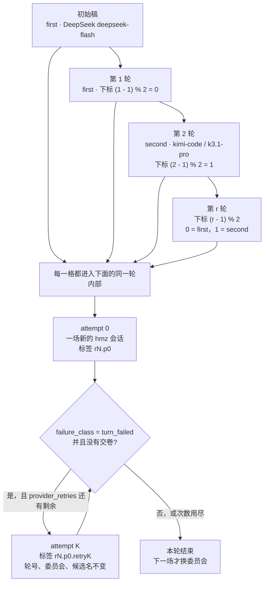
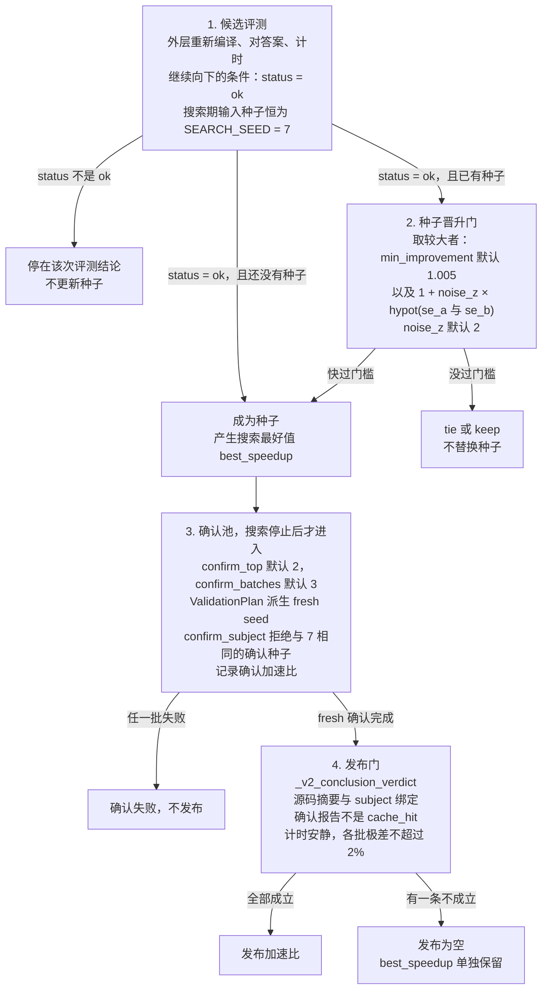
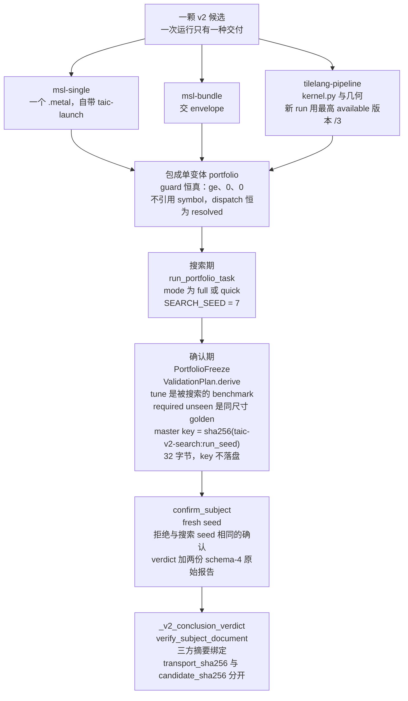

# 搜索 → v2 标准任务目录的接线

状态：S1–S6 已实现并有真实 Metal 证据。`taic run gemm --dtype fp16 --size small` 现在走 v2。
本文记录口径决策、落点、两处上游缺陷修复与可重放证据。题面规则见 `v2协议参考.md`。A1–A6 已把当时的题迁到 v2，那一轮不含模型搜索。

## 阅读本篇之前：搜索术语

本篇默认读者知道一次搜索怎么循环。下面把后文会直接用到的说法写开。委员会轮换、重试和三档加速比与 [搜索.md](搜索.md) 是同一套；本篇的种子数字按第 1 节执行。第 1 节的决策表仍然是口径本身。

一次 v2 搜索仍是两个席位轮流写内核，程序负责判卷。默认 `first` 是 DeepSeek `deepseek-flash`，`second` 是 `kimi-code` / `k3.1-pro`。模型交上来的是一颗候选；程序把它包成只有一个变体的 portfolio，再决定是否晋升、确认和发布。

| 说法 | 在本篇里的含义 |
| --- | --- |
| `first` / `second` | 两个委员会，各一名成员（一个 provider 加一个 model）。初始稿和第 1 轮用 `first`。第 `r` 轮（从 1 计）用下标 `(r - 1) % 2`，0 是 `first`，1 是 `second`。 |
| 种子核 | 当前最好的合格候选。搜索期评测这颗候选以及后来的每一颗时，输入种子恒为 `SEARCH_SEED = 7`。 |
| 搜索最好值 | 搜索循环里留下的 `best_speedup`。它来自 seed 7 上的测量，偏乐观，不能单独当发布数字。 |
| 确认加速比 | `confirm_subject` 用 `ValidationPlan` 派生的 fresh seed 复测后的结论。`confirm_subject` 拒绝与搜索相同的 seed。 |
| 发布加速比 | 读盘时走 `_v2_conclusion_verdict`：核对 subject 文档和三方摘要。条件不齐则发布为空，不回退成搜索最好值。 |
| `turn_failed` 的 provider 重试 | 同一轮、同一委员会、同一候选内的有界重试。默认 0 次，最多 3 次。只覆盖 `failure_class=turn_failed` 且没有交卷。标签是 `rN.p0.retryK`，轮号不前进。每次重试是另一场计费的 hmz attempt。 |
| `loop_protocol: flame_chase_1` | `run_config.json` 的续跑标签。`taic resume` 只接这个值。它识别当前单路接力目录，不调用仓库外的 `flame_chase` 流程。v2 的付费中断续跑与 v1 共用这条 `restore` 路径。 |



重试框属于上面每一格。默认次数为 0 时，一轮就是一场会话。



只有一个用途点的尺寸无法派生 `ValidationPlan`，那种运行不做确认。发布条件的逐项表仍在 [搜索.md](搜索.md) 的发布层；v2 额外走第 3 节和第 8 节的摘要绑定。

## 1. 口径决策（人类已拍板）

| 决策点 | 选择 | 含义 |
|---|---|---|
| 确认门 | **走 portfolio 全套**（A=1） | 不另写一套确认逻辑：单候选包装成 portfolio 后直接复用 `run_portfolio_task` 与 `confirm_subject` |
| seed 纪律 | **(a) 与 P2 完全一致** | 搜索期所有候选恒 `SEARCH_SEED=7`；fresh 只属于确认（`ValidationPlan` 派生），`confirm_subject` 拒绝同 seed 的确认 |
| Track | **默认 `msl-single`** | 省略 `--track` 且 `taic.toml` 没有 `[search].track` 时仍是 `msl-single`：一个 `.metal` 加自带 `/* taic-launch */`。`--track` 的可选项来自 registry 里 `available` 的 id，现行还有 `msl-bundle` 和 `tilelang-pipeline`。新 run 选 TileLang 时拿到最高 available 版本 `/3`。bundle 交 envelope，TileLang 交 `kernel.py` 与几何 |

非目标（在 v2 run 上直接 `RunStartError`，不静默降级）：`--hw-feedback`、`--profile-best`、
`--profile-poor`、`@variant` 题名、v1 `evaluate_fn` 注入。远程评测也仍在这一行：v2 只接
`V2LocalEvaluator`，`--remote-evaluator-config` 给出的 `GrpcEvaluatorFactory` 在构造时被拒（报
`a v2 search currently supports only the local v2 evaluator`，见第 7 节）；远程只在 v1
路径上生效。`msl-bundle` 原本也在这一行，B0–B5 实施后已改成受支持路径（下面是它的接线）。

## 2. 结构：一颗候选就是一份 portfolio

一次运行只提交一颗候选，Track 在启动时选定。接线不另写一套确认逻辑：先包成「一个变体、守卫恒真」的 portfolio，搜索和确认都复用已有的 portfolio 路径。



下面的字符图与上图是同一条路径，保留文件名和 guard 的字面量。

```
source (.metal, 自带 taic-launch)
  → envelope: device/candidate.metal + coverage_plan/portfolio.json（单 variant、恒真 guard ["ge",0,0]）
  → normalize_semantic_domain_plan(contract.spec, (contract.instance,), target)
  → parse_portfolio / DispatchRequest.from_instance
  → run_portfolio_task(...)            # 搜索期评测（mode full/quick，seed=7）
  → PortfolioFreeze + ValidationPlan.derive(tune=benchmark, required unseen=golden, master=HMAC key)
  → confirm_subject(...)               # fresh 确认，verdict + 两份原始 schema-4 报告
```

- 恒真 guard 不引用任何 symbol，因此 dispatch 恒 `resolved`；不存在「搜索候选落在域外」这种状态。
- 被搜索的 benchmark 实例是 **tune** shard（确实被调参），sidecar 的 `coverage_kind=tune_confirmation`；
  同尺寸 golden 点是 required unseen。只有一个用途点的尺寸无法派生 ValidationPlan，那种运行不做确认。
- `master_seed`：run_seed 是 64 位随机数，HMAC key 用 `sha256("taic-v2-search:<run_seed>")`（32 字节），
  key 不落盘；落盘的是 freeze/validation 文档与 fresh seed。
- `guidance_digest` = `fingerprint(system_prompt + presentation.statement)`，把本次题面绑进 freeze。

默认搜索仍是这一节的单变体路径：一颗候选包成一个变体，guard 恒真。多个变体、每个形状各一颗核，走 `taic portfolio-run`，见 [形状组合搜索](搜索.md#形状组合搜索)。

## 3. 落点

| 文件 | 职责 |
|---|---|
| `tcenv/backends/metal/search_candidate.py` | 单候选 portfolio 的构造、评测、确认输入与确认调用（唯一直接拼 envelope 的地方） |
| `taic/task_binding.py` | 装题分派：v1 `get_task` / v2 locator+合同；非默认实例重建 locator；题面/签名骨架/身份 |
| `taic/v2_evaluation.py` | `V2LocalEvaluator`：与 `LocalEvaluator` 同协议（formal/selfcheck/confirmation_expected），`_evaluate_report` 不改 |
| `taic/orchestrator.py` | binding 接入、v2 系统提示/run_config/SessionBrief、搜索 seed=7、`_confirm_v2`、结果带 `task_mode` |
| `taic/prompts.py` / `taic/kernel_agent.py` | v2 系统提示与 TASK.md（无 Triton 段、必须自带 taic-launch、自检命令 `eval-v2`） |
| `tcenv/cli.py` | 新 `tcenv eval-v2`：agent 自检与外层共用同一个 `evaluate_task`，含 self_checks 记录与 seed-report 判定 |
| `experiments/common.py` | 读盘发布：v2 走 `_v2_conclusion_verdict`（`verify_subject_document` + 三方摘要绑定），v1 谓词不变 |
| `taic/kernel_catalog.py` | 归档允许 v2 合同指纹（不再对 v2 调 `get_task`），记录 `task_mode` |
| `taic/cli.py` / `taic/brief.py` | resume 装题与系统提示变体；brief 输出 `task_mode/track/task_pack_digest` |

run_config 的 `track` 不再是恒 `None`。`taic/orchestrator.py` 的记录从 registry 派生 `{track_id, track_version, delivery}`，再加 `task_pack_digest`、`presentation_sha256`、`task_mode:"v2"`；result.json 同样带这些字段。新的 `msl-single` 运行是 version 1、`single_source`；`msl-bundle` 是 `candidate_bundle`；`tilelang-pipeline` 的新 run 用最高 available 版本，delivery 是 `dsl_source_pipeline`。
v1 run 的这些字段保持原状（`track=None`、`task_pack_digest=None`、无 `task_mode`）。

## 4. 两处上游缺陷修复（接线过程中暴露，都有真实 GPU 反例）

1. **worker 的 evaluation_fingerprint 用了 staged 合同指纹**。
   `encode_request` 已把控制机的 `opspec_digest/lowering_profile_digest` 显式带给 worker（build 身份正确），
   但 `v2_evaluation_task` 仍用 staged 副本的 `contract.fingerprint()` 构造 `Specialization`。
   staged pack 的路径拼写不同（`_pack_identity`：repo 内用 `tasks/<op>/...`，repo 外用 bare names），
   于是报告的 `evaluation_fingerprint` 与控制机/P2 expected 永远 mismatch，真实任务上确认不可能通过。
   修复：`_evaluate_direct` 把 `_report_identity` 的合同指纹传给 `v2_evaluation_task`，与 build 身份同源。
2. **候选 `compile_error` 被 portfolio runner 当成合同错误**。
   编译失败时 worker 发布自己的 provider（无 candidate dispatch），runner 的两处审计只放行
   `BUILD_FREE_STATUSES`，于是搜索最常见的「初稿编译失败」直接炸成 `TaskContractError`。
   修复：新增 `NO_DISPATCH_STATUSES = BUILD_FREE_STATUSES | {"compile_error"}`，编译失败按
   「真实（失败的）构建、零 dispatch」记录，不再抛错。

## 5. 可重放证据

不花钱、不占 GPU：

```
uv run pytest -q -n 0 \
  tests/shared/test_search_task_binding.py \
  tests/backends/metal/test_search_v2_portfolio.py \
  tests/shared/test_search_v2_prompt.py \
  tests/shared/test_search_v2_orchestrator.py
```

覆盖：v1/v2 分派与 `@variant` 拒绝、恒真 guard 的 dispatch、tune/unseen 与 fresh seed、
envelope 字节确定性、v2 题面与 eval-v2 命令、搜索循环 seed=7、run_config/result 的 v2 身份、
finished v2 run 的 resume dry-run。

真实 Metal（脚本化模型，零模型费用）：

```
uv run pytest -q -n 0 tests/backends/metal/test_search_v2_gpu.py
```

初稿编译失败 → 修复 → 搜索种子 → `confirm_subject` verdict=confirmed（identity match、
search seed 7、fresh confirmation seed）→ `conclusion_of_run` 发布 confirmed → catalog 以 v2 身份归档。

回归：`tests/backends/metal/test_orchestrator_gpu.py`（v1 端到端）、
`test_shape_portfolio_gpu.py`、`test_shape_portfolio_confirmation_gpu.py`、
`test_shape_portfolio_performance_gpu.py` 全绿；今天停掉的 v1 run 的 `resume --dry-run` 仍通过。

## 6. 计时逻辑改善（2026-11-03 追加）

本节回答「small gemm 加速比为什么 <1」的完整调查结论，以及由此落地的计时路径优化。

### 6.1 调查结论：不是 kernel 问题，是 launch-bound 计时固定成本

- **small gemm 与 MLX 的 steel kernel 性能相当**（同窗口 GPU 时间 ≈2.6 µs 对 ≈2.7 µs）。加速比在 0.74–0.96 之间波动，是这个尺寸 launch-bound 的计时特性，不是「技不如人」。
- 工具链相同：本机 metal 编译器 `32023.921` 与 MLX 的 metallib `32023.883` 是同一家族，「换工具链」没有意义。
- 调查中的两个测量陷阱已记录：MLX fused kernel 的输出 D 在 **buffer(3)**（不是 2）、params 在 **buffer(4)**，放错槽位会让它提前 return、显得「快」；以及 `mx.fast.metal_kernel` 的 `grid` 是**总线程数**（不是 threadgroup 数）。

### 6.2 落地的计时路径优化

| 改动 | 文件 | 效果 |
|---|---|---|
| `run_pipeline` 的 native 编码器扩展到**多阶段、纯 buffer、无 fill** 的批次 | `tcenv/backends/metal/native_batch.{m,py}`（新增 `taic_metal_run_pipeline`）、`runtime.py` | 多阶段固定成本 **5.26 → 1.33 µs/iter（约 -75%）**，单阶段 ≈1.0 µs/iter |
| `v2_worker` 补上 `backend.prepare_context` 组合根 | `tcenv/v2_worker.py` | v2 worker 的 `run_pipeline` 此前只能走 PyObjC（native 编码器与内部清零核从未准备） |
| `launch.py` 接受 `math relaxed` | `tcenv/backends/metal/launch.py` | 编译层本就支持 MTLMathModeRelaxed，解析层此前只允许 fast/safe |

多阶段测试：`tests/backends/metal/test_native_batch.py` 新增多阶段 eligible 与 native 与 Python 逐值一致性对照。

### 6.3 回退的尝试（不要重走）

- 给 `ctx.run` 加 native 快路径：对官方发布数字**没有影响**（官方走 run_pipeline），且引入了 unsafe，已回退。
- 给 native 编码器加 fill/workspace 支持：接口预留后引入回归，已回退；带 fill/workspace 的批次仍走 PyObjC。

### 6.4 计数/锚点随功能演进的同步

- `targets/apple-m4-max/experience.md` 新增 3 条 verified 经验（small GEMM 结论、32 fragment 寄存器边界、多阶段计时优化），`test_experience_staging` 的 verified 计数同步为 12。
- `docs/架构/backend-phase0-baseline.json` 的 `system_prompt_sha256` 与 `prompt_sha1` 按既有做法随 prompt 演进重签。
- `test_a6_retirement.py` 的 lowering 对比基准固定到 A6 之前的提交 `4a93ed2`（当前 HEAD 已不含退役 profile）。
- `test_observe_publications` 的真实 catalog 测试改为复制成临时夹具并移除 gemm（gemm 的新 confirmed 由 `test_search_v2_gpu` 单独覆盖），避免生产 catalog 污染与历史断言失效。

## 7. 已知边界

- small 尺寸（几微秒）在这台机器上常得 `timing_uncertain`：这是 P2 计时门的合法 verdict，
  不是接线问题；要 published speedup 需要更安静的测量窗口或更大负载。
- v2 的 resume 目前覆盖 dry-run 装配与状态重建；付费中断续跑与 v1 共用同一条 `restore` 路径。
- 远程评测、Instruments/hw_feedback 在 v2 run 上显式拒绝（构造时 `RunStartError`）；domain sweep 不是拒绝而是不做：`_confirm` 对 v2 直接转 `_confirm_v2`，`_domain_sweep` 自己也有 `_v2` 时直接返回的守卫；v1 只在确认发布成功后才跑它。
- `msl-bundle` + **远程 workspace** 目前不支持，但代码里没有对应的启动期拒绝：`workspace_prompt.py` 只换掉「验证命令」段、「晋升标准」正文、反馈校验命令和种子对比说明，bundle 的打包命令（`uv run --directory <控制机仓库> python scripts/msl_bundle_pack.py`）仍留在远端 `TASK.md` 里，而远端主机没有这份仓库。远端打包是后续扩展。
- 动态 `[[threadgroup(k)]]` 参数在 bundle 里仍不支持（ABI 直接拒），题面已如实写明。


## 8. msl-bundle 的接线（B0–B5 实施结果）

一次运行只有一种交付机制：`--track`（或 `taic.toml` 的 `[search].track`）→ `Orchestrator(track_id=)`
→ 局部 `binding` → 系统提示 / `V2LocalEvaluator` / `SessionBrief.track_id` / `run_config.track` /
`result.track` / 确认 / catalog。`taic resume` 从 `run_config.track` 取回记录值（schema<3 的旧 v2 目录按
`msl-single` 恢复，v1 保持 `None`），`--track` 只能重申不能改。

| 环节 | 落点 | 说明 |
|---|---|---|
| 唯一包装 | `search_candidate.portfolio_for_submission()` | single 分支与今天的父包逐字节相同；bundle 分支把子包机械映射成父包（几何 entry 的 role 从 `schedule` 改成 `host_tiling`，其余字节不动），`planner=taic.search.bundle`，`protocol_epoch=2` |
| 唯一预检 | `search_candidate.preflight_submission()` | 全 CPU：形态/解码 → 父包 parse → 投影 → 跨源 launch 唯一性 → 几何求值 → launch↔ABI workspace → Host Tiling span。返回值带 `stage`，四条消费路径（搜索评测、`tcenv eval-v2`、selfcheck bridge、确认）共用 |
| 交付错误 | `tcenv.evaluation.CandidateDeliveryError` | 超限源码、lone surrogate、envelope 解不开都是**候选自己的问题**：请求构造边界转成 `status="rejected"`、`stage="delivery"`，不建 outbox、不占 GPU |
| 交卷字节 | `kernel_agent.collect_session` | bundle 会话用 `read_bytes()` + 严格解码，且**跳过** `kernel_text()` 抽块；非法 UTF-8 → `source=None` + `diagnostics.failure_class="candidate_delivery"`（`status=="ok"` 时才设），`classify_result` → `delivery_rejected`，`_one_session_attempt` 在入账之后记一条 typed rejected（空串占位内核文件保留，空 source 永不进 cache） |
| 题面 | `prompts._rules_for(backend, delivery)` + `system_prompt_v2` + `kernel_agent.render_contract` | bundle 渲染期**替换**四条 single 专用冲突句（不是追加 ignore），并给出几何闭集示例、workspace 的真实 MSL ABI 与打包/自测命令；single 只多了清零句纠错 |
| 签名骨架 | `TaskBinding.signature_stub()` | bundle 保留 workspace 参数槽位（可写性与 `access` 一致），single 逐字节不变；方法签名不变，读 `self.track_id` |
| 受信面 | `taic.trust` | 新增登记 `prompts.system_prompt_v2`、`kernel_agent._check_command`、`task_binding.TaskBinding.signature_stub`（点分路径，方法源码）；`docs/架构/backend-phase0-baseline.json` 已重签 |
| 发布 | `experiments/common._v2_conclusion_verdict` | `transport_sha256`（提交字节）与 `candidate_sha256`（manifest）分开绑定，`result.track` × registry 交叉校；新增原因码 `track_mismatch`（只追加） |
| 归档 | `taic/kernel_catalog.archive_confirmed` | `meta.json`/`history.jsonl` 记 `transport_sha256`、`candidate_sha256`、`track`；blob 仍按 transport 寻址 |
| seed | `orchestrator._prior_source_path/_prior_source_label/_read_prior_source` | `@catalog` 不再死路（门/日志/dup 豁免统一来源），读盘用 `read_bytes()`，形状判定复用 `preflight_submission`（残缺 envelope → typed `RunStartError`） |

垂直切片（真实 Metal，`uv run pytest -q -n 0 -m gpu`）：

- `tests/backends/metal/test_search_v2_bundle_gpu.py`：派生 lifecycle 的 host tiling、`inside_timing=true`、
  多阶段 + 多源、动态 threadgroup 负例、evaluator 路径、确认（1 次 search + ≤3 次 confirmation 的
  dispatch 序列一致）。
- 新题 `tasks/affine_ramp/`（第一道声明 `space: workspace` 的标准题）与
  `tests/support/msl_bundle_affine_ramp/host/` 夹具；`tests/shared/test_affine_ramp_task.py` 覆盖
  discovery/实例/oracle/ABI span/baseline 闭合/舍入判别。
