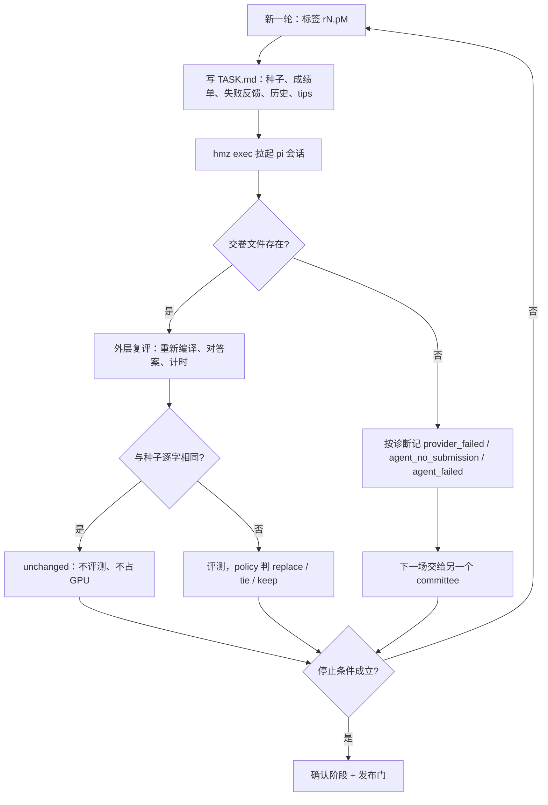
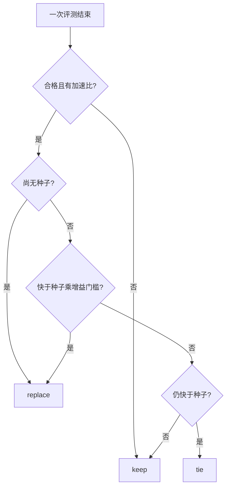
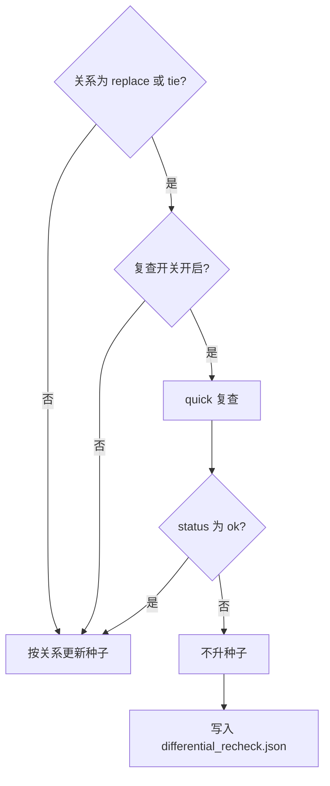
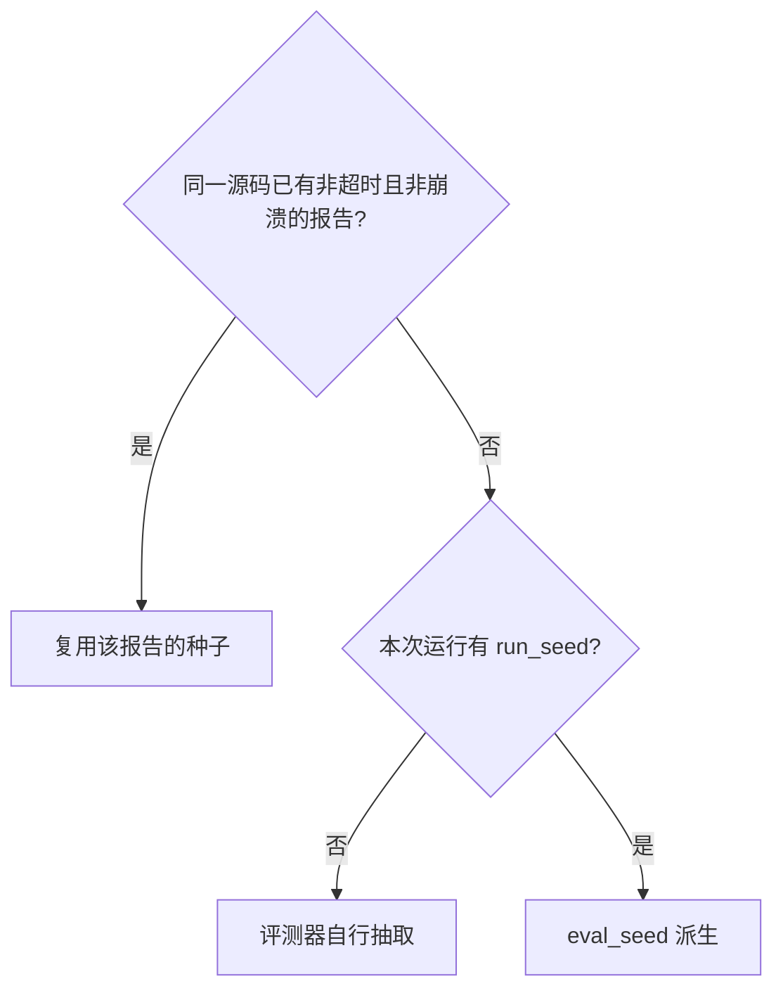

# 搜索

这一篇回答：一次搜索怎样循环、什么数字可以对外发布、怎样续跑。进程怎么分工见 [架构说明.md](../架构说明.md)。对应的搜索/策略/编排测试和运行方式见 [tests/README.md](../../tests/README.md)。

## 这篇讲什么

- 模型只负责写内核文本，**是否采纳由程序判定**：`taic` 准备任务书（`TASK.md`）并判卷，模型在 `pi` 里写代码。
- 默认一轮就是一场**新的 `hmz` 会话**（session）。只有显式打开 provider 重试时，同一轮才会有多次有界尝试（attempt）。
- 写错了不留上下文，不合格的反馈写进**下一场**的任务书，而不是继续在同一段对话里修补。
- 搜索过程中的加速比偏乐观，因为那是从许多次嘈杂测量里挑出来的最优值；对外发布的数字来自结束时的**复测**（确认阶段）。

术语对照（后文沿用这些说法）：

| 文档用词 | 实际含义 |
| --- | --- |
| 一轮 / 一场 | 一次 `hmz` 会话，对应一个 attempt 标签，例如 `r3.p0` |
| 种子（seed） | 当前最好的合格内核，放在 `kernel.metal`，只供阅读，外层不读它交卷 |
| 交卷文件 | 代理必须写出的文件，名为 `{题目}-{dtype}-{规模}-{场次}.metal` |
| 任务书 | 本轮写给代理的 `TASK.md`（12KB 预算，见 [数据层.md](数据层.md)） |
| 委员会（committee） | 模型轮换位置，名为 `first` 与 `second`，各一名成员 |
| 成员（member） | 一个 provider 加一个 model |
| 无核 | 这一场没有交回内核（`agent_failed` / `provider_failed` / `agent_no_submission`） |
| 判卷 | 外层重新编译、对答案、计时，并决定是否替换种子 |

模型写文字，程序决定留不留。默认一轮是一场新的 `hmz` 会话；显式打开 provider 重试时，同一轮可以有多次有界 attempt。写错了，不合格的反馈写进下一场任务书，不留在同一段对话里。搜索过程里的倍数偏乐观，因为那是从很多次嘈杂测量里挑出来的。对外数字来自结束时的复测。

## 搜索循环

### 一轮里发生什么

默认一轮是一场 `hmz` 会话。种子放在 `kernel.metal`，只供阅读。交卷文件名是 `{题目}-{dtype}-{规模}-{场次}.metal`，例如 `conv2d-fp16-paper-r3.p0.metal`。搜索开场不创建这个文件。

`pi` 在 v2 场次用 `python -m tcenv.cli eval-v2` 加 `--quick` 或 `--timed`；v1 brief 仍用 `eval`。这两条命令里的交卷文件和 `report.json` 都是本场工作目录下的绝对路径，因为 `uv run --directory` 会把工作目录换成仓库。

某版通过 `--quick` 后立刻用 `cp` 复制成 `<交卷文件>.tmp`，再用 `mv` 原子替换成正式交卷文件，作为防断连的 checkpoint，不等会话结束；之后自测合格且更快也这样替换。还没有合格版时在收尾前放最近一版，不抄种子。checkpoint 不代替外层判卷。

`NOTES.md` 和 `FEEDBACK.md` 当场追加。到回合的输出 token 或时长上限时，同一会话再跑一个短回合：交卷文件已经在就不重写，不在就用 `cp` 复制最好的那一版，然后补齐这两份笔记里缺的行。

外层只读交卷文件，重新编译、对答案、计时。文件不存在时，按诊断记为 `provider_failed`、`agent_no_submission` 或 `agent_failed`；三者最终都表示没有交回内核。代理自己报的微秒不进种子，也不进对外的加速比。评测之后的存档仍叫 `candidates/<序号>_<标签>/kernel.metal`。

### `FEEDBACK.md` 的两条通道

`FEEDBACK.md` 有两条通道，都不改变换种子、失败计数、预算和停机。

| 通道 | 去处 | 谁看 |
| --- | --- | --- |
| 给系统的建议（提示词、技能、工具、规则、需要人拍板的事） | 只写入本运行的 `feedback.jsonl` | 人在看板 `/reviews` 复核 |
| 给下一棒的避坑和被否决的前提 | 下一场开场时由 `peer_tips_for` 从本运行 `feedback.jsonl` 现算进任务书 | 下一场写内核的代理 |

给系统的建议只进 `feedback.jsonl`，给人在看板复核。日志只追加。看板按 `feedback_bytes` 接着读新行，审查文件变了不重读这份日志。顶栏的待审查按钮另开 `/reviews`，列出所有运行。

给下一棒的避坑和被否决的前提，由 `peer_tips_for` 在下一场开场时从本运行的 `feedback.jsonl` 现算进任务书。每一场都在 `feedback.jsonl` 占一个序号，没写反馈的场也占，所以过期按场次而不是按有字的记录数。未验证前提和降级前提从第一次写出来的那场之后再出现两场，第三场开场时不再放进任务书；原样复述不把起点往后推。同一进程里追加记录失败时，这一场的序号已经分配，下一场按这个序号计龄。进程退出后只剩磁盘上的记录。

### 已验证与降级的判定

标了已实测、但探针文件在工作目录、仓库和同运行 `agent_work` 兄弟目录里都读不到的，记成降级，按未验证过期；降级保留命题和数字。同一条只要有一次探针可读，就按已实测保留。

字符预算：

| 类别 | 条数上限 | 字符上限 | 说明 |
| --- | --- | --- | --- |
| 已实测 | 单独一段 | 最近 1800 字符 | 不占普通提示的 8 条 |
| 未验证 + 降级 + 普通避坑 | 共用 8 条 | 共用 1200 字符 | 整段进 `TASK.md` 前再按 1500 字节裁剪 |

digest 只认命题：数字、探针文件名和未验证后面的理由不另算一条。旧记录不回写；读入时在内存里补空 digest、被抹掉的命题，以及截断小节名。某一节去掉标点和空白后只剩「无 / 没有 / 空 / none / n/a」时不进条目。

写完可以用 `uv run python -m taic.agent_feedback check <FEEDBACK.md> --work <本场工作目录>` 看解析器会怎么读，这条命令不写 `feedback.jsonl`。

`search.peer_tips` 默认开，`taic.toml` 里有这个键，命令行用 `--peer-tips` / `--no-peer-tips`，续跑读 `run_config.json` 里记下的值。关掉时任务书里没有这段。不读其它运行的文件。

### 续跑与冻结的指引

续跑不重放内存：序号接着文件里的最大值，上一场的 `NOTES.md` 和失败反馈从 `agent_work/` 补回。转录只记反馈的类别、非空小节和字数。

新运行把 `device.md`、`experience.md` 和 `msl_reference.md` 冻进 `agent_guidance/`，并在 `run_config.json` 里记下这三份和技能 `SKILL.md` 的 sha256。续跑用这份快照。没有 `agent_guidance/` 的旧运行仍从仓库拷。

章程在 [代理反馈.md](../代理反馈.md)，规则落在哪个文件里见 [写核代理读什么.md](../写核代理读什么.md)。

### 判定函数放在哪里

编排器调用 `taic/policy.py` 中的纯函数决定替换、并列、确认池和耐心计数。续跑回放使用同一组函数，避免恢复路径和在线路径各写一套取舍。当前循环一场接一场，不并行发模型请求。

### 两个委员会

每次搜索恰好两个委员会，名为 first 与 second，各有一名成员。一名成员是一个 provider 加一个 model。

拒绝规则（都在读取凭据和调用模型**之前**生效）：

- 成员人数不是 1，或名字不属于这两个 → 拒绝；较长的名单不会被收成第一名。
- 不写 `--model` 时，名单还要正好各有一个 first 和一个 second；同名重复、多一个或少一个也拒绝。
- `--model` 在人数和名字这两项检查通过后，把该模型设到两个委员会上。

成员名单写在 `taic.toml` 里（见下一节）。论文预设不改这两行成员配置，也不改 `kernel_agent`。配置里没有 `committees` 键时，两个委员会都复制当时的模型配置。

绑定规则：

| 事件 | 绑定 |
| --- | --- |
| 初始稿 | first |
| 第 1 轮 | first |
| 第 r 轮（r 从 1 计） | 下标 `(r - 1) % 2`，0 为 first，1 为 second |

两个委员会共用一份账本、一份 `transcript.jsonl` 和一份预算。写内核的连接和进程失败记为 `agent_failed`，下一场交给另一个委员会。`taic/llm.py` 里的重试只包住实验脚本的直调，不包住这场 `hmz`。

### 当值成员写在配置里

当值成员写在 `taic.toml` 的两个 `[[committees]]` 里。first 是 DeepSeek 的 `deepseek-flash`，second 是 `kimi-code` / `k3.1-pro`。`--model` 把该模型设到两个委员会上。网页上的模型入口给 first 和 second 各选一个模型，分别写进对应的那一名成员。`[llm]` 跟着 first。两个选同一个也可以。已经在跑的搜索保持启动时的成员。接口为 OpenAI 兼容的对话补全。两个委员会共用一本账，缓存命中与未命中分开计价。服务端若不报告权重版本，运行配置中的模型名不能被当成权重版本已锁定。

### provider 重试

`search.provider_retries` 控制结构化传输失败的重试，默认 0，允许 0–3 次，CLI 是 `--provider-retries N`。

| 情况 | 是否在同一 committee、同一候选内重试 |
| --- | --- |
| `failure_class=turn_failed` 且没有 submission 的 attempt | 是 |
| 正常 `result` 但没交卷 | 否 |
| timeout | 否 |
| 进程失败 | 否 |
| `cost_incomplete` | 否 |
| 已有 checkpoint/source | 否 |

标签与记账：首次 attempt 的标签是 `r3.p0`，第 N 次重试是 `r3.p0.retryN`；候选仍叫 `r3.p0`，轮号不前进。每个 attempt 都重新过预算门，独立写 agent 事件、token、费用和诊断，并带 `candidate_label` 与从 0 开始的 `attempt`。`provider_retry` 事件只记录 scheduled 的退避，不代表已经发出请求，也不重复计费。重试耗尽后才把这一轮交给原有的无核失败计数；下一场仍换 committee。

### 会话诊断

会话诊断不改变最终的停止与 resume 放行规则。`hmz exec --json` 的 `session`、`kind`、`text` 由 `diagnostics_from_stream` 读成 `runtime` 字段，随 `event=agent` 写进 transcript：`failed_turns`、`last_terminal_kind`、`tool_calls`、`failure_class` 和错误摘要用于解释这场为什么没交卷。

`failure_class` 在上述开关下决定能否重试，但不改变两轮最终无核后的 `stop_reason=agent_failure`，也不让这种 run 自动变成可续跑。

正常返回 `result` 却没有交卷时，另在 `agent_diagnostics/` 留一份最多 240 字的脱敏响应预览，transcript 只记路径、响应长度和 sha256；完整 stdout、工具输出与系统提示不落盘。历史 run 不回写这些字段。

### 初始生成

初始生成先得到一份能当种子的内核。第一次由 first 写。这场失败，下一次由 second 写。

| 结果 | `stop_reason` |
| --- | --- |
| 两场都是最终无核 outcome（`agent_failed`、`provider_failed` 或 `agent_no_submission`；包括起不来、进程失败，或超时且没有交回与种子不同的核） | `agent_failure` |
| 超时但交回了新核 | 这一场也计入 `max_hangs`；默认 `max_hangs=1` 会先按挂死熔断停下 |
| 两场尝试后仍没有合格种子（不含接连两场 `agent_failed`） | `no_valid_initial_kernel` |

外层不再在同一委员会里修补。不合格的反馈写进下一轮的合同，由另一位接着改。

### 单路接力之前的多分支做法（历史）

下面这段是改成单路接力之前的做法；`_plan`、`_develop` 已从代码里删除，当前搜索不再并发分支。

当时每轮 `_plan` 产生 `branches` 份方案，默认 3。规划失败或 JSON 无法解析时使用三份固定方案，使这一轮补丁仍能发出：16 字节向量访问、单遍全局内存配合 SIMD 归约、矩阵乘使用 `simdgroup_matrix`。一个分支的模型错误只跳过该分支，避免一次接口失败废掉其余改法。这一轮每一路都是模型错误时，整次搜索停下，原因以 `llm_error:` 开头。历史保留最近 24 条。

当时 `plan_ledger` 默认开启；规划提示里的这 24 条是 `taic/plan_ledger.py` 的结构化记录：编译失败、接口错误、算错、不安全、运行出错或没有内核，记为方向尚未被计时否定；写对了但没有变快，才记为方向已否定。当时的 `--no-plan-ledger` 改回原来的 24 条文本。为什么默认打开、学自哪里、哪些不照抄，写在 [外部框架经验.md](../外部框架经验.md) 的「从 KDA 的笔记学了什么」。

消息构造：

- 每一轮的规划和每一路补丁都是新的用户消息：当前核与评测反馈。规划另含这 24 条，用来避开已经失败的假设。
- `diversity_archive` 默认关闭；打开后，连续两轮没有新种子时，本轮最后一条尚未开始的分支改一颗静态特征与种子不同、且不低于种子 85% 的合格核。已经开始的分支在续跑时保持记下的对话，不另换亲本。
- 补丁另含这一份方案，不含这 24 条。两条消息都不含上一轮的助手回复。
- 第 2 轮起，两条消息开头都有交接句，两名成员的模型相同时也写。交接句点明委员会，并写明上一轮对话不在这次请求里。初始稿和第 1 轮没有交接句。第 1 轮也不含初始稿的助手回复。

### 停止条件

停止条件把钱和轮数花在仍可能改进的搜索上：

| 触发 | 说明 |
| --- | --- |
| 超时次数达到 `max_hangs` | 单场默认 1 次即停 |
| 子进程连续崩溃 3 次 | 进程级熔断 |
| 连续 `patience` 轮没有新种子 | 没有改进迹象 |
| 达到 `max_rounds` | 轮数上限 |
| 下一次会话将超过预算 | 发请求前的预算门 |
| 剩余预算低于最近三场已完成会话成本的中位数 | 提前停止；`stop_reason` 仍为 `budget_exhausted`，`result.json` 的 `session_budget_stop=true`。这是为了避免尾段只剩 $0.2 还开一场只复测种子的会话 |
| 接连两轮最终无核（`agent_failed`、`provider_failed` 或 `agent_no_submission`） | `stop_reason` 均为 `agent_failure` |
| 一场正常结束却没有 token 账单 | `cost_incomplete` |

`stop_at_roofline` 默认开启：种子相对参考算法下界的倍数已不大于增益门槛，计时不属不安静，且没有基线快于该下界时，`stop_reason` 为 `at_roofline`。种子自己的 `time_over_lower_bound` 低于 0.95，或算力、带宽占用已经高过这条线的倒数时，早停不触发。源码里有 `/* taic-launch */` 本身不停用早停。可用 `--no-stop-at-roofline` 关闭。

## 执行位置与评测故障

默认 `local-integrated`：`hmz` 在本机启动 `pi`，候选回本机 `tcenv.evaluate` 判卷。显式传 `--remote-evaluator-config FILE` 时切到 `split-control`：`pi` 和 workspace 仍在 control_host，正式评测与自测经 `EvaluationExecutor` 送到设备侧受信服务；`pi` 不去设备站点。实际执行方式写进 `runs/<run>/execution.json`。

- 远程正式请求先写 `evaluation_outbox/`。同一 label 与 request digest 得到同一个 `request_id`；只有本来就可 resume 的 run（预算耗尽/中断）才会在 digest 与 evaluator epoch 不变时复用已完成结果或按同一 id 重提。正常收尾的 `evaluation_unavailable` 被视为 finished，CLI 不直接续跑。
- 远程首次 hello/`ensure_epoch` 成功后、outbox `begin()` 之前固定 evaluator identity（site/device/backend/build/task pack/calibration/protocol 合成的 epoch）。后续结果 epoch 或 request digest 对不上，run 以 `evaluation_unavailable` 停下。
- 传输失败、协议/身份不匹配、发布 allowlist 拒绝、epoch 漂移都不是候选的 `timeout`/`crash`。它们不增加 `hangs`、连续 crash 或 `agent_failed` 计数，也不把下一场交给另一个委员会。
- 远程结果要成为候选，还要过 host 发布门：`measurement_kind=measured`、`publication_allowed=true`、`site_id` 在 `publishable_site_ids` 中，并且 `publishable_epochs` 显式包含当前 epoch。local 可用 `null` 表示不做 epoch 限制；remote 的 `null` 和 `[]` 都拒绝发布，resume 也拒绝缺少显式 epoch 白名单的旧 remote run。模拟结果永远不进入种子比较或确认。
- split-control 的自测走每场一个 host bridge。socket 与短期 token 由 hmz 会话环境注入，token 文件在 host-owned 的 `${XDG_CACHE_HOME:-~/.cache}/taic-selfcheck/`（0600），不进入 argv/TASK/workspace。远端 `selfcheck_token_file` 必须是独立 grant，缺失时不再回退到 formal evaluator。timed 结果会写 `.selfcheck/self_checks.jsonl` 和 host 权威日志，可参与 `premise`；quick 和基础设施错误不写。仍缺 `tool_probe` 执行证据。
- 远程连接池按 `idle_timeout_s` 和 `max_clients` 做 idle/LRU 回收：只关闭空闲连接，不杀正在执行的请求；连接关闭后再次请求会重新 hello，服务端幂等记录仍用于避免重复执行。

协议、outbox 状态机、自测桥和 P2 隔离的完整说明见 [执行运行时与设备扩展.md](执行运行时与设备扩展.md)。

## 和当前种子相同的文件

验证只认交上来的那份源码。上一颗合格内核已经按自己的标签存着，新的一支不合格不会把它抹掉。所以一支失败就该留下失败的文件，让评测写成 `incorrect` 或其他关卡，不能把旧文件再交一次，让人看成又一次合格。

`_eval` 在调用 `evaluate` 之前做这件事。当前已有种子，且这份源码和种子逐字相同，状态写成 `unchanged`，`eligible` 为假。不占用 GPU，不把这份结论放进评测缓存，加速比不参与比较，轨迹字段 `eval_seed_from` 为 `unchanged`。这一支也不再修补。修补会让模型再赶一版去凑过检查。

提示和这条检查是一起的。当前任务书写明：最后一版即使不合格，也写进交卷文件，不要把种子原文抄进去过检查。交卷文件不存在不是 `unchanged`。`patch_user` 里的同一句只留给不再调用的聊天补丁。代理可以用 `TASK.md` 里的自测命令自查（v2 为 `eval-v2 --quick`）。通过它不是搜索成绩。`quick_check` 不再注册成这场的函数。

2026-10-19 的 `runs/apple-m4-max/conv2d-pi-skill2-20261019` 里，第 1 轮的 Winograd 在 `quick_check` 上缩放误差约 2.27，允许值是 1。当时的补丁提示写着 “Keep everything that already works”。代理把 `init2` 的内核写回 `kernel.metal`。搜索只看见退出时的文件，评测缓存复用了 `init2` 的成绩单，序号 2 和序号 3 的加速比都是 0.7973585458241038。从记入本节的这次修改起，同样的提交记为 `unchanged`。

和种子不同、但和本场更早某颗候选逐字相同，状态是 `duplicate`，不评测。和其它运行的 `candidates/*/kernel.metal` 或 `best.metal` 逐字相同，状态是 `external_duplicate`。`--from` 指定的那份旧核除外。`timeout` 和 `crash` 不挡下一次评测。

## 系统提示与工具

系统提示仍按下面的表拼出来，整次搜索写进 `system_prompt.txt`。当前写内核的模型不读这份提示。它读的是这场的 `TASK.md`，以及技能 `taic-tools`。`device.md`、`msl_reference.md` 和 `experience.md` 拷进工作目录；新运行拷的是 `agent_guidance/` 里冻住的那一版。Skill 2b 和 2c 只进存盘的系统提示，不进 `pi`。打开 `profile_poor`、`hw_feedback`、`experience_index`、`target_note` 或 `status_lines` 时，对应材料写进这一场任务书的证据段。

笔记进入提示的条件如下。

| 文件 | 条件 |
| --- | --- |
| `backends/metal/skills/apple_gpu_optimization.md` | 始终全文写入系统提示。旧的规划请求会按 `roofline.bound` 只留对应的一节；当前搜索不发规划请求 |
| `backends/metal/skills/metal_profiling.md` | 始终 |
| `backends/metal/skills/msl_reference.md` | `use_tools` 为真时只给目录；为假时全文进入 |
| `backends/metal/skills/profiler_evidence.md` | `profile_poor` 为真 |
| `backends/metal/skills/hardware_feedback.md` | `hw_feedback` 为真 |

技能 `taic/flows/kernel_once/skills/taic-tools/SKILL.md` 只写 `TASK.md` 里的 `--quick`/`--timed` 两条命令；`lookup_msl`/`quick_check` 两个名字已从技能删除。`pi` 用 `read` 读 `msl_reference.md`，用 `bash` 跑 `TASK.md` 里的 `--quick` 和 `--timed`（v2 命令是 `eval-v2`）。它们不是注册进当前搜索的函数。`SearchConfig.max_quick_checks` 默认是 0。`MAX_TOOL_TURNS = 6` 仍留在 `taic/llm.py`，只包住直接调用 `chat_with_tools` 的脚本。

谁做、调用谁、模型在哪一层，写在 [外部框架经验.md](../外部框架经验.md) 的「我们做了什么，调用了什么，模型在哪一层」。搜索程序准备任务书并判卷。写内核的模型在 `pi` 里面：本工程调用 `hmz`，`hmz` 调用 `pi`。`kernel_agent` 必须是 `pi`。论文预设不改它。`--kernel-agent off` 拒绝启动。

反馈在 STATUS 之后先写数字头（上界类别、离下界的倍数或「基线已快过下界」、利用率、计时波动、线程组内存），再写其余段落。写进任务书时，外层成绩和失败反馈各截到约 1000 字节。`FEEDBACK_CHARS = 6000` 是没有调用者的残留常量。基线已经快过下界时，数字头不写离界倍数。换算法那句已经从成绩单删掉。`truncation_retry` 字段默认开启，但仓库里没有实现再问一次的代码，当前搜索也走 `hmz`，所以走不到。`truncation_retry_effort` 默认 `low`。`llm.chat` 对顶满长度只留下正文并记一条警告。`plan_reasoning_effort` 与 `patch_reasoning_effort` 默认空，空就是沿用 `reasoning_effort`。

## 实验脚本直调（不是搜索）

搜索写内核不走直调。`kernel_agent` 为 `pi`；`--kernel-agent off` 拒绝启动，退出码 5。`taic/llm.py` 的 `chat` / `chat_with_tools` 只给实验脚本；流式空闲、空回复、长度截断和工具调用的收法见 [直调与hmz取舍.md](../直调与hmz取舍.md)。

## 候选替换、复查、确认与发布

替换规则把“测得略快”和“快过噪声”分开。否则多次嘈杂测量里的最大值会把较差的内核留成种子。

### 三种关系

`relation_to_best` 把一次评测收成三种关系。增益门槛取 `min_improvement`（默认 1.005）与 `1 + noise_z * hypot(se_a, se_b)` 中的较大者，`noise_z` 默认为 2。

### 差分复查

`differential_recheck` 默认关闭。打开后，搜索阶段一次合格不能单独决定升种子：换一颗输入种子后数值失败的候选停在原处。已有运行里出现过“搜索时合格、确认时 incorrect”。下图只在关系已经是 `replace` 或 `tie` 时进入。复查用阶段 `recheck` 的种子做一次 `quick` 评测。通过仍只是另一次抽样。记录不是 `VerifyResult`，没有 `counterexample`。

复查记录里的 `counts_as_kernel_error` 按下表填写。`timeout` 与 `crash` 同时计入现有挂起计数。

| 复查 `status` | `counts_as_kernel_error` | 种子 |
| --- | --- | --- |
| `ok` | 不写记录 | 按原关系更新 |
| `incorrect`、`unsafe`、`compile_error`、`abi_error`、`rejected`、`runtime_error` 及其它非超时/崩溃状态 | 真 | 不升 |
| `timeout`、`crash` | 假 | 不升 |

### 确认测量

确认测量去掉“在若干次噪声测量里取最大”的偏差。池中取当前种子，以及至多 `confirm_top - 1` 个噪声内合格候选；`confirm_top` 默认为 2。搜索种子留在结果里，除非另一颗完整复测的中位数超过噪声门槛。不采用搜索过程中的最大值，也不把复测中位数里略高的一颗直接换成结果。

| 项 | 取值 |
| --- | --- |
| 阶段 | `confirm` |
| 重复次数 | `eval_reps` 的 2 倍 |
| 写入 `confirmed_speedup` 的候选 | 搜索种子；另一颗只有完整复测并超过噪声门槛才替换它 |
| `confirmation_source_sha256` | 该候选源码的 SHA-256 |

### 发布层

发布层是 `experiments/common.py` 的 `conclusion_of_run`，底层是 `published_conclusion`。它避免把未复测、复测失败或源码对不上的数字写成确认加速比。下表每一行都要成立；任一不成立则不回退到 `best_speedup`。

| 条件 | 不成立时的发布标记 |
| --- | --- |
| 结果中存在键 `confirmation_source_sha256` | 旧版未绑定源码 |
| `confirmed_status` 为 `ok` | 未确认 |
| `confirm_report.json` 的状态为 `ok` | 未确认 |
| `best.metal` 与胜者 `kernel.metal` 的哈希都等于该字段 | 未确认 |
| `confirm_winner_label` 指向该候选 | 未确认 |
| `timing_is_uncertain` 为假 | 不确定 |
| `confirm_report.json` 不是评测缓存命中（`cache_hit` 不为真） | 不确定 |
| `confirmed_values` 的极差不超过 2% | 不确定 |

「不确定」只在上表前五行都成立之后使用：确认报告来自评测缓存、计时被判为不安静，或各批极差超过 2%，都标「不确定」。前五行有一行不成立时，标记仍取该行，不改成「不确定」。

`publication_role` 在 `experiments/common.py` 现算，不写入 `result.json`。运行中是空。`primary` 要上表给出确认加速比，加速比不低于 `SearchConfig.min_improvement`（默认 1.005），并且 `domain_report.json` 的 `coverage.kind` 为 `domain_sweep`、`passed` 为真，其源码哈希等于确认源码，题目指纹等于这次运行的 `task_fingerprint`。其余已结束的运行是 `fallback`。

### 一元 fp16 的取值域扫描

一元 fp16 的取值域扫描不进入 `task.cases`。搜索和确认仍用原来的六个 case。确认选出胜者之后，编排器用阶段 `domain`、`mode=quick`、`cases=("domain",)` 再评一次，只看正确性，写入 `domain_report.json`。扫描失败不改 `confirmed_status`。输入是全部 65536 个 fp16 位型，按种子打乱位置；paper 尺寸每个位型出现 256 次。容差不含 RMS 项，也不因基线自己的误差而放宽。

### 评测种子怎么派生

派生种子使同一次运行里，同一标签、同一源码、同一阶段的输入可以复算；搜索、确认和复查使用不同种子，确认不会重复搜索时那一组随机数。

有 `run_seed` 时按下列规则取得：

| 项 | 规则 |
| --- | --- |
| `source` | 拼接契约头之前的原文 |
| `phase` | `search`、`confirm`、`recheck`、`domain`；后加的 `domain` 不改变前三个阶段的载荷 |
| `source_sha256` | 该原文 UTF-8 的 SHA-256 小写十六进制 |
| 载荷 | JSON 数组的 UTF-8 字节，分隔符为逗号与冒号，不含空格：`["ai_lowerling/eval_seed/v1", run_seed, phase, label, source_sha256]` |
| 评测种子 | 该载荷 SHA-256 的前 6 字节，按大端解释 |

相同 `run_seed` 不控制模型服务端采样，也不控制 GPU 温度。

缓存复用在轨迹中标记 `eval_seed_from` 为 `cached report`，不表示用新种子重测过。新运行的 `run_config.json` 写 `launch_protocol: 1`。续跑读到的配置没有这个字段、而候选源码含有 `taic-launch` 时，不复用那份存盘报告，下一次评测重新上 GPU。没有这段标记的旧源码仍复用。固定向量如下。

| 输入或输出 | 值 |
| --- | --- |
| `run_seed` | 1 |
| `phase` | `search` |
| `label` | `init` |
| 源码 | `kernel void k() {}\n` |
| `source_sha256` | `ae97b4b6b017756328f7bbf1c39c8a871cf9f4857b583abcc236fce00e90d6e9` |
| 评测种子 | `96049487906312` |

### 预设与配置

新搜索未写 `--preset` 时，预设名是 `taic.llm.DEFAULT_PRESET`。`load_raw_config` 先读 `taic.toml`，再叠 `taic.<预设>.toml`。`--preset base` 或环境变量 `TAIC_PRESET=base` 只读 `taic.toml`。`--config` 不叠预设。没有记下预设的旧运行，续跑用 `base`，以免把后来的预设盖到已经跑过的搜索上。预算、轮数和耐心的数字以这两个 toml 和 `SearchConfig` 的字段默认值为准，不在这里另抄一份。

### 字段默认值

字段默认值仍如下。进入当前任务书的是 `profile_poor`、`hw_feedback`、`experience_index`、`target_note`、`status_lines`。`stop_at_roofline`、`fast_bench`、`differential_recheck` 作用在停止和评测上。`plan_mix`、`truncation_retry`、`abi_guard`、`diversity_archive` 只剩记录字段，搜索执行路径不读它们；`plan_ledger` 只被看板/查询用来重算计划结局，当前任务书不附四类测法结果。任务书里的历史是最近 5 行普通文本，进 `TASK.md` 前再按 400 字节裁剪。

| 开关 | 默认 | 行为 |
| --- | --- | --- |
| `plan_mix` | 关 | 字段还在。当前一轮一场不读它 |
| `profile_poor` | 关 | 种子慢于最强基线时录制，每次搜索至多 4 次。打开后写进这一场任务书 |
| `hw_feedback` | 关 | 静态硬件特性分析。打开后写进这一场任务书。接近上界时不再列缺项。Skill 2c 只进存盘的系统提示 |
| `truncation_retry` | 开 | 只剩记录字段；仓库里没有实现再问一次的代码，当前搜索也走 `hmz`。实验脚本直调的流、空闲和重试见 [直调与hmz取舍.md](../直调与hmz取舍.md) |
| `stop_at_roofline` | 开 | 见上文「搜索循环」。下界被基线明显超越，或种子自己低于下界的 0.95 倍时不触发 |
| `abi_guard` | 开 | 只剩记录字段；仓库里没有停分支的代码。接口错误的线程组内存说明仍可能附在失败反馈后 |
| `target_note` | 开 | 基线耗时小于下界的 0.95 倍时，目标改为该基线时间，并说明下界假设不成立。写进这一场任务书 |
| `rich_history` | 开 | 这一轮写进历史的失败行含种类与一句原因 |
| `status_lines` | 开 | 任务书里含增益门槛、轮次、耐心与已花费 |
| `plan_ledger` | 开 | 看板可按它重算计划结局。当前任务书不附四类测法结果 |
| `diversity_archive` | 关 | 纯函数还在。搜索循环不调用它，轨迹里的 `parent_label` 也不会被填上 |
| `fast_bench` | 关 | 只作用于搜索阶段的计时：不测串行派发；若已记下该题最快基线名，只和那一条交错计时。确认测量仍测全部基线；串行派发仍只在 `measure_serial` 打开时测 |
| `experience_index` | 空 | 非空时把最多 3 行历史配对提示写进这一场任务书，并排除同一道题。重复性实验强制置空 |

## 已有目录的再次搜索与续跑

### `--from`：改一份已经合格的内核

`--from` 把预算花在改一份已经合格的内核上，而不是再付一次第一稿的模型费用。再评一次是因为考场或机器可能已经变化，旧稿不能未测就当种子。

`taic run --from <目录>` 读取 `best.metal`，按本次题目、数据类型和规模做一次 `full` 评测。合格则标签为 `prior`，跳过初始生成，加速比用这次测量。没有 `best.metal`、题目标识或目标设备与本次不一致，或再评不合格时，改为初始生成并写日志。

`--from @catalog` 的取核函数 `_prior_kernel_text()` 在，但 `_search` 的入口只在 `from_run` 非空时先评测；按当前代码它不会像目录那样先评 catalog 内核，先用 `--from <目录>`。没有 `result.json` 时仍按本次题目再评。`result.json` 在但损坏，或版本比这份代码新，则拒绝启动并说明需要人工检查，不把它当成还没跑过。重复性实验不使用该参数，以免各次试验不再独立。

### `taic resume`

续跑接着没做完的轮次。已经有候选的轮次不重做。没有候选的轮次新开一场，再计一次费。若中断发生在 provider 重试之间，`state.json` 的 `provider_attempts` 记录下一条 attempt，resume 从对应的 `.retryN` 接着走；全部历史 agent attempt 的费用先入账，且最近会话成本也从逐次账单恢复，不把失败 attempt 漏出预算门。`--dry-run` 用来在花钱之前看见将恢复的状态。

`taic resume <目录>` 不新建搜索。只接 `loop_protocol: flame_chase_1`。不是这个协议的目录拒绝，退出码 3。聊天多分支的旧目录不能续。允许继续的情况：进程已退出且已有合格种子；或 `stop_reason` 为 `budget_exhausted` 且已有合格种子。`--lift-count-limits` 额外允许因轮数或耐心停止的运行。

`cost_incomplete` 默认不可续；`--accept-cost-gap` 是人在 hmz epic 对账后的显式例外：续跑先按会话标签把 transcript 缺的金额写成一条 `unaccounted`，再开新会话。GPU 超时熔断与模型错误不在允许之列，避免在挂起或接口失败之后自动再占 GPU。

| 情况 | 行为 / 退出码 |
| --- | --- |
| `--dry-run` | 只重建内存中的状态并打印，不拿锁、不写盘、不调用模型 |
| 不能续跑 | 3 |
| 锁被占用 | 4，防止两个进程改同一目录 |
| 设置或预算不合法 | 5 |
| 续跑跑完但确认阶段失败（`stop_reason` 以 `confirm_error` 开头） | 6，与 `taic run` 一致 |

续跑取得 `resume.lock`；锁内进程号已不存在则锁过期。原 `result.json` 保留为 `result.before_topup_<n>.json`，续跑前的结论仍可核对。美元按转录里的 `agent` 费用累加；还原出的缓存命中、未命中和输出 token 来自该事件的 `tokens` 字段，旧事件没有这个字段时为 0。旧运行没有记下的设置，用预设或默认值补上，并在 dry-run 与正式续跑中列出来源，文本含 `not recorded by this run`。这种补值不拒绝续跑，但缺 `flame_chase_1` 的目录在补设置之前就拒绝。下一场任务书由当前代码的 `render_contract` 现写。`system_prompt.txt` 若在，续跑读它；写内核的模型仍读新任务书。

## 模型归属、费用与单场上限

每个候选的 `origin` 记录写它的是哪一场会话：`origin=session`，以及 `provider`、`model`、`committee`、`session_label`、`attempt`；`--from` 的种子写 `origin=prior`。旧 run 从 transcript 的 agent 行回退，不重写历史文件。

`result.json` 另记 `best_provider/best_model/best_committee` 与确认后 `winner_*`，同时保留原来的 `model`（启动主模型）。`result.model_totals` 和 `taic brief` 的 `model_totals` 按 provider/model/committee 汇总会话数、费用与四类 token；账本仍以逐请求记录为准。

`search.session_cost_cap_usd` 是可选的一次 hmz attempt 外层预算，默认 None。设置后传给 hmz 的 `budget.cost`，并取它与当前运行剩余预算的较小值；每次 provider attempt 独立计算，总预算门仍是最终门。hmz 的成本预算接口存在，但真实 provider 对 input/output/cache 的计费覆盖要由受控 run 验证；未验证前不能把它当成绝对美元保证。失败后额外 wrap 是否还能花钱由 hmz 的 sticky budget 决定，TAIC 只负责传入上限和记录实际账单。

## 文件

| 文件 | 职责 |
| --- | --- |
| `taic/orchestrator.py` | 搜索循环、候选评测与确认 |
| `taic/session_supervisor.py` | attempt 标签、provider retry 状态机、结果分类与 session origin |
| `taic/committees.py` | 两个委员会的名单、人数检查和交接句 |
| `taic/policy.py` | 替换、并列、确认池、耐心，以及异构亲本的纯函数 |
| `taic/plan_ledger.py` | 把一次方案收成赢、并列、方向已否定或尚未计时 |
| `taic/experience.py` | 从已有候选对提炼提示；检索时排除同一道题 |
| `taic/artifacts.py` | 结果、状态、账本的版本读取 |
| `taic/llm.py` | 客户端、账本、`SearchConfig` |
| `taic/resume.py` | 从目录重建；回放使用 `policy` |
| `taic/control.py` | 控制文件、运行锁、预算事件 |
| `taic/feedback_extra.py` | 上界停止、目标句、接口重复、状态行 |
| `experiments/common.py` | `published_conclusion`、`publication_role`、`summarize` |
| `experiments/contract_menu.py` | 同一算子多套启动契约的外层搜索 |
| `experiments/manifest.py` | 实验清单。冻结条件变了就拒绝写进同一个目录 |

## 确认阶段

`_confirm` 对进入确认的每颗候选跑 `search.confirm_batches` 批独立输入（默认 3，同一批里的候选共用一个种子，`eval_reps × 2` 次重复）。每一批都必须成功，失败的批次不会被前面的成功批次改写成 ok。记录下来的是这些批次的**中位数**；`confirmed_values`、`confirmed_worst`、`confirmed_best` 写进 `result.json`，每颗候选的 `failed_batches` 在 `result.json` 的 `confirmations` 列表里。`confirm_report.json` 留下与中位数最接近的那一批报告。搜索种子留在结果里，除非另一颗完整复测的中位数超过噪声门槛（重复内标准误，再加 1% 的输入批次下限）。同一颗核最好与最差之比超过 2% 时，中位数仍留在文件里，公布层记为不确定。
