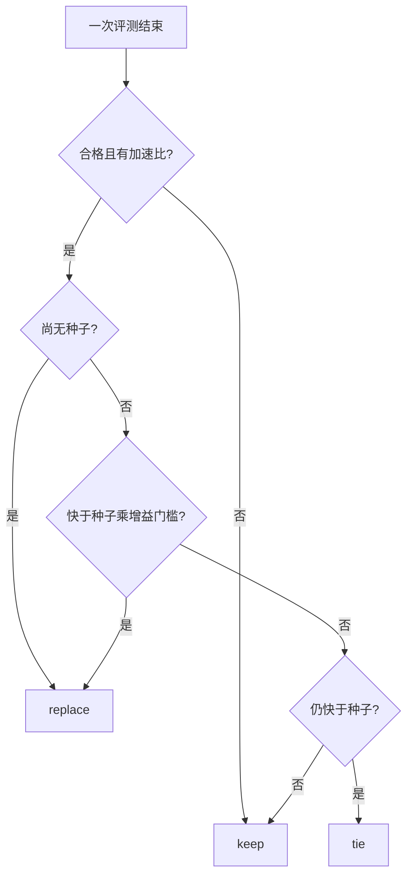
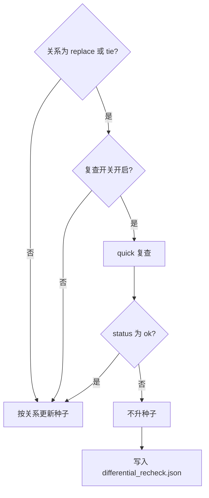
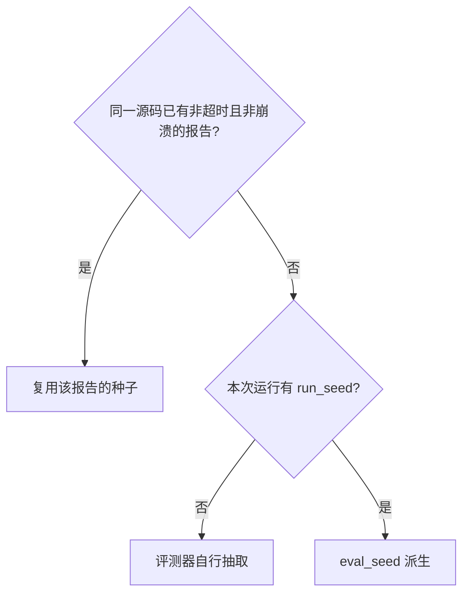

# 搜索

这一篇回答：一次搜索怎样循环、什么数字可以对外发布、怎样续跑。进程怎么分工见 [架构说明.md](../架构说明.md)。

## 搜索循环

搜索把模型限制在“改一版、看成绩、再决定留不留”。模型看不到 GPU，成绩单是它的观察；多份方案并行是为了同一轮试不同改法，而不是把同一种微调重复交三次。评测串行是为了计时不被另一份候选干扰。分支完成的先后会改变搜索轨迹；最终比较以确认测量为准。

编排器调用 `taic/policy.py` 中的纯函数决定替换、并列、确认池和耐心计数。续跑回放使用同一组函数，避免恢复路径和在线路径各写一套取舍。模型请求可以并行。

每次搜索恰好两个委员会，名为 first 与 second，各有一名成员。一名成员是一个 provider 加一个 model。成员人数不是 1，或名字不属于这两个，在读取凭据和调用模型之前拒绝；较长的名单不会被收成第一名。不写 `--model` 时，名单还要正好各有一个 first 和一个 second，同名重复、多一个或少一个也在调用模型之前拒绝。默认两名都是 deepseek 的 deepseek-flash。`--model` 在人数和名字这两项检查通过后，把该模型设到两个委员会上。配置里没有 `committees` 键时，两个委员会都复制当时的模型配置。两个不同的模型是 `taic.toml` 里两行 `model`。初始稿与第 1 轮绑定 first。第 r 轮（r 从 1 计）绑定下标 `(r - 1) % 2`（0 为 first，1 为 second）。两个委员会共用一份账本、一份 `transcript.jsonl` 和一份预算。连接失败在 `taic/llm.py` 内重试，不因此换委员会。

初始生成先得到一份能当种子的内核。一颗候选的修补把编译和数值错误喂回开出它的那条对话，委员会保持为开出它的那一个，这条修补不写交接句。`init_samples` 默认为 1。修补最多 `max_repair_tries` 次，默认 3。初始对话最多重开 2 次。仍无合格内核时，`stop_reason` 为 `no_valid_initial_kernel`。

每轮 `_plan` 产生 `branches` 份方案，默认 3。规划失败或 JSON 无法解析时使用三份固定方案，使这一轮补丁仍能发出：16 字节向量访问、单遍全局内存配合 SIMD 归约、矩阵乘使用 `simdgroup_matrix`。一个分支的模型错误只跳过该分支，避免一次接口失败废掉其余改法。历史保留最近 24 条。`plan_ledger` 默认开启；规划提示里的这 24 条是 `taic/plan_ledger.py` 的结构化记录：接口错误、编译失败或没有内核记为方向尚未被计时否定，写对了但没有变快才记为方向已否定。`--no-plan-ledger` 改回原来的 24 条文本。为什么默认打开、学自哪里、哪些不照抄，写在 [外部框架经验.md](../外部框架经验.md) 的「从 KDA 的笔记学了什么」。每一轮的规划和每一路补丁都是新的用户消息：当前核与评测反馈。规划另含这 24 条，用来避开已经失败的假设。`diversity_archive` 默认关闭；打开后，连续两轮没有新种子时，本轮最后一条尚未开始的分支改一颗静态特征与种子不同、且不低于种子 85% 的合格核。已经开始的分支在续跑时保持记下的对话，不另换亲本。补丁另含这一份方案，不含这 24 条。两条消息都不含上一轮的助手回复。第 2 轮起，两条消息开头都有交接句，两名成员的模型相同时也写。交接句点明委员会，并写明上一轮对话不在这次请求里。初始稿和第 1 轮没有交接句。第 1 轮也不含初始稿的助手回复。

停止条件把钱和轮数花在仍可能改进的搜索上：超时次数达到 `max_hangs`；子进程连续崩溃 3 次；连续 `patience` 轮没有新种子；达到 `max_rounds`；下一次请求将超过预算。`stop_at_roofline` 默认开启：种子相对下界的倍数已不大于增益门槛，计时不属不安静，且没有基线快于该下界时，同一算法上再改也过不了噪声门，`stop_reason` 为 `at_roofline`。可用 `--no-stop-at-roofline` 关闭。

## 和当前种子相同的文件

验证只认交上来的那份源码。上一颗合格内核已经按自己的标签存着，新的一支不合格不会把它抹掉。所以一支失败就该留下失败的文件，让评测写成 `incorrect` 或其他关卡，不能把旧文件再交一次，让人看成又一次合格。

`_eval` 在调用 `evaluate` 之前做这件事。当前已有种子，且这份源码和种子逐字相同，状态写成 `unchanged`，`eligible` 为假。不占用 GPU，不把这份结论放进评测缓存，加速比不参与比较，轨迹字段 `eval_seed_from` 为 `unchanged`。这一支也不再修补。修补会让模型再赶一版去凑过检查。

提示和这条检查是一起的。`patch_user` 写明：种子已经保存；这一支只看交上的内核；方案没通过检查时，把失败的内核留在文件里，不要把当前内核贴回去凑及格；和当前内核相同的文件记为 `unchanged`，不算数。`--kernel-agent pi` 的任务书在 `quick_check` 旁边写同一句。`quick_check` 只供写的人自查，通过它不是搜索成绩。

2026-10-19 的 `runs/conv2d-pi-skill2-20261019` 里，第 1 轮的 Winograd 在 `quick_check` 上缩放误差约 2.27，允许值是 1。当时的补丁提示写着 “Keep everything that already works”。代理把 `init2` 的内核写回 `kernel.metal`。搜索只看见退出时的文件，评测缓存复用了 `init2` 的成绩单，序号 2 和序号 3 的加速比都是 0.7973585458241038。从记入本节的这次修改起，同样的提交记为 `unchanged`。

和种子不同、但和更早某颗候选相同的源码，仍走评测缓存：那是同一份源码的同一次测量，轨迹写 `cached report`。`timeout` 和 `crash` 不进缓存。

## 系统提示与工具

记在运行里的系统提示整次搜索不变，初始、修补和补丁请求都用它，供前缀缓存。规划请求在种子报告的 `roofline.bound` 为 `memory` 或 `compute` 时拿掉这两节优化章节，只在用户消息里附上对应的一节；没有该字段时规划请求也用原文。笔记把“这台机器上怎样写才快”和“成绩单字段表示什么”放进系统提示，模型不必凭空解释计时。

笔记进入提示的条件如下。

| 文件 | 条件 |
| --- | --- |
| `skills/apple_gpu_optimization.md` | 始终写入系统提示；规划且 `roofline.bound` 已知时只留对应的一节 |
| `skills/metal_profiling.md` | 始终 |
| `skills/msl_reference.md` | `use_tools` 为真时只给目录；为假时全文进入 |
| `skills/profiler_evidence.md` | `profile_poor` 为真 |
| `skills/hardware_feedback.md` | `hw_feedback` 为真 |

`lookup_msl` 按关键词返回章节，避免把整本参考塞进每一次请求。`quick_check` 让模型在交正式稿之前先看编译和数值，且不返回计时，因此不能靠某一次碰巧很快的自查换种子。它使用 `quick` 模式，每次请求最多 3 次。该工具没有稳定的调用编号，种子不从 `run_seed` 派生，仍由评测器抽取并写入报告。

谁做、调用谁、模型在哪一层，写在 [外部框架经验.md](../外部框架经验.md) 的「我们做了什么，调用了什么，模型在哪一层」。搜索程序准备上下文和工具，并判卷。规划时模型在搜索程序直接发出的请求里。`--kernel-agent pi` 时，写内核的模型在 `pi` 里面：本工程调用 `hmz`，`hmz` 调用 `pi`。`lookup_msl` 和 `quick_check` 在这条路上是技能 `taic/flows/kernel_once/skills/taic-tools/SKILL.md`，由 `hmz` 放进这场 `pi` 的虚拟家目录，代理用 `read` 和 `bash` 去执行。不用 `pi` 时，这两个名字是注册进聊天的函数，模型就在那次聊天里。论文预设不打开 `pi`。

反馈在 STATUS 之后先写数字头（上界类别、离下界的倍数或「基线已快过下界」、利用率、计时波动、线程组内存），再写其余段落。全文再截到约 6000 字符，砍的是后面的散文，数字头留在前面。基线已经快过下界时，数字头不写离界倍数，并写明基线更快不是改算法的理由。`truncation_retry` 默认开启：长度封顶且回复中没有内核时，去掉回传的思考后再请求一次，不计入修补次数，避免思考占满长度后这一稿直接作废。这一次重试的推理强度是 `truncation_retry_effort`，默认 `low`；`same` 才沿用该次搜索原来的强度。`plan_reasoning_effort` 与 `patch_reasoning_effort` 默认空，空就是沿用 `reasoning_effort`。

## 直调模型

`kernel_agent` 为空是默认，`--kernel-agent off` 相同。规划和写内核都进 `taic/llm.py`。总览在 [架构说明.md](../架构说明.md) 的 §2.4。这里记开关和数字。

2026-10-20 起按流接收。`request_timeout_s` 默认 900 秒，是两块数据之间的空闲。流静默超过它、连接断开、5xx、限流，同一份消息再发，次数是 `max_retries`（默认 6）。半截不进入下一次请求。正常结束但正文和工具调用都空，同样再发，次数用尽才把空回复交给搜索。429 的正文若是余额不足，以及其它不能靠重发修好的 4xx，不重试。上下文超窗时去掉回传的思考、缩短过长的工具结果，再发一次。输出顶到长度上限并且带了工具调用时，不执行，要求模型重发。长度封顶且回复里没有内核，仍走上面的 `truncation_retry`。

这几条取自 [deepseek-harness编排与异常.md](../deepseek-harness编排与异常.md)、[opencode编排与异常.md](../opencode编排与异常.md)、[pi编排与异常.md](../pi编排与异常.md) 里能放进一次聊天请求的部分。没有搬进来的是自动换模型、把整段历史做成摘要，以及编程代理的权限和子代理。`--kernel-agent pi` 写内核时不走这张表，异常由 `hmz` 和 `pi` 自己收。

## 候选替换、复查、确认与发布

替换规则把“测得略快”和“快过噪声”分开。否则多次嘈杂测量里的最大值会把较差的内核留成种子。

`relation_to_best` 把一次评测收成三种关系。增益门槛取 `min_improvement`（默认 1.005）与 `1 + noise_z * hypot(se_a, se_b)` 中的较大者，`noise_z` 默认为 2。

`differential_recheck` 默认关闭。打开后，搜索阶段一次合格不能单独决定升种子：换一颗输入种子后数值失败的候选停在原处。已有运行里出现过“搜索时合格、确认时 incorrect”。下图只在关系已经是 `replace` 或 `tie` 时进入。复查用阶段 `recheck` 的种子做一次 `quick` 评测。通过仍只是另一次抽样。记录不是 `VerifyResult`，没有 `counterexample`。

复查记录里的 `counts_as_kernel_error` 按下表填写。`timeout` 与 `crash` 同时计入现有挂起计数。

| 复查 `status` | `counts_as_kernel_error` | 种子 |
| --- | --- | --- |
| `ok` | 不写记录 | 按原关系更新 |
| `incorrect`、`unsafe`、`compile_error`、`abi_error`、`rejected` | 真 | 不升 |
| `timeout`、`crash` | 假 | 不升 |

确认测量去掉“在若干次噪声测量里取最大”的偏差。池中取当前种子，以及至多 `confirm_top - 1` 个噪声内合格候选；`confirm_top` 默认为 2。对外采用复测最快且状态为 `ok` 的那一次，不采用搜索过程中的最大值。

| 项 | 取值 |
| --- | --- |
| 阶段 | `confirm` |
| 重复次数 | `eval_reps` 的 2 倍 |
| 写入 `confirmed_speedup` 的候选 | 池中状态为 `ok` 且最快者 |
| `confirmation_source_sha256` | 该候选源码的 SHA-256 |

`published_conclusion` 避免把未复测、复测失败或源码对不上的数字写成确认加速比。返回确认加速比时，下表每一行都要成立。任一不成立则不回退到 `best_speedup`。

| 条件 | 不成立时的发布标记 |
| --- | --- |
| 结果中存在键 `confirmation_source_sha256` | 旧版未绑定源码 |
| `confirmed_status` 为 `ok` | 未确认 |
| `confirm_report.json` 的状态为 `ok` | 未确认 |
| `best.metal` 与胜者 `kernel.metal` 的哈希都等于该字段 | 未确认 |
| `confirm_winner_label` 指向该候选 | 未确认 |
| `timing_is_uncertain` 为假 | 不确定 |

「不确定」只在上表前五行都成立、而计时被判为不安静时使用。前五行有一行不成立时，标记仍取该行，不改成「不确定」。

`publication_role` 在 `experiments/common.py` 现算，不写入 `result.json`。运行中是空。`primary` 要上表给出确认加速比，加速比不低于 `SearchConfig.min_improvement`（默认 1.005），并且 `domain_report.json` 的 `coverage.kind` 为 `domain_sweep`、`passed` 为真，其源码哈希等于确认源码，题目指纹等于这次运行的 `task_fingerprint`。其余已结束的运行是 `fallback`。

一元 fp16 的取值域扫描不进入 `task.cases`。搜索和确认仍用原来的六个 case。确认选出胜者之后，编排器用阶段 `domain`、`mode=quick`、`cases=("domain",)` 再评一次，只看正确性，写入 `domain_report.json`。扫描失败不改 `confirmed_status`。输入是全部 65536 个 fp16 位型，按种子打乱位置；paper 尺寸每个位型出现 256 次。容差不含 RMS 项，也不因基线自己的误差而放宽。

派生种子使同一次运行里，同一标签、同一源码、同一阶段的输入可以复算；搜索、确认和复查使用不同种子，确认不会重复搜索时那一组随机数。有 `run_seed` 时按下列顺序取得。`source` 是拼接契约头之前的原文。`phase` 取 `search`、`confirm`、`recheck`、`domain`。后加的 `domain` 不改变前三个阶段的载荷。`source_sha256` 是该原文 UTF-8 的 SHA-256 小写十六进制。载荷是 JSON 数组的 UTF-8 字节，分隔符为逗号与冒号，不含空格：`["ai_lowerling/eval_seed/v1", run_seed, phase, label, source_sha256]`。评测种子是该载荷 SHA-256 的前 6 字节，按大端解释。相同 `run_seed` 不控制模型服务端采样，也不控制 GPU 温度。

缓存复用在轨迹中标记 `eval_seed_from` 为 `cached report`，不表示用新种子重测过。固定向量如下。

| 输入或输出 | 值 |
| --- | --- |
| `run_seed` | 1 |
| `phase` | `search` |
| `label` | `init` |
| 源码 | `kernel void k() {}\n` |
| `source_sha256` | `ae97b4b6b017756328f7bbf1c39c8a871cf9f4857b583abcc236fce00e90d6e9` |
| 评测种子 | `96049487906312` |

新搜索未写 `--preset` 时，预设名是 `taic.llm.DEFAULT_PRESET`。`load_raw_config` 先读 `taic.toml`，再叠 `taic.<预设>.toml`。`--preset base` 或环境变量 `TAIC_PRESET=base` 只读 `taic.toml`。`--config` 不叠预设。没有记下预设的旧运行，续跑用 `base`，以免把后来的预设盖到已经跑过的搜索上。预算、轮数和耐心的数字以这两个 toml 和 `SearchConfig` 的字段默认值为准，不在这里另抄一份。

| 开关 | 默认 | 行为 |
| --- | --- | --- |
| `plan_mix` | 关 | 每轮最后一份为局部改动 |
| `profile_poor` | 关 | 种子慢于最强基线时录制，每次搜索至多 4 次 |
| `hw_feedback` | 关 | 静态硬件特性分析附在反馈后。接近上界时不再列缺项 |
| `truncation_retry` | 开 | 见上文「系统提示与工具」。直调的流、空闲和重试见「直调模型」 |
| `stop_at_roofline` | 开 | 见上文「搜索循环」。下界被基线明显超越时不触发 |
| `abi_guard` | 开 | 同一分支连续两次相同接口错误则停该分支，并写明 32768 字节线程组内存上限 |
| `target_note` | 开 | 基线耗时小于下界的 0.95 倍时，目标改为该基线时间，并说明下界假设不成立 |
| `rich_history` | 开 | 失败记录含种类与一句原因 |
| `status_lines` | 开 | 提示中含增益门槛、轮次、耐心与已花费 |
| `plan_ledger` | 开 | 下一轮规划看到每条尝试的短记录。编译、ABI 或没写出核记为尚未被计时否定，可以按提示再试。写对了但没有变快才记为方向已否定。关着时仍是最近 24 条文本。留不留种子仍由评测决定 |
| `diversity_archive` | 关 | 连续两轮没有新种子时，最后一条未开始的分支改特征不同的合格核。档案最多 4 个签名 |
| `fast_bench` | 关 | 只作用于搜索阶段的计时：不测串行派发；若已记下该题最快基线名，只和那一条交错计时。确认测量仍测全部基线与串行时间 |
| `experience_index` | 空 | 非空时把最多 3 行历史配对提示附在规划反馈后，并排除同一道题。重复性实验强制置空 |

当值成员写在 `taic.toml` 的两个 `[[committees]]` 里。默认两行都是 deepseek 的 deepseek-flash。`--model` 把该模型设到两个委员会上。两个不同的模型是这两行里不同的 `model`。网页上的模型入口给 first 和 second 各选一个模型，分别写进对应的那一名成员。`[llm]` 跟着 first。两个选同一个也可以。已经在跑的搜索保持启动时的成员。接口为 OpenAI 兼容的对话补全。两个委员会共用一本账，缓存命中与未命中分开计价。服务端若不报告权重版本，运行配置中的模型名不能被当成权重版本已锁定。

## 已有目录的再次搜索与续跑

`--from` 把预算花在改一份已经合格的内核上，而不是再付一次第一稿的模型费用。再评一次是因为考场或机器可能已经变化，旧稿不能未测就当种子。

`taic run --from <目录>` 读取 `best.metal`，按本次题目、数据类型和规模做一次 `full` 评测。合格则标签为 `prior`，跳过初始生成，加速比用这次测量。没有 `best.metal`、题目标识与本次不一致，或再评不合格时，改为初始生成并写日志。没有 `result.json` 时仍按本次题目再评。`result.json` 在但损坏，或版本比这份代码新，则拒绝启动并说明需要人工检查，不把它当成还没跑过。重复性实验不使用该参数，以免各次试验不再独立。

续跑接着没做完的轮次，已完成的分支和已记账的请求不再花一次。`--dry-run` 用来在花钱之前看见将恢复的状态。

`taic resume <目录>` 不新建搜索。允许继续的情况：进程已退出且已有合格种子；或 `stop_reason` 为 `budget_exhausted` 且已有合格种子。`--lift-count-limits` 额外允许因轮数或耐心停止的运行。GPU 超时熔断与模型错误不在允许之列，避免在挂起或接口失败之后自动再占 GPU。`--dry-run` 只重建内存中的状态并打印，不拿锁、不写盘、不调用模型。不能续跑时退出码为 3。锁被占用时为 4，防止两个进程改同一目录。设置或预算不合法时为 5。续跑取得 `resume.lock`；锁内进程号已不存在则锁过期。原 `result.json` 保留为 `result.before_topup_<n>.json`，续跑前的结论仍可核对。已花费从转录还原。旧运行没有记下的设置，用预设或默认值补上，并在 dry-run 与正式续跑中列出来源，文本含 `not recorded by this run`。这种补值不拒绝续跑。续跑沿用转录中的系统提示；提示文件若已改动，仍用转录原文，避免同一次实验的前后轮次对着不同契约。

## 文件

| 文件 | 职责 |
| --- | --- |
| `taic/orchestrator.py` | 搜索循环 |
| `taic/committees.py` | 两个委员会的名单、人数检查和交接句 |
| `taic/policy.py` | 替换、并列、确认池、耐心，以及异构亲本的纯函数 |
| `taic/plan_ledger.py` | 把一次方案收成赢、并列、方向已否定或尚未计时 |
| `taic/experience.py` | 从已有候选对提炼提示；检索时排除同一道题 |
| `taic/artifacts.py` | 结果、状态、账本的版本读取 |
| `taic/llm.py` | 客户端、账本、`SearchConfig` |
| `taic/resume.py` | 从目录重建；回放使用 `policy` |
| `taic/control.py` | 控制文件、运行锁、预算事件 |
| `taic/feedback_extra.py` | 上界停止、目标句、接口重复、状态行 |
| `experiments/common.py` | `published_conclusion`、`publication_role`、`summarize` |
| `experiments/contract_menu.py` | 同一算子多套启动契约的外层搜索 |
| `experiments/manifest.py` | 实验清单。冻结条件变了就拒绝写进同一个目录 |
