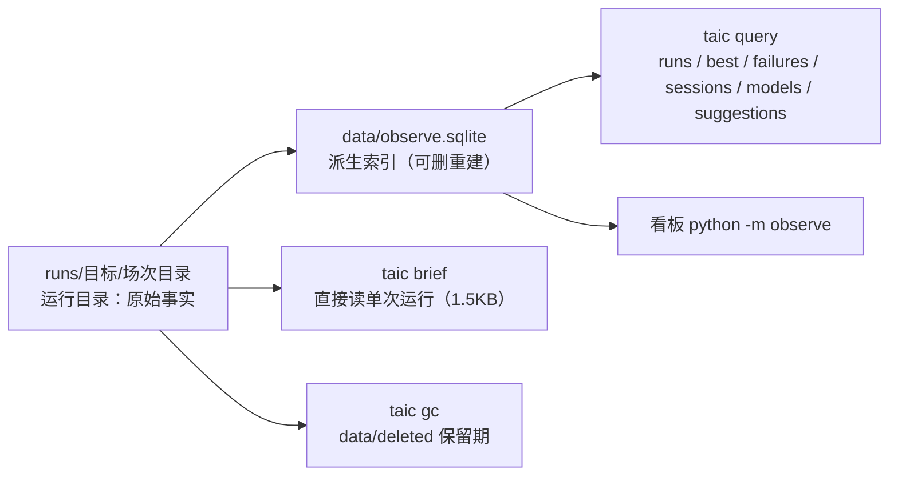
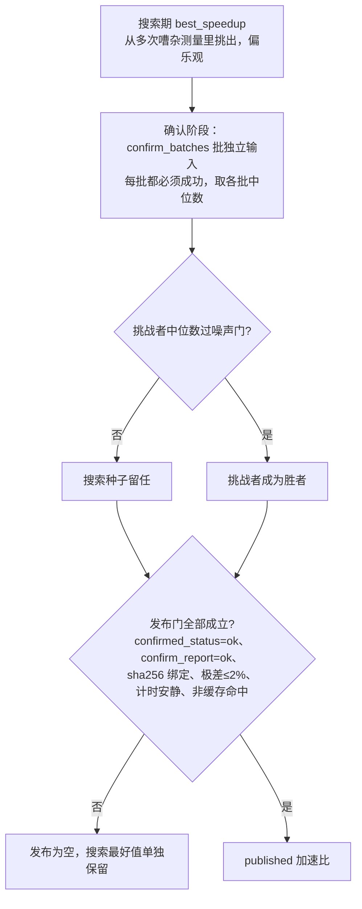
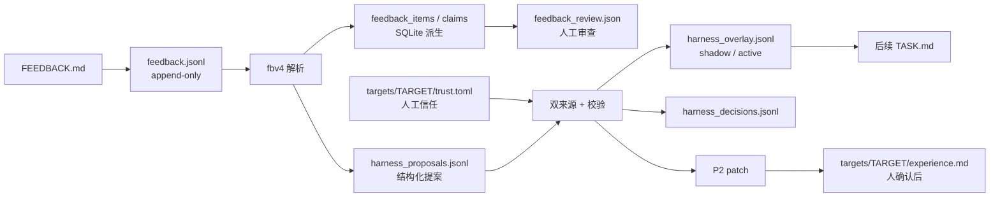

# 数据层：高效、准确、少花钱、方便检索

这一篇只讲数据：一次搜索产生什么、存在哪里、索引怎样建、人和 AI 怎样查、哪些数字可以信、哪些成本已经被省掉。搜索循环本身见 [搜索.md](搜索.md)，评测协议见 [评测.md](评测.md)，看板见 [可观测.md](可观测.md)，政策类决定见 [维护决策.md](../维护决策.md)。索引、检索、迁移和 observe 的测试与运行方式见 [tests/README.md](../../tests/README.md)。

**一句话**：每个事实只留一个权威副本；读取只走索引；测量带协议版本；上下文有字节预算；删除有保留期。

## 这篇讲什么

- **原始事实**（source of truth）是 `runs/` 里的运行目录；`data/observe.sqlite` 是可重建的派生索引（derived index）。
- **写入**尽量少花钱：任务书有 12KB 上限、会话工作区会归档、transcript 默认不落正文。
- **准确**靠协议版本（`PROTOCOL_VERSION`）、噪声门槛和发布门（只有通过确认门才对外发布加速比）。
- **检索**给人用看板，给 AI 用 `taic query` 的分层返回（compact → detail）。

整体数据流：



---

## 0. 十条结论（先看这个）

1. **运行目录是原始事实，SQLite 是可重建的派生索引。** 索引删了可以从 `runs/` 重建；`runs/` 删了不能从索引恢复。
2. **`transcript.jsonl` 只记计费事实、会话元数据和重试/错误事件。** 新的 chat 行默认只写 prompt/reply 的 sha256 与字节数；hmz 会话只有 `agent` 行（token、cost、outcome、model）。review 等非会话扣费不在 transcript，只记在 `ledger.json` 的 `requests`（label `review:<key>`）。759.7MB 的 prompt 正文是旧 chat 协议的遗留，不是当前设计；该数字是 2026-10-22 的量。
3. **TASK.md 有 12KB 上限。** 合同/签名/命令/证据规则必留；成绩单、失败反馈、NOTES、tips、历史按优先级装，装不下的块写明文件路径。真实 conv2d/flash_attention 各约 11.99KB。
4. **`agent_work` 只留固定文件加证据文件。** 固定保留 `NOTES.md`、`FEEDBACK.md`、`self_checks.jsonl`、`TASK.md`、`HARNESS.md`、`.selfcheck/`、交卷文件和本场种子文件；`NOTES.md`/`FEEDBACK.md` 点名的顶层证据文件（探针脚本、`v/` 等）也留在原处，否则 premise 会从 verified 降级。其余归档到 `scratch/<label>.tar.gz`，单归档 50MB 上限。
5. **索引 schema 13。** `runs` / `candidates` / `sessions` / `turns` / `feedback_*`（会话条目、父 claim、子命题、墓碑）/ `experiments` / `arms` / `ledger`，以及第一次 bump 就建好、由后续读模型逐步填充的空表：`failure_members`、`kernel_history`、`run_rollup`、`confirmed_best`、`run_pending_eval`、`gpu_events`/`gpu_waits`/`lock_spans`、`blob_refs` 与 `runs_fts`/`cands_fts`（FTS5 external content）。`lock_span_slots`/`lock_spans_long` 是 `lock_spans` 的派生桶索引（摄取时维护，供时间线有界区间读），`runs_budget_cover` 是预算窄投影的覆盖索引；它们都能从源数据重建。`turns.grp` 是组级 keyset 分页用的投影列。列表用 keyset，候选和会话可直接查；大多数读路径不扫目录，但 `sessions`/`failures`/`models`/`suggestions` 以及 `live_overview`（经 `experiment_jobs`）/`experiment_jobs`/`compare`/`ledger` 会先增量 `tick()`（`best` 走节流的 `discover_new()` 加确认行重摄取，`overview` 只回反馈计数、不 `tick()`）；`experiments` 也只 `tick()`。显式全量核对仍由 `refresh()` / `sync_known()` 保留。
6. **测量有协议版本。** `PROTOCOL_VERSION = "3"`；旧 `flame_chase_1` 通过 `protocol_epoch` 归到上一代。跨协议不平均。
7. **`candidate_serial` 默认关闭。** 2026-10-22 的 3×3 A/B：墙钟 −4~8%，候选中位数 −0.82%/+0.08%/+1.14%（cv 2–4%），无系统偏差。需要时 `--serial` 打开。
8. **完全相同的评测可以复用。** `eval_cache` 的键含 kernel/task fingerprint/seed/reps/mode/target/protocol/measure_serial；同一次 relu 评测 wall 4.41s → 0.68s，报告逐字段相同。不同 seed 的确认批次照常上 GPU。
9. **发布只认确认门。** 重新测量、哈希绑定、批次全成功、批次间极差 ≤2%、计时安静、确认报告不是缓存命中；否则发布为空，搜索最好值单独保留。
10. **删除有 30 天保留期。** `taic gc` 默认只报告；`--apply` 还要再加 `--confirm` 才删除并写审计行。`data/deleted` 在 2026-10-24 约 266MB。

---

## 1. 数据放在哪里

### 1.1 运行目录

```
runs/<target>/<stamp>_<task>_<dtype>_<model>/
  run_config.json        # schema_version=3；配置、题目指纹、target 块、委员会、价格、git 身份、protocol_version、report_schema_epoch、track、task_pack_digest、agent_guidance
  state.json             # 当前检查点（可重建；用于续跑和看板）
  result.json            # 对外发布记录；schema_version / confirmed_* / trace / spent_usd / backend_version
  best.metal             # 获胜内核源码；发布门用它和确认报告的 sha256 绑定
  transcript.jsonl       # 会话计费记录；append-only；chat 正文默认不落盘
  ledger.json            # 账本检查点；review 等非会话扣费也在这里的 requests
  budget_events.json     # 每次生效的加预算/续跑事件（不是完整账单）
  control.json           # 看板/CLI 的加预算请求
  eval_progress.json     # 评测阶段心跳
  execution.json         # 本地/远程评测、发布 site/epoch allowlist、首次观测到的 evaluator identity
  evaluation_outbox/     # 远程正式请求的 pending/completed/unavailable 状态、结果信封、receipt 去重索引
  selfcheck_usage/       # split-control bridge 的 host 侧次数/GPU 秒/hang 记录
  code_promotions/       # P2 补丁、人工 diff 审阅、静态/隔离动态验收记录
  llm.json               # 当前会话/预览状态（含 inflight）
  system_prompt.txt      # 本 run 冻结的系统提示
  agent_guidance/        # 开跑时冻结的 device.md / experience.md / 参考 skill；另记 SKILL.md 哈希
  agent_work/<label>/    # 一场会话工作区；固定文件 + 证据文件（见 §2.2）
  agent_work/<label>/.selfcheck/self_checks.jsonl  # 自检日志，在工作区内；每场开始时清空
  selfcheck_usage/<hash>.seed.json  # split-control 的 host 冻结种子报告，用于 replacement verdict
  candidates/<NNN>_<label>/
                         # kernel.metal / report.json / feedback.txt / NOTES.md；失败候选另有 differential_recheck.json
  rechecks/              # 失败候选的差异复查记录 <label>.json（确认失败也写这里）
  confirm_report.json    # 确认门采用的那一批报告（有确认时）
  confirmations/<instance_key>.json  # v2 确认的逐实例 sidecar（identity、覆盖种类、确认种子、状态）；文件名里 instance_key 的 `/` 写成 `_`
  domain_report.json     # 域扫描结果（只做正确性，不改发布数，见 §3.4）
  feedback.jsonl         # 本 run 的 append-only 代理反馈
  feedback_review.json   # 人工审查记录（可选；claims 下按 seq:digest）
  harness_proposals.jsonl / harness_overlay.jsonl / harness_decisions.jsonl / harness_reviews.jsonl
  harness_reviews/<key>/ # 单次 review 的工作区（HARNESS_REVIEW.json）
  harness_promotions/<key>.patch|json  # 生成的 P2 补丁与元数据
  harness_control.json   # 只能关闭 overlay；不含新权限
  scratch/<label>.tar.gz # agent_work 的归档，硬上限 50MB；超限时改写 <label>.json 清单
  profiles/              # 可选的搜索期 xctrace 结果（r<轮号>_<种子>.txt|json）
  xctrace_profile.txt/json  # profile_best 的收尾痕迹（可选）
  result.before_topup_N.json / state.before_resume_N.json  # 加预算/续跑前的快照（可选）
```

**权威副本规则**

| 事实 | 权威文件 | 派生/可删 |
| --- | --- | --- |
| 每场会话花了多少、token | `transcript.jsonl` 的 `agent`/`chat` 行 | `ledger.json` 汇总；review 等非会话扣费也只在 `ledger.json` |
| 发布什么内核、发布多少 | `result.json` + `confirm_report.json` + `best.metal` | `state.json` |
| 每颗候选的成绩 | `candidates/*/report.json` | `feedback.txt` 是它的可读渲染 |
| 每场的结构化提案格式 | `agent_work/*/HARNESS.md` | 由 TASK 指向；不占 TASK 的 12KB 预算 |
| 会话的输入/输出 | `agent_work/*/NOTES.md`、`FEEDBACK.md` | `scratch/*.tar.gz` |
| 自检预算/挂死 | 本机：`agent_work/*/.selfcheck/self_checks.jsonl` 加 `~/.cache/taic-selfcheck-state/<hash>/self_checks.jsonl`；split-control：`selfcheck_usage/*.json` 加服务端 grant 配额 | 候选目录里的副本；旧 run 的 `session_checks/` 只读回退 |
| 评测执行方式与发布许可 | `execution.json`（`evaluation`、`publishable_site_ids`、`publishable_epochs`、`observed`） | 原始运行事实，随 run 保留；缺失不会被自动可靠重建，续跑读取失败会拒绝或报 `execution_manifest_error` |
| 远程正式请求与结果 | `evaluation_outbox/<hash>.json`、`<hash>.result.json`、`receipts.json` | 服务端幂等记录是另一份；host 只保留请求身份与结果信封 |
| P2 补丁验收 | `code_promotions/<key>.patch`、`.review.json`、`.implementation.json` | `data/review_events.jsonl` 是全局复核哈希链 |

### 1.2 其他目录

- `data/observe.sqlite`：看板和 `taic query` 的派生索引，可删重建。
- `data/deleted/`：看板删除的记录；30 天保留，手动 `taic gc --older-than-days 30 --apply --confirm`。
- `kernels/<target>/<task>/<dtype>/<size>/`：确认内核目录；`best.metal`、`meta.json`，`history.jsonl` 保留每次确认的 `source_sha256`。每次确认的源码同时按摘要写成内容寻址的 `data/blobs/<sha 前两位>/<sha>`，所以 `best.metal` 被更快的确认内核覆盖后源码仍能取回。
- `targets/<id>/`：设备档案（`target.toml`、`device.md`、`experience.md`、本机 `calibration.json`），以及 `trust.toml` / `trust_audit.jsonl`。
- `backends/<name>/`：`backend.toml`、语言/工具链共用的 skill 与 wiki。

### 1.3 旧数据

`runs/` 里 transcript 合计约 725MB（绝大部分是旧 chat 正文），另有约 317MB xctrace XML（2026-10-24 量）。它们**不是当前协议的成本**：旧 chat 每个请求把完整 prompt 写进 `messages`，当前 hmz 只写 `agent` 元数据（通常 1–14KB/run）。旧数据不迁移、不重写；聚合时按 `protocol_epoch` 分桶。

---

## 2. 高效：写入、存储、读取

### 2.1 写入：TASK.md 的字节预算

`taic/kernel_agent.py:render_contract`：

- **必留**：目标、正确性、约束、签名骨架、验证/评测命令、晋升标准、系统工作方式、证据规则。
- **按优先级装**：当前现场（种子 + 部分成绩单）、失败反馈、本运行 harness overlay、上一轮 NOTES、peer tips、最近历史、现场证据、自测对照。
- **装不下**：先裁「当前现场」到剩余字节（种子行和部分成绩单保留），后面的块整块省略；末尾写明「本轮省略」和全文所在文件（`NOTES.md` / `FEEDBACK.md` / `feedback.jsonl` / `state.json`）。
- **上限**：`TASK_MAX_BYTES = 12_000`，省略注记算在内；没有 overlay 时预留 420 字节给注记，有 overlay 时只预留 200 字节，overlay 先占位。
- 上游也收紧：NOTES 2500（TASK 里再压到 1800）、scorecard 1000、history 5 行（渲染时再压到 400 字符）、tips 1500、TIP_KEEP 8。

**实测**：真实 `conv2d` paper 11,999B，`flash_attention` paper 11,989B；两者都保留种子行、部分成绩单、两条命令和截断标记。

### 2.2 写入：会话工作区归档

`taic/kernel_agent.py:prune_work` 在每场会话结束后：

1. 保留 `NOTES.md`、`FEEDBACK.md`、`self_checks.jsonl`、`TASK.md`、`HARNESS.md`、`.selfcheck/`、交卷文件和本场种子文件。
2. `NOTES.md`/`FEEDBACK.md` 点名的顶层证据文件也留着，不归档：例如探针脚本、`v/` 消融源码。删掉它们会让下一条 premise 从 verified 降成 downgraded。
3. 其余（seed `report.json`、guidance 副本、草稿脚本等）打进 `<run>/scratch/<label>.tar.gz`。
4. 归档超过 50MB 就丢弃归档，写一个 JSON manifest（`scratch/<label>.json`；文件名、字节数、原因），仍然删除工作区里的副本。
5. `experiments/prune_agent_work.py` 对历史 run 应用同一规则。

**实测（2026-10-22）**：`agent_work` 从 112.0MB 降到 0.5MB；恢复 91 份 TASK.md 供审计后为 2.6MB / 214 文件。`runs/` 在 2026-10-24 约 1.12GB。

### 2.3 写入：transcript 默认不落正文

`taic/llm.py:chat_transcript_event`：

- `LLMConfig.keep_transcript_bodies` 直接构造默认 **True**（测试/显式审计）；`load_config` 默认 **False**（生产）。
- 关闭时 chat 行只有 `messages_sha256` / `messages_bytes` / `reply_sha256` / `reply_bytes`、usage、cost、finish。
- hmz 的 `agent` 行写 provider/model/committee/outcome/tokens/cost/self_check、`candidate_label`/`attempt`，以及 `runtime` 结构化诊断（session id、失败回合数、最后 `result/failed` 类型、工具调用数、failure_class、错误摘要）。`failure_class` 决定 `provider_retries` 开关下能否重试，但不改变最终 `agent_failure` 停止与 resume 放行。`provider_retry` 只记 scheduled 退避，不记费用。
- 正常 `result` 但没交卷时，响应长度和 sha256 进 `runtime`；最多 240 字的脱敏预览单独写 `agent_diagnostics/<label>-<时间>.json`，transcript 只记 `diagnostics_path`。完整响应、stdout、工具输出和预览不进 SQLite。其它会话不写响应正文。
- 旧 chat run 的 prompt 正文不会因为这次开关变化被删除；它只是不再增加。旧 run 也不回填诊断。

### 2.4 读取：索引不是请求时扫描

`observe/index.py`：

- SQLite WAL，单写者；`meta.index_schema_version` 与代码不一致时删库重建。
- `tick()`：看 `runs/` 自己的 mtime 发现新目录；每 10 秒做一次完整的 `watched` 扫描；运行中的 run 每帧追平。
- 请求路径：`runs_page` / `history` 默认不调 `tick()`，只在 `OBSERVE_REFRESH_ON_READ=1` 时为测试调一次（tick 自身按 0.5 秒节流）。`sessions_page`、`model_stats`、`failures`、`candidates_page`、`feedback_board`、`experiments` 会直接 `tick()`；`suggestions`（compact）也先 `tick()`。`best_confirmed` 不调 `tick()`：它按节流做 `discover_new()`，再只重摄取确认指纹变了的已确认行。`experiment_jobs`、`compare`、`ledger_report` 同样只调增量 `tick()`，`live_overview` 经 `experiment_jobs` 使用同一路径（`overview` 现在只回反馈计数，不 `tick()`）。它们不再在每次请求里全量 `sync_known()`。
- `query.refresh()` 与 `Index.sync_known()` 仍保留给显式全量核对、删除/缺失核对和重建；不要把增量读路径当作磁盘强一致保证。新目录由根 mtime 或 watched 扫描发现，未触发根 mtime 的变化最迟按 watched 周期出现。请求路径并非严格只读：`tick()` 会更新派生索引，但不重新全量入库。
- `history()` 按 `(db 路径, revision)` 缓存；revision 不变不重读 `row_json`。
- `turns` 仍是**懒投影**：重建后 `turns=0`，打开某一场详情才按 `turn_bytes` 建行；transcript 文件没删。

**2026-10-22 的 10 万 run 合成实测**（`experiments/scale_probe.py`，最小 run 目录，`/tmp`）：

| 指标 | 结果 |
| --- | ---: |
| 冷建 `sync_known` | **157.6s** |
| 热 `tick` | **6ms** |
| `history()` | **0.83s** |
| 列表第一页 | **4ms** |
| 列表第二页（cursor） | **2ms** |
| 按 speedup 排序第一页 | **2ms** |
| `best_confirmed` | **0.5s** |
| 索引文件 | **167MB** |

结论：冷建和 `best` 的全表扫描仍是规模成本。冷建是一次性的，`best` 的聚合表是下一步。

**2026-10-25 的 1,000 / 10,000 run 合成实测**（同为最小 run 目录，首次入库与稳态读取分开）：

| 规模 | 首次入库 `sync_known()` | `history()` | 列表页 | `best_confirmed` |
| --- | ---: | ---: | ---: | ---: |
| 1,000 run | 1.506 s | 25 ms | 1 ms | 5 ms |
| 10,000 run | 15.2 s | 65 ms | 1 ms | 48 ms |

| 规模 | `experiment_jobs()` 改前全量核对 | `compare()` 改前全量核对 | `ledger_report()` 改前全量核对 | 模拟增量 `tick()`（三者） |
| --- | ---: | ---: | ---: | ---: |
| 1,000 run | 0.299 s | 0.284 s | 0.276 s | — |
| 10,000 run | 2.883 s | 3.040 s | 3.007 s | 0.0487 / 0.0493 / 0.0533 s |

改后探针把窗口首个请求（cold，强制 watched mtime 扫描）与窗口内热请求（warm）分开：10,000 run 下 cold 为 49 / 49 / 54 ms，warm 为 <1 / <1 / 4 ms，`read_sync_calls=0`，均低于 200 ms。`read_sync_calls=0` 只证明没有调用 `sync_known`；`tick()` 仍按周期做 watched mtime 扫描，只是不重新全量解析 JSON。

### 2.5 读取：keyset、索引、缓存

`observe/query.py:runs_page`：

- keyset 游标是 `(排序列, run_id)`；`started` / `speedup` / `spent` / `updated`。
- 过滤：`task`、`dtype`、`model`、`status`、`target`、`publication`、`min_speedup`、`since`、`experiment_id`。
- 返回 `next`；满页时才给。`offset` 只作为旧调用方的回退。
- SQLite 表达式/部分索引：`runs_live_started`、`runs_live_speedup`、`runs_live_spent`、`runs_confirmed`。
- `feature_grid` 的 `feature_signature` 按源码 sha 缓存；state/result 变化重建格子，但相同源码不重算。
- `detail_stamp`/`stamp` 让详情和 `brief` 可以短路。

---

## 3. 准确：测量、统计、发布

### 3.1 协议版本

- `tcenv/schema.py:PROTOCOL_VERSION = "3"`；写入 `run_config.json`、`result.json`、`EvalReport.protocol_version`、`candidates.protocol_version`。
- 旧 run：`flame_chase_1` 或 `legacy`（2026-10-22 时约 4 / 48 个；数量随归档变化）。`runs_page` 返回 `protocol_epoch`：`flame_chase_1 → 2`，新 run 是 `3`，`legacy` 单独一桶。
- **不要跨 epoch 平均速度、成本或 confirmed 数。**
- 跨 backend 与跨 target 的可比性键只有这一张表，别处引用它，不再重述：

| 用途 | 键 | 说明 |
| --- | --- | --- |
| trust 条目 | `target_id + task + provider/model + effort` | `target_id` 已隐含 backend，不另加全局 backend 键 |
| harness overlay | `(target_id, task, protocol_version)` | target 不同即不共享 |
| benchmark / roofline 聚合 | `backend + protocol_version` | 任一不同都不能算进同一个中位数或发布结论 |
| 提示词信任 | `prompt_sha1`（历史字段名，实际 SHA-256） | 与上表各键独立，提示源文件一变即失效 |

跨 backend 不混算当前是**设计约束，不是数据验收项**：只有 Metal 一个可运行 backend，构造不出真实的混合样本；查询与页面按上表分组实现即可，等有第二个 backend 或历史样本再把它升级成验收。

### 3.2 计费准确性

- `taic/committees.py:_priced` 与 `taic/llm.py:load_config` 用同一个表达式设置 `price_cache_write`；第二个委员会换 provider 时不再继承第一个委员会的 cache-write 单价。
- 每个 provider attempt 的 session/work/submission 标签唯一（`r3.p0`、`r3.p0.retry1`…），候选标签另行记录。resume 逐条累加所有 agent attempt 的账单，`provider_retry` 调度事件不重复收费；`state.provider_attempts` 恢复下一条 attempt，最近会话成本也按逐次账单恢复。
- `CostLedger.add` 记录 `hit/miss/write/out`；`charge(usd, tokens=..., basis=...)` 记录 hmz 会话的 token 分解和当时的价表；`summary()` 暴露 `input_tokens_cache_write` 与 `cost_basis`。
- 历史补账：`experiments/reprice_runs.py` 从 transcript 的 `agent.tokens` 重算，写 `cost_recomputed.json`，**不改 `spent_usd`**（预算门用的是当时记录值）。

**会话成本效率（读时派生，不改 schema 13）**：`sessions_page()`、`model_stats()`、`result.model_totals` 和 `taic query sessions/models` 使用同一口径：

| 字段 | 公式 | 返回 `null` 的条件 |
| --- | --- | --- |
| `cache_read_per_output` | `tokens_cache_read / tokens_output` | 输出为 0、缺失或非法 |
| `usd_per_1m_output` | `cost_usd * 1_000_000 / tokens_output` | 输出为 0，成本缺失或非有限数 |
| `cost_per_session_usd` | `cost_usd / sessions` | 仅聚合行；会话数为 0 或成本缺失 |
| `sessions_with_cost` | 有有限 `cost_usd` 记录的会话数；与 `sessions` 一起给出成本覆盖 | 无；它不是效率比率 |

按模型/委员会聚合时必须先分别 SUM 原始 token、成本和会话数，再算比值，不能平均每场比值。`cost_per_session_usd` 的分母按本批约定是**全部会话**，包括没有成本记录的会话；因此覆盖不全时它是场均下界，`usd_per_1m_output` 也只是已记录成本的下界。用 `sessions_with_cost / sessions` 看出覆盖，不要把下界当成完整场均。原始四类 token 与 `cost_usd` 不变；输出 token 包含 reasoning，不称作“有效产出”。旧 run 缺 token 时沿用现有 0/缺失语义，不回填、不造数，也不用今天的价目表重算历史账单。

这些比率只对已有记录做算术，**不证明成本完整**。`sessions` 没有 `cost_incomplete` 列；原始 `agent.cost_incomplete` 以及 result/详情已有的成本不完整说明保持不变，不能把派生值非空解释为账单已经补齐。

`runtime.result_turns` 只数 `kind=result` 的终态事件，`runtime.failed_turns` 只数失败终态，`runtime.tool_calls` 是工具调用数；三者都不是总模型回合数。本批页面只展示“工具调用”，不从这些字段或 cache_read 推导、虚构 `model_turns`。

`Index.ensure_sessions` 用 `sessions_fp` 比较 transcript 的 `(mtime_ns,size)`，用 `sessions_bytes` 只投影新增完整行；首次、文件变短或等长内容改写走全量重建，避免把等长改判成“没有新增”。两个游标都在 `meta`，删除/移动 run 或切换 runs_root 时清理，不改 schema。`GET /api/v2/runs/{id}/sessions?stamp=` 的 stamp 由源指纹、总会话数和 limit 组成：没变时先回 `same`，不进入投影；变化时才增量追平，超过 limit 后的新增也会改变 stamp。`GET /api/v2/model-stats?run=<id>` 与详情模型费用表共用实时聚合；不带 run 的全局 models 只追平 `status=running` 的少量活跃 run。历史 run 的带外 transcript 修改由下一次读取该 run 的 sessions/models 追平；`refresh()` 本身并不重投影 sessions。`result.model_totals` 作回退。transcript 大于 1MB 时（`flame_chase_1` 也一样）清空投影并跳过，不是全量重建。

2026-10-22 重算：

| run | 记录 | 重算 | 差额 |
| --- | ---: | ---: | ---: |
| flash_attention-20261022-2 | $13.3334 | **$18.2056** | +$4.8722 |
| conv2d-feedback-20261021 | $15.2199 | **$20.5391** | +$5.3191 |
| conv2d-flame-20261020 | $7.8743 | **$10.7351** | +$2.8608 |

### 3.3 计时

- 候选与 MLX / PyTorch 交错测同一把 `perf_counter` 墙钟；候选窗口含 encode（和 `mx.eval` / torch 启动循环对齐）。
- 每批 `reps` 次，取中位数；CV 是批内重复的标准差/均值。
- `candidate_serial`（严格串行派发）默认关闭：它不参与选种子、不参与发布，A/B 显示关掉后墙钟下降 4–8%，候选中位数变化在 cv 内。
- 需要串行对照时：`tcenv eval --serial` 或 `measure_serial = true`。

### 3.4 统计与发布门

- 换种子要同时过 `min_improvement` 和 `noise_z` 个标准误；`speedup_se` 来自报告自己的 cv/reps。
- 确认阶段：每颗候选跑 `confirm_batches` 批独立输入；**每一批都必须成功**；同一批的并列候选共用一个种子；取各批中位数。
- `choose_confirmed`：搜索种子留任，除非挑战者的中位数同时过 `min_improvement` 和「重复内 SE + 1% 输入批次下限」合成的噪声门。
- 发布：`conclusion_of_run` 要求 `confirmed_status=ok`、`confirm_report` 状态 ok、`confirmation_source_sha256 == best.metal == winner kernel.metal`、`batches_agree`（极差 ≤2%）、`timing_is_uncertain` 为假，且 `confirm_report.cache_hit` 不为真（缓存复述不算复测）；否则发布为空。
- `reps < 2` 视为不确定；`cv=0` 的单次测量不能当安静。
- 域扫描（`domain_report.json`）只做正确性，不改发布数。



### 3.5 评测缓存

`tcenv/evaluate.py` 的 `eval_cache`：

- 键：`EVAL_CACHE_SCHEMA`、`PROTOCOL_VERSION`、task fingerprint、`evaluation_fingerprint`、backend/backend_version、target、kernel sha256、seed、reps、cases、mode、validate、fast_bench、require_contract_launch、measure_serial。`evaluation_fingerprint` 覆盖输入生成、参考实现、误差缩放与基线可执行身份；只改 task fingerprint 不足以说明缓存可复用。
- 只缓存 `status=ok`；不同 seed 的确认批次不会命中；`fast_bench` 不缓存（基线集合可能变）。
- 命中时返回原报告并标 `cache_hit=true`；`--timed` 自检会追加一条 `cached` 记录，不占 GPU。
- 同一次 relu 评测：wall **4.41s → 0.68s**，`candidate_us`/`speedup` 逐字段相同。
- 远端评测不走宿主侧这套缓存：结果放在 `evaluation_outbox/`，远端 worker 用服务端自己的 `tcenv` 缓存；`cache_policy=disabled` 必须在服务端生效。缓存与 epoch 的边界见 [执行运行时与设备扩展.md](执行运行时与设备扩展.md) §5。

### 3.6 来源与可复现

`run_config.json` 记录（`schema_version=3`）：target 块（`id`/`backend`/`backend_version`/`display_name`）、git commit + dirty、task fingerprint、committee/model、解析后的价格、`protocol_version`、`report_schema_epoch`、`task_mode`、`track`、`task_pack_digest`、`presentation_sha256`、`effective_correctness_only`、`launch_protocol`/`loop_protocol`、system prompt sha1、contract hash、Triton 源码 hash（v2 运行哈希空字符串）、search 配置，以及 `agent_guidance` 文件哈希。`execution.json` 另记评测模式和发布 allowlist；第一次评测后写入 `observed` 的 site/device/backend/build/task pack/calibration/protocol 摘要，resume 与后续结果都按它校验。

`result.json` 记录 target/backend/backend_version/protocol、trace、candidate 表（含 origin）、ledger 摘要、`model_totals`、`best_*`/`winner_*` 归属、confirmed_values，以及 `confirmations`（每颗候选的批次与 `failed_batches`）。`model` 仍是启动主模型；胜者可能是另一委员会。

实验：`experiments/manifest.py` 的 `experiment.json`（kind/driver/frozen/config_hash/arms/budget_extensions）；p1/repeat 这类旧目录可以用 `python -m experiments.manifest --backfill ROOT --kind suite --driver p1_runs` 补 arm 并 attach 现有 run。当前 `runs/apple-m4-max/p1/experiment.json` 有 11 臂（2026-10-24 核对）。

`kernels/` 的 `best.metal` 会被更快的确认内核覆盖，历史行只留 `source_sha256`；源码本身按摘要写进内容寻址 blob（`taic/kernel_catalog.write_blob` 与目录史同一处写），`blob_refs` 由索引按目录史登记引用，`taic blobs` 默认只报告、`--prune --apply --confirm` 才按 365 天保留期删，`/api/v2/publications/{sha256}/source` 直接读它——源目录过了 30 天 TTL 也还能取回源码。

---

## 4. 少花钱：token、GPU、LLM

### 4.1 每场会话的固定开销

TASK.md 的 12KB 上限把每场上下文从「26.6KB 级」压到「11.99KB 级」；重复 21–64 场/搜索，省的是每场固定的几千 token。NOTES 只给尾部摘要，tips 有字符预算和 digest，不再每场整段重发。

### 4.2 GPU 计时

- 关闭 `candidate_serial`：墙钟 −4~8%（conv2d/flash/relu 的 A/B）。
- `eval_cache`：完全相同的评测不再上 GPU；resume/重复调用直接读报告。
- 确认批次仍按不同 seed 测，不为了省钱复用同一批输入。
- `profile_poor`/`profile_best` 默认关闭；xctrace 有 `profile_max` 上限。
- `max_hangs=1`：一次挂死就停，避免 GPU 冻屏和后续排队。

### 4.3 LLM 花费

- 计费修复后，第二个委员会的 cache-write 不再漏记；预算门按真实花费停，而不是按低估的账。
- 搜索的预算门在每个会话前检查；`relay_budget_usd` 只是单场输出 token 的指导，不是硬上限；`budget_usd` 是发请求前的门，已经在飞的请求仍可能让它略微超出。
- `unchanged`/`agent_failed` 会话仍计费；是否调整 `patience` 需要试点数据，不在默认里改。
- 委员会轮换会打断前缀缓存（prompt prefix cache）；这是策略选择，不是数据层能单独修的。

### 4.4 存储

- 2026-10-24 复核：`runs/` 约 1.12GB；transcript 合计约 725MB（绝大部分是旧 chat）、XML 约 317MB、`agent_work` 约 26.5MB、`candidates` 约 25.6MB、`scratch` 约 6.8MB，其余约 14MB。
- 新的 chat 正文默认不落盘；旧数据冷归档/不迁移。
- `agent_work` 归档后从 112MB 降到 0.5MB（2026-10-22 实测；恢复 TASK 后 2.6MB）。
- `data/deleted` 30 天 TTL；`taic gc` 默认 dry-run，`--apply --confirm` 才真删。

---

## 5. 方便检索：人 + AI 共用一个读模型

### 5.1 索引表

schema **13**：

| 表 | 一行是什么 | 关键列 |
| --- | --- | --- |
| `runs` | 一次搜索 | task/dtype/size/target_id/model/status/stop_reason/publication/published_speedup/spent_usd/protocol_version/kernel_sha256/committees_json；row_json 另带 winner_* provenance |
| `candidates` | 一颗候选 | run_id/idx/label/status/stage/speedup/within_noise/eligible/kernel_sha256/protocol_version；result.candidates 另带 origin |
| `sessions` | 一次 hmz attempt（冷建不投影；第一次读 `sessions`/`model_stats` 或巡检时按 transcript 懒投影，>1MB 一律跳过，`flame_chase_1` 同样受限） | run_id/seq/label/candidate_label/attempt/committee/provider/model/outcome/cost_usd/session_id/failed_turns/last_kind/failure_class/error/tool_calls/diagnostics_path/tokens_* |
| `turns` | 一条模型事件（懒投影） | run_id/seq/label/kind/grp/row_json；`grp` 是组级 keyset 分页的投影列 |
| `feedback_items` / `feedback_claims` | 反馈与主张 | 场、小节、状态、digest、topic、premise、placeholder_items |
| `feedback_subclaims` | 一条父 claim 下的子命题 | 父 digest、子序号、文本/sha256、状态、证据来源、backend/target_id |
| `feedback_claim_removed` | 被解析器或退役删除的主张墓碑 | run_id/seq/digest/status/reason |
| `experiments` | 实验清单 | experiment_id/kind/driver/config_hash/status |
| `arms` | 实验的一臂 | experiment_id/arm_id/delta_json/planned_n/task_fingerprint |
| comparability key（`observe/compare_key.py`，非表） | `compare` 的可比性分组键：`sha256(canonical({task,dtype,size,budget_usd,protocol_epoch,frozen 的题目/规模/预算}))[:12]`，不含 `delta`（delta 由 `binding=drift` 在摄入时判定） | — |
| `ledger` | 花费账本 | run_id/operator/month/started_at/spent_max_usd/budget_usd |
| `ledger_carryover` | 一次结转 | total_usd/origin/sha256 |
| `watched` | 目录 mtime | path/mtime_ns |
| `run_parents` | 直接包含 run 的目录（发现新 run 只 stat 这一小撮父目录） | path |
| `confirmed_best` | 已确认运行的物化排序行（由写路径维护；`confirmed_at` 是确认报告的 mtime，不是 `started_at`） | run_id/task/dtype/size/target_id/protocol_epoch/published_speedup/kernel_sha256/confirmed_at |
| `kernel_history` | 目录史 `kernels/.../history.jsonl` 的派生投影（`patrol` 的 best 与发布史数据源；每条确认一行，`updated_at` 是确认时刻）。由 `Index._sync_kernels()` 在 10 秒全扫分支整表重建（按目录史 `(mtime_ns,size)` 总指纹短路；`kernels/` 缺失时只 glob 一次、不读 JSON）；`run_id` 按 §8.1/§8.2 解析（含 `/` 精确命中 → 后缀唯一 → `winner_label` → `source_sha256` 联合消歧），解析不到时为空并置 `source_unknown=1` | target_id/task/dtype/size/seq/run_id_raw/run_id/winner_label/source_sha256/confirmed_speedup/confirmed_values_json/candidate_us/baseline_us_json/task_fingerprint/calibration_sha256/updated_at/source_unknown |
| `run_pending_eval` / `failure_members` / `run_rollup` / `blob_refs` | `run_pending_eval` 与 `failure_members` 由 `_upsert_run` / `_upsert_candidates` 在摄取时维护；`run_rollup` 由 `_upsert_run` 在同一事务里“先减旧桶、再加新桶”，删除/移动/失联走同一规则，键含 `day/task/dtype/size/target_id/protocol_epoch`；删除/移动后 `runs <= 0` 的桶删除 | 见 `_create()` |
| `gpu_events` / `gpu_waits` / `lock_spans` | 机全局 GPU 锁事件的派生索引 | 事件 `(t,pid,kind,mode,what)`；未配对 wait 每 pid 一条（`seq` 保留进入顺序）；已配对区间带 `closed_at` |

机全局 `gpu_events.jsonl` 超过 `TCENV_GPU_EVENTS_MAX_BYTES`（默认 8MB）时，写者把它改名保留成 `<name>.<时间戳>` 分片，**不自动删除任何分片**；索引在 inode 变化后按分片重放，删库重建必须得到逐行相同的历史。旧分片只能由运维显式清理，索引发现已记录的分片缺失或变短时会标 `gpu_events_truncated`，不假装完整。
| `runs_fts` / `cands_fts` | FTS5 external content 投影 | runs: run_id/task/dtype/target_id/model/stop_reason；candidates: label/message |

计数随运行变化，不在文档里写死。`turns` 冷建后为 0，打开某一场详情后才增长；`runs`/`candidates`/`sessions` 随目录增长。

### 5.1.1 反馈、信任与 harness overlay

反馈、信任与 harness 的理论和流程图见 [../可信harness/架构与理论.md](../可信harness/架构与理论.md)。这一节的要点：

- 运行目录里的 `feedback.jsonl` 是原始记录；`feedback_review.json` 是人工审查，条目可选 `subclaims` 保存一个父 claim 下的多个子命题状态。
- 索引的 `feedback_claims.status` 除了 `pending`/`adopted`/`rejected`/`done`，还接受 `info`（未验证/开放问题）和 `obsolete`（空占位/重复/退役）。
- 审查读取时会按同 `digest`+`task`+`target_id` 附上更早 claim 的 `prior`，用于避免重复验证；它是精确文本匹配。审查事件还记录自动取得的 git reviewer、method/batch、审查时 HEAD/dirty 和可选的 expected_status。
- 批量审查先 dry-run、全部校验后一次写入；`data/review_events.jsonl` 是可选的哈希链台账（`TAIC_REVIEW_EVENTS` 可覆盖），只存证据/note 哈希和身份，不复制长原文。
- 子命题有独立索引，父 claim 的 `prior`/`similar` 也会把开放子命题的文本纳入匹配。pending 行还会用本地 `NLEmbedding` 句向量附 `similar`，仅在同 task/target 内做近义检索，不联网、不调用模型；结果只是提示，不是自动结论。
- 解析器版本 `fbv4`。重建时如果 `feedback_parser` 变了，会重新读 `FEEDBACK.md`，按旧 digest 匹配 `sections` 里的原始片段，恢复被旧解析器擦除的正文并把探针已恢复的降级前提升为 verified；旧 digest 和审查键保留，不再生成空占位 claim。被删的 claim 进 `feedback_claim_removed`，墓碑保留 `status` 和 `reason`。

运行目录与 target 目录里另有这些文件：

| 文件 | 内容 |
| --- | --- |
| `targets/<id>/trust.toml` | 人工授予的 `(task, provider, model, effort)` 信任；绑定 `prompt_sha1`、协议版本、scope、过期时间 |
| `targets/<id>/trust_audit.jsonl` | 追加式 grant/suspend/revoke 审计 |
| `runs/<run>/harness_proposals.jsonl` | 结构化提案及校验结果（含 invalid 原因） |
| `runs/<run>/harness_overlay.jsonl` | 影子或生效的 overlay 事件；带 target/task/protocol/evidence sha |
| `runs/<run>/harness_decisions.jsonl` | 去重后的 shadow/apply/reviewed_active/promotion/suspend 决策；旧记录里还可能看到 `reviewed_shadow`/`promotion_approval`/`promotion_commit` |
| `runs/<run>/harness_reviews.jsonl` | 独立只读 review：reviewer、useful/confidence、证据/风险、价格预算/实际成本 |
| `runs/<run>/harness_control.json` | 只允许关闭 overlay；不含新权限 |
| `agent_work/*/.selfcheck/self_checks.jsonl` | 评测命令追加的 timed 自检；含 target、协议、内核 SHA、candidate_us/speedup，供 `premise` 信任门匹配 |

`trust.toml` 的 `prompt_sha1` 字段名沿用旧名，值实际是对提示函数源码、模板常量与技能文档逐项取字节、按标签拼接后算出的一个 sha256：`taic/prompts.py` 的提示函数与 `HARNESS_RULES`/`MIXED_PLANS`/`WIKI_DOCS`，`taic/kernel_agent.py::render_contract`/`_cap_task`，`taic/harness.py::TEMPLATE`/`write_template`，目标档的 `experience.md`/`device.md`（按 `target_id` 解析），`taic/flows/kernel_once/skills/taic-tools/SKILL.md`，以及目标 backend 自动收集的 `backends/<id>/skills/*.md`（跳过 `_template`）。

同一文件里的计费、进程等非提示代码改动不影响指纹；提示函数、模板常量或技能文档的字节变化会让旧授权失效。目标文档按 `target_id` 解析，不同 target 的指纹不同。



`harness_auto` 默认关，`harness_shadow` 默认开，`harness_review` 默认开（单来源 tip 的独立 review）。`tip` 要两个委员会的不同 provider/model、都有 active 信任，并带两份 SHA 不同的本场探针；`premise` 不走双模型投票，但需要本场探针、active `overlay:premise` 信任和匹配的 self-checks/外层报告。overlay 进入 TASK 时受同一 12KB 预算，标题标明“不是合同，不是事实”。

### 5.2 AI 入口

```bash
uv run python -m taic.cli brief RUN_DIR            # L1 JSON（≤1.5KB）；无 GPU、无模型
uv run python -m taic.cli brief RUN_DIR --expand cands,models,failures   # 候选清单/模型费用/多场失败
uv run python -m taic.cli brief RUN_DIR --gpu      # 需要机器级 GPU 锁事件时才加
uv run python -m taic.cli query runs --task gemm --publication confirmed --sort speedup --limit 5 --jsonl
uv run python -m taic.cli query runs --limit 5 --wide                     # 旧的 22 列宽行
uv run python -m taic.cli query patrol                                    # 一屏判定，≤1.5KB
uv run python -m taic.cli query best --task gemm --limit 5
uv run python -m taic.cli query failures --status abi_error --task relu --limit 20
uv run python -m taic.cli query sessions --run apple-m4-max/conv2d-feedback-20261021 --jsonl
uv run python -m taic.cli query models --limit 5
uv run python -m taic.cli query capabilities

# 自由文本系统建议：默认只返回按 digest 聚合的预览，不返回全文
uv run python -m taic.cli query suggestions --task flash_attention --status pending --limit 20 --preview 80
uv run python -m taic.cli query suggestions --task flash_attention --limit 20 --offset 20 --preview 80
uv run python -m taic.cli query suggestions --task flash_attention --jsonl

# AI 选中某一组后，才取该条的全文
uv run python -m taic.cli query suggestion --run apple-m4-max/flash-attention-pilot-20261022 \
  --seq 4 --digest 9db07fe836501244
```

`query suggestions` 先用 SQLite 的 `feedback_claims` / `feedback_items` 计算过滤后的总数、按 digest 分组并分页，再只为当前页的每个 digest 读一条代表性 `feedback.jsonl` 记录，返回 `preview`；`query suggestion` 才返回完整句子、来源和是否已转结构化/已 review。这样 AI 第一阶段只看几十行统计，不必把所有建议全文塞进上下文。索引本身不存文本，全文仍以运行目录为准。

`taic query` 不发模型、不上 GPU；`runs`/`capabilities` 默认不写索引（`runs` 在 `OBSERVE_REFRESH_ON_READ=1` 时会先 `tick()`），`failures`/`sessions`/`models`/`suggestions` 会先 `tick()` 追平派生索引，`best` 走节流的 `discover_new()` 并重摄取确认指纹变了的行（不是 `tick()`），`patrol` 会刷新目录史投影（`kernel_history`，不是 `tick()`），因此都不是严格只读。`sessions` 与 `models` 返回上述成本效率字段，和看板共用同一口径。

`brief` 默认是 L1：`schema_version`、`protocol_version`、`stamp`、task/dtype/size、committee/model、phase、stop_reason、round、`spent_usd`/`budget_usd`、published/publication、search_best、`candidate_us`/`baseline_us`（`baseline_us` 按真实 schema 是 `{基线名: 微秒}` 字典）、`last_failure`（最近一条失败，带会话 `sig`）、counts、paths（仓库相对）、`pending_evaluation`（pending/unavailable 计数及请求 status/error_code/retryable）、可选 `gpu`。候选清单（最多 8）、模型费用与完整失败列表要 `--expand cands,models,failures` 才出现；`--kernels` 支持 `--limit/--cursor`。不含消息正文、内核源码、绝对路径。

### 5.2.1 自由文本建议：先 compact，再 detail

自由文本建议不适合直接作为 AI 的上下文：索引能定位 claim，但 `feedback_claims` **不存正文**，正文在运行目录的 `feedback.jsonl`。`taic query suggestions` 因此分两段：

1. **compact**：用 SQLite 过滤，在**整个过滤集合**上计算 `total_claims` / `total_groups`，按 `digest` 聚合并分页；只为当前页每组读一条代表性 `feedback.jsonl` 记录，返回 `preview`（默认 120 字符；CLI 常用 80）。
2. **detail**：AI 选中少量 digest 后，按 `run/seq/digest` 取完整正文、转换状态和 review。

```bash
# 第一段：只给 AI 统计 + preview
uv run python -m taic.cli query suggestions --task flash_attention --status pending --limit 20 --preview 80
uv run python -m taic.cli query suggestions --task flash_attention --limit 20 --offset 20 --preview 80
uv run python -m taic.cli query suggestions --task flash_attention --jsonl

# 第二段：只取选中的一条全文
uv run python -m taic.cli query suggestion \
  --run apple-m4-max/flash-attention-pilot-20261022 --seq 4 --digest 9db07fe836501244
```

HTTP 对应：

```text
GET /api/v2/suggestions?task=&target=&model=&status=&limit=&offset=&preview=
GET /api/v2/suggestion?run=&seq=&digest=
```

`compact` 的组字段：`digest`、`claims`、`runs`、`tasks`、`models`、`targets`、`statuses`、`first`、`preview`、`converted_key`、`reviewed`。`total_claims` / `total_groups` 是过滤后的总数；`returned_groups` 是当前页组数，`limit` 只限制返回组数，不会把全文带出来。返回还有 `offset`、`next_offset` 和 `truncated`：`truncated=true` 表示后面还有组，用 `next_offset` 继续翻页；`next_offset=null` 表示当前页已到末尾。分页在 SQL 层完成，不再用固定 5000 行截断后冒充满量统计。

`converted_key` 与 `reviewed` 只描述 `first` 所指的代表性 claim（响应中的 `link_scope` 会明示）。它们按 `run_id#seq#digest` 精确匹配；同 digest 的其他场次可能另有转换，不能把代表性 claim 的空 `converted_key` 当成整组都未转换。`query suggestion` 还返回该场的 `session_started` 和已转换提案的 `probe_time_verified`，这样 AI 在决定是否转换前能看出探针时间是否可验证。

实测（2026-10-22，flash_attention 的 12 条自由文本建议）：

```text
compact JSON（limit=20、80 字 preview）  5,515 bytes
全量 collector JSON                        20,030 bytes
```

约 **3.6×** 的上下文节省；如果只对选中的 2–3 组调用 detail，实际节省还会更大。当时（2026-10-22）索引里有 36 条系统建议 claim、36 个 digest；用 `--limit 20` 时 compact 只给前 20 组并返回 `truncated=true`，不会一次把 36 段全文交给模型。这个字节数是在加入分页字段前测的；分页字段只增加少量元数据。

边界：

- `digest` 是精确内容哈希；同一主题但改写过的建议是不同 digest。compact 不自动做语义聚类；AI 仍需根据 preview 自己归并候选，或对选中的 digest 取全文再判断。
- preview 会截断上下文；不要只凭 preview 做“有用/无用”或改代码的决定。
- 索引的 `feedback_claims` / `feedback_items` 是派生数据；正文仍以运行目录为准。索引刷新有节流，刚写完 run 后先按现有 `taic query` 的约定刷新/等待。
- 这只是检索层省 token；它不改变 review、信任或 P2 的人工闸门。

### 5.3 分层返回（token 预算）

| 层 | 预算 | 内容 |
| --- | --- | --- |
| L0 | ≤200B/行（已满足）；页预算 20 行 ≤5KB | `run_id`、`publication`（短码）、`published_speedup`、`stop_code` |
| L1 | ≤1.5KB | `brief` 默认：状态/停止原因/公布与搜索最优/`candidate_us`/`baseline_us`/预算/最近一条失败（带会话 `sig`）/计数/`paths` |
| L2 | 显式请求 | `query runs --wide`（22 列）、`brief --expand cands,models,failures`、`query patrol` 之外的 report/kernel/feedback 全文 |

`stop_code` 是摄入时写的窄列：`stop_reason` 里冒号前的第一段，再取这一段里的第一个词，≤24 字符（规则版本记在 `meta.stop_code_rule`；打开索引时若版本不符就只重算这一列一次，旧库立刻与当前规则一致，之后不再重算）（实测最长的一条 `stop_reason` 有 224 字符，是 HTTP 402 provider 错误）。取第一个词是为了“每类停止一个码”：真实语料里 8 行是 `converged (12 rounds without improvement)` / `converged (4 rounds ...)`，按字符截断会得到两个码，机器筛选就失效了。完整文本只在 `--wide` 与详情里。`publication` 在 L0 用 `confirmed/in_progress/unconfirmed/uncertain/legacy` 短码（原始值 `不确定` 也有短码；`--publication` 过滤吃短码也吃原始短语），中文短语留给 UI。

L0 的行是**砍过字段**的四列：plan §6.1 最初列了七字段（另加 `task`/`spent_usd`/`updated_at`），但真实最长 run id 有 73 字符，七字段最坏 276B；plan §0.3 第 6 条明确“字段放不下就砍字段，不改预算”，于是只留句柄、可发布性、已发布数值与停止码。`task` 用 `--task` 过滤，`spent_usd`/`updated_at`/完整 `stop_reason` 都在 `--wide` 的 22 列里；`stop_code` 仍是摄入时写好的窄列（`stop_reason` 冒号前第一段的第一个词、≤24 字符；实测最长的一条 `stop_reason` 有 224 字符，是 HTTP 402 provider 错误）。

实测（63 场真实索引，plan 的序列化口径 `len(json.dumps(row, ensure_ascii=False, separators=(",", ":")).encode("utf-8"))`）：四列单行 min/median/max = 98/125/190B，全部 ≤200B；`--limit 20` 整页（含 envelope 与游标）3.0KB ≤5KB。`tests/shared/test_query_token_budget.py::test_the_real_index_l0_rows_meet_the_authoritative_200_byte_budget` 是普通、必须通过的真实索引断言。

其余实测：`brief` L1 在 36 个带确认报告的真实 run 目录上最大 1,207B（`baseline_us` 按真实 schema 是 `{基线名: 微秒}` 字典，不是标量）；`query failures` 单行 ≤426B（message 脱敏、单行、≤120 字符）；`query patrol` ~1.4KB ≤1,536B，超预算时连协议纪元这类固定元数据也按项、按字符截断并置 `truncated`（含 `epochs`）。`patrol` 的 `best` 是每个 `(task, target)` 一行：`published_speedup` 取该组当前最佳、`confirmed_at` 取该组最后一次确认。数据来自 `kernel_history`——它由 `kernels/<target>/<task>/<dtype>/<size>/history.jsonl` 增量投影而来（§6.4 指定的数据源）：目录史在每次发布确认时追加，`updated_at` 是**确认时刻**（不是 run 的开始时间），发布丢失时也不会像 `confirmed_best` 那样删行。`patrol` 读取前按目录史的 `(mtime_ns,size)` 总指纹做一次整表重建（只有变化时才重读；没变化时只 stat 几次），因此删库后能重建出同样的历史。

`run_detail` 是给人看的全量（首屏 44.7KB/363ms 量级），AI 不应直接读它。

#### 5.3.1 分析面板（§8.4）

三个端点各一个 `GET` + `stamp` 短路。**聚合永远在完整过滤集上做，行/桶上限只限制展示**：gap 返回真实的 `published_total`，各组中位数与秩相关都按全部运行算；每个面板最后按 UTF-8 字节预算收口（先截展示文本、再从尾部丢行/桶，≤8KB 并置 `truncated`）。10k 合成下 p95 ≤150ms（slow 测试 `test_analysis_panels_stay_under_150ms_p95_on_ten_thousand_runs`）。

- 纪元口径：三个面板都用同一个规则——匹配集跨多个 `protocol_epoch` 又没给 `protocol_epoch` 时返回 400 并列出可选纪元；**空库/空过滤集不是混纪元**，返回 200 的空面板（epoch 为空串）。
- 分组键：gap 的组与 committees 的桶都用 PR12 的统一可比性键 `(task, dtype, size, target_id, protocol_epoch, arm_id or '')`（`compare_key.comparison_group`），不同 dtype/size/target/arm 不混；组/桶样本 <5 时只给点/计数，不给中位数。
- `GET /api/v2/publications?task=&target=&dtype=&size=&stamp=
GET /api/v2/gap?protocol_epoch=&task=&target=&stamp=`：每场**已发布**运行的 `search_best`、`published`、`signed_delta_pct=(published/search_best−1)×100`、确认报告里的 `cv` 与 `n_batches`。`published` 取自 `conclusion_of_run` 写下的 `published_speedup` 列，**不用 `result.confirmed_speedup`**（门失效时后者仍有值）；不发布的运行只进 `unpublished` 计数。`rank_correlation` 是 cv 与落差的 Spearman，只在 n≥20 时给。
- 每美元（同一 `gap` 响应）：`usd_per_100pct_gain = spent_max_usd / max(published−1, ε)`（**只有** `published ≤ 1` 返回 null 并计入 `excluded`），`usd_per_confirmed = spent_max_usd`；响应里的 `usd_note` 明确这是替代口径。`gain_per_usd` 保持原样（基线缺失时仍显示“基线加速比缺失”，不补数）。
- `GET /api/v2/committees?task=&protocol_epoch=&stamp=`：**单位是 session 不是场**，按统一可比性键 + `committee/provider/model` 分桶（不跨题、不跨配置平均），`session ⋈ candidates on (run_id, candidate_label=label)`；成本口径与 `model_stats()` 一致（复用 `efficiency_fields`：先 SUM，再除以**全部** session；没有一条会话记成本时不给比值），`sessions_with_cost < sessions` 时 `cost_is_lower_bound=true`；`committee=''` 的会话是显式桶（`totals.empty_committee_sessions` 单独报）。逐桶 `insufficient`，全局 `insufficient` 只是“有没有不足桶”，并用 `insufficient_buckets` 点名。
- `GET /api/v2/noise?task=&protocol_epoch=&stamp=`：候选 `cv` 的 p10/p50/p90（最近秩）、`reps` 分布、`cache_hit` 覆盖率（`known/total`；**缺失不算 false**，`true`/`false` 分开报）。与 gap 同一个纪元口径，不跨纪元暗中汇总。
- 界面：`#view-analysis` 由顶栏「分析」打开，三个面板各自 `stamp` 短路；折线用内联 `<svg><polyline>`，最多 200 点，n<5 时只画点并显示“样本不足以判定”。gap 显示真实的已发布总数与截断提示、cv/批次数与秩相关；committees 逐桶标“样本不足以判定”并点名不足桶；noise 显示 reps 分布与 cache_hit 覆盖率。

#### 5.3.2 发布史与原因码（§8.1-8.2，PR14）

- `GET /api/v2/publications?task=&target=&dtype=&size=&stamp=`：每行目录事实 + 环比 + 当前发布判定。字段：`updated_at`、`catalog_confirmed_speedup`（历史事实）、`delta_vs_prev`（同一 `comparability_key` 内按目录行序相邻两条的环比 %）、`is_best_so_far`、`comparability_key`（`(task, dtype, size, target_id, task_fingerprint, calibration_sha256, protocol_epoch)`，纪元从解析到的 run 的 `protocol_version` 派生，解析不到为 `unknown` 且不参与环比）、`current_publication`/`current_published_speedup`（来自 `conclusion_of_run`，不用 `result.confirmed_speedup`）、`publication_reason`（原因码）、`run_id`/`run_id_raw`、`source_unknown`、`source_available`、`source_ambiguous`。解析不到来源的行不进环比。
- 来源消歧（§8.2）：解析顺序 `run_id` → `winner_label` → `source_sha256`；同 label 的候选有多份时用 sha 再筛，仍不唯一就 `source_ambiguous=true`，不随便挑一个。
- `publication_reason(run_dir, result)` 是 `conclusion_of_run` 的纯重构：返回 `{"publication", "reason"}`，原因码按代码顺序取第一个命中——`cache_hit`、`missing_confirmation_block`、`sha_mismatch`、`label_mismatch`、`values_mismatch`、`speedup_mismatch`、`candidate_us_mismatch`、`protocol_mismatch`、`target_mismatch`、`timing_uncertain`、`batches_disagree`、`track_mismatch`、`not_confirmed`、`no_result_json`、`confirmed`。（`track_mismatch` 是 msl-bundle 接入时**追加**的码：`result.track` 缺失而 best 是 envelope、`delivery` 与 registry 矛盾、`track_id` 未登记或 `track_version` 不符；它只追加、不改既有码与既有运行的原因码；闭集与 `taic/policy.py::PUBLICATION_REASONS` 的顺序由 `tests/shared/test_publication_reason_closed_set.py` 逐项核对。）`conclusion_of_run` 仍只返回 `{speedup, publication}` 两个键（已有整-dict 断言不受影响），旧格式确认报告只报 `missing_confirmation_block`，不发明组合码。
- `patrol.alerts` 增加三类发布告警（每条带 `reason`）：`confirmation_regressed`（同 key 相邻两条目录史下降）、`publication_lost`（目录史说确认过但当前不发布；没有 `result.json` 的行不算丢失，原因码为空的行也不报——旧库重新摄取前不知道原因，就不编一个）、`catalog_mismatch`（目录史与 `result.confirmed_speedup` 不一致）。告警配额是**一个全局上限 10 条**：发布类（最可行动）→ 预算 → 会话失败 → 待评测不可用排成一条序列取前 10 条，`truncated.alerts` 报是否还有没显示的；整体仍受 1.5KB 字节预算约束。

### 5.4 HTTP 接口

```
GET /api/v2/runs?task=&status=&publication=&min_speedup=&sort=&cursor=&limit=
GET /api/v2/runs/{id}/candidates
GET /api/v2/suggestions?task=&target=&model=&status=&limit=&offset=&preview=
GET /api/v2/suggestion?run=&seq=&digest=
GET /api/v2/runs/{id}/sessions?stamp=
GET /api/v2/model-stats?run=
GET /api/v2/failures?status=&task=&limit=
GET /api/v2/best?task=&target=&limit=
GET /api/v2/model-stats
GET /api/v2/publications?task=&target=&dtype=&size=&stamp=
GET /api/v2/gap?protocol_epoch=&task=&target=&stamp=
GET /api/v2/committees?task=&stamp=
GET /api/v2/noise?task=&stamp=
GET /api/v2/runs/{id}?stamp=      # 详情；stamp 相同直接 same
GET /api/v2/turns/{id}?before=&stamp=
GET /api/v2/feedback?since=
GET /api/v2/harness/{id}
GET /api/v2/stream
```

完整路由表见 [可观测.md](可观测.md)；这里只列数据读路径和 SSE。

- 非 SSE 响应带 `ETag` + gzip；`If-None-Match` 返回 304。
- SSE 推送 `index_revision` / `turns_revision` / `feedback_revision` 和变化 run id，不重发全量。
- 列表页筛选写入 URL；`stop_reason`、花费、模型在表里。

### 5.5 看板

- 主列表：cursor 翻页、URL 即状态、`content-visibility` 行级虚拟化、最佳/失败两个检索弹窗。
- 详情：`detail_stamp` 短路；候选/回合/反馈按需；特征格子按源码 sha 缓存。模型费用表展示 cache_read/cache_write、cache_read/output、实际每百万输出成本与场均花费；会话成本表只在打开详情时请求 `/api/v2/runs/{id}/sessions`，运行中跟随 turns_revision（转录/会话变化）刷新，不另开高频轮询，也不解析 pi 会话全文。
- 审查页：`feedback_revision` 增量、单卡替换；首次全量是唯一的大快照。

### 5.6 查找示例

```bash
# 哪个 gemm 已确认内核最快
uv run python -m taic.cli query best --task gemm --limit 10

# 最近 20 个 abi_error 候选
uv run python -m taic.cli query failures --status abi_error --limit 20 --jsonl

# 某次搜索每场花了多少
uv run python -m taic.cli query sessions --run apple-m4-max/conv2d-feedback-20261021 --jsonl

# kimi vs deepseek 的会话数与记录成本
uv run python -m taic.cli query models
```

---

## 6. 运维手册

### 6.1 日常

| 任务 | 命令 |
| --- | --- |
| 只读摘要 | `uv run python -m taic.cli brief RUN_DIR` |
| 检索 | `uv run python -m taic.cli query ...` |
| 看板 | `uv run python -m observe`（127.0.0.1:8765；`OBSERVE_PORT` 可改） |
| 删除记录保留期报告 | `uv run python -m taic.cli gc --older-than-days 30` |
| 真正清理（不可逆） | `uv run python -m taic.cli gc --older-than-days 30 --apply --confirm` |
| 历史补账 | `uv run python -m experiments.reprice_runs` |
| 工作区归档 | `uv run python -m experiments.prune_agent_work --apply` |
| 补实验清单 | `uv run python -m experiments.manifest --backfill RUNS_DIR --kind suite --driver p1_runs` |
| 规模压测 | `uv run python -m experiments.scale_probe --counts 1000,10000,100000` |

### 6.2 索引

- 删 `data/observe.sqlite` 会按 `runs/` 重建；schema 版本不一致会自动删库重建。删库不碰 `data/blobs/`（证据不是派生数据）。
- 写者日志在 `<runs>/.index_journal/<pid>.jsonl`：源写者在落盘后追加一行 `{"run","path","at"}`（白名单：state/result/confirm/config/feedback/`feedback_review`/`best.*`/候选 report+kernel/`budget_events`/`ledger`/`resume.lock`/`experiment.json`；不记 transcript/llm/eval_progress）。每进程一个分片、4MB 原子轮转，不 fsync；索引器按 `(分片, offset, inode)` 消费，只摄取点名的 run。删掉/截断/轮转会退回一次逐 run 五元指纹对账；带外修改的最坏发现延迟是对账周期（默认 10 秒）。
- 重建后 `turns=0` 是正常的懒投影；打开详情才建行。
- 索引是派生物，不备份；需要保留的是 `runs/`、`data/books.sqlite` 和 `ledger_carryover.json`。绕过看板直接 `mv`/`rm` 运行目录后，用 `uv run python -c 'from observe.query import refresh; refresh()'` 做显式全量核对；普通 `tick()` 不会把所有失联目录标成 `missing`。
- 如果加列/加表，bump `INDEX_SCHEMA_VERSION`，不要就地赌旧库。当前版本 **13**：版本 10 新增 `feedback_subclaims` 和 `feedback_claims.subclaims_sha256`；版本 11 给 `runs` 加 `backend`/`backend_version`；版本 12 一次补齐读模型需要的列/索引/表（`candidates.message/failure_sig/cv/reps/cache_hit/improved`、`sessions.failure_sig`、`runs.search_best_speedup/stop_code/control_*/topped_up/initial_budget_usd`、`runs.kernel_writer`（同版本的防御性补列，摘要窄投影）、`turns.grp`、`failure_members`、`kernel_history`、`run_rollup`、`confirmed_best`、`run_pending_eval`、`gpu_events`/`gpu_waits`/`lock_spans`、`blob_refs`、`runs_fts`/`cands_fts`）；版本 13 给 `candidates` 加 `report_state`（`current`/`old_format`/`unreadable`/`missing`）与只对 schema-4 报告写入的 `build_shape`/`build_kind`/`evaluation_fingerprint` —— 旧报告这三列保持 NULL，不猜、不回填；同版本的语义是「非 current 报告不产生测量结论」：`status` 存格式标记，`speedup`/`cv`/`reps`/`cache_hit`/`eligible`/`stage`/`protocol_version` 为空、`failure_sig` 为 NULL（`failures` 只列 current 行），`message` 仍保留为脱敏诊断文本。报告的 `timeline`/`backend_version` 存在 `row_json` 和报告文件里，不是单独的索引列。旧索引按版本重建。
- `_create()` 里仍有几条 `ALTER TABLE ... ADD COLUMN`（feedback `rev`/`subclaims_sha256`、`runs.feedback_*`/`backend*`/schema-12 列、`feedback_items.line_at`/`placeholder_items`、墓碑列、`lock_spans.closed_at`）；它们对同版本旧表是防御性补列。版本不同仍直接删库重建，不是迁移机制。
- FTS 投影在每次打开时校验列形状、`content`/`content_rowid` 声明、同步触发器与「索引 rowid ↔ 内容表 rowid」；任何一项不对就重建该虚拟表并 `rebuild`。

### 6.3 协议变更

任何改变计时窗口、确认批次、目标限制的改动：

1. bump `tcenv/schema.py:PROTOCOL_VERSION`；
2. 旧 run 保留旧值，查询用 `protocol_epoch` 分桶；
3. 不要跨 epoch 平均；
4. 需要 A/B 时先跑 `experiments/ab_serial.py` 或 `experiments/scale_probe.py`，别用生产预算做试验。

远程协议另有自己的版本号（`tcenv/remote/protocol.py` 的 `PROTOCOL_VERSION`）。改帧格式、能力清单或请求/结果字段时，bump 它；evaluator epoch 会把协议版本、site/device/backend/build/task pack/calibration 一起摘要，旧 epoch 的结果不能与新部署混算。

### 6.4 价格与凭据

- 价格来自 `~/.pi/agent/models.json` 的 `cost`；价格不写在 `taic.toml`，那里写 `credentials_file`、provider/模型名和搜索开关。
- `run_config.json` 的 `llm` 记录启动时生效的模型和单价；`committees` 只记 provider/model，不逐成员记价。补账脚本 `experiments/reprice_runs.py` 用 `~/.pi/agent/models.json` 的当前价表重算，不能把它当成历史成交价；不要事后用今天的价表解释旧账。
- 密钥不进入 run 目录、transcript 或索引。

### 6.5 测试门禁

```bash
# 快速安全套件：无 GPU、无模型、不跑 slow。默认并行（-n auto --dist loadgroup）。
uv run pytest -q -m 'not gpu and not llm and not slow'

# 完整 CPU 套件（含 slow）
uv run pytest -q -m 'not gpu and not llm'

# 串行复现单个失败
uv run pytest -q -n 0 <nodeid>
```

GPU 测试带 `gpu` marker；LLM 测试带 `llm` marker。`uv run pytest -q` 会跑 GPU 用例，只在明确允许时运行。失败时先读 `logs/pytest/triage/triage_summary.md`，再读它指向的 Markdown；JSON handoff 块里有单进程复现命令。`experiments/ab_serial.py` 会启动 GPU，只在需要重测协议时手动跑。

---

## 7. 决策、边界与已知限制

### 已记录的决定

已记录在 [维护决策.md](../维护决策.md) 的决定：

- `data/deleted`：30 天保留，默认 dry-run，`--apply --confirm` 才删。
- `candidate_serial`：默认关闭；`measure_serial=false`；协议 3。
- `eval_cache`：默认开启；键含 seed/protocol；不同 seed 不复用。
- `feedback_claims.topic`：维持人工填写，不自动生成；重启条件见决策文档。

### 仍缺 / 下一轮

1. **冷建 10 万 run 约 157.6s（2026-10-22 合成实测）**：冷建仍是一次性 O(N) 重建；增量帧已按 §6.2 的写者日志（`<runs>/.index_journal/<pid>.jsonl`）只处理被点名的 run，这一项只剩冷建本身。
2. **`best_confirmed` 在 10 万 run 上 0.5s（同一次合成实测）**：需要按 task/target/publication 的聚合表或物化视图。
3. **`turns` 懒投影**：打开某一场详情仍要读该场 transcript；可接受，但不是 L2 的零成本。
4. **`kernels/` 覆盖 `best.metal`**：已落地——源码写内容寻址 blob，并按目录史登记 `blob_refs`（见 §3.6），不再只留 sha。
5. **MCP**：`taic query` 已覆盖同一读模型；MCP 的传输/鉴权/工具 schema 未定，等接入形态。
6. **旧数据**：约 725MB 旧 chat 正文和约 317MB XML（2026-10-24 量）没有迁移/压缩；按保留政策处理。
7. **`backend_version` 没有代码漂移保护**：`backends/metal/backend.toml` 与 `MetalBackend.version` 都是手写的 `"1"`，注册表校验两者一致，但没有测试卡住“backend 代码目录有改动而版本号未动”，也没有按源码算指纹。多 backend 的版本审计因此不可信；当前只能靠 `git_commit` + `git_dirty` 追溯。同理报告只有 `device_warnings`，档案 limits 与 probe 现场值没有分列字段：档案值生效，现场值只做提示。

### 不要做

- 不要跨 `protocol_epoch` 平均速度/成本/confirmed。
- 不要用 `runs.model` 判断全会话的模型成本；用 `sessions`/`model_stats`。
- `compare` 按 `(arm_id, config_key)` 分组：一个臂混了多种可比配置时，每组各占一行（多带 `config_key`），并把 `config_key → run_id` 列进 `mixed` 在对照视图里显示；`contract_menu` 的判定身份也带 `config_key`（不跨配置合并成一个契约），且混合臂一律不给 `winner`（理由写进 `reason`）。单配置臂的臂行字段、分组与判定行为不变。跨运行分析的分组键统一为 `(task, dtype, size, target_id, protocol_epoch, arm_id or '')`（`compare_key.comparison_group`）。
- 不要在请求路径调用 `sync_known()`；它是一次全量核对。`live_overview`（经 `experiment_jobs`）、`experiment_jobs`、`compare`、`ledger_report` 与 `experiments` 只 `tick()`（`overview` 只回反馈计数，不 `tick()`）；显式 `refresh()` / `sync_known()` 留给运维核对和重建。
- 不要把 `run_detail` 当 AI 接口；用 `brief` / `taic query`。
- 不要在没有预算批准时跑 `taic run` / `taic resume` / GPU A/B / LLM。

---

## 8. 数据字典（常用）

### `runs`

`run_id`（相对 `runs/` 的路径）、`experiment_id`/`arm_id`/`trial`/`kind`/`source`/`binding`、`task`/`operator`/`dtype`/`size`/`target_id`、`backend`/`backend_version`、`model`（第一委员会）、`status`、`stop_reason`、`publication`、`published_speedup`、`spent_usd`/`budget_usd`、`started_at`/`updated_at`、`kernel_sha256`、`protocol_version`、`committees_json`、`row_json`（详情缓存）、`fp_*`（文件指纹）、`turn_bytes`（turns 投影偏移）、`feedback_bytes`/`feedback_review_fp`/`feedback_parser`（反馈追平）。

### `candidates`

`run_id`、`idx`、`label`、`status`、`stage`、`speedup`、`within_noise`、`eligible`、`kernel_sha256`、`protocol_version`、`updated_at`。

### `sessions`

`run_id`、`seq`、`label`、`committee`、`provider`、`model`、`outcome`、`cost_usd`、`tokens_input`、`tokens_output`、`tokens_cache_read`、`tokens_cache_write`。

### `transcript.jsonl` 行

- `agent`：label、harness、provider、model、committee、outcome、cost_usd、cost_incomplete、tokens{input,output,cache_read,cache_write}、self_checks、self_check_timeouts、self_check_gpu_s、feedback_kinds、feedback_sections、feedback_chars。
- `chat`（旧协议/显式保留）：messages 或 messages_sha256/bytes、reply 或 reply_sha256/bytes、usage、cost_usd。
- `warning` / `retry` / `resume` / `error`：事件和原因。

### `EvalReport`

`task`/`dtype`/`size`/`mode`/`status`/`stage`/`message`/`seed`、`protocol_version`、`target_id`/`backend`/`backend_version`/`device_name`/`gpu_family`、`benchmark`（`candidate` 里的 cv/reps、`baselines`、`noise_cv`、`attempts`、`candidate_serial_us`、`measure_serial`）、`speedup`/`candidate_us`/`baseline_us`、`safety`/`correctness`/`roofline`、`timeline`、`cache_hit`、`elapsed_s`。

远程评测得在 `EvalReport` 外包一层 `EvaluationResult`：`report + provenance + evidence + receipt + signature`。`provenance` 绑定 site/device/backend/build/task pack/calibration/协议与 `epoch`，不写进报告本体；`request_digest`、`candidate_sha256` 和 receipt 共同绑定请求与源码。详见 [执行运行时与设备扩展.md](执行运行时与设备扩展.md)。

---

## 9. 变更记录

| 日期 | 变更 |
| --- | --- |
| 2026-10-25 | 执行运行时：`execution.json`、远程 `evaluation_outbox`、evaluator epoch/发布 allowlist、`tcenv.remote` 协议与服务、selfcheck host bridge、P2 静态/隔离动态验收、`sim-npu` 模拟报告 |
| 2026-10-22 | 计费补 cache-write；TASK 12KB 预算；agent_work 归档；索引 v9（反馈墓碑/trust/overlay）；keyset；10 万压测；serial 默认关闭；eval cache；30 天 TTL；`taic query`/`gc`；最佳/失败视图；fbv3 与反馈审计写回 |
| 2026-10-23 | 审查人自动取 git 身份；批量 dry-run/原子写入；哈希链审查台账；子命题索引 v10；`open_subclaims_total`/`open_work_total`；backend 注册表/版本/阶段时间线，索引 v11 |
| 2026-10-24 | 文档校对：索引 v11、`gc --apply --confirm`、测试命令/失败日志、运行目录与 TASK 预算、review 扣费位置按当前代码更新 |
| 2026-10-25 | overview/experiment_jobs/compare/ledger 改增量 tick；sessions/models/result.model_totals 增加会话成本效率；看板增加模型费用列与会话成本表，schema 保持 v11 |
| 2026-10-21 | target/backend 目录；`runs/<target>/`；`kernels/<target>/`；校准移出源码树；transcript 尾部保留 |
| 更早 | 见 git log 与 [架构说明.md](../架构说明.md) |
