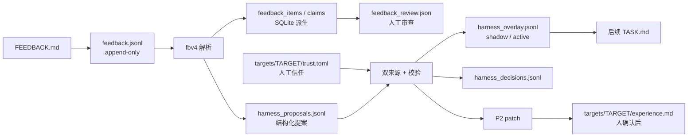

# 数据层：高效、准确、少花钱、方便检索

这一篇只讲数据：一次搜索产生什么、存在哪里、索引怎样建、人和 AI 怎样查、哪些数字可以信、哪些成本已经被省掉。搜索循环本身见 [搜索.md](搜索.md)，评测协议见 [评测.md](评测.md)，看板见 [可观测.md](可观测.md)，政策类决定见 [维护决策.md](../维护决策.md)。索引、检索、迁移和 observe 的测试与运行方式见 [tests/README.md](../../tests/README.md)。

**一句话**：每个事实只留一个权威副本；读取只走索引；测量带协议版本；上下文有字节预算；删除有保留期。

---

## 0. 十条结论（先看这个）

1. **运行目录是原始事实，SQLite 是可重建的派生索引。** 索引删了可以从 `runs/` 重建；`runs/` 删了不能从索引恢复。
2. **`transcript.jsonl` 只记花钱的事实和会话元数据。** 新的 chat 行默认只写 prompt/reply 的 sha256 与字节数；hmz 会话只有 `agent` 行（token、cost、outcome、model）。759.7MB 的 prompt 正文是旧 chat 协议的遗留，不是当前设计。
3. **TASK.md 有 12KB 上限。** 合同/签名/命令/证据规则必留；成绩单、失败反馈、NOTES、tips、历史按优先级装，装不下的块写明文件路径。真实 conv2d/flash_attention 各约 11.99KB。
4. **`agent_work` 只留固定文件加证据文件。** 固定保留 `NOTES.md`、`FEEDBACK.md`、`self_checks.jsonl`、`TASK.md`、`HARNESS.md`、`.selfcheck/` 和交卷文件；`NOTES.md`/`FEEDBACK.md` 点名的顶层证据文件（探针脚本、`v/` 等）也留在原处，否则 premise 会从 verified 降级。其余归档到 `scratch/<label>.tar.gz`，单归档 50MB 上限。
5. **索引 schema 11。** `runs` / `candidates` / `sessions` / `turns` / `feedback_*`（父 claim、子命题、墓碑）/ `experiments` / `arms` / `ledger`。列表用 keyset，候选和会话可直接查；大多数读路径不扫目录，但 `sessions`/`best`/`failures`/`models` 会先 `tick()`，`overview`/`experiments`/`ledger` 仍是全量 `sync_known()` 例外。
6. **测量有协议版本。** `PROTOCOL_VERSION = "3"`；旧 `flame_chase_1` 通过 `protocol_epoch` 归到上一代。跨协议不平均。
7. **`candidate_serial` 默认关闭。** 2026-10-22 的 3×3 A/B：墙钟 −4~8%，候选中位数 −0.82%/+0.08%/+1.14%（cv 2–4%），无系统偏差。需要时 `--serial` 打开。
8. **完全相同的评测可以复用。** `eval_cache` 的键含 kernel/task fingerprint/seed/reps/mode/target/protocol/measure_serial；同一次 relu 评测 wall 4.41s → 0.68s，报告逐字段相同。不同 seed 的确认批次照常上 GPU。
9. **发布只认确认门。** 重新测量、哈希绑定、批次全成功、批次间极差 ≤2%、计时安静；否则发布为空，搜索最好值单独保留。
10. **删除有 30 天保留期。** `taic gc` 默认只报告，`--apply` 才删除并写审计行；`data/deleted` 当前约 266MB。

---

## 1. 数据放在哪里

### 1.1 运行目录

```
runs/<target>/<stamp>_<task>_<dtype>_<model>/
  run_config.json        # 配置、题目指纹、目标、委员会、价格、git 身份、protocol_version
  state.json             # 当前检查点（可重建；用于续跑和看板）
  result.json            # 对外发布记录；schema_version / confirmed_* / trace / spent_usd
  transcript.jsonl       # 唯一的花钱记录；append-only；chat 正文默认不落盘
  agent_work/<label>/    # 一场会话工作区；固定文件 + 证据文件（见 §2.2）
  agent_work/<label>/.selfcheck/self_checks.jsonl  # 自检日志，在工作区内；每场开始时清空
  candidates/<NNN>_<label>/
                         # kernel.metal / report.json / feedback.txt / NOTES.md
  rechecks/              # 确认或复查失败的证据
  confirm_report.json    # 确认门采用的那一批报告（有确认时）
  scratch/<label>.tar.gz # agent_work 的归档，硬上限 50MB
  profiles/              # 可选的 xctrace 结果
```

**权威副本规则**

| 事实 | 权威文件 | 派生/可删 |
| --- | --- | --- |
| 花了多少钱、每场 token | `transcript.jsonl` 的 `agent`/`chat` 行 | `ledger.json` 是检查点 |
| 发布什么内核、发布多少 | `result.json` + `confirm_report.json` + `best.metal` | `state.json` |
| 每颗候选的成绩 | `candidates/*/report.json` | `feedback.txt` 是它的可读渲染 |
| 每场的结构化提案格式 | `agent_work/*/HARNESS.md` | 由 TASK 指向；不占 TASK 的 12KB 预算 |
| 会话的输入/输出 | `agent_work/*/NOTES.md`、`FEEDBACK.md` | `scratch/*.tar.gz` |
| 自检预算/挂死 | `agent_work/*/.selfcheck/self_checks.jsonl` | 候选目录里的副本；旧 run 的 `session_checks/` 只读回退 |

### 1.2 其他目录

- `data/observe.sqlite`：看板和 `taic query` 的派生索引，可删重建。
- `data/deleted/`：看板删除的记录；30 天保留，手动 `taic gc --apply`。
- `kernels/<target>/<task>/<dtype>/<size>/`：确认内核目录；`history.jsonl` 保留每次确认的 `source_sha256`。
- `targets/<id>/`：设备档案（`target.toml`、`device.md`、`experience.md`、本机 calibration）。
- `backends/<name>/`：语言/工具链共用的 skill 与 wiki。

### 1.3 旧数据

`runs/` 里仍有 759.7MB 旧 chat transcript 和 332.4MB xctrace XML。它们**不是当前协议的成本**：旧 chat 每个请求把完整 prompt 写进 `messages`，当前 hmz 只写 `agent` 元数据（通常 1–14KB/run）。旧数据不迁移、不重写；聚合时按 `protocol_epoch` 分桶。

---

## 2. 高效：写入、存储、读取

### 2.1 写入：TASK.md 的字节预算

`taic/kernel_agent.py:render_contract`：

- **必留**：目标、正确性、约束、签名骨架、验证/评测命令、晋升标准、系统工作方式、证据规则。
- **按优先级装**：当前现场（种子 + 部分成绩单）、失败反馈、本运行 harness overlay、上一轮 NOTES、peer tips、最近历史、现场证据、自测对照。
- **装不下**：先裁「当前现场」到剩余字节（种子行和部分成绩单保留），后面的块整块省略；末尾写明「本轮省略」和全文所在文件（`NOTES.md` / `FEEDBACK.md` / `feedback.jsonl` / `state.json`）。
- **上限**：`TASK_MAX_BYTES = 12_000`，省略注记算在内；预留 420 字节给注记。
- 上游也收紧：NOTES 2500、scorecard 1000、history 5 行、tips 1200/1800、TIP_KEEP 8。

**实测**：真实 `conv2d` paper 11,999B，`flash_attention` paper 11,989B；两者都保留种子行、部分成绩单、两条命令和截断标记。

### 2.2 写入：会话工作区归档

`taic/kernel_agent.py:prune_work` 在每场会话结束后：

1. 保留 `NOTES.md`、`FEEDBACK.md`、`self_checks.jsonl`、`TASK.md`、`HARNESS.md`、`.selfcheck/` 和交卷文件。
2. `NOTES.md`/`FEEDBACK.md` 点名的顶层证据文件也留着，不归档：例如探针脚本、`v/` 消融源码。删掉它们会让下一条 premise 从 verified 降成 downgraded。
3. 其余（seed `kernel.metal`、seed `report.json`、guidance 副本等）打进 `<run>/scratch/<label>.tar.gz`。
4. 归档超过 50MB 就丢弃归档，写一个 JSON manifest（文件名、字节数、原因），仍然删除工作区里的副本。
5. `experiments/prune_agent_work.py` 对历史 run 应用同一规则。

**实测**：`agent_work` 从 112.0MB 降到 0.5MB；恢复 91 份 TASK.md 供审计后为 2.6MB / 214 文件。`runs/` 当前 1,131.3MB。

### 2.3 写入：transcript 默认不落正文

`taic/llm.py:chat_transcript_event`：

- `LLMConfig.keep_transcript_bodies` 直接构造默认 **True**（测试/显式审计）；`load_config` 默认 **False**（生产）。
- 关闭时 chat 行只有 `messages_sha256` / `messages_bytes` / `reply_sha256` / `reply_bytes`、usage、cost、finish。
- hmz 本来只写 `agent` 行：provider/model/committee/outcome/tokens/cost/self_check。
- 旧 chat run 的 prompt 正文不会因为这次开关变化被删除；它只是不再增加。

### 2.4 读取：索引不是请求时扫描

`observe/index.py`：

- SQLite WAL，单写者；`meta.index_schema_version` 与代码不一致时删库重建。
- `tick()`：看 `runs/` 自己的 mtime 发现新目录；每 10 秒做一次完整的 `watched` 扫描；运行中的 run 每帧追平。
- 请求路径：`runs_page` / `history` 默认不调 `tick()`，只在 `OBSERVE_REFRESH_ON_READ=1` 时为测试调一次（tick 自身按 0.5 秒节流）。`sessions_page`、`model_stats`、`failures`、`best_confirmed` 会直接 `tick()`；`experiment_jobs`、`compare`、`ledger_report` 会调 `refresh()`（即全量 `sync_known()`），这是已知例外，不应当作可扩展读路径的样板。
- `history()` 按 `(db 路径, revision)` 缓存；revision 不变不重读 `row_json`。
- `turns` 仍是**懒投影**：重建后 `turns=0`，打开某一场详情才按 `turn_bytes` 建行；transcript 文件没删。

**10 万 run 合成实测**（`experiments/scale_probe.py`，最小 run 目录，`/tmp`）：

| 指标 | 结果 |
| --- | ---: |
| 冷建 `sync_known` | **157.6s** |
| 热 `tick` | **6ms** |
| `history()` | **0.83s** |
| 列表第一页 | **4ms** |
| 列表第二页（cursor） | **2ms** |
| 按 speedup 排序第一页 | **2ms** |
| `best_confirmed` | **0.5s** |
| 索引文件 | **167MB** |

结论：**请求路径已经不是 O(N)**；冷建和 `best` 的全表扫描仍是规模成本。冷建是一次性的，`best` 的聚合表是下一步。

### 2.5 读取：keyset、索引、缓存

`observe/query.py:runs_page`：

- keyset 游标是 `(排序列, run_id)`；`started` / `speedup` / `spent` / `updated`。
- 过滤：`task`、`dtype`、`model`、`status`、`target`、`publication`、`min_speedup`、`since`、`experiment_id`。
- 返回 `next`；满页时才给。`offset` 只作为旧调用方的回退。
- SQLite 表达式/部分索引：`runs_live_started`、`runs_live_speedup`、`runs_live_spent`、`runs_confirmed`。
- `feature_grid` 的 `feature_signature` 按源码 sha 缓存；state/result 变化重建格子，但相同源码不重算。
- `detail_stamp`/`stamp` 让详情和 `brief` 可以短路。

---

## 3. 准确：测量、统计、发布

### 3.1 协议版本

- `tcenv/schema.py:PROTOCOL_VERSION = "3"`；写入 `run_config.json`、`result.json`、`EvalReport.protocol_version`、`candidates.protocol_version`。
- 旧 run：`flame_chase_1`（4 个）或 `legacy`（48 个）。`runs_page` 返回 `protocol_epoch`：`flame_chase_1 → 2`，新 run 是 `3`，`legacy` 单独一桶。
- **不要跨 epoch 平均速度、成本或 confirmed 数。**

### 3.2 计费准确性

- `taic/committees.py:_priced` 与 `taic/llm.py:load_config` 用同一个表达式设置 `price_cache_write`；第二个委员会换 provider 时不再继承第一个委员会的 cache-write 单价。
- `CostLedger.add` 记录 `hit/miss/write/out`；`charge(usd, tokens=..., basis=...)` 记录 hmz 会话的 token 分解和当时的价表；`summary()` 暴露 `input_tokens_cache_write` 与 `cost_basis`。
- 历史补账：`experiments/reprice_runs.py` 从 transcript 的 `agent.tokens` 重算，写 `cost_recomputed.json`，**不改 `spent_usd`**（预算门用的是当时记录值）。

2026-10-22 重算：

| run | 记录 | 重算 | 差额 |
| --- | ---: | ---: | ---: |
| flash_attention-20261022-2 | $13.3334 | **$18.2056** | +$4.8722 |
| conv2d-feedback-20261021 | $15.2199 | **$20.5391** | +$5.3191 |
| conv2d-flame-20261020 | $7.8743 | **$10.7351** | +$2.8608 |

### 3.3 计时

- 候选与 MLX / PyTorch 交错测同一把 `perf_counter` 墙钟；候选窗口含 encode（和 `mx.eval` / torch 启动循环对齐）。
- 每批 `reps` 次，取中位数；CV 是批内重复的标准差/均值。
- `candidate_serial`（严格串行派发）默认关闭：它不参与选种子、不参与发布，A/B 显示关掉后墙钟下降 4–8%，候选中位数变化在 cv 内。
- 需要串行对照时：`tcenv eval --serial` 或 `measure_serial = true`。

### 3.4 统计与发布门

- 换种子要同时过 `min_improvement` 和 `noise_z` 个标准误；`speedup_se` 来自报告自己的 cv/reps。
- 确认阶段：每颗候选跑 `confirm_batches` 批独立输入；**每一批都必须成功**；同一批的并列候选共用一个种子；取各批中位数。
- `choose_confirmed`：搜索种子留任，除非挑战者的中位数在「重复内 SE + 1% 输入批次下限」的噪声门之外。
- 发布：`conclusion_of_run` 要求 `confirmed_status=ok`、`confirm_report` 状态 ok、`confirmation_source_sha256 == best.metal == winner kernel.metal`、`batches_agree`（极差 ≤2%）、`timing_is_uncertain` 为假；否则发布为空。
- `reps < 2` 视为不确定；`cv=0` 的单次测量不能当安静。
- 域扫描（`domain_report.json`）只做正确性，不改发布数。

### 3.5 评测缓存

`tcenv/evaluate.py` 的 `eval_cache`：

- 键：`EVAL_CACHE_SCHEMA`、`PROTOCOL_VERSION`、task fingerprint、kernel sha256、seed、reps、cases、mode、validate、fast_bench、require_contract_launch、measure_serial、target。
- 只缓存 `status=ok`；不同 seed 的确认批次不会命中；`fast_bench` 不缓存（基线集合可能变）。
- 命中时返回原报告并标 `cache_hit=true`；`--timed` 自检会追加一条 `cached` 记录，不占 GPU。
- 同一次 relu 评测：wall **4.41s → 0.68s**，`candidate_us`/`speedup` 逐字段相同。

### 3.6 来源与可复现

`run_config.json` 记录：target/backend/display_name、target device、git commit + dirty、task fingerprint、committee/model、解析后的价格、`protocol_version`、system prompt sha1、contract hash、Triton 源码 hash、search 配置。`result.json` 记录 target/backend/protocol、trace、candidate 表、ledger 摘要、confirmed_values/failed_batches。

实验：`experiments/manifest.py` 的 `experiment.json`（kind/driver/frozen/config_hash/arms/budget_extensions）；p1/repeat 这类旧目录可以用 `python -m experiments.manifest --backfill ROOT --kind suite --driver p1_runs` 补 arm 并 attach 现有 run。当前 `arms=13`。

仍缺：`kernels/` 的 `best.metal` 被更快的确认内核覆盖，历史只留 `source_sha256`；要永久保留源码需要 blob+refcount（未做）。

---

## 4. 少花钱：token、GPU、LLM

### 4.1 每场会话的固定开销

TASK.md 的 12KB 上限把每场上下文从「26.6KB 级」压到「11.99KB 级」；重复 21–64 场/搜索，省的是每场固定的几千 token。NOTES 只给尾部摘要，tips 有字符预算和 digest，不再每场整段重发。

### 4.2 GPU 计时

- 关闭 `candidate_serial`：墙钟 −4~8%（conv2d/flash/relu 的 A/B）。
- `eval_cache`：完全相同的评测不再上 GPU；resume/重复调用直接读报告。
- 确认批次仍按不同 seed 测，不为了省钱复用同一批输入。
- `profile_poor`/`profile_best` 默认关闭；xctrace 有 `profile_max` 上限。
- `max_hangs=1`：一次挂死就停，避免 GPU 冻屏和后续排队。

### 4.3 LLM 花费

- 计费修复后，第二个委员会的 cache-write 不再漏记；预算门按真实花费停，而不是按低估的账。
- 搜索的预算门在每个会话前检查；`relay_budget_usd` 只是单场输出 token 的指导，不是硬上限；`budget_usd` 是硬门。
- `unchanged` 会话仍计费；是否降低 `unchanged_patience` 需要试点数据，不在默认里改。
- 委员会轮换会打断前缀缓存；这是策略选择，不是数据层能单独修的。

### 4.4 存储

- 当前 `runs/` 1,131.3MB：transcript 759.7MB（旧 chat）、XML 332.4MB、`agent_work` 2.6MB、`candidates` 20.5MB、其他 16.2MB。
- 新的 chat 正文默认不落盘；旧数据冷归档/不迁移。
- `agent_work` 归档后从 112MB 降到 0.5MB（恢复 TASK 后 2.6MB）。
- `data/deleted` 30 天 TTL；`taic gc` 默认 dry-run。

---

## 5. 方便检索：人 + AI 共用一个读模型

### 5.1 索引表

schema **9**：

| 表 | 一行是什么 | 关键列 |
| --- | --- | --- |
| `runs` | 一次搜索 | task/dtype/size/target_id/model/status/stop_reason/publication/published_speedup/spent_usd/protocol_version/kernel_sha256/committees_json |
| `candidates` | 一颗候选 | run_id/idx/label/status/stage/speedup/within_noise/eligible/kernel_sha256/protocol_version |
| `sessions` | 一场 hmz | run_id/seq/label/committee/provider/model/outcome/cost_usd/tokens_* |
| `turns` | 一条模型事件（懒投影） | run_id/seq/label/kind/row_json |
| `feedback_items` / `feedback_claims` | 反馈与主张 | 场、小节、状态、digest、topic、premise、placeholder_items |
| `feedback_claim_removed` | 被解析器或退役删除的主张墓碑 | run_id/seq/digest/status/reason |
| `experiments` | 实验清单 | experiment_id/kind/driver/config_hash/status |
| `arms` | 实验的一臂 | experiment_id/arm_id/delta_json/planned_n/task_fingerprint |
| `ledger` | 花费账本 | run_id/operator/month/started_at/spent_max_usd/budget_usd |
| `ledger_carryover` | 一次结转 | total_usd/origin/sha256 |
| `watched` | 目录 mtime | path/mtime_ns |

计数随运行变化，不在文档里写死。`turns` 冷建后为 0，打开某一场详情后才增长；`runs`/`candidates`/`sessions` 随目录增长。

### 5.1.1 反馈、信任与 harness overlay

反馈、信任与 harness 的理论和流程图见 [可信harness.md](可信harness.md)。运行目录里的 `feedback.jsonl` 是原始记录；`feedback_review.json` 是人工审查，条目可选 `subclaims` 保存一个父 claim 下的多个子命题状态。索引的 `feedback_claims.status` 除了 `pending`/`adopted`/`rejected`/`done`，还接受 `info`（未验证/开放问题）和 `obsolete`（空占位/重复/退役）。审查读取时会按同 `digest`+`task`+`target_id` 附上更早 claim 的 `prior`，用于避免重复验证；它是精确文本匹配。审查事件还记录自动取得的 git reviewer、method/batch、审查时 HEAD/dirty 和可选的 expected_status。批量审查先 dry-run、全部校验后一次写入；`data/review_events.jsonl` 是可选的哈希链台账（`TAIC_REVIEW_EVENTS` 可覆盖），只存证据/note 哈希和身份，不复制长原文。子命题有独立索引，父 claim 的 `prior`/`similar` 也会把开放子命题的文本纳入匹配。pending 行还会用本地 `NLEmbedding` 句向量附 `similar`，仅在同 task/target 内做近义检索，不联网、不调用模型；结果只是提示，不是自动结论。解析器版本 `fbv4`。重建时如果 `feedback_parser` 变了，会重新读 `FEEDBACK.md`，按旧 digest 匹配 `sections` 里的原始片段，恢复被旧解析器擦除的正文并把探针已恢复的降级前提升为 verified；旧 digest 和审查键保留，不再生成空占位 claim。被删的 claim 进 `feedback_claim_removed`，墓碑保留 `status` 和 `reason`。

每个 target 另有：

| 文件 | 内容 |
| --- | --- |
| `targets/<id>/trust.toml` | 人工授予的 `(task, provider, model, effort)` 信任；绑定 prompt sha、协议版本、scope、过期时间 |
| `targets/<id>/trust_audit.jsonl` | 追加式 grant/suspend/revoke 审计 |
| `runs/<run>/harness_proposals.jsonl` | 结构化提案及校验结果（含 invalid 原因） |
| `runs/<run>/harness_overlay.jsonl` | 影子或生效的 overlay 事件；带 target/task/protocol/evidence sha |
| `runs/<run>/harness_decisions.jsonl` | 去重后的 shadow/apply/reviewed_active/promotion/suspend 决策 |
| `runs/<run>/harness_reviews.jsonl` | 独立只读 review：reviewer、useful/confidence、证据/风险、价格预算/实际成本 |
| `runs/<run>/harness_control.json` | 只允许关闭 overlay；不含新权限 |
| `agent_work/*/.selfcheck/self_checks.jsonl` | 评测命令追加的 timed 自检；含 target、协议、内核 SHA、candidate_us/speedup，供 `premise` 信任门匹配 |



`harness_auto` 默认关，`harness_shadow` 默认开，`harness_review` 默认开（单来源 tip 的独立 review）。`tip` 要两个委员会的不同 provider/model 且都有 active 信任；`premise` 不走双模型投票，但需要本场探针、active `overlay:premise` 信任和匹配的 self-checks/外层报告。overlay 进入 TASK 时受同一 12KB 预算，标题标明“不是合同，不是事实”。

### 5.2 AI 入口

```bash
uv run python -m taic.cli brief RUN_DIR            # 1.5KB JSON；无 GPU、无模型
uv run python -m taic.cli brief RUN_DIR --gpu      # 需要机器级 GPU 锁事件时才加
uv run python -m taic.cli query runs --task gemm --publication confirmed --sort speedup --limit 5 --jsonl
uv run python -m taic.cli query best --task gemm --limit 5
uv run python -m taic.cli query failures --status abi_error --task relu --limit 20
uv run python -m taic.cli query sessions --run apple-m4-max/conv2d-feedback-20261021 --jsonl
uv run python -m taic.cli query models
uv run python -m taic.cli query capabilities

# 自由文本系统建议：默认只返回按 digest 聚合的预览，不返回全文
uv run python -m taic.cli query suggestions --task flash_attention --status pending --limit 20 --preview 80
uv run python -m taic.cli query suggestions --task flash_attention --limit 20 --offset 20 --preview 80
uv run python -m taic.cli query suggestions --task flash_attention --jsonl

# AI 选中某一组后，才取该条的全文
uv run python -m taic.cli query suggestion --run apple-m4-max/flash-attention-pilot-20261022 \
  --seq 4 --digest 9db07fe836501244
```

`query suggestions` 先用 SQLite 的 `feedback_claims` / `feedback_items` 计算过滤后的总数、按 digest 分组并分页，再只为当前页的每个 digest 读一条代表性 `feedback.jsonl` 记录，返回 `preview`；`query suggestion` 才返回完整句子、来源和是否已转结构化/已 review。这样 AI 第一阶段只看几十行统计，不必把所有建议全文塞进上下文。索引本身不存文本，全文仍以运行目录为准。

`brief` 的字段：`schema_version`、`protocol_version`、`stamp`、task/dtype/size、committee/model、phase、stop_reason、round、spent/budget、published/publication、search_best、cands（最多 8）、counts、paths（仓库相对）、可选 `gpu`。不含消息正文、内核源码、绝对路径。

### 5.2.1 自由文本建议：先 compact，再 detail

自由文本建议不适合直接作为 AI 的上下文：索引能定位 claim，但 `feedback_claims` **不存正文**，正文在运行目录的 `feedback.jsonl`。`taic query suggestions` 因此分两段：

1. **compact**：用 SQLite 过滤，在**整个过滤集合**上计算 `total_claims` / `total_groups`，按 `digest` 聚合并分页；只为当前页每组读一条代表性 `feedback.jsonl` 记录，返回 `preview`（默认 120 字符；CLI 常用 80）。
2. **detail**：AI 选中少量 digest 后，按 `run/seq/digest` 取完整正文、转换状态和 review。

```bash
# 第一段：只给 AI 统计 + preview
uv run python -m taic.cli query suggestions --task flash_attention --status pending --limit 20 --preview 80
uv run python -m taic.cli query suggestions --task flash_attention --limit 20 --offset 20 --preview 80
uv run python -m taic.cli query suggestions --task flash_attention --jsonl

# 第二段：只取选中的一条全文
uv run python -m taic.cli query suggestion \
  --run apple-m4-max/flash-attention-pilot-20261022 --seq 4 --digest 9db07fe836501244
```

HTTP 对应：

```text
GET /api/v2/suggestions?task=&target=&model=&status=&limit=&offset=&preview=
GET /api/v2/suggestion?run=&seq=&digest=
```

`compact` 的组字段：`digest`、`claims`、`runs`、`tasks`、`models`、`targets`、`statuses`、`first`、`preview`、`converted_key`、`reviewed`。`total_claims` / `total_groups` 是过滤后的总数；`returned_groups` 是当前页组数，`limit` 只限制返回组数，不会把全文带出来。返回还有 `offset`、`next_offset` 和 `truncated`：`truncated=true` 表示后面还有组，用 `next_offset` 继续翻页；`next_offset=null` 表示当前页已到末尾。分页在 SQL 层完成，不再用固定 5000 行截断后冒充满量统计。

`converted_key` 与 `reviewed` 只描述 `first` 所指的代表性 claim（响应中的 `link_scope` 会明示）。它们按 `run_id#seq#digest` 精确匹配；同 digest 的其他场次可能另有转换，不能把代表性 claim 的空 `converted_key` 当成整组都未转换。`query suggestion` 还返回该场的 `session_started` 和已转换提案的 `probe_time_verified`，这样 AI 在决定是否转换前能看出探针时间是否可验证。

实测（2026-10-22，flash_attention 的 12 条自由文本建议）：

```text
compact JSON（limit=20、80 字 preview）  5,515 bytes
全量 collector JSON                        20,030 bytes
```

约 **3.6×** 的上下文节省；如果只对选中的 2–3 组调用 detail，实际节省还会更大。当前索引里有 36 条系统建议 claim、36 个 digest；用 `--limit 20` 时 compact 只给前 20 组并返回 `truncated=true`，不会一次把 36 段全文交给模型。这个字节数是在加入分页字段前测的；分页字段只增加少量元数据。

边界：

- `digest` 是精确内容哈希；同一主题但改写过的建议是不同 digest。compact 不自动做语义聚类；AI 仍需根据 preview 自己归并候选，或对选中的 digest 取全文再判断。
- preview 会截断上下文；不要只凭 preview 做“有用/无用”或改代码的决定。
- 索引的 `feedback_claims` / `feedback_items` 是派生数据；正文仍以运行目录为准。索引刷新有节流，刚写完 run 后先按现有 `taic query` 的约定刷新/等待。
- 这只是检索层省 token；它不改变 review、信任或 P2 的人工闸门。

### 5.3 分层返回（token 预算）

| 层 | 预算 | 内容 |
| --- | --- | --- |
| L0 | 设计目标 ≤200B/行 | id、task、publication、speedup、stop_reason |
| L1 | ≤1.5KB | + spend、round、winner label/sha、最后失败、计数、`stamp` |
| L2 | 显式请求 | report/kernel 源码/feedback 全文/transcript tail |

`brief` 是 L1；`taic query runs` 实际返回 L1 级的宽行（model/target_id/committees_json 等，实测约 0.7–0.9KB），不是 200B 的 L0；`run_detail` 是给人看的全量（首屏 44.7KB/363ms 量级），AI 不应直接读它。

### 5.4 HTTP 接口

```
GET /api/v2/runs?task=&status=&publication=&min_speedup=&sort=&cursor=&limit=
GET /api/v2/runs/{id}/candidates
GET /api/v2/suggestions?task=&target=&model=&status=&limit=&offset=&preview=
GET /api/v2/suggestion?run=&seq=&digest=
GET /api/v2/runs/{id}/sessions
GET /api/v2/failures?status=&task=&limit=
GET /api/v2/best?task=&target=&limit=
GET /api/v2/model-stats
GET /api/v2/runs/{id}?stamp=      # 详情；stamp 相同直接 same
GET /api/v2/turns/{id}?before=&stamp=
```

- 非 SSE 响应带 `ETag` + gzip；`If-None-Match` 返回 304。
- SSE 推送 `index_revision` / `turns_revision` / `feedback_revision` 和变化 run id，不重发全量。
- 列表页筛选写入 URL；`stop_reason`、花费、模型在表里。

### 5.5 看板

- 主列表：cursor 翻页、URL 即状态、`content-visibility` 行级虚拟化、最佳/失败两个检索弹窗。
- 详情：`detail_stamp` 短路；候选/回合/反馈按需；特征格子按源码 sha 缓存。
- 审查页：`feedback_revision` 增量、单卡替换；首次全量是唯一的大快照。

### 5.6 查找示例

```bash
# 哪个 gemm 已确认内核最快
uv run python -m taic.cli query best --task gemm --limit 10

# 最近 20 个 abi_error 候选
uv run python -m taic.cli query failures --status abi_error --limit 20 --jsonl

# 某次搜索每场花了多少
uv run python -m taic.cli query sessions --run apple-m4-max/conv2d-feedback-20261021 --jsonl

# kimi vs deepseek 的会话数与记录成本
uv run python -m taic.cli query models
```

---

## 6. 运维手册

### 6.1 日常

| 任务 | 命令 |
| --- | --- |
| 只读摘要 | `uv run python -m taic.cli brief RUN_DIR` |
| 检索 | `uv run python -m taic.cli query ...` |
| 看板 | `uv run python -m observe`（127.0.0.1:8765） |
| 删除记录保留期报告 | `uv run python -m taic.cli gc --older-than-days 30` |
| 真正清理（不可逆） | `uv run python -m taic.cli gc --older-than-days 30 --apply` |
| 历史补账 | `uv run python -m experiments.reprice_runs` |
| 工作区归档 | `uv run python -m experiments.prune_agent_work --apply` |
| 补实验清单 | `uv run python -m experiments.manifest --backfill RUNS_DIR --kind suite --driver p1_runs` |
| 规模压测 | `uv run python -m experiments.scale_probe --counts 1000,10000,100000` |

### 6.2 索引

- 删 `data/observe.sqlite` 会按 `runs/` 重建；schema 版本不一致会自动删库重建。
- 重建后 `turns=0` 是正常的懒投影；打开详情才建行。
- 索引是派生物，不备份；需要保留的是 `runs/`、`data/books.sqlite` 和 `ledger_carryover.json`。
- 如果加列/加表，bump `INDEX_SCHEMA_VERSION`，不要就地赌旧库。版本 10 新增 `feedback_subclaims` 和 `feedback_claims.subclaims_sha256`；版本 11 给 `runs` 加 `backend`/`backend_version`，并记录报告的 `timeline`/`backend_version`。旧索引按版本重建。版本仍是 9 时的就地 `ALTER TABLE` 只是历史兼容，不是新迁移机制。

### 6.3 协议变更

任何改变计时窗口、确认批次、目标限制的改动：

1. bump `tcenv/schema.py:PROTOCOL_VERSION`；
2. 旧 run 保留旧值，查询用 `protocol_epoch` 分桶；
3. 不要跨 epoch 平均；
4. 需要 A/B 时先跑 `experiments/ab_serial.py` 或 `experiments/scale_probe.py`，别用生产预算做试验。

### 6.4 价格与凭据

- 价格来自 `~/.pi/agent/models.json` 的 `cost`；价格不写在 `taic.toml`，那里写 `credentials_file`、provider/模型名和搜索开关。
- 每个委员会成员的价格在 `run_config.json` 里落盘；不要事后用今天的价表解释旧账。
- 密钥不进入 run 目录、transcript 或索引。

### 6.5 测试门禁

```bash
uv run pytest -q -m "not gpu and not llm"     # 离线；不需要 GPU 或模型
```

GPU 测试带 `gpu` marker；LLM 测试带 `llm` marker。`experiments/ab_serial.py` 会启动 GPU，只在需要重测协议时手动跑。

---

## 7. 决策、边界与已知限制

已记录在 [维护决策.md](../维护决策.md) 的决定：

- `data/deleted`：30 天保留，默认 dry-run，`--apply` 才删。
- `candidate_serial`：默认关闭；`measure_serial=false`；协议 3。
- `eval_cache`：默认开启；键含 seed/protocol；不同 seed 不复用。
- `feedback_claims.topic`：维持人工填写，不自动生成；重启条件见决策文档。

**仍缺 / 下一轮**

1. **冷建 10 万 run 约 157.6s**：目前是一次性重建；写穿 journal（`runs/.index_journal.jsonl`）可以把 O(N) 降到 O(changed)。
2. **`best_confirmed` 在 10 万 run 上 0.5s**：需要按 task/target/publication 的聚合表或物化视图。
3. **`turns` 懒投影**：打开某一场详情仍要读该场 transcript；可接受，但不是 L2 的零成本。
4. **`kernels/` 覆盖 `best.metal`**：历史只留 sha；blob + refcount 未做。
5. **MCP**：`taic query` 已覆盖同一读模型；MCP 的传输/鉴权/工具 schema 未定，等接入形态。
6. **旧数据**：759.7MB 旧 chat 正文和 332.4MB XML 没有迁移/压缩；按保留政策处理。

**不要做**

- 不要跨 `protocol_epoch` 平均速度/成本/confirmed。
- 不要用 `runs.model` 判断全会话的模型成本；用 `sessions`/`model_stats`。
- 不要在请求路径调用 `sync_known()`；它是一次全量核对。当前 `overview`/`experiments`/`ledger` 三个接口仍经 `refresh()` 调它，这是待改的例外。
- 不要把 `run_detail` 当 AI 接口；用 `brief` / `taic query`。
- 不要在没有预算批准时跑 `taic run` / `taic resume` / GPU A/B / LLM。

---

## 8. 数据字典（常用）

### `runs`

`run_id`（相对 `runs/` 的路径）、`experiment_id`/`arm_id`/`trial`、`task`/`operator`/`dtype`/`size`/`target_id`、`model`（第一委员会）、`status`、`stop_reason`、`publication`、`published_speedup`、`spent_usd`/`budget_usd`、`started_at`/`updated_at`、`kernel_sha256`、`protocol_version`、`committees_json`、`row_json`（详情缓存）、`fp_*`（文件指纹）、`turn_bytes`（turns 投影偏移）。

### `candidates`

`run_id`、`idx`、`label`、`status`、`stage`、`speedup`、`within_noise`、`eligible`、`kernel_sha256`、`protocol_version`、`updated_at`。

### `sessions`

`run_id`、`seq`、`label`、`committee`、`provider`、`model`、`outcome`、`cost_usd`、`tokens_input`、`tokens_output`、`tokens_cache_read`、`tokens_cache_write`。

### `transcript.jsonl` 行

- `agent`：label、provider、model、committee、outcome、cost_usd、tokens{input,output,cache_read,cache_write}、self_checks、self_check_timeouts、feedback_kinds。
- `chat`（旧协议/显式保留）：messages 或 messages_sha256/bytes、reply 或 reply_sha256/bytes、usage、cost_usd。
- `warning` / `retry` / `resume` / `error`：事件和原因。

### `EvalReport`

`task`/`dtype`/`size`/`mode`/`status`/`stage`/`message`/`seed`、`protocol_version`、`target_id`/`backend`/`device_name`/`gpu_family`、`benchmark`（`candidate` 里的 cv/reps、`baselines`、`noise_cv`、`attempts`、`candidate_serial_us`、`measure_serial`）、`speedup`/`candidate_us`/`baseline_us`、`safety`/`correctness`/`roofline`、`cache_hit`、`elapsed_s`。

---

## 9. 变更记录

| 日期 | 变更 |
| --- | --- |
| 2026-10-22 | 计费补 cache-write；TASK 12KB 预算；agent_work 归档；索引 v9（反馈墓碑/trust/overlay）；keyset；10 万压测；serial 默认关闭；eval cache；30 天 TTL；`taic query`/`gc`；最佳/失败视图；fbv3 与反馈审计写回 |
| 2026-10-23 | 审查人自动取 git 身份；批量 dry-run/原子写入；哈希链审查台账；子命题索引 v10；`open_subclaims_total`/`open_work_total`；backend 注册表/版本/阶段时间线，索引 v11 |
| 2026-10-21 | target/backend 目录；`runs/<target>/`；`kernels/<target>/`；校准移出源码树；transcript 尾部保留 |
| 更早 | 见 git log 与 [架构说明.md](../架构说明.md) |
