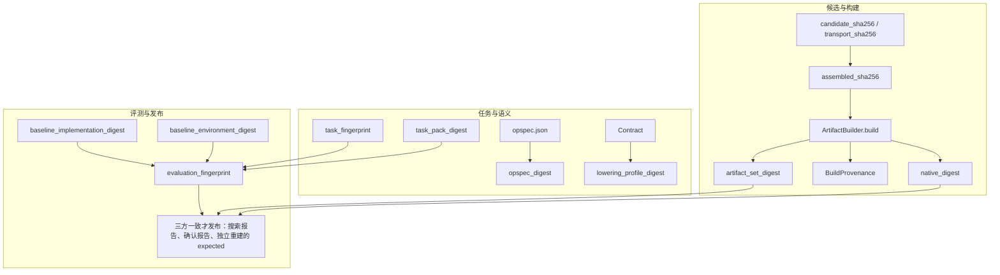

# 构建与评测身份

## 一屏说明

身份链回答一个问题：报告里的这个数字，到底是哪道题、哪份源码、哪次构建、哪次测量。

它把四类事实分成可单独复核的摘要（digest，一律是 64 位小写十六进制 SHA-256）：

1. **题没有换。** 合同、形状、容差、题面和这次测量用的任务包，各自有摘要。
2. **核没有换。** 候选源码、拼上头之后真正送进编译器的字节、构建产物和 native 可执行文件，各自有摘要。
3. **环境和参考没有换。** 登记的 baseline 实现、当时机器上的库版本、输入生成和 reference，收进评测摘要。
4. **发布只认三方一致。** 搜索报告、确认报告、以及不读搜索报告而独立重建的 expected，三者一致才发布。

因此这三件事过不了发布门：搜索很快、确认时却换成另一份源码或另一套环境；只交一份自报的 JSON，对不上独立重建的 expected；把构建日志当成已经测过的证据。缺字段记 `unknown`。同一字段对不上记 `mismatch`。模拟、`source_only`、缓存命中和计时不确定都停在门外。`request_digest` 只标识这一次请求，不拿来比较搜索期和确认期。

下文的图是依赖关系，表是闭集。每条摘要覆盖什么、不覆盖什么，仍以「身份分层」为准。

### 本文范围

R0–R6 已关闭。本文只保留仍在生效的身份、构建入口和确认规则。身份向量夹具在 `tests/support/golden/shared/identity/`。迁移前题面对照固定在提交 `3fb9ac85bfc760eb655d9b1759d48f5c4896997a` 的 `tasks/`。Shape portfolio 的状态以 `docs/架构/shape-portfolio实施计划.md` 为准。真实 NPU 验收未授权；模拟结果保持 `simulated=true`、`publication_allowed=false`。

报告文件、计时和容差见 `docs/架构/评测.md`。运行目录和索引见 `docs/架构/数据层.md`。

## 身份链

三条链分开记账。任务摘要不证明源码没换，构建摘要不证明库版本没换，评测摘要不放进 `build`。

| 域 | 这条链固定的事实 | 图里的箭头 |
| --- | --- | --- |
| 任务与语义 | 算什么、什么形状、什么容差、哪一包测量文件 | `opspec.json` 得到 `opspec_digest`。`Contract` 进入 `lowering_profile_digest`。`task_fingerprint` 与 `task_pack_digest` 是同域里另外两份身份，分别覆盖语义实例和这一侧的 pack |
| 候选与构建 | 编译的是哪份源码、哪套工具链、哪份产物 | 提交身份（`candidate_sha256`，bundle 另有 `transport_sha256`）先于 `assembled_sha256`，再进入 `ArtifactBuilder.build`，得到 `artifact_set_digest`、`BuildProvenance` 和 `native_digest` |
| 评测与发布 | 参考实现、输入生成和库环境是不是确认时那一套 | 两个 baseline 摘要进入 `evaluation_fingerprint`，再和构建身份一起接受三方核对 |

读图时带上这四条边界：

- `task_fingerprint` 覆盖 SemanticInstance、含 Contract 全字段的 Specialization、题面、`description` 和后端 reference。它不是 `opspec_digest` 与 `lowering_profile_digest` 拼出来的别名，也不用 `Contract.describe()` 代替全字段。
- v2 构建记录里的 `lowering_profile_digest` 填的是 `Contract.fingerprint()`。v1 那一份是注册 LoweringProfile 的摘要。两条路径的文档不同，见「身份分层」。
- `assembled_sha256` 哈希的是进入编译器的字节（契约头加候选正文），不代替 `candidate_sha256`。bundle 的 `transport_sha256` 是提交文本字节，`candidate_sha256` 是候选 entry manifest 摘要；定义见 `docs/架构/v2协议参考.md` 的 L.1。
- `evaluation_fingerprint` 还绑上 task、task pack、输入生成、reference 和 error scale。它不放进 `build`，也不代替三方核对里的构建身份。`request_digest` 不进这张图。

核数或设备资源变化不合成一个摘要：改构建期 tiling 或生成代码，动的是 LoweringProfile；只改编译选项，动的是 BuildProvenance；改设备组分配或拓扑，旧测量失效。

## 状态与构建形状

报告里只有一份 `build`。`status` 与 `build` 的形状是闭集，读入时由 `tcenv/build_projection.py` 的 `validate_for_status` 按 `STATUS_SHAPES` 重算，不补字段。键必须在；取值可以是 `null`。`pending` 不是落盘状态。

| `status` | `build` | 这一行在说什么 |
| --- | --- | --- |
| `ok` | `full` | 该模式要求的关卡通过。确认发布还要求 `build_kind=native` |
| `abi_error` | `full` | 已经编译，签名或启动规模不符 |
| `unsafe` | `full` | 保护带、输入不变性、确定性或着色器校验失败 |
| `incorrect` | `full` | 超出容差，或输出仍含未写入的毒化图案 |
| `runtime_error` | `full` | GPU 在正确性或计时阶段报错 |
| `compile_error` | `partial` | 编译器拒绝。`partial` 的 `error_class` 恒为 `compile`，这份记录不可执行 |
| `timeout` | `null` | 父进程已发送 `SIGKILL` |
| `crash` | `null` | 子进程未留下报告 |
| `unchanged` | `null` | 与当前种子逐字相同。搜索在调用 `evaluate` 之前写下，不进评测流水线 |
| `duplicate` | `null` | 搜索层的贴回筛查，不是 `evaluate()` 的判决 |
| `external_duplicate` | `null` | 同上，`build` 必须是 `null` |
| `refused_hang` | `null` | 读取时接受。本仓没有写出路径 |
| `rejected` | `null` 或 `full` | 静态筛查、launch 规格、工作区分配、自检上限或设备检查拒绝。两种形状都在闭集里，读入不把缺的那种补出来 |

`full` 是成功构建，或收到的预构建产物集。`partial` 只表示有类型的编译失败。模拟和 `source_only` 不能报成 native `full`。成功和编译失败都要带同一份 BuildOutcome 里的 provenance。各状态的判据见 `docs/架构/评测.md`。

## 身份分层

每一层只覆盖自己的事实。缺证据记 unknown，不一致记 mismatch。两者都不等于“比较通过”，也都不发布。

| 身份 | 覆盖 | 不覆盖 |
| --- | --- | --- |
| `opspec_digest` | 整份已校验 OpSpec，加上语义规则版本和记账规则版本 | grid/threads、设备、构建参数、track 文本 |
| `lowering_profile_digest` | 解析后的 LoweringProfile、lowerer 与 variant factory 的身份和版本，含契约默认启动和 `Contract` 目标名 | 工具链、设备探测、候选 `taic-launch`、源码字节 |
| BuildProvenance | `builder_id`/`builder_version`、`build_profile`、`toolchain`（id/version/sdk_version）、`build_host`、`compile_profile`、`source_sha256`、`artifact_set_digest` | lowering 配置、DeviceGroup、placement、`build_kind`（它不是 provenance 的 wire 字段，在报告 `build` 顶层） |
| `candidate_sha256` | 候选提交的源码字节，含其 `taic-launch` | 契约头、构建环境 |
| `assembled_sha256` | 契约头加候选正文 | 不代替 `candidate_sha256` |
| `artifact_set_digest` | ArtifactBundle 的 manifest 与字节 | 设备组、placement、缓存策略 |
| `native_digest` | 整份 native executable 文档（`backend_id`、`kind`、`entry_path`、`entry_sha256` 与 canonical `descriptor`）的 SHA-256；读入时重算并与声明值比对 | handle 本身；没有 native 时必须写 `null` 并给 `native_absent_reason`（`portable_artifact_set` 或 `not_native_build`） |
| `task_fingerprint` | SemanticInstance、Specialization（含 Contract 全字段）、题面、`description`、后端 reference | 不用 `Contract.describe()` 代替全字段 |
| `task_pack_digest` | 这一侧测量用的 pack。远端是已部署 pack 的 manifest；本地是同一文档形状下、该题登记文件集的摘要 | 外部库版本、设备、候选。两侧文件集不同，不要求跨侧相等 |
| `baseline_implementation_digest` | 登记 baseline 的实现与 canonical params。不随 fast-bench 子集变化 | 库是否安装、库版本 |
| `baseline_environment_digest` | 每个登记 baseline 的可用性与实测库版本。认不出版本时整段为 `null` | 实现代码 |
| `evaluation_fingerprint` | `task_fingerprint`、task pack、输入生成 / reference / error scale 的登记实现与 params、上面两个 baseline 摘要 | 不放进 `build`。不序列化闭包。不代替 protocol、target 和计时检查 |
| `request_digest` | 这一次请求自己的 canonical 全集 | 不拿来比较搜索期和确认期。两次请求本来就不同 |

核数或设备资源变化要分开认：改了构建期 tiling 或生成代码，动的是 LoweringProfile；只改编译选项，动的是 BuildProvenance；改了设备组分配或拓扑，旧测量失效。不能用一个 digest 把这三类混掉。

摘要是 `SHA256(RFC8785(canonical_document))`，64 位小写十六进制。键顺序和空白不影响结果。字符串按原码点哈希，不做 Unicode 归一化。源 JSON 用拒绝重复键的解析器读。实现走 `tcenv/remote/contracts.py` 的 `canonical_digest_document`，不另写一个接受浮点的序列化器。浮点先收成最短往返的十进制字符串再送进去；`0.0` 和 `-0.0` 不同；NaN 和无穷大拒绝。同一个逻辑字段在两次实例化里不能一会儿是 int、一会儿是 float。

`instantiate` 产生语义实例、容差和 `flops` / `min_bytes`，并得到 `opspec_digest`。`lower` 只按登记的 LoweringProfile 产生契约默认的 grid、threads 和目标名，不改语义，也不按 target 临时挑一份 profile。没有登记 profile 的 target 在评测前拒绝。候选的 `taic-launch` 只改变候选和它下游的构建、缓存身份。

`lowering_profile_digest` 在两条路径上不是同一份文档：v1 是注册 LoweringProfile 的摘要（`tcenv/lowering.py`）；v2 的构建记录用 `Contract.fingerprint()` 填它（任务合同身份，见 `tcenv/taskcontract/runner.py` 与 `tcenv/backends/metal/kernel_pipeline.py`），因为 v2 候选自带几何，launch 不再由注册 profile 决定。

## 构建入口

生产构建只经 `backend.artifact_builder()`，再调用 `ArtifactBuilder.build`。`MetalContext.compile` / `compile_all` 只留在 builder 内部。成功和编译失败都要带同一份 BuildOutcome 里的 provenance；模拟和 `source_only` 不能报成 native full。报告里只有这一份 `build`，`status` 与它的形状是闭集对应（例如 `ok` 必须是 `full`，`compile_error` 必须是 `partial`，`timeout`/`crash` 必须是 `null`），读入时重算交叉校验，不补字段。整张对应表见上文「状态与构建形状」。

当前版本：评测请求 4，报告 4，descriptor `tcenv.eval-report.v4`，`EVAL_CACHE_SCHEMA` 3，`PROTOCOL_VERSION` `"3"`，`run_config.json` 3，observe 索引 13。旧本地报告不迁移、不回填。`docs/架构/backend-phase0-baseline.json` 不改写、不重算。

## 确认

发布只走一个谓词。搜索报告、确认报告和预期三者一致才算过。读盘时用确认报告里冻结的 expected，不用本机现探的库版本或设备事实改写旧结论。模拟、`source_only`、缓存命中和计时不确定都不发布。fallback 的时间和正确性不算 variant 的成绩。确认报告的 `build` 必须是 `full` 且 `build_kind=native`，`build.candidate_sha256` 要等于登记的源码摘要；每个确认批次同样要求 `native`、`measured`、`cache_hit: false`，`timing_uncertain` 必须显式为 `false`。缺字段是 unknown，不是通过。

六 RPC 的名称和 field number、BlobChannel、VendorDriver、HMAC 不因身份字段改动。
